<article class="ltx_document ltx_authors_1line">

<section id="S1" class="ltx_section">
<h2 class="ltx_title ltx_title_section" id="introduction">
1 Introduction</h2>

Large-scale Bayesian inverse problems—image deblurring, computed tomography, magnetic resonance imaging <cite class="ltx_cite ltx_citemacro_citep">[Stuart, <a href="#bib.bib27" title="Inverse problems: a Bayesian perspective" class="ltx_ref">2010</a>]</cite>—give rise to posterior distributions $\pi(x)\propto\exp(-f(x)-g(x))$ in which $f$ is a smooth data-fit term and $g$ is a non-smooth regulariser such as total variation or wavelet-$\ell_{1}$ <cite class="ltx_cite ltx_citemacro_citep">[Pereyra, <a href="#bib.bib24" title="Proximal Markov chain Monte Carlo algorithms" class="ltx_ref">2016</a>; Durmus et al., <a href="#bib.bib1" title="Efficient Bayesian computation by proximal Markov chain Monte Carlo: when Langevin meets Moreau" class="ltx_ref">2018</a>; Habring et al., <a href="#bib.bib37" title="Subgradient Langevin methods for sampling from nonsmooth potentials" class="ltx_ref">2024</a>]</cite>. At image resolutions of $256\times 256$ and above, the Hessian of $f$ routinely exhibits condition numbers $\kappa_{f}$ on the order of $10^{5}$–$10^{7}\text{,}$ inflating the mixing time of the unadjusted Langevin algorithm <cite class="ltx_cite ltx_citemacro_citep">[ULA; Roberts and Tweedie, <a href="#bib.bib21" title="Exponential convergence of Langevin distributions and their discrete approximations" class="ltx_ref">1996</a>]</cite> for smooth strongly log-concave targets to $O(\kappa_{f}/\varepsilon^{2})$ iterations <cite class="ltx_cite ltx_citemacro_citep">[Dalalyan, <a href="#bib.bib2" title="Theoretical guarantees for approximate sampling from smooth and log-concave densities" class="ltx_ref">2017</a>; Durmus and Moulines, <a href="#bib.bib3" title="High-dimensional Bayesian inference via the unadjusted Langevin algorithm" class="ltx_ref">2019</a>; Cheng and Bartlett, <a href="#bib.bib31" title="Convergence of Langevin MCMC in KL-divergence" class="ltx_ref">2018</a>; Vempala and Wibisono, <a href="#bib.bib22" title="Rapid convergence of the unadjusted Langevin algorithm: isoperimetry suffices" class="ltx_ref">2019</a>; Chewi, <a href="#bib.bib41" title="Log-concave sampling" class="ltx_ref">2026</a>]</cite>—in practice, computationally out of reach.

On a smooth potential $U\text{,}$ ULA takes $X_{n+1}=X_{n}-\delta\nabla U(X_{n})+\sqrt{2\delta}\,\xi_{n}\text{,}$ with $\xi_{n}\sim\mathcal{N}(0,I)\text{.}$ Preconditioning is the classical remedy. Replacing the Langevin drift by $-M^{-1}\nabla f$ with $M\approx\nabla^{2}f$ equalises curvatures across coordinates and, in principle, lowers the effective condition number $\kappa_{\mathrm{eff}}=L_{M}/m_{M}$ toward $O(1)\text{,}$ where $m_{M},L_{M}$ bound the eigenvalues of $M^{-1/2}\nabla^{2}fM^{-1/2}\text{,}$ echoing long-established accelerations in iterative linear solvers and optimisation <cite class="ltx_cite ltx_citemacro_citep">[Girolami and Calderhead, <a href="#bib.bib4" title="Riemann manifold Langevin and Hamiltonian Monte Carlo methods" class="ltx_ref">2011</a>; Titsias, <a href="#bib.bib5" title="Optimal preconditioning and Fisher adaptive Langevin sampling" class="ltx_ref">2023</a>; Hird and Livingstone, <a href="#bib.bib6" title="Quantifying the effectiveness of linear preconditioning in Markov chain Monte Carlo" class="ltx_ref">2025</a>]</cite>. Yet the preconditioned unadjusted Langevin algorithm (P-ULA) faces an obstruction: at large dimensionless steps $\delta\ell\text{,}$ its explicit-Euler discretisation incurs variance inflation $1/(1-\delta\ell/2)$ on a whitened mode of precision $\ell\text{,}$ offsetting the intended conditioning gain.

An algebraic resolution. On a scalar Gaussian target with precision $\ell\text{,}$ every $\theta$-scheme reduces the Langevin diffusion to an AR(1) recursion $z_{n+1}=r\,z_{n}+\sigma\,\xi_{n}$ with stationary variance $\sigma^{2}/(1-r^{2})\text{.}$ Matching this to the target variance $v=\ell^{-1}$ is equivalent to the <em class="ltx_emph ltx_font_italic">variance-budget identity</em> $r^{2}+\sigma^{2}/v=1\text{.}$ Direct computation, with $a\coloneqq\delta\ell/2\text{,}$ gives two qualitatively different outcomes:

$$\begin{aligned}
\text{explicit Euler:}\quad &amp; \displaystyle r^{2}+\sigma^{2}/v\;=\;(1-2a)^{2}+4a\;=\;1+4a^{2}, \\[2pt]
\text{implicit midpoint (}\theta=\tfrac{1}{2}\text{):}\quad &amp; \displaystyle r^{2}+\sigma^{2}/v\;=\;\frac{(1-a)^{2}+4a}{(1+a)^{2}}\;\equiv\;1.
\end{aligned}$$

(1)(2)

The $4a^{2}$ surplus in (<a href="#S1.E1" title="In 1 Introduction ‣ Preconditioned Implicit Midpoint Langevin Sampling for Non-Smooth Bayesian Imaging" class="ltx_ref">1</a>) is precisely what preconditioning’s large steps amplify; its exact cancellation in (<a href="#S1.E2" title="In 1 Introduction ‣ Preconditioned Implicit Midpoint Langevin Sampling for Non-Smooth Bayesian Imaging" class="ltx_ref">2</a>)—unique to $\theta=1/2$ among $\theta$-schemes, traceable to the Cayley transform $r(a)=(1-a)/(1+a)$—is the algebraic cancellation that this paper builds on, making implicit-midpoint integration a natural ingredient for realising large-step preconditioning. Figure <a href="#S1.F1" title="Figure 1 ‣ 1 Introduction ‣ Preconditioned Implicit Midpoint Langevin Sampling for Non-Smooth Bayesian Imaging" class="ltx_ref">1</a> maps the resulting $2\times 2$ landscape.

<figure id="S1.F1" class="ltx_figure">
<table class="ltx_tabular ltx_centering ltx_guessed_headers ltx_align_middle">
<thead class="ltx_thead">
<tr class="ltx_tr">
<th class="ltx_td ltx_th ltx_th_column ltx_th_row ltx_border_r" style="padding:1.6pt 8.0pt;"></th>
<th class="ltx_td ltx_align_center ltx_th ltx_th_column ltx_border_r ltx_border_t" style="padding:1.6pt 8.0pt;">
No preconditioning ($M=I$)
</th>
<th class="ltx_td ltx_align_center ltx_th ltx_th_column ltx_border_r ltx_border_t" style="padding:1.6pt 8.0pt;">
Preconditioned ($M\approx\nabla^{2}f$)
</th>
</tr>
</thead>
<tbody class="ltx_tbody">
<tr class="ltx_tr">
<th class="ltx_td ltx_align_right ltx_th ltx_th_row ltx_border_r" style="padding:1.6pt 8.0pt;">Explicit Euler</th>
<td class="ltx_td ltx_align_center ltx_border_r ltx_border_t" style="background-color:rgba(255,0,0,0.08);padding:1.6pt 8.0pt;">
<table class="ltx_tabular ltx_align_middle">
<tr class="ltx_tr">
<td class="ltx_td ltx_nopad_r ltx_align_center" style="padding-bottom:-1.0pt;padding:1.6pt 8.0pt;">slow-mixing</td>
</tr>
<tr class="ltx_tr">
<td class="ltx_td ltx_nopad_r ltx_align_center" style="padding:1.6pt 8.0pt;">ULA: VR $=0.24$</td>
</tr>
</table>
</td>
<td class="ltx_td ltx_align_center ltx_border_r ltx_border_t" style="background-color:rgba(255,0,0,0.08);padding:1.6pt 8.0pt;">
<table class="ltx_tabular ltx_align_middle">
<tr class="ltx_tr">
<td class="ltx_td ltx_nopad_r ltx_align_center" style="padding-bottom:-1.0pt;padding:1.6pt 8.0pt;">unstable</td>
</tr>
<tr class="ltx_tr">
<td class="ltx_td ltx_nopad_r ltx_align_center" style="padding:1.6pt 8.0pt;">P-ULA: VR $\to\infty$</td>
</tr>
</table>
</td>
</tr>
<tr class="ltx_tr">
<th class="ltx_td ltx_align_right ltx_th ltx_th_row ltx_border_r" style="padding:1.6pt 8.0pt;">Implicit midpoint</th>
<td class="ltx_td ltx_align_center ltx_border_b ltx_border_r ltx_border_t" style="background-color:rgba(255,128,0,0.10);padding:1.6pt 8.0pt;">
<table class="ltx_tabular ltx_align_middle">
<tr class="ltx_tr">
<td class="ltx_td ltx_nopad_r ltx_align_center" style="padding-bottom:-1.0pt;padding:1.6pt 8.0pt;">long transient</td>
</tr>
<tr class="ltx_tr">
<td class="ltx_td ltx_nopad_r ltx_align_center" style="padding:1.6pt 8.0pt;">IMLA: VR $=48.6$</td>
</tr>
</table>
</td>
<td class="ltx_td ltx_align_center ltx_border_b ltx_border_r ltx_border_t" style="background-color:rgba(0,255,0,0.12);padding:1.6pt 8.0pt;">
<table class="ltx_tabular ltx_align_middle">
<tr class="ltx_tr">
<td class="ltx_td ltx_nopad_r ltx_align_center" style="padding-bottom:-1.0pt;padding:1.6pt 8.0pt;">rapid relaxation</td>
</tr>
<tr class="ltx_tr">
<td class="ltx_td ltx_nopad_r ltx_align_center" style="padding:1.6pt 8.0pt;">P-IMLA: VR $=1.0246\pm 0.0001$</td>
</tr>
</table>
</td>
</tr>
</tbody>
</table>
<figcaption class="ltx_caption ltx_centering" style="font-size:90%;">Figure 1: The $2\times 2$ landscape at a fixed simulation budget. Gaussian target with mean $\mu\text{,}$ precision $H$ and $\kappa_{f}=4\times 10^{7}$ (App. <a href="#A3.SS2" title="C.2 Quantitative 2×2 landscape on a Gaussian target ‣ Appendix C Auxiliary experimental results ‣ Preconditioned Implicit Midpoint Langevin Sampling for Non-Smooth Bayesian Imaging" class="ltx_ref">C.2</a>). VR denotes the time-averaged normalised mean-square displacement from the target mean, $d^{-1}\overline{(X-\mu)^{\top}H(X-\mu)}\text{,}$ including the cold-start transient. It is not a stationary variance estimate. Both midpoint schemes are Gaussian-exact with exact solves; $98.7\%$ of IMLA’s displayed $48.6$ is transient mean error (App. <a href="#A4.SS5" title="D.5 What the finite-budget Gaussian statistic measures ‣ Appendix D Additional bias, convergence and posterior-model checks ‣ Preconditioned Implicit Midpoint Langevin Sampling for Non-Smooth Bayesian Imaging" class="ltx_ref">D.5</a>). Preconditioning makes that transient short at the reported budget.</figcaption>
</figure>

Contributions. We introduce the <em class="ltx_emph ltx_font_italic">Preconditioned Implicit Midpoint Langevin Algorithm</em> (P-IMLA) and its non-smooth variant P-IMLAλ based on an $M$-norm Moreau envelope; to our knowledge this is the first matrix-preconditioned implicit-midpoint proximal Langevin sampler. Our contributions are:

<ol id="S1.I1" class="ltx_enumerate">
<li id="S1.I1.i1" class="ltx_item" style="list-style-type:none;">
1. 

Algorithm (§<a href="#S3" title="3 The P-IMLA Algorithm ‣ Preconditioned Implicit Midpoint Langevin Sampling for Non-Smooth Bayesian Imaging" class="ltx_ref">3</a>). An inner solver computes $\mathrm{prox}^{M}_{(\delta/2)U_{\lambda}}$ for $U_{\lambda}=f+g^{\lambda,M}$ at $O(K_{\mathrm{P}}K_{\mathrm{in}}d\log d)$ per outer iteration on convolutional models with TV priors, matching MYULA’s per-step cost; an engineering variant JP-IMLA (App. <a href="#A2" title="Appendix B JP-IMLA: kernel guarantees and empirical comparisons ‣ Preconditioned Implicit Midpoint Langevin Sampling for Non-Smooth Bayesian Imaging" class="ltx_ref">B</a>) gives $\sim\!60\!\times$ per-iteration speedup.

</li>
<li id="S1.I1.i2" class="ltx_item" style="list-style-type:none;">
2. 

Gaussian exactness and contraction (Theorems <a href="#Thmtheorem2" title="Theorem 2 (Gaussian exactness). ‣ 4.1 Gaussian exactness and Cayley contraction ‣ 4 The Theory of P-IMLA ‣ Preconditioned Implicit Midpoint Langevin Sampling for Non-Smooth Bayesian Imaging" class="ltx_ref">2</a>–<a href="#Thmtheorem3" title="Theorem 3 (𝑀-norm Wasserstein contraction). ‣ 4.2 Contraction of the reflected proximal map ‣ 4 The Theory of P-IMLA ‣ Preconditioned Implicit Midpoint Langevin Sampling for Non-Smooth Bayesian Imaging" class="ltx_ref">3</a>). On Gaussian targets, P-IMLA’s stationary distribution equals $\pi$ exactly at every step size—via the identity in (<a href="#S1.E2" title="In 1 Introduction ‣ Preconditioned Implicit Midpoint Langevin Sampling for Non-Smooth Bayesian Imaging" class="ltx_ref">2</a>). On general $m$-strongly log-concave targets, whitening transfers the reflected-proximal bound of <cite class="ltx_cite ltx_citemacro_citet">Klatzer et al. (<a href="#bib.bib8" title="Accelerated Bayesian imaging by relaxed proximal-point Langevin sampling" class="ltx_ref">2024</a>)</cite> to an $M$-norm Wasserstein contraction rate $\rho^{\star}=(\sqrt{\kappa_{\mathrm{eff}}}-1)/(\sqrt{\kappa_{\mathrm{eff}}}+1)\text{,}$ with quadratic targets attaining the bound.

</li>
<li id="S1.I1.i3" class="ltx_item" style="list-style-type:none;">
3. 

Sharp drift-only bias (Theorem <a href="#Thmtheorem5" title="Theorem 5 (Drift-only BEA bias). ‣ 4.3 Sharp drift-only bias via backward error analysis ‣ 4 The Theory of P-IMLA ‣ Preconditioned Implicit Midpoint Langevin Sampling for Non-Smooth Bayesian Imaging" class="ltx_ref">5</a>, primary novelty). A backward-error analysis under the regularity and Poisson assumptions of Theorem <a href="#Thmtheorem5" title="Theorem 5 (Drift-only BEA bias). ‣ 4.3 Sharp drift-only bias via backward error analysis ‣ 4 The Theory of P-IMLA ‣ Preconditioned Implicit Midpoint Langevin Sampling for Non-Smooth Bayesian Imaging" class="ltx_ref">5</a> gives the asymptotic bias formula

<table id="S1.E3" class="ltx_equation ltx_eqn_table">

<tbody><tr class="ltx_equation ltx_eqn_row ltx_align_baseline">
<td class="ltx_eqn_cell ltx_eqn_center_padleft"></td>
<td class="ltx_eqn_cell ltx_align_center">$$\pi_{\delta}(\varphi)-\pi(\varphi)\;=\;\tfrac{\delta}{4}\,\mathrm{Cov}_{\pi}\!\big(\operatorname{tr}(M^{-1}\nabla^{2}f),\,\varphi\big)+o(\delta),$$</td>
<td class="ltx_eqn_cell ltx_eqn_center_padright"></td>
<td rowspan="1" class="ltx_eqn_cell ltx_eqn_eqno ltx_align_middle ltx_align_right">(3)</td>
</tr></tbody>
</table>

whose bias operator is first-order (drift-only), in structural contrast to P-ULA’s second-order drift-<em class="ltx_emph ltx_font_italic">and</em>-diffusion bias. The drift-only form forces the bias to vanish on Gaussians (where $\operatorname{tr}(M^{-1}\nabla^{2}f)$ is constant) while retaining an $O(\delta)$ stationary weak bias in general. Here “first-order” describes the differential operator, not an improvement in the order in $\delta\text{.}$

</li>
<li id="S1.I1.i4" class="ltx_item" style="list-style-type:none;">
4. 

End-to-end error budget (Theorem <a href="#Thmtheorem6" title="Theorem 6 (End-to-end 𝑊₂^𝑀 bound). ‣ 4.4 End-to-end error budget for non-smooth targets ‣ 4 The Theory of P-IMLA ‣ Preconditioned Implicit Midpoint Langevin Sampling for Non-Smooth Bayesian Imaging" class="ltx_ref">6</a>). A three-term $W_{2}$ decomposition—contraction $+$ discretisation $+$ Moreau smoothing—with an explicit $C^{1,1}$ discretisation remainder and coupled $(\delta,\lambda)$ dependence; see Rem. <a href="#Thmtheorem7" title="Remark 7 (Precision protocol). ‣ 4.4 End-to-end error budget for non-smooth targets ‣ 4 The Theory of P-IMLA ‣ Preconditioned Implicit Midpoint Langevin Sampling for Non-Smooth Bayesian Imaging" class="ltx_ref">7</a> for the fixed-$\lambda$ (P1) vs full-$\varepsilon$ (P2) regimes. We further verify (App. <a href="#A3.SS9" title="C.9 Term III √𝜆 scaling on polyhedral 𝑔 ‣ Appendix C Auxiliary experimental results ‣ Preconditioned Implicit Midpoint Langevin Sampling for Non-Smooth Bayesian Imaging" class="ltx_ref">C.9</a>) the smoothing term’s $\sqrt{\lambda}$ exponent is non-tight on polyhedral $g$ (convex functions with polyhedral epigraphs, including $\ell_{1}$ penalties <cite class="ltx_cite ltx_citemacro_citep">[Bauschke and Combettes, <a href="#bib.bib18" title="Convex analysis and monotone operator theory in Hilbert spaces" class="ltx_ref">2011</a>]</cite>; empirical slopes $0.97$ asymmetric / $1.95$ symmetric, both strictly above the worst-case exponent $0.5$).

</li>
<li id="S1.I1.i5" class="ltx_item" style="list-style-type:none;">
5. 

Imaging-scale experiments at fixed iteration budgets (§<a href="#S5" title="5 Experiments ‣ Preconditioned Implicit Midpoint Langevin Sampling for Non-Smooth Bayesian Imaging" class="ltx_ref">5</a>). On $256\!\times\!256$ TV deconvolution at a $100\!\times$ iteration-budget ratio, P-IMLAλ reaches cold-start per-pixel $\hat{R}&lt;1.05$ at iteration $10$ (contraction timescale $N\approx 22\text{,}$ not a theoretical $\hat{R}$ threshold at $\kappa_{\mathrm{eff}}^{\lambda}=201$) and $\hat{R}\leq 1.001$ at $N=2{,}000$ with SSE $=855.22\pm 0.66\text{,}$ while SP-MYULA reaches near-unity $\hat{R}$ at $\sim\!4\!\times$ larger SSE; a MALA comparison (App. <a href="#A3.SS12" title="C.12 Independent reference-posterior verification of Proposition 1 ‣ Appendix C Auxiliary experimental results ‣ Preconditioned Implicit Midpoint Langevin Sampling for Non-Smooth Bayesian Imaging" class="ltx_ref">C.12</a>) gives covariance-trace ratios $7.68$ vs $0.95\text{,}$ complemented by overdispersed-start diagnostics and target-exact small-image Gibbs checks (App. <a href="#A4" title="Appendix D Additional bias, convergence and posterior-model checks ‣ Preconditioned Implicit Midpoint Langevin Sampling for Non-Smooth Bayesian Imaging" class="ltx_ref">D</a>), and MYULA / SK-ROCK fail to mix. The $3.5\!\times\!\!-\!\!4.0\!\times$ advantage is stable across geometric, Shepp–Logan, and cameraman phantoms.

</li>
</ol>

Related work. Prior work splits into two regimes. The <em class="ltx_emph ltx_font_italic">preconditioned-Langevin</em> thread <cite class="ltx_cite ltx_citemacro_citep">[Girolami and Calderhead, <a href="#bib.bib4" title="Riemann manifold Langevin and Hamiltonian Monte Carlo methods" class="ltx_ref">2011</a>; Titsias, <a href="#bib.bib5" title="Optimal preconditioning and Fisher adaptive Langevin sampling" class="ltx_ref">2023</a>; Hird and Livingstone, <a href="#bib.bib6" title="Quantifying the effectiveness of linear preconditioning in Markov chain Monte Carlo" class="ltx_ref">2025</a>]</cite> reshapes sampling geometry, while explicit Euler retains a stability and bias trade-off. SK-ROCK <cite class="ltx_cite ltx_citemacro_citep">[Pereyra et al., <a href="#bib.bib10" title="Accelerating proximal Markov chain Monte Carlo by using an explicit stabilized method" class="ltx_ref">2020</a>]</cite> stabilises the explicit step via Chebyshev stages, and <cite class="ltx_cite ltx_citemacro_citet">Corbineau et al. (<a href="#bib.bib11" title="Preconditioned P-ULA for joint deconvolution-segmentation of ultrasound images" class="ltx_ref">2019</a>)</cite> combines preconditioning with non-smooth imaging priors. The <em class="ltx_emph ltx_font_italic">implicit-integrator</em> thread <cite class="ltx_cite ltx_citemacro_citep">[Hodgkinson et al., <a href="#bib.bib7" title="Implicit Langevin algorithms for sampling from log-concave densities" class="ltx_ref">2021</a>; Klatzer et al., <a href="#bib.bib8" title="Accelerated Bayesian imaging by relaxed proximal-point Langevin sampling" class="ltx_ref">2024</a>]</cite> studies implicit Langevin discretisations, alongside the geometric-integrator-for-sampling tradition of <cite class="ltx_cite ltx_citemacro_citet">Bou-Rabee and Sanz-Serna (<a href="#bib.bib26" title="Geometric integrators and the Hamiltonian Monte Carlo method" class="ltx_ref">2018</a>)</cite>; the semi-implicit pCNL <cite class="ltx_cite ltx_citemacro_citep">[Cotter et al., <a href="#bib.bib9" title="MCMC methods for functions: modifying old algorithms to make them faster" class="ltx_ref">2013</a>]</cite> treats a Gaussian-prior covariance implicitly with Metropolis correction. Underdamped Langevin <cite class="ltx_cite ltx_citemacro_citep">[Cheng et al., <a href="#bib.bib32" title="Underdamped Langevin MCMC: a non-asymptotic analysis" class="ltx_ref">2018</a>; Leimkuhler et al., <a href="#bib.bib40" title="Contraction and convergence rates for discretized kinetic Langevin dynamics" class="ltx_ref">2024</a>]</cite>, HMC/NUTS <cite class="ltx_cite ltx_citemacro_citep">[Neal, <a href="#bib.bib42" title="MCMC using Hamiltonian dynamics" class="ltx_ref">2011</a>; Hoffman and Gelman, <a href="#bib.bib43" title="The no-U-turn sampler: adaptively setting path lengths in Hamiltonian Monte Carlo" class="ltx_ref">2014</a>]</cite>, and Wasserstein-gradient-flow samplers <cite class="ltx_cite ltx_citemacro_citep">[Wibisono, <a href="#bib.bib33" title="Sampling as optimization in the space of measures: the Langevin dynamics as a composite optimization problem" class="ltx_ref">2018</a>]</cite> provide complementary acceleration mechanisms outside our controlled integrator comparison. IMLA <cite class="ltx_cite ltx_citemacro_citep">[Klatzer et al., <a href="#bib.bib8" title="Accelerated Bayesian imaging by relaxed proximal-point Langevin sampling" class="ltx_ref">2024</a>]</cite> ($M=I\text{,}$ $\tilde{O}(\sqrt{\kappa_{f}})$) is the closest predecessor. At large $\kappa_{f}\text{,}$ its low-curvature modes retain long initial transients; the VR $=48.6$ in Figure <a href="#S1.F1" title="Figure 1 ‣ 1 Introduction ‣ Preconditioned Implicit Midpoint Langevin Sampling for Non-Smooth Bayesian Imaging" class="ltx_ref">1</a> is a finite-budget statistic, not a failure of Gaussian exactness. For fixed $M\text{,}$ P-IMLA is exactly IMLA in whitened coordinates: Theorem <a href="#Thmtheorem3" title="Theorem 3 (𝑀-norm Wasserstein contraction). ‣ 4.2 Contraction of the reflected proximal map ‣ 4 The Theory of P-IMLA ‣ Preconditioned Implicit Midpoint Langevin Sampling for Non-Smooth Bayesian Imaging" class="ltx_ref">3</a> transports the factor of <cite class="ltx_cite ltx_citemacro_citet">Klatzer et al. (<a href="#bib.bib8" title="Accelerated Bayesian imaging by relaxed proximal-point Langevin sampling" class="ltx_ref">2024</a>)</cite>, Thm. 3.3, while relaxing $C^{2}$ to $C^{1,1}$ regularity. We differ in the $M$-norm Moreau construction, stationary-bias analysis, and treatment of the joint-proximal implementation. Coupling methods <cite class="ltx_cite ltx_citemacro_citep">[Eberle, <a href="#bib.bib23" title="Reflection couplings and contraction rates for diffusions" class="ltx_ref">2016</a>; Klatzer et al., <a href="#bib.bib8" title="Accelerated Bayesian imaging by relaxed proximal-point Langevin sampling" class="ltx_ref">2024</a>]</cite> control convergence distances; building on weak-error analysis <cite class="ltx_cite ltx_citemacro_citep">[Talay and Tubaro, <a href="#bib.bib17" title="Expansion of the global error for numerical schemes solving stochastic differential equations" class="ltx_ref">1990</a>; Abdulle et al., <a href="#bib.bib16" title="High order numerical approximation of the invariant measure of ergodic SDEs" class="ltx_ref">2014</a>]</cite>, we identify the leading invariant coefficient and its drift-only defect, under explicit regularity and Poisson assumptions. The generalized Hessian therefore determines both the rate and the leading bias, which vanishes on Gaussians while remaining first order in the step size for general smooth targets. The non-smooth construction extends proximal Langevin methods <cite class="ltx_cite ltx_citemacro_citep">[Pereyra, <a href="#bib.bib24" title="Proximal Markov chain Monte Carlo algorithms" class="ltx_ref">2016</a>; Durmus et al., <a href="#bib.bib1" title="Efficient Bayesian computation by proximal Markov chain Monte Carlo: when Langevin meets Moreau" class="ltx_ref">2018</a>, <a href="#bib.bib35" title="A proximal Markov chain Monte Carlo method for Bayesian inference in imaging inverse problems: when Langevin meets Moreau" class="ltx_ref">2022</a>; Habring et al., <a href="#bib.bib39" title="Diffusion at absolute zero: Langevin sampling using successive Moreau envelopes" class="ltx_ref">2026</a>]</cite> using an $M$-norm envelope whose smoothness constant adds to $L_{M}$ in the same metric. Recent Bayesian imaging work <cite class="ltx_cite ltx_citemacro_citep">[Laumont et al., <a href="#bib.bib25" title="Bayesian imaging using plug-and-play priors: when Langevin meets Tweedie" class="ltx_ref">2022</a>; Holden et al., <a href="#bib.bib34" title="Bayesian imaging with data-driven priors encoded by neural networks: theory, methods, and algorithms" class="ltx_ref">2022</a>; Ehrhardt et al., <a href="#bib.bib36" title="Proximal Langevin sampling with inexact proximal mapping" class="ltx_ref">2024</a>; Renaud et al., <a href="#bib.bib38" title="From stability of Langevin diffusion to convergence of proximal MCMC for non-log-concave sampling" class="ltx_ref">2025</a>]</cite> provides a broader modelling and algorithmic context for this construction. Our JP bounds separately quantify the change of proximal model and the finite inner-solver error.

<figure id="S1.T1" class="ltx_table" style="overflow-y:hidden">
<figcaption class="ltx_caption ltx_centering">Table 1: Notation. The preconditioner $M$ is fixed throughout.</figcaption>
<table class="ltx_tabular ltx_centering ltx_guessed_headers ltx_align_middle">
<thead class="ltx_thead">
<tr class="ltx_tr">
<th class="ltx_td ltx_align_left ltx_th ltx_th_column ltx_th_row ltx_border_tt">Symbol</th>
<th class="ltx_td ltx_align_left ltx_th ltx_th_column ltx_border_tt">Meaning</th>
</tr>
</thead>
<tbody class="ltx_tbody">
<tr class="ltx_tr">
<th class="ltx_td ltx_align_left ltx_th ltx_th_row ltx_border_t">$\pi,\;\pi_{\lambda}$</th>
<td class="ltx_td ltx_align_left ltx_border_t">Original and Moreau-smoothed targets</td>
</tr>
<tr class="ltx_tr">
<th class="ltx_td ltx_align_left ltx_th ltx_th_row">$\delta,\;\lambda,\;\tau=\delta/2$</th>
<td class="ltx_td ltx_align_left">Langevin step, Moreau parameter, proximal step</td>
</tr>
<tr class="ltx_tr">
<th class="ltx_td ltx_align_left ltx_th ltx_th_row">$\ell,\;m_{M},\;L_{M}$</th>
<td class="ltx_td ltx_align_left">
Spectral value and curvature bounds in the $M$-metric
</td>
</tr>
<tr class="ltx_tr">
<th class="ltx_td ltx_align_left ltx_th ltx_th_row">$L_{\lambda}=L_{M}+\lambda^{-1}$</th>
<td class="ltx_td ltx_align_left">
Smoothness bound for $U_{\lambda}=f+g^{\lambda,M}$
</td>
</tr>
<tr class="ltx_tr">
<th class="ltx_td ltx_align_left ltx_th ltx_th_row">$P,\;Q,\;\widehat{Q}$</th>
<td class="ltx_td ltx_align_left">Exact smoothed, exact joint-proximal, implemented JP updates</td>
</tr>
<tr class="ltx_tr">
<th class="ltx_td ltx_align_left ltx_th ltx_th_row ltx_border_bb">$K_{\mathrm{P}},\;K_{\mathrm{in}}$</th>
<td class="ltx_td ltx_align_left ltx_border_bb">Picard and inner ADMM iteration budgets</td>
</tr>
</tbody>
</table>
</figure>
</section>
<section id="S2" class="ltx_section">
<h2 class="ltx_title ltx_title_section" id="background">
2 Background</h2>

<section id="S2.SS1" class="ltx_subsection">
<h3 class="ltx_title ltx_title_subsection" id="problem-setup-and-preconditioned-langevin">
2.1 Problem setup and preconditioned Langevin</h3>

We sample from $\pi(x)\propto\exp(-f(x)-g(x))$ on $\mathbb{R}^{d}$ as introduced in §<a href="#S1" title="1 Introduction ‣ Preconditioned Implicit Midpoint Langevin Sampling for Non-Smooth Bayesian Imaging" class="ltx_ref">1</a>, under the following structural hypothesis throughout:

<h6 class="ltx_title ltx_runin ltx_title_theorem">
Assumption 1 (Target regularity).
</h6>

$f\in C^{2}(\mathbb{R}^{d})$ is $m$-strongly convex and $L$-smooth, i.e. $m\,I\preceq\nabla^{2}\!f(x)\preceq L\,I$ for every $x\text{;}$ and $g\colon\mathbb{R}^{d}\to\mathbb{R}\cup\{+\infty\}$ is proper, convex, and lower semicontinuous, but possibly non-smooth.

A fixed, position-independent symmetric positive-definite <em class="ltx_emph ltx_font_italic">preconditioner</em> $M\succ 0$ reshapes the Langevin diffusion:

<table id="S2.E4" class="ltx_equation ltx_eqn_table">

<tbody><tr class="ltx_equation ltx_eqn_row ltx_align_baseline">
<td class="ltx_eqn_cell ltx_eqn_center_padleft"></td>
<td class="ltx_eqn_cell ltx_align_center">$$\mathrm{d}X_{t}\;=\;-M^{-1}\nabla\!f(X_{t})\,\mathrm{d}t\;+\;\sqrt{2}\,M^{-1/2}\,\mathrm{d}W_{t},$$</td>
<td class="ltx_eqn_cell ltx_eqn_center_padright"></td>
<td rowspan="1" class="ltx_eqn_cell ltx_eqn_eqno ltx_align_middle ltx_align_right">(4)</td>
</tr></tbody>
</table>

whose invariant distribution is still $\pi\propto\exp(-f)$ (restricting momentarily to $g\equiv 0$): the preconditioner accelerates mixing without distorting the target. The effective strong-convexity and smoothness constants of $f$ in the induced $M$-norm $\|v\|_{M}^{2}\coloneqq\langle v,Mv\rangle$ are $m_{M}$ and $L_{M}\text{,}$ defined by

<table id="S2.E5" class="ltx_equation ltx_eqn_table">

<tbody><tr class="ltx_equation ltx_eqn_row ltx_align_baseline">
<td class="ltx_eqn_cell ltx_eqn_center_padleft"></td>
<td class="ltx_eqn_cell ltx_align_center">$$m_{M}\,I\;\preceq\;M^{-1/2}\,\nabla^{2}\!f(x)\,M^{-1/2}\;\preceq\;L_{M}\,I\quad\forall\,x,\qquad\kappa_{\mathrm{eff}}\;\coloneqq\;\frac{L_{M}}{m_{M}}.$$</td>
<td class="ltx_eqn_cell ltx_eqn_center_padright"></td>
<td rowspan="1" class="ltx_eqn_cell ltx_eqn_eqno ltx_align_middle ltx_align_right">(5)</td>
</tr></tbody>
</table>

When $M\approx\nabla^{2}\!f$ (the optimization-motivated “Newton-like” choice), $\kappa_{\mathrm{eff}}=O(1)$ and the preconditioner has, in principle, fully absorbed the conditioning of the target. The $M$-induced Wasserstein distance $W_{2}^{M}$ on $\mathcal{P}_{2}(\mathbb{R}^{d})$—defined by replacing Euclidean cost with $\|\cdot\|_{M}^{2}$ in the standard optimal-transport formulation—is the natural metric for quantifying convergence of preconditioned chains.

<section id="S2.SS1.SSS0.Px1" class="ltx_paragraph">
<h4 class="ltx_title ltx_title_paragraph" id="whitening">Whitening.</h4>

Let $T=M^{1/2}$ and $\widetilde{f}(z)=f(T^{-1}z)\text{,}$ $\widetilde{g}(z)=g(T^{-1}z)\text{.}$ Then $T\operatorname{prox}_{\tau f}^{M}(w)=\operatorname{prox}_{\tau\widetilde{f}}(Tw)\text{,}$ $g^{\lambda,M}(T^{-1}z)=\widetilde{g}^{\lambda}(z)\text{,}$ and $W_{2}^{M}(\mu,\nu)=W_{2}(T_{\#}\mu,T_{\#}\nu)\text{.}$ Thus fixed-$M$ P-IMLA is canonically conjugate to IMLA; the following calculation isolates Euler’s discretisation bias in these coordinates.

<h6 class="ltx_title ltx_runin ltx_title_theorem">
Proposition 1 (P-ULA variance inflation at preconditioned step sizes).
</h6>

Let $f(x)=\tfrac{1}{2}x^{\top}Hx$ with $H\succ 0\text{,}$ $g\equiv 0\text{,}$ preconditioner $M\succ 0\text{,}$ and write $\ell_{1},\ldots,\ell_{d}$ for the eigenvalues of $M^{-1/2}HM^{-1/2}\text{.}$ For any $\delta&gt;0$ with $\delta\ell_{i}&lt;2$ for all $i$ (the forward-Euler stability boundary), the preconditioned Euler–Maruyama iteration

<table id="S2.Ex1" class="ltx_equation ltx_eqn_table">

<tbody><tr class="ltx_equation ltx_eqn_row ltx_align_baseline">
<td class="ltx_eqn_cell ltx_eqn_center_padleft"></td>
<td class="ltx_eqn_cell ltx_align_center">$$X_{n+1}\;=\;X_{n}\;-\;\delta\,M^{-1}\nabla f(X_{n})\;+\;\sqrt{2\delta}\,M^{-1/2}\xi_{n},\qquad\xi_{n}\sim\mathcal{N}(0,I),$$</td>
<td class="ltx_eqn_cell ltx_eqn_center_padright"></td>
</tr></tbody>
</table>

admits a unique stationary distribution $\pi_{\delta}^{\mathrm{Euler}}$ whose variance in generalized-Hessian eigencomponent $z_{i}=q_{i}^{\top}M^{1/2}x$ (with $q_{i}$ a unit eigenvector of $M^{-1/2}HM^{-1/2}$) is

<table id="S2.E6" class="ltx_equation ltx_eqn_table">

<tbody><tr class="ltx_equation ltx_eqn_row ltx_align_baseline">
<td class="ltx_eqn_cell ltx_eqn_center_padleft"></td>
<td class="ltx_eqn_cell ltx_align_center">$$\operatorname{Var}_{\pi_{\delta}^{\mathrm{Euler}}}\!(z_{i})\;=\;\ell_{i}^{-1}\,\cdot\,\frac{1}{1\;-\;\delta\ell_{i}/2},$$</td>
<td class="ltx_eqn_cell ltx_eqn_center_padright"></td>
<td rowspan="1" class="ltx_eqn_cell ltx_eqn_eqno ltx_align_middle ltx_align_right">(6)</td>
</tr></tbody>
</table>

against the target’s $\operatorname{Var}_{\pi}(z_{i})=\ell_{i}^{-1}\text{.}$ The inflation factor $(1-\delta\ell_{i}/2)^{-1}$ diverges as $\delta\ell_{i}\to 2^{-}\text{,}$ Euler therefore trades mixing speed against stationary accuracy even after preconditioning; instability occurs at $\delta\ell_{i}\geq 2\text{.}$

<h6 class="ltx_title ltx_runin ltx_font_italic ltx_title_proof">Proof.</h6>

In whitened coordinates $z=Q^{\top}M^{1/2}x\text{,}$ where $Q$ diagonalises $M^{-1/2}HM^{-1/2}=Q\operatorname{diag}(\ell)Q^{\top}\text{,}$ the iteration decouples into scalar AR(1) processes $z_{n+1,i}=(1-\delta\ell_{i})\,z_{n,i}+\sqrt{2\delta}\,\eta_{n,i}$ with $\eta_{n,i}\sim\mathcal{N}(0,1)$ independent. The stationary variance of an AR(1) $Z_{n+1}=rZ_{n}+\sigma\eta_{n}$ is $\sigma^{2}/(1-r^{2})\text{;}$ substituting $r=1-\delta\ell_{i}$ and $\sigma^{2}=2\delta$ and simplifying via $1-r^{2}=\delta\ell_{i}(2-\delta\ell_{i})$ yields (<a href="#S2.E6" title="In Proposition 1 (P-ULA variance inflation at preconditioned step sizes). ‣ Whitening. ‣ 2.1 Problem setup and preconditioned Langevin ‣ 2 Background ‣ Preconditioned Implicit Midpoint Langevin Sampling for Non-Smooth Bayesian Imaging" class="ltx_ref">6</a>).
∎

</section>
</section>
<section id="S2.SS2" class="ltx_subsection">
<h3 class="ltx_title ltx_title_subsection" id="the-m-norm-moreau-envelope">
2.2 The $M$-norm Moreau envelope</h3>

To handle a non-smooth $g\text{,}$ we do not smooth it in the Euclidean metric—as MYULA <cite class="ltx_cite ltx_citemacro_citep">[Durmus et al., <a href="#bib.bib1" title="Efficient Bayesian computation by proximal Markov chain Monte Carlo: when Langevin meets Moreau" class="ltx_ref">2018</a>]</cite> does—but in the <em class="ltx_emph ltx_font_italic">preconditioned</em> $M$-metric. For a parameter $\lambda&gt;0\text{,}$ define

<table id="S2.E7" class="ltx_equation ltx_eqn_table">

<tbody><tr class="ltx_equation ltx_eqn_row ltx_align_baseline">
<td class="ltx_eqn_cell ltx_eqn_center_padleft"></td>
<td class="ltx_eqn_cell ltx_align_center">$$g^{\lambda,M}(x)\;\coloneqq\;\min_{z\in\mathbb{R}^{d}}\,\Big\{\,g(z)+\tfrac{1}{2\lambda}\|z-x\|_{M}^{2}\,\Big\},$$</td>
<td class="ltx_eqn_cell ltx_eqn_center_padright"></td>
<td rowspan="1" class="ltx_eqn_cell ltx_eqn_eqno ltx_align_middle ltx_align_right">(7)</td>
</tr></tbody>
</table>

the <em class="ltx_emph ltx_font_italic">$M$-norm Moreau envelope</em> of $g$ with parameter $\lambda\text{.}$ This envelope is a $C^{1,1}$ convex surrogate for $g$ with the key gradient-Lipschitz property

<table id="S2.E8" class="ltx_equation ltx_eqn_table">

<tbody><tr class="ltx_equation ltx_eqn_row ltx_align_baseline">
<td class="ltx_eqn_cell ltx_eqn_center_padleft"></td>
<td class="ltx_eqn_cell ltx_align_center">$$\big\|\nabla g^{\lambda,M}(x)-\nabla g^{\lambda,M}(y)\big\|_{M^{-1}}\;\leq\;\tfrac{1}{\lambda}\,\|x-y\|_{M},$$</td>
<td class="ltx_eqn_cell ltx_eqn_center_padright"></td>
<td rowspan="1" class="ltx_eqn_cell ltx_eqn_eqno ltx_align_middle ltx_align_right">(8)</td>
</tr></tbody>
</table>

i.e. $\nabla g^{\lambda,M}$ is $(1/\lambda)$-Lipschitz <em class="ltx_emph ltx_font_italic">in the $M$-metric</em> (<cite class="ltx_cite ltx_citemacro_citet">Bauschke and Combettes <a href="#bib.bib18" title="Convex analysis and monotone operator theory in Hilbert spaces" class="ltx_ref">2011</a></cite>, Prop. 12.27, applied to the $M$-Hilbert space $(\mathbb{R}^{d},\langle\cdot,\cdot\rangle_{M})$). Thus the smoothed potential $U_{\lambda}\coloneqq f+g^{\lambda,M}$ is $m_{M}$-strongly convex and $(L_{M}+1/\lambda)$-smooth in the $M$-norm, with effective condition number $\kappa_{\mathrm{eff}}^{\lambda}=(L_{M}+1/\lambda)/m_{M}\text{.}$ The surrogate target is $\pi_{\lambda}\propto\exp(-U_{\lambda})\text{;}$ the Moreau bias $W_{2}^{M}(\pi_{\lambda},\pi)$ is controlled as Term III of Theorem <a href="#Thmtheorem6" title="Theorem 6 (End-to-end 𝑊₂^𝑀 bound). ‣ 4.4 End-to-end error budget for non-smooth targets ‣ 4 The Theory of P-IMLA ‣ Preconditioned Implicit Midpoint Langevin Sampling for Non-Smooth Bayesian Imaging" class="ltx_ref">6</a>.

The explicit preconditioned comparator SP-MYULA uses the same surrogate:

<table id="S2.Ex2" class="ltx_equation ltx_eqn_table">

<tbody><tr class="ltx_equation ltx_eqn_row ltx_align_baseline">
<td class="ltx_eqn_cell ltx_eqn_center_padleft"></td>
<td class="ltx_eqn_cell ltx_align_center">$$X_{n+1}=X_{n}-\delta M^{-1}\nabla U_{\lambda}(X_{n})+\sqrt{2\delta}\,M^{-1/2}\xi_{n}.$$</td>
<td class="ltx_eqn_cell ltx_eqn_center_padright"></td>
</tr></tbody>
</table>

Its smoothing, discretisation and inner-solve errors are distinct.

</section>
<section id="S2.SS3" class="ltx_subsection">
<h3 class="ltx_title ltx_title_subsection" id="where-p-imla-sits-in-the-landscape">
2.3 Where P-IMLA sits in the landscape</h3>

Table <a href="#S2.T2" title="Table 2 ‣ 2.3 Where P-IMLA sits in the landscape ‣ 2 Background ‣ Preconditioned Implicit Midpoint Langevin Sampling for Non-Smooth Bayesian Imaging" class="ltx_ref">2</a> plots the proximal-Langevin landscape along the two axes of Figure <a href="#S1.F1" title="Figure 1 ‣ 1 Introduction ‣ Preconditioned Implicit Midpoint Langevin Sampling for Non-Smooth Bayesian Imaging" class="ltx_ref">1</a>: discretisation of the underlying Langevin diffusion, and geometry imposed on it by a preconditioner. On the explicit-Euler side, MYULA <cite class="ltx_cite ltx_citemacro_citep">[Durmus et al., <a href="#bib.bib1" title="Efficient Bayesian computation by proximal Markov chain Monte Carlo: when Langevin meets Moreau" class="ltx_ref">2018</a>]</cite> and SKROCK <cite class="ltx_cite ltx_citemacro_citep">[Pereyra et al., <a href="#bib.bib10" title="Accelerating proximal Markov chain Monte Carlo by using an explicit stabilized method" class="ltx_ref">2020</a>]</cite> achieve $\kappa_{f}$-dependent rates with no preconditioning, and the sole prior method at the “non-trivial $M$ + non-smooth $g$” intersection, Corbineau P-ULA <cite class="ltx_cite ltx_citemacro_citep">[Corbineau et al., <a href="#bib.bib11" title="Preconditioned P-ULA for joint deconvolution-segmentation of ultrasound images" class="ltx_ref">2019</a>]</cite>, retains explicit Euler—so inherits (<a href="#S1.E1" title="In 1 Introduction ‣ Preconditioned Implicit Midpoint Langevin Sampling for Non-Smooth Bayesian Imaging" class="ltx_ref">1</a>)’s variance inflation—and comes with no mixing-rate theory. On the implicit side, <cite class="ltx_cite ltx_citemacro_citet">Klatzer et al. (<a href="#bib.bib8" title="Accelerated Bayesian imaging by relaxed proximal-point Langevin sampling" class="ltx_ref">2024</a>)</cite> obtain the sharp $\tilde{O}(\sqrt{\kappa_{f}})$ rate but uniformly fix $M=I\text{;}$ the semi-implicit variant pCNL <cite class="ltx_cite ltx_citemacro_citep">[Cotter et al., <a href="#bib.bib9" title="MCMC methods for functions: modifying old algorithms to make them faster" class="ltx_ref">2013</a>]</cite> treats only the prior covariance implicitly, is bound to Gaussian-prior function-space formulations, and is always Metropolis-corrected. P-IMLA, to our knowledge, is the first to combine a matrix preconditioner, implicit-midpoint discretisation, and $M$-metric Moreau treatment of nonsmooth priors; its rate $\tilde{O}(\sqrt{\kappa_{\mathrm{eff}}})$ (Theorem <a href="#Thmtheorem3" title="Theorem 3 (𝑀-norm Wasserstein contraction). ‣ 4.2 Contraction of the reflected proximal map ‣ 4 The Theory of P-IMLA ‣ Preconditioned Implicit Midpoint Langevin Sampling for Non-Smooth Bayesian Imaging" class="ltx_ref">3</a>) improves on <cite class="ltx_cite ltx_citemacro_citet">Klatzer et al. (<a href="#bib.bib8" title="Accelerated Bayesian imaging by relaxed proximal-point Langevin sampling" class="ltx_ref">2024</a>)</cite>’s $\tilde{O}(\sqrt{\kappa_{f}})$ whenever $\kappa_{\mathrm{eff}}&lt;\kappa_{f}\text{.}$

<figure id="S2.T2" class="ltx_table" style="overflow-y:hidden">
<figcaption class="ltx_caption ltx_centering">Table 2: The proximal-Langevin landscape. Rates reproduce the cited settings and are not uniform comparisons of total work. For IMLA and P-IMLA, the displayed $\widetilde{O}(\sqrt{\kappa})$ is contraction to the discretised invariant law; accuracy relative to the target also requires bias control (Rem. <a href="#Thmtheorem7" title="Remark 7 (Precision protocol). ‣ 4.4 End-to-end error budget for non-smooth targets ‣ 4 The Theory of P-IMLA ‣ Preconditioned Implicit Midpoint Langevin Sampling for Non-Smooth Bayesian Imaging" class="ltx_ref">7</a>). “None” means no corresponding rate stated here; $I$-Moreau denotes Euclidean smoothing.</figcaption>
<table class="ltx_tabular ltx_centering ltx_guessed_headers ltx_align_middle">
<thead class="ltx_thead">
<tr class="ltx_tr">
<th class="ltx_td ltx_align_left ltx_th ltx_th_column ltx_th_row ltx_border_tt" style="padding-top:0.9pt;padding-bottom:0.9pt;">Method</th>
<th class="ltx_td ltx_align_center ltx_th ltx_th_column ltx_th_row ltx_border_tt" style="padding-top:0.9pt;padding-bottom:0.9pt;">Discretisation</th>
<th class="ltx_td ltx_align_center ltx_th ltx_th_column ltx_border_tt" style="padding-top:0.9pt;padding-bottom:0.9pt;">$M$</th>
<th class="ltx_td ltx_align_center ltx_th ltx_th_column ltx_border_tt" style="padding-top:0.9pt;padding-bottom:0.9pt;">
Non-smooth $g$
</th>
<th class="ltx_td ltx_align_center ltx_th ltx_th_column ltx_border_tt" style="padding-top:0.9pt;padding-bottom:0.9pt;">Rate / setting</th>
</tr>
</thead>
<tbody class="ltx_tbody">
<tr class="ltx_tr">
<th class="ltx_td ltx_align_left ltx_th ltx_th_row ltx_border_t" style="padding-top:0.9pt;padding-bottom:0.9pt;">ULA</th>
<th class="ltx_td ltx_align_center ltx_th ltx_th_row ltx_border_t" style="padding-top:0.9pt;padding-bottom:0.9pt;">Expl. Euler</th>
<td class="ltx_td ltx_align_center ltx_border_t" style="padding-top:0.9pt;padding-bottom:0.9pt;">$I$</td>
<td class="ltx_td ltx_align_center ltx_border_t" style="padding-top:0.9pt;padding-bottom:0.9pt;">—</td>
<td class="ltx_td ltx_align_center ltx_border_t" style="padding-top:0.9pt;padding-bottom:0.9pt;">$\tilde{O}(\kappa_{f}/\varepsilon^{2})$</td>
</tr>
<tr class="ltx_tr">
<th class="ltx_td ltx_align_left ltx_th ltx_th_row" style="padding-top:0.9pt;padding-bottom:0.9pt;">MYULA</th>
<th class="ltx_td ltx_align_center ltx_th ltx_th_row" style="padding-top:0.9pt;padding-bottom:0.9pt;">Expl. Euler</th>
<td class="ltx_td ltx_align_center" style="padding-top:0.9pt;padding-bottom:0.9pt;">$I$</td>
<td class="ltx_td ltx_align_center" style="padding-top:0.9pt;padding-bottom:0.9pt;">
$I$-Moreau
</td>
<td class="ltx_td ltx_align_center" style="padding-top:0.9pt;padding-bottom:0.9pt;">$\tilde{O}(\kappa_{\lambda}/\varepsilon^{2})$</td>
</tr>
<tr class="ltx_tr">
<th class="ltx_td ltx_align_left ltx_th ltx_th_row" style="padding-top:0.9pt;padding-bottom:0.9pt;">SKROCK</th>
<th class="ltx_td ltx_align_center ltx_th ltx_th_row" style="padding-top:0.9pt;padding-bottom:0.9pt;">Expl. stabilised</th>
<td class="ltx_td ltx_align_center" style="padding-top:0.9pt;padding-bottom:0.9pt;">$I$</td>
<td class="ltx_td ltx_align_center" style="padding-top:0.9pt;padding-bottom:0.9pt;">
$I$-Moreau
</td>
<td class="ltx_td ltx_align_center" style="padding-top:0.9pt;padding-bottom:0.9pt;">
$\tilde{O}(\sqrt{\kappa_{\lambda}})$, Gaussian
</td>
</tr>
<tr class="ltx_tr">
<th class="ltx_td ltx_align_left ltx_th ltx_th_row" style="padding-top:0.9pt;padding-bottom:0.9pt;">P-ULA</th>
<th class="ltx_td ltx_align_center ltx_th ltx_th_row" style="padding-top:0.9pt;padding-bottom:0.9pt;">Expl. Euler</th>
<td class="ltx_td ltx_align_center" style="padding-top:0.9pt;padding-bottom:0.9pt;">
$f$ only
</td>
<td class="ltx_td ltx_align_center" style="padding-top:0.9pt;padding-bottom:0.9pt;">
$I$-Moreau
</td>
<td class="ltx_td ltx_align_center" style="padding-top:0.9pt;padding-bottom:0.9pt;"><em class="ltx_emph ltx_font_italic" style="font-size:90%;">none</em></td>
</tr>
<tr class="ltx_tr">
<th class="ltx_td ltx_align_left ltx_th ltx_th_row" style="padding-top:0.9pt;padding-bottom:0.9pt;">RMMALA</th>
<th class="ltx_td ltx_align_center ltx_th ltx_th_row" style="padding-top:0.9pt;padding-bottom:0.9pt;">Euler + MH</th>
<td class="ltx_td ltx_align_center" style="padding-top:0.9pt;padding-bottom:0.9pt;">position-dep.</td>
<td class="ltx_td ltx_align_center" style="padding-top:0.9pt;padding-bottom:0.9pt;">—</td>
<td class="ltx_td ltx_align_center" style="padding-top:0.9pt;padding-bottom:0.9pt;"><em class="ltx_emph ltx_font_italic" style="font-size:90%;">none</em></td>
</tr>
<tr class="ltx_tr">
<th class="ltx_td ltx_align_left ltx_th ltx_th_row" style="padding-top:0.9pt;padding-bottom:0.9pt;">Fisher MALA</th>
<th class="ltx_td ltx_align_center ltx_th ltx_th_row" style="padding-top:0.9pt;padding-bottom:0.9pt;">Euler + MH</th>
<td class="ltx_td ltx_align_center" style="padding-top:0.9pt;padding-bottom:0.9pt;">adaptive</td>
<td class="ltx_td ltx_align_center" style="padding-top:0.9pt;padding-bottom:0.9pt;">—</td>
<td class="ltx_td ltx_align_center" style="padding-top:0.9pt;padding-bottom:0.9pt;"><em class="ltx_emph ltx_font_italic" style="font-size:90%;">none</em></td>
</tr>
<tr class="ltx_tr">
<th class="ltx_td ltx_align_left ltx_th ltx_th_row" style="padding-top:0.9pt;padding-bottom:0.9pt;">pCNL</th>
<th class="ltx_td ltx_align_center ltx_th ltx_th_row" style="padding-top:0.9pt;padding-bottom:0.9pt;">Semi-impl. + MH</th>
<td class="ltx_td ltx_align_center" style="padding-top:0.9pt;padding-bottom:0.9pt;">prior cov.</td>
<td class="ltx_td ltx_align_center" style="padding-top:0.9pt;padding-bottom:0.9pt;">—</td>
<td class="ltx_td ltx_align_center" style="padding-top:0.9pt;padding-bottom:0.9pt;">dim-free, Gaussian prior</td>
</tr>
<tr class="ltx_tr">
<th class="ltx_td ltx_align_left ltx_th ltx_th_row" style="padding-top:0.9pt;padding-bottom:0.9pt;">IMLA</th>
<th class="ltx_td ltx_align_center ltx_th ltx_th_row" style="padding-top:0.9pt;padding-bottom:0.9pt;">Impl. midpoint</th>
<td class="ltx_td ltx_align_center" style="padding-top:0.9pt;padding-bottom:0.9pt;">$I$</td>
<td class="ltx_td ltx_align_center" style="padding-top:0.9pt;padding-bottom:0.9pt;">
$I$-Moreau
</td>
<td class="ltx_td ltx_align_center" style="padding-top:0.9pt;padding-bottom:0.9pt;">$\tilde{O}(\sqrt{\kappa_{f}})$</td>
</tr>
<tr class="ltx_tr" style="background-color:rgba(0,255,0,0.08);">
<th class="ltx_td ltx_align_left ltx_th ltx_th_row ltx_border_bb ltx_border_t" style="padding-top:0.9pt;padding-bottom:0.9pt;">P-IMLA (ours)</th>
<th class="ltx_td ltx_align_center ltx_th ltx_th_row ltx_border_bb ltx_border_t" style="padding-top:0.9pt;padding-bottom:0.9pt;">Impl. midpoint</th>
<td class="ltx_td ltx_align_center ltx_border_bb ltx_border_t" style="padding-top:0.9pt;padding-bottom:0.9pt;">general $\succ 0$</td>
<td class="ltx_td ltx_align_center ltx_border_bb ltx_border_t" style="padding-top:0.9pt;padding-bottom:0.9pt;">
$M$-Moreau
</td>
<td class="ltx_td ltx_align_center ltx_border_bb ltx_border_t" style="padding-top:0.9pt;padding-bottom:0.9pt;">$\boldsymbol{\tilde{O}(\sqrt{\kappa_{\mathrm{eff}}})}$</td>
</tr>
</tbody>
</table>
</figure>
</section>
</section>
<section id="S3" class="ltx_section">
<h2 class="ltx_title ltx_title_section" id="the-p-imla-algorithm">
3 The P-IMLA Algorithm</h2>

Smooth case. Fix $\delta&gt;0$ and a constant SPD preconditioner $M\succ 0\text{.}$ For smooth targets ($g\equiv 0$), the <em class="ltx_emph ltx_font_italic">Preconditioned Implicit Midpoint Langevin Algorithm</em> is the one-step kernel

<table id="S3.E9" class="ltx_equation ltx_eqn_table">

<tbody><tr class="ltx_equation ltx_eqn_row ltx_align_baseline">
<td class="ltx_eqn_cell ltx_eqn_center_padleft"></td>
<td class="ltx_eqn_cell ltx_align_center">$$X_{n+1}\;=\;-X_{n}\;+\;2\,\mathrm{prox}^{M}_{(\delta/2)f}\!\left(X_{n}+\tfrac{\sqrt{2\delta}}{2}\,M^{-1/2}\xi_{n}\right),\qquad\xi_{n}\stackrel{{\scriptstyle\mathrm{iid}}}{{\sim}}\mathcal{N}(0,I),$$</td>
<td class="ltx_eqn_cell ltx_eqn_center_padright"></td>
<td rowspan="1" class="ltx_eqn_cell ltx_eqn_eqno ltx_align_middle ltx_align_right">(9)</td>
</tr></tbody>
</table>

with $\mathrm{prox}^{M}_{\tau f}(y)\coloneqq\arg\min_{x}\{f(x)+\tfrac{1}{2\tau}\|x-y\|_{M}^{2}\}\text{.}$ At $M=I$ the update recovers IMLA <cite class="ltx_cite ltx_citemacro_citep">[Klatzer et al., <a href="#bib.bib8" title="Accelerated Bayesian imaging by relaxed proximal-point Langevin sampling" class="ltx_ref">2024</a>]</cite>; for quadratic $f\text{,}$ at $M=H=\nabla^{2}f$ (or a fixed spectrally equivalent surrogate) it realises the matrix-preconditioned variant introduced here. We use a single fixed $M\text{,}$ as in <cite class="ltx_cite ltx_citemacro_citet">Titsias (<a href="#bib.bib5" title="Optimal preconditioning and Fisher adaptive Langevin sampling" class="ltx_ref">2023</a>); Hird and Livingstone (<a href="#bib.bib6" title="Quantifying the effectiveness of linear preconditioning in Markov chain Monte Carlo" class="ltx_ref">2025</a>)</cite>, rather than the position-dependent metric of <cite class="ltx_cite ltx_citemacro_citet">Girolami and Calderhead (<a href="#bib.bib4" title="Riemann manifold Langevin and Hamiltonian Monte Carlo methods" class="ltx_ref">2011</a>)</cite>—a simplification essential for the $M$-norm Moreau construction (§<a href="#S2.SS2" title="2.2 The 𝑀-norm Moreau envelope ‣ 2 Background ‣ Preconditioned Implicit Midpoint Langevin Sampling for Non-Smooth Bayesian Imaging" class="ltx_ref">2.2</a>) and the spectral analysis of §<a href="#S4" title="4 The Theory of P-IMLA ‣ Preconditioned Implicit Midpoint Langevin Sampling for Non-Smooth Bayesian Imaging" class="ltx_ref">4</a>.

Why this is implicit midpoint. Let $p\coloneqq\mathrm{prox}^{M}_{(\delta/2)f}(w)$ with $w\coloneqq X_{n}+\tfrac{\sqrt{2\delta}}{2}M^{-1/2}\xi_{n}\text{.}$ The proximal first-order condition

<table id="S3.E10" class="ltx_equation ltx_eqn_table">

<tbody><tr class="ltx_equation ltx_eqn_row ltx_align_baseline">
<td class="ltx_eqn_cell ltx_eqn_center_padleft"></td>
<td class="ltx_eqn_cell ltx_align_center">$$p\;=\;w-\tfrac{\delta}{2}M^{-1}\nabla f(p)$$</td>
<td class="ltx_eqn_cell ltx_eqn_center_padright"></td>
<td rowspan="1" class="ltx_eqn_cell ltx_eqn_eqno ltx_align_middle ltx_align_right">(10)</td>
</tr></tbody>
</table>

combined with $X_{n+1}=2p-X_{n}$ gives

<table id="S3.E11" class="ltx_equation ltx_eqn_table">

<tbody><tr class="ltx_equation ltx_eqn_row ltx_align_baseline">
<td class="ltx_eqn_cell ltx_eqn_center_padleft"></td>
<td class="ltx_eqn_cell ltx_align_center">$$X_{n+1}\;=\;X_{n}\;-\;\delta\,M^{-1}\nabla f\!\bigg(\tfrac{X_{n}+X_{n+1}}{2}\bigg)\;+\;\sqrt{2\delta}\,M^{-1/2}\xi_{n},$$</td>
<td class="ltx_eqn_cell ltx_eqn_center_padright"></td>
<td rowspan="1" class="ltx_eqn_cell ltx_eqn_eqno ltx_align_middle ltx_align_right">(11)</td>
</tr></tbody>
</table>

since $p=(X_{n}+X_{n+1})/2\text{:}$ the proximal operator <em class="ltx_emph ltx_font_italic">is</em> the solution of the midpoint equation (<a href="#S3.E11" title="In 3 The P-IMLA Algorithm ‣ Preconditioned Implicit Midpoint Langevin Sampling for Non-Smooth Bayesian Imaging" class="ltx_ref">11</a>), repackaged as a single off-the-shelf call. The proximal is strongly convex in $x$ for every $\delta&gt;0\text{,}$ so no step-size restriction $\delta&lt;2/L_{M}$ arises. When $f$ is quadratic, $f(x)=\tfrac{1}{2}x^{\top}Hx-h_{\mathrm{data}}^{\top}x$ with $h_{\mathrm{data}}=A^{\top}y/\sigma_{\mathrm{noise}}^{2}$ (Gaussian likelihood, forward operator $A$); when additionally $H,M$ are Fourier-diagonal, the proximal admits a closed form costing $O(d\log d)$ per iteration.

Non-smooth case: P-IMLAλ. For $\pi\propto\exp(-(f+g))$ with $g$ proper convex lsc, run P-IMLA on the Moreau-smoothed $U_{\lambda}\coloneqq f+g^{\lambda,M}$ from (<a href="#S2.E7" title="In 2.2 The 𝑀-norm Moreau envelope ‣ 2 Background ‣ Preconditioned Implicit Midpoint Langevin Sampling for Non-Smooth Bayesian Imaging" class="ltx_ref">7</a>), in the spirit of <cite class="ltx_cite ltx_citemacro_citet">Pereyra (<a href="#bib.bib24" title="Proximal Markov chain Monte Carlo algorithms" class="ltx_ref">2016</a>); Durmus et al. (<a href="#bib.bib1" title="Efficient Bayesian computation by proximal Markov chain Monte Carlo: when Langevin meets Moreau" class="ltx_ref">2018</a>)</cite>’s MYULA but with $M$-metric Moreau and implicit-midpoint discretisation, yielding

<table id="S3.E12" class="ltx_equation ltx_eqn_table">

<tbody><tr class="ltx_equation ltx_eqn_row ltx_align_baseline">
<td class="ltx_eqn_cell ltx_eqn_center_padleft"></td>
<td class="ltx_eqn_cell ltx_align_center">$$X_{n+1}\;=\;-X_{n}\;+\;2\,\mathrm{prox}^{M}_{(\delta/2)U_{\lambda}}\!\left(X_{n}+\tfrac{\sqrt{2\delta}}{2}\,M^{-1/2}\xi_{n}\right).$$</td>
<td class="ltx_eqn_cell ltx_eqn_center_padright"></td>
<td rowspan="1" class="ltx_eqn_cell ltx_eqn_eqno ltx_align_middle ltx_align_right">(12)</td>
</tr></tbody>
</table>

$U_{\lambda}$ is $C^{1,1}$ with $M$-metric Lipschitz constant $L_{M}+1/\lambda$ (<a href="#S2.E8" title="In 2.2 The 𝑀-norm Moreau envelope ‣ 2 Background ‣ Preconditioned Implicit Midpoint Langevin Sampling for Non-Smooth Bayesian Imaging" class="ltx_ref">8</a>), so Theorem <a href="#Thmtheorem3" title="Theorem 3 (𝑀-norm Wasserstein contraction). ‣ 4.2 Contraction of the reflected proximal map ‣ 4 The Theory of P-IMLA ‣ Preconditioned Implicit Midpoint Langevin Sampling for Non-Smooth Bayesian Imaging" class="ltx_ref">3</a> applies; Theorem <a href="#Thmtheorem5" title="Theorem 5 (Drift-only BEA bias). ‣ 4.3 Sharp drift-only bias via backward error analysis ‣ 4 The Theory of P-IMLA ‣ Preconditioned Implicit Midpoint Langevin Sampling for Non-Smooth Bayesian Imaging" class="ltx_ref">5</a> requires additional smoothness and Poisson regularity; the gap $W_{2}^{M}(\pi_{\lambda},\pi)$ is controlled by Theorem <a href="#Thmtheorem6" title="Theorem 6 (End-to-end 𝑊₂^𝑀 bound). ‣ 4.4 End-to-end error budget for non-smooth targets ‣ 4 The Theory of P-IMLA ‣ Preconditioned Implicit Midpoint Langevin Sampling for Non-Smooth Bayesian Imaging" class="ltx_ref">6</a> Term III. The inner problem is the proximal of the sum $U_{\lambda}\text{.}$ With $\tau\coloneqq\delta/2\text{,}$ differentiating (<a href="#S2.E7" title="In 2.2 The 𝑀-norm Moreau envelope ‣ 2 Background ‣ Preconditioned Implicit Midpoint Langevin Sampling for Non-Smooth Bayesian Imaging" class="ltx_ref">7</a>) at its unique minimizer gives $\nabla g^{\lambda,M}(p)=(M/\lambda)(p-u)\text{,}$ where $u=\mathrm{prox}^{M}_{\lambda g}(p)\text{.}$ The first-order condition $0=\nabla f(p)+(M/\lambda)(p-u)+(M/\tau)(p-w)$ for $p=\mathrm{prox}^{M}_{\tau U_{\lambda}}(w)$ gives

<table id="S3.E13" class="ltx_equation ltx_eqn_table">

<tbody><tr class="ltx_equation ltx_eqn_row ltx_align_baseline">
<td class="ltx_eqn_cell ltx_eqn_center_padleft"></td>
<td class="ltx_eqn_cell ltx_align_center">$$\bigl(\tau\hat{H}+(1+\tau/\lambda)\hat{M}\bigr)\,\hat{p}\;=\;\tau\,\hat{h}_{\mathrm{data}}+\hat{M}\hat{w}+(\tau/\lambda)\,\hat{M}\,\widehat{\mathrm{prox}^{M}_{\lambda g}(p)}.$$</td>
<td class="ltx_eqn_cell ltx_eqn_center_padright"></td>
<td rowspan="1" class="ltx_eqn_cell ltx_eqn_eqno ltx_align_middle ltx_align_right">(13)</td>
</tr></tbody>
</table>

The LHS is a closed-form solve when $H,M$ are circulant (so $\hat{H},\hat{M}$ are diagonal); for anisotropic TV, $g(x)=\rho_{\mathrm{TV}}\|Dx\|_{1}\text{,}$ the inner $M$-norm proximal is computed by a 2-block ADMM with the constraint $z=Dx$ and soft-thresholding in $z$ <cite class="ltx_cite ltx_citemacro_citep">[Boyd et al., <a href="#bib.bib12" title="Distributed optimization and statistical learning via the alternating direction method of multipliers" class="ltx_ref">2011</a>]</cite>. We solve (<a href="#S3.E13" title="In 3 The P-IMLA Algorithm ‣ Preconditioned Implicit Midpoint Langevin Sampling for Non-Smooth Bayesian Imaging" class="ltx_ref">13</a>) by Picard iteration on $p\text{,}$ giving Algorithm <a href="#alg1" title="Algorithm 1 ‣ 3 The P-IMLA Algorithm ‣ Preconditioned Implicit Midpoint Langevin Sampling for Non-Smooth Bayesian Imaging" class="ltx_ref">1</a>.

<figure id="alg1" class="ltx_float ltx_float_algorithm ltx_framed ltx_framed_top">
<figcaption class="ltx_caption">Algorithm 1  Picard inner solver for $p=\mathrm{prox}^{M}_{(\delta/2)U_{\lambda}}(w)$ with $U_{\lambda}=f+g^{\lambda,M}\text{.}$</figcaption>

            
            
            
          Require: $w\in\mathbb{R}^{d}\text{,}$ parameters $\delta,\lambda$ (set $\tau\coloneqq\delta/2$), Fourier-diagonal $\hat{M},\hat{H},\hat{h}_{\mathrm{data}}\text{,}$ periodic forward-difference operator $D\text{,}$ ADMM penalty $\rho_{a}\text{,}$ Picard steps $K_{\mathrm{P}}\text{,}$ ADMM steps $K_{\mathrm{in}}$

            1:
            
            
          Cache $\hat{D}_{\mathrm{denom}}\leftarrow\tau\hat{H}+(1+\tau/\lambda)\hat{M}\text{,}$ $\hat{w}\leftarrow\mathcal{F}(w)\text{;}$ warm-start $x$

            2:
            
            
          for $k=1,\ldots,K_{\mathrm{P}}$ do

            3:
            
            
               $u\leftarrow\mathrm{prox}^{M}_{\lambda g}(x)$ via 2-block ADMM (warm-started; $K_{\mathrm{in}}$ FFTs + soft-threshold)

            4:
            
            
               $\hat{u}\leftarrow\mathcal{F}(u)\text{;}$ $x\leftarrow\mathcal{F}^{-1}\!\Bigl(\hat{D}_{\mathrm{denom}}^{-1}\!\bigl(\tau\,\hat{h}_{\mathrm{data}}+\hat{M}\hat{w}+(\tau/\lambda)\hat{M}\hat{u}\bigr)\Bigr)$

            5:
            
            
          end for

            6:
            
            
          return $p\leftarrow x$

</figure>

With exact inner proximals, the Picard map is a contraction with factor $(\tau/\lambda)/(1+\tau m_{M}+\tau/\lambda)=0.929$ at the imaging parameters ($m_{M}=1\text{,}$ $\delta=0.141\text{,}$ $\lambda=5\times 10^{-3}$). Warm starts reduce the initial residual; a fixed sweep count alone is not an accuracy certificate. Per-outer cost is $O(K_{\mathrm{P}}K_{\mathrm{in}}d\log d)\text{,}$ with the TV proximal computed inexactly in practice.

Engineering optimization (JP-IMLA). A practical variant <em class="ltx_emph ltx_font_italic">JP-IMLA</em> replaces the nested Picard solve with a single 2-block ADMM evaluating $\mathrm{prox}^{M}_{\tau(f+g)}$ (App. <a href="#A2" title="Appendix B JP-IMLA: kernel guarantees and empirical comparisons ‣ Preconditioned Implicit Midpoint Langevin Sampling for Non-Smooth Bayesian Imaging" class="ltx_ref">B</a>); its reported finite-budget SSE differs from the Picard result by at most $0.7\%$ across imaging phantoms (Table <a href="#A2.T8" title="Table 8 ‣ B.4 Imaging-scale comparison ‣ Appendix B JP-IMLA: kernel guarantees and empirical comparisons ‣ Preconditioned Implicit Midpoint Langevin Sampling for Non-Smooth Bayesian Imaging" class="ltx_ref">8</a>) at $\sim\!60\!\times$ per-iter speedup. The main experiments use Picard; the ideal theorems concern exact proximal updates. Appendix <a href="#A2" title="Appendix B JP-IMLA: kernel guarantees and empirical comparisons ‣ Preconditioned Implicit Midpoint Langevin Sampling for Non-Smooth Bayesian Imaging" class="ltx_ref">B</a> separates exact-kernel and finite-solver guarantees; Table <a href="#A2.T7" title="Table 7 ‣ Inner-budget sensitivity and timings. ‣ B.2 Kernel and finite-solver audits ‣ Appendix B JP-IMLA: kernel guarantees and empirical comparisons ‣ Preconditioned Implicit Midpoint Langevin Sampling for Non-Smooth Bayesian Imaging" class="ltx_ref">7</a> reports separate budget timings and pointwise certificates, which do not certify every production update.

</section>
<section id="S4" class="ltx_section">
<h2 class="ltx_title ltx_title_section" id="the-theory-of-p-imla">
4 The Theory of P-IMLA</h2>

The theoretical analysis chains four results, all proved in Appendix <a href="#A1" title="Appendix A Full Proofs from Section 4 ‣ Preconditioned Implicit Midpoint Langevin Sampling for Non-Smooth Bayesian Imaging" class="ltx_ref">A</a>. Theorem <a href="#Thmtheorem2" title="Theorem 2 (Gaussian exactness). ‣ 4.1 Gaussian exactness and Cayley contraction ‣ 4 The Theory of P-IMLA ‣ Preconditioned Implicit Midpoint Langevin Sampling for Non-Smooth Bayesian Imaging" class="ltx_ref">2</a> establishes Gaussian exactness at any step size. Theorem <a href="#Thmtheorem3" title="Theorem 3 (𝑀-norm Wasserstein contraction). ‣ 4.2 Contraction of the reflected proximal map ‣ 4 The Theory of P-IMLA ‣ Preconditioned Implicit Midpoint Langevin Sampling for Non-Smooth Bayesian Imaging" class="ltx_ref">3</a> gives the corresponding reflected-proximal contraction for strongly convex $C^{1,1}$ potentials; for fixed $M\text{,}$ this is the sharp IMLA factor in whitened coordinates <cite class="ltx_cite ltx_citemacro_citep">[Klatzer et al., <a href="#bib.bib8" title="Accelerated Bayesian imaging by relaxed proximal-point Langevin sampling" class="ltx_ref">2024</a>]</cite>. Theorem <a href="#Thmtheorem5" title="Theorem 5 (Drift-only BEA bias). ‣ 4.3 Sharp drift-only bias via backward error analysis ‣ 4 The Theory of P-IMLA ‣ Preconditioned Implicit Midpoint Langevin Sampling for Non-Smooth Bayesian Imaging" class="ltx_ref">5</a> characterises the leading stationary bias via backward error analysis (BEA): its defect is a <em class="ltx_emph ltx_font_italic">first-order differential operator</em>, whereas P-ULA’s also contains a second-order term. Theorem <a href="#Thmtheorem6" title="Theorem 6 (End-to-end 𝑊₂^𝑀 bound). ‣ 4.4 End-to-end error budget for non-smooth targets ‣ 4 The Theory of P-IMLA ‣ Preconditioned Implicit Midpoint Langevin Sampling for Non-Smooth Bayesian Imaging" class="ltx_ref">6</a> gives an error budget for non-smooth targets. Write $r(\ell)=(1-\delta\ell/2)/(1+\delta\ell/2)$ for a spectral value $\ell\text{;}$ $\lambda$ denotes the Moreau parameter.

<section id="S4.SS1" class="ltx_subsection">
<h3 class="ltx_title ltx_title_subsection" id="gaussian-exactness-and-cayley-contraction">
4.1 Gaussian exactness and Cayley contraction</h3>

<h6 class="ltx_title ltx_runin ltx_title_theorem">
Theorem 2 (Gaussian exactness).
</h6>

Let $f(x)=\tfrac{1}{2}x^{\top}Hx-h^{\top}x$ with $H\succ 0\text{,}$ $g\equiv 0\text{,}$ $\pi=\mathcal{N}(H^{-1}h,\,H^{-1})\text{,}$ and preconditioner $M\succ 0$ with $\kappa_{\mathrm{eff}}=L_{M}/m_{M}$ as in (<a href="#S2.E5" title="In 2.1 Problem setup and preconditioned Langevin ‣ 2 Background ‣ Preconditioned Implicit Midpoint Langevin Sampling for Non-Smooth Bayesian Imaging" class="ltx_ref">5</a>). For every $\delta&gt;0\text{,}$ the P-IMLA iteration (<a href="#S3.E9" title="In 3 The P-IMLA Algorithm ‣ Preconditioned Implicit Midpoint Langevin Sampling for Non-Smooth Bayesian Imaging" class="ltx_ref">9</a>) has $\pi$ as its unique stationary distribution, and contracts as $W_{2}^{M}(\mathrm{Law}(X_{N}),\,\pi)\leq\rho(\delta)^{N}\,W_{2}^{M}(\mu_{0},\pi)$ with $\rho(\delta)=\max\{|r(m_{M})|,\,|r(L_{M})|\}\text{.}$ The minimax-optimal step size $\delta^{\star}=2/\sqrt{m_{M}L_{M}}$ achieves $\rho^{\star}=(\sqrt{\kappa_{\mathrm{eff}}}-1)/(\sqrt{\kappa_{\mathrm{eff}}}+1)\text{,}$ giving mixing complexity $N=O(\sqrt{\kappa_{\mathrm{eff}}}\,\log(1/\varepsilon))\text{.}$

</section>
<section id="S4.SS2" class="ltx_subsection">
<h3 class="ltx_title ltx_title_subsection" id="contraction-of-the-reflected-proximal-map">
4.2 Contraction of the reflected proximal map</h3>

<h6 class="ltx_title ltx_runin ltx_title_theorem">
Theorem 3 ($M$-norm Wasserstein contraction).
</h6>

Let $f\in C^{1,1}(\mathbb{R}^{d})$ be $m_{M}$-strongly convex and $L_{M}$-smooth in the $M$-norm, $g\equiv 0\text{.}$ For every $\delta&gt;0\text{,}$ two P-IMLA chains $X_{n},Y_{n}$ driven by shared Gaussian noise satisfy $\|X_{n+1}-Y_{n+1}\|_{M}\leq\rho(\delta)\,\|X_{n}-Y_{n}\|_{M}$ almost surely, with $\rho(\delta)$ as in Theorem <a href="#Thmtheorem2" title="Theorem 2 (Gaussian exactness). ‣ 4.1 Gaussian exactness and Cayley contraction ‣ 4 The Theory of P-IMLA ‣ Preconditioned Implicit Midpoint Langevin Sampling for Non-Smooth Bayesian Imaging" class="ltx_ref">2</a>; the bound is attained by quadratic $f$ (Gaussian worst case). Consequently P-IMLA admits a unique stationary distribution $\pi_{\delta}$ and $W_{2}^{M}(\mathrm{Law}(X_{N}),\pi_{\delta})\leq\rho(\delta)^{N}\,W_{2}^{M}(\mu_{0},\pi_{\delta})\text{.}$

<h6 class="ltx_title ltx_runin ltx_title_theorem">
Remark 4 (Contraction and empirical convergence).
</h6>

The bound controls distance to the discrete invariant law, not a threshold for $\widehat{R}$ or reconstruction error. The diagnostics in §<a href="#S5" title="5 Experiments ‣ Preconditioned Implicit Midpoint Langevin Sampling for Non-Smooth Bayesian Imaging" class="ltx_ref">5</a> measure empirical convergence separately. Gaussian exactness also holds at $M=I\text{;}$ preconditioning improves the finite-budget contraction factor through $\kappa_{\mathrm{eff}}\text{.}$

</section>
<section id="S4.SS3" class="ltx_subsection">
<h3 class="ltx_title ltx_title_subsection" id="sharp-drift-only-bias-via-backward-error-analysis">
4.3 Sharp drift-only bias via backward error analysis</h3>

<h6 class="ltx_title ltx_runin ltx_title_theorem">
Theorem 5 (Drift-only BEA bias).
</h6>

Let $g\equiv 0\text{,}$ and let $f\in C^{6}(\mathbb{R}^{d})$ be globally $m_{M}$-strongly convex and $L_{M}$-smooth in the fixed $M$-norm, with derivatives of orders $3$–$6$ of at most polynomial growth. For an observable $\varphi\text{,}$ assume that $\mathcal{L}u_{\varphi}=-(\varphi-\pi(\varphi))$ has a solution $u_{\varphi}\in C^{6}_{\mathrm{pol}}\text{,}$ where $\mathcal{L}u=-M^{-1}\nabla f\cdot\nabla u+M^{-1}:\nabla^{2}u$ and $C^{6}_{\mathrm{pol}}$ means polynomial growth of the function and its derivatives through order six. Define $h(x)\coloneqq\operatorname{tr}(M^{-1}\nabla^{2}f(x))\text{.}$ Then, as $\delta\downarrow 0\text{,}$

<table id="S4.E14" class="ltx_equation ltx_eqn_table">

<tbody><tr class="ltx_equation ltx_eqn_row ltx_align_baseline">
<td class="ltx_eqn_cell ltx_eqn_center_padleft"></td>
<td class="ltx_eqn_cell ltx_align_center">$$\pi_{\delta}(\varphi)-\pi(\varphi)\;=\;\tfrac{\delta}{4}\,\operatorname{Cov}_{\pi}\!\bigl(h,\,\varphi\bigr)\;+\;o(\delta).$$</td>
<td class="ltx_eqn_cell ltx_eqn_center_padright"></td>
<td rowspan="1" class="ltx_eqn_cell ltx_eqn_eqno ltx_align_middle ltx_align_right">(14)</td>
</tr></tbody>
</table>

The required $\delta$-uniform polynomial moments are proved in Lemma <a href="#Thmtheorem10" title="Lemma 10 (𝛿-uniform invariant moments). ‣ Uniform moments. ‣ A.3 Proof of Theorem 5 and its refinements ‣ Appendix A Full Proofs from Section 4 ‣ Preconditioned Implicit Midpoint Langevin Sampling for Non-Smooth Bayesian Imaging" class="ltx_ref">10</a>. On Gaussian targets, $h$ is constant and the coefficient vanishes, consistently with Theorem <a href="#Thmtheorem2" title="Theorem 2 (Gaussian exactness). ‣ 4.1 Gaussian exactness and Cayley contraction ‣ 4 The Theory of P-IMLA ‣ Preconditioned Implicit Midpoint Langevin Sampling for Non-Smooth Bayesian Imaging" class="ltx_ref">2</a>.

<em class="ltx_emph ltx_font_italic">Why drift-only.</em> The weighted expansion gives $P_{\delta}u=u+\delta\mathcal{L}u+\delta^{2}(\mathcal{L}^{2}u/2+B_{2}u)+o(\delta^{2})\text{.}$ The proximal Jacobian identity $SM^{-1}S^{\top}=M^{-1}-\delta\Gamma+O(\delta^{2})\text{,}$ with $S=(I+(\delta/2)M^{-1}\nabla^{2}f)^{-1}$ and $\Gamma=M^{-1}\nabla^{2}fM^{-1}\text{,}$ cancels the second-order modification, leaving $B_{2}u=\tfrac{1}{4}(M^{-1}\nabla h)\cdot\nabla u\text{.}$ P-ULA retains a diffusion modification (Appendix <a href="#A1.SS4" title="A.4 P-ULA backward error analysis ‣ Appendix A Full Proofs from Section 4 ‣ Preconditioned Implicit Midpoint Langevin Sampling for Non-Smooth Bayesian Imaging" class="ltx_ref">A.4</a>); both schemes generally have $O(\delta)$ weak invariant bias. Theorem <a href="#Thmtheorem5" title="Theorem 5 (Drift-only BEA bias). ‣ 4.3 Sharp drift-only bias via backward error analysis ‣ 4 The Theory of P-IMLA ‣ Preconditioned Implicit Midpoint Langevin Sampling for Non-Smooth Bayesian Imaging" class="ltx_ref">5</a> does not assume a density expansion: the leading $W_{2}^{M}$ coefficient is conditional on the additional $L^{3}(\pi)$ condition in Proposition <a href="#Thmtheorem13" title="Proposition 13 (Conditional KL and 𝑊₂^𝑀 coefficient). ‣ Conditional density, KL and Wasserstein consequence. ‣ A.3 Proof of Theorem 5 and its refinements ‣ Appendix A Full Proofs from Section 4 ‣ Preconditioned Implicit Midpoint Langevin Sampling for Non-Smooth Bayesian Imaging" class="ltx_ref">13</a>. Under stronger $C^{8}$ and two-level Poisson regularity, Corollary <a href="#Thmtheorem12" title="Corollary 12 (Richardson extrapolation). ‣ Second-order weak expansion and Richardson extrapolation. ‣ A.3 Proof of Theorem 5 and its refinements ‣ Appendix A Full Proofs from Section 4 ‣ Preconditioned Implicit Midpoint Langevin Sampling for Non-Smooth Bayesian Imaging" class="ltx_ref">12</a> gives second-order Richardson cancellation. A TV Moreau envelope is generally only $C^{1,1}\text{,}$ so its guarantee below does not invoke this BEA theorem.

</section>
<section id="S4.SS4" class="ltx_subsection">
<h3 class="ltx_title ltx_title_subsection" id="end-to-end-error-budget-for-non-smooth-targets">
4.4 End-to-end error budget for non-smooth targets</h3>

<h6 class="ltx_title ltx_runin ltx_title_theorem">
Theorem 6 (End-to-end $W_{2}^{M}$ bound).
</h6>

Let $\pi\propto\exp(-f-g)$ with $f$ as in Assumption <a href="#Thmassumption1" title="Assumption 1 (Target regularity). ‣ 2.1 Problem setup and preconditioned Langevin ‣ 2 Background ‣ Preconditioned Implicit Midpoint Langevin Sampling for Non-Smooth Bayesian Imaging" class="ltx_ref">1</a> and $g$ convex and globally $L_{g}^{M}$-Lipschitz in the $M$-norm. Set $U_{\lambda}=f+g^{\lambda,M}$ and $L_{\lambda}=L_{M}+1/\lambda\text{.}$ For $\lambda&gt;0\text{,}$ $0&lt;\delta\leq 2/L_{\lambda}$ and $N\geq 1\text{,}$ the exact P-IMLAλ kernel satisfies

<table id="S4.E15" class="ltx_equation ltx_eqn_table">

<tbody><tr class="ltx_equation ltx_eqn_row ltx_align_baseline">
<td class="ltx_eqn_cell ltx_eqn_center_padleft"></td>
<td class="ltx_eqn_cell ltx_align_center">$$W_{2}^{M}\!\bigl(\mathrm{Law}(X_{N}),\,\pi\bigr)\;\leq\;\underbrace{\rho(\delta,\lambda)^{N}\,W_{0}}_{\textnormal{\rm(I) mixing}}\;+\;\underbrace{\frac{C_{1}(\lambda)\sqrt{d}\,\delta^{3/2}+\bar{C}_{2}(\lambda)\delta^{2}}{1-\rho(\delta,\lambda)}}_{\textnormal{\rm(II) discretisation}}\;+\;\underbrace{L_{g}^{M}\,\sqrt{\lambda/m_{M}}}_{\textnormal{\rm(III) Moreau}},$$</td>
<td class="ltx_eqn_cell ltx_eqn_center_padright"></td>
<td rowspan="1" class="ltx_eqn_cell ltx_eqn_eqno ltx_align_middle ltx_align_right">(15)</td>
</tr></tbody>
</table>

where $W_{0}=W_{2}^{M}(\mu_{0},\pi_{\delta,\lambda})\text{,}$ $\rho(\delta,\lambda)=\max\{|r(m_{M})|,|r(L_{\lambda})|\}\text{,}$ $C_{1}(\lambda)=L_{\lambda}/\sqrt{2}\text{,}$ and one may take

<table id="S4.Ex3" class="ltx_equation ltx_eqn_table">

<tbody><tr class="ltx_equation ltx_eqn_row ltx_align_baseline">
<td class="ltx_eqn_cell ltx_eqn_center_padleft"></td>
<td class="ltx_eqn_cell ltx_align_center">$$\bar{C}_{2}(\lambda)=L_{\lambda}^{2}\left(\tfrac{3}{2}\sqrt{10d/m_{M}}+\tfrac{1}{2}\sqrt{d/L_{\lambda}}\right).$$</td>
<td class="ltx_eqn_cell ltx_eqn_center_padright"></td>
</tr></tbody>
</table>

The terms are coupled through $\rho$ and their $\lambda$-dependent constants.

<h6 class="ltx_title ltx_runin ltx_title_theorem">
Remark 7 (Precision protocol).
</h6>

At fixed $\lambda\text{,}$ the all-step contraction theorem gives $N=O(\sqrt{\kappa_{\mathrm{eff}}^{\lambda}}\log(W_{0}/\varepsilon))$ to the <em class="ltx_emph ltx_font_upright">discrete invariant law</em> at $\delta_{\lambda}^{\star}=2/\sqrt{m_{M}L_{\lambda}}\text{,}$ where $\kappa_{\mathrm{eff}}^{\lambda}=L_{\lambda}/m_{M}\text{.}$ This optimum generally exceeds the step range of Theorem <a href="#Thmtheorem6" title="Theorem 6 (End-to-end 𝑊₂^𝑀 bound). ‣ 4.4 End-to-end error budget for non-smooth targets ‣ 4 The Theory of P-IMLA ‣ Preconditioned Implicit Midpoint Langevin Sampling for Non-Smooth Bayesian Imaging" class="ltx_ref">6</a>. Full $\varepsilon$-accuracy to $\pi$ requires controlling the discretisation and Moreau terms as well; the displayed contraction complexity alone does not provide that guarantee. At fixed $\lambda\text{,}$ the two accumulated discretisation terms are $O(\sqrt{\delta})$ and $O(\delta)$ as $\delta\downarrow 0\text{.}$

<h6 class="ltx_title ltx_runin ltx_title_theorem">
Remark 8 (Gaussian duality and polyhedral tightness).
</h6>

Quadratic targets attain the contraction bound and have zero stationary bias; at $M=H$ and $\delta=2$ the update produces an independent exact Gaussian sample. For Term III, the generic $\sqrt{\lambda}$ bound can be conservative: 1-D quantile integration on $f(x)=x^{2}/2$ with the polyhedral penalties $|x|$ and $\max(2x,-x)$ gives empirical $W_{2}^{M}$-vs-$\lambda$ slopes $1.95$ and $0.97$ (Appendix <a href="#A3.SS9" title="C.9 Term III √𝜆 scaling on polyhedral 𝑔 ‣ Appendix C Auxiliary experimental results ‣ Preconditioned Implicit Midpoint Langevin Sampling for Non-Smooth Bayesian Imaging" class="ltx_ref">C.9</a>). These examples do not establish a uniform improved rate for all polyhedral penalties.

</section>
<section id="S4.SS5" class="ltx_subsection">
<h3 class="ltx_title ltx_title_subsection" id="guarantees-for-jp-imla">
4.5 Guarantees for JP-IMLA</h3>

Let $P$ denote the canonical P-IMLAλ kernel and $Q$ the exact
JP-IMLA kernel, obtained by replacing $\operatorname{prox}_{\tau U_{\lambda}}^{M}$
with $\operatorname{prox}_{\tau(f+g)}^{M}\text{,}$ $\tau=\delta/2\text{.}$

<h6 class="ltx_title ltx_runin ltx_title_theorem">
Proposition 9 (JP model and solver perturbations).
</h6>

Under the hypotheses on $f,g$ of Theorem <a href="#Thmtheorem6" title="Theorem 6 (End-to-end 𝑊₂^𝑀 bound). ‣ 4.4 End-to-end error budget for non-smooth targets ‣ 4 The Theory of P-IMLA ‣ Preconditioned Implicit Midpoint Langevin Sampling for Non-Smooth Bayesian Imaging" class="ltx_ref">6</a>, fix
$\delta,\lambda&gt;0$ and write $\rho=\rho(\delta,\lambda)\text{.}$
For joint and smoothed proximal points $p,q$ at a common input,
and $\mu,\nu\in\mathcal{P}_{2}\text{,}$

<table id="S4.E16" class="ltx_equation ltx_eqn_table">

<tbody><tr class="ltx_equation ltx_eqn_row ltx_align_baseline">
<td class="ltx_eqn_cell ltx_eqn_center_padleft"></td>
<td class="ltx_eqn_cell ltx_align_center">$$\begin{gathered}\varepsilon_{\rm model}=2\lambda L_{g}^{M}\frac{\tau^{-1}+L_{M}}{\tau^{-1}+m_{M}},\qquad\|p-q\|_{M}\leq\varepsilon_{\rm model}/2,\\ W_{2}^{M}(Q\mu,P\nu)\leq\rho W_{2}^{M}(\mu,\nu)+\varepsilon_{\rm model}.\end{gathered}$$</td>
<td class="ltx_eqn_cell ltx_eqn_center_padright"></td>
<td rowspan="1" class="ltx_eqn_cell ltx_eqn_eqno ltx_align_middle ltx_align_right">(16)</td>
</tr></tbody>
</table>

For a finite-ADMM chain $\widehat{X}_{j}$ satisfying
Proposition <a href="#Thmtheorem16" title="Proposition 16 (Primal–dual inner-error certificate). ‣ A certificate for the finite ADMM solve. ‣ B.1 Kernel guarantees for JP-IMLA ‣ Appendix B JP-IMLA: kernel guarantees and empirical comparisons ‣ Preconditioned Implicit Midpoint Langevin Sampling for Non-Smooth Bayesian Imaging" class="ltx_ref">16</a>, with fresh noise independent of the
past and possibly history-dependent warm starts, let $U_{K,j}$ denote
its certificate at the actual step input.
Set $e_{K,j}=(8\mathbb{E}U_{K,j}/(m_{M}+\tau^{-1}))^{1/2}$ and
$D_{j}=W_{2}^{M}(\mathcal{L}(\widehat{X}_{j}),\pi_{\delta,\lambda})\text{,}$
assuming these quantities are finite. Then

$$\begin{aligned}
\displaystyle D_{j+1} &amp; \displaystyle\leq\rho D_{j}+\varepsilon_{\rm model}+e_{K,j}, \\
\displaystyle D_{N} &amp; \displaystyle\leq\rho^{N}D_{0}+\sum_{j=0}^{N-1}\rho^{N-1-j}(\varepsilon_{\rm model}+e_{K,j}).
\end{aligned}$$

(17)

Every invariant law $\nu_{Q}\in\mathcal{P}_{2}$ of $Q$ satisfies
$W_{2}^{M}(\nu_{Q},\pi_{\delta,\lambda})\leq\varepsilon_{\rm model}/(1-\rho)\text{.}$

<em class="ltx_emph ltx_font_italic">Proof sketch.</em>
Monotonicity of $\partial g$ gives the proximal gap; reflection and
shared-noise coupling combine it with canonical contraction.
The certificate and Minkowski’s inequality give the solver recursion;
complete proofs are in Appendix <a href="#A2.SS1" title="B.1 Kernel guarantees for JP-IMLA ‣ Appendix B JP-IMLA: kernel guarantees and empirical comparisons ‣ Preconditioned Implicit Midpoint Langevin Sampling for Non-Smooth Bayesian Imaging" class="ltx_ref">B.1</a>.

Adding the discretisation and Moreau terms of
Theorem <a href="#Thmtheorem6" title="Theorem 6 (End-to-end 𝑊₂^𝑀 bound). ‣ 4.4 End-to-end error budget for non-smooth targets ‣ 4 The Theory of P-IMLA ‣ Preconditioned Implicit Midpoint Langevin Sampling for Non-Smooth Bayesian Imaging" class="ltx_ref">6</a> gives the original-target bound
(<a href="#A2.E43" title="In Implemented process and end-to-end bound. ‣ B.1 Kernel guarantees for JP-IMLA ‣ Appendix B JP-IMLA: kernel guarantees and empirical comparisons ‣ Preconditioned Implicit Midpoint Langevin Sampling for Non-Smooth Bayesian Imaging" class="ltx_ref">43</a>) when $0&lt;\delta\leq 2/L_{\lambda}\text{;}$
the perturbation and solver bounds above hold for every $\delta&gt;0\text{.}$
The exact $Q$ has an invariant law, unique in $\mathcal{P}_{2}$ for quadratic
$f$ and finite $g=\sum_{e}\rho_{e}|d_{e}^{\top}x|\text{,}$ $\rho_{e}&gt;0\text{,}$ including our imaging model
(Theorem <a href="#Thmtheorem18" title="Theorem 18 (Unique invariant law in the imaging setting). ‣ Existence and uniqueness for the exact joint kernel. ‣ B.1 Kernel guarantees for JP-IMLA ‣ Appendix B JP-IMLA: kernel guarantees and empirical comparisons ‣ Preconditioned Implicit Midpoint Langevin Sampling for Non-Smooth Bayesian Imaging" class="ltx_ref">18</a>).
This supplies no mixing rate or uniqueness claim for finite ADMM.
Appendix <a href="#A2.SS2" title="B.2 Kernel and finite-solver audits ‣ Appendix B JP-IMLA: kernel guarantees and empirical comparisons ‣ Preconditioned Implicit Midpoint Langevin Sampling for Non-Smooth Bayesian Imaging" class="ltx_ref">B.2</a> reports the corresponding numerical audits.

</section>
</section>
<section id="S5" class="ltx_section">
<h2 class="ltx_title ltx_title_section" id="experiments">
5 Experiments</h2>

We compare samplers on $256\!\times\!256$ TV deconvolution using geometric, Shepp–Logan and cameraman phantoms. Appendix <a href="#A3" title="Appendix C Auxiliary experimental results ‣ Preconditioned Implicit Midpoint Langevin Sampling for Non-Smooth Bayesian Imaging" class="ltx_ref">C</a> reports Gaussian variance and contraction checks, nonquadratic bias stress tests, Moreau-bias measurements and step-size sweeps. A separate $64\!\times\!64$ random fan-beam experiment tests a non-Fourier forward operator (Appendix <a href="#A3.SS6" title="C.6 Beyond Fourier-diagonal forward operators (random fan-beam) ‣ Appendix C Auxiliary experimental results ‣ Preconditioned Implicit Midpoint Langevin Sampling for Non-Smooth Bayesian Imaging" class="ltx_ref">C.6</a>). Appendix <a href="#A4" title="Appendix D Additional bias, convergence and posterior-model checks ‣ Preconditioned Implicit Midpoint Langevin Sampling for Non-Smooth Bayesian Imaging" class="ltx_ref">D</a> adds a $d=256$ bias-coefficient experiment satisfying the potential assumptions of Theorem <a href="#Thmtheorem5" title="Theorem 5 (Drift-only BEA bias). ‣ 4.3 Sharp drift-only bias via backward error analysis ‣ 4 The Theory of P-IMLA ‣ Preconditioned Implicit Midpoint Langevin Sampling for Non-Smooth Bayesian Imaging" class="ltx_ref">5</a>, and separates convergence diagnostics from reconstruction quality and posterior texture. For TV deconvolution we use $M=\hat{H}\text{,}$ giving $\kappa_{\mathrm{eff}}^{\lambda}=1+1/\lambda$ for the Moreau-smoothed composite (<a href="#S3.E12" title="In 3 The P-IMLA Algorithm ‣ Preconditioned Implicit Midpoint Langevin Sampling for Non-Smooth Bayesian Imaging" class="ltx_ref">12</a>).

Setup. A $256\!\times\!256$ phantom under Gaussian blur ($\sigma_{\mathrm{blur}}=2.0\text{,}$ $\sigma_{\mathrm{noise}}=0.05$); $f$ quadratic with $\kappa_{f}=4\!\times\!10^{5}\text{,}$ $g=\rho_{\mathrm{TV}}\|D\!\cdot\|_{1}$ <cite class="ltx_cite ltx_citemacro_citep">[anisotropic TV in the spirit of Rudin et al., <a href="#bib.bib30" title="Nonlinear total variation based noise removal algorithms" class="ltx_ref">1992</a>]</cite> with $\rho_{\mathrm{TV}}=0.3\text{,}$ $\lambda=5\!\times\!10^{-3}\text{,}$ giving $\kappa_{\mathrm{eff}}^{\lambda}=201\text{.}$ We compare four samplers under a fixed $100\!\times$ iteration allocation: ours $N_{\mathrm{ours}}=2{,}000$ via Algorithm <a href="#alg1" title="Algorithm 1 ‣ 3 The P-IMLA Algorithm ‣ Preconditioned Implicit Midpoint Langevin Sampling for Non-Smooth Bayesian Imaging" class="ltx_ref">1</a> ($K_{\mathrm{P}}=30\text{,}$ $K_{\mathrm{in}}=50\text{,}$ $\rho_{a}=200\text{,}$ $\delta=0.141$); SP-MYULA, MYULA, SK-ROCK <cite class="ltx_cite ltx_citemacro_citep">[$s=10\text{,}$ Pereyra et al., <a href="#bib.bib10" title="Accelerating proximal Markov chain Monte Carlo by using an explicit stabilized method" class="ltx_ref">2020</a>]</cite> each $N_{\mathrm{base}}=2\!\times\!10^{5}$ at largest stable step (App. <a href="#A3.SS10" title="C.10 Baseline tuning sweep (fairness) ‣ Appendix C Auxiliary experimental results ‣ Preconditioned Implicit Midpoint Langevin Sampling for Non-Smooth Bayesian Imaging" class="ltx_ref">C.10</a>). Eight chains per sampler start from $X_{0}=0\text{,}$ with averages accumulated without burn-in, on an NVIDIA RTX PRO 6000 Blackwell ($96$ GB) with $4$-process parallelisation. Actual per-chain wall-clocks are reported in Table <a href="#S5.T3" title="Table 3 ‣ 5 Experiments ‣ Preconditioned Implicit Midpoint Langevin Sampling for Non-Smooth Bayesian Imaging" class="ltx_ref">3</a>; the iteration allocation does not make all wall-clocks equal.

Diagnostics and matched-budget comparison. The classical per-pixel $\hat{R}$ in Figure <a href="#S5.F2" title="Figure 2 ‣ 5 Experiments ‣ Preconditioned Implicit Midpoint Langevin Sampling for Non-Smooth Bayesian Imaging" class="ltx_ref">2</a> reaches $1.008$ at $N=10$ and $\leq 1.001$ at $N=2{,}000$ for P-IMLAλ; an $N=10{,}000$ extension (ours and JP-IMLA, on the same hardware) shows stable reconstruction SSE. Because these chains share $X_{0}=0\text{,}$ this diagnostic alone does not establish convergence; Theorem <a href="#Thmtheorem3" title="Theorem 3 (𝑀-norm Wasserstein contraction). ‣ 4.2 Contraction of the reflected proximal map ‣ 4 The Theory of P-IMLA ‣ Preconditioned Implicit Midpoint Langevin Sampling for Non-Smooth Bayesian Imaging" class="ltx_ref">3</a> bounds Wasserstein contraction, not a threshold-crossing time for $\hat{R}\text{.}$ Table <a href="#S5.T3" title="Table 3 ‣ 5 Experiments ‣ Preconditioned Implicit Midpoint Langevin Sampling for Non-Smooth Bayesian Imaging" class="ltx_ref">3</a> separately reports reconstruction SSE $=\|\bar{x}-x^{\star}\|^{2}$ ($\pm$ SE): P-IMLAλ $855.22\pm 0.66$ (per-pixel RMSE $\approx 0.11$), versus $3{,}432$ for SP-MYULA. This approximately fourfold difference is a cold-start, finite-budget result, not a measurement of stationary bias. MYULA / SK-ROCK have SSE $\sim 10^{9},10^{10}$ and $\hat{R}=2.41,11.07\text{.}$

<figure id="S5.F2" class="ltx_figure">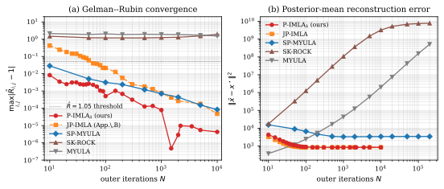
<figcaption class="ltx_caption ltx_centering">Figure 2: Classical per-pixel Gelman–Rubin trajectory at $256\!\times\!256\text{.}$ Eight chains from the same zero start; (a) $\max_{i,j}|\hat{R}_{i,j}-1|$ on log scale to $N=10{,}000\text{;}$ (b) extends to $N=2\!\times\!10^{5}\text{.}$ P-IMLAλ reaches $\hat{R}&lt;1.05$ at $N=10$ and its per-chain SSE changes from $855$ to $846$ by $N=10{,}000\text{.}$ SP-MYULA also reaches $\hat{R}\leq 1.001\text{,}$ despite larger reconstruction error; MYULA and SK-ROCK end at $2.41$ and $11.07\text{.}$ These same-start diagnostics <cite class="ltx_cite ltx_citemacro_citep">[Gelman and Rubin, <a href="#bib.bib29" title="Inference from iterative simulation using multiple sequences" class="ltx_ref">1992</a>]</cite> are complemented by overdispersed, rank-normalized split diagnostics in Appendix <a href="#A4.SS2" title="D.2 Overdispersed chains and observable-specific diagnostics ‣ Appendix D Additional bias, convergence and posterior-model checks ‣ Preconditioned Implicit Midpoint Langevin Sampling for Non-Smooth Bayesian Imaging" class="ltx_ref">D.2</a>.</figcaption>
</figure>
<figure id="S5.T3" class="ltx_table" style="overflow-y:hidden">
<figcaption class="ltx_caption ltx_centering" style="font-size:90%;">Table 3: $256\!\times\!256$ TV deconvolution, geometric phantom, fixed iteration budgets. $\rho_{\mathrm{TV}}\!=\!0.3\text{,}$ $\sigma_{\mathrm{noise}}\!=\!0.05\text{,}$ $\lambda\!=\!5\!\times\!10^{-3}\text{;}$ RTX PRO 6000 Blackwell, 4-way parallel. SSE is per-chain $\|\bar{x}_{c}-x^{\star}\|^{2}$ averaged across $K$ chains $\pm$ SE, including the initial transient. $\hat{R}$ is classical per-pixel, from common zero starts. These are reconstruction and implementation-budget comparisons; joint-kernel guarantees are stated separately in the appendix. Cross-phantom results appear in Table <a href="#S5.T4" title="Table 4 ‣ 5 Experiments ‣ Preconditioned Implicit Midpoint Langevin Sampling for Non-Smooth Bayesian Imaging" class="ltx_ref">4</a>.</figcaption>
<table class="ltx_tabular ltx_centering ltx_guessed_headers ltx_align_middle">
<thead class="ltx_thead">
<tr class="ltx_tr">
<th class="ltx_td ltx_align_left ltx_th ltx_th_column ltx_th_row ltx_border_tt" style="padding-top:-0.25pt;padding-bottom:-0.25pt;">Method</th>
<th class="ltx_td ltx_align_center ltx_th ltx_th_column ltx_border_tt" style="padding-top:-0.25pt;padding-bottom:-0.25pt;">
SSE at final $N$
</th>
<th class="ltx_td ltx_align_center ltx_th ltx_th_column ltx_border_tt" style="padding-top:-0.25pt;padding-bottom:-0.25pt;">$K$</th>
<th class="ltx_td ltx_align_center ltx_th ltx_th_column ltx_border_tt" style="padding-top:-0.25pt;padding-bottom:-0.25pt;">$N_{\mathrm{final}}$</th>
<th class="ltx_td ltx_align_center ltx_th ltx_th_column ltx_border_tt" style="padding-top:-0.25pt;padding-bottom:-0.25pt;">Wall-clock/chain</th>
<th class="ltx_td ltx_nopad_r ltx_align_center ltx_th ltx_th_column ltx_border_tt" style="padding-top:-0.25pt;padding-bottom:-0.25pt;">
$\hat{R}$ at $N_{\mathrm{final}}$
</th>
</tr>
</thead>
<tbody class="ltx_tbody">
<tr class="ltx_tr">
<th class="ltx_td ltx_align_left ltx_th ltx_th_row ltx_border_t" style="padding-top:-0.25pt;padding-bottom:-0.25pt;">MYULA</th>
<td class="ltx_td ltx_align_center ltx_border_t" style="padding-top:-0.25pt;padding-bottom:-0.25pt;">
$\sim\!10^{9}$ (no mix)
</td>
<td class="ltx_td ltx_align_center ltx_border_t" style="padding-top:-0.25pt;padding-bottom:-0.25pt;">8</td>
<td class="ltx_td ltx_align_center ltx_border_t" style="padding-top:-0.25pt;padding-bottom:-0.25pt;">$2\!\times\!10^{5}$</td>
<td class="ltx_td ltx_align_center ltx_border_t" style="padding-top:-0.25pt;padding-bottom:-0.25pt;">
$43$ min
</td>
<td class="ltx_td ltx_nopad_r ltx_align_center ltx_border_t" style="padding-top:-0.25pt;padding-bottom:-0.25pt;">$2.41$</td>
</tr>
<tr class="ltx_tr">
<th class="ltx_td ltx_align_left ltx_th ltx_th_row" style="padding-top:-0.25pt;padding-bottom:-0.25pt;">
SK-ROCK ($s\!=\!10$)
</th>
<td class="ltx_td ltx_align_center" style="padding-top:-0.25pt;padding-bottom:-0.25pt;">
$\sim\!10^{10}$ (no mix)
</td>
<td class="ltx_td ltx_align_center" style="padding-top:-0.25pt;padding-bottom:-0.25pt;">8</td>
<td class="ltx_td ltx_align_center" style="padding-top:-0.25pt;padding-bottom:-0.25pt;">$2\!\times\!10^{5}$</td>
<td class="ltx_td ltx_align_center" style="padding-top:-0.25pt;padding-bottom:-0.25pt;">
$425$ min
</td>
<td class="ltx_td ltx_nopad_r ltx_align_center" style="padding-top:-0.25pt;padding-bottom:-0.25pt;">$11.07$</td>
</tr>
<tr class="ltx_tr">
<th class="ltx_td ltx_align_left ltx_th ltx_th_row" style="padding-top:-0.25pt;padding-bottom:-0.25pt;">SP-MYULA</th>
<td class="ltx_td ltx_align_center" style="padding-top:-0.25pt;padding-bottom:-0.25pt;">$3{,}432.0\pm 1.0$</td>
<td class="ltx_td ltx_align_center" style="padding-top:-0.25pt;padding-bottom:-0.25pt;">8</td>
<td class="ltx_td ltx_align_center" style="padding-top:-0.25pt;padding-bottom:-0.25pt;">$2\!\times\!10^{5}$</td>
<td class="ltx_td ltx_align_center" style="padding-top:-0.25pt;padding-bottom:-0.25pt;">
$74$ min
</td>
<td class="ltx_td ltx_nopad_r ltx_align_center" style="padding-top:-0.25pt;padding-bottom:-0.25pt;">$\leq\!1.001$</td>
</tr>
<tr class="ltx_tr">
<th class="ltx_td ltx_align_left ltx_th ltx_th_row" style="padding-top:-0.25pt;padding-bottom:-0.25pt;">P-IMLAλ (ours)</th>
<td class="ltx_td ltx_align_center" style="padding-top:-0.25pt;padding-bottom:-0.25pt;">$\mathbf{855.22\!\pm\!0.66}$</td>
<td class="ltx_td ltx_align_center" style="padding-top:-0.25pt;padding-bottom:-0.25pt;">8</td>
<td class="ltx_td ltx_align_center" style="padding-top:-0.25pt;padding-bottom:-0.25pt;">$\mathbf{2{,}000}$</td>
<td class="ltx_td ltx_align_center" style="padding-top:-0.25pt;padding-bottom:-0.25pt;">
$\mathbf{70}$ min
</td>
<td class="ltx_td ltx_nopad_r ltx_align_center" style="padding-top:-0.25pt;padding-bottom:-0.25pt;">$\mathbf{\leq\!1.001}$</td>
</tr>
<tr class="ltx_tr">
<th class="ltx_td ltx_align_left ltx_th ltx_th_row ltx_border_bb" style="padding-top:-0.25pt;padding-bottom:-0.25pt;">JP-IMLA (variant, §<a href="#S3" title="3 The P-IMLA Algorithm ‣ Preconditioned Implicit Midpoint Langevin Sampling for Non-Smooth Bayesian Imaging" class="ltx_ref">3</a>)</th>
<td class="ltx_td ltx_align_center ltx_border_bb" style="padding-top:-0.25pt;padding-bottom:-0.25pt;">$\mathbf{852.72\pm 0.65}$</td>
<td class="ltx_td ltx_align_center ltx_border_bb" style="padding-top:-0.25pt;padding-bottom:-0.25pt;">8</td>
<td class="ltx_td ltx_align_center ltx_border_bb" style="padding-top:-0.25pt;padding-bottom:-0.25pt;">$\mathbf{2{,}000}$</td>
<td class="ltx_td ltx_align_center ltx_border_bb" style="padding-top:-0.25pt;padding-bottom:-0.25pt;">
$\mathbf{1.2}$ min
</td>
<td class="ltx_td ltx_nopad_r ltx_align_center ltx_border_bb" style="padding-top:-0.25pt;padding-bottom:-0.25pt;">$\mathbf{\leq\!1.001}$</td>
</tr>
</tbody>
</table>
</figure>
<figure id="S5.F3" class="ltx_figure">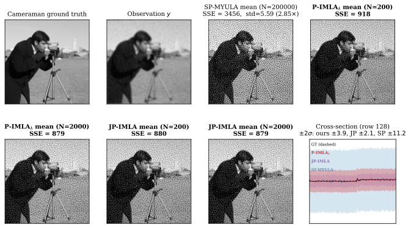
<figcaption class="ltx_caption ltx_centering">Figure 3: $256\!\times\!256$ cameraman posterior-mean reconstructions at fixed budgets. Images are averages across chains, not individual posterior draws. R1: GT, observation, SP-MYULA at $N\!=\!2\!\times\!10^{5}$ (R1C3; pooled-mean SSE $3{,}456\text{,}$ mean pixel std $\bar{s}=5.59$), and P-IMLAλ at $N=200$ (R1C4; SSE $918$). R2C1: P-IMLAλ at $N=2{,}000$ (SSE $879\text{,}$ $\bar{s}=1.96$). R2C2–C3: JP-IMLA (§<a href="#S3" title="3 The P-IMLA Algorithm ‣ Preconditioned Implicit Midpoint Langevin Sampling for Non-Smooth Bayesian Imaging" class="ltx_ref">3</a>) at $N=200$ (SSE $880$) and $N=2{,}000$ (SSE $879$), with the historical $\sim 60\!\times$ per-iteration implementation speedup. R2C4: row-$128$ cross-section with $\pm 2$ posterior-standard-deviation bands. Pooled-mean SSE differs from the per-chain average in Table <a href="#S5.T4" title="Table 4 ‣ 5 Experiments ‣ Preconditioned Implicit Midpoint Langevin Sampling for Non-Smooth Bayesian Imaging" class="ltx_ref">4</a>. Appendix <a href="#A4.SS3" title="D.3 Separating draw roughness from posterior-mean texture ‣ Appendix D Additional bias, convergence and posterior-model checks ‣ Preconditioned Implicit Midpoint Langevin Sampling for Non-Smooth Bayesian Imaging" class="ltx_ref">D.3</a> shows that stronger TV regularization reduces the means’ visible texture.</figcaption>
</figure>

Cross-phantom robustness (Shepp–Logan, cameraman). We extend the same finite-budget protocol to <em class="ltx_emph ltx_font_italic">Shepp–Logan</em> and <em class="ltx_emph ltx_font_italic">cameraman</em>, four chains each. Across all three phantoms ours achieves a $3.5\!\times\!\!-\!\!4.0\!\times$ reconstruction-SSE reduction over SP-MYULA with the $100\!\times$ iteration allocation (Table <a href="#S5.T4" title="Table 4 ‣ 5 Experiments ‣ Preconditioned Implicit Midpoint Langevin Sampling for Non-Smooth Bayesian Imaging" class="ltx_ref">4</a>). Changing burn-in, initialization or solver accuracy defines a different comparison; these ratios do not isolate invariant-measure error.

Additional bias and roughness checks. On a $16\!\times\!16$ log-cosh lattice satisfying Theorem <a href="#Thmtheorem5" title="Theorem 5 (Drift-only BEA bias). ‣ 4.3 Sharp drift-only bias via backward error analysis ‣ 4 The Theory of P-IMLA ‣ Preconditioned Implicit Midpoint Langevin Sampling for Non-Smooth Bayesian Imaging" class="ltx_ref">5</a>’s potential assumptions, all nine coefficient estimates across three preconditioners and three observables agree with the prediction within their $95\%$ intervals. Separate overdispersed imaging runs distinguish high-frequency draw variability controlled by $\lambda$ from mid-frequency posterior-mean texture reduced by $\rho_{\mathrm{TV}}\text{;}$ doubling $\rho_{\mathrm{TV}}$ improves PSNR by $3.5$ dB (geometric) and $2.7$ dB (cameraman). Independent exact-target Gibbs experiments at $32^{2}$ and $48^{2}$ retain the same texture without Moreau smoothing or time discretization. Full protocols, observable-specific diagnostics and their remaining slow modes are in Appendix <a href="#A4" title="Appendix D Additional bias, convergence and posterior-model checks ‣ Preconditioned Implicit Midpoint Langevin Sampling for Non-Smooth Bayesian Imaging" class="ltx_ref">D</a>.

<figure id="S5.T4" class="ltx_table" style="overflow-y:hidden">
<figcaption class="ltx_caption ltx_centering" style="font-size:90%;">Table 4: Cross-phantom matched-budget SSE (geometric: 8 chains; Shepp–Logan, cameraman: 4 chains; $\pm$ SE; ours $N\!=\!2{,}000\text{,}$ baselines $N\!=\!2\!\times\!10^{5}$). MYULA SSE $\sim\!10^{9}$ on all three.</figcaption>
<table class="ltx_tabular ltx_centering ltx_guessed_headers ltx_align_middle">
<thead class="ltx_thead">
<tr class="ltx_tr">
<th class="ltx_td ltx_align_left ltx_th ltx_th_column ltx_th_row ltx_border_tt" style="padding-top:-0.25pt;padding-bottom:-0.25pt;">Phantom</th>
<th class="ltx_td ltx_align_center ltx_th ltx_th_column ltx_border_tt" style="padding-top:-0.25pt;padding-bottom:-0.25pt;">ours SSE</th>
<th class="ltx_td ltx_align_center ltx_th ltx_th_column ltx_border_tt" style="padding-top:-0.25pt;padding-bottom:-0.25pt;">SP-MYULA SSE</th>
<th class="ltx_td ltx_nopad_r ltx_align_center ltx_th ltx_th_column ltx_border_tt" style="padding-top:-0.25pt;padding-bottom:-0.25pt;">SP-MYULA / ours</th>
</tr>
</thead>
<tbody class="ltx_tbody">
<tr class="ltx_tr">
<th class="ltx_td ltx_align_left ltx_th ltx_th_row ltx_border_t" style="padding-top:-0.25pt;padding-bottom:-0.25pt;">geometric</th>
<td class="ltx_td ltx_align_center ltx_border_t" style="padding-top:-0.25pt;padding-bottom:-0.25pt;">$855.22\pm 0.66$</td>
<td class="ltx_td ltx_align_center ltx_border_t" style="padding-top:-0.25pt;padding-bottom:-0.25pt;">$3{,}432.0\pm 1.0$</td>
<td class="ltx_td ltx_nopad_r ltx_align_center ltx_border_t" style="padding-top:-0.25pt;padding-bottom:-0.25pt;">$4.01\!\times$</td>
</tr>
<tr class="ltx_tr">
<th class="ltx_td ltx_align_left ltx_th ltx_th_row" style="padding-top:-0.25pt;padding-bottom:-0.25pt;">Shepp–Logan</th>
<td class="ltx_td ltx_align_center" style="padding-top:-0.25pt;padding-bottom:-0.25pt;">$1{,}013.99\pm 0.81$</td>
<td class="ltx_td ltx_align_center" style="padding-top:-0.25pt;padding-bottom:-0.25pt;">$3{,}525.6\pm 1.0$</td>
<td class="ltx_td ltx_nopad_r ltx_align_center" style="padding-top:-0.25pt;padding-bottom:-0.25pt;">$3.48\!\times$</td>
</tr>
<tr class="ltx_tr">
<th class="ltx_td ltx_align_left ltx_th ltx_th_row ltx_border_bb" style="padding-top:-0.25pt;padding-bottom:-0.25pt;">cameraman</th>
<td class="ltx_td ltx_align_center ltx_border_bb" style="padding-top:-0.25pt;padding-bottom:-0.25pt;">$890.24\pm 1.19$</td>
<td class="ltx_td ltx_align_center ltx_border_bb" style="padding-top:-0.25pt;padding-bottom:-0.25pt;">$3{,}460.4\pm 2.0$</td>
<td class="ltx_td ltx_nopad_r ltx_align_center ltx_border_bb" style="padding-top:-0.25pt;padding-bottom:-0.25pt;">$3.89\!\times$</td>
</tr>
</tbody>
</table>
</figure>
</section>
<section id="S6" class="ltx_section">
<h2 class="ltx_title ltx_title_section" id="conclusion">
6 Conclusion</h2>

Implicit midpoint with fixed matrix preconditioning combines Gaussian exactness with the sharp IMLA contraction factor in the effective condition number. The variance-budget identity (<a href="#S1.E2" title="In 1 Introduction ‣ Preconditioned Implicit Midpoint Langevin Sampling for Non-Smooth Bayesian Imaging" class="ltx_ref">2</a>) explains the Gaussian cancellation; the drift-only BEA coefficient identifies the leading weak bias beyond Gaussians under explicit smoothness assumptions. At imaging scale, P-IMLAλ improves finite-budget reconstruction and relaxation at the reported settings, while the diagnostic sweeps separate smoothing, solver and prior effects. The joint-proximal variant retains a substantial per-iteration speed advantage, with model and solver errors controlled separately by the kernel comparison and primal–dual certificate.

Limitations. The BEA expansion does not apply directly to a $C^{1,1}$ TV envelope, and the end-to-end accuracy bound uses a smaller step range than the all-step contraction theorem. Exact-JP uniqueness is proved for the imaging penalty class, not for arbitrary finite ADMM implementations. Small-image exact-posterior checks and overdispersed full-image diagnostics complement the original experiments but do not certify all full-image posterior moments. Position-dependent preconditioning and image-scale non-Fourier validation remain open; Appendix <a href="#A5" title="Appendix E Limitations and open problems ‣ Preconditioned Implicit Midpoint Langevin Sampling for Non-Smooth Bayesian Imaging" class="ltx_ref">E</a> gives the full scope.

</section>
<section id="Sx1" class="ltx_section">
<h2 class="ltx_title ltx_title_section" id="acknowledgments">Acknowledgments</h2>

We thank the anonymous reviewers for their careful reading and constructive feedback, which substantially improved the paper. This work is supported by Guangdong Province (No. 2023QN10X215), Shenzhen Science and Technology Program (No. JCYJ20241202130548062), the Natural Science Foundation of Shenzhen (No. JCYJ20230807142703006), and the Key Research Platforms and Projects of the Guangdong Provincial Department of Education (No. 2023ZDZX1034).
The authors declare no competing interests.

</section>
<section id="bib" class="ltx_bibliography">
<h2 class="ltx_title ltx_title_bibliography" id="references">References</h2>

<ul id="bib.L1" class="ltx_biblist">
<li id="bib.bib16" class="ltx_bibitem ltx_bib_article">
A. Abdulle, G. Vilmart, and K. C. Zygalakis (2014)
High order numerical approximation of the invariant measure of ergodic SDEs.

SIAM Journal on Numerical Analysis 52 (4),  pp. 1600–1622.

Cited by: <a href="#S1.p5" title="1 Introduction ‣ Preconditioned Implicit Midpoint Langevin Sampling for Non-Smooth Bayesian Imaging" class="ltx_ref">§1</a>.

</li>
<li id="bib.bib18" class="ltx_bibitem ltx_bib_book">
H. H. Bauschke and P. L. Combettes (2011)
Convex analysis and monotone operator theory in Hilbert spaces.

CMS Books in Mathematics,  Springer.

Cited by: <a href="#S1.I1.i4.p1" title="In 1 Introduction ‣ Preconditioned Implicit Midpoint Langevin Sampling for Non-Smooth Bayesian Imaging" class="ltx_ref">item 4</a>,
<a href="#S2.SS2.p1" title="2.2 The 𝑀-norm Moreau envelope ‣ 2 Background ‣ Preconditioned Implicit Midpoint Langevin Sampling for Non-Smooth Bayesian Imaging" class="ltx_ref">§2.2</a>.

</li>
<li id="bib.bib26" class="ltx_bibitem ltx_bib_article">
N. Bou-Rabee and J. M. Sanz-Serna (2018)
Geometric integrators and the Hamiltonian Monte Carlo method.

Acta Numerica 27,  pp. 113–206.

Cited by: <a href="#S1.p5" title="1 Introduction ‣ Preconditioned Implicit Midpoint Langevin Sampling for Non-Smooth Bayesian Imaging" class="ltx_ref">§1</a>.

</li>
<li id="bib.bib12" class="ltx_bibitem ltx_bib_article">
S. Boyd, N. Parikh, E. Chu, B. Peleato, and J. Eckstein (2011)
Distributed optimization and statistical learning via the alternating direction method of multipliers.

Foundations and Trends in Machine Learning 3 (1),  pp. 1–122.

Cited by: <a href="#S3.p3" title="3 The P-IMLA Algorithm ‣ Preconditioned Implicit Midpoint Langevin Sampling for Non-Smooth Bayesian Imaging" class="ltx_ref">§3</a>.

</li>
<li id="bib.bib31" class="ltx_bibitem ltx_bib_inproceedings">
X. Cheng and P. L. Bartlett (2018)
Convergence of Langevin MCMC in KL-divergence.

In Proceedings of Algorithmic Learning Theory (ALT),

PMLR, Vol. 83,  pp. 186–211.

Cited by: <a href="#S1.p1" title="1 Introduction ‣ Preconditioned Implicit Midpoint Langevin Sampling for Non-Smooth Bayesian Imaging" class="ltx_ref">§1</a>.

</li>
<li id="bib.bib32" class="ltx_bibitem ltx_bib_inproceedings">
X. Cheng, N. S. Chatterji, P. L. Bartlett, and M. I. Jordan (2018)
Underdamped Langevin MCMC: a non-asymptotic analysis.

In Proceedings of the Conference on Learning Theory (COLT),

PMLR, Vol. 75,  pp. 300–323.

Cited by: <a href="#S1.p5" title="1 Introduction ‣ Preconditioned Implicit Midpoint Langevin Sampling for Non-Smooth Bayesian Imaging" class="ltx_ref">§1</a>.

</li>
<li id="bib.bib41" class="ltx_bibitem ltx_bib_unpublished">
S. Chewi (2026)
Log-concave sampling.

Note: Book draft, March 2026 version. Available at <a href="https://chewisinho.github.io/main.pdf" class="ltx_ref ltx_url ltx_font_typewriter">https://chewisinho.github.io/main.pdf</a>

Cited by: <a href="#S1.p1" title="1 Introduction ‣ Preconditioned Implicit Midpoint Langevin Sampling for Non-Smooth Bayesian Imaging" class="ltx_ref">§1</a>.

</li>
<li id="bib.bib11" class="ltx_bibitem ltx_bib_article">
M. Corbineau, D. Kouamé, E. Chouzenoux, J. Tourneret, and J. Pesquet (2019)
Preconditioned P-ULA for joint deconvolution-segmentation of ultrasound images.

IEEE Signal Processing Letters 26 (10),  pp. 1456–1460.

Cited by: <a href="#S1.p5" title="1 Introduction ‣ Preconditioned Implicit Midpoint Langevin Sampling for Non-Smooth Bayesian Imaging" class="ltx_ref">§1</a>,
<a href="#S2.SS3.p1" title="2.3 Where P-IMLA sits in the landscape ‣ 2 Background ‣ Preconditioned Implicit Midpoint Langevin Sampling for Non-Smooth Bayesian Imaging" class="ltx_ref">§2.3</a>.

</li>
<li id="bib.bib9" class="ltx_bibitem ltx_bib_article">
S. L. Cotter, G. O. Roberts, A. M. Stuart, and D. White (2013)
MCMC methods for functions: modifying old algorithms to make them faster.

Statistical Science 28 (3),  pp. 424–446.

Cited by: <a href="#S1.p5" title="1 Introduction ‣ Preconditioned Implicit Midpoint Langevin Sampling for Non-Smooth Bayesian Imaging" class="ltx_ref">§1</a>,
<a href="#S2.SS3.p1" title="2.3 Where P-IMLA sits in the landscape ‣ 2 Background ‣ Preconditioned Implicit Midpoint Langevin Sampling for Non-Smooth Bayesian Imaging" class="ltx_ref">§2.3</a>.

</li>
<li id="bib.bib2" class="ltx_bibitem ltx_bib_article">
A. S. Dalalyan (2017)
Theoretical guarantees for approximate sampling from smooth and log-concave densities.

Journal of the Royal Statistical Society: Series B 79 (3),  pp. 651–676.

Cited by: <a href="#S1.p1" title="1 Introduction ‣ Preconditioned Implicit Midpoint Langevin Sampling for Non-Smooth Bayesian Imaging" class="ltx_ref">§1</a>.

</li>
<li id="bib.bib3" class="ltx_bibitem ltx_bib_article">
A. Durmus and É. Moulines (2019)
High-dimensional Bayesian inference via the unadjusted Langevin algorithm.

Bernoulli 25 (4A),  pp. 2854–2882.

Cited by: <a href="#S1.p1" title="1 Introduction ‣ Preconditioned Implicit Midpoint Langevin Sampling for Non-Smooth Bayesian Imaging" class="ltx_ref">§1</a>.

</li>
<li id="bib.bib1" class="ltx_bibitem ltx_bib_article">
A. Durmus, É. Moulines, and M. Pereyra (2018)
Efficient Bayesian computation by proximal Markov chain Monte Carlo: when Langevin meets Moreau.

SIAM Journal on Imaging Sciences 11 (1),  pp. 473–506.

Cited by: <a href="#A3.SS0.SSS0.Px3.p1" title="Sampler naming conventions. ‣ Appendix C Auxiliary experimental results ‣ Preconditioned Implicit Midpoint Langevin Sampling for Non-Smooth Bayesian Imaging" class="ltx_ref">Appendix C</a>,
<a href="#S1.p1" title="1 Introduction ‣ Preconditioned Implicit Midpoint Langevin Sampling for Non-Smooth Bayesian Imaging" class="ltx_ref">§1</a>,
<a href="#S1.p5" title="1 Introduction ‣ Preconditioned Implicit Midpoint Langevin Sampling for Non-Smooth Bayesian Imaging" class="ltx_ref">§1</a>,
<a href="#S2.SS2.p1" title="2.2 The 𝑀-norm Moreau envelope ‣ 2 Background ‣ Preconditioned Implicit Midpoint Langevin Sampling for Non-Smooth Bayesian Imaging" class="ltx_ref">§2.2</a>,
<a href="#S2.SS3.p1" title="2.3 Where P-IMLA sits in the landscape ‣ 2 Background ‣ Preconditioned Implicit Midpoint Langevin Sampling for Non-Smooth Bayesian Imaging" class="ltx_ref">§2.3</a>,
<a href="#S3.p3" title="3 The P-IMLA Algorithm ‣ Preconditioned Implicit Midpoint Langevin Sampling for Non-Smooth Bayesian Imaging" class="ltx_ref">§3</a>.

</li>
<li id="bib.bib35" class="ltx_bibitem ltx_bib_article">
A. Durmus, É. Moulines, and M. Pereyra (2022)
A proximal Markov chain Monte Carlo method for Bayesian inference in imaging inverse problems: when Langevin meets Moreau.

SIAM Review 64 (4),  pp. 991–1028.

Cited by: <a href="#S1.p5" title="1 Introduction ‣ Preconditioned Implicit Midpoint Langevin Sampling for Non-Smooth Bayesian Imaging" class="ltx_ref">§1</a>.

</li>
<li id="bib.bib23" class="ltx_bibitem ltx_bib_article">
A. Eberle (2016)
Reflection couplings and contraction rates for diffusions.

Probability Theory and Related Fields 166,  pp. 851–886.

Cited by: <a href="#S1.p5" title="1 Introduction ‣ Preconditioned Implicit Midpoint Langevin Sampling for Non-Smooth Bayesian Imaging" class="ltx_ref">§1</a>.

</li>
<li id="bib.bib36" class="ltx_bibitem ltx_bib_article">
M. J. Ehrhardt, L. Kuger, and C. Schönlieb (2024)
Proximal Langevin sampling with inexact proximal mapping.

SIAM Journal on Imaging Sciences 17 (3),  pp. 1729–1760.

Cited by: <a href="#S1.p5" title="1 Introduction ‣ Preconditioned Implicit Midpoint Langevin Sampling for Non-Smooth Bayesian Imaging" class="ltx_ref">§1</a>.

</li>
<li id="bib.bib20" class="ltx_bibitem ltx_bib_article">
Z. Frangella, J. A. Tropp, and M. Udell (2023)
Randomized Nyström preconditioning.

SIAM Journal on Matrix Analysis and Applications 44 (2),  pp. 718–752.

Cited by: <a href="#A3.SS6.p1" title="C.6 Beyond Fourier-diagonal forward operators (random fan-beam) ‣ Appendix C Auxiliary experimental results ‣ Preconditioned Implicit Midpoint Langevin Sampling for Non-Smooth Bayesian Imaging" class="ltx_ref">§C.6</a>.

</li>
<li id="bib.bib29" class="ltx_bibitem ltx_bib_article">
A. Gelman and D. B. Rubin (1992)
Inference from iterative simulation using multiple sequences.

Statistical Science 7 (4),  pp. 457–472.

Cited by: <a href="#S5.F2" title="In 5 Experiments ‣ Preconditioned Implicit Midpoint Langevin Sampling for Non-Smooth Bayesian Imaging" class="ltx_ref">Figure 2</a>.

</li>
<li id="bib.bib4" class="ltx_bibitem ltx_bib_article">
M. Girolami and B. Calderhead (2011)
Riemann manifold Langevin and Hamiltonian Monte Carlo methods.

Journal of the Royal Statistical Society: Series B 73 (2),  pp. 123–214.

Cited by: <a href="#S1.p2" title="1 Introduction ‣ Preconditioned Implicit Midpoint Langevin Sampling for Non-Smooth Bayesian Imaging" class="ltx_ref">§1</a>,
<a href="#S1.p5" title="1 Introduction ‣ Preconditioned Implicit Midpoint Langevin Sampling for Non-Smooth Bayesian Imaging" class="ltx_ref">§1</a>,
<a href="#S3.p1" title="3 The P-IMLA Algorithm ‣ Preconditioned Implicit Midpoint Langevin Sampling for Non-Smooth Bayesian Imaging" class="ltx_ref">§3</a>.

</li>
<li id="bib.bib37" class="ltx_bibitem ltx_bib_article">
A. Habring, M. Holler, and T. Pock (2024)
Subgradient Langevin methods for sampling from nonsmooth potentials.

SIAM Journal on Mathematics of Data Science 6,  pp. 897–925.

Cited by: <a href="#S1.p1" title="1 Introduction ‣ Preconditioned Implicit Midpoint Langevin Sampling for Non-Smooth Bayesian Imaging" class="ltx_ref">§1</a>.

</li>
<li id="bib.bib39" class="ltx_bibitem ltx_bib_article">
A. Habring, A. Falk, M. Zach, and T. Pock (2026)
Diffusion at absolute zero: Langevin sampling using successive Moreau envelopes.

SIAM Journal on Imaging Sciences 19 (1),  pp. 35–77.

Cited by: <a href="#S1.p5" title="1 Introduction ‣ Preconditioned Implicit Midpoint Langevin Sampling for Non-Smooth Bayesian Imaging" class="ltx_ref">§1</a>.

</li>
<li id="bib.bib6" class="ltx_bibitem ltx_bib_article">
M. Hird and S. Livingstone (2025)
Quantifying the effectiveness of linear preconditioning in Markov chain Monte Carlo.

Journal of Machine Learning Research 26 (119),  pp. 1–51.

Cited by: <a href="#S1.p2" title="1 Introduction ‣ Preconditioned Implicit Midpoint Langevin Sampling for Non-Smooth Bayesian Imaging" class="ltx_ref">§1</a>,
<a href="#S1.p5" title="1 Introduction ‣ Preconditioned Implicit Midpoint Langevin Sampling for Non-Smooth Bayesian Imaging" class="ltx_ref">§1</a>,
<a href="#S3.p1" title="3 The P-IMLA Algorithm ‣ Preconditioned Implicit Midpoint Langevin Sampling for Non-Smooth Bayesian Imaging" class="ltx_ref">§3</a>.

</li>
<li id="bib.bib7" class="ltx_bibitem ltx_bib_article">
L. Hodgkinson, R. Salomone, and F. Roosta (2021)
Implicit Langevin algorithms for sampling from log-concave densities.

Journal of Machine Learning Research 22 (136),  pp. 1–30.

Cited by: <a href="#S1.p5" title="1 Introduction ‣ Preconditioned Implicit Midpoint Langevin Sampling for Non-Smooth Bayesian Imaging" class="ltx_ref">§1</a>.

</li>
<li id="bib.bib43" class="ltx_bibitem ltx_bib_article">
M. D. Hoffman and A. Gelman (2014)
The no-U-turn sampler: adaptively setting path lengths in Hamiltonian Monte Carlo.

Journal of Machine Learning Research 15 (47),  pp. 1593–1623.

Cited by: <a href="#A3.SS11.p2" title="C.11 Scope of empirical comparison: the Langevin family ‣ Appendix C Auxiliary experimental results ‣ Preconditioned Implicit Midpoint Langevin Sampling for Non-Smooth Bayesian Imaging" class="ltx_ref">§C.11</a>,
<a href="#S1.p5" title="1 Introduction ‣ Preconditioned Implicit Midpoint Langevin Sampling for Non-Smooth Bayesian Imaging" class="ltx_ref">§1</a>.

</li>
<li id="bib.bib34" class="ltx_bibitem ltx_bib_article">
M. Holden, M. Pereyra, and K. C. Zygalakis (2022)
Bayesian imaging with data-driven priors encoded by neural networks: theory, methods, and algorithms.

SIAM Journal on Imaging Sciences 15 (2),  pp. 892–924.

Cited by: <a href="#S1.p5" title="1 Introduction ‣ Preconditioned Implicit Midpoint Langevin Sampling for Non-Smooth Bayesian Imaging" class="ltx_ref">§1</a>.

</li>
<li id="bib.bib8" class="ltx_bibitem ltx_bib_article">
T. Klatzer, P. Dobson, Y. Altmann, M. Pereyra, J. M. Sanz-Serna, and K. C. Zygalakis (2024)
Accelerated Bayesian imaging by relaxed proximal-point Langevin sampling.

SIAM Journal on Imaging Sciences 17 (2),  pp. 1078–1117.

Cited by: <a href="#S1.I1.i2.p1" title="In 1 Introduction ‣ Preconditioned Implicit Midpoint Langevin Sampling for Non-Smooth Bayesian Imaging" class="ltx_ref">item 2</a>,
<a href="#S1.p5" title="1 Introduction ‣ Preconditioned Implicit Midpoint Langevin Sampling for Non-Smooth Bayesian Imaging" class="ltx_ref">§1</a>,
<a href="#S2.SS3.p1" title="2.3 Where P-IMLA sits in the landscape ‣ 2 Background ‣ Preconditioned Implicit Midpoint Langevin Sampling for Non-Smooth Bayesian Imaging" class="ltx_ref">§2.3</a>,
<a href="#S3.p1" title="3 The P-IMLA Algorithm ‣ Preconditioned Implicit Midpoint Langevin Sampling for Non-Smooth Bayesian Imaging" class="ltx_ref">§3</a>,
<a href="#S4.p1" title="4 The Theory of P-IMLA ‣ Preconditioned Implicit Midpoint Langevin Sampling for Non-Smooth Bayesian Imaging" class="ltx_ref">§4</a>.

</li>
<li id="bib.bib25" class="ltx_bibitem ltx_bib_article">
R. Laumont, V. De Bortoli, A. Almansa, J. Delon, A. Durmus, and M. Pereyra (2022)
Bayesian imaging using plug-and-play priors: when Langevin meets Tweedie.

SIAM Journal on Imaging Sciences 15 (2),  pp. 701–737.

Cited by: <a href="#S1.p5" title="1 Introduction ‣ Preconditioned Implicit Midpoint Langevin Sampling for Non-Smooth Bayesian Imaging" class="ltx_ref">§1</a>.

</li>
<li id="bib.bib40" class="ltx_bibitem ltx_bib_article">
B. Leimkuhler, D. Paulin, and P. A. Whalley (2024)
Contraction and convergence rates for discretized kinetic Langevin dynamics.

SIAM Journal on Numerical Analysis 62 (3),  pp. 1226–1258.

Cited by: <a href="#S1.p5" title="1 Introduction ‣ Preconditioned Implicit Midpoint Langevin Sampling for Non-Smooth Bayesian Imaging" class="ltx_ref">§1</a>.

</li>
<li id="bib.bib42" class="ltx_bibitem ltx_bib_incollection">
R. M. Neal (2011)
MCMC using Hamiltonian dynamics.

In Handbook of Markov Chain Monte Carlo,  S. Brooks, A. Gelman, G. L. Jones, and X. Meng (Eds.),

 pp. 113–162.

Cited by: <a href="#A3.SS11.p2" title="C.11 Scope of empirical comparison: the Langevin family ‣ Appendix C Auxiliary experimental results ‣ Preconditioned Implicit Midpoint Langevin Sampling for Non-Smooth Bayesian Imaging" class="ltx_ref">§C.11</a>,
<a href="#S1.p5" title="1 Introduction ‣ Preconditioned Implicit Midpoint Langevin Sampling for Non-Smooth Bayesian Imaging" class="ltx_ref">§1</a>.

</li>
<li id="bib.bib24" class="ltx_bibitem ltx_bib_article">
M. Pereyra (2016)
Proximal Markov chain Monte Carlo algorithms.

Statistics and Computing 26 (4),  pp. 745–760.

Cited by: <a href="#S1.p1" title="1 Introduction ‣ Preconditioned Implicit Midpoint Langevin Sampling for Non-Smooth Bayesian Imaging" class="ltx_ref">§1</a>,
<a href="#S1.p5" title="1 Introduction ‣ Preconditioned Implicit Midpoint Langevin Sampling for Non-Smooth Bayesian Imaging" class="ltx_ref">§1</a>,
<a href="#S3.p3" title="3 The P-IMLA Algorithm ‣ Preconditioned Implicit Midpoint Langevin Sampling for Non-Smooth Bayesian Imaging" class="ltx_ref">§3</a>.

</li>
<li id="bib.bib10" class="ltx_bibitem ltx_bib_article">
M. Pereyra, L. A. Vargas Mieles, and K. C. Zygalakis (2020)
Accelerating proximal Markov chain Monte Carlo by using an explicit stabilized method.

SIAM Journal on Imaging Sciences 13 (2),  pp. 905–935.

Cited by: <a href="#A3.SS8.p1" title="C.8 SK-ROCK 𝛿-stability sweep ‣ Appendix C Auxiliary experimental results ‣ Preconditioned Implicit Midpoint Langevin Sampling for Non-Smooth Bayesian Imaging" class="ltx_ref">§C.8</a>,
<a href="#S1.p5" title="1 Introduction ‣ Preconditioned Implicit Midpoint Langevin Sampling for Non-Smooth Bayesian Imaging" class="ltx_ref">§1</a>,
<a href="#S2.SS3.p1" title="2.3 Where P-IMLA sits in the landscape ‣ 2 Background ‣ Preconditioned Implicit Midpoint Langevin Sampling for Non-Smooth Bayesian Imaging" class="ltx_ref">§2.3</a>,
<a href="#S5.p2" title="5 Experiments ‣ Preconditioned Implicit Midpoint Langevin Sampling for Non-Smooth Bayesian Imaging" class="ltx_ref">§5</a>.

</li>
<li id="bib.bib38" class="ltx_bibitem ltx_bib_inproceedings">
M. Renaud, V. De Bortoli, A. Leclaire, and N. Papadakis (2025)
From stability of Langevin diffusion to convergence of proximal MCMC for non-log-concave sampling.

In Advances in Neural Information Processing Systems (NeurIPS),

Cited by: <a href="#S1.p5" title="1 Introduction ‣ Preconditioned Implicit Midpoint Langevin Sampling for Non-Smooth Bayesian Imaging" class="ltx_ref">§1</a>.

</li>
<li id="bib.bib21" class="ltx_bibitem ltx_bib_article">
G. O. Roberts and R. L. Tweedie (1996)
Exponential convergence of Langevin distributions and their discrete approximations.

Bernoulli 2 (4),  pp. 341–363.

Cited by: <a href="#S1.p1" title="1 Introduction ‣ Preconditioned Implicit Midpoint Langevin Sampling for Non-Smooth Bayesian Imaging" class="ltx_ref">§1</a>.

</li>
<li id="bib.bib30" class="ltx_bibitem ltx_bib_article">
L. I. Rudin, S. Osher, and E. Fatemi (1992)
Nonlinear total variation based noise removal algorithms.

Physica D: Nonlinear Phenomena 60 (1–4),  pp. 259–268.

Cited by: <a href="#S5.p2" title="5 Experiments ‣ Preconditioned Implicit Midpoint Langevin Sampling for Non-Smooth Bayesian Imaging" class="ltx_ref">§5</a>.

</li>
<li id="bib.bib27" class="ltx_bibitem ltx_bib_article">
A. M. Stuart (2010)
Inverse problems: a Bayesian perspective.

Acta Numerica 19,  pp. 451–559.

Cited by: <a href="#S1.p1" title="1 Introduction ‣ Preconditioned Implicit Midpoint Langevin Sampling for Non-Smooth Bayesian Imaging" class="ltx_ref">§1</a>.

</li>
<li id="bib.bib14" class="ltx_bibitem ltx_bib_article">
M. Talagrand (1996)
Transportation cost for Gaussian and other product measures.

Geometric and Functional Analysis 6 (3),  pp. 587–600.

Cited by: <a href="#A1.SS3.SSS0.Px7.p2" title="Conditional density, KL and Wasserstein consequence. ‣ A.3 Proof of Theorem 5 and its refinements ‣ Appendix A Full Proofs from Section 4 ‣ Preconditioned Implicit Midpoint Langevin Sampling for Non-Smooth Bayesian Imaging" class="ltx_ref">§A.3</a>.

</li>
<li id="bib.bib17" class="ltx_bibitem ltx_bib_article">
D. Talay and L. Tubaro (1990)
Expansion of the global error for numerical schemes solving stochastic differential equations.

Stochastic Analysis and Applications 8 (4),  pp. 483–509.

Cited by: <a href="#S1.p5" title="1 Introduction ‣ Preconditioned Implicit Midpoint Langevin Sampling for Non-Smooth Bayesian Imaging" class="ltx_ref">§1</a>.

</li>
<li id="bib.bib5" class="ltx_bibitem ltx_bib_inproceedings">
M. K. Titsias (2023)
Optimal preconditioning and Fisher adaptive Langevin sampling.

In Advances in Neural Information Processing Systems (NeurIPS),

Vol. 36.

Cited by: <a href="#S1.p2" title="1 Introduction ‣ Preconditioned Implicit Midpoint Langevin Sampling for Non-Smooth Bayesian Imaging" class="ltx_ref">§1</a>,
<a href="#S1.p5" title="1 Introduction ‣ Preconditioned Implicit Midpoint Langevin Sampling for Non-Smooth Bayesian Imaging" class="ltx_ref">§1</a>,
<a href="#S3.p1" title="3 The P-IMLA Algorithm ‣ Preconditioned Implicit Midpoint Langevin Sampling for Non-Smooth Bayesian Imaging" class="ltx_ref">§3</a>.

</li>
<li id="bib.bib28" class="ltx_bibitem ltx_bib_article">
A. Vehtari, A. Gelman, D. Simpson, B. Carpenter, and P. Bürkner (2021)
Rank-normalization, folding, and localization: an improved $\widehat{R}$ for assessing convergence of MCMC.

Bayesian Analysis 16 (2),  pp. 667–718.

Cited by: <a href="#A4.SS2.p2" title="D.2 Overdispersed chains and observable-specific diagnostics ‣ Appendix D Additional bias, convergence and posterior-model checks ‣ Preconditioned Implicit Midpoint Langevin Sampling for Non-Smooth Bayesian Imaging" class="ltx_ref">§D.2</a>.

</li>
<li id="bib.bib22" class="ltx_bibitem ltx_bib_inproceedings">
S. S. Vempala and A. Wibisono (2019)
Rapid convergence of the unadjusted Langevin algorithm: isoperimetry suffices.

In Advances in Neural Information Processing Systems (NeurIPS),

Vol. 32.

Cited by: <a href="#S1.p1" title="1 Introduction ‣ Preconditioned Implicit Midpoint Langevin Sampling for Non-Smooth Bayesian Imaging" class="ltx_ref">§1</a>.

</li>
<li id="bib.bib33" class="ltx_bibitem ltx_bib_inproceedings">
A. Wibisono (2018)
Sampling as optimization in the space of measures: the Langevin dynamics as a composite optimization problem.

In Proceedings of the Conference on Learning Theory (COLT),

PMLR, Vol. 75,  pp. 2093–3027.

Cited by: <a href="#S1.p5" title="1 Introduction ‣ Preconditioned Implicit Midpoint Langevin Sampling for Non-Smooth Bayesian Imaging" class="ltx_ref">§1</a>.

</li>
</ul>
</section>

<section id="A1" class="ltx_appendix">
<h2 class="ltx_title ltx_title_appendix" id="full-proofs-from-section-4">
Appendix A Full Proofs from Section <a href="#S4" title="4 The Theory of P-IMLA ‣ Preconditioned Implicit Midpoint Langevin Sampling for Non-Smooth Bayesian Imaging" class="ltx_ref">4</a>
</h2>

This appendix provides the full proofs of Theorems <a href="#Thmtheorem2" title="Theorem 2 (Gaussian exactness). ‣ 4.1 Gaussian exactness and Cayley contraction ‣ 4 The Theory of P-IMLA ‣ Preconditioned Implicit Midpoint Langevin Sampling for Non-Smooth Bayesian Imaging" class="ltx_ref">2</a>–<a href="#Thmtheorem6" title="Theorem 6 (End-to-end 𝑊₂^𝑀 bound). ‣ 4.4 End-to-end error budget for non-smooth targets ‣ 4 The Theory of P-IMLA ‣ Preconditioned Implicit Midpoint Langevin Sampling for Non-Smooth Bayesian Imaging" class="ltx_ref">6</a> and the supporting technical lemmas referenced in Section <a href="#S4" title="4 The Theory of P-IMLA ‣ Preconditioned Implicit Midpoint Langevin Sampling for Non-Smooth Bayesian Imaging" class="ltx_ref">4</a>. The proofs are self-contained given the definitions and labeled equations of Sections <a href="#S2" title="2 Background ‣ Preconditioned Implicit Midpoint Langevin Sampling for Non-Smooth Bayesian Imaging" class="ltx_ref">2</a>–<a href="#S4" title="4 The Theory of P-IMLA ‣ Preconditioned Implicit Midpoint Langevin Sampling for Non-Smooth Bayesian Imaging" class="ltx_ref">4</a>; no additional notation is introduced beyond the specifications below.

<section id="A1.SS0.SSS0.Px1" class="ltx_paragraph">
<h4 class="ltx_title ltx_title_paragraph" id="standing-conventions-for-the-appendix">Standing conventions for the appendix.</h4>

We write $H=\nabla^{2}f\text{,}$ $A=M^{-1/2}HM^{-1/2}\text{,}$ $\Gamma=M^{-1}HM^{-1}\text{,}$ and $b=-M^{-1}\nabla f\text{;}$ these are functions of the current point unless $f$ is quadratic. We use the Einstein summation convention on repeated indices and write $M^{-1}_{ij}=(M^{-1})_{ij}\text{.}$ The spectral variable is $\ell\text{;}$ $\lambda$ denotes Moreau smoothing.

</section>
<section id="A1.SS1" class="ltx_subsection">
<h3 class="ltx_title ltx_title_subsection" id="proof-of-theorem-2-gaussian-exactness">
A.1 Proof of Theorem <a href="#Thmtheorem2" title="Theorem 2 (Gaussian exactness). ‣ 4.1 Gaussian exactness and Cayley contraction ‣ 4 The Theory of P-IMLA ‣ Preconditioned Implicit Midpoint Langevin Sampling for Non-Smooth Bayesian Imaging" class="ltx_ref">2</a> (Gaussian exactness)</h3>

Recall the setting: $f(x)=\tfrac{1}{2}x^{\top}Hx-h^{\top}x$ with $H\succ 0\text{,}$ $g\equiv 0\text{,}$ $\pi=\mathcal{N}(\mu,H^{-1})$ with $\mu=H^{-1}h\text{,}$ and $M\succ 0\text{.}$ P-IMLA reads

<table id="A1.E18" class="ltx_equation ltx_eqn_table">

<tbody><tr class="ltx_equation ltx_eqn_row ltx_align_baseline">
<td class="ltx_eqn_cell ltx_eqn_center_padleft"></td>
<td class="ltx_eqn_cell ltx_align_center">$$X_{n+1}=-X_{n}+2\,\mathrm{prox}^{M}_{(\delta/2)f}\!\Bigl(X_{n}+\tfrac{\sqrt{2\delta}}{2}\,M^{-1/2}\xi_{n}\Bigr),\qquad\xi_{n}\overset{\textrm{iid}}{\sim}\mathcal{N}(0,I).$$</td>
<td class="ltx_eqn_cell ltx_eqn_center_padright"></td>
<td rowspan="1" class="ltx_eqn_cell ltx_eqn_eqno ltx_align_middle ltx_align_right">(18)</td>
</tr></tbody>
</table>

<section id="A1.SS1.SSS0.Px1" class="ltx_paragraph">
<h4 class="ltx_title ltx_title_paragraph" id="step-1-joint-diagonalization-and-whitening">Step 1 (Joint diagonalization and whitening).</h4>

Let $A=M^{-1/2}HM^{-1/2}=Q\Lambda Q^{\top}$ be the spectral decomposition with $\Lambda=\mathrm{diag}(\ell_{1},\dots,\ell_{d})$ and $Q$ orthogonal. Introduce whitened coordinates

<table id="A1.Ex4" class="ltx_equation ltx_eqn_table">

<tbody><tr class="ltx_equation ltx_eqn_row ltx_align_baseline">
<td class="ltx_eqn_cell ltx_eqn_center_padleft"></td>
<td class="ltx_eqn_cell ltx_align_center">$$Z_{n}\;\coloneqq\;Q^{\top}M^{1/2}(X_{n}-\mu).$$</td>
<td class="ltx_eqn_cell ltx_eqn_center_padright"></td>
</tr></tbody>
</table>

Under this change of variables: the $M$-norm becomes Euclidean, $\|X-\mu\|_{M}=\|Z\|\text{;}$ the target becomes $\pi_{Z}=\bigotimes_{i=1}^{d}\mathcal{N}(0,\ell_{i}^{-1})\text{;}$ and $W_{2}^{M}$ in $X$-coordinates equals Euclidean $W_{2}$ in $Z$-coordinates.

We claim that (<a href="#A1.E18" title="In A.1 Proof of Theorem 2 (Gaussian exactness) ‣ Appendix A Full Proofs from Section 4 ‣ Preconditioned Implicit Midpoint Langevin Sampling for Non-Smooth Bayesian Imaging" class="ltx_ref">18</a>) maps to $d$ independent scalar recurrences

<table id="A1.E19" class="ltx_equation ltx_eqn_table">

<tbody><tr class="ltx_equation ltx_eqn_row ltx_align_baseline">
<td class="ltx_eqn_cell ltx_eqn_center_padleft"></td>
<td class="ltx_eqn_cell ltx_align_center">$$Z_{n+1,i}\;=\;r_{i}\,Z_{n,i}\;+\;\frac{\sqrt{2\delta}}{1+a_{i}}\,\eta_{n,i},\qquad r_{i}\coloneqq\tfrac{1-a_{i}}{1+a_{i}},\ \ a_{i}\coloneqq\tfrac{\delta}{2}\ell_{i},\ \ \eta_{n,i}\sim\mathcal{N}(0,1).$$</td>
<td class="ltx_eqn_cell ltx_eqn_center_padright"></td>
<td rowspan="1" class="ltx_eqn_cell ltx_eqn_eqno ltx_align_middle ltx_align_right">(19)</td>
</tr></tbody>
</table>

Indeed, the proximal of the quadratic $f$ at $y$ satisfies the first-order condition $Hp-h+\tfrac{2}{\delta}M(p-y)=0\text{,}$ which gives

<table id="A1.Ex5" class="ltx_equation ltx_eqn_table">

<tbody><tr class="ltx_equation ltx_eqn_row ltx_align_baseline">
<td class="ltx_eqn_cell ltx_eqn_center_padleft"></td>
<td class="ltx_eqn_cell ltx_align_center">$$p\;=\;\bigl(\tfrac{\delta}{2}H+M\bigr)^{-1}\bigl(\tfrac{\delta}{2}(H\mu+(h-H\mu))+My\bigr)\;=\;\bigl(\tfrac{\delta}{2}H+M\bigr)^{-1}\bigl(\tfrac{\delta}{2}H\mu+My\bigr),$$</td>
<td class="ltx_eqn_cell ltx_eqn_center_padright"></td>
</tr></tbody>
</table>

using $h=H\mu\text{.}$ Subtracting $\mu=(\tfrac{\delta}{2}H+M)^{-1}(\tfrac{\delta}{2}H+M)\mu$ gives $p-\mu=(\tfrac{\delta}{2}H+M)^{-1}M(y-\mu)\text{.}$ Applying $X_{n+1}-\mu=-(X_{n}-\mu)+2(p-\mu)$ with $y=X_{n}+\tfrac{\sqrt{2\delta}}{2}M^{-1/2}\xi_{n}$ yields

<table id="A1.Ex6" class="ltx_equation ltx_eqn_table">

<tbody><tr class="ltx_equation ltx_eqn_row ltx_align_baseline">
<td class="ltx_eqn_cell ltx_eqn_center_padleft"></td>
<td class="ltx_eqn_cell ltx_align_center">$$X_{n+1}-\mu\;=\;\bigl(-I+2(\tfrac{\delta}{2}H+M)^{-1}M\bigr)\,(X_{n}-\mu)\;+\;\sqrt{2\delta}\,(\tfrac{\delta}{2}H+M)^{-1}M^{1/2}\xi_{n}.$$</td>
<td class="ltx_eqn_cell ltx_eqn_center_padright"></td>
</tr></tbody>
</table>

Whitening gives $Z_{n+1}=R\,Z_{n}+\sqrt{2\delta}\,S\,\eta_{n}$ where $\eta_{n}\coloneqq Q^{\top}\xi_{n}\sim\mathcal{N}(0,I)\text{,}$ $R=(I+\tfrac{\delta}{2}\Lambda)^{-1}(I-\tfrac{\delta}{2}\Lambda)\text{,}$ and $S=(I+\tfrac{\delta}{2}\Lambda)^{-1}\text{.}$ Since $R,S$ are diagonal with entries $r_{i},1/(1+a_{i})\text{,}$ the recurrence (<a href="#A1.E19" title="In Step 1 (Joint diagonalization and whitening). ‣ A.1 Proof of Theorem 2 (Gaussian exactness) ‣ Appendix A Full Proofs from Section 4 ‣ Preconditioned Implicit Midpoint Langevin Sampling for Non-Smooth Bayesian Imaging" class="ltx_ref">19</a>) follows coordinate-wise.

</section>
<section id="A1.SS1.SSS0.Px2" class="ltx_paragraph">
<h4 class="ltx_title ltx_title_paragraph" id="step-2-zero-bias-via-variance-budget">Step 2 (Zero bias via variance budget).</h4>

The stationary variance of the Cayley AR(1) (<a href="#A1.E19" title="In Step 1 (Joint diagonalization and whitening). ‣ A.1 Proof of Theorem 2 (Gaussian exactness) ‣ Appendix A Full Proofs from Section 4 ‣ Preconditioned Implicit Midpoint Langevin Sampling for Non-Smooth Bayesian Imaging" class="ltx_ref">19</a>) is

<table id="A1.Ex7" class="ltx_equation ltx_eqn_table">

<tbody><tr class="ltx_equation ltx_eqn_row ltx_align_baseline">
<td class="ltx_eqn_cell ltx_eqn_center_padleft"></td>
<td class="ltx_eqn_cell ltx_align_center">$$\mathrm{Var}(Z_{\infty,i})\;=\;\frac{2\delta/(1+a_{i})^{2}}{1-r_{i}^{2}}.$$</td>
<td class="ltx_eqn_cell ltx_eqn_center_padright"></td>
</tr></tbody>
</table>

Since $1-r_{i}^{2}=1-\bigl(\tfrac{1-a_{i}}{1+a_{i}}\bigr)^{2}=\tfrac{(1+a_{i})^{2}-(1-a_{i})^{2}}{(1+a_{i})^{2}}=\tfrac{4a_{i}}{(1+a_{i})^{2}}\text{,}$ the Cayley denominators cancel:

<table id="A1.Ex8" class="ltx_equation ltx_eqn_table">

<tbody><tr class="ltx_equation ltx_eqn_row ltx_align_baseline">
<td class="ltx_eqn_cell ltx_eqn_center_padleft"></td>
<td class="ltx_eqn_cell ltx_align_center">$$\mathrm{Var}(Z_{\infty,i})\;=\;\frac{2\delta/(1+a_{i})^{2}}{4a_{i}/(1+a_{i})^{2}}\;=\;\frac{2\delta}{4\cdot(\delta\ell_{i}/2)}\;=\;\frac{1}{\ell_{i}}\quad\text{for every }\delta&gt;0.$$</td>
<td class="ltx_eqn_cell ltx_eqn_center_padright"></td>
</tr></tbody>
</table>

This is the variance-budget identity (<a href="#S1.E2" title="In 1 Introduction ‣ Preconditioned Implicit Midpoint Langevin Sampling for Non-Smooth Bayesian Imaging" class="ltx_ref">2</a>). Combined with $\mathbb{E}[Z_{\infty,i}]=0$ (from $|r_{i}|&lt;1$) and the independence of components, $Z_{\infty}\sim\pi_{Z}\text{,}$ hence $X_{\infty}\sim\pi\text{.}$ The synchronous contraction below gives uniqueness, as in Appendix <a href="#A1.SS2" title="A.2 Proof of Theorem 3 (reflected-proximal contraction) ‣ Appendix A Full Proofs from Section 4 ‣ Preconditioned Implicit Midpoint Langevin Sampling for Non-Smooth Bayesian Imaging" class="ltx_ref">A.2</a>. This establishes Gaussian exactness.

</section>
<section id="A1.SS1.SSS0.Px3" class="ltx_paragraph">
<h4 class="ltx_title ltx_title_paragraph" id="step-3-wasserstein-contraction-via-synchronous-coupling">Step 3 (Wasserstein contraction via synchronous coupling).</h4>

For two chains driven by the same noise $\{\xi_{n}\}\text{,}$ whitening preserves the shared-noise structure and (<a href="#A1.E19" title="In Step 1 (Joint diagonalization and whitening). ‣ A.1 Proof of Theorem 2 (Gaussian exactness) ‣ Appendix A Full Proofs from Section 4 ‣ Preconditioned Implicit Midpoint Langevin Sampling for Non-Smooth Bayesian Imaging" class="ltx_ref">19</a>) gives

<table id="A1.Ex9" class="ltx_equation ltx_eqn_table">

<tbody><tr class="ltx_equation ltx_eqn_row ltx_align_baseline">
<td class="ltx_eqn_cell ltx_eqn_center_padleft"></td>
<td class="ltx_eqn_cell ltx_align_center">$$Z_{n+1,i}-Z^{\prime}_{n+1,i}\;=\;r_{i}\,(Z_{n,i}-Z^{\prime}_{n,i})\qquad\textrm{(deterministically, for each }i\textrm{)}.$$</td>
<td class="ltx_eqn_cell ltx_eqn_center_padright"></td>
</tr></tbody>
</table>

Iterating, $\|Z_{N}-Z^{\prime}_{N}\|\leq\bigl(\max_{i}|r_{i}|\bigr)^{N}\,\|Z_{0}-Z^{\prime}_{0}\|\text{,}$ i.e.,

<table id="A1.Ex10" class="ltx_equation ltx_eqn_table">

<tbody><tr class="ltx_equation ltx_eqn_row ltx_align_baseline">
<td class="ltx_eqn_cell ltx_eqn_center_padleft"></td>
<td class="ltx_eqn_cell ltx_align_center">$$\|X_{N}-X^{\prime}_{N}\|_{M}\;\leq\;\rho(\delta)^{N}\,\|X_{0}-X^{\prime}_{0}\|_{M},\qquad\rho(\delta)=\max_{i}|r_{i}|=\max\bigl(|r(m_{M})|,|r(L_{M})|\bigr),$$</td>
<td class="ltx_eqn_cell ltx_eqn_center_padright"></td>
</tr></tbody>
</table>

since $r^{\prime}(\ell)=-\delta/(1+\delta\ell/2)^{2}&lt;0\text{,}$ so $|r|$ attains its maximum on $[m_{M},L_{M}]$ at an endpoint. Taking an optimal $W_{2}^{M}$-coupling at time $0$ and using synchronous noise proves the Wasserstein contraction bound.

</section>
<section id="A1.SS1.SSS0.Px4" class="ltx_paragraph">
<h4 class="ltx_title ltx_title_paragraph" id="step-4-minimax-optimum-and-mixing-complexity">Step 4 (Minimax optimum and mixing complexity).</h4>

For $\delta\in[2/L_{M},2/m_{M}]\text{,}$ the endpoint magnitudes are $r(m_{M})=(1-\delta m_{M}/2)/(1+\delta m_{M}/2)$ and $|r(L_{M})|=(\delta L_{M}/2-1)/(\delta L_{M}/2+1)\text{,}$ respectively decreasing and increasing in $\delta\text{.}$ Outside this interval, moving $\delta$ toward it decreases both magnitudes. Equating $r(m_{M})=|r(L_{M})|$ yields

<table id="A1.Ex11" class="ltx_equation ltx_eqn_table">

<tbody><tr class="ltx_equation ltx_eqn_row ltx_align_baseline">
<td class="ltx_eqn_cell ltx_eqn_center_padleft"></td>
<td class="ltx_eqn_cell ltx_align_center">$$\tfrac{1-\delta m_{M}/2}{1+\delta m_{M}/2}\;=\;\tfrac{\delta L_{M}/2-1}{\delta L_{M}/2+1}\iff\delta^{\star}\;=\;\tfrac{2}{\sqrt{m_{M}L_{M}}},$$</td>
<td class="ltx_eqn_cell ltx_eqn_center_padright"></td>
</tr></tbody>
</table>

and substituting $\delta^{\star}$ gives the common value

<table id="A1.Ex12" class="ltx_equation ltx_eqn_table">

<tbody><tr class="ltx_equation ltx_eqn_row ltx_align_baseline">
<td class="ltx_eqn_cell ltx_eqn_center_padleft"></td>
<td class="ltx_eqn_cell ltx_align_center">$$\rho^{\star}\;=\;\tfrac{1-\sqrt{m_{M}/L_{M}}}{1+\sqrt{m_{M}/L_{M}}}\;=\;\tfrac{\sqrt{\kappa_{\mathrm{eff}}}-1}{\sqrt{\kappa_{\mathrm{eff}}}+1},$$</td>
<td class="ltx_eqn_cell ltx_eqn_center_padright"></td>
</tr></tbody>
</table>

establishing the optimal step and factor. For mixing: solving $\rho^{\star N}\leq\varepsilon$ gives $N\geq\log(1/\varepsilon)/\log(1/\rho^{\star})=O(\sqrt{\kappa_{\mathrm{eff}}}\log(1/\varepsilon))$ using $\log(1/\rho^{\star})=2/\sqrt{\kappa_{\mathrm{eff}}}+O(\kappa_{\mathrm{eff}}^{-3/2})\text{.}$ This proves the stated mixing complexity. $\square$

</section>
</section>
<section id="A1.SS2" class="ltx_subsection">
<h3 class="ltx_title ltx_title_subsection" id="proof-of-theorem-3-reflected-proximal-contraction">
A.2 Proof of Theorem <a href="#Thmtheorem3" title="Theorem 3 (𝑀-norm Wasserstein contraction). ‣ 4.2 Contraction of the reflected proximal map ‣ 4 The Theory of P-IMLA ‣ Preconditioned Implicit Midpoint Langevin Sampling for Non-Smooth Bayesian Imaging" class="ltx_ref">3</a> (reflected-proximal contraction)</h3>

Write $\tau=\delta/2$ and $\widetilde{f}(z)=f(M^{-1/2}z)\text{.}$ Whitening turns the $M$-norm into the Euclidean norm and the preconditioned update into IMLA for $\widetilde{f}\text{.}$ Thus it suffices to prove the result for $M=I\text{,}$ with strong-convexity and smoothness constants $m_{M},L_{M}\text{.}$

Let $p=\operatorname{prox}_{\tau\widetilde{f}}(w)$ and $q=\operatorname{prox}_{\tau\widetilde{f}}(v)\text{.}$ There is a symmetric matrix $\bar{H}$ satisfying

<table id="A1.Ex13" class="ltx_equation ltx_eqn_table">

<tbody><tr class="ltx_equation ltx_eqn_row ltx_align_baseline">
<td class="ltx_eqn_cell ltx_eqn_center_padleft"></td>
<td class="ltx_eqn_cell ltx_align_center">$$m_{M}I\preceq\bar{H}\preceq L_{M}I,\qquad\nabla\widetilde{f}(p)-\nabla\widetilde{f}(q)=\bar{H}(p-q).$$</td>
<td class="ltx_eqn_cell ltx_eqn_center_padright"></td>
</tr></tbody>
</table>

For a $C^{2}$ potential, take the Hessian integrated along the segment from $q$ to $p\text{.}$ For $C^{1,1}\text{,}$ mollify $\widetilde{f}\text{:}$ the mollifications retain the same Hessian bounds, their gradients converge locally uniformly, and a convergent subsequence of the bounded symmetric secant matrices gives the displayed identity. The proximal optimality conditions now give

<table id="A1.Ex14" class="ltx_equation ltx_eqn_table">

<tbody><tr class="ltx_equation ltx_eqn_row ltx_align_baseline">
<td class="ltx_eqn_cell ltx_eqn_center_padleft"></td>
<td class="ltx_eqn_cell ltx_align_center">$$w-v=(I+\tau\bar{H})(p-q).$$</td>
<td class="ltx_eqn_cell ltx_eqn_center_padright"></td>
</tr></tbody>
</table>

Consequently, for $R_{\tau}=2\operatorname{prox}_{\tau\widetilde{f}}-I\text{,}$

<table id="A1.E20" class="ltx_equation ltx_eqn_table">

<tbody><tr class="ltx_equation ltx_eqn_row ltx_align_baseline">
<td class="ltx_eqn_cell ltx_eqn_center_padleft"></td>
<td class="ltx_eqn_cell ltx_align_center">$$R_{\tau}(w)-R_{\tau}(v)=(I-\tau\bar{H})(I+\tau\bar{H})^{-1}(w-v).$$</td>
<td class="ltx_eqn_cell ltx_eqn_center_padright"></td>
<td rowspan="1" class="ltx_eqn_cell ltx_eqn_eqno ltx_align_middle ltx_align_right">(20)</td>
</tr></tbody>
</table>

The eigenvalues of the matrix on the right are $(1-\tau\ell)/(1+\tau\ell)$ with $\ell\in[m_{M},L_{M}]\text{.}$ This scalar function is decreasing, so

<table id="A1.Ex15" class="ltx_equation ltx_eqn_table">

<tbody><tr class="ltx_equation ltx_eqn_row ltx_align_baseline">
<td class="ltx_eqn_cell ltx_eqn_center_padleft"></td>
<td class="ltx_eqn_cell ltx_align_center">$$\|R_{\tau}(w)-R_{\tau}(v)\|\leq\max_{\ell\in\{m_{M},L_{M}\}}\left|\frac{1-\tau\ell}{1+\tau\ell}\right|\|w-v\|=\rho(\delta)\|w-v\|.$$</td>
<td class="ltx_eqn_cell ltx_eqn_center_padright"></td>
</tr></tbody>
</table>

For shared noise, $w=X_{n}+\sqrt{\delta/2}\,\xi_{n}$ and $v=Y_{n}+\sqrt{\delta/2}\,\xi_{n}\text{;}$ the extra noise translation in the reflected-proximal representation cancels. Whitening back proves the pathwise inequality. A quadratic potential with an endpoint eigenvalue attains this factor. Attainment does not require that every potential attaining it be quadratic.

The one-step map sends $\mathcal{P}_{2}$ into itself, since the proximal map is Lipschitz and the noise has a finite second moment. Applying the pathwise inequality to an optimal coupling gives

<table id="A1.Ex16" class="ltx_equation ltx_eqn_table">

<tbody><tr class="ltx_equation ltx_eqn_row ltx_align_baseline">
<td class="ltx_eqn_cell ltx_eqn_center_padleft"></td>
<td class="ltx_eqn_cell ltx_align_center">$$W_{2}^{M}(\mu P_{\delta},\nu P_{\delta})\leq\rho(\delta)W_{2}^{M}(\mu,\nu).$$</td>
<td class="ltx_eqn_cell ltx_eqn_center_padright"></td>
</tr></tbody>
</table>

Here $\rho(\delta)&lt;1$ for every $\delta&gt;0\text{.}$ The space $(\mathcal{P}_{2},W_{2}^{M})$ is complete, so Banach’s fixed-point theorem gives a unique invariant law $\pi_{\delta}\in\mathcal{P}_{2}$ and the stated iterated bound. This is also the only invariant probability law: convergence from each deterministic initial state, tested against bounded Lipschitz functions and integrated against any invariant probability law, gives equality with $\pi_{\delta}$ by dominated convergence. This proves Theorem <a href="#Thmtheorem3" title="Theorem 3 (𝑀-norm Wasserstein contraction). ‣ 4.2 Contraction of the reflected proximal map ‣ 4 The Theory of P-IMLA ‣ Preconditioned Implicit Midpoint Langevin Sampling for Non-Smooth Bayesian Imaging" class="ltx_ref">3</a>.

</section>
<section id="A1.SS3" class="ltx_subsection">
<h3 class="ltx_title ltx_title_subsection" id="proof-of-theorem-5-and-its-refinements">
A.3 Proof of Theorem <a href="#Thmtheorem5" title="Theorem 5 (Drift-only BEA bias). ‣ 4.3 Sharp drift-only bias via backward error analysis ‣ 4 The Theory of P-IMLA ‣ Preconditioned Implicit Midpoint Langevin Sampling for Non-Smooth Bayesian Imaging" class="ltx_ref">5</a> and its refinements</h3>

Throughout this subsection $M$ is fixed, $g=0\text{,}$ $C=M^{-1}\text{,}$
$b=-C\nabla f\text{,}$ $h=\operatorname{tr}(C\nabla^{2}f)$ and
$\mathcal{L}u=b\cdot\nabla u+C:\nabla^{2}u\text{.}$
We write $C^{k}_{\mathrm{pol}}$ for functions whose derivatives through order $k\text{,}$ including the function itself, have at most polynomial growth. A remainder $O_{V_{q}}(\delta^{a})$ is bounded in absolute value by $K\delta^{a}V_{q}(x)\text{,}$ with $V_{q}(x)=1+\|x-x_{\star}\|_{M}^{q}\text{,}$ uniformly for sufficiently small $\delta\text{;}$ $o_{V_{q}}$ has the analogous meaning. Constants may depend on the potential and the test function, but not on $\delta\text{.}$

<section id="A1.SS3.SSS0.Px1" class="ltx_paragraph">
<h4 class="ltx_title ltx_title_paragraph" id="uniform-moments">Uniform moments.</h4>

The following lemma supplies the integrability needed for the weighted expansions; it requires only the assumptions of the contraction theorem.

<h6 class="ltx_title ltx_runin ltx_title_theorem">
Lemma 10 ($\delta$-uniform invariant moments).
</h6>

Let $V\in C^{1,1}$ be globally $m_{M}$-strongly convex and $L_{V}$-smooth in the $M$-norm, and let $\nu_{\delta}$ be the invariant law of its exact midpoint kernel. If $0&lt;\delta\leq 2/L_{V}$ and $x_{\star}$ minimises $V\text{,}$ then

<table id="A1.E21" class="ltx_equation ltx_eqn_table">

<tbody><tr class="ltx_equation ltx_eqn_row ltx_align_baseline">
<td class="ltx_eqn_cell ltx_eqn_center_padleft"></td>
<td class="ltx_eqn_cell ltx_align_center">$$\mathbb{E}_{\nu_{\delta}}\|X-x_{\star}\|_{M}^{2}\leq\frac{10d}{m_{M}},\qquad\left(\mathbb{E}_{\nu_{\delta}}\|X-x_{\star}\|_{M}^{p}\right)^{1/p}\leq K\sqrt{\frac{d+p}{m_{M}}}\quad(p\geq 1),$$</td>
<td class="ltx_eqn_cell ltx_eqn_center_padright"></td>
<td rowspan="1" class="ltx_eqn_cell ltx_eqn_eqno ltx_align_middle ltx_align_right">(21)</td>
</tr></tbody>
</table>

where $K$ is a numerical constant.

<h6 class="ltx_title ltx_runin ltx_font_italic ltx_title_proof">Proof.</h6>

Whiten and translate so that $M=I$ and $x_{\star}=0\text{,}$ and retain the notation $V\text{.}$ Put $\tau=\delta/2\text{,}$ $\sigma=\sqrt{\tau}\text{,}$ take $X\sim\nu_{\delta}$ independently of $\xi\sim\mathcal{N}(0,I)\text{,}$ and set

<table id="A1.Ex17" class="ltx_equation ltx_eqn_table">

<tbody><tr class="ltx_equation ltx_eqn_row ltx_align_baseline">
<td class="ltx_eqn_cell ltx_eqn_center_padleft"></td>
<td class="ltx_eqn_cell ltx_align_center">$$p=\operatorname{prox}_{\tau V}(X+\sigma\xi),\qquad X^{\prime}=-X+2p.$$</td>
<td class="ltx_eqn_cell ltx_eqn_center_padright"></td>
</tr></tbody>
</table>

The invariant law has a finite second moment by Theorem <a href="#Thmtheorem3" title="Theorem 3 (𝑀-norm Wasserstein contraction). ‣ 4.2 Contraction of the reflected proximal map ‣ 4 The Theory of P-IMLA ‣ Preconditioned Implicit Midpoint Langevin Sampling for Non-Smooth Bayesian Imaging" class="ltx_ref">3</a>. Since $p=(X+X^{\prime})/2$ and
$X^{\prime}-X=-\delta\nabla V(p)+\sqrt{2\delta}\,\xi\text{,}$ stationarity gives

<table id="A1.Ex18" class="ltx_equation ltx_eqn_table">

<tbody><tr class="ltx_equation ltx_eqn_row ltx_align_baseline">
<td class="ltx_eqn_cell ltx_eqn_center_padleft"></td>
<td class="ltx_eqn_cell ltx_align_center">$$0=-2\delta\,\mathbb{E}\langle\nabla V(p),p\rangle+2\sqrt{2\delta}\,\mathbb{E}\langle\xi,p\rangle.$$</td>
<td class="ltx_eqn_cell ltx_eqn_center_padright"></td>
</tr></tbody>
</table>

Conditioning on $X\text{,}$ Gaussian integration by parts and the a.e. Jacobian of the Lipschitz proximal map imply

<table id="A1.Ex19" class="ltx_equation ltx_eqn_table">

<tbody><tr class="ltx_equation ltx_eqn_row ltx_align_baseline">
<td class="ltx_eqn_cell ltx_eqn_center_padleft"></td>
<td class="ltx_eqn_cell ltx_align_center">$$\mathbb{E}\langle\xi,p\rangle=\sigma\,\mathbb{E}\operatorname{tr}(I+\tau\nabla^{2}V(p))^{-1}\leq\sigma d.$$</td>
<td class="ltx_eqn_cell ltx_eqn_center_padright"></td>
</tr></tbody>
</table>

For $C^{1,1}$ potentials this identity follows either by the weak derivative version of Gaussian integration by parts or by mollification. Thus
$m_{M}\mathbb{E}\|p\|^{2}\leq\mathbb{E}\langle\nabla V(p),p\rangle\leq d\text{.}$
The optimality condition also gives $X=p+\tau\nabla V(p)-\sigma\xi\text{,}$ hence

<table id="A1.Ex20" class="ltx_equation ltx_eqn_table">

<tbody><tr class="ltx_equation ltx_eqn_row ltx_align_baseline">
<td class="ltx_eqn_cell ltx_eqn_center_padleft"></td>
<td class="ltx_eqn_cell ltx_align_center">$$\mathbb{E}\|X\|^{2}\leq 2(1+\tau L_{V})^{2}\,d/m_{M}+2\tau d\leq 10d/m_{M},$$</td>
<td class="ltx_eqn_cell ltx_eqn_center_padright"></td>
</tr></tbody>
</table>

using $\tau L_{V}\leq 1$ and $m_{M}\leq L_{V}\text{.}$

For higher moments, the map
$\Phi(x,\xi)=-x+2\operatorname{prox}_{\tau V}(x+\sigma\xi)$
has state Lipschitz factor
$\rho=(1-\tau m_{M})/(1+\tau m_{M})$ in this step range, and noise Lipschitz factor at most $2\sigma/(1+\tau m_{M})\text{.}$
Construct its stationary solution by starting at $0$ in the remote past and using independent Gaussian noises. Contraction makes these finite-past solutions converge in $L^{2}$ to the unique invariant law. The influence of the noise $k$ steps in the past is at most

<table id="A1.Ex21" class="ltx_equation ltx_eqn_table">

<tbody><tr class="ltx_equation ltx_eqn_row ltx_align_baseline">
<td class="ltx_eqn_cell ltx_eqn_center_padleft"></td>
<td class="ltx_eqn_cell ltx_align_center">$$a_{k}=\frac{2\sqrt{\tau}}{1+\tau m_{M}}\rho^{k},\qquad\sum_{k=0}^{\infty}a_{k}^{2}=\frac{4\tau}{(1+\tau m_{M})^{2}(1-\rho^{2})}=\frac{1}{m_{M}}.$$</td>
<td class="ltx_eqn_cell ltx_eqn_center_padright"></td>
</tr></tbody>
</table>

Each finite-past map is therefore $1/\sqrt{m_{M}}$-Lipschitz as a function of its Gaussian inputs. Gaussian concentration, followed by the $L^{2}$ limit, gives the same concentration bound for $\|X\|$ about its mean. Integrating its Gaussian tail yields
$(\mathbb{E}|\|X\|-\mathbb{E}\|X\||^{p})^{1/p}\leq K_{0}\sqrt{p/m_{M}}\text{.}$
Combining this with $\mathbb{E}\|X\|\leq\sqrt{10d/m_{M}}$ proves the second assertion.
∎

</section>
<section id="A1.SS3.SSS0.Px2" class="ltx_paragraph">
<h4 class="ltx_title ltx_title_paragraph" id="step-1-finite-order-implicit-expansion">Step 1 (Finite-order implicit expansion).</h4>

Assume the hypotheses of Theorem <a href="#Thmtheorem5" title="Theorem 5 (Drift-only BEA bias). ‣ 4.3 Sharp drift-only bias via backward error analysis ‣ 4 The Theory of P-IMLA ‣ Preconditioned Implicit Midpoint Langevin Sampling for Non-Smooth Bayesian Imaging" class="ltx_ref">5</a>. Write $\varepsilon=\sqrt{\delta}\text{,}$ $\eta=\sqrt{2}M^{-1/2}\xi$ and $\Delta=X_{1}-x\text{.}$ The implicit equation is

<table id="A1.Ex22" class="ltx_equation ltx_eqn_table">

<tbody><tr class="ltx_equation ltx_eqn_row ltx_align_baseline">
<td class="ltx_eqn_cell ltx_eqn_center_padleft"></td>
<td class="ltx_eqn_cell ltx_align_center">$$\Delta=\varepsilon\eta+\varepsilon^{2}b(x+\Delta/2).$$</td>
<td class="ltx_eqn_cell ltx_eqn_center_padright"></td>
</tr></tbody>
</table>

For $\delta L_{M}\leq 1\text{,}$ the global Lipschitz bound on $b$ gives

<table id="A1.E22" class="ltx_equation ltx_eqn_table">

<tbody><tr class="ltx_equation ltx_eqn_row ltx_align_baseline">
<td class="ltx_eqn_cell ltx_eqn_center_padleft"></td>
<td class="ltx_eqn_cell ltx_align_center">$$\|\Delta\|_{M}\leq 2\varepsilon\|\eta\|_{M}+2\varepsilon^{2}L_{M}\|x-x_{\star}\|_{M}.$$</td>
<td class="ltx_eqn_cell ltx_eqn_center_padright"></td>
<td rowspan="1" class="ltx_eqn_cell ltx_eqn_eqno ltx_align_middle ltx_align_right">(22)</td>
</tr></tbody>
</table>

All derivatives of $b$ needed below have polynomial growth. Define

<table id="A1.E23" class="ltx_equation ltx_eqn_table">

<tbody><tr class="ltx_equation ltx_eqn_row ltx_align_baseline">
<td class="ltx_eqn_cell ltx_eqn_center_padleft"></td>
<td class="ltx_eqn_cell ltx_align_center">$$A_{4}=\varepsilon\eta+\varepsilon^{2}b+\frac{\varepsilon^{3}}{2}Db\,\eta+\varepsilon^{4}\left(\frac{1}{2}Db\,b+\frac{1}{8}D^{2}b[\eta,\eta]\right),$$</td>
<td class="ltx_eqn_cell ltx_eqn_center_padright"></td>
<td rowspan="1" class="ltx_eqn_cell ltx_eqn_eqno ltx_align_middle ltx_align_right">(23)</td>
</tr></tbody>
</table>

where the coefficients are evaluated at $x\text{.}$ To bound the remainder, set
$G(v)=v-\varepsilon\eta-\varepsilon^{2}b(x+v/2)\text{.}$
Taylor’s formula with integral remainder, applied to $b(x+A_{4}/2)$ through order two, cancels all powers through $\varepsilon^{4}$ and gives

<table id="A1.Ex23" class="ltx_equation ltx_eqn_table">

<tbody><tr class="ltx_equation ltx_eqn_row ltx_align_baseline">
<td class="ltx_eqn_cell ltx_eqn_center_padleft"></td>
<td class="ltx_eqn_cell ltx_align_center">$$\|G(A_{4})\|_{M}\leq K\varepsilon^{5}(1+\|x-x_{\star}\|_{M}^{q}+\|\eta\|_{M}^{q})$$</td>
<td class="ltx_eqn_cell ltx_eqn_center_padright"></td>
</tr></tbody>
</table>

for some finite $q\text{.}$ The estimate is global: coefficients of $A_{4}$ are polynomially bounded, and the integral remainder is bounded by the corresponding polynomial weight along the segment. Moreover,
$D_{v}G=I+(\varepsilon^{2}/2)M^{-1}\nabla^{2}f(x+v/2)$
is at least $1$-strongly monotone in the $M$-inner product. Since $G(\Delta)=0\text{,}$ Cauchy–Schwarz applied to its monotonicity inequality gives

<table id="A1.E24" class="ltx_equation ltx_eqn_table">

<tbody><tr class="ltx_equation ltx_eqn_row ltx_align_baseline">
<td class="ltx_eqn_cell ltx_eqn_center_padleft"></td>
<td class="ltx_eqn_cell ltx_align_center">$$\|\Delta-A_{4}\|_{M}\leq K\varepsilon^{5}(1+\|x-x_{\star}\|_{M}^{q}+\|\eta\|_{M}^{q}).$$</td>
<td class="ltx_eqn_cell ltx_eqn_center_padright"></td>
<td rowspan="1" class="ltx_eqn_cell ltx_eqn_eqno ltx_align_middle ltx_align_right">(24)</td>
</tr></tbody>
</table>

No analyticity of the proximal map or symmetry of the full increment is assumed.

</section>
<section id="A1.SS3.SSS0.Px3" class="ltx_paragraph">
<h4 class="ltx_title ltx_title_paragraph" id="step-2-conditional-moments-and-the-local-weak-operator">Step 2 (Conditional moments and the local weak operator).</h4>

The Gaussian identities $\mathbb{E}\eta=0$ and
$\mathbb{E}\eta_{i}\eta_{j}=2C_{ij}\text{,}$ together with
(<a href="#A1.E23" title="In Step 1 (Finite-order implicit expansion). ‣ A.3 Proof of Theorem 5 and its refinements ‣ Appendix A Full Proofs from Section 4 ‣ Preconditioned Implicit Midpoint Langevin Sampling for Non-Smooth Bayesian Imaging" class="ltx_ref">23</a>)–(<a href="#A1.E24" title="In Step 1 (Finite-order implicit expansion). ‣ A.3 Proof of Theorem 5 and its refinements ‣ Appendix A Full Proofs from Section 4 ‣ Preconditioned Implicit Midpoint Langevin Sampling for Non-Smooth Bayesian Imaging" class="ltx_ref">24</a>), give

$$\begin{aligned}
\displaystyle\mathbb{E}[\Delta_{i}\mid x] &amp; \displaystyle=\delta b_{i}+\delta^{2}\left(\tfrac{1}{2}(Db\,b)_{i}-\tfrac{1}{4}(C\nabla h)_{i}\right)+O_{V_{q}}(\delta^{5/2}), \\
\displaystyle\mathbb{E}[\Delta_{i}\Delta_{j}\mid x] &amp; \displaystyle=2\delta C_{ij}+\delta^{2}(b_{i}b_{j}-2\Gamma_{ij})+O_{V_{q}}(\delta^{5/2}), \\
\displaystyle\mathbb{E}[\Delta_{i}\Delta_{j}\Delta_{k}\mid x] &amp; \displaystyle=2\delta^{2}(b_{i}C_{jk}+b_{j}C_{ik}+b_{k}C_{ij})+O_{V_{q}}(\delta^{5/2}), \\
\displaystyle\mathbb{E}[\Delta_{i}\Delta_{j}\Delta_{k}\Delta_{l}\mid x] &amp; \displaystyle=4\delta^{2}(C_{ij}C_{kl}+C_{ik}C_{jl}+C_{il}C_{jk})+O_{V_{q}}(\delta^{5/2}),
\end{aligned}$$

(25)(26)(27)(28)

where $\Gamma=C\nabla^{2}f\,C\text{.}$ For example,
$\mathbb{E}D^{2}b[\eta,\eta]=2C:\nabla^{2}b=-2C\nabla h\text{;}$
the second-moment cross terms use $Db\,C=C(Db)^{\top}=-\Gamma\text{.}$
Odd Gaussian monomials vanish after expectation, term by term.

Taylor expansion of $u(x+\Delta)$ through order four, with its fifth-order remainder bounded using (<a href="#A1.E22" title="In Step 1 (Finite-order implicit expansion). ‣ A.3 Proof of Theorem 5 and its refinements ‣ Appendix A Full Proofs from Section 4 ‣ Preconditioned Implicit Midpoint Langevin Sampling for Non-Smooth Bayesian Imaging" class="ltx_ref">22</a>), is valid for $u\in C^{6}_{\mathrm{pol}}\text{.}$ Substituting these moments yields

<table id="A1.E29" class="ltx_equation ltx_eqn_table">

<tbody><tr class="ltx_equation ltx_eqn_row ltx_align_baseline">
<td class="ltx_eqn_cell ltx_eqn_center_padleft"></td>
<td class="ltx_eqn_cell ltx_align_center">$$P_{\delta}u=u+\delta\mathcal{L}u+\delta^{2}A_{2}u+O_{V_{q}}(\delta^{5/2}),\qquad A_{2}=\tfrac{1}{2}\mathcal{L}^{2}+B_{2},\qquad B_{2}u=\tfrac{1}{4}(C\nabla h)\cdot\nabla u.$$</td>
<td class="ltx_eqn_cell ltx_eqn_center_padright"></td>
<td rowspan="1" class="ltx_eqn_cell ltx_eqn_eqno ltx_align_middle ltx_align_right">(29)</td>
</tr></tbody>
</table>

For completeness, the four derivative orders in $A_{2}u$ are

<table id="A1.Ex24" class="ltx_equation ltx_eqn_table">

<tbody><tr class="ltx_equation ltx_eqn_row ltx_align_baseline">
<td class="ltx_eqn_cell ltx_eqn_center_padleft"></td>
<td class="ltx_eqn_cell ltx_align_center">$$\left(\tfrac{1}{2}Db\,b-\tfrac{1}{4}C\nabla h\right)\cdot\nabla u+\left(\tfrac{1}{2}bb^{\top}-\Gamma\right):\nabla^{2}u+b_{i}C_{jk}\partial_{ijk}u+\tfrac{1}{2}C_{ij}C_{kl}\partial_{ijkl}u.$$</td>
<td class="ltx_eqn_cell ltx_eqn_center_padright"></td>
</tr></tbody>
</table>

Direct differentiation of $\mathcal{L}u$ gives the same expression for
$\mathcal{L}^{2}u/2$ except that its first-derivative coefficient is
$Db\,b/2-C\nabla h/2\text{.}$ This verifies the displayed $B_{2}\text{.}$
The second-moment cancellation can equivalently be read from the proximal Jacobian:

<table id="A1.E30" class="ltx_equation ltx_eqn_table">

<tbody><tr class="ltx_equation ltx_eqn_row ltx_align_baseline">
<td class="ltx_eqn_cell ltx_eqn_center_padleft"></td>
<td class="ltx_eqn_cell ltx_align_center">$$SCS^{\top}=C-\delta\Gamma+O(\delta^{2}),\qquad S=(I+(\delta/2)C\nabla^{2}f)^{-1}.$$</td>
<td class="ltx_eqn_cell ltx_eqn_center_padright"></td>
<td rowspan="1" class="ltx_eqn_cell ltx_eqn_eqno ltx_align_middle ltx_align_right">(30)</td>
</tr></tbody>
</table>

It does not require $M$ and $\nabla^{2}f$ to commute.

</section>
<section id="A1.SS3.SSS0.Px4" class="ltx_paragraph">
<h4 class="ltx_title ltx_title_paragraph" id="step-3-stationarity-and-the-poisson-equation">Step 3 (Stationarity and the Poisson equation).</h4>

The one-step estimate and invariant perturbation argument proved independently in Appendix <a href="#A1.SS5" title="A.5 Proof of Theorem 6 (end-to-end bound) ‣ Appendix A Full Proofs from Section 4 ‣ Preconditioned Implicit Midpoint Langevin Sampling for Non-Smooth Bayesian Imaging" class="ltx_ref">A.5</a>, with $V=f\text{,}$ imply
$W_{2}^{M}(\pi_{\delta},\pi)=O(\sqrt{\delta})\text{.}$
Thus $\pi_{\delta}\Rightarrow\pi\text{.}$ Lemma <a href="#Thmtheorem10" title="Lemma 10 (𝛿-uniform invariant moments). ‣ Uniform moments. ‣ A.3 Proof of Theorem 5 and its refinements ‣ Appendix A Full Proofs from Section 4 ‣ Preconditioned Implicit Midpoint Langevin Sampling for Non-Smooth Bayesian Imaging" class="ltx_ref">10</a> upgrades this to convergence of expectations of continuous polynomially bounded functions, by truncation and uniform integrability.
Apply (<a href="#A1.E29" title="In Step 2 (Conditional moments and the local weak operator). ‣ A.3 Proof of Theorem 5 and its refinements ‣ Appendix A Full Proofs from Section 4 ‣ Preconditioned Implicit Midpoint Langevin Sampling for Non-Smooth Bayesian Imaging" class="ltx_ref">29</a>) to the assumed Poisson solution $u_{\varphi}$ and integrate against $\pi_{\delta}\text{.}$ Stationarity and the uniform moments give

<table id="A1.Ex25" class="ltx_equation ltx_eqn_table">

<tbody><tr class="ltx_equation ltx_eqn_row ltx_align_baseline">
<td class="ltx_eqn_cell ltx_eqn_center_padleft"></td>
<td class="ltx_eqn_cell ltx_align_center">$$\pi_{\delta}(\varphi)-\pi(\varphi)=\delta\,\pi_{\delta}(A_{2}u_{\varphi})+O(\delta^{3/2})=\delta\,\pi(A_{2}u_{\varphi})+o(\delta).$$</td>
<td class="ltx_eqn_cell ltx_eqn_center_padright"></td>
</tr></tbody>
</table>

Strong log-concavity gives Gaussian tails for $\pi\text{;}$ polynomial derivative bounds allow integration by parts with smooth cutoffs and passage to the limit. In particular
$\pi(\mathcal{L}^{2}u_{\varphi})=0$ and

<table id="A1.Ex26" class="ltx_equation ltx_eqn_table">

<tbody><tr class="ltx_equation ltx_eqn_row ltx_align_baseline">
<td class="ltx_eqn_cell ltx_eqn_center_padleft"></td>
<td class="ltx_eqn_cell ltx_align_center">$$\pi\big((C\nabla h)\cdot\nabla u_{\varphi}\big)=-\pi(h\,\mathcal{L}u_{\varphi})=\pi\big(h(\varphi-\pi(\varphi))\big).$$</td>
<td class="ltx_eqn_cell ltx_eqn_center_padright"></td>
</tr></tbody>
</table>

Therefore $\pi(A_{2}u_{\varphi})=\operatorname{Cov}_{\pi}(h,\varphi)/4\text{,}$ proving Theorem <a href="#Thmtheorem5" title="Theorem 5 (Drift-only BEA bias). ‣ 4.3 Sharp drift-only bias via backward error analysis ‣ 4 The Theory of P-IMLA ‣ Preconditioned Implicit Midpoint Langevin Sampling for Non-Smooth Bayesian Imaging" class="ltx_ref">5</a>. This argument uses only zeroth-order convergence of $\pi_{\delta}\text{;}$ it never assumes a first-order invariant-density expansion.

</section>
<section id="A1.SS3.SSS0.Px5" class="ltx_paragraph">
<h4 class="ltx_title ltx_title_paragraph" id="second-order-weak-expansion-and-richardson-extrapolation">Second-order weak expansion and Richardson extrapolation.</h4>

We record the stronger assumptions needed for an actual second-order guarantee.
Assume now that $f\in C^{8}\text{,}$ that $D^{j}f$ has polynomial growth for $3\leq j\leq 8\text{,}$ and that the same global strong-convexity and smoothness bounds hold.
The finite-order expansion above extends to
$A_{6}=\sum_{k=1}^{6}\varepsilon^{k}a_{k}\text{,}$ where

$$\begin{aligned}
\displaystyle a_{1} &amp; \displaystyle=\eta,\qquad a_{2}=b,\qquad a_{3}=\tfrac{1}{2}Db\,\eta,\qquad a_{4}=\tfrac{1}{2}Db\,b+\tfrac{1}{8}D^{2}b[\eta,\eta], \\
\displaystyle a_{5} &amp; \displaystyle=\tfrac{1}{4}(Db)^{2}\eta+\tfrac{1}{4}D^{2}b[\eta,b]+\tfrac{1}{48}D^{3}b[\eta,\eta,\eta], \\
\displaystyle a_{6} &amp; \displaystyle=\tfrac{1}{4}(Db)^{2}b+\tfrac{1}{16}Db\,D^{2}b[\eta,\eta]+\tfrac{1}{8}D^{2}b[\eta,Db\,\eta]+\tfrac{1}{8}D^{2}b[b,b] \\
 &amp; \displaystyle\hspace{1em}+\tfrac{1}{16}D^{3}b[\eta,\eta,b]+\tfrac{1}{384}D^{4}b[\eta,\eta,\eta,\eta].
\end{aligned}$$

Substitution into $G$ cancels powers through $\varepsilon^{6}\text{.}$
Taylor’s integral remainder and the same strong-monotonicity argument give

<table id="A1.Ex31" class="ltx_equation ltx_eqn_table">

<tbody><tr class="ltx_equation ltx_eqn_row ltx_align_baseline">
<td class="ltx_eqn_cell ltx_eqn_center_padleft"></td>
<td class="ltx_eqn_cell ltx_align_center">$$\|\Delta-A_{6}\|_{M}\leq K\varepsilon^{7}(1+\|x-x_{\star}\|_{M}^{q}+\|\eta\|_{M}^{q}).$$</td>
<td class="ltx_eqn_cell ltx_eqn_center_padright"></td>
</tr></tbody>
</table>

For $u\in C^{8}_{\mathrm{pol}}\text{,}$ its sixth-order Taylor expansion consequently yields

<table id="A1.E31" class="ltx_equation ltx_eqn_table">

<tbody><tr class="ltx_equation ltx_eqn_row ltx_align_baseline">
<td class="ltx_eqn_cell ltx_eqn_center_padleft"></td>
<td class="ltx_eqn_cell ltx_align_center">$$P_{\delta}u=u+\delta\mathcal{L}u+\delta^{2}A_{2}u+\delta^{3}A_{3}u+O_{V_{q}}(\delta^{7/2}).$$</td>
<td class="ltx_eqn_cell ltx_eqn_center_padright"></td>
<td rowspan="1" class="ltx_eqn_cell ltx_eqn_eqno ltx_align_middle ltx_align_right">(31)</td>
</tr></tbody>
</table>

Here the differential operator $A_{3}\text{,}$ of order at most six, is defined explicitly by the finite sum

<table id="A1.Ex32" class="ltx_equation ltx_eqn_table">

<tbody><tr class="ltx_equation ltx_eqn_row ltx_align_baseline">
<td class="ltx_eqn_cell ltx_eqn_center_padleft"></td>
<td class="ltx_eqn_cell ltx_align_center">$$A_{3}u=\mathbb{E}_{\eta}\left[\sum_{j=1}^{6}\frac{1}{j!}\sum_{\begin{subarray}{c}k_{1}+\cdots+k_{j}=6\\ k_{i}\geq 1\end{subarray}}D^{j}u(x)[a_{k_{1}},\ldots,a_{k_{j}}]\right].$$</td>
<td class="ltx_eqn_cell ltx_eqn_center_padright"></td>
</tr></tbody>
</table>

Its coefficients have polynomial growth. Every coefficient of an odd power of $\varepsilon$ is odd in $\eta\text{,}$ as is seen from the displayed $a_{k}\text{;}$ its Gaussian expectation is zero. This accounts in particular for the absence of a $\delta^{5/2}$ term in (<a href="#A1.E31" title="In Second-order weak expansion and Richardson extrapolation. ‣ A.3 Proof of Theorem 5 and its refinements ‣ Appendix A Full Proofs from Section 4 ‣ Preconditioned Implicit Midpoint Langevin Sampling for Non-Smooth Bayesian Imaging" class="ltx_ref">31</a>).

<h6 class="ltx_title ltx_runin ltx_title_theorem">
Theorem 11 (Second-order weak invariant expansion).
</h6>

Under the $C^{8}$ assumptions above, suppose
$\mathcal{L}u_{\varphi}=-(\varphi-\pi(\varphi))$ has a solution
$u_{\varphi}\in C^{8}_{\mathrm{pol}}\text{.}$ Set
$\psi=A_{2}u_{\varphi}$ and $\bar{\psi}=\psi-\pi(\psi)\text{,}$ and suppose
$\mathcal{L}u_{\bar{\psi}}=-\bar{\psi}$ has a solution
$u_{\bar{\psi}}\in C^{6}_{\mathrm{pol}}\text{.}$ Then

<table id="A1.Ex33" class="ltx_equation ltx_eqn_table">

<tbody><tr class="ltx_equation ltx_eqn_row ltx_align_baseline">
<td class="ltx_eqn_cell ltx_eqn_center_padleft"></td>
<td class="ltx_eqn_cell ltx_align_center">$$\pi_{\delta}(\varphi)-\pi(\varphi)=\delta c_{1}(\varphi)+\delta^{2}c_{2}(\varphi)+o(\delta^{2}),$$</td>
<td class="ltx_eqn_cell ltx_eqn_center_padright"></td>
</tr></tbody>
</table>

where
$c_{1}(\varphi)=\operatorname{Cov}_{\pi}(h,\varphi)/4$ and
$c_{2}(\varphi)=\pi(B_{2}u_{\bar{\psi}})+\pi(A_{3}u_{\varphi})\text{.}$

<h6 class="ltx_title ltx_runin ltx_font_italic ltx_title_proof">Proof.</h6>

Integrate (<a href="#A1.E31" title="In Second-order weak expansion and Richardson extrapolation. ‣ A.3 Proof of Theorem 5 and its refinements ‣ Appendix A Full Proofs from Section 4 ‣ Preconditioned Implicit Midpoint Langevin Sampling for Non-Smooth Bayesian Imaging" class="ltx_ref">31</a>) against $\pi_{\delta}\text{,}$ use stationarity and the Poisson equation, and divide by $\delta\text{:}$

<table id="A1.Ex34" class="ltx_equation ltx_eqn_table">

<tbody><tr class="ltx_equation ltx_eqn_row ltx_align_baseline">
<td class="ltx_eqn_cell ltx_eqn_center_padleft"></td>
<td class="ltx_eqn_cell ltx_align_center">$$\pi_{\delta}(\varphi)-\pi(\varphi)=\delta\,\pi_{\delta}(\psi)+\delta^{2}\pi_{\delta}(A_{3}u_{\varphi})+o(\delta^{2}).$$</td>
<td class="ltx_eqn_cell ltx_eqn_center_padright"></td>
</tr></tbody>
</table>

The uniform moments and $\pi_{\delta}\Rightarrow\pi$ give
$\pi_{\delta}(A_{3}u_{\varphi})=\pi(A_{3}u_{\varphi})+o(1)\text{.}$
Apply the already proved first-order theorem to the observable $\psi\text{,}$
using its assumed Poisson solution:
$\pi_{\delta}(\psi)=\pi(\psi)+\delta\pi(B_{2}u_{\bar{\psi}})+o(\delta)\text{.}$
Finally $\pi(\psi)=\pi(A_{2}u_{\varphi})=c_{1}(\varphi)\text{.}$
Substitution proves the result without a density expansion.
∎

<h6 class="ltx_title ltx_runin ltx_title_theorem">
Corollary 12 (Richardson extrapolation).
</h6>

Under Theorem <a href="#Thmtheorem5" title="Theorem 5 (Drift-only BEA bias). ‣ 4.3 Sharp drift-only bias via backward error analysis ‣ 4 The Theory of P-IMLA ‣ Preconditioned Implicit Midpoint Langevin Sampling for Non-Smooth Bayesian Imaging" class="ltx_ref">5</a>,
$2\pi_{\delta/2}(\varphi)-\pi_{\delta}(\varphi)=\pi(\varphi)+o(\delta)\text{.}$
Under the stronger hypotheses of Theorem <a href="#Thmtheorem11" title="Theorem 11 (Second-order weak invariant expansion). ‣ Second-order weak expansion and Richardson extrapolation. ‣ A.3 Proof of Theorem 5 and its refinements ‣ Appendix A Full Proofs from Section 4 ‣ Preconditioned Implicit Midpoint Langevin Sampling for Non-Smooth Bayesian Imaging" class="ltx_ref">11</a>,

<table id="A1.Ex35" class="ltx_equation ltx_eqn_table">

<tbody><tr class="ltx_equation ltx_eqn_row ltx_align_baseline">
<td class="ltx_eqn_cell ltx_eqn_center_padleft"></td>
<td class="ltx_eqn_cell ltx_align_center">$$2\pi_{\delta/2}(\varphi)-\pi_{\delta}(\varphi)-\pi(\varphi)=-\tfrac{1}{2}c_{2}(\varphi)\delta^{2}+o(\delta^{2}).$$</td>
<td class="ltx_eqn_cell ltx_eqn_center_padright"></td>
</tr></tbody>
</table>

<h6 class="ltx_title ltx_runin ltx_font_italic ltx_title_proof">Proof.</h6>

Insert the corresponding invariant expansion at $\delta$ and $\delta/2\text{.}$
The terms linear in $\delta$ cancel; the quadratic coefficient is
$2(\delta/2)^{2}-\delta^{2}=-\delta^{2}/2\text{.}$
∎

These are invariant-expectation statements, not finite-sample MSE bounds.
The weights $(2,-1)$ can increase Monte Carlo variance; coupling coarse and fine chains with nested Brownian increments and reporting cost-normalised MSE addresses that separate issue. The combination is not a probability distribution. The $C^{1,1}$ TV Moreau potential does not automatically satisfy the stronger regularity assumptions.

</section>
<section id="A1.SS3.SSS0.Px6" class="ltx_paragraph">
<h4 class="ltx_title ltx_title_paragraph" id="deterministic-numerical-check-of-richardson-extrapolation">Deterministic numerical check of Richardson extrapolation.</h4>

We test Corollary <a href="#Thmtheorem12" title="Corollary 12 (Richardson extrapolation). ‣ Second-order weak expansion and Richardson extrapolation. ‣ A.3 Proof of Theorem 5 and its refinements ‣ Appendix A Full Proofs from Section 4 ‣ Preconditioned Implicit Midpoint Langevin Sampling for Non-Smooth Bayesian Imaging" class="ltx_ref">12</a> on the smooth one-dimensional target
$f(x)=x^{2}/2+0.7\log\cosh x\text{,}$ with $M=1\text{.}$
Here $1\leq f^{\prime\prime}\leq 1.7$ and all derivatives of order two and higher are bounded,
so the potential satisfies the strengthened regularity assumptions.
For $\varphi\in\{h=f^{\prime\prime},x^{2},\log\cosh x\}\text{,}$ we compute the midpoint invariant law
deterministically: 128-node Gauss–Hermite quadrature integrates the injected
Gaussian noise, four-point cubic Lagrange deposition represents the transition
operator on 3,201 points in $[-8,8]\text{,}$ and power iteration stops at an
$L^{1}$ change below $10^{-14}\text{.}$ Proximal Newton solves use tolerance $10^{-15}\text{.}$
Target expectations use grid quadrature; the theoretical coefficient
$c_{1}(\varphi)=\operatorname{Cov}_{\pi}(h,\varphi)/4$ is evaluated independently
on 200,001 points in $[-10,10]\text{.}$

Let $b_{\varphi}(\delta)=\pi_{\delta}(\varphi)-\pi(\varphi)\text{.}$
We fit $b_{\varphi}(\delta)$ to a cubic polynomial without an intercept using
seven step sizes from $0.04$ to $0.32\text{.}$
Table <a href="#A1.T5" title="Table 5 ‣ Deterministic numerical check of Richardson extrapolation. ‣ A.3 Proof of Theorem 5 and its refinements ‣ Appendix A Full Proofs from Section 4 ‣ Preconditioned Implicit Midpoint Langevin Sampling for Non-Smooth Bayesian Imaging" class="ltx_ref">5</a> reports the fitted leading coefficient and
the extrapolated residuals on three exact halving pairs.
The Gaussian control, obtained by setting the $\log\cosh$ coefficient to zero,
has maximum numerical bias $3.1\times 10^{-11}$ at $\delta\in\{0.04,0.32\}\text{.}$
Thus the tabulated residuals are well above the calibrated numerical error;
there is no Monte Carlo sampling error.

<figure id="A1.T5" class="ltx_table" style="overflow-y:hidden">
<figcaption class="ltx_caption ltx_centering" style="font-size:90%;">Table 5: Richardson check on a smooth nonquadratic target.
Residual columns are $|2b_{\varphi}(\delta/2)-b_{\varphi}(\delta)|\text{.}$
The last column gives the two successive base-two log slopes;
Corollary <a href="#Thmtheorem12" title="Corollary 12 (Richardson extrapolation). ‣ Second-order weak expansion and Richardson extrapolation. ‣ A.3 Proof of Theorem 5 and its refinements ‣ Appendix A Full Proofs from Section 4 ‣ Preconditioned Implicit Midpoint Langevin Sampling for Non-Smooth Bayesian Imaging" class="ltx_ref">12</a> predicts asymptotic order two.</figcaption>
<table class="ltx_tabular ltx_centering ltx_guessed_headers ltx_align_middle">
<thead class="ltx_thead">
<tr class="ltx_tr">
<th class="ltx_td ltx_align_left ltx_th ltx_th_column ltx_th_row ltx_border_tt" style="padding-left:4.0pt;padding-right:4.0pt;">$\varphi$</th>
<th class="ltx_td ltx_align_center ltx_th ltx_th_column ltx_border_tt" style="padding-left:4.0pt;padding-right:4.0pt;">$\widehat{c}_{1}/c_{1}$</th>
<th class="ltx_td ltx_align_center ltx_th ltx_th_column ltx_border_tt" style="padding-left:4.0pt;padding-right:4.0pt;">$\delta=0.32$</th>
<th class="ltx_td ltx_align_center ltx_th ltx_th_column ltx_border_tt" style="padding-left:4.0pt;padding-right:4.0pt;">$\delta=0.16$</th>
<th class="ltx_td ltx_align_center ltx_th ltx_th_column ltx_border_tt" style="padding-left:4.0pt;padding-right:4.0pt;">$\delta=0.08$</th>
<th class="ltx_td ltx_nopad_r ltx_align_center ltx_th ltx_th_column ltx_border_tt" style="padding-left:4.0pt;padding-right:4.0pt;">Slopes</th>
</tr>
</thead>
<tbody class="ltx_tbody">
<tr class="ltx_tr">
<th class="ltx_td ltx_align_left ltx_th ltx_th_row ltx_border_t" style="padding-left:4.0pt;padding-right:4.0pt;">$h$</th>
<td class="ltx_td ltx_align_center ltx_border_t" style="padding-left:4.0pt;padding-right:4.0pt;">$1.0030$</td>
<td class="ltx_td ltx_align_center ltx_border_t" style="padding-left:4.0pt;padding-right:4.0pt;">$3.16\times 10^{-4}$</td>
<td class="ltx_td ltx_align_center ltx_border_t" style="padding-left:4.0pt;padding-right:4.0pt;">$8.18\times 10^{-5}$</td>
<td class="ltx_td ltx_align_center ltx_border_t" style="padding-left:4.0pt;padding-right:4.0pt;">$2.01\times 10^{-5}$</td>
<td class="ltx_td ltx_nopad_r ltx_align_center ltx_border_t" style="padding-left:4.0pt;padding-right:4.0pt;">$1.95,\ 2.02$</td>
</tr>
<tr class="ltx_tr">
<th class="ltx_td ltx_align_left ltx_th ltx_th_row" style="padding-left:4.0pt;padding-right:4.0pt;">$x^{2}$</th>
<td class="ltx_td ltx_align_center" style="padding-left:4.0pt;padding-right:4.0pt;">$1.0001$</td>
<td class="ltx_td ltx_align_center" style="padding-left:4.0pt;padding-right:4.0pt;">$7.46\times 10^{-4}$</td>
<td class="ltx_td ltx_align_center" style="padding-left:4.0pt;padding-right:4.0pt;">$1.96\times 10^{-4}$</td>
<td class="ltx_td ltx_align_center" style="padding-left:4.0pt;padding-right:4.0pt;">$5.00\times 10^{-5}$</td>
<td class="ltx_td ltx_nopad_r ltx_align_center" style="padding-left:4.0pt;padding-right:4.0pt;">$1.93,\ 1.97$</td>
</tr>
<tr class="ltx_tr">
<th class="ltx_td ltx_align_left ltx_th ltx_th_row ltx_border_bb" style="padding-left:4.0pt;padding-right:4.0pt;">$\log\cosh x$</th>
<td class="ltx_td ltx_align_center ltx_border_bb" style="padding-left:4.0pt;padding-right:4.0pt;">$1.0007$</td>
<td class="ltx_td ltx_align_center ltx_border_bb" style="padding-left:4.0pt;padding-right:4.0pt;">$3.35\times 10^{-4}$</td>
<td class="ltx_td ltx_align_center ltx_border_bb" style="padding-left:4.0pt;padding-right:4.0pt;">$8.68\times 10^{-5}$</td>
<td class="ltx_td ltx_align_center ltx_border_bb" style="padding-left:4.0pt;padding-right:4.0pt;">$2.18\times 10^{-5}$</td>
<td class="ltx_td ltx_nopad_r ltx_align_center ltx_border_bb" style="padding-left:4.0pt;padding-right:4.0pt;">$1.95,\ 1.99$</td>
</tr>
</tbody>
</table>
</figure>

The leading coefficient agrees within $0.3\%\text{,}$ and the extrapolated slopes
$1.93$–$2.02$ support the second-order invariant-bias prediction.
The verification script is rebuttal/verify_items_7_8.py, Part 7.

</section>
<section id="A1.SS3.SSS0.Px7" class="ltx_paragraph">
<h4 class="ltx_title ltx_title_paragraph" id="conditional-density-kl-and-wasserstein-consequence">Conditional density, KL and Wasserstein consequence.</h4>

The weak expansions above do not imply the following density condition.
Let $c(x)=\tfrac{1}{4}(h(x)-\pi(h))$ and assume

<table id="A1.E32" class="ltx_equation ltx_eqn_table">

<tbody><tr class="ltx_equation ltx_eqn_row ltx_align_baseline">
<td class="ltx_eqn_cell ltx_eqn_center_padleft"></td>
<td class="ltx_eqn_cell ltx_align_center">$$\pi_{\delta}\ll\pi,\qquad\left\|\frac{d\pi_{\delta}}{d\pi}-1-\delta c\right\|_{L^{3}(\pi)}=o(\delta).$$</td>
<td class="ltx_eqn_cell ltx_eqn_center_padright"></td>
<td rowspan="1" class="ltx_eqn_cell ltx_eqn_eqno ltx_align_middle ltx_align_right">(32)</td>
</tr></tbody>
</table>

The function $c$ belongs to $L^{3}(\pi)$ under our assumptions.

<h6 class="ltx_title ltx_runin ltx_title_theorem">
Proposition 13 (Conditional KL and $W_{2}^{M}$ coefficient).
</h6>

If (<a href="#A1.E32" title="In Conditional density, KL and Wasserstein consequence. ‣ A.3 Proof of Theorem 5 and its refinements ‣ Appendix A Full Proofs from Section 4 ‣ Preconditioned Implicit Midpoint Langevin Sampling for Non-Smooth Bayesian Imaging" class="ltx_ref">32</a>) holds, then

<table id="A1.Ex36" class="ltx_equation ltx_eqn_table">

<tbody><tr class="ltx_equation ltx_eqn_row ltx_align_baseline">
<td class="ltx_eqn_cell ltx_eqn_center_padleft"></td>
<td class="ltx_eqn_cell ltx_align_center">$$\mathrm{KL}(\pi_{\delta}\|\pi)=\tfrac{\delta^{2}}{32}\operatorname{Var}_{\pi}(h)+o(\delta^{2}),\qquad W_{2}^{M}(\pi_{\delta},\pi)\leq\frac{\delta}{4\sqrt{m_{M}}}\operatorname{Std}_{\pi}(h)+o(\delta).$$</td>
<td class="ltx_eqn_cell ltx_eqn_center_padright"></td>
</tr></tbody>
</table>

<h6 class="ltx_title ltx_runin ltx_font_italic ltx_title_proof">Proof.</h6>

Write $s=d\pi_{\delta}/d\pi-1\text{,}$ so $s\geq-1$ and $\pi(s)=0\text{.}$
For $\Phi(s)=(1+s)\log(1+s)-s\text{,}$ with its continuous value at $s=-1\text{,}$
there is a numerical constant $K$ such that
$|\Phi(s)-s^{2}/2|\leq K|s|^{3}$ for all $s\geq-1\text{.}$
On $|s|\leq 1/2$ this follows from Taylor’s integral remainder.
On $s&gt;1/2$ use $0\leq\Phi(s)\leq s^{2}\text{,}$ and on $[-1,-1/2]$
use boundedness of $\Phi$ and $|s|^{3}\geq 1/8\text{.}$
Thus

<table id="A1.Ex37" class="ltx_equation ltx_eqn_table">

<tbody><tr class="ltx_equation ltx_eqn_row ltx_align_baseline">
<td class="ltx_eqn_cell ltx_eqn_center_padleft"></td>
<td class="ltx_eqn_cell ltx_align_center">$$\left|\mathrm{KL}(\pi_{\delta}\|\pi)-\tfrac{1}{2}\|s\|_{L^{2}(\pi)}^{2}\right|\leq K\|s\|_{L^{3}(\pi)}^{3}.$$</td>
<td class="ltx_eqn_cell ltx_eqn_center_padright"></td>
</tr></tbody>
</table>

Condition (<a href="#A1.E32" title="In Conditional density, KL and Wasserstein consequence. ‣ A.3 Proof of Theorem 5 and its refinements ‣ Appendix A Full Proofs from Section 4 ‣ Preconditioned Implicit Midpoint Langevin Sampling for Non-Smooth Bayesian Imaging" class="ltx_ref">32</a>) gives
$\|s\|_{3}=O(\delta)$ and
$\|s\|_{2}^{2}=\delta^{2}\|c\|_{2}^{2}+o(\delta^{2})\text{,}$ proving the KL expansion.
Whitening and the Talagrand inequality for an $m_{M}$-strongly log-concave measure
<cite class="ltx_cite ltx_citemacro_citep">[Talagrand, <a href="#bib.bib14" title="Transportation cost for Gaussian and other product measures" class="ltx_ref">1996</a>]</cite> give
$(W_{2}^{M})^{2}\leq 2\,\mathrm{KL}/m_{M}$ and hence the stated bound.
∎

Condition (<a href="#A1.E32" title="In Conditional density, KL and Wasserstein consequence. ‣ A.3 Proof of Theorem 5 and its refinements ‣ Appendix A Full Proofs from Section 4 ‣ Preconditioned Implicit Midpoint Langevin Sampling for Non-Smooth Bayesian Imaging" class="ltx_ref">32</a>) is an additional hypothesis; neither the moment lemma nor the weak observable expansion proves it.

</section>
</section>
<section id="A1.SS4" class="ltx_subsection">
<h3 class="ltx_title ltx_title_subsection" id="p-ula-backward-error-analysis">
A.4 P-ULA backward error analysis</h3>

For comparison, P-ULA has increment
$\Delta=\delta b+\sqrt{2\delta}\,M^{-1/2}\xi\text{.}$
Its first two conditional moments are

<table id="A1.Ex38" class="ltx_equation ltx_eqn_table">

<tbody><tr class="ltx_equation ltx_eqn_row ltx_align_baseline">
<td class="ltx_eqn_cell ltx_eqn_center_padleft"></td>
<td class="ltx_eqn_cell ltx_align_center">$$\mathbb{E}\Delta_{i}=\delta b_{i},\qquad\mathbb{E}\Delta_{i}\Delta_{j}=2\delta C_{ij}+\delta^{2}b_{i}b_{j};$$</td>
<td class="ltx_eqn_cell ltx_eqn_center_padright"></td>
</tr></tbody>
</table>

its third and fourth moments agree with
(<a href="#A1.E27" title="In Step 2 (Conditional moments and the local weak operator). ‣ A.3 Proof of Theorem 5 and its refinements ‣ Appendix A Full Proofs from Section 4 ‣ Preconditioned Implicit Midpoint Langevin Sampling for Non-Smooth Bayesian Imaging" class="ltx_ref">27</a>)–(<a href="#A1.E28" title="In Step 2 (Conditional moments and the local weak operator). ‣ A.3 Proof of Theorem 5 and its refinements ‣ Appendix A Full Proofs from Section 4 ‣ Preconditioned Implicit Midpoint Langevin Sampling for Non-Smooth Bayesian Imaging" class="ltx_ref">28</a>) at order $\delta^{2}\text{.}$
Taylor expansion and comparison with $\mathcal{L}^{2}/2$ therefore yield

<table id="A1.E33" class="ltx_equation ltx_eqn_table">

<tbody><tr class="ltx_equation ltx_eqn_row ltx_align_baseline">
<td class="ltx_eqn_cell ltx_eqn_center_padleft"></td>
<td class="ltx_eqn_cell ltx_align_center">$$B_{2}^{\mathrm{ULA}}u=-\tfrac{1}{2}(Db\,b)\cdot\nabla u+\tfrac{1}{2}(C\nabla h)\cdot\nabla u+\Gamma_{ij}\partial_{ij}u.$$</td>
<td class="ltx_eqn_cell ltx_eqn_center_padright"></td>
<td rowspan="1" class="ltx_eqn_cell ltx_eqn_eqno ltx_align_middle ltx_align_right">(33)</td>
</tr></tbody>
</table>

The last term is a second-order differential operator, absent from the midpoint defect. This is an operator-level distinction: both methods generally have first-order weak invariant bias in $\delta\text{.}$ On Gaussian targets the P-ULA stationary variance is inflated by $(1-\delta\ell/2)^{-1}$ in eigendirection $\ell\text{,}$ as proved in Proposition <a href="#Thmtheorem1" title="Proposition 1 (P-ULA variance inflation at preconditioned step sizes). ‣ Whitening. ‣ 2.1 Problem setup and preconditioned Langevin ‣ 2 Background ‣ Preconditioned Implicit Midpoint Langevin Sampling for Non-Smooth Bayesian Imaging" class="ltx_ref">1</a>; midpoint preserves the variance exactly. This comparison does not assert that preconditioning requires a particular integrator.

</section>
<section id="A1.SS5" class="ltx_subsection">
<h3 class="ltx_title ltx_title_subsection" id="proof-of-theorem-6-end-to-end-bound">
A.5 Proof of Theorem <a href="#Thmtheorem6" title="Theorem 6 (End-to-end 𝑊₂^𝑀 bound). ‣ 4.4 End-to-end error budget for non-smooth targets ‣ 4 The Theory of P-IMLA ‣ Preconditioned Implicit Midpoint Langevin Sampling for Non-Smooth Bayesian Imaging" class="ltx_ref">6</a> (end-to-end bound)</h3>

<section id="A1.SS5.SSS0.Px1" class="ltx_paragraph">
<h4 class="ltx_title ltx_title_paragraph" id="part-i-the-smoothed-kernel">Part I (The smoothed kernel).</h4>

For convex $g\text{,}$ the metric Moreau envelope satisfies
$\nabla g^{\lambda,M}=\lambda^{-1}M(I-\operatorname{prox}_{\lambda g}^{M})\text{.}$
Firm nonexpansiveness of the proximal map in the $M$-Hilbert space gives

<table id="A1.Ex39" class="ltx_equation ltx_eqn_table">

<tbody><tr class="ltx_equation ltx_eqn_row ltx_align_baseline">
<td class="ltx_eqn_cell ltx_eqn_center_padleft"></td>
<td class="ltx_eqn_cell ltx_align_center">$$\|\nabla g^{\lambda,M}(x)-\nabla g^{\lambda,M}(y)\|_{M^{-1}}\leq\lambda^{-1}\|x-y\|_{M}.$$</td>
<td class="ltx_eqn_cell ltx_eqn_center_padright"></td>
</tr></tbody>
</table>

Thus $U_{\lambda}=f+g^{\lambda,M}$ is $C^{1,1}\text{,}$ $m_{M}$-strongly convex and
$L_{\lambda}=L_{M}+1/\lambda$-smooth in the $M$-norm.
Theorem <a href="#Thmtheorem3" title="Theorem 3 (𝑀-norm Wasserstein contraction). ‣ 4.2 Contraction of the reflected proximal map ‣ 4 The Theory of P-IMLA ‣ Preconditioned Implicit Midpoint Langevin Sampling for Non-Smooth Bayesian Imaging" class="ltx_ref">3</a> gives its exact midpoint kernel $P_{\delta,\lambda}$
a unique invariant law $\pi_{\delta,\lambda}$ and contraction factor
$\rho(\delta,\lambda)=\max\{|r(m_{M})|,|r(L_{\lambda})|\}$ for all $\delta&gt;0\text{.}$

</section>
<section id="A1.SS5.SSS0.Px2" class="ltx_paragraph">
<h4 class="ltx_title ltx_title_paragraph" id="part-ii-a-one-step-estimate-retaining-both-terms">Part II (A one-step estimate retaining both terms).</h4>

We use the estimate with the continuous target as initial law, so that the discrete contraction factor can be used directly in the invariant perturbation argument.

<h6 class="ltx_title ltx_runin ltx_title_theorem">
Lemma 14 (One-step strong error under $C^{1,1}$).
</h6>

Let $V\in C^{1,1}$ be globally $m_{M}$-strongly convex and $L_{V}$-smooth in the $M$-norm, and let $\pi_{V}\propto e^{-V}\text{.}$ Start its Langevin diffusion and one exact midpoint step from the same $X_{0}\sim\pi_{V}\text{,}$ independently of a Brownian motion $W\text{.}$ Couple their noises by $\xi=W_{\delta}/\sqrt{\delta}\text{.}$ For $0&lt;\delta\leq 2/L_{V}\text{,}$

<table id="A1.E34" class="ltx_equation ltx_eqn_table">

<tbody><tr class="ltx_equation ltx_eqn_row ltx_align_baseline">
<td class="ltx_eqn_cell ltx_eqn_center_padleft"></td>
<td class="ltx_eqn_cell ltx_align_center">$$\left(\mathbb{E}\|X_{1}^{\mathrm{disc}}-X_{\delta}\|_{M}^{2}\right)^{1/2}\leq\frac{L_{V}}{\sqrt{2}}\sqrt{d}\,\delta^{3/2}+L_{V}^{2}\left(\frac{3}{2}\sqrt{\frac{10d}{m_{M}}}+\frac{1}{2}\sqrt{\frac{d}{L_{V}}}\right)\delta^{2}.$$</td>
<td class="ltx_eqn_cell ltx_eqn_center_padright"></td>
<td rowspan="1" class="ltx_eqn_cell ltx_eqn_eqno ltx_align_middle ltx_align_right">(34)</td>
</tr></tbody>
</table>

<h6 class="ltx_title ltx_runin ltx_font_italic ltx_title_proof">Proof.</h6>

Write $b=-M^{-1}\nabla V\text{,}$ $p=(X_{0}+X_{1}^{\mathrm{disc}})/2\text{,}$ and let $x_{\star}$ minimise $V\text{.}$ The coupled updates give

<table id="A1.Ex40" class="ltx_equation ltx_eqn_table">

<tbody><tr class="ltx_equation ltx_eqn_row ltx_align_baseline">
<td class="ltx_eqn_cell ltx_eqn_center_padleft"></td>
<td class="ltx_eqn_cell ltx_align_center">$$X_{1}^{\mathrm{disc}}=X_{0}+\sqrt{2}M^{-1/2}W_{\delta}+\delta b(p),\qquad X_{\delta}=X_{0}+\sqrt{2}M^{-1/2}W_{\delta}+\int_{0}^{\delta}b(X_{t})\,dt,$$</td>
<td class="ltx_eqn_cell ltx_eqn_center_padright"></td>
</tr></tbody>
</table>

so $e=X_{1}^{\mathrm{disc}}-X_{\delta}=\int_{0}^{\delta}[b(p)-b(X_{t})]\,dt\text{.}$
Integration by parts under $\pi_{V}\text{,}$ followed by strong convexity, yields
$\mathbb{E}_{\pi_{V}}\|X-x_{\star}\|_{M}^{2}\leq d/m_{M}\text{.}$
This identity is justified by Gaussian tails and approximation for $C^{1,1}$ potentials. The diffusion is stationary, hence

<table id="A1.Ex41" class="ltx_equation ltx_eqn_table">

<tbody><tr class="ltx_equation ltx_eqn_row ltx_align_baseline">
<td class="ltx_eqn_cell ltx_eqn_center_padleft"></td>
<td class="ltx_eqn_cell ltx_align_center">$$\sup_{t\leq\delta}(\mathbb{E}\|X_{t}-x_{\star}\|_{M}^{2})^{1/2}\leq R,\qquad R=\sqrt{10d/m_{M}}.$$</td>
<td class="ltx_eqn_cell ltx_eqn_center_padright"></td>
</tr></tbody>
</table>

Since $\operatorname{prox}_{(\delta/2)V}^{M}(x_{\star})=x_{\star}\text{,}$ its nonexpansiveness and $\delta/2\leq 1/L_{V}$ give

<table id="A1.Ex42" class="ltx_equation ltx_eqn_table">

<tbody><tr class="ltx_equation ltx_eqn_row ltx_align_baseline">
<td class="ltx_eqn_cell ltx_eqn_center_padleft"></td>
<td class="ltx_eqn_cell ltx_align_center">$$R_{p}:=(\mathbb{E}\|p-x_{\star}\|_{M}^{2})^{1/2}\leq R+\sqrt{d/L_{V}}.$$</td>
<td class="ltx_eqn_cell ltx_eqn_center_padright"></td>
</tr></tbody>
</table>

The Brownian part of $p-X_{t}$ is
$M^{-1/2}(W_{\delta}/\sqrt{2}-\sqrt{2}W_{t})\text{,}$ whose squared $M$-norm has expectation

<table id="A1.Ex43" class="ltx_equation ltx_eqn_table">

<tbody><tr class="ltx_equation ltx_eqn_row ltx_align_baseline">
<td class="ltx_eqn_cell ltx_eqn_center_padleft"></td>
<td class="ltx_eqn_cell ltx_align_center">$$\tfrac{1}{2}d\delta+2dt-2d\min(t,\delta)=d\delta/2\qquad(0\leq t\leq\delta).$$</td>
<td class="ltx_eqn_cell ltx_eqn_center_padright"></td>
</tr></tbody>
</table>

The drift part is $(\delta/2)b(p)-\int_{0}^{t}b(X_{s})\,ds\text{.}$
Minkowski’s inequality and $\|b(x)\|_{M}\leq L_{V}\|x-x_{\star}\|_{M}$ imply

<table id="A1.Ex44" class="ltx_equation ltx_eqn_table">

<tbody><tr class="ltx_equation ltx_eqn_row ltx_align_baseline">
<td class="ltx_eqn_cell ltx_eqn_center_padleft"></td>
<td class="ltx_eqn_cell ltx_align_center">$$(\mathbb{E}\|p-X_{t}\|_{M}^{2})^{1/2}\leq\sqrt{d\delta/2}+\delta L_{V}(R_{p}/2+R).$$</td>
<td class="ltx_eqn_cell ltx_eqn_center_padright"></td>
</tr></tbody>
</table>

Finally Minkowski’s inequality in the integral defining $e$ and the
$L_{V}$-Lipschitz property of $b$ give

<table id="A1.Ex45" class="ltx_equation ltx_eqn_table">

<tbody><tr class="ltx_equation ltx_eqn_row ltx_align_baseline">
<td class="ltx_eqn_cell ltx_eqn_center_padleft"></td>
<td class="ltx_eqn_cell ltx_align_center">$$(\mathbb{E}\|e\|_{M}^{2})^{1/2}\leq L_{V}\sqrt{d/2}\,\delta^{3/2}+L_{V}^{2}(R_{p}/2+R)\delta^{2}.$$</td>
<td class="ltx_eqn_cell ltx_eqn_center_padright"></td>
</tr></tbody>
</table>

Inserting the bound on $R_{p}$ proves (<a href="#A1.E34" title="In Lemma 14 (One-step strong error under 𝐶^{1,1}). ‣ Part II (A one-step estimate retaining both terms). ‣ A.5 Proof of Theorem 6 (end-to-end bound) ‣ Appendix A Full Proofs from Section 4 ‣ Preconditioned Implicit Midpoint Langevin Sampling for Non-Smooth Bayesian Imaging" class="ltx_ref">34</a>).
∎

Apply the lemma with $V=U_{\lambda}\text{,}$ and denote its right-hand side by
$\eta_{\delta,\lambda}=C_{1}(\lambda)\sqrt{d}\,\delta^{3/2}+\bar{C}_{2}(\lambda)\delta^{2}\text{.}$
Since the exact diffusion preserves $\pi_{\lambda}\propto e^{-U_{\lambda}}\text{,}$
the lemma supplies
$W_{2}^{M}(\pi_{\lambda}P_{\delta,\lambda},\pi_{\lambda})\leq\eta_{\delta,\lambda}\text{.}$
Invariance of $\pi_{\delta,\lambda}\text{,}$ discrete contraction and the triangle inequality give

<table id="A1.Ex46" class="ltx_equation ltx_eqn_table">

<tbody><tr class="ltx_equation ltx_eqn_row ltx_align_baseline">
<td class="ltx_eqn_cell ltx_eqn_center_padleft"></td>
<td class="ltx_eqn_cell ltx_align_center">$$W_{2}^{M}(\pi_{\delta,\lambda},\pi_{\lambda})\leq\rho(\delta,\lambda)W_{2}^{M}(\pi_{\delta,\lambda},\pi_{\lambda})+\eta_{\delta,\lambda}.$$</td>
<td class="ltx_eqn_cell ltx_eqn_center_padright"></td>
</tr></tbody>
</table>

Rearranging proves

<table id="A1.E35" class="ltx_equation ltx_eqn_table">

<tbody><tr class="ltx_equation ltx_eqn_row ltx_align_baseline">
<td class="ltx_eqn_cell ltx_eqn_center_padleft"></td>
<td class="ltx_eqn_cell ltx_align_center">$$W_{2}^{M}(\pi_{\delta,\lambda},\pi_{\lambda})\leq E_{\mathrm{disc}}(\delta,\lambda):=\frac{C_{1}(\lambda)\sqrt{d}\,\delta^{3/2}+\bar{C}_{2}(\lambda)\delta^{2}}{1-\rho(\delta,\lambda)},\qquad 0&lt;\delta\leq 2/L_{\lambda}.$$</td>
<td class="ltx_eqn_cell ltx_eqn_center_padright"></td>
<td rowspan="1" class="ltx_eqn_cell ltx_eqn_eqno ltx_align_middle ltx_align_right">(35)</td>
</tr></tbody>
</table>

The same argument with $V=f$ proves the zeroth-order convergence used in Appendix <a href="#A1.SS3" title="A.3 Proof of Theorem 5 and its refinements ‣ Appendix A Full Proofs from Section 4 ‣ Preconditioned Implicit Midpoint Langevin Sampling for Non-Smooth Bayesian Imaging" class="ltx_ref">A.3</a>, independently of BEA.

</section>
<section id="A1.SS5.SSS0.Px3" class="ltx_paragraph">
<h4 class="ltx_title ltx_title_paragraph" id="part-iii-moreau-approximation">Part III (Moreau approximation).</h4>

Global $M$-Lipschitzness of $g$ is equivalent to
$\|\zeta\|_{M^{-1}}\leq L_{g}^{M}$ for every $\zeta\in\partial g(x)\text{.}$
For $z=\operatorname{prox}_{\lambda g}^{M}(x)$ and such a subgradient at $x\text{,}$
convexity and the definition of the envelope give

<table id="A1.Ex47" class="ltx_equation ltx_eqn_table">

<tbody><tr class="ltx_equation ltx_eqn_row ltx_align_baseline">
<td class="ltx_eqn_cell ltx_eqn_center_padleft"></td>
<td class="ltx_eqn_cell ltx_align_center">$$g(x)-g^{\lambda,M}(x)\leq\langle\zeta,x-z\rangle-\frac{\|x-z\|_{M}^{2}}{2\lambda}\leq L_{g}^{M}\|x-z\|_{M}-\frac{\|x-z\|_{M}^{2}}{2\lambda}.$$</td>
<td class="ltx_eqn_cell ltx_eqn_center_padright"></td>
</tr></tbody>
</table>

Maximising the final quadratic over $\|x-z\|_{M}$ yields

<table id="A1.E36" class="ltx_equation ltx_eqn_table">

<tbody><tr class="ltx_equation ltx_eqn_row ltx_align_baseline">
<td class="ltx_eqn_cell ltx_eqn_center_padleft"></td>
<td class="ltx_eqn_cell ltx_align_center">$$0\leq g(x)-g^{\lambda,M}(x)\leq\tfrac{\lambda}{2}(L_{g}^{M})^{2}.$$</td>
<td class="ltx_eqn_cell ltx_eqn_center_padright"></td>
<td rowspan="1" class="ltx_eqn_cell ltx_eqn_eqno ltx_align_middle ltx_align_right">(36)</td>
</tr></tbody>
</table>

Writing $Z$ and $Z_{\lambda}$ for the normalising constants, $Z_{\lambda}\geq Z$ and therefore

<table id="A1.Ex48" class="ltx_equation ltx_eqn_table">

<tbody><tr class="ltx_equation ltx_eqn_row ltx_align_baseline">
<td class="ltx_eqn_cell ltx_eqn_center_padleft"></td>
<td class="ltx_eqn_cell ltx_align_center">$$\mathrm{KL}(\pi_{\lambda}\|\pi)=\mathbb{E}_{\pi_{\lambda}}(g-g^{\lambda,M})+\log(Z/Z_{\lambda})\leq\tfrac{\lambda}{2}(L_{g}^{M})^{2}.$$</td>
<td class="ltx_eqn_cell ltx_eqn_center_padright"></td>
</tr></tbody>
</table>

The potential $f+g$ is $m_{M}$-strongly convex in the $M$-norm.
Whitening and the Talagrand inequality (also valid for this nonsmooth strongly convex potential by convex approximation) give

<table id="A1.Ex49" class="ltx_equation ltx_eqn_table">

<tbody><tr class="ltx_equation ltx_eqn_row ltx_align_baseline">
<td class="ltx_eqn_cell ltx_eqn_center_padleft"></td>
<td class="ltx_eqn_cell ltx_align_center">$$W_{2}^{M}(\pi_{\lambda},\pi)\leq L_{g}^{M}\sqrt{\lambda/m_{M}}.$$</td>
<td class="ltx_eqn_cell ltx_eqn_center_padright"></td>
</tr></tbody>
</table>

</section>
<section id="A1.SS5.SSS0.Px4" class="ltx_paragraph">
<h4 class="ltx_title ltx_title_paragraph" id="part-iv-triangulation">Part IV (Triangulation).</h4>

Theorem <a href="#Thmtheorem3" title="Theorem 3 (𝑀-norm Wasserstein contraction). ‣ 4.2 Contraction of the reflected proximal map ‣ 4 The Theory of P-IMLA ‣ Preconditioned Implicit Midpoint Langevin Sampling for Non-Smooth Bayesian Imaging" class="ltx_ref">3</a> gives
$W_{2}^{M}(\mu_{0}P_{\delta,\lambda}^{N},\pi_{\delta,\lambda})\leq\rho(\delta,\lambda)^{N}W_{0}\text{.}$
Add this to (<a href="#A1.E35" title="In Part II (A one-step estimate retaining both terms). ‣ A.5 Proof of Theorem 6 (end-to-end bound) ‣ Appendix A Full Proofs from Section 4 ‣ Preconditioned Implicit Midpoint Langevin Sampling for Non-Smooth Bayesian Imaging" class="ltx_ref">35</a>) and the Moreau bound to obtain
(<a href="#S4.E15" title="In Theorem 6 (End-to-end 𝑊₂^𝑀 bound). ‣ 4.4 End-to-end error budget for non-smooth targets ‣ 4 The Theory of P-IMLA ‣ Preconditioned Implicit Midpoint Langevin Sampling for Non-Smooth Bayesian Imaging" class="ltx_ref">15</a>). Only the contraction statement is valid for arbitrary step size; the displayed discretisation estimate retains the condition $\delta\leq 2/L_{\lambda}\text{.}$

For the finite-dimensional TV penalty $g(x)=\rho_{\mathrm{TV}}\|Dx\|_{1}\text{,}$
one may take
$L_{g}^{M}=\rho_{\mathrm{TV}}\sup_{\|s\|_{\infty}\leq 1}\|D^{\top}s\|_{M^{-1}}&lt;\infty\text{.}$
This makes explicit the metric dependence of the smoothing term.

</section>
</section>
</section>
<section id="A2" class="ltx_appendix">
<h2 class="ltx_title ltx_title_appendix" id="jp-imla-kernel-guarantees-and-empirical-comparisons">
Appendix B JP-IMLA: kernel guarantees and empirical comparisons</h2>

<section id="A2.SS1" class="ltx_subsection">
<h3 class="ltx_title ltx_title_subsection" id="kernel-guarantees-for-jp-imla">
B.1 Kernel guarantees for JP-IMLA</h3>

Throughout this subsection $M\succ 0$ is constant, $f$ is globally
$m_{M}$-strongly convex and $L_{M}$-smooth in the $M$-norm, and $g$ is finite,
convex and Lipschitz in that norm. Write
$L_{g}^{M}=\sup_{(x,s)\in\operatorname{gra}\partial g}\|s\|_{M^{-1}}&lt;\infty\text{,}$
$U_{\lambda}=f+g^{\lambda,M}$ and $\tau=\delta/2\text{.}$
At input $w=x+\sqrt{\delta/2}\,M^{-1/2}\xi\text{,}$ $\xi\sim\mathcal{N}(0,I)\text{,}$
define

<table id="A2.E37" class="ltx_equation ltx_eqn_table">

<tbody><tr class="ltx_equation ltx_eqn_row ltx_align_baseline">
<td class="ltx_eqn_cell ltx_eqn_center_padleft"></td>
<td class="ltx_eqn_cell ltx_align_center">$$\begin{gathered}p(w)=\operatorname{prox}_{\tau(f+g)}^{M}(w),\qquad q(w)=\operatorname{prox}_{\tau U_{\lambda}}^{M}(w),\\ Q:x\mapsto-x+2p(w),\quad P:x\mapsto-x+2q(w).\end{gathered}$$</td>
<td class="ltx_eqn_cell ltx_eqn_center_padright"></td>
<td rowspan="1" class="ltx_eqn_cell ltx_eqn_eqno ltx_align_middle ltx_align_right">(37)</td>
</tr></tbody>
</table>

$Q$ is the exact joint-proximal kernel; $P$ is the canonical smoothed
kernel analysed in Theorem <a href="#Thmtheorem6" title="Theorem 6 (End-to-end 𝑊₂^𝑀 bound). ‣ 4.4 End-to-end error budget for non-smooth targets ‣ 4 The Theory of P-IMLA ‣ Preconditioned Implicit Midpoint Langevin Sampling for Non-Smooth Bayesian Imaging" class="ltx_ref">6</a>. The parameter $\lambda$
indexes the comparison with $P\text{;}$ the exact joint proximal map itself
does not depend on $\lambda\text{.}$ The finite-ADMM implementation also carries
inner variables between steps and will be treated separately below.

<h6 class="ltx_title ltx_runin ltx_title_theorem">
Proposition 15 (Linear proximal and kernel gap).
</h6>

For every $w$ and $\delta,\lambda&gt;0\text{,}$

<table id="A2.E38" class="ltx_equation ltx_eqn_table">

<tbody><tr class="ltx_equation ltx_eqn_row ltx_align_baseline">
<td class="ltx_eqn_cell ltx_eqn_center_padleft"></td>
<td class="ltx_eqn_cell ltx_align_center">$$\|p(w)-q(w)\|_{M}\leq\lambda L_{g}^{M}\frac{\tau^{-1}+L_{M}}{\tau^{-1}+m_{M}},\qquad\varepsilon_{\rm model}:=2\lambda L_{g}^{M}\frac{\tau^{-1}+L_{M}}{\tau^{-1}+m_{M}}.$$</td>
<td class="ltx_eqn_cell ltx_eqn_center_padright"></td>
<td rowspan="1" class="ltx_eqn_cell ltx_eqn_eqno ltx_align_middle ltx_align_right">(38)</td>
</tr></tbody>
</table>

With $L_{\lambda}=L_{M}+\lambda^{-1}$ and
$\rho=\max_{a\in\{m_{M},L_{\lambda}\}}|(1-\tau a)/(1+\tau a)|&lt;1\text{,}$
the same-noise coupling yields, for $\mu,\nu\in\mathcal{P}_{2}\text{,}$

<table id="A2.E39" class="ltx_equation ltx_eqn_table">

<tbody><tr class="ltx_equation ltx_eqn_row ltx_align_baseline">
<td class="ltx_eqn_cell ltx_eqn_center_padleft"></td>
<td class="ltx_eqn_cell ltx_align_center">$$W_{2}^{M}(Q\mu,P\nu)\leq\varepsilon_{\rm model}+\rho W_{2}^{M}(\mu,\nu).$$</td>
<td class="ltx_eqn_cell ltx_eqn_center_padright"></td>
<td rowspan="1" class="ltx_eqn_cell ltx_eqn_eqno ltx_align_middle ltx_align_right">(39)</td>
</tr></tbody>
</table>

<h6 class="ltx_title ltx_runin ltx_font_italic ltx_title_proof">Proof.</h6>

Whiten by $z=M^{1/2}x\text{;}$ the following argument is Euclidean with constants
$m_{M},L_{M},L_{g}^{M}\text{,}$ and transforms back without loss.
Let $r=\operatorname{prox}_{\lambda g}(q)\text{,}$
$s_{r}=(q-r)/\lambda\in\partial g(r)\text{,}$ and choose
$s_{p}\in\partial g(p)$ from the joint optimality condition. With
$d=q-p$ and $h=q-r\text{,}$ subtraction of the two optimality conditions gives

<table id="A2.Ex50" class="ltx_equation ltx_eqn_table">

<tbody><tr class="ltx_equation ltx_eqn_row ltx_align_baseline">
<td class="ltx_eqn_cell ltx_eqn_center_padleft"></td>
<td class="ltx_eqn_cell ltx_align_center">$$Ad+s_{r}-s_{p}=0,\qquad Ad:=\tau^{-1}(q-p)+\nabla f(q)-\nabla f(p).$$</td>
<td class="ltx_eqn_cell ltx_eqn_center_padright"></td>
</tr></tbody>
</table>

Monotonicity between $(r,s_{r})$ and $(p,s_{p})$ gives
$\langle Ad,d-h\rangle\leq 0\text{.}$ Strong monotonicity and Lipschitzness of
$\tau^{-1}I+\nabla f$ imply

<table id="A2.Ex51" class="ltx_equation ltx_eqn_table">

<tbody><tr class="ltx_equation ltx_eqn_row ltx_align_baseline">
<td class="ltx_eqn_cell ltx_eqn_center_padleft"></td>
<td class="ltx_eqn_cell ltx_align_center">$$(\tau^{-1}+m_{M})\|d\|^{2}\leq\langle Ad,d\rangle\leq\langle Ad,h\rangle\leq(\tau^{-1}+L_{M})\|d\|\,\lambda L_{g}^{M}.$$</td>
<td class="ltx_eqn_cell ltx_eqn_center_padright"></td>
</tr></tbody>
</table>

This proves (<a href="#A2.E38" title="In Proposition 15 (Linear proximal and kernel gap). ‣ B.1 Kernel guarantees for JP-IMLA ‣ Appendix B JP-IMLA: kernel guarantees and empirical comparisons ‣ Preconditioned Implicit Midpoint Langevin Sampling for Non-Smooth Bayesian Imaging" class="ltx_ref">38</a>), including $d=0\text{.}$
Reflection doubles the proximal difference. At a common state and noise,
the $Q$ and $P$ outputs thus differ by at most $\varepsilon_{\rm model}\text{;}$
the $P$ outputs from two states differ by at most $\rho$ times the state
distance by Theorem <a href="#Thmtheorem3" title="Theorem 3 (𝑀-norm Wasserstein contraction). ‣ 4.2 Contraction of the reflected proximal map ‣ 4 The Theory of P-IMLA ‣ Preconditioned Implicit Midpoint Langevin Sampling for Non-Smooth Bayesian Imaging" class="ltx_ref">3</a>. Apply the triangle inequality
in $L^{2}$ to an optimal initial coupling to obtain
(<a href="#A2.E39" title="In Proposition 15 (Linear proximal and kernel gap). ‣ B.1 Kernel guarantees for JP-IMLA ‣ Appendix B JP-IMLA: kernel guarantees and empirical comparisons ‣ Preconditioned Implicit Midpoint Langevin Sampling for Non-Smooth Bayesian Imaging" class="ltx_ref">39</a>).
∎

The linear bound strengthens the submitted
$L_{g}^{M}\sqrt{\tau\lambda/2}$ proximal bound; a smaller observed gap does
not contradict that earlier upper bound. At the spectrally balanced
$\tau_{*}=(m_{M}L_{\lambda})^{-1/2}\text{,}$ direct substitution gives

<table id="A2.E40" class="ltx_equation ltx_eqn_table">

<tbody><tr class="ltx_equation ltx_eqn_row ltx_align_baseline">
<td class="ltx_eqn_cell ltx_eqn_center_padleft"></td>
<td class="ltx_eqn_cell ltx_align_center">$$\frac{\varepsilon_{\rm model}}{1-\rho_{*}}=L_{g}^{M}\sqrt{\frac{\lambda}{m_{M}}}\,C_{\rm JP}(\lambda),\quad C_{\rm JP}(\lambda)=\frac{\sqrt{m_{M}L_{\lambda}}+L_{M}}{\sqrt{m_{M}L_{\lambda}}+m_{M}}\left(\sqrt{\lambda L_{\lambda}}+\sqrt{\lambda m_{M}}\right)\longrightarrow 1.$$</td>
<td class="ltx_eqn_cell ltx_eqn_center_padright"></td>
<td rowspan="1" class="ltx_eqn_cell ltx_eqn_eqno ltx_align_middle ltx_align_right">(40)</td>
</tr></tbody>
</table>

Thus the accumulated joint-model gap has the same order as the Moreau
term. This identity concerns the kernel comparison, which holds for every
$\delta&gt;0\text{;}$ it does not enlarge the step range of the discretisation
estimate in Theorem <a href="#Thmtheorem6" title="Theorem 6 (End-to-end 𝑊₂^𝑀 bound). ‣ 4.4 End-to-end error budget for non-smooth targets ‣ 4 The Theory of P-IMLA ‣ Preconditioned Implicit Midpoint Langevin Sampling for Non-Smooth Bayesian Imaging" class="ltx_ref">6</a>. For TV,
$L_{g}^{M}=O(\rho_{\rm TV}\sqrt{d})$ with a constant depending on $D$ and $M\text{;}$
the dimension dependence is not removed by the comparison.

<section id="A2.SS1.SSS0.Px1" class="ltx_paragraph">
<h4 class="ltx_title ltx_title_paragraph" id="a-certificate-for-the-finite-admm-solve">A certificate for the finite ADMM solve.</h4>

Suppose $g=\phi\circ D$ and set
$F_{w}(x)=f(x)+\|x-w\|_{M}^{2}/(2\tau)\text{,}$
$J_{w}(x)=F_{w}(x)+\phi(Dx)$ and
$\mu_{\rm prox}=m_{M}+\tau^{-1}\text{.}$
Let $(x_{K},z_{K},y_{K})$ be the primal, split and unscaled dual variables after
a complete ADMM iterate with an exact $z$ update. Then
$y_{K}\in\partial\phi(z_{K})\text{:}$ this follows directly from the $z$ optimality
condition and the subsequent dual update. Define

<table id="A2.E41" class="ltx_equation ltx_eqn_table">

<tbody><tr class="ltx_equation ltx_eqn_row ltx_align_baseline">
<td class="ltx_eqn_cell ltx_eqn_center_padleft"></td>
<td class="ltx_eqn_cell ltx_align_center">$$\begin{split}a_{K}&amp;=\nabla F_{w}(x_{K})+D^{\top}y_{K},\\ c_{K}&amp;=\phi(Dx_{K})-\phi(z_{K})-\langle y_{K},Dx_{K}-z_{K}\rangle,\\ U_{K}&amp;=c_{K}+\frac{\|a_{K}\|_{M^{-1}}^{2}}{2\mu_{\rm prox}}.\end{split}$$</td>
<td class="ltx_eqn_cell ltx_eqn_center_padright"></td>
<td rowspan="1" class="ltx_eqn_cell ltx_eqn_eqno ltx_align_middle ltx_align_right">(41)</td>
</tr></tbody>
</table>

<h6 class="ltx_title ltx_runin ltx_title_theorem">
Proposition 16 (Primal–dual inner-error certificate).
</h6>

Under the preceding conditions,

<table id="A2.E42" class="ltx_equation ltx_eqn_table">

<tbody><tr class="ltx_equation ltx_eqn_row ltx_align_baseline">
<td class="ltx_eqn_cell ltx_eqn_center_padleft"></td>
<td class="ltx_eqn_cell ltx_align_center">$$0\leq J_{w}(x_{K})-J_{w}(p)\leq U_{K},\qquad\|x_{K}-p\|_{M}\leq\sqrt{2U_{K}/\mu_{\rm prox}}.$$</td>
<td class="ltx_eqn_cell ltx_eqn_center_padright"></td>
<td rowspan="1" class="ltx_eqn_cell ltx_eqn_eqno ltx_align_middle ltx_align_right">(42)</td>
</tr></tbody>
</table>

<h6 class="ltx_title ltx_runin ltx_font_italic ltx_title_proof">Proof.</h6>

Fenchel weak duality gives
$-F_{w}^{*}(-D^{\top}y_{K})-\phi^{*}(y_{K})\leq J_{w}(p)\text{.}$
Put $s=-D^{\top}y_{K}\text{.}$ The primal–dual gap is the sum of

<table id="A2.Ex52" class="ltx_equation ltx_eqn_table">

<tbody><tr class="ltx_equation ltx_eqn_row ltx_align_baseline">
<td class="ltx_eqn_cell ltx_eqn_center_padleft"></td>
<td class="ltx_eqn_cell ltx_align_center">$$F_{w}(x_{K})+F_{w}^{*}(s)-\langle s,x_{K}\rangle\quad\text{and}\quad\phi(Dx_{K})+\phi^{*}(y_{K})-\langle y_{K},Dx_{K}\rangle.$$</td>
<td class="ltx_eqn_cell ltx_eqn_center_padright"></td>
</tr></tbody>
</table>

The first term is at most
$\|\nabla F_{w}(x_{K})-s\|_{M^{-1}}^{2}/(2\mu_{\rm prox})$ because
$F_{w}^{*}$ is $1/\mu_{\rm prox}$-smooth in the dual norm. Fenchel equality
at $(z_{K},y_{K})$ makes the second term exactly $c_{K}\geq 0\text{.}$
Finally, $\mu_{\rm prox}$-strong convexity of $J_{w}$ gives
$J_{w}(x_{K})-J_{w}(p)\geq\mu_{\rm prox}\|x_{K}-p\|_{M}^{2}/2\text{.}$
∎

For anisotropic TV, $\phi(z)=\rho_{\rm TV}\|z\|_{1}$ and the exact
soft-threshold update ensures $\|y_{K}\|_{\infty}\leq\rho_{\rm TV}\text{.}$
The equivalent box-feasible expression
$c_{K}=\rho_{\rm TV}\|Dx_{K}\|_{1}-\langle y_{K},Dx_{K}\rangle$ can be used
after projecting a floating-point dual onto this box; it only requires
dual feasibility. A split residual alone omits this complementarity
term and is not the certificate in (<a href="#A2.E41" title="In A certificate for the finite ADMM solve. ‣ B.1 Kernel guarantees for JP-IMLA ‣ Appendix B JP-IMLA: kernel guarantees and empirical comparisons ‣ Preconditioned Implicit Midpoint Langevin Sampling for Non-Smooth Bayesian Imaging" class="ltx_ref">41</a>).

</section>
<section id="A2.SS1.SSS0.Px2" class="ltx_paragraph">
<h4 class="ltx_title ltx_title_paragraph" id="implemented-process-and-end-to-end-bound">Implemented process and end-to-end bound.</h4>

Let $\widehat{X}_{j}$ be the image iterate and $S_{j}$ all warm-started ADMM
variables. At each step fresh Gaussian noise is independent of the past;
the inner budget $K$ can be fixed or chosen from the history. Apply the
certificate at that step’s actual input and let

<table id="A2.Ex53" class="ltx_equation ltx_eqn_table">

<tbody><tr class="ltx_equation ltx_eqn_row ltx_align_baseline">
<td class="ltx_eqn_cell ltx_eqn_center_padleft"></td>
<td class="ltx_eqn_cell ltx_align_center">$$e_{K,j}=\left(\frac{8\mathbb{E}U_{K,j}}{\mu_{\rm prox}}\right)^{1/2},\qquad D_{0}=W_{2}^{M}(\mathcal{L}(\widehat{X}_{0}),\pi_{\delta,\lambda}),$$</td>
<td class="ltx_eqn_cell ltx_eqn_center_padright"></td>
</tr></tbody>
</table>

where $\pi_{\delta,\lambda}$ is the invariant law of $P\text{.}$
Whenever the displayed expectations are finite,

<table id="A2.E43" class="ltx_equation ltx_eqn_table">

<tbody><tr class="ltx_equation ltx_eqn_row ltx_align_baseline">
<td class="ltx_eqn_cell ltx_eqn_center_padleft"></td>
<td class="ltx_eqn_cell ltx_align_center">$$\begin{split}W_{2}^{M}(\mathcal{L}(\widehat{X}_{N}),\pi)\leq{}&amp;\rho^{N}D_{0}+\sum_{j=0}^{N-1}\rho^{N-1-j}(\varepsilon_{\rm model}+e_{K,j})\\ &amp;+\frac{C_{1}(\lambda)\sqrt{d}\,\delta^{3/2}+\overline{C}_{2}(\lambda)\delta^{2}}{1-\rho}+L_{g}^{M}\sqrt{\lambda/m_{M}}.\end{split}$$</td>
<td class="ltx_eqn_cell ltx_eqn_center_padright"></td>
<td rowspan="1" class="ltx_eqn_cell ltx_eqn_eqno ltx_align_middle ltx_align_right">(43)</td>
</tr></tbody>
</table>

Here the constants and step range are those of
Theorem <a href="#Thmtheorem6" title="Theorem 6 (End-to-end 𝑊₂^𝑀 bound). ‣ 4.4 End-to-end error budget for non-smooth targets ‣ 4 The Theory of P-IMLA ‣ Preconditioned Implicit Midpoint Langevin Sampling for Non-Smooth Bayesian Imaging" class="ltx_ref">6</a>; in particular its displayed small-step
estimate applies for $0&lt;\delta\leq 2/L_{\lambda}\text{.}$
The kernel and solver terms themselves have no such step restriction.

To prove the marginal recursion, at each step optimally couple
$\widehat{X}_{j}$ with $Y_{j}\sim\pi_{\delta,\lambda}\text{,}$ lift this coupling to
$(\widehat{X}_{j},S_{j},Y_{j})$ by conditioning on $\widehat{X}_{j}\text{,}$ and draw
fresh shared noise independently. Evolve $Y_{j}$ with $P\text{.}$
By (<a href="#A2.E42" title="In Proposition 16 (Primal–dual inner-error certificate). ‣ A certificate for the finite ADMM solve. ‣ B.1 Kernel guarantees for JP-IMLA ‣ Appendix B JP-IMLA: kernel guarantees and empirical comparisons ‣ Preconditioned Implicit Midpoint Langevin Sampling for Non-Smooth Bayesian Imaging" class="ltx_ref">42</a>), reflection gives
$\|\widehat{X}_{j+1}-Q(\widehat{X}_{j},\xi_{j})\|_{M}\leq 2\sqrt{2U_{K,j}/\mu_{\rm prox}}\text{.}$
Writing $D_{j}=W_{2}^{M}(\mathcal{L}(\widehat{X}_{j}),\pi_{\delta,\lambda})\text{,}$
Minkowski’s inequality and (<a href="#A2.E39" title="In Proposition 15 (Linear proximal and kernel gap). ‣ B.1 Kernel guarantees for JP-IMLA ‣ Appendix B JP-IMLA: kernel guarantees and empirical comparisons ‣ Preconditioned Implicit Midpoint Langevin Sampling for Non-Smooth Bayesian Imaging" class="ltx_ref">39</a>) yield
$D_{j+1}\leq\rho D_{j}+\varepsilon_{\rm model}+e_{K,j}\text{.}$
Iteration and the stationary discretisation and smoothing terms of
Theorem <a href="#Thmtheorem6" title="Theorem 6 (End-to-end 𝑊₂^𝑀 bound). ‣ 4.4 End-to-end error budget for non-smooth targets ‣ 4 The Theory of P-IMLA ‣ Preconditioned Implicit Midpoint Langevin Sampling for Non-Smooth Bayesian Imaging" class="ltx_ref">6</a> prove (<a href="#A2.E43" title="In Implemented process and end-to-end bound. ‣ B.1 Kernel guarantees for JP-IMLA ‣ Appendix B JP-IMLA: kernel guarantees and empirical comparisons ‣ Preconditioned Implicit Midpoint Langevin Sampling for Non-Smooth Bayesian Imaging" class="ltx_ref">43</a>).
This bounds the image marginal of the augmented process
$(\widehat{X}_{j},S_{j})\text{;}$ no Markov assumption on $\widehat{X}_{j}$ alone is used.

</section>
<section id="A2.SS1.SSS0.Px3" class="ltx_paragraph">
<h4 class="ltx_title ltx_title_paragraph" id="existence-and-uniqueness-for-the-exact-joint-kernel">Existence and uniqueness for the exact joint kernel.</h4>

<h6 class="ltx_title ltx_runin ltx_title_theorem">
Proposition 17 (Existence and stationary comparison).
</h6>

For every fixed $\delta&gt;0\text{,}$ $Q$ has an invariant law in $\mathcal{P}_{2}\text{.}$
Every such law $\nu_{Q}$ satisfies
$W_{2}^{M}(\nu_{Q},\pi_{\delta,\lambda})\leq\varepsilon_{\rm model}/(1-\rho)\text{.}$

<h6 class="ltx_title ltx_runin ltx_font_italic ltx_title_proof">Proof.</h6>

Iterate (<a href="#A2.E39" title="In Proposition 15 (Linear proximal and kernel gap). ‣ B.1 Kernel guarantees for JP-IMLA ‣ Appendix B JP-IMLA: kernel guarantees and empirical comparisons ‣ Preconditioned Implicit Midpoint Langevin Sampling for Non-Smooth Bayesian Imaging" class="ltx_ref">39</a>) against the stationary $P$ chain.
For any $\mu_{0}\in\mathcal{P}_{2}\text{,}$ the distances
$W_{2}^{M}(Q^{n}\mu_{0},\pi_{\delta,\lambda})$ are bounded uniformly in $n\text{.}$
The triangle inequality in $L^{2}$ therefore bounds the second moments of
$Q^{n}\mu_{0}$ uniformly. The kernel is Feller because the proximal map is
Lipschitz; dominated convergence applies to bounded continuous test
functions. Tightness of the Cesaro averages and the
Krylov–Bogoliubov argument give an invariant law, with finite second
moment by lower semicontinuity. Apply
(<a href="#A2.E39" title="In Proposition 15 (Linear proximal and kernel gap). ‣ B.1 Kernel guarantees for JP-IMLA ‣ Appendix B JP-IMLA: kernel guarantees and empirical comparisons ‣ Preconditioned Implicit Midpoint Langevin Sampling for Non-Smooth Bayesian Imaging" class="ltx_ref">39</a>) to any invariant $\nu_{Q}$ and the invariant
$P$ law and rearrange to obtain the stated distance bound.
∎

For clarity, reflected proximal maps need not be strict contractions:
for $f(x)=x^{2}/2\text{,}$ $g(x)=a|x|\text{,}$ the proximal map is zero on
$[-\tau a,\tau a]$ and its reflection is $x\mapsto-x$ there.
A synchronous coupling nonetheless satisfies the following useful bound.
Write $D_{n}=\|X_{n}-Y_{n}\|_{M}$ for two exact $Q$ chains.

<table id="A2.E44" class="ltx_equation ltx_eqn_table">

<tbody><tr class="ltx_equation ltx_eqn_row ltx_align_baseline">
<td class="ltx_eqn_cell ltx_eqn_center_padleft"></td>
<td class="ltx_eqn_cell ltx_align_center">$$D_{n+1}^{2}\leq D_{n}^{2}-4\tau m_{M}\left(\frac{(D_{n}-2\tau L_{g}^{M})_{+}}{1+\tau L_{M}}\right)^{2}.$$</td>
<td class="ltx_eqn_cell ltx_eqn_center_padright"></td>
<td rowspan="1" class="ltx_eqn_cell ltx_eqn_eqno ltx_align_middle ltx_align_right">(44)</td>
</tr></tbody>
</table>

Indeed, in whitened coordinates put $a=X_{n}-Y_{n}$ and
$b=p(w_{X})-p(w_{Y})\text{.}$ Optimality gives
$a=b+\tau(u_{X}-u_{Y})\text{,}$ with $u_{i}\in\partial(f+g)(p(w_{i}))\text{.}$
Thus $\|2b-a\|^{2}\leq\|a\|^{2}-4\tau m_{M}\|b\|^{2}\text{,}$ while
$\|a\|\leq(1+\tau L_{M})\|b\|+2\tau L_{g}^{M}\text{.}$
This proves (<a href="#A2.E44" title="In Existence and uniqueness for the exact joint kernel. ‣ B.1 Kernel guarantees for JP-IMLA ‣ Appendix B JP-IMLA: kernel guarantees and empirical comparisons ‣ Preconditioned Implicit Midpoint Langevin Sampling for Non-Smooth Bayesian Imaging" class="ltx_ref">44</a>). In particular $D_{n}$ decreases
and $\limsup_{n}D_{n}\leq\delta L_{g}^{M}\text{.}$ For invariant initial marginals,
dominated convergence gives the unconditional comparison
$W_{2}^{M}(\nu_{1},\nu_{2})\leq\delta L_{g}^{M}$ between any two invariant laws.

<h6 class="ltx_title ltx_runin ltx_title_theorem">
Theorem 18 (Unique invariant law in the imaging setting).
</h6>

If $f$ is strongly convex quadratic and
$g(x)=\sum_{e=1}^{E}\rho_{e}|d_{e}^{\top}x|\text{,}$ with finitely many nonzero
$d_{e}$ and $\rho_{e}&gt;0\text{,}$ then $Q$ has a unique invariant law $\nu_{Q}$ in
$\mathcal{P}_{2}\text{.}$ For every $\mu_{0}\in\mathcal{P}_{2}\text{,}$
$W_{2}^{M}(Q^{n}\mu_{0},\nu_{Q})\to 0\text{.}$ This statement gives no convergence rate.

<h6 class="ltx_title ltx_runin ltx_font_italic ltx_title_proof">Proof.</h6>

Whiten and write $f(x)=\tfrac{1}{2}(x-\mu)^{\top}H(x-\mu)+\mathrm{const}\text{,}$
with $m_{M}I\preceq H\preceq L_{M}I\text{;}$ the transformed $g$ is still a finite
$\ell_{1}$ composite. Set $A=I+\tau H\text{.}$ Choose a unit vector $v$ outside
the finite union of hyperplanes $d_{e}^{\top}A^{-1}v=0\text{,}$ and put
$\sigma_{e}=\operatorname{sign}(d_{e}^{\top}A^{-1}v)\text{.}$
For this fixed sign vector define the affine branch

<table id="A2.Ex54" class="ltx_equation ltx_eqn_table">

<tbody><tr class="ltx_equation ltx_eqn_row ltx_align_baseline">
<td class="ltx_eqn_cell ltx_eqn_center_padleft"></td>
<td class="ltx_eqn_cell ltx_align_center">$$p_{\sigma}(w)=A^{-1}\left(w+\tau H\mu-\tau\sum_{e}\rho_{e}\sigma_{e}d_{e}\right).$$</td>
<td class="ltx_eqn_cell ltx_eqn_center_padright"></td>
</tr></tbody>
</table>

For any compact set of pairs $(x,y)\text{,}$ a sufficiently large fixed $t$
makes every $\sigma_{e}d_{e}^{\top}p_{\sigma}(w)$ positive for all
$w=x+tv+z\text{,}$ $w=y+tv+z\text{,}$ $\|z\|\leq 1\text{,}$ and their connecting segments.
This follows because the coefficient of $t$ is the strictly positive
$|d_{e}^{\top}A^{-1}v|\text{,}$ and the remaining terms are uniformly bounded on
the compact set. At every such $w\text{,}$ the branch’s sign pattern verifies
the joint-proximal KKT condition, so strong convexity gives
$p(w)=p_{\sigma}(w)\text{.}$ On this region the reflected map has linear part
$2A^{-1}-I$ and norm

<table id="A2.Ex55" class="ltx_equation ltx_eqn_table">

<tbody><tr class="ltx_equation ltx_eqn_row ltx_align_baseline">
<td class="ltx_eqn_cell ltx_eqn_center_padleft"></td>
<td class="ltx_eqn_cell ltx_align_center">$$\rho_{f}=\max_{a\in\{m_{M},L_{M}\}}|(1-\tau a)/(1+\tau a)|&lt;1.$$</td>
<td class="ltx_eqn_cell ltx_eqn_center_padright"></td>
</tr></tbody>
</table>

Consequently the Gaussian event
$\|\sqrt{\delta/2}\,\xi-tv\|\leq 1$ has a strictly positive probability
$p_{C}\text{,}$ uniform over pairs in the chosen compact set $C\text{,}$ and on this
event $D_{n+1}\leq\rho_{f}D_{n}\text{.}$ This argument uses a fixed affine branch
and checks KKT at its endpoints; it makes no monotonicity assumption
about a true prox path as it crosses active faces.

For two invariant initial marginals, or one arbitrary $\mu_{0}\in\mathcal{P}_{2}$ and one invariant marginal, use synchronous noises. The reflected
resolvent is nonexpansive, so $D_{n}\downarrow D_{\infty}$ almost surely and
$D_{n}\leq D_{0}\in L^{2}\text{.}$ The second-moment bound proved above makes the pair
of marginals uniformly tight. If
$q=\mathbb{P}(D_{\infty}\geq a)&gt;0$ for some $a&gt;0\text{,}$ choose compact $C$ with
$\sup_{n}\mathbb{P}((X_{n},Y_{n})\notin C)&lt;q/2\text{.}$ The strict-contraction event
then gives, at every $n\text{,}$

<table id="A2.Ex56" class="ltx_equation ltx_eqn_table">

<tbody><tr class="ltx_equation ltx_eqn_row ltx_align_baseline">
<td class="ltx_eqn_cell ltx_eqn_center_padleft"></td>
<td class="ltx_eqn_cell ltx_align_center">$$\mathbb{E}(D_{n}^{2}-D_{n+1}^{2})\geq(1-\rho_{f}^{2})p_{C}\,\mathbb{E}[D_{n}^{2}\mathbf{1}_{\{(X_{n},Y_{n})\in C\}}]\geq(1-\rho_{f}^{2})p_{C}a^{2}q/2&gt;0.$$</td>
<td class="ltx_eqn_cell ltx_eqn_center_padright"></td>
</tr></tbody>
</table>

Summing contradicts $\mathbb{E}D_{0}^{2}&lt;\infty\text{.}$ Hence $D_{\infty}=0\text{;}$
dominated convergence gives $\mathbb{E}D_{n}^{2}\to 0\text{,}$ proving uniqueness
and the stated $W_{2}$ convergence.
∎

<h6 class="ltx_title ltx_runin ltx_title_theorem">
Remark 19 (Scope of the JP guarantees).
</h6>

The exact joint kernel has the model-gap and stationary guarantees above,
and the finite-ADMM process has (<a href="#A2.E43" title="In Implemented process and end-to-end bound. ‣ B.1 Kernel guarantees for JP-IMLA ‣ Appendix B JP-IMLA: kernel guarantees and empirical comparisons ‣ Preconditioned Implicit Midpoint Langevin Sampling for Non-Smooth Bayesian Imaging" class="ltx_ref">43</a>).
Uniqueness of the implemented warm-start process is not asserted.
The uniqueness theorem covers quadratic likelihoods with anisotropic TV
or a finite wavelet-$\ell_{1}$ penalty; it does not assert uniqueness for
every convex nonsmooth prior or a quantitative mixing rate for $Q\text{.}$
The measured per-iteration speedup reported below retains its original
solver-budget and hardware conditions; it is not a consequence of a
Wasserstein bound or a guarantee of equal accuracy at equal cost.

</section>
</section>
<section id="A2.SS2" class="ltx_subsection">
<h3 class="ltx_title ltx_title_subsection" id="kernel-and-finite-solver-audits">
B.2 Kernel and finite-solver audits</h3>

<section id="A2.SS2.SSS0.Px1" class="ltx_paragraph">
<h4 class="ltx_title ltx_title_paragraph" id="exact-kernel-comparison">Exact-kernel comparison.</h4>

The $64\times 64$ audit solves the two proximal problems to a relative
movement tolerance $10^{-8}$ across six values of $\lambda$ spanning a
factor of $40\text{.}$ The maximum gap over three probe points has log–log
slope $0.985\text{,}$ consistent with (<a href="#A2.E38" title="In Proposition 15 (Linear proximal and kernel gap). ‣ B.1 Kernel guarantees for JP-IMLA ‣ Appendix B JP-IMLA: kernel guarantees and empirical comparisons ‣ Preconditioned Implicit Midpoint Langevin Sampling for Non-Smooth Bayesian Imaging" class="ltx_ref">38</a>).
Figure <a href="#A2.F4" title="Figure 4 ‣ Exact-kernel comparison. ‣ B.2 Kernel and finite-solver audits ‣ Appendix B JP-IMLA: kernel guarantees and empirical comparisons ‣ Preconditioned Implicit Midpoint Langevin Sampling for Non-Smooth Bayesian Imaging" class="ltx_ref">4</a> reports this audit; its right
panel is one shared-noise realization. The independent eight-chain
aggregation is reported in Table <a href="#A2.T6" title="Table 6 ‣ Exact-kernel comparison. ‣ B.2 Kernel and finite-solver audits ‣ Appendix B JP-IMLA: kernel guarantees and empirical comparisons ‣ Preconditioned Implicit Midpoint Langevin Sampling for Non-Smooth Bayesian Imaging" class="ltx_ref">6</a> so that a single
realization is not confused with a multi-chain RMS.

<figure id="A2.F4" class="ltx_figure">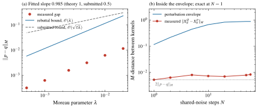
<figcaption class="ltx_caption ltx_centering">Figure 4: Joint versus smoothed proximal kernels.
Left: measured proximal gap and the linear and earlier square-root
upper bounds. The title’s “submitted $0.5$” denotes the exponent of
the earlier upper bound, not a predicted measured slope.
Right: the original single shared-noise realization and the model-gap
envelope. The corrected eight-chain RMS values are in
Table <a href="#A2.T6" title="Table 6 ‣ Exact-kernel comparison. ‣ B.2 Kernel and finite-solver audits ‣ Appendix B JP-IMLA: kernel guarantees and empirical comparisons ‣ Preconditioned Implicit Midpoint Langevin Sampling for Non-Smooth Bayesian Imaging" class="ltx_ref">6</a>; neither panel is a bound on SSE.</figcaption>
</figure>
<figure id="A2.T6" class="ltx_table" style="overflow-y:hidden">
<figcaption class="ltx_caption ltx_centering" style="font-size:90%;">Table 6: Eight-chain kernel comparison at $64^{2}\text{,}$
$\lambda=0.005\text{,}$ $\delta=0.141\text{.}$ The gate predicts an initial RMS
separation $0.00412567\text{;}$ its measured/predicted ratio is $1.0000226\text{.}$</figcaption>
<table class="ltx_tabular ltx_centering ltx_guessed_headers ltx_align_middle">
<thead class="ltx_thead">
<tr class="ltx_tr">
<th class="ltx_td ltx_align_right ltx_th ltx_th_column ltx_th_row ltx_border_tt">$N$</th>
<th class="ltx_td ltx_align_right ltx_th ltx_th_column ltx_border_tt">
RMS $M$-distance
</th>
<th class="ltx_td ltx_align_right ltx_th ltx_th_column ltx_border_tt">Across-chain min–max</th>
<th class="ltx_td ltx_align_right ltx_th ltx_th_column ltx_border_tt">Model envelope</th>
</tr>
</thead>
<tbody class="ltx_tbody">
<tr class="ltx_tr">
<th class="ltx_td ltx_align_right ltx_th ltx_th_row ltx_border_t">1</th>
<td class="ltx_td ltx_align_right ltx_border_t">0.004126</td>
<td class="ltx_td ltx_align_right ltx_border_t">0.002429–0.005619</td>
<td class="ltx_td ltx_align_right ltx_border_t">0.11647</td>
</tr>
<tr class="ltx_tr">
<th class="ltx_td ltx_align_right ltx_th ltx_th_row">10</th>
<td class="ltx_td ltx_align_right">0.007550</td>
<td class="ltx_td ltx_align_right">0.006160–0.008652</td>
<td class="ltx_td ltx_align_right">0.66887</td>
</tr>
<tr class="ltx_tr">
<th class="ltx_td ltx_align_right ltx_th ltx_th_row ltx_border_bb">60</th>
<td class="ltx_td ltx_align_right ltx_border_bb">0.007132</td>
<td class="ltx_td ltx_align_right ltx_border_bb">0.005937–0.008315</td>
<td class="ltx_td ltx_align_right ltx_border_bb">0.88406</td>
</tr>
</tbody>
</table>
</figure>
</section>
<section id="A2.SS2.SSS0.Px2" class="ltx_paragraph">
<h4 class="ltx_title ltx_title_paragraph" id="production-budget-certificate">Production-budget certificate.</h4>

At $256^{2}\text{,}$ $\delta=0.141\text{,}$ $\rho_{\rm TV}=0.3\text{,}$ and $\rho_{a}=3\text{,}$
the three-probe reference model-gap scale is $7.16792$ in the reflected
$M$-distance. At an audited warm-start input after 200 preliminary
updates, the production budget $K=12$ gives a measured step error
$2.92717\text{,}$ or $0.408$ times that scale. Its converged reference solve
is recorded in the supplied output. The computable certificate is
$56.87016\text{,}$ or $7.934$ times the same scale: the observed $0.4$ ratio
is a reference-solve comparison, not a certified upper bound.
For $K=100$ the certificate is $2.84233$ ($0.397$ times that scale).
These are pointwise solver audits, not estimates of the expectation
$\mathbb{E}U_{K,j}$ along every step of a production chain.
The latter $K=100$ reference solve did not satisfy its requested stopping
tolerance, so we use its certificate but do not report a “true error”
from that reference. The audit establishes the usefulness of the
certificate without declaring every finite reference solve converged.

</section>
<section id="A2.SS2.SSS0.Px3" class="ltx_paragraph">
<h4 class="ltx_title ltx_title_paragraph" id="inner-budget-sensitivity-and-timings">Inner-budget sensitivity and timings.</h4>

Table <a href="#A2.T7" title="Table 7 ‣ Inner-budget sensitivity and timings. ‣ B.2 Kernel and finite-solver audits ‣ Appendix B JP-IMLA: kernel guarantees and empirical comparisons ‣ Preconditioned Implicit Midpoint Langevin Sampling for Non-Smooth Bayesian Imaging" class="ltx_ref">7</a> uses the saved, paired geometric-phantom
runs with $8$ chains, $N=2000\text{,}$ $X_{0}=0\text{,}$ and time averages accumulated
from the first step. The TRUE Picard reference uses its submitted
$(K_{\rm Picard},K_{\rm inner})=(30,50)\text{;}$ JP varies only its ADMM budget.
These supplementary timings were measured on an RTX 5000 Ada and are
kept separate from the original Blackwell timings below.

<figure id="A2.T7" class="ltx_table" style="overflow-y:hidden">
<figcaption class="ltx_caption ltx_centering" style="font-size:90%;">Table 7: JP inner-budget audit at $256^{2}\text{.}$ SSE is a reconstruction
statistic (mean $\pm$ SE over eight chains), not a kernel-distance
estimate. “Certificate” is the separate warm-input upper bound
in reflected $M$-distance; it does not use a converged reference solve.</figcaption>
<table class="ltx_tabular ltx_centering ltx_guessed_headers ltx_align_middle">
<thead class="ltx_thead">
<tr class="ltx_tr">
<th class="ltx_td ltx_align_left ltx_th ltx_th_column ltx_th_row ltx_border_tt">Method / ADMM budget</th>
<th class="ltx_td ltx_align_right ltx_th ltx_th_column ltx_th_row ltx_border_tt">Per-chain SSE</th>
<th class="ltx_td ltx_align_right ltx_th ltx_th_column ltx_border_tt">Time (min)</th>
<th class="ltx_td ltx_align_right ltx_th ltx_th_column ltx_border_tt">Certificate</th>
</tr>
</thead>
<tbody class="ltx_tbody">
<tr class="ltx_tr">
<th class="ltx_td ltx_align_left ltx_th ltx_th_row ltx_border_t">
JP, $K=12$
</th>
<th class="ltx_td ltx_align_right ltx_th ltx_th_row ltx_border_t">$851.80\pm 0.77$</th>
<td class="ltx_td ltx_align_right ltx_border_t">0.198</td>
<td class="ltx_td ltx_align_right ltx_border_t">56.870</td>
</tr>
<tr class="ltx_tr">
<th class="ltx_td ltx_align_left ltx_th ltx_th_row">
JP, $K=25$
</th>
<th class="ltx_td ltx_align_right ltx_th ltx_th_row">$885.46\pm 0.80$</th>
<td class="ltx_td ltx_align_right">0.386</td>
<td class="ltx_td ltx_align_right">–</td>
</tr>
<tr class="ltx_tr">
<th class="ltx_td ltx_align_left ltx_th ltx_th_row">
JP, $K=50$
</th>
<th class="ltx_td ltx_align_right ltx_th ltx_th_row">$899.52\pm 0.82$</th>
<td class="ltx_td ltx_align_right">0.715</td>
<td class="ltx_td ltx_align_right">–</td>
</tr>
<tr class="ltx_tr">
<th class="ltx_td ltx_align_left ltx_th ltx_th_row">
JP, $K=100$
</th>
<th class="ltx_td ltx_align_right ltx_th ltx_th_row">$904.23\pm 0.83$</th>
<td class="ltx_td ltx_align_right">1.348</td>
<td class="ltx_td ltx_align_right">2.842</td>
</tr>
<tr class="ltx_tr">
<th class="ltx_td ltx_align_left ltx_th ltx_th_row">
JP, $K=200$
</th>
<th class="ltx_td ltx_align_right ltx_th ltx_th_row">$905.40\pm 0.83$</th>
<td class="ltx_td ltx_align_right">2.904</td>
<td class="ltx_td ltx_align_right">–</td>
</tr>
<tr class="ltx_tr">
<th class="ltx_td ltx_align_left ltx_th ltx_th_row ltx_border_bb">TRUE Picard</th>
<th class="ltx_td ltx_align_right ltx_th ltx_th_row ltx_border_bb">$854.49\pm 0.76$</th>
<td class="ltx_td ltx_align_right ltx_border_bb">25.240</td>
<td class="ltx_td ltx_align_right ltx_border_bb">–</td>
</tr>
</tbody>
</table>
</figure>

The near agreement of JP at $K=12$ with TRUE Picard changes as the inner
budget increases: the SSE offset is $-0.32\%$ at $K=12$ and $+5.96\%$
at $K=200\text{.}$ This is consistent with partial cancellation between solver
and model errors at the production budget. It does not establish
equality of the invariant laws, and the $M$-distance bound in
Proposition <a href="#Thmtheorem15" title="Proposition 15 (Linear proximal and kernel gap). ‣ B.1 Kernel guarantees for JP-IMLA ‣ Appendix B JP-IMLA: kernel guarantees and empirical comparisons ‣ Preconditioned Implicit Midpoint Langevin Sampling for Non-Smooth Bayesian Imaging" class="ltx_ref">15</a> is not a relative-SSE bound.
The original production setting is retained; the larger budgets serve
to expose this sensitivity and to report a tighter certificate.

</section>
<section id="A2.SS2.SSS0.Px4" class="ltx_paragraph">
<h4 class="ltx_title ltx_title_paragraph" id="reproducibility">Reproducibility.</h4>

The eight-chain output is
rebuttal/R4/exp_r4_jp_kernel_K8_20260727.json.
The certificate and budget-sweep scripts and JSON outputs are in
rebuttal/R4/;
rebuttal/R4/README_camera_ready.md gives the commands, fixed
configurations, and reference-convergence limitations. The audit
scripts preserve raw outputs and write new checks to separate paths.

</section>
</section>
<section id="A2.SS3" class="ltx_subsection">
<h3 class="ltx_title ltx_title_subsection" id="finite-budget-comparison-at-early-n">
B.3 Finite-budget comparison at early-$N$
</h3>

We run JP-IMLA on the geometric phantom under the same protocol as the body’s TRUE-Picard headline benchmark—same $\sigma_{\mathrm{blur}}\text{,}$ $\sigma_{\mathrm{noise}}\text{,}$ $\rho_{\mathrm{TV}}\text{,}$ $\delta=0.141\text{,}$ $\lambda=5\!\times\!10^{-3}\text{,}$ $K=8$ chains from $X_{0}=0\text{,}$ and <em class="ltx_emph ltx_font_italic">matched seed base</em>—so that JP and TRUE trajectories are directly comparable per chain. These are reconstruction and mixing diagnostics; Proposition <a href="#Thmtheorem15" title="Proposition 15 (Linear proximal and kernel gap). ‣ B.1 Kernel guarantees for JP-IMLA ‣ Appendix B JP-IMLA: kernel guarantees and empirical comparisons ‣ Preconditioned Implicit Midpoint Langevin Sampling for Non-Smooth Bayesian Imaging" class="ltx_ref">15</a> bounds reflected proximal distance, not relative SSE.

<figure id="A2.F5" class="ltx_figure">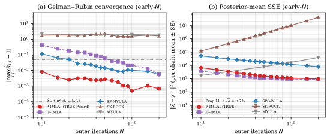
<figcaption class="ltx_caption ltx_centering">Figure 5: Finite-budget JP/Picard comparison at early-$N\text{.}$ (a) Classical per-pixel $\hat{R}$ from the common zero start. (b) Per-chain reconstruction SSE. At $N=200\text{,}$ JP gives $888.28\pm 2.63$ versus Picard’s $972.09\pm 2.62\text{,}$ an $8.6\%$ difference. The shaded percentage band is a visual guide from the original plot, not a consequence of a proximal or Wasserstein bound; it does not certify relative SSE.</figcaption>
</figure>
<section id="A2.SS3.SSS0.Px1" class="ltx_paragraph">
<h4 class="ltx_title ltx_title_paragraph" id="wall-clock-per-outer-iteration">Wall-clock per outer iteration.</h4>

At $256\times 256$ on an NVIDIA RTX PRO 6000 Blackwell, the recorded JP implementation averages $35.0$ ms per iteration against Picard’s $2.11$ s, approximately $60{\times}\text{.}$ The headline Picard budget is $(K_{\mathrm{P}},K_{\mathrm{in}})=(30,50)\text{,}$ while JP uses $K=12$ ADMM steps. These are implementation timings under the recorded parallel workloads, not a complexity ratio at matched certified accuracy. Table <a href="#A2.T7" title="Table 7 ‣ Inner-budget sensitivity and timings. ‣ B.2 Kernel and finite-solver audits ‣ Appendix B JP-IMLA: kernel guarantees and empirical comparisons ‣ Preconditioned Implicit Midpoint Langevin Sampling for Non-Smooth Bayesian Imaging" class="ltx_ref">7</a> reports separate RTX 5000 Ada budget-sweep timings and certificates at audited warm inputs; those pointwise certificates do not certify every step of the plotted production runs.

</section>
</section>
<section id="A2.SS4" class="ltx_subsection">
<h3 class="ltx_title ltx_title_subsection" id="imaging-scale-comparison">
B.4 Imaging-scale comparison</h3>

We extend the matched-budget benchmark of §<a href="#S5" title="5 Experiments ‣ Preconditioned Implicit Midpoint Langevin Sampling for Non-Smooth Bayesian Imaging" class="ltx_ref">5</a> to JP-IMLA on all three phantoms used in Table <a href="#S5.T4" title="Table 4 ‣ 5 Experiments ‣ Preconditioned Implicit Midpoint Langevin Sampling for Non-Smooth Bayesian Imaging" class="ltx_ref">4</a> (geometric, cameraman, Shepp–Logan), at $N=2{,}000$ on RTX PRO 6000 Blackwell, with seed offsets matching the canonical TRUE-Picard runs.

<figure id="A2.F6" class="ltx_figure">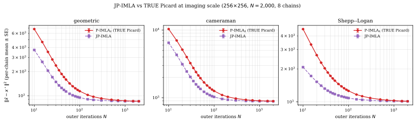
<figcaption class="ltx_caption ltx_centering">Figure 6: JP-IMLA tracks TRUE Picard at imaging scale across three phantom morphologies. Per-chain SSE means $\pm$ SE; both samplers run the same $N=2{,}000$-iteration matched-budget protocol. The TRUE/JP traces are visually indistinguishable for $N\geq 200$ on all three phantoms. JP uses the original $K=12$ budget; Table <a href="#A2.T7" title="Table 7 ‣ Inner-budget sensitivity and timings. ‣ B.2 Kernel and finite-solver audits ‣ Appendix B JP-IMLA: kernel guarantees and empirical comparisons ‣ Preconditioned Implicit Midpoint Langevin Sampling for Non-Smooth Bayesian Imaging" class="ltx_ref">7</a> separately reports budget sensitivity and pointwise certificates.</figcaption>
</figure>
<figure id="A2.T8" class="ltx_table" style="overflow-y:hidden">
<figcaption class="ltx_caption ltx_centering" style="font-size:90%;">Table 8: Cross-phantom JP-IMLA vs TRUE Picard at $N=2{,}000\text{.}$ Per-chain SSE means $\pm$ SE (JP: eight chains; Picard: eight geometric and four per other phantom). The kernels and finite inner solvers differ. Relative SSE is a reconstruction statistic, not a distributional error bound.</figcaption>
<table class="ltx_tabular ltx_centering ltx_guessed_headers ltx_align_middle">
<thead class="ltx_thead">
<tr class="ltx_tr">
<th class="ltx_td ltx_align_left ltx_th ltx_th_column ltx_th_row ltx_border_tt">Phantom</th>
<th class="ltx_td ltx_align_center ltx_th ltx_th_column ltx_border_tt">TRUE Picard SSE</th>
<th class="ltx_td ltx_align_center ltx_th ltx_th_column ltx_border_tt">JP-IMLA SSE</th>
<th class="ltx_td ltx_nopad_r ltx_align_center ltx_th ltx_th_column ltx_border_tt">
Drift (JP/TRUE $-1$)
</th>
</tr>
</thead>
<tbody class="ltx_tbody">
<tr class="ltx_tr">
<th class="ltx_td ltx_align_left ltx_th ltx_th_row ltx_border_t">geometric</th>
<td class="ltx_td ltx_align_center ltx_border_t">$855.22\pm 0.66$</td>
<td class="ltx_td ltx_align_center ltx_border_t">$852.72\pm 0.65$</td>
<td class="ltx_td ltx_nopad_r ltx_align_center ltx_border_t">$-0.29\%$</td>
</tr>
<tr class="ltx_tr">
<th class="ltx_td ltx_align_left ltx_th ltx_th_row">cameraman</th>
<td class="ltx_td ltx_align_center">$890.24\pm 1.19$</td>
<td class="ltx_td ltx_align_center">$884.52\pm 0.62$</td>
<td class="ltx_td ltx_nopad_r ltx_align_center">$-0.64\%$</td>
</tr>
<tr class="ltx_tr">
<th class="ltx_td ltx_align_left ltx_th ltx_th_row ltx_border_bb">Shepp–Logan</th>
<td class="ltx_td ltx_align_center ltx_border_bb">$1{,}013.99\pm 0.81$</td>
<td class="ltx_td ltx_align_center ltx_border_bb">$1{,}012.27\pm 0.63$</td>
<td class="ltx_td ltx_nopad_r ltx_align_center ltx_border_bb">$-0.17\%$</td>
</tr>
</tbody>
</table>
</figure>

At these finite budgets, the reported JP and Picard SSEs differ by at most $0.7\%\text{.}$ This agreement does not imply equality of invariant laws or uniform solver accuracy; the model and finite-ADMM terms are quantified separately in Appendix <a href="#A2.SS1" title="B.1 Kernel guarantees for JP-IMLA ‣ Appendix B JP-IMLA: kernel guarantees and empirical comparisons ‣ Preconditioned Implicit Midpoint Langevin Sampling for Non-Smooth Bayesian Imaging" class="ltx_ref">B.1</a>.

</section>
</section>
<section id="A3" class="ltx_appendix">
<h2 class="ltx_title ltx_title_appendix" id="auxiliary-experimental-results">
Appendix C Auxiliary experimental results</h2>

This appendix collects (a) validation experiments for Theorems <a href="#Thmtheorem2" title="Theorem 2 (Gaussian exactness). ‣ 4.1 Gaussian exactness and Cayley contraction ‣ 4 The Theory of P-IMLA ‣ Preconditioned Implicit Midpoint Langevin Sampling for Non-Smooth Bayesian Imaging" class="ltx_ref">2</a>–<a href="#Thmtheorem5" title="Theorem 5 (Drift-only BEA bias). ‣ 4.3 Sharp drift-only bias via backward error analysis ‣ 4 The Theory of P-IMLA ‣ Preconditioned Implicit Midpoint Langevin Sampling for Non-Smooth Bayesian Imaging" class="ltx_ref">5</a> that the main-text §<a href="#S5" title="5 Experiments ‣ Preconditioned Implicit Midpoint Langevin Sampling for Non-Smooth Bayesian Imaging" class="ltx_ref">5</a> summarises in one sentence, and (b) intermediate-checkpoint reconstructions for the matched-budget benchmark of Figure <a href="#S5.F3" title="Figure 3 ‣ 5 Experiments ‣ Preconditioned Implicit Midpoint Langevin Sampling for Non-Smooth Bayesian Imaging" class="ltx_ref">3</a>.

<section id="A3.SS0.SSS0.Px1" class="ltx_paragraph">
<h4 class="ltx_title ltx_title_paragraph" id="geometric--and-shepplogan-phantom-imaging-panels">Geometric- and Shepp–Logan-phantom imaging panels.</h4>

<figure id="A3.F7" class="ltx_figure">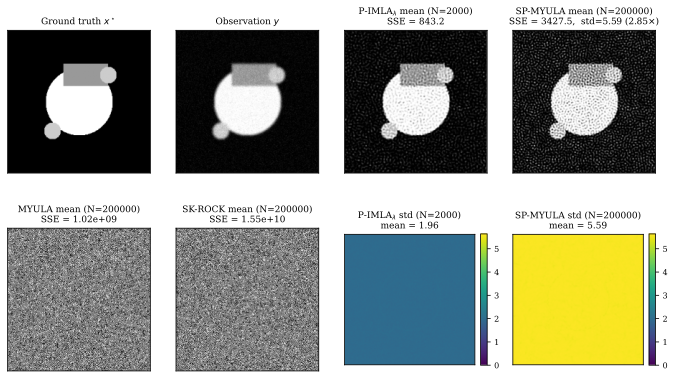
<figcaption class="ltx_caption ltx_centering">Figure 7: Geometric phantom counterpart to main-text Figure <a href="#S5.F3" title="Figure 3 ‣ 5 Experiments ‣ Preconditioned Implicit Midpoint Langevin Sampling for Non-Smooth Bayesian Imaging" class="ltx_ref">3</a>, matched-budget reconstructions: ours at $N=2{,}000$ (top right; ensemble SSE $843.1\text{,}$ std mean $1.95$); SP-MYULA / MYULA / SK-ROCK at $N=2\!\times\!10^{5}\text{.}$ Same structural conclusions as the cameraman panel apply: ours recovers the four phantom regions cleanly, SP-MYULA’s mean is similar but std uniformly inflated $\sim$$2.86\!{\times}\text{,}$ MYULA and SK-ROCK mean fields are unrecognisable.</figcaption>
</figure>
</section>
<section id="A3.SS0.SSS0.Px2" class="ltx_paragraph">
<h4 class="ltx_title ltx_title_paragraph" id="p-imlaλ-recovery-at-intermediate-n-geometric">P-IMLAλ recovery at intermediate $N$ (geometric).</h4>

Figure <a href="#A3.F7" title="Figure 7 ‣ Geometric- and Shepp–Logan-phantom imaging panels. ‣ Appendix C Auxiliary experimental results ‣ Preconditioned Implicit Midpoint Langevin Sampling for Non-Smooth Bayesian Imaging" class="ltx_ref">7</a> shows the headline pair $N_{\mathrm{ours}}=2{,}000$ vs $N_{\mathrm{base}}=2\!\times\!10^{5}\text{.}$ Identically rendered panels at $N_{\mathrm{ours}}\in\{10,50,100,200,500,1000\}$ (each paired with the corresponding $100\!\times$ baseline budget) are provided in the supplementary material. Visual quality stabilises by $N\approx 200$ (where $\hat{R}=1.0004$); $N=10$ and $N=50$ show partial mixing artefacts. The contraction timescale $N\approx 22$ does not predict a threshold for $\hat{R}$ or visual quality.

Uncertainty conventions are experiment-specific. For averages over $K$ independent seeds, $\mathrm{SE}$ denotes the sample standard deviation divided by $\sqrt{K}\text{;}$ single-chain batch-means errors and deterministic calculations are identified separately below.

</section>
<section id="A3.SS0.SSS0.Px3" class="ltx_paragraph">
<h4 class="ltx_title ltx_title_paragraph" id="sampler-naming-conventions">Sampler naming conventions.</h4>

Throughout this appendix we use <em class="ltx_emph ltx_font_italic">SP-IMLA</em> for the smooth-target P-IMLA of (<a href="#S3.E9" title="In 3 The P-IMLA Algorithm ‣ Preconditioned Implicit Midpoint Langevin Sampling for Non-Smooth Bayesian Imaging" class="ltx_ref">9</a>) with $M=H\text{;}$ <em class="ltx_emph ltx_font_italic">SP-ULA</em> for the corresponding explicit-Euler scheme $X_{n+1}=X_{n}-\delta M^{-1}\nabla f(X_{n})+\sqrt{2\delta}\,M^{-1/2}\xi_{n}$ at $M=H\text{;}$ and <em class="ltx_emph ltx_font_italic">SP-MYULA</em> for the explicit-Euler counterpart of P-IMLAλ on the same $M$-norm-Moreau-smoothed potential $U_{\lambda}=f+g^{\lambda,M}\text{:}$

<table id="A3.E45" class="ltx_equation ltx_eqn_table">

<tbody><tr class="ltx_equation ltx_eqn_row ltx_align_baseline">
<td class="ltx_eqn_cell ltx_eqn_center_padleft"></td>
<td class="ltx_eqn_cell ltx_align_center">$$X_{n+1}\;=\;X_{n}-\delta M^{-1}\nabla U_{\lambda}(X_{n})+\sqrt{2\delta}\,M^{-1/2}\xi_{n},\qquad M=H,$$</td>
<td class="ltx_eqn_cell ltx_eqn_center_padright"></td>
<td rowspan="1" class="ltx_eqn_cell ltx_eqn_eqno ltx_align_middle ltx_align_right">(45)</td>
</tr></tbody>
</table>

identical to MYULA <cite class="ltx_cite ltx_citemacro_citep">[Durmus et al., <a href="#bib.bib1" title="Efficient Bayesian computation by proximal Markov chain Monte Carlo: when Langevin meets Moreau" class="ltx_ref">2018</a>]</cite> except (i) the Moreau envelope is taken in the $M$-norm matching the preconditioner geometry (matching the body’s convention), and (ii) the drift and noise are preconditioned by $M^{-1}$ and $M^{-1/2}$ respectively. SP-MYULA isolates the effect of midpoint vs. Euler integration with preconditioner choice, Moreau parameterisation, and noise injection all matched to P-IMLAλ, the observed SSE gap also depends on finite-solver accuracy and initial transients.

</section>
<section id="A3.SS1" class="ltx_subsection">
<h3 class="ltx_title ltx_title_subsection" id="variance-budget-identity-theorem-2-and-proposition-1">
C.1 Variance-budget identity (Theorem <a href="#Thmtheorem2" title="Theorem 2 (Gaussian exactness). ‣ 4.1 Gaussian exactness and Cayley contraction ‣ 4 The Theory of P-IMLA ‣ Preconditioned Implicit Midpoint Langevin Sampling for Non-Smooth Bayesian Imaging" class="ltx_ref">2</a> and Proposition <a href="#Thmtheorem1" title="Proposition 1 (P-ULA variance inflation at preconditioned step sizes). ‣ Whitening. ‣ 2.1 Problem setup and preconditioned Langevin ‣ 2 Background ‣ Preconditioned Implicit Midpoint Langevin Sampling for Non-Smooth Bayesian Imaging" class="ltx_ref">1</a>)</h3>

We test the variance-budget identity (<a href="#S1.E2" title="In 1 Introduction ‣ Preconditioned Implicit Midpoint Langevin Sampling for Non-Smooth Bayesian Imaging" class="ltx_ref">2</a>) and the Euler overfill (<a href="#S1.E1" title="In 1 Introduction ‣ Preconditioned Implicit Midpoint Langevin Sampling for Non-Smooth Bayesian Imaging" class="ltx_ref">1</a>) on two settings: (a) a 1-D Gaussian $f(x)=x^{2}/2$ at $M=1\text{,}$ swept across eight step sizes $\delta\in[0.1,1.8]\text{;}$ and (b) a $d=100$ anisotropic Gaussian $H=\operatorname{diag}(1,\ldots,100)\text{,}$ $M=H\text{,}$ $\kappa_{\mathrm{eff}}=1\text{.}$ Each sampler runs $N=5\!\times\!10^{6}$ post-burn-in samples. Setup A uses batch-means SEs (batch size $10^{4}$). Setup B computes per-mode variance ratios $\mathrm{VR}_{j}$ from one vector chain in whitened coordinates; the SE of their average is the sample standard deviation across the $100$ independent Gaussian modes divided by $\sqrt{100}\text{.}$

<figure id="A3.T9" class="ltx_table" style="overflow-y:hidden">
<figcaption class="ltx_caption ltx_centering" style="font-size:90%;">Table 9: Variance-budget verification (1-D Gaussian, Setup A). SP-IMLA’s $\mathrm{VR}$ lies in $[0.9978,\,1.0009]$ across all eight $\delta$ ($|z|$-scores $\leq 1.34$); Setup B per-mode average is $0.999937\pm 0.000087\text{.}$ SP-ULA tracks $1/(1-\delta/2)$ to within $0.12\%\text{.}$</figcaption>
<table class="ltx_tabular ltx_centering ltx_guessed_headers ltx_align_middle">
<thead class="ltx_thead">
<tr class="ltx_tr">
<th class="ltx_td ltx_align_center ltx_th ltx_th_column ltx_border_tt" style="padding:0.25pt 9.0pt;">$\delta$</th>
<th class="ltx_td ltx_align_center ltx_th ltx_th_column ltx_border_tt" style="padding:0.25pt 9.0pt;">
SP-IMLA $\mathrm{VR}$
</th>
<th class="ltx_td ltx_align_center ltx_th ltx_th_column ltx_border_tt" style="padding:0.25pt 9.0pt;">
SP-ULA $\mathrm{VR}$
</th>
<th class="ltx_td ltx_nopad_r ltx_align_center ltx_th ltx_th_column ltx_border_tt" style="padding:0.25pt 9.0pt;">
Theory $1/(1-\delta/2)$
</th>
</tr>
</thead>
<tbody class="ltx_tbody">
<tr class="ltx_tr">
<td class="ltx_td ltx_align_center ltx_border_t" style="padding:0.25pt 9.0pt;">$0.1$</td>
<td class="ltx_td ltx_align_center ltx_border_t" style="padding:0.25pt 9.0pt;">$0.99885$</td>
<td class="ltx_td ltx_align_center ltx_border_t" style="padding:0.25pt 9.0pt;">$1.0539$</td>
<td class="ltx_td ltx_nopad_r ltx_align_center ltx_border_t" style="padding:0.25pt 9.0pt;">$1.0526$</td>
</tr>
<tr class="ltx_tr">
<td class="ltx_td ltx_align_center" style="padding:0.25pt 9.0pt;">$0.5$</td>
<td class="ltx_td ltx_align_center" style="padding:0.25pt 9.0pt;">$1.00033$</td>
<td class="ltx_td ltx_align_center" style="padding:0.25pt 9.0pt;">$1.3324$</td>
<td class="ltx_td ltx_nopad_r ltx_align_center" style="padding:0.25pt 9.0pt;">$1.3333$</td>
</tr>
<tr class="ltx_tr">
<td class="ltx_td ltx_align_center" style="padding:0.25pt 9.0pt;">$1.0$</td>
<td class="ltx_td ltx_align_center" style="padding:0.25pt 9.0pt;">$0.99949$</td>
<td class="ltx_td ltx_align_center" style="padding:0.25pt 9.0pt;">$2.0015$</td>
<td class="ltx_td ltx_nopad_r ltx_align_center" style="padding:0.25pt 9.0pt;">$2.0000$</td>
</tr>
<tr class="ltx_tr">
<td class="ltx_td ltx_align_center" style="padding:0.25pt 9.0pt;">$1.5$</td>
<td class="ltx_td ltx_align_center" style="padding:0.25pt 9.0pt;">$0.99953$</td>
<td class="ltx_td ltx_align_center" style="padding:0.25pt 9.0pt;">$3.9986$</td>
<td class="ltx_td ltx_nopad_r ltx_align_center" style="padding:0.25pt 9.0pt;">$4.0000$</td>
</tr>
<tr class="ltx_tr">
<td class="ltx_td ltx_align_center ltx_border_bb" style="padding:0.25pt 9.0pt;">$1.8$</td>
<td class="ltx_td ltx_align_center ltx_border_bb" style="padding:0.25pt 9.0pt;">$0.99941$</td>
<td class="ltx_td ltx_align_center ltx_border_bb" style="padding:0.25pt 9.0pt;">$9.9976$</td>
<td class="ltx_td ltx_nopad_r ltx_align_center ltx_border_bb" style="padding:0.25pt 9.0pt;">$10.000$</td>
</tr>
</tbody>
</table>
</figure>

SP-IMLA’s $\mathrm{VR}$ is statistically indistinguishable from $1$ across an $18$-fold step-size range, confirming the Cayley algebra cancellation (<a href="#S1.E2" title="In 1 Introduction ‣ Preconditioned Implicit Midpoint Langevin Sampling for Non-Smooth Bayesian Imaging" class="ltx_ref">2</a>) to four decimals even at $\delta=1.8\text{,}$ where SP-ULA’s variance has inflated ten-fold. Theorem <a href="#Thmtheorem2" title="Theorem 2 (Gaussian exactness). ‣ 4.1 Gaussian exactness and Cayley contraction ‣ 4 The Theory of P-IMLA ‣ Preconditioned Implicit Midpoint Langevin Sampling for Non-Smooth Bayesian Imaging" class="ltx_ref">2</a> makes no step-size assumption; explicit Euler breaks down precisely in the large-$\delta$ regime that preconditioning calls for.

</section>
<section id="A3.SS2" class="ltx_subsection">
<h3 class="ltx_title ltx_title_subsection" id="quantitative-2times2-landscape-on-a-gaussian-target">
C.2 Quantitative $2\!\times\!2$ landscape on a Gaussian target</h3>

Figure <a href="#S1.F1" title="Figure 1 ‣ 1 Introduction ‣ Preconditioned Implicit Midpoint Langevin Sampling for Non-Smooth Bayesian Imaging" class="ltx_ref">1</a> reports a fixed-budget statistic on the Gaussian setup of <a href="#A3.SS3" title="C.3 Contraction rate and 𝜅_𝑓-independence (Theorem 3) ‣ Appendix C Auxiliary experimental results ‣ Preconditioned Implicit Midpoint Langevin Sampling for Non-Smooth Bayesian Imaging" class="ltx_ref">C.3</a>. Explicit Euler is either slow at stable steps or unstable beyond its spectral boundary. Both midpoint schemes have the exact Gaussian invariant law with exact proximal solves. For unpreconditioned IMLA, low-curvature modes retain their initial-mean error over the reported horizon: $98.7\%$ of the displayed VR $=48.6$ is transient, while the post-burn-in stationary ratio is $1.000\text{.}$ The quantity is a time-averaged normalised mean-square error, not stationary variance inflation. Preconditioning reduces the relevant condition number and shortens that transient. Appendix <a href="#A4.SS5" title="D.5 What the finite-budget Gaussian statistic measures ‣ Appendix D Additional bias, convergence and posterior-model checks ‣ Preconditioned Implicit Midpoint Langevin Sampling for Non-Smooth Bayesian Imaging" class="ltx_ref">D.5</a> gives the exact AR(1) decomposition and its stationary-start check.

</section>
<section id="A3.SS3" class="ltx_subsection">
<h3 class="ltx_title ltx_title_subsection" id="contraction-rate-and-kappa-f-independence-theorem-3">
C.3 Contraction rate and $\kappa_{f}$-independence (Theorem <a href="#Thmtheorem3" title="Theorem 3 (𝑀-norm Wasserstein contraction). ‣ 4.2 Contraction of the reflected proximal map ‣ 4 The Theory of P-IMLA ‣ Preconditioned Implicit Midpoint Langevin Sampling for Non-Smooth Bayesian Imaging" class="ltx_ref">3</a>)</h3>

<figure id="A3.F8" class="ltx_figure">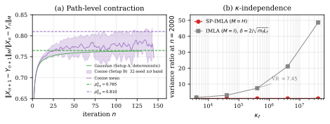
<figcaption class="ltx_caption ltx_centering">Figure 8: (a) Path-level contraction ratio $\|X_{n+1}-Y_{n+1}\|_{M}/\|X_{n}-Y_{n}\|_{M}$ for two chains driven by shared noise. Setup A (Gaussian, deterministic) attains mean ratio $0.7544\text{,}$ $98.65\%$ of the bound $\rho_{\mathrm{thy}}=0.7647\text{.}$ Setup B (32 independent seeds, $d=50$ cosine-perturbed target $f+0.3\sum_{j}(\cos x_{j}-1)$) gives seed-mean max ratio $0.8074\pm 0.0015$ vs the strict bound $\rho_{B}=0.8100$ ($1.73$ SE below). Shading shows one standard deviation across seeds; quoted uncertainties are SEs. (b) Cold-start time-averaged normalized MSE over $n=2000$ iterations as $\kappa_{f}$ varies over four orders of magnitude (Exp 04, 32 independent seeds, $M=H$). SP-IMLA’s $\mathrm{VR}^{\mathrm{mode}}=1.0246\pm 0.0001$ across $\kappa_{f}\in[4\!\times\!10^{3},\,4\!\times\!10^{7}]\text{;}$ IMLA grows monotonically from $\mathrm{VR}=7.449$ to $48.6\text{.}$ These values include the initial-mean transient; both exact midpoint kernels preserve Gaussian stationary variance (Appendix <a href="#A4.SS5" title="D.5 What the finite-budget Gaussian statistic measures ‣ Appendix D Additional bias, convergence and posterior-model checks ‣ Preconditioned Implicit Midpoint Langevin Sampling for Non-Smooth Bayesian Imaging" class="ltx_ref">D.5</a>).</figcaption>
</figure>

The path-level panel verifies the deterministic contraction inequality of Theorem <a href="#Thmtheorem3" title="Theorem 3 (𝑀-norm Wasserstein contraction). ‣ 4.2 Contraction of the reflected proximal map ‣ 4 The Theory of P-IMLA ‣ Preconditioned Implicit Midpoint Langevin Sampling for Non-Smooth Bayesian Imaging" class="ltx_ref">3</a>: at every iteration the $M$-norm separation contracts to within float precision, with Gaussians approaching the contraction bound more tightly than the cosine target ($98.65\%$ vs $93.13\%$)—quantitative evidence that Gaussian targets attain the bound (Theorem <a href="#Thmtheorem3" title="Theorem 3 (𝑀-norm Wasserstein contraction). ‣ 4.2 Contraction of the reflected proximal map ‣ 4 The Theory of P-IMLA ‣ Preconditioned Implicit Midpoint Langevin Sampling for Non-Smooth Bayesian Imaging" class="ltx_ref">3</a>). The $\kappa$-independence panel verifies the resulting $\sqrt{\kappa_{\mathrm{eff}}}$ rate at the mixing-rate optimum (Remark <a href="#Thmtheorem7" title="Remark 7 (Precision protocol). ‣ 4.4 End-to-end error budget for non-smooth targets ‣ 4 The Theory of P-IMLA ‣ Preconditioned Implicit Midpoint Langevin Sampling for Non-Smooth Bayesian Imaging" class="ltx_ref">7</a>): the $\sqrt{\kappa_{f}}$ dependence the IMLA curve exhibits is replaced under preconditioning by a constant.

</section>
<section id="A3.SS4" class="ltx_subsection">
<h3 class="ltx_title ltx_title_subsection" id="joint-smoothing-and-step-size-sweep-at-imaging-scale">
C.4 Joint smoothing and step-size sweep at imaging scale</h3>

A $\lambda$-sweep at the same $256\!\times\!256$ setting over a $200$-fold range $\lambda\in[10^{-3},\,0.2]$ (Exp 10) exhibits two robust empirical features: (i) $\kappa_{\mathrm{eff}}^{\lambda}=1+1/\lambda$ matches the measured spectrum at every $\lambda$ to four significant figures, while MYULA’s $\kappa_{\mathrm{eff}}$ remains four orders of magnitude larger; (ii) $\mathrm{ESS}/\text{iter}$ saturates at $1.00$ for $\lambda\geq 5\!\times\!10^{-3}\text{.}$ The sweep traces a joint $(\delta_{\lambda}^{\star},\rho_{a}^{\star})$ schedule rather than independently varying $\lambda$ in the inner solver; Term III’s $\sqrt{\lambda}$ scaling is verified directly in 1-D in §<a href="#A3.SS9" title="C.9 Term III √𝜆 scaling on polyhedral 𝑔 ‣ Appendix C Auxiliary experimental results ‣ Preconditioned Implicit Midpoint Langevin Sampling for Non-Smooth Bayesian Imaging" class="ltx_ref">C.9</a> (Remark <a href="#Thmtheorem8" title="Remark 8 (Gaussian duality and polyhedral tightness). ‣ 4.4 End-to-end error budget for non-smooth targets ‣ 4 The Theory of P-IMLA ‣ Preconditioned Implicit Midpoint Langevin Sampling for Non-Smooth Bayesian Imaging" class="ltx_ref">8</a>).

</section>
<section id="A3.SS5" class="ltx_subsection">
<h3 class="ltx_title ltx_title_subsection" id="step-size-robustness-and-the-antithetic-regime">
C.5 Step-size robustness and the antithetic regime</h3>

Sweeping $\delta$ on a $64\!\times\!64$ non-smooth benchmark (same $M=\hat{H}\text{,}$ $\lambda=5\!\times\!10^{-3}\text{,}$ $\delta^{\star}=2/\sqrt{m_{M}L_{\lambda}}\approx 0.141$), we observe a regime not predicted by Theorem <a href="#Thmtheorem3" title="Theorem 3 (𝑀-norm Wasserstein contraction). ‣ 4.2 Contraction of the reflected proximal map ‣ 4 The Theory of P-IMLA ‣ Preconditioned Implicit Midpoint Langevin Sampling for Non-Smooth Bayesian Imaging" class="ltx_ref">3</a>’s worst-case bound. The Cayley factor $r(\ell)$ is negative for eigenvalues $\ell&gt;2/\delta\text{,}$ allowing alternating-sign correlations. At $\delta&gt;\delta^{\star}\text{,}$ the reported effective-sample-size per iteration (Geyer initial-positive-sequence estimator, capped at one in our implementation) plateaus at $\mathrm{ESS}/\text{iter}=1.00$ for $\delta\in[0.2,\,1.0]$ (Figure <a href="#A3.F9" title="Figure 9 ‣ C.5 Step-size robustness and the antithetic regime ‣ Appendix C Auxiliary experimental results ‣ Preconditioned Implicit Midpoint Langevin Sampling for Non-Smooth Bayesian Imaging" class="ltx_ref">9</a>), an order-of-magnitude robustness range beyond $\delta^{\star}\text{.}$ The Wasserstein contraction of Theorem <a href="#Thmtheorem3" title="Theorem 3 (𝑀-norm Wasserstein contraction). ‣ 4.2 Contraction of the reflected proximal map ‣ 4 The Theory of P-IMLA ‣ Preconditioned Implicit Midpoint Langevin Sampling for Non-Smooth Bayesian Imaging" class="ltx_ref">3</a> does not forbid this—$|r(L_{\lambda})|\to 1$ as $\delta\to\infty$—but at finite $\delta$ alternating-sign autocorrelations can reduce variance without improving the worst-case path-level bound. A signed analysis of this regime is an open problem.

<figure id="A3.F9" class="ltx_figure">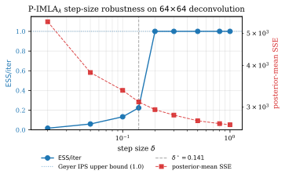
<figcaption class="ltx_caption ltx_centering">Figure 9: Step-size robustness of P-IMLAλ on $64\!\times\!64$ deconvolution. $\mathrm{ESS}/\mathrm{iter}$ rises through the worst-case $\delta^{\star}=0.141$ and <em class="ltx_emph ltx_font_italic">saturates at $1.00$</em> (implementation cap) across $\delta\in[0.2,\,1.0]\text{.}$ Posterior-mean SSE remains bounded across the same range. The negative-Cayley antithetic regime at $\delta&gt;\delta^{\star}$ produces alternating-sign autocorrelations that the reflected-proximal contraction bound of Theorem <a href="#Thmtheorem3" title="Theorem 3 (𝑀-norm Wasserstein contraction). ‣ 4.2 Contraction of the reflected proximal map ‣ 4 The Theory of P-IMLA ‣ Preconditioned Implicit Midpoint Langevin Sampling for Non-Smooth Bayesian Imaging" class="ltx_ref">3</a> (which uses $|r(L_{M})|$) does not capture; a signed analysis closing this gap is an open problem.</figcaption>
</figure>
</section>
<section id="A3.SS6" class="ltx_subsection">
<h3 class="ltx_title ltx_title_subsection" id="beyond-fourier-diagonal-forward-operators-random-fan-beam">
C.6 Beyond Fourier-diagonal forward operators (random fan-beam)</h3>

To verify that the framework is not specific to circulant forward operators, we re-run the matched-budget protocol of §<a href="#S5" title="5 Experiments ‣ Preconditioned Implicit Midpoint Langevin Sampling for Non-Smooth Bayesian Imaging" class="ltx_ref">5</a> with a non-Fourier $A\text{.}$ Setup: $64\!\times\!64$ image ($d=4{,}096$), $m=4{,}096$ random fan-beam projection lines through the image domain (sparse $A\in\mathbb{R}^{m\times d}$ with $\sim\!2.51\!\times\!10^{5}$ nonzero entries, $\sim$$64$ pixels per ray); Gaussian noise $\sigma_{\mathrm{noise}}=0.05\text{;}$ TV regulariser $\rho_{\mathrm{TV}}=0.3\text{,}$ $\lambda=5\!\times\!10^{-3}\text{,}$ $\delta=0.141$ as in the headline benchmark. The preconditioner is a randomised Nyström <cite class="ltx_cite ltx_citemacro_citep">[Frangella et al., <a href="#bib.bib20" title="Randomized Nyström preconditioning" class="ltx_ref">2023</a>]</cite> approximation $M=U\Lambda U^{\top}+\beta I$ of $A^{\top}A/\sigma_{\mathrm{noise}}^{2}$ at rank $r=128\text{;}$ the inner Picard $u$-update (<a href="#S3.E13" title="In 3 The P-IMLA Algorithm ‣ Preconditioned Implicit Midpoint Langevin Sampling for Non-Smooth Bayesian Imaging" class="ltx_ref">13</a>) is no longer Fourier-diagonal, so we replace it by $K_{\mathrm{cg}}=12$ steps of conjugate gradient on the SPD operator $L=(1/\lambda)M+\rho_{a}D^{\top}D$ with relative tolerance $10^{-6}\text{.}$ This auxiliary run uses $(K_{\mathrm{P}},K_{\mathrm{in}})=(8,15)$ and ADMM warm starts, a separate inner-solver budget from the headline $(30,50)$ protocol.

Matched-budget result. P-IMLAλ runs $K=8$ chains for $N=300$ outer iterations; SP-MYULA runs $K=4$ chains for $N=30{,}000$ ($100\!\times$ iteration ratio). P-IMLAλ first crosses $\hat{R}&lt;1.05$ at the second checkpoint $N=5$ ($\hat{R}=1.0485$) and reaches $\hat{R}=0.9990$ at $N=300\text{,}$ with per-chain SSE $36.99\pm 0.23\text{;}$ SP-MYULA crosses $\hat{R}&lt;1.05$ at $N=10$ ($\hat{R}=1.0190$) and reaches $\hat{R}=1.0000$ at $N=30{,}000$ with per-chain SSE $38.94\pm 0.14\text{.}$ Wall-clocks are $10.1$–$20.8$ min/chain for ours and $137.4$ min/chain for SP-MYULA, a $6.5\!-\!13.7\!\times$ difference under the stated iteration allocation. The SP-MYULA/P-IMLA SSE ratio is $1.05$ ($38.94/36.99$). These finite-budget results demonstrate operation beyond Fourier-diagonal models; they do not measure stationary bias or establish a $100\!\times$ mixing-rate improvement. The TV envelope does not satisfy Theorem <a href="#Thmtheorem5" title="Theorem 5 (Drift-only BEA bias). ‣ 4.3 Sharp drift-only bias via backward error analysis ‣ 4 The Theory of P-IMLA ‣ Preconditioned Implicit Midpoint Langevin Sampling for Non-Smooth Bayesian Imaging" class="ltx_ref">5</a>’s smoothness assumptions. At rank $r=128\ll d=4{,}096\text{,}$ the Nyström $M$ leaves the orthogonal-complement modes essentially un-preconditioned. Image-scale CT/MRI validation with rank matched to the spectrum remains open (Appendix <a href="#A5" title="Appendix E Limitations and open problems ‣ Preconditioned Implicit Midpoint Langevin Sampling for Non-Smooth Bayesian Imaging" class="ltx_ref">E</a>).

</section>
<section id="A3.SS7" class="ltx_subsection">
<h3 class="ltx_title ltx_title_subsection" id="formal-drift-only-coefficient-quartic-stress-tests">
C.7 Formal drift-only coefficient: quartic stress tests</h3>

We illustrate the formal drift-only coefficient on the 1-D target $\pi\propto e^{-f(x)}$ with $f(x)=x^{2}/2+\varepsilon\,x^{4}/24\text{,}$ choosing the observable $\varphi(x)=x^{2}\text{.}$ Then $h(x)=f^{\prime\prime}(x)=1+(\varepsilon/2)\,x^{2}$ and $\mathrm{Cov}_{\pi}(h,\varphi)=(\varepsilon/2)\,\mathrm{Var}_{\pi}(x^{2})\text{,}$ so the predicted leading bias coefficient is $c_{1}=(\varepsilon/8)\,\mathrm{Var}_{\pi}(x^{2})$ with $\mathrm{Var}_{\pi}(x^{2})$ computed by quadrature. Each plotted point uses one P-IMLA chain with $N=5\!\times\!10^{6}$ post-burn-in iterations; the figure displays point estimates without error bars. The implementation computes batch-means SEs with batch size $5{,}000\text{;}$ its separate Richardson coefficient check reports SEs across $32$ independent seeds, without bootstrap resampling.

<figure id="A3.F10" class="ltx_figure">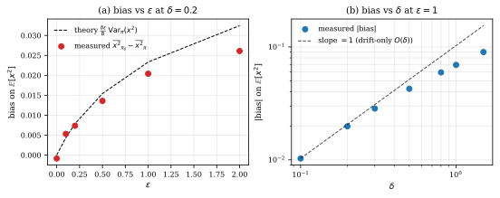
<figcaption class="ltx_caption ltx_centering">Figure 10: Formal drift-only coefficient on a 1-D quartic test target. (a) At fixed $\delta\text{,}$ measured bias estimates on $\mathbb{E}[x^{2}]$ are compared with the leading-order prediction $\delta\varepsilon/8\cdot\mathrm{Var}_{\pi}(x^{2})\text{;}$ no uncertainty bars are displayed. (b) At fixed $\varepsilon\text{,}$ the bias scales as $\delta^{1}$ on log–log axes (reference dashed line), consistent with a leading $O(\delta)$ weak bias. Drift-only refers to the differential order of the defect; P-ULA also has a leading $O(\delta)$ weak bias (Appendix <a href="#A1.SS4" title="A.4 P-ULA backward error analysis ‣ Appendix A Full Proofs from Section 4 ‣ Preconditioned Implicit Midpoint Langevin Sampling for Non-Smooth Bayesian Imaging" class="ltx_ref">A.4</a>).</figcaption>
</figure>

This quartic target is not globally $L$-smooth, so the experiment illustrates the coefficient outside the stated theorem assumptions; the globally smooth $d=256$ test is in App. <a href="#A4" title="Appendix D Additional bias, convergence and posterior-model checks ‣ Preconditioned Implicit Midpoint Langevin Sampling for Non-Smooth Bayesian Imaging" class="ltx_ref">D</a>. The empirical $\delta$-slope of $1.00$ (panel b) and the linear $\varepsilon$-fit (panel a) jointly confirm the leading-order coefficient predicted by the BEA expansion of §<a href="#A1.SS3" title="A.3 Proof of Theorem 5 and its refinements ‣ Appendix A Full Proofs from Section 4 ‣ Preconditioned Implicit Midpoint Langevin Sampling for Non-Smooth Bayesian Imaging" class="ltx_ref">A.3</a>.

<section id="A3.SS7.SSS0.Px1" class="ltx_paragraph">
<h4 class="ltx_title ltx_title_paragraph" id="2-d-formal-coefficient-stress-test">2-D formal-coefficient stress test.</h4>

The 1-D test illustrates the coefficient when $h(x)=f^{\prime\prime}(x)$ is non-constant. To examine the formula beyond one dimension, we repeat the test on $f(x_{1},x_{2})=(x_{1}^{2}+x_{2}^{2})/2+\varepsilon\,x_{1}^{2}x_{2}^{2}/4\text{,}$ where $h(x)=\operatorname{tr}(\nabla^{2}f)=2+\varepsilon(x_{1}^{2}+x_{2}^{2})/2$ and $\operatorname{Cov}_{\pi}(h,\varphi)$ is computed by 2-D quadrature for $\varphi(x)=x_{1}^{2}+x_{2}^{2}\text{.}$ P-IMLA samples are run for $N=5\!\times\!10^{6}$ post-burn-in iterations.

<figure id="A3.F11" class="ltx_figure">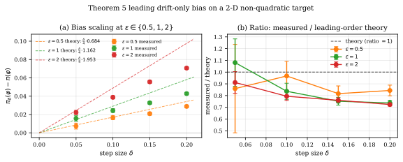
<figcaption class="ltx_caption ltx_centering">Figure 11: 2-D formal-coefficient check. (a) Measured bias on $\mathbb{E}[\varphi]$ scales linearly with $\delta$ at each $\varepsilon\text{,}$ with theory line $\delta\,\operatorname{Cov}_{\pi}(h,\varphi)/4$ from Theorem <a href="#Thmtheorem5" title="Theorem 5 (Drift-only BEA bias). ‣ 4.3 Sharp drift-only bias via backward error analysis ‣ 4 The Theory of P-IMLA ‣ Preconditioned Implicit Midpoint Langevin Sampling for Non-Smooth Bayesian Imaging" class="ltx_ref">5</a> (dashed). (b) Measured/theory ratio across all $(\varepsilon,\delta)$ tested, clustering near $1\text{;}$ the $\sim\!0.72\!-\!0.84$ values at the largest $\delta$ are consistent with a negative $O(\delta^{2})$ next-order BEA correction.</figcaption>
</figure>

The control case $\varepsilon=0$ yields measured bias indistinguishable from zero (consistent with $h\equiv 2$ giving $\operatorname{Cov}_{\pi}(h,\varphi)=0$), and across $\varepsilon\in\{0.5,1,2\}$ the measured bias matches the leading-order prediction within ratio $0.72\!-\!1.08$ across all $\delta\in[0.05,0.20]\text{.}$ The polynomial interaction is not globally smooth or globally convex, so this is a formal-coefficient check rather than a verification under Theorem <a href="#Thmtheorem5" title="Theorem 5 (Drift-only BEA bias). ‣ 4.3 Sharp drift-only bias via backward error analysis ‣ 4 The Theory of P-IMLA ‣ Preconditioned Implicit Midpoint Langevin Sampling for Non-Smooth Bayesian Imaging" class="ltx_ref">5</a>'s assumptions.

</section>
</section>
<section id="A3.SS8" class="ltx_subsection">
<h3 class="ltx_title ltx_title_subsection" id="sk-rock-delta-stability-sweep">
C.8 SK-ROCK $\delta$-stability sweep</h3>

We run SK-ROCK <cite class="ltx_cite ltx_citemacro_citep">[$s=10\text{,}$ $\eta=0.05\text{,}$ Pereyra et al., <a href="#bib.bib10" title="Accelerating proximal Markov chain Monte Carlo by using an explicit stabilized method" class="ltx_ref">2020</a>]</cite> on the same $64\!\times\!64$ Gaussian-deconvolution benchmark used in §<a href="#A3.SS5" title="C.5 Step-size robustness and the antithetic regime ‣ Appendix C Auxiliary experimental results ‣ Preconditioned Implicit Midpoint Langevin Sampling for Non-Smooth Bayesian Imaging" class="ltx_ref">C.5</a> ($\sigma_{\mathrm{blur}}=2.0\text{,}$ $\sigma_{\mathrm{noise}}=0.05\text{,}$ $\rho_{\mathrm{TV}}=0.02\text{,}$ $\lambda=5\!\times\!10^{-3}\text{,}$ $M=I$), and sweep $\delta$ over an order-of-magnitude range straddling the theoretical Chebyshev stability boundary $\delta_{\max}^{\mathrm{thy}}=2s^{2}(1+\eta/s^{2})/L_{M}=0.9955$ (with $L_{M}=1+1/\lambda=201$). For each $\delta$ the chain is run for $5{,}500$ iterations ($500$ burn-in, $5{,}000$ posterior); a sample is flagged as diverged if $\|X\|_{\infty}&gt;10^{6}$ or non-finite at any iteration.

<figure id="A3.F12" class="ltx_figure">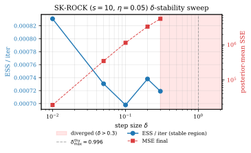
<figcaption class="ltx_caption ltx_centering">Figure 12: SK-ROCK $\delta$-stability sweep on a $64\!\times\!64$ Moreau-smoothed posterior. Stable region (left of red shading): $\delta\leq 0.30\text{.}$ Diverged region (red): $\delta\geq 0.50\text{.}$ The empirical stability boundary $\delta_{\max}^{\mathrm{emp}}\approx 0.30$ is roughly $3\!\times$ tighter than the smooth-case Chebyshev prediction $\delta_{\max}^{\mathrm{thy}}=0.9955\text{,}$ indicating that SK-ROCK’s published stability margin is <em class="ltx_emph ltx_font_italic">optimistic</em> (over-predicts the stable region) once the Moreau-smoothed sub-gradient enters the iteration. Even within the stable region, $\mathrm{ESS}/\text{iter}\in[7\!\times\!10^{-4},\,8\!\times\!10^{-4}]$ remains essentially flat, an order $10^{3}$ below P-IMLAλ’s $\mathrm{ESS}/\text{iter}\approx 1$ at the same $\lambda$ (cf. §<a href="#A3.SS5" title="C.5 Step-size robustness and the antithetic regime ‣ Appendix C Auxiliary experimental results ‣ Preconditioned Implicit Midpoint Langevin Sampling for Non-Smooth Bayesian Imaging" class="ltx_ref">C.5</a>); MSE rises monotonically with $\delta$ within the stable region as the chain has not finished a single integrated-autocorrelation time within the $5{,}000$-sample budget.</figcaption>
</figure>

The takeaway is two-fold: (i) SK-ROCK’s stability margin contracts substantially under Moreau-smoothed proximal handling, restricting the practical $\delta$ range to roughly $[10^{-2},\,0.3]$ at this $\lambda\text{;}$ (ii) within that range, $\mathrm{ESS}/\text{iter}$ is bounded by $\sim 10^{-3}\text{,}$ so the iteration-budget gap to P-IMLAλ identified in the main-text matched-budget benchmark (Table <a href="#S5.T3" title="Table 3 ‣ 5 Experiments ‣ Preconditioned Implicit Midpoint Langevin Sampling for Non-Smooth Bayesian Imaging" class="ltx_ref">3</a>) is intrinsic to the explicit-Euler $+$ Chebyshev recursion’s mixing rate, not to a sub-optimal step-size choice.

</section>
<section id="A3.SS9" class="ltx_subsection">
<h3 class="ltx_title ltx_title_subsection" id="term-iii-sqrtlambda-scaling-on-polyhedral-g">
C.9 Term III $\sqrt{\lambda}$ scaling on polyhedral $g$
</h3>

The Talagrand-based derivation of Term III is generic in that it uses only the pointwise bound $(g-g^{\lambda,M})(x)\leq\tfrac{\lambda}{2}(L_{g}^{M})^{2}$ together with strong convexity of $f$ in the $M$-norm; it makes no structural assumption on the sub-level geometry of $g$ beyond Lipschitzness. For the polyhedral regularizers that motivate P-IMLAλ in practice (TV, $\ell_{1}$), we expect the bound to be loose because the $M$-norm subgradient bound collapses across a codimension-1 switching set. We verify this directly on the 1-D target $\pi\propto e^{-f-g}\text{,}$ $f(x)=x^{2}/2\text{,}$ in two contrasting setups: a <em class="ltx_emph ltx_font_italic">symmetric</em> polyhedral $g_{\mathrm{sym}}(x)=|x|$ and an <em class="ltx_emph ltx_font_italic">asymmetric</em> polyhedral $g_{\mathrm{asym}}(x)=\max(2x,-x)\text{.}$ The target distributions $\pi$ and $\pi_{\lambda}$ are approximated by deterministic quadrature on a log-concentrated grid, and $W_{2}^{M}(\pi_{\lambda},\pi)$ is evaluated via the 1-D quantile identity $W_{2}^{2}(P,Q)=\int_{0}^{1}(F_{P}^{-1}(u)-F_{Q}^{-1}(u))^{2}\,du$ at $17$ log-spaced values of $\lambda\in[10^{-4},1]\text{.}$ This calculation has numerical integration and interpolation error, but no Monte Carlo sampling error bars.

<figure id="A3.F13" class="ltx_figure">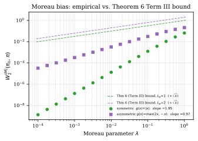
<figcaption class="ltx_caption ltx_centering">Figure 13: Empirical verification of Theorem <a href="#Thmtheorem6" title="Theorem 6 (End-to-end 𝑊₂^𝑀 bound). ‣ 4.4 End-to-end error budget for non-smooth targets ‣ 4 The Theory of P-IMLA ‣ Preconditioned Implicit Midpoint Langevin Sampling for Non-Smooth Bayesian Imaging" class="ltx_ref">6</a> Term III. The dashed lines show the theoretical $L_{g}^{M}\sqrt{\lambda/m_{M}}$ bounds ($L_{g}^{M}=1$ for $g_{\mathrm{sym}}\text{,}$ $L_{g}^{M}=2$ for $g_{\mathrm{asym}}$). The empirical $W_{2}^{M}(\pi_{\lambda},\pi)$ lies <em class="ltx_emph ltx_font_italic">strictly below</em> the bound at every $\lambda$ in both setups (maximum $W_{2}/\text{bound}$ ratios $0.065$ and $0.106$). The log-log fitted slopes are $0.97$ for the asymmetric case and $1.95$ for the symmetric case, both tighter than the theorem’s worst-case exponent of $0.5\text{.}$ These two examples show that the generic bound can be conservative; they do not establish an improved rate for all polyhedral penalties.</figcaption>
</figure>

Both slopes exceed the generic exponent $1/2\text{.}$ The difference between the two examples is consistent with cancellation in the symmetric case, but a uniform polyhedral improvement or a universal symmetry-based $O(\lambda^{2})$ rate is not proved here.

</section>
<section id="A3.SS10" class="ltx_subsection">
<h3 class="ltx_title ltx_title_subsection" id="baseline-tuning-sweep-fairness">
C.10 Baseline tuning sweep (fairness)</h3>

To pre-empt the question of whether the explicit-Euler baselines are fairly tuned, we sweep $\delta\in\{10^{-6},10^{-5},10^{-4},10^{-3},5\!\times\!10^{-3},10^{-2},5\!\times\!10^{-2},10^{-1},5\!\times\!10^{-1}\}$ for SP-MYULA and MYULA on the same $64\!\times\!64$ benchmark of §<a href="#A3.SS5" title="C.5 Step-size robustness and the antithetic regime ‣ Appendix C Auxiliary experimental results ‣ Preconditioned Implicit Midpoint Langevin Sampling for Non-Smooth Bayesian Imaging" class="ltx_ref">C.5</a>. Per $\delta$ we run $5{,}500$ iterations ($500$ burn-in) and report ESS/iter at the diagnostic pixel (Geyer initial-positive sequence) and the post-burn posterior-mean SSE. The body benchmark of §<a href="#S5" title="5 Experiments ‣ Preconditioned Implicit Midpoint Langevin Sampling for Non-Smooth Bayesian Imaging" class="ltx_ref">5</a> uses (rounded down from the largest stable for safety margin) $\delta_{\mathrm{SP\text{-}MYULA}}=9.45\!\times\!10^{-3}\text{,}$ $\delta_{\mathrm{MYULA}}=3\!\times\!10^{-3}\text{,}$ and $\delta_{\mathrm{SK\text{-}ROCK}}=0.25$ (cf. §<a href="#A3.SS8" title="C.8 SK-ROCK 𝛿-stability sweep ‣ Appendix C Auxiliary experimental results ‣ Preconditioned Implicit Midpoint Langevin Sampling for Non-Smooth Bayesian Imaging" class="ltx_ref">C.8</a>).

<figure id="A3.F14" class="ltx_figure">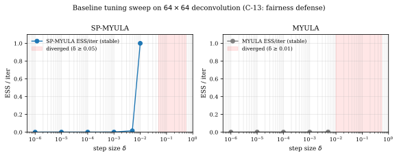
<figcaption class="ltx_caption ltx_centering">Figure 14: Baseline tuning sweep on $64\!\times\!64$ deconvolution. Left: SP-MYULA stable through $\delta=10^{-2}$ (ESS/iter peaks at $1.0$ at the largest stable $\delta$); diverges from $\delta\geq 5\!\times\!10^{-2}\text{.}$ Right: MYULA stable only through $\delta=5\!\times\!10^{-3}\text{,}$ with best ESS/iter $=2.6\!\times\!10^{-3}$ ($\sim\!380\!\times$ lower than SP-MYULA’s best); diverges from $\delta\geq 10^{-2}\text{.}$ The body benchmark of §<a href="#S5" title="5 Experiments ‣ Preconditioned Implicit Midpoint Langevin Sampling for Non-Smooth Bayesian Imaging" class="ltx_ref">5</a> runs each baseline at its best stable step size from this sweep, controlling step-size choice within this sweep; it does not establish optimal baseline inner-solver tuning.</figcaption>
</figure>

The headline narrative implication: at imaging-scale curvature ($\kappa_{f}$ here is similar to the body $\kappa_{f}$ ratio), MYULA’s stability boundary forces $\delta$ so small that even at its <em class="ltx_emph ltx_font_italic">best</em> stable choice it requires $\sim\!400\!\times$ more iterations (best ESS/iter $\approx 2.6\!\times\!10^{-3}$ vs P-IMLAλ’s ESS/iter $\approx 1$ in §<a href="#A3.SS5" title="C.5 Step-size robustness and the antithetic regime ‣ Appendix C Auxiliary experimental results ‣ Preconditioned Implicit Midpoint Langevin Sampling for Non-Smooth Bayesian Imaging" class="ltx_ref">C.5</a>) to extract a single effective sample.

</section>
<section id="A3.SS11" class="ltx_subsection">
<h3 class="ltx_title ltx_title_subsection" id="scope-of-empirical-comparison-the-langevin-family">
C.11 Scope of empirical comparison: the Langevin family</h3>

The matched-budget benchmarks of §<a href="#S5" title="5 Experiments ‣ Preconditioned Implicit Midpoint Langevin Sampling for Non-Smooth Bayesian Imaging" class="ltx_ref">5</a> compare P-IMLAλ against three Langevin-family baselines—MYULA, SK-ROCK, SP-MYULA—under matched preconditioning, Moreau parameter, and noise injection. This isolates the effect we analyse and prove rate theorems for: the integration scheme (explicit Euler vs. implicit midpoint) on the same underlying Langevin SDE with non-smooth proximal regularisation. The structural obstruction (<a href="#S1.E1" title="In 1 Introduction ‣ Preconditioned Implicit Midpoint Langevin Sampling for Non-Smooth Bayesian Imaging" class="ltx_ref">1</a>) and its midpoint cancellation (<a href="#S1.E2" title="In 1 Introduction ‣ Preconditioned Implicit Midpoint Langevin Sampling for Non-Smooth Bayesian Imaging" class="ltx_ref">2</a>) are properties of this dichotomy; SP-MYULA is the within-family explicit-Euler counterpart of P-IMLAλ on the identical $M$-norm-Moreau-smoothed potential (Sampler naming conventions, §<a href="#A3" title="Appendix C Auxiliary experimental results ‣ Preconditioned Implicit Midpoint Langevin Sampling for Non-Smooth Bayesian Imaging" class="ltx_ref">C</a>), but the finite-budget SSE gap also depends on solver accuracy and initial transients, and does not isolate the integration scheme alone.

Cross-family samplers such as Hamiltonian Monte Carlo <cite class="ltx_cite ltx_citemacro_citep">[Neal, <a href="#bib.bib42" title="MCMC using Hamiltonian dynamics" class="ltx_ref">2011</a>]</cite> and NUTS <cite class="ltx_cite ltx_citemacro_citep">[Hoffman and Gelman, <a href="#bib.bib43" title="The no-U-turn sampler: adaptively setting path lengths in Hamiltonian Monte Carlo" class="ltx_ref">2014</a>]</cite> accelerate via momentum and adaptive trajectory length on differentiable potentials; on non-smooth targets (TV imaging, $\ell_{1}$ priors) they additionally require Moreau smoothing or specialised non-smooth variants, against which our SP-MYULA comparison is the structural reference. The matrix-preconditioning + implicit-midpoint architecture introduced here is complementary to momentum-based acceleration and can in principle be combined; that combination is follow-up work.

</section>
<section id="A3.SS12" class="ltx_subsection">
<h3 class="ltx_title ltx_title_subsection" id="independent-reference-posterior-verification-of-proposition-1">
C.12 Independent reference-posterior verification of Proposition <a href="#Thmtheorem1" title="Proposition 1 (P-ULA variance inflation at preconditioned step sizes). ‣ Whitening. ‣ 2.1 Problem setup and preconditioned Langevin ‣ 2 Background ‣ Preconditioned Implicit Midpoint Langevin Sampling for Non-Smooth Bayesian Imaging" class="ltx_ref">1</a>
</h3>

To rule out the alternative explanation that SP-MYULA’s $\sim\!4\!\times$ larger SSE in Table <a href="#S5.T3" title="Table 3 ‣ 5 Experiments ‣ Preconditioned Implicit Midpoint Langevin Sampling for Non-Smooth Bayesian Imaging" class="ltx_ref">3</a> reflects a chain that has converged to the correct posterior but with looser concentration around the ground truth (rather than a biased stationary distribution), we build an independent MALA reference posterior at the same $256\!\times\!256$ geometric setup and directly compare second-moment statistics across samplers.

<section id="A3.SS12.SSS0.Px1" class="ltx_paragraph">
<h4 class="ltx_title ltx_title_paragraph" id="setup">Setup.</h4>

4 chains of MALA on the smoothed target $\pi^{M}_{\lambda}$ ($M=\hat{H}\text{,}$ $\lambda=5\!\times\!10^{-3}$) at $\delta_{\rm MALA}=1.41\!\times\!10^{-5}\text{,}$ warm-started from a P-IMLAλ stationary sample at $N=2{,}000$ (a warm start reduces the initial transient but does not itself establish convergence), $N_{\rm burn}=2\!\times\!10^{5}\text{,}$ $N_{\rm post}=10^{6}$ per chain on the same Pro 6000 hardware as Table <a href="#S5.T3" title="Table 3 ‣ 5 Experiments ‣ Preconditioned Implicit Midpoint Langevin Sampling for Non-Smooth Bayesian Imaging" class="ltx_ref">3</a> ($\sim$$7.1$ h/chain $\times$ 4-way parallel = $\sim$$7.1$ h total). Acceptance saturates at $1.00$ at this $\delta\text{;}$ the chain therefore mixes slowly and the mean estimator is noisier than P-IMLAλ’s, and local covariance stability does not by itself establish global mixing.

</section>
<section id="A3.SS12.SSS0.Px2" class="ltx_paragraph">
<h4 class="ltx_title ltx_title_paragraph" id="headline-h1-readout">Headline (H1) readout.</h4>

Pooled across all chains, comparing each sampler’s second-moment statistics to the MALA reference:

<figure id="A3.T10" class="ltx_table" style="overflow-y:hidden">
<figcaption class="ltx_caption ltx_centering" style="font-size:90%;">Table 10: Imaging-scale reference-posterior comparison on the $256\!\times\!256$ geometric phantom (App. <a href="#A3.SS12" title="C.12 Independent reference-posterior verification of Proposition 1 ‣ Appendix C Auxiliary experimental results ‣ Preconditioned Implicit Midpoint Langevin Sampling for Non-Smooth Bayesian Imaging" class="ltx_ref">C.12</a>). $\mathrm{tr}(\mathrm{Cov})$ is the trace of the per-pixel covariance; $\langle\hat{\sigma}\rangle$ is the average per-pixel posterior std. Pooled-sample counts in row 2.</figcaption>
<table class="ltx_tabular ltx_centering ltx_guessed_headers ltx_align_middle">
<thead class="ltx_thead">
<tr class="ltx_tr">
<th class="ltx_td ltx_align_left ltx_th ltx_th_column ltx_border_tt" style="padding-top:-0.25pt;padding-bottom:-0.25pt;">Sampler</th>
<th class="ltx_td ltx_align_center ltx_th ltx_th_column ltx_border_tt" style="padding-top:-0.25pt;padding-bottom:-0.25pt;">$\mathrm{tr}(\mathrm{Cov})$</th>
<th class="ltx_td ltx_align_center ltx_th ltx_th_column ltx_border_tt" style="padding-top:-0.25pt;padding-bottom:-0.25pt;">$\langle\hat{\sigma}\rangle$</th>
<th class="ltx_td ltx_nopad_r ltx_align_center ltx_th ltx_th_column ltx_border_tt" style="padding-top:-0.25pt;padding-bottom:-0.25pt;">ratio to MALA</th>
</tr>
</thead>
<tbody class="ltx_tbody">
<tr class="ltx_tr">
<td class="ltx_td ltx_align_left ltx_border_t" style="padding-top:-0.25pt;padding-bottom:-0.25pt;">
MALA reference (4 ch. $\times\!10^{6}$)
</td>
<td class="ltx_td ltx_align_center ltx_border_t" style="padding-top:-0.25pt;padding-bottom:-0.25pt;">$2.67\!\times\!10^{5}$</td>
<td class="ltx_td ltx_align_center ltx_border_t" style="padding-top:-0.25pt;padding-bottom:-0.25pt;">$2.017$</td>
<td class="ltx_td ltx_nopad_r ltx_align_center ltx_border_t" style="padding-top:-0.25pt;padding-bottom:-0.25pt;">—</td>
</tr>
<tr class="ltx_tr">
<td class="ltx_td ltx_align_left" style="padding-top:-0.25pt;padding-bottom:-0.25pt;">
P-IMLAλ TRUE Picard (8 ch. $\times\!10^{4}$)
</td>
<td class="ltx_td ltx_align_center" style="padding-top:-0.25pt;padding-bottom:-0.25pt;">$2.53\!\times\!10^{5}$</td>
<td class="ltx_td ltx_align_center" style="padding-top:-0.25pt;padding-bottom:-0.25pt;">$1.965$</td>
<td class="ltx_td ltx_nopad_r ltx_align_center" style="padding-top:-0.25pt;padding-bottom:-0.25pt;">$\mathbf{0.95}$</td>
</tr>
<tr class="ltx_tr">
<td class="ltx_td ltx_align_left ltx_border_bb" style="padding-top:-0.25pt;padding-bottom:-0.25pt;">
SP-MYULA (8 ch. $\times\!2\!\times\!10^{5}$)
</td>
<td class="ltx_td ltx_align_center ltx_border_bb" style="padding-top:-0.25pt;padding-bottom:-0.25pt;">$2.05\!\times\!10^{6}$</td>
<td class="ltx_td ltx_align_center ltx_border_bb" style="padding-top:-0.25pt;padding-bottom:-0.25pt;">$5.591$</td>
<td class="ltx_td ltx_nopad_r ltx_align_center ltx_border_bb" style="padding-top:-0.25pt;padding-bottom:-0.25pt;">$\mathbf{7.68}$</td>
</tr>
</tbody>
</table>
</figure>
</section>
<section id="A3.SS12.SSS0.Px3" class="ltx_paragraph">
<h4 class="ltx_title ltx_title_paragraph" id="reading">Reading.</h4>

The reported covariance-trace ratios are $0.95$ for P-IMLAλ and $7.68$ for SP-MYULA relative to this MALA run; the per-pixel standard-deviation ratio is $2.77\text{.}$ These comparisons are consistent with an Euler discretisation effect, but the slowly mixing reference is not a certificate of exact full-image posterior moments. The overdispersed diagnostics and target-exact Gibbs checks in Appendix <a href="#A4" title="Appendix D Additional bias, convergence and posterior-model checks ‣ Preconditioned Implicit Midpoint Langevin Sampling for Non-Smooth Bayesian Imaging" class="ltx_ref">D</a> provide complementary evidence and explicitly report the remaining limitations.

</section>
</section>
</section>
<section id="A4" class="ltx_appendix">
<h2 class="ltx_title ltx_title_appendix" id="additional-bias-convergence-and-posterior-model-checks">
Appendix D Additional bias, convergence and posterior-model checks</h2>

<section id="A4.SS1" class="ltx_subsection">
<h3 class="ltx_title ltx_title_subsection" id="high-dimensional-nonquadratic-bias-coefficient">
D.1 High-dimensional nonquadratic bias coefficient</h3>

The quartic examples in Appendix <a href="#A3" title="Appendix C Auxiliary experimental results ‣ Preconditioned Implicit Midpoint Langevin Sampling for Non-Smooth Bayesian Imaging" class="ltx_ref">C</a> are stress tests outside the global assumptions of Theorem <a href="#Thmtheorem5" title="Theorem 5 (Drift-only BEA bias). ‣ 4.3 Sharp drift-only bias via backward error analysis ‣ 4 The Theory of P-IMLA ‣ Preconditioned Implicit Midpoint Langevin Sampling for Non-Smooth Bayesian Imaging" class="ltx_ref">5</a>: the one-dimensional quartic has unbounded curvature, and the coupled two-dimensional quartic is not globally convex. Here we use a smooth, globally strongly convex target with bounded Hessian on the periodic $16\times 16$ lattice ($d=256$):

<table id="A4.E46" class="ltx_equation ltx_eqn_table">

<tbody><tr class="ltx_equation ltx_eqn_row ltx_align_baseline">
<td class="ltx_eqn_cell ltx_eqn_center_padleft"></td>
<td class="ltx_eqn_cell ltx_align_center">$$\begin{gathered}f(z)=\tfrac{1}{2}\|z\|^{2}+\alpha\sum_{e}\log\cosh((Bz)_{e}),\\ \qquad\alpha=0.7,\qquad M=I+\gamma B^{\top}B,\quad\gamma\in\{0,0.15,0.35\},\end{gathered}$$</td>
<td class="ltx_eqn_cell ltx_eqn_center_padright"></td>
<td rowspan="1" class="ltx_eqn_cell ltx_eqn_eqno ltx_align_middle ltx_align_right">(46)</td>
</tr></tbody>
</table>

where $B$ is the edge-incidence matrix of the periodic square grid. Since $\|B\|^{2}=8\text{,}$ $I\preceq\nabla^{2}f\preceq 6.6I\text{;}$ all derivatives of order two and higher are bounded. The target remains fixed when $\gamma$ changes. By translation and lattice symmetry,

<table id="A4.E47" class="ltx_equation ltx_eqn_table">

<tbody><tr class="ltx_equation ltx_eqn_row ltx_align_baseline">
<td class="ltx_eqn_cell ltx_eqn_center_padleft"></td>
<td class="ltx_eqn_cell ltx_align_center">$$h_{M}(z)=\operatorname{tr}(M^{-1})+\alpha w(\gamma)\sum_{e}\operatorname{sech}^{2}((Bz)_{e}),\qquad w(\gamma)=b_{e}^{\top}M^{-1}b_{e},$$</td>
<td class="ltx_eqn_cell ltx_eqn_center_padright"></td>
<td rowspan="1" class="ltx_eqn_cell ltx_eqn_eqno ltx_align_middle ltx_align_right">(47)</td>
</tr></tbody>
</table>

with a common leverage $w(\gamma)$ for every row $b_{e}^{\top}$ of $B\text{.}$ For $\varphi=h_{M}\text{,}$ the predicted coefficient $\tfrac{1}{4}\operatorname{Var}_{\pi}(h_{M})$ therefore scales as $w(\gamma)^{2}\text{.}$

We use five step sizes $\delta\in\{0.02,0.032,0.05,0.08,0.128\}\text{,}$ $64$ chains per step size, $3{,}000$ burn-in steps and $120{,}000$ retained steps per chain. The inner Newton solve uses tolerance $10^{-11}\text{.}$ A Metropolis-corrected $M$-MALA reference uses $16$ chains, $50{,}000$ burn-in steps and $900{,}000$ retained steps each. Reference rank-normalized split-$\hat{R}$ rounds to $1.0000\text{;}$ bulk ESS for $h_{M}$ is about $10^{6}\text{.}$ The observables are $h_{M}\text{,}$ $d^{-1}\|z\|^{2}\text{,}$ and the normalized edge energy $\|Bz\|^{2}/(2d)\text{.}$

For each observable we fit the measured-to-predicted ratio of bias divided by $\delta$ as $c_{0}+c_{1}\delta\text{,}$ using inverse squared reported Monte Carlo standard errors as weights. Table <a href="#A4.T11" title="Table 11 ‣ D.1 High-dimensional nonquadratic bias coefficient ‣ Appendix D Additional bias, convergence and posterior-model checks ‣ Preconditioned Implicit Midpoint Langevin Sampling for Non-Smooth Bayesian Imaging" class="ltx_ref">11</a> and Figure <a href="#A4.F15" title="Figure 15 ‣ D.1 High-dimensional nonquadratic bias coefficient ‣ Appendix D Additional bias, convergence and posterior-model checks ‣ Preconditioned Implicit Midpoint Langevin Sampling for Non-Smooth Bayesian Imaging" class="ltx_ref">15</a> report nominal $95\%$ weighted-fit intervals, $c_{0}\pm 1.96\,\mathrm{SE}(c_{0})\text{;}$ these are not one-standard-error intervals. All nine contain one. The $h_{M}$ coefficient changes from $39.7727$ to $13.6324$ to $5.8883\text{,}$ a factor of $6.75\text{,}$ following the predicted leverage-squared law to within $0.2\%\text{.}$ Thus the leading invariant defect depends quantitatively on $M$ even for one fixed target.

<figure id="A4.T11" class="ltx_table" style="overflow-y:hidden">
<figcaption class="ltx_caption ltx_centering" style="font-size:90%;">Table 11: High-dimensional coefficient check. The slope fits $|\pi_{\delta}(\varphi)-\pi(\varphi)|$ against $\delta$ on logarithmic axes. The last column is the extrapolated measured/predicted ratio with a nominal $95\%$ interval, computed with the same diagonal MCSE weights as Figure <a href="#A4.F15" title="Figure 15 ‣ D.1 High-dimensional nonquadratic bias coefficient ‣ Appendix D Additional bias, convergence and posterior-model checks ‣ Preconditioned Implicit Midpoint Langevin Sampling for Non-Smooth Bayesian Imaging" class="ltx_ref">15</a>.</figcaption>
<table class="ltx_tabular ltx_centering ltx_guessed_headers ltx_align_middle">
<thead class="ltx_thead">
<tr class="ltx_tr">
<th class="ltx_td ltx_align_center ltx_th ltx_th_column ltx_border_tt">$\gamma$</th>
<th class="ltx_td ltx_align_left ltx_th ltx_th_column ltx_border_tt">Observable</th>
<th class="ltx_td ltx_align_center ltx_th ltx_th_column ltx_border_tt">Slope</th>
<th class="ltx_td ltx_nopad_r ltx_align_center ltx_th ltx_th_column ltx_border_tt">
Ratio $c_{0}\pm 1.96\,\mathrm{SE}$
</th>
</tr>
</thead>
<tbody class="ltx_tbody">
<tr class="ltx_tr">
<td class="ltx_td ltx_align_center ltx_border_t">0</td>
<td class="ltx_td ltx_align_left ltx_border_t">$h_{M}$</td>
<td class="ltx_td ltx_align_center ltx_border_t">0.930</td>
<td class="ltx_td ltx_nopad_r ltx_align_center ltx_border_t">$1.0005\pm 0.0179$</td>
</tr>
<tr class="ltx_tr">
<td class="ltx_td ltx_align_center">0</td>
<td class="ltx_td ltx_align_left">$d^{-1}\|z\|^{2}$</td>
<td class="ltx_td ltx_align_center">0.928</td>
<td class="ltx_td ltx_nopad_r ltx_align_center">$1.0120\pm 0.0286$</td>
</tr>
<tr class="ltx_tr">
<td class="ltx_td ltx_align_center">0</td>
<td class="ltx_td ltx_align_left">Edge energy</td>
<td class="ltx_td ltx_align_center">0.948</td>
<td class="ltx_td ltx_nopad_r ltx_align_center">$1.0024\pm 0.0202$</td>
</tr>
<tr class="ltx_tr">
<td class="ltx_td ltx_align_center">0.15</td>
<td class="ltx_td ltx_align_left">$h_{M}$</td>
<td class="ltx_td ltx_align_center">0.993</td>
<td class="ltx_td ltx_nopad_r ltx_align_center">$0.9938\pm 0.0341$</td>
</tr>
<tr class="ltx_tr">
<td class="ltx_td ltx_align_center">0.15</td>
<td class="ltx_td ltx_align_left">$d^{-1}\|z\|^{2}$</td>
<td class="ltx_td ltx_align_center">1.018</td>
<td class="ltx_td ltx_nopad_r ltx_align_center">$0.9980\pm 0.0500$</td>
</tr>
<tr class="ltx_tr">
<td class="ltx_td ltx_align_center">0.15</td>
<td class="ltx_td ltx_align_left">Edge energy</td>
<td class="ltx_td ltx_align_center">1.007</td>
<td class="ltx_td ltx_nopad_r ltx_align_center">$0.9959\pm 0.0388$</td>
</tr>
<tr class="ltx_tr">
<td class="ltx_td ltx_align_center">0.35</td>
<td class="ltx_td ltx_align_left">$h_{M}$</td>
<td class="ltx_td ltx_align_center">0.986</td>
<td class="ltx_td ltx_nopad_r ltx_align_center">$0.9989\pm 0.0590$</td>
</tr>
<tr class="ltx_tr">
<td class="ltx_td ltx_align_center">0.35</td>
<td class="ltx_td ltx_align_left">$d^{-1}\|z\|^{2}$</td>
<td class="ltx_td ltx_align_center">1.052</td>
<td class="ltx_td ltx_nopad_r ltx_align_center">$0.9841\pm 0.0817$</td>
</tr>
<tr class="ltx_tr">
<td class="ltx_td ltx_align_center ltx_border_bb">0.35</td>
<td class="ltx_td ltx_align_left ltx_border_bb">Edge energy</td>
<td class="ltx_td ltx_align_center ltx_border_bb">0.985</td>
<td class="ltx_td ltx_nopad_r ltx_align_center ltx_border_bb">$1.0066\pm 0.0674$</td>
</tr>
</tbody>
</table>
</figure>
<figure id="A4.F15" class="ltx_figure">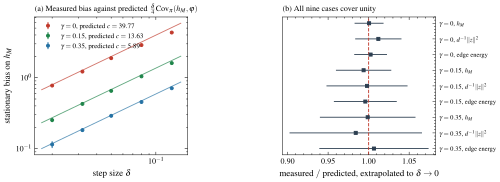
<figcaption class="ltx_caption ltx_centering">Figure 15: Bias coefficient on a fixed $d=256$ target. Left: measured $h_{M}$ bias (bars: one MCSE) and the predicted leading term for three preconditioners. Right: extrapolated measured/predicted ratios with nominal $95\%$ weighted-fit intervals. The target is held fixed throughout.</figcaption>
</figure>
</section>
<section id="A4.SS2" class="ltx_subsection">
<h3 class="ltx_title ltx_title_subsection" id="overdispersed-chains-and-observable-specific-diagnostics">
D.2 Overdispersed chains and observable-specific diagnostics</h3>

The finite-budget benchmark in Section <a href="#S5" title="5 Experiments ‣ Preconditioned Implicit Midpoint Langevin Sampling for Non-Smooth Bayesian Imaging" class="ltx_ref">5</a> uses a common zero start and no burn-in. We additionally run $13$ geometric-phantom configurations and five cameraman configurations at $256^{2}\text{,}$ with eight starts: zero, the observation, the minimizer of $f\text{,}$ two noise-perturbed minimizers, two constant fields and a checkerboard. Ordinary runs have $5{,}000$ iterations, discarding $500\text{;}$ the three refined geometric runs have $10{,}000\text{,}$ discarding $1{,}000\text{.}$ The refined cameraman run has $5{,}000\text{,}$ discarding $500\text{.}$ These experiments use RTX 4090 hardware and a baseline $(K_{\mathrm{P}},K_{\rm in})=(8,15)\text{,}$ not the $(30,50)$ solver budget of the headline experiment. Hence their absolute SSEs and timings are not replacements for Table <a href="#S5.T3" title="Table 3 ‣ 5 Experiments ‣ Preconditioned Implicit Midpoint Langevin Sampling for Non-Smooth Bayesian Imaging" class="ltx_ref">3</a>.

We compute rank-normalized split-$\hat{R}\text{,}$ bulk/tail effective sample sizes (ESS), and Monte Carlo standard errors <cite class="ltx_cite ltx_citemacro_citep">[Vehtari et al., <a href="#bib.bib28" title="Rank-normalization, folding, and localization: an improved ^R for assessing convergence of MCMC" class="ltx_ref">2021</a>]</cite>. The diagnostic implementation is checked on independent draws, AR(1) processes and chains with shifted means. Table <a href="#A4.T12" title="Table 12 ‣ D.2 Overdispersed chains and observable-specific diagnostics ‣ Appendix D Additional bias, convergence and posterior-model checks ‣ Preconditioned Implicit Midpoint Langevin Sampling for Non-Smooth Bayesian Imaging" class="ltx_ref">12</a> reports sampling diagnostics alone; reconstruction SSE and PSNR are reported separately in Table <a href="#A4.T13" title="Table 13 ‣ D.3 Separating draw roughness from posterior-mean texture ‣ Appendix D Additional bias, convergence and posterior-model checks ‣ Preconditioned Implicit Midpoint Langevin Sampling for Non-Smooth Bayesian Imaging" class="ltx_ref">13</a>.

<figure id="A4.T12" class="ltx_table" style="overflow-y:hidden">
<figcaption class="ltx_caption ltx_centering" style="font-size:90%;">Table 12: Diagnostics by observable and experimental group. Energy/TV/high-frequency ranges pool only those three scalar observables; they do not bound every observable. The spatial mean retains appreciable autocorrelation, especially in the refined cameraman run. Values are rounded from the archived summaries.</figcaption>
<table class="ltx_tabular ltx_centering ltx_guessed_headers ltx_align_middle">
<thead class="ltx_thead">
<tr class="ltx_tr">
<th class="ltx_td ltx_align_left ltx_th ltx_th_column ltx_border_tt" style="padding-left:4.0pt;padding-right:4.0pt;">Group</th>
<th class="ltx_td ltx_align_left ltx_th ltx_th_column ltx_border_tt" style="padding-left:4.0pt;padding-right:4.0pt;">Observables</th>
<th class="ltx_td ltx_align_center ltx_th ltx_th_column ltx_border_tt" style="padding-left:4.0pt;padding-right:4.0pt;">
Maximum $\hat{R}$
</th>
<th class="ltx_td ltx_align_center ltx_th ltx_th_column ltx_border_tt" style="padding-left:4.0pt;padding-right:4.0pt;">Bulk ESS range</th>
<th class="ltx_td ltx_nopad_r ltx_align_center ltx_th ltx_th_column ltx_border_tt" style="padding-left:4.0pt;padding-right:4.0pt;">Tail ESS range</th>
</tr>
</thead>
<tbody class="ltx_tbody">
<tr class="ltx_tr">
<td class="ltx_td ltx_align_left ltx_border_t" style="padding-left:4.0pt;padding-right:4.0pt;">Geometric (13 configurations)</td>
<td class="ltx_td ltx_align_left ltx_border_t" style="padding-left:4.0pt;padding-right:4.0pt;">
$f+g$, TV, high-frequency
</td>
<td class="ltx_td ltx_align_center ltx_border_t" style="padding-left:4.0pt;padding-right:4.0pt;">1.0076</td>
<td class="ltx_td ltx_align_center ltx_border_t" style="padding-left:4.0pt;padding-right:4.0pt;">
$768$–$18{,}938$
</td>
<td class="ltx_td ltx_nopad_r ltx_align_center ltx_border_t" style="padding-left:4.0pt;padding-right:4.0pt;">
$855$–$33{,}086$
</td>
</tr>
<tr class="ltx_tr">
<td class="ltx_td ltx_align_left" style="padding-left:4.0pt;padding-right:4.0pt;">Cameraman (5 configurations)</td>
<td class="ltx_td ltx_align_left" style="padding-left:4.0pt;padding-right:4.0pt;">
$f+g$, TV, high-frequency
</td>
<td class="ltx_td ltx_align_center" style="padding-left:4.0pt;padding-right:4.0pt;">1.0141</td>
<td class="ltx_td ltx_align_center" style="padding-left:4.0pt;padding-right:4.0pt;">
$432$–$19{,}516$
</td>
<td class="ltx_td ltx_nopad_r ltx_align_center" style="padding-left:4.0pt;padding-right:4.0pt;">
$146$–$28{,}584$
</td>
</tr>
<tr class="ltx_tr">
<td class="ltx_td ltx_align_left" style="padding-left:4.0pt;padding-right:4.0pt;">
Geometric, $\lambda=10^{-3}$
</td>
<td class="ltx_td ltx_align_left" style="padding-left:4.0pt;padding-right:4.0pt;">Spatial mean</td>
<td class="ltx_td ltx_align_center" style="padding-left:4.0pt;padding-right:4.0pt;">1.0750</td>
<td class="ltx_td ltx_align_center" style="padding-left:4.0pt;padding-right:4.0pt;">$71$</td>
<td class="ltx_td ltx_nopad_r ltx_align_center" style="padding-left:4.0pt;padding-right:4.0pt;">$104$</td>
</tr>
<tr class="ltx_tr">
<td class="ltx_td ltx_align_left ltx_border_bb" style="padding-left:4.0pt;padding-right:4.0pt;">Refined cameraman</td>
<td class="ltx_td ltx_align_left ltx_border_bb" style="padding-left:4.0pt;padding-right:4.0pt;">Spatial mean</td>
<td class="ltx_td ltx_align_center ltx_border_bb" style="padding-left:4.0pt;padding-right:4.0pt;">1.1244</td>
<td class="ltx_td ltx_align_center ltx_border_bb" style="padding-left:4.0pt;padding-right:4.0pt;">$42$</td>
<td class="ltx_td ltx_nopad_r ltx_align_center ltx_border_bb" style="padding-left:4.0pt;padding-right:4.0pt;">$36$</td>
</tr>
</tbody>
</table>
</figure>

Across these runs classical per-pixel $\hat{R}$ is at most $1.002\text{,}$ but this does not remove the slow spatial-mean mode exposed by the split diagnostics. We therefore treat the refined small-step runs as sensitivity checks, not exact-posterior ground truth or a certificate of convergence for all functionals. In particular, convergence diagnostics measure mixing of the implemented chain; they do not bound its discretization, smoothing or inner-solve bias.

</section>
<section id="A4.SS3" class="ltx_subsection">
<h3 class="ltx_title ltx_title_subsection" id="separating-draw-roughness-from-posterior-mean-texture">
D.3 Separating draw roughness from posterior-mean texture</h3>

We vary $\delta\text{,}$ $\lambda\text{,}$ $\rho_{\mathrm{TV}}$ and the inner solve. The baseline is $\delta=0.141\text{,}$ $\lambda=0.005\text{,}$ $\rho_{\mathrm{TV}}=0.3\text{,}$ $\rho_{a}=200$ and $(K_{\mathrm{P}},K_{\rm in})=(8,15)\text{.}$ The inner-solve arms use $\rho_{a}=0.5$ with budgets $(4,8)\text{,}$ $(8,15)$ and $(16,30)\text{.}$ The refined runs use $\delta=0.141/8\text{,}$ $\lambda=0.001\text{,}$ $\rho_{a}=0.5\text{,}$ and $(12,20)$ on geometric or $(8,15)$ on cameraman. The Moreau/Picard inner solver and the joint-proximal solver need different ADMM penalties; these settings do not prescribe changing the joint solver’s penalty.

Define high-frequency draw energy by summing $|\widehat{x}(k)|^{2}/d$ over $|k|&gt;n/4\text{.}$ Reducing $\lambda$ from $0.005$ to $0.001$ lowers its chain-averaged value by $79.6\%$ on both phantoms; dividing $\delta$ by four changes it by only $+0.42\%$ and $+0.41\%\text{.}$ The geometric inner-solve arms change it by $1.5$–$3.3\%\text{.}$ The large $\lambda$ effect is accompanied by a covariance-trace decrease from approximately $2.45\times 10^{5}$ to $4.99\times 10^{4}\text{.}$ The high-frequency modes occupy $0.8039$ of the Fourier grid; across all 18 configurations, chain-averaged high-frequency energy divided by $0.8039\operatorname{tr}(\operatorname{Cov}X)$ lies between $1.185$ and $1.242\text{.}$ Its nearly constant proportionality links draw roughness to posterior width, with some excess high-frequency covariance. These are controlled changes of the implemented smoothed chain, not a claim that either value equals the variance of the nonsmoothed posterior.

The visible texture in the posterior <em class="ltx_emph ltx_font_italic">mean</em> lies in a different band, $32\leq|k|&lt;58$ at $n=256$ (approximately $5.6$ pixels in wavelength). Let $B$ denote mean-image power in this band divided by ground-truth power in the same band. Doubling $\rho_{\mathrm{TV}}$ reduces $B$ from $5.47$ to $2.09$ on geometric and $3.58$ to $1.43$ on cameraman, improving PSNR by $3.46$ and $2.70$ dB, respectively. The cameraman change is visible in Figure <a href="#A4.F16" title="Figure 16 ‣ D.3 Separating draw roughness from posterior-mean texture ‣ Appendix D Additional bias, convergence and posterior-model checks ‣ Preconditioned Implicit Midpoint Langevin Sampling for Non-Smooth Bayesian Imaging" class="ltx_ref">16</a>. Reducing $\lambda$ alone also reduces this mean-image band power ($3.58$ to $2.91$); the two controls therefore do not act exclusively on disjoint effects. Decreasing $\delta$ alone increases it to $5.43\text{,}$ and the refined cameraman run has $B=6.29\text{.}$ Thus a less textured output need not be a less biased sampler. Changing $\rho_{\mathrm{TV}}$ changes the posterior model itself; the independent target check below distinguishes this effect from a P-IMLA implementation artifact.

<figure id="A4.T13" class="ltx_table" style="overflow-y:hidden">
<figcaption class="ltx_caption ltx_centering" style="font-size:90%;">Table 13: Reconstruction quality, separate from convergence diagnostics. These are pooled posterior-mean SSE, PSNR using the ground-truth intensity range, and mean-image band-power ratio $B$ for the overdispersed $(8,15)$ baseline protocol. All other parameters are fixed when $\rho_{\mathrm{TV}}$ is doubled.</figcaption>
<table class="ltx_tabular ltx_centering ltx_guessed_headers ltx_align_middle">
<thead class="ltx_thead">
<tr class="ltx_tr">
<th class="ltx_td ltx_align_left ltx_th ltx_th_column ltx_th_row ltx_border_tt">Phantom</th>
<th class="ltx_td ltx_align_center ltx_th ltx_th_column ltx_border_tt">$\rho_{\mathrm{TV}}$</th>
<th class="ltx_td ltx_align_center ltx_th ltx_th_column ltx_border_tt">SSE</th>
<th class="ltx_td ltx_align_center ltx_th ltx_th_column ltx_border_tt">PSNR (dB)</th>
<th class="ltx_td ltx_nopad_r ltx_align_center ltx_th ltx_th_column ltx_border_tt">$B$</th>
</tr>
</thead>
<tbody class="ltx_tbody">
<tr class="ltx_tr">
<th class="ltx_td ltx_align_left ltx_th ltx_th_row ltx_border_t">Geometric</th>
<td class="ltx_td ltx_align_center ltx_border_t">0.3</td>
<td class="ltx_td ltx_align_center ltx_border_t">544.94</td>
<td class="ltx_td ltx_align_center ltx_border_t">20.80</td>
<td class="ltx_td ltx_nopad_r ltx_align_center ltx_border_t">5.47</td>
</tr>
<tr class="ltx_tr">
<th class="ltx_td ltx_align_left ltx_th ltx_th_row">Geometric</th>
<td class="ltx_td ltx_align_center">0.6</td>
<td class="ltx_td ltx_align_center">245.40</td>
<td class="ltx_td ltx_align_center">24.27</td>
<td class="ltx_td ltx_nopad_r ltx_align_center">2.09</td>
</tr>
<tr class="ltx_tr">
<th class="ltx_td ltx_align_left ltx_th ltx_th_row">Cameraman</th>
<td class="ltx_td ltx_align_center">0.3</td>
<td class="ltx_td ltx_align_center">615.73</td>
<td class="ltx_td ltx_align_center">20.19</td>
<td class="ltx_td ltx_nopad_r ltx_align_center">3.58</td>
</tr>
<tr class="ltx_tr">
<th class="ltx_td ltx_align_left ltx_th ltx_th_row ltx_border_bb">Cameraman</th>
<td class="ltx_td ltx_align_center ltx_border_bb">0.6</td>
<td class="ltx_td ltx_align_center ltx_border_bb">330.71</td>
<td class="ltx_td ltx_align_center ltx_border_bb">22.89</td>
<td class="ltx_td ltx_nopad_r ltx_align_center ltx_border_bb">1.43</td>
</tr>
</tbody>
</table>
</figure>
<figure id="A4.F16" class="ltx_figure">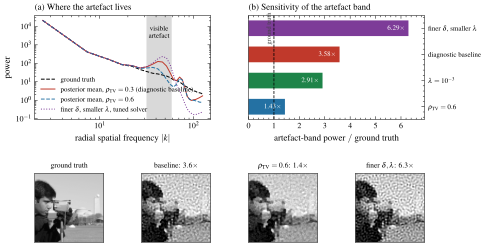
<figcaption class="ltx_caption ltx_centering">Figure 16: Cameraman posterior-mean texture and regularization sensitivity. The shaded spectral band is $32\leq|k|&lt;58\text{.}$ Bottom panels use identical crops and grayscale limits $[0,1]\text{.}$ The diagnostic baseline uses $(K_{\mathrm{P}},K_{\rm in})=(8,15)$ and is distinct from the headline reconstruction protocol. The refined run is a sensitivity check with the residual slow mode reported in Table <a href="#A4.T12" title="Table 12 ‣ D.2 Overdispersed chains and observable-specific diagnostics ‣ Appendix D Additional bias, convergence and posterior-model checks ‣ Preconditioned Implicit Midpoint Langevin Sampling for Non-Smooth Bayesian Imaging" class="ltx_ref">12</a>.</figcaption>
</figure>
<figure id="A4.F17" class="ltx_figure">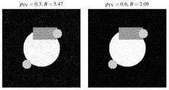
<figcaption class="ltx_caption ltx_centering">Figure 17: Geometric posterior means with stronger TV regularization. The two archived $256^{2}$ reconstructions differ only in $\rho_{\mathrm{TV}}\text{:}$ eight chains, $5{,}000$ iterations with $500$ discarded, $(K_{\mathrm{P}},K_{\rm in})=(8,15)\text{,}$ and common grayscale limits $[0,1]\text{.}$ Stronger regularization reduces band-power ratio $B$ from $5.47$ to $2.09$ and improves PSNR from $20.80$ to $24.27$ dB (Table <a href="#A4.T13" title="Table 13 ‣ D.3 Separating draw roughness from posterior-mean texture ‣ Appendix D Additional bias, convergence and posterior-model checks ‣ Preconditioned Implicit Midpoint Langevin Sampling for Non-Smooth Bayesian Imaging" class="ltx_ref">13</a>). This controlled diagnostic comparison uses a different inner budget and averaging protocol from the original headline reconstructions.</figcaption>
</figure>
</section>
<section id="A4.SS4" class="ltx_subsection">
<h3 class="ltx_title ltx_title_subsection" id="independent-exact-target-reference-at-322-and-482">
D.4 Independent exact-target reference at $32^{2}$ and $48^{2}$
</h3>

To test the nonsmoothed posterior independently of P-IMLA, we use data-augmentation Gibbs sampling for

<table id="A4.E48" class="ltx_equation ltx_eqn_table">

<tbody><tr class="ltx_equation ltx_eqn_row ltx_align_baseline">
<td class="ltx_eqn_cell ltx_eqn_center_padleft"></td>
<td class="ltx_eqn_cell ltx_align_center">$$\pi(x)\propto\exp\!\left[-\frac{\|Ax-y\|^{2}}{2\sigma^{2}}-\frac{\eta}{2}\|x\|^{2}-\rho_{\mathrm{TV}}\|Dx\|_{1}\right],\qquad\sigma=0.05,\quad\eta=10^{-3}.$$</td>
<td class="ltx_eqn_cell ltx_eqn_center_padright"></td>
<td rowspan="1" class="ltx_eqn_cell ltx_eqn_eqno ltx_align_middle ltx_align_right">(48)</td>
</tr></tbody>
</table>

Each Laplace factor is a Gaussian scale mixture: $z_{e}\mid\tau_{e}\sim N(0,\tau_{e})\text{,}$ $\tau_{e}\sim\operatorname{Exp}(\rho_{\mathrm{TV}}^{2}/2)\text{.}$ The conditional precision for $x$ is $C+D^{\top}\operatorname{diag}(1/\tau_{e})D\text{,}$ where $C=A^{\top}A/\sigma^{2}+\eta I\text{;}$ its conditional mean solves this precision times the mean equal to $A^{\top}y/\sigma^{2}\text{.}$ We sample this Gaussian by dense Cholesky and update $1/\tau_{e}$ from its inverse-Gaussian conditional. These transitions use neither Moreau smoothing nor time discretization nor P-IMLA’s inner solver. “Exact-target” describes the invariant target and conditional draws; finite Monte Carlo error remains.

The blur is fixed at $2$ pixels at both resolutions, and the artifact band is fixed in cycles per pixel, $|k|/n\in[32/256,58/256)\text{.}$ These are smaller members of the same model family, not continuum-coarsened copies of the $256^{2}$ problem; their band-power ratios need not equal those at $256^{2}\text{.}$ All $32^{2}$ runs and the $48^{2}\text{,}$ $\rho_{\mathrm{TV}}=0.6$ run use four chains of $4{,}000$ steps, discarding $1{,}000\text{.}$ The other two $48^{2}$ runs use eight chains of $8{,}000\text{,}$ discarding $2{,}000\text{.}$

<figure id="A4.T14" class="ltx_table" style="overflow-y:hidden">
<figcaption class="ltx_caption ltx_centering" style="font-size:90%;">Table 14: Exact-target Gibbs reference. $B$ is posterior-mean band power divided by ground-truth band power at the same resolution. The MC floor estimates band power due to finite-chain mean uncertainty from between-chain variation, in the same normalized units.</figcaption>
<table class="ltx_tabular ltx_centering ltx_guessed_headers ltx_align_middle">
<thead class="ltx_thead">
<tr class="ltx_tr">
<th class="ltx_td ltx_align_center ltx_th ltx_th_column ltx_th_row ltx_border_tt">Resolution</th>
<th class="ltx_td ltx_align_center ltx_th ltx_th_column ltx_border_tt">$\rho_{\mathrm{TV}}$</th>
<th class="ltx_td ltx_align_center ltx_th ltx_th_column ltx_border_tt">$B$</th>
<th class="ltx_td ltx_align_center ltx_th ltx_th_column ltx_border_tt">MC floor</th>
<th class="ltx_td ltx_align_center ltx_th ltx_th_column ltx_border_tt">SSE</th>
<th class="ltx_td ltx_nopad_r ltx_align_center ltx_th ltx_th_column ltx_border_tt">PSNR (dB)</th>
</tr>
</thead>
<tbody class="ltx_tbody">
<tr class="ltx_tr">
<th class="ltx_td ltx_align_center ltx_th ltx_th_row ltx_border_t">$32^{2}$</th>
<td class="ltx_td ltx_align_center ltx_border_t">0.15</td>
<td class="ltx_td ltx_align_center ltx_border_t">12.394</td>
<td class="ltx_td ltx_align_center ltx_border_t">0.00195</td>
<td class="ltx_td ltx_align_center ltx_border_t">253.93</td>
<td class="ltx_td ltx_nopad_r ltx_align_center ltx_border_t">6.06</td>
</tr>
<tr class="ltx_tr">
<th class="ltx_td ltx_align_center ltx_th ltx_th_row">$32^{2}$</th>
<td class="ltx_td ltx_align_center">0.30</td>
<td class="ltx_td ltx_align_center">6.856</td>
<td class="ltx_td ltx_align_center">0.00123</td>
<td class="ltx_td ltx_align_center">89.66</td>
<td class="ltx_td ltx_nopad_r ltx_align_center">10.58</td>
</tr>
<tr class="ltx_tr">
<th class="ltx_td ltx_align_center ltx_th ltx_th_row">$32^{2}$</th>
<td class="ltx_td ltx_align_center">0.60</td>
<td class="ltx_td ltx_align_center">3.028</td>
<td class="ltx_td ltx_align_center">0.00061</td>
<td class="ltx_td ltx_align_center">37.95</td>
<td class="ltx_td ltx_nopad_r ltx_align_center">14.31</td>
</tr>
<tr class="ltx_tr">
<th class="ltx_td ltx_align_center ltx_th ltx_th_row">$48^{2}$</th>
<td class="ltx_td ltx_align_center">0.15</td>
<td class="ltx_td ltx_align_center">15.749</td>
<td class="ltx_td ltx_align_center">0.00040</td>
<td class="ltx_td ltx_align_center">627.30</td>
<td class="ltx_td ltx_nopad_r ltx_align_center">5.65</td>
</tr>
<tr class="ltx_tr">
<th class="ltx_td ltx_align_center ltx_th ltx_th_row">$48^{2}$</th>
<td class="ltx_td ltx_align_center">0.30</td>
<td class="ltx_td ltx_align_center">9.403</td>
<td class="ltx_td ltx_align_center">0.00029</td>
<td class="ltx_td ltx_align_center">205.19</td>
<td class="ltx_td ltx_nopad_r ltx_align_center">10.50</td>
</tr>
<tr class="ltx_tr">
<th class="ltx_td ltx_align_center ltx_th ltx_th_row ltx_border_bb">$48^{2}$</th>
<td class="ltx_td ltx_align_center ltx_border_bb">0.60</td>
<td class="ltx_td ltx_align_center ltx_border_bb">4.257</td>
<td class="ltx_td ltx_align_center ltx_border_bb">0.00060</td>
<td class="ltx_td ltx_align_center ltx_border_bb">76.35</td>
<td class="ltx_td ltx_nopad_r ltx_align_center ltx_border_bb">14.80</td>
</tr>
</tbody>
</table>
</figure>

The mean-image texture persists under this independently implemented exact-target sampler and decreases with stronger TV regularization (Figure <a href="#A4.F18" title="Figure 18 ‣ D.4 Independent exact-target reference at 32² and 48² ‣ Appendix D Additional bias, convergence and posterior-model checks ‣ Preconditioned Implicit Midpoint Langevin Sampling for Non-Smooth Bayesian Imaging" class="ltx_ref">18</a>, Table <a href="#A4.T14" title="Table 14 ‣ D.4 Independent exact-target reference at 32² and 48² ‣ Appendix D Additional bias, convergence and posterior-model checks ‣ Preconditioned Implicit Midpoint Langevin Sampling for Non-Smooth Bayesian Imaging" class="ltx_ref">14</a>). We validate the Gaussian draw against the closed-form mean marginal variance (relative error $6.66\times 10^{-4}$ over $20{,}000$ draws), and cross-check a matrix-free perturb-and-MAP/CG implementation: at $32^{2}\text{,}$ the band ratios are $6.8662$ and $6.8588\text{,}$ with mean pixel standard deviations differing by $0.064\%\text{.}$ Independent Metropolis sampling of the exact potential at $48^{2}\text{,}$ $\rho_{\mathrm{TV}}=0.3\text{,}$ gives $B=9.364$ versus Gibbs $9.403$ and mean pixel standard deviation $1.3338$ versus $1.3401\text{.}$ These checks concern distributional summaries, not pointwise identity of finite-run posterior means. They support a model-side source of the texture without asserting that P-IMLA has zero bias relative to this reference.

<figure id="A4.F18" class="ltx_figure">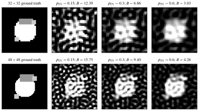
<figcaption class="ltx_caption ltx_centering">Figure 18: Posterior means of the nonsmoothed TV model from independent Gibbs sampling. Top: $32^{2}\text{;}$ bottom: $48^{2}\text{.}$ All panels use grayscale limits $[0,1]\text{;}$ numerical metrics use the unclipped arrays. The mean-image band-power ratio $B$ decreases as $\rho_{\mathrm{TV}}$ increases. This figure reuses the archived reference samples and introduces no new sampling run.</figcaption>
</figure>
</section>
<section id="A4.SS5" class="ltx_subsection">
<h3 class="ltx_title ltx_title_subsection" id="what-the-finite-budget-gaussian-statistic-measures">
D.5 What the finite-budget Gaussian statistic measures</h3>

For the Gaussian experiment the reported statistic is

<table id="A4.Ex57" class="ltx_equation ltx_eqn_table">

<tbody><tr class="ltx_equation ltx_eqn_row ltx_align_baseline">
<td class="ltx_eqn_cell ltx_eqn_center_padleft"></td>
<td class="ltx_eqn_cell ltx_align_center">$$V_{N}=\frac{1}{Nd}\sum_{n=1}^{N}(X_{n}-\mu)^{\top}H(X_{n}-\mu),\qquad X_{0}=0.$$</td>
<td class="ltx_eqn_cell ltx_eqn_center_padright"></td>
</tr></tbody>
</table>

It combines covariance filling and the initial mean offset. In orthonormal Hessian coordinates with eigenvalues $h_{i}$ and Cayley factors $r_{i}=(1-\delta h_{i}/2)/(1+\delta h_{i}/2)\text{,}$

<table id="A4.Ex58" class="ltx_equation ltx_eqn_table">

<tbody><tr class="ltx_equation ltx_eqn_row ltx_align_baseline">
<td class="ltx_eqn_cell ltx_eqn_center_padleft"></td>
<td class="ltx_eqn_cell ltx_align_center">$$\mathbb{E}V_{N}=\frac{1}{d}\sum_{i}\left[1-a_{i,N}+h_{i}\mu_{i}^{2}a_{i,N}\right],\qquad a_{i,N}=\frac{1}{N}\sum_{n=1}^{N}r_{i}^{2n}.$$</td>
<td class="ltx_eqn_cell ltx_eqn_center_padright"></td>
</tr></tbody>
</table>

For unpreconditioned IMLA at $\kappa_{f}\simeq 4\times 10^{7}$ and $N=2{,}000\text{,}$ this gives $48.6329=0.6104+48.0225\text{:}$ $98.7\%$ is the unrelaxed initial-mean contribution. Direct simulation gives $48.5974\text{.}$ The stationary variance ratio is exactly one, as required by Gaussian exactness even without preconditioning. The slowest-mode relaxation time is $3{,}162$ iterations, consistent with the method’s $\sqrt{\kappa_{f}}$ dependence. Figure <a href="#A4.F19" title="Figure 19 ‣ D.5 What the finite-budget Gaussian statistic measures ‣ Appendix D Additional bias, convergence and posterior-model checks ‣ Preconditioned Implicit Midpoint Langevin Sampling for Non-Smooth Bayesian Imaging" class="ltx_ref">19</a> therefore explains a finite-budget mixing advantage, not failure of IMLA’s Gaussian invariant covariance.

<figure id="A4.F19" class="ltx_figure">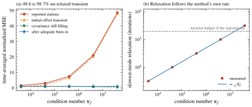
<figcaption class="ltx_caption ltx_centering">Figure 19: Initial transients in the Gaussian comparison. Left: exact decomposition of the cold-start time-averaged normalized MSE into mean-offset and covariance terms. Right: the slowest-mode relaxation time follows $\sqrt{\kappa_{f}}\text{.}$ Adequate burn-in recovers a ratio close to one; the invariant ratio is exactly one.</figcaption>
</figure>
</section>
</section>
<section id="A5" class="ltx_appendix">
<h2 class="ltx_title ltx_title_appendix" id="limitations-and-open-problems">
Appendix E Limitations and open problems</h2>

Four limitations merit explicit acknowledgement. (i) For quadratic $f$ with $M=\nabla^{2}f\text{,}$ the bound $\kappa_{\mathrm{eff}}^{\lambda}=1+1/\lambda$ retains the smoothing dependence. All results use fixed $M\text{;}$ a position-dependent metric would require an additional drift correction and a separate analysis. (ii) The weak BEA result requires global smoothness, polynomial derivative growth and Poisson regularity. The $d=256$ lattice experiment verifies its coefficient under these assumptions; the earlier quartic checks are only formal illustrations. The $L^{3}$ density expansion used for the sharp Wasserstein coefficient remains an additional condition, and is not proved for general targets. Richardson cancellation likewise requires the stronger assumptions of Corollary <a href="#Thmtheorem12" title="Corollary 12 (Richardson extrapolation). ‣ Second-order weak expansion and Richardson extrapolation. ‣ A.3 Proof of Theorem 5 and its refinements ‣ Appendix A Full Proofs from Section 4 ‣ Preconditioned Implicit Midpoint Langevin Sampling for Non-Smooth Bayesian Imaging" class="ltx_ref">12</a>; it is not a TV-posterior guarantee. (iii) The headline benchmark uses a Fourier-diagonal forward operator. Appendix <a href="#A3.SS6" title="C.6 Beyond Fourier-diagonal forward operators (random fan-beam) ‣ Appendix C Auxiliary experimental results ‣ Preconditioned Implicit Midpoint Langevin Sampling for Non-Smooth Bayesian Imaging" class="ltx_ref">C.6</a> provides a $64\times 64$ random fan-beam test with a rank-128 Nyström preconditioner and conjugate gradients, but image-scale CT/MRI validation remains open. (iv) Exact JP and the finite, warm-started ADMM implementation are different objects. Appendix <a href="#A2.SS1" title="B.1 Kernel guarantees for JP-IMLA ‣ Appendix B JP-IMLA: kernel guarantees and empirical comparisons ‣ Preconditioned Implicit Midpoint Langevin Sampling for Non-Smooth Bayesian Imaging" class="ltx_ref">B.1</a> proves exact-kernel uniqueness for quadratic likelihoods with finite $\ell_{1}$-composite penalties and controls implementation error by certificates; it does not give a uniform certificate for every production $K=12$ step. The observed small-budget SSE agreement can include error cancellation.

Empirical accuracy also depends on the target, observable and inner-solver budget. Common-start per-pixel diagnostics do not establish convergence of every image functional; the overdispersed checks retain slow mixing in some spatial-mean observables. The original $4\times$ SSE comparison holds at its stated settings, and is sensitive to baseline ADMM accuracy. Small-image Gibbs checks target the original anisotropic-TV posterior, whereas the full-image comparisons use a Moreau surrogate. A distributional error bound does not directly certify reconstruction SSE.

Open directions include a signed analysis of the antithetic regime, position-dependent metrics, and weakly log-concave targets. Our reported ESS implementation caps ESS per iteration at one; antithetic chains can have larger theoretical ESS, so this cap is an estimator convention rather than a universal upper bound.

<section id="A5.SS0.SSS0.Px1" class="ltx_paragraph">
<h4 class="ltx_title ltx_title_paragraph" id="other-regularisers">Other regularisers.</h4>

Algorithm <a href="#alg1" title="Algorithm 1 ‣ 3 The P-IMLA Algorithm ‣ Preconditioned Implicit Midpoint Langevin Sampling for Non-Smooth Bayesian Imaging" class="ltx_ref">1</a> extends to proper convex lower-semicontinuous penalties with a computable $M$-prox, replacing the TV-specific inner solve. The quantitative Moreau and joint-kernel bounds additionally require $L_{g}^{M}=\sup_{x,s\in\partial g(x)}\|s\|_{M^{-1}}&lt;\infty\text{.}$ In finite dimensions this includes anisotropic and isotropic TV, wavelet $\ell_{1}\text{,}$ group and nuclear norms, Huber-TV, and TGV with auxiliary variables solved within the prox. Hard constraints have unbounded normal cones; nonconvex learned priors need a separate analysis. Changing $g$ changes the posterior, and improved reconstruction does not follow from the sampler theory.

</section>
<section id="A5.SS0.SSS0.Px2" class="ltx_paragraph">
<h4 class="ltx_title ltx_title_paragraph" id="full-images-and-patch-splitting">Full images and patch splitting.</h4>

If the likelihood, prior and metric factorize over disjoint patches of size $p\text{,}$ the update block-diagonalizes and the FFT cost becomes $O(d\log p)$ instead of $O(d\log d)\text{;}$ the worst block determines contraction. Squared Wasserstein errors add across blocks, however, so the dimension factor in Theorem <a href="#Thmtheorem6" title="Theorem 6 (End-to-end 𝑊₂^𝑀 bound). ‣ 4.4 End-to-end error budget for non-smooth targets ‣ 4 The Theory of P-IMLA ‣ Preconditioned Implicit Midpoint Langevin Sampling for Non-Smooth Bayesian Imaging" class="ltx_ref">6</a> still counts the full image. Overlapping or consensus-coupled patches alter the model and require a separate analysis.

</section>
</section>
</article>
