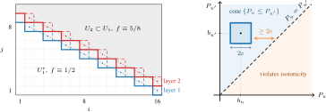
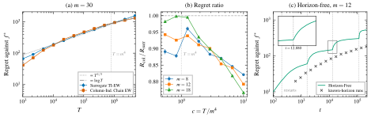
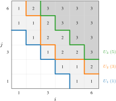

<article class="ltx_document ltx_authors_1line">

<section id="S1" class="ltx_section">
<h2 class="ltx_title ltx_title_section" id="introduction">
1 Introduction</h2>

In online isotonic regression, a learner plays against an adversary on a finite partially ordered set known to both. At each of $T$ rounds the adversary picks a query point, possibly one queried before, and the learner predicts $\hat{y}_{t}\in[0,1]\text{.}$ The adversary then reveals a label $y_{t}\in[0,1]\text{,}$ and the learner incurs the squared loss $(\hat{y}_{t}-y_{t})^{2}\text{.}$ Its regret is the cumulative loss minus that of the best isotonic function in hindsight. On the chain, the totally ordered case, <cite class="ltx_cite ltx_citemacro_citet">Kotłowski et al. [<a href="#bib.bib2" title="Online isotonic regression" class="ltx_ref">2016</a>]</cite> determined the minimax regret up to logarithmic factors when each point is queried once, and attained it efficiently. Beyond the chain, <cite class="ltx_cite ltx_citemacro_citet">Kotłowski et al. [<a href="#bib.bib3" title="Random permutation online isotonic regression" class="ltx_ref">2017</a>]</cite> posed the design of efficient algorithms as a central open problem. This leads to the question we study: <em class="ltx_emph ltx_font_italic">what is the minimax regret on a poset other than the chain, and can a polynomial-time learner attain it?</em> We answer both parts on the grids $[m]^{d}=\{1,\ldots,m\}^{d}$ under the coordinatewise order, for every fixed dimension $d\geq 2\text{.}$ We determine the minimax regret up to constant factors, attain it with a polynomial-time learner, and extend both results to a broad family of losses that includes the log loss. Repeated queries naturally model a wider range of settings, such as streaming data. <a href="#S6" title="6 Discussion ‣ The Minimax Rate of Online Isotonic Regression on Product Orders" class="ltx_ref">Section 6</a> discusses the case of distinct queries.

Two applications motivate the multivariate setting. Probability calibration with two features extends classical isotonic calibration <cite class="ltx_cite ltx_citemacro_citep">[Zadrozny and Elkan, <a href="#bib.bib17" title="Transforming classifier scores into accurate multiclass probability estimates" class="ltx_ref">2002</a>, Niculescu-Mizil and Caruana, <a href="#bib.bib18" title="Predicting good probabilities with supervised learning" class="ltx_ref">2005</a>, Berta et al., <a href="#bib.bib19" title="Classifier calibration with ROC-regularized isotonic regression" class="ltx_ref">2024</a>]</cite>. There the calibrated probability of a deployed classifier is modeled as jointly nondecreasing in the model score and in an ordinal covariate, and its natural loss is the log loss. On UCI Adult, our learner on the score-by-covariate grid has smaller cumulative squared loss than either calibration along the score alone or an unstructured per-cell mean, on all 20 splits (<a href="#A1" title="Appendix A Experiments ‣ The Minimax Rate of Online Isotonic Regression on Product Orders" class="ltx_ref">Appendix A</a>). In combination dose-finding, the toxicity probability of a two-agent therapy is nondecreasing in each dose and is learned sequentially as patients are treated <cite class="ltx_cite ltx_citemacro_citep">[Conaway et al., <a href="#bib.bib20" title="Designs for single- or multiple-agent phase I trials" class="ltx_ref">2004</a>, Wages et al., <a href="#bib.bib21" title="Continual reassessment method for partial ordering" class="ltx_ref">2011</a>]</cite>.

<section id="S1.SS0.SSS0.Px1" class="ltx_paragraph">
<h5 class="ltx_title ltx_title_paragraph">Main results.</h5>

For every fixed $d\geq 2$ and all integers $m\geq 2$ and $T\geq 1\text{,}$ the minimax regret under the squared loss is (<a href="#Thmtheorem2" title="Theorem 2 (Main Theorem). ‣ 3.2 The Main Theorem ‣ 3 Matching Lower Bounds and the Characterization ‣ The Minimax Rate of Online Isotonic Regression on Product Orders" class="ltx_ref">Theorem 2</a>)

<table id="S1.Ex2" class="ltx_equation ltx_eqn_table">

<tbody><tr class="ltx_equation ltx_eqn_row ltx_align_baseline">
<td class="ltx_eqn_cell ltx_eqn_center_padleft"></td>
<td class="ltx_eqn_cell ltx_align_center">$$R_{T}^{*}\bigl([m]^{d}\bigr)\;=\;\Theta_{d}\!\left(\min\!\left\{T,\;\inf_{K\in\mathbb{N}_{+}}\!\Bigl[\,2\,H_{[m]^{d}}(K)\,+\,\frac{T}{4K^{2}}\,\Bigr]\right\}\right),\quad H_{\mathcal{P}}(K)\;:=\;\log\Omega(\mathcal{P},K{+}1),$$</td>
<td class="ltx_eqn_cell ltx_eqn_center_padright"></td>
</tr></tbody>
</table>

where, for a finite poset $\mathcal{P}\text{,}$ $\Omega(\mathcal{P},N)$ is the number of order-preserving maps from $\mathcal{P}$ to $\{1,\ldots,N\}\text{,}$ the order polynomial of <cite class="ltx_cite ltx_citemacro_citet">Stanley [<a href="#bib.bib6" title="A chromatic-like polynomial for ordered sets" class="ltx_ref">1970</a>]</cite>. The formula balances two costs of learning on the value grid $\{0,1/K,\ldots,1\}\text{.}$ The first, $H_{[m]^{d}}(K)\text{,}$ is the logarithm of the number of grid-valued isotonic functions, and up to a factor of two in the resolution it is the sup-norm metric entropy of the comparator class. The second, $T/(4K^{2})\text{,}$ bounds the cost of rounding the best isotonic function onto the grid. The upper bound holds on every finite poset $\mathcal{P}\text{,}$ with $H_{\mathcal{P}}$ in place of $H_{[m]^{d}}$ (<a href="#Thmtheorem1" title="Theorem 1 (Universal Upper Bound). ‣ 2.3 Level-Set Stationarity and the Upper Bound ‣ 2 The Complexity Formula and the Universal Upper Bound ‣ The Minimax Rate of Online Isotonic Regression on Product Orders" class="ltx_ref">Theorem 1</a>). Evaluating the formula on grids gives three phases (<a href="#Thmtheorem3" title="Corollary 3 (Three-Phase Scaling Law). ‣ 3.3 The Three Phases ‣ 3 Matching Lower Bounds and the Characterization ‣ The Minimax Rate of Online Isotonic Regression on Product Orders" class="ltx_ref">Corollary 3</a>): the rate is $\Theta_{d}(T)$ for $T\leq m^{d-1}$ (Phase 0), $\Theta_{d}(m^{2(d-1)/3}\,T^{1/3})$ for $m^{d-1}\leq T\leq m^{d+2}$ (Phase 1), and $\Theta_{d}(m^{d}[1+\log(T/m^{d+2})])$ beyond (Phase 2). On rectangles $[a]\times[b]$ the same formula characterizes the minimax regret at every fixed aspect ratio, and a fourth regime appears that substituting $\sqrt{ab}$ for $m$ in the grid rates would miss (<a href="#Thmtheorem66" title="Proposition 66 (Rectangles). ‣ K.5 Rectangles ‣ Appendix K Grids and Other Posets ‣ The Minimax Rate of Online Isotonic Regression on Product Orders" class="ltx_ref">Proposition 66</a>). The chain’s intermediate rate has an extra logarithmic factor (<a href="#Thmtheorem46" title="Theorem 46 (Minimax Rate on the Chain). ‣ Order polynomial of the chain. ‣ I.1 Setup and Main Theorem ‣ Appendix I The Minimax Rate on the Chain ‣ The Minimax Rate of Online Isotonic Regression on Product Orders" class="ltx_ref">Theorem 46</a>) that the grids lack, and <a href="#S2.SS2" title="2.2 Order Polynomials and Metric Entropy ‣ 2 The Complexity Formula and the Universal Upper Bound ‣ The Minimax Rate of Online Isotonic Regression on Product Orders" class="ltx_ref">Section 2.2</a> traces it to the entropy at coarse scales.

The characterization extends beyond the squared loss. It holds, with loss-dependent constants, for every smooth, exp-concave and bounded loss whose excess risk under Bernoulli labels is at least quadratic (a strongly proper loss), and for the log loss (<a href="#Thmtheorem2" title="Theorem 2 (Main Theorem). ‣ 3.2 The Main Theorem ‣ 3 Matching Lower Bounds and the Characterization ‣ The Minimax Rate of Online Isotonic Regression on Product Orders" class="ltx_ref">Theorem 2</a>). The absolute and pinball losses are piecewise linear, and their minimax regret grows as a square root instead, $\Theta_{d}(\min\{T,\sqrt{m^{d-1}T}\})$ for the absolute loss (<a href="#Thmtheorem56" title="Theorem 56 (Pinball and Absolute Losses on Grids). ‣ J.5 Lipschitz Losses ‣ Appendix J Level-Set Stationarity and General Losses ‣ The Minimax Rate of Online Isotonic Regression on Product Orders" class="ltx_ref">Theorem 56</a>). Our polynomial-time learner attains the rate for every loss of <a href="#Thmtheorem2" title="Theorem 2 (Main Theorem). ‣ 3.2 The Main Theorem ‣ 3 Matching Lower Bounds and the Characterization ‣ The Minimax Rate of Online Isotonic Regression on Product Orders" class="ltx_ref">Theorem 2</a> and every fixed dimension, without advance knowledge of $T$ (<a href="#Thmtheorem7" title="Theorem 7 (Slicing). ‣ 5.4 Higher Dimensions and Other Losses ‣ 5 Polynomial-Time Algorithms ‣ The Minimax Rate of Online Isotonic Regression on Product Orders" class="ltx_ref">Theorem 7</a>). It combines two planar algorithms built on exponential weights, restarts them at doubling regret budgets, and runs an independent copy on each planar slice of the grid.

</section>
<section id="S1.SS0.SSS0.Px2" class="ltx_paragraph">
<h5 class="ltx_title ltx_title_paragraph">Technical contributions.</h5>

The upper bound rests on one property of the isotonic fit. On each of its level sets in $(0,1)$ the fitted value is stationary for the cumulative loss, so rounding the fit onto the grid changes the loss only to second order, by at most $T/(4K^{2})$ under the squared loss. Exponential weights over the grid-valued isotonic functions add $2H_{\mathcal{P}}(K)\text{,}$ and the best $K$ balances the two terms (<a href="#S2" title="2 The Complexity Formula and the Universal Upper Bound ‣ The Minimax Rate of Online Isotonic Regression on Product Orders" class="ltx_ref">Section 2</a>). The matching lower bounds come from two randomized adversaries, each of which draws a random isotonic function and Bernoulli labels with that mean (<a href="#S3.SS1" title="3.1 Two Mechanisms ‣ 3 Matching Lower Bounds and the Characterization ‣ The Minimax Rate of Online Isotonic Regression on Product Orders" class="ltx_ref">Section 3.1</a>). The first sets the values on large antichains by independent fair bits, so that each queried value depends on a single bit and the learner faces independent two-point tests. It gives the lower bound in Phases 0 and 1. The second perturbs a strictly order-preserving function independently at every point, so that the posterior factorizes and the van Trees inequality <cite class="ltx_cite ltx_citemacro_citep">[Gill and Levit, <a href="#bib.bib8" title="Applications of the van Trees inequality: a Bayesian Cramér–Rao bound" class="ltx_ref">1995</a>]</cite> bounds each estimation error from below. It gives the logarithmic lower bound of Phase 2.

Exponential weights over the grid class maintain $e^{H_{\mathcal{P}}(K)}$ experts, too many for a polynomial-time learner, since $H_{[m]^{d}}(K)$ grows like $m^{d-1}K$ for $K\leq m\text{.}$ Treating each column of the plane as an independent chain is efficient and attains the rate in Phase 2, but its regret bound is larger by a factor $(\log m)^{2/3}$ through most of Phase 1. Wider strips do not help. A transfer-matrix program runs exponential weights on each strip, and as long as it takes polynomial time, the standard exp-concave bound keeps this factor (<a href="#Thmtheorem44" title="Theorem 44 (Strip-Independent Transfer-Matrix Lower Bound). ‣ G.2 Main Theorem and Proof ‣ Appendix G Strip-Independent Transfer-Matrix Lower Bound ‣ The Minimax Rate of Online Isotonic Regression on Product Orders" class="ltx_ref">Theorem 44</a>). We decompose instead by threshold sets. An isotonic grid function $h/K$ is determined by its $K$ upsets (upward-closed sets) $\{h\geq r\}\text{,}$ and its squared loss at label $y$ telescopes into $y^{2}$ plus one increment for each upset that contains the query. Applying the same formula to tuples of upsets that need not nest defines a surrogate loss, under which the exponential weights factorize across the $K$ upsets. The plane has $\binom{2m}{m}$ upsets, one for each monotone lattice path, so the relaxed class has entropy $\Theta(mK)\text{,}$ the order of $H_{[m]^{2}}(K)$ for $K\leq m\text{.}$ The surrogate dominates the true loss, so it bounds the learner’s loss, and the two coincide whenever the upsets nest, as they do for the rounded comparator. One $O(m^{2})$-time dynamic program per factor computes the prediction (<a href="#S5.SS2" title="5.2 Surrogate Threshold-Indexed Exponential Weights ‣ 5 Polynomial-Time Algorithms ‣ The Minimax Rate of Online Isotonic Regression on Product Orders" class="ltx_ref">Section 5.2</a>). To run without knowing $T\text{,}$ the learner restarts each time its regret budget doubles. Restarting each time the horizon doubles would instead square the logarithm of Phase 2. An independent copy on each planar slice extends the learner to every dimension, because the entropies of the slices sum to that of the grid within a constant factor (<a href="#S5.SS3" title="5.3 Combined Strategy and Horizon-Free Wrapper ‣ 5 Polynomial-Time Algorithms ‣ The Minimax Rate of Online Isotonic Regression on Product Orders" class="ltx_ref">Sections 5.3</a> and <a href="#S5.SS4" title="5.4 Higher Dimensions and Other Losses ‣ 5 Polynomial-Time Algorithms ‣ The Minimax Rate of Online Isotonic Regression on Product Orders" class="ltx_ref">5.4</a>).

</section>
<section id="S1.SS0.SSS0.Px3" class="ltx_paragraph">
<h5 class="ltx_title ltx_title_paragraph">Related work.</h5>

<cite class="ltx_cite ltx_citemacro_citet">Kotłowski et al. [<a href="#bib.bib2" title="Online isotonic regression" class="ltx_ref">2016</a>]</cite> and <cite class="ltx_cite ltx_citemacro_citet">Kotłowski et al. [<a href="#bib.bib3" title="Random permutation online isotonic regression" class="ltx_ref">2017</a>]</cite> are the direct predecessors, both on the chain, the second in the random-permutation model. In the batch setting, <cite class="ltx_cite ltx_citemacro_citet">Chatterjee et al. [<a href="#bib.bib4" title="On matrix estimation under monotonicity constraints" class="ltx_ref">2018</a>]</cite> bound the $L_{2}$ risk of least squares for matrices that are monotone in both coordinates. Once an entropy estimate is available, the framework of <cite class="ltx_cite ltx_citemacro_citet">Rakhlin and Sridharan [<a href="#bib.bib16" title="Online non-parametric regression" class="ltx_ref">2014</a>]</cite> gives the rate as an upper bound, and the chaining algorithm of <cite class="ltx_cite ltx_citemacro_citet">Gaillard and Gerchinovitz [<a href="#bib.bib23" title="A chaining algorithm for online nonparametric regression" class="ltx_ref">2015</a>]</cite> attains $O_{d}(m^{2(d-1)/3}\,T^{1/3})$ in Phase 1. This approach leaves open the entropy estimate itself, the matching lower bounds, and a polynomial-time implementation. The covers it aggregates over have cardinality $e^{\Theta_{d}(m^{d-1}K)}\text{,}$ and our algorithms never enumerate one. Ignoring the order, exp-concave aggregation over a fine value grid at every point <cite class="ltx_cite ltx_citemacro_citep">[Vovk, <a href="#bib.bib15" title="A game of prediction with expert advice" class="ltx_ref">1998</a>, Cesa-Bianchi and Lugosi, <a href="#bib.bib1" title="Prediction, learning, and games" class="ltx_ref">2006</a>]</cite> has regret $O_{d}(m^{d}\log T)\text{,}$ which matches the rate only deep in Phase 2. The adaptive online algorithms of <cite class="ltx_cite ltx_citemacro_citet">Liautaud et al. [<a href="#bib.bib24" title="Minimax-optimal and locally-adaptive online nonparametric regression" class="ltx_ref">2025a</a>,<a href="#bib.bib25" title="Minimax adaptive online nonparametric regression over Besov spaces" class="ltx_ref">b</a>]</cite> require Hölder or Besov smoothness above the continuity threshold $s&gt;d/p\text{,}$ which excludes monotone surfaces that jump across a monotone curve. Isotonic functions on $[m]^{2}$ do extend to smooth functions on $[0,1]^{2}\text{,}$ but a Hölder–Zygmund ball of fixed integer order $s$ that contains these extensions needs radius of order $m^{s}\text{.}$ The minimax regret over a ball of that radius, $m^{2s/(s+1)}\,T^{1/(s+1)}$ up to logarithmic factors, exceeds the isotonic $m^{2/3}T^{1/3}$ by a polynomial factor for $m^{2}\leq T\leq m^{4}$ (<a href="#A12" title="Appendix L Metric Entropy and Online Nonparametric Regression ‣ The Minimax Rate of Online Isotonic Regression on Product Orders" class="ltx_ref">Appendix L</a>).

</section>
</section>
<section id="S2" class="ltx_section">
<h2 class="ltx_title ltx_title_section" id="the-complexity-formula-and-the-universal-upper-bound">
2 The Complexity Formula and the Universal Upper Bound</h2>

The characterization has three ingredients: a universal upper bound, two lower-bound mechanisms (<a href="#S3" title="3 Matching Lower Bounds and the Characterization ‣ The Minimax Rate of Online Isotonic Regression on Product Orders" class="ltx_ref">Section 3</a>), and an elementary comparison that turns the two families of lower bounds into one bound matching the upper bound (<a href="#S3.SS2" title="3.2 The Main Theorem ‣ 3 Matching Lower Bounds and the Characterization ‣ The Minimax Rate of Online Isotonic Regression on Product Orders" class="ltx_ref">Section 3.2</a>, with explicit planar constants in <a href="#A4" title="Appendix D Bridge Lemma ‣ The Minimax Rate of Online Isotonic Regression on Product Orders" class="ltx_ref">Appendix D</a>). This section proves the upper bound, for every finite poset and every loss of the class defined below.

<section id="S2.SS1" class="ltx_subsection">
<h3 class="ltx_title ltx_title_subsection" id="setup">
2.1 Setup</h3>

Let $(\mathcal{P},\preceq)$ be a finite poset with $n:=|\mathcal{P}|\text{.}$ At each round $t=1,\ldots,T\text{,}$ the adversary chooses $(x_{t},y_{t})\in\mathcal{P}\times[0,1]\text{,}$ with repeated query points allowed, and reveals $x_{t}\text{.}$ The learner predicts $\hat{y}_{t}\in[0,1]\text{,}$ then observes $y_{t}$ and incurs $\ell(\hat{y}_{t},y_{t})\text{.}$ The comparators are the isotonic functions

<table id="S2.Ex3" class="ltx_equation ltx_eqn_table">

<tbody><tr class="ltx_equation ltx_eqn_row ltx_align_baseline">
<td class="ltx_eqn_cell ltx_eqn_center_padleft"></td>
<td class="ltx_eqn_cell ltx_align_center">$$\mathcal{F}_{\mathcal{P}}^{\uparrow}\;:=\;\bigl\{f:\mathcal{P}\to[0,1]\;:\;u\preceq v\Rightarrow f(u)\leq f(v)\bigr\}.$$</td>
<td class="ltx_eqn_cell ltx_eqn_center_padright"></td>
</tr></tbody>
</table>

The regret is $R_{T}:=\sum_{t=1}^{T}\ell(\hat{y}_{t},y_{t})-\min_{f\in\mathcal{F}_{\mathcal{P}}^{\uparrow}}\sum_{t=1}^{T}\ell(f(x_{t}),y_{t})\text{,}$ and the minimax regret $R_{T}^{*}(\mathcal{P},\ell):=\inf\sup\mathbb{E}[R_{T}]$ takes the infimum over (possibly randomized) learner strategies and the supremum over (oblivious or adaptive) adversary sequences <cite class="ltx_cite ltx_citemacro_citep">[Cesa-Bianchi and Lugosi, <a href="#bib.bib1" title="Prediction, learning, and games" class="ltx_ref">2006</a>]</cite>. Every upper bound below holds pathwise, on each individual sequence, and is achieved by a deterministic learner. Every lower bound is proved via Yao’s principle <cite class="ltx_cite ltx_citemacro_citep">[Yao, <a href="#bib.bib5" title="Probabilistic computations: toward a unified measure of complexity" class="ltx_ref">1977</a>]</cite> against a randomized oblivious adversary. When the loss is omitted it is the squared loss $\ell_{\mathrm{sq}}(p,y):=(p-y)^{2}\text{,}$ so $R_{T}^{*}(\mathcal{P}):=R_{T}^{*}(\mathcal{P},\ell_{\mathrm{sq}})\text{.}$ Throughout, $m$ is the side length of the grid $[m]^{d}:=\{1,\ldots,m\}^{d}$ under the coordinatewise order, $K\in\mathbb{N}_{+}$ is a discretization level with value grid $G_{K}:=\{0,1/K,\ldots,1\}\text{,}$ and logarithms are natural. Subscripts on $O\text{,}$ $\Omega\text{,}$ $\Theta$ and $\lesssim$ name the parameters on which the implied constants depend.

A loss is a function $\ell:[0,1]^{2}\to[0,\infty]$ whose first argument is the prediction, with $\ell(\cdot,y)$ convex on $[0,1]$ for every $y\text{.}$ We call $\ell$ <em class="ltx_emph ltx_font_italic">curved</em> with parameters $(\eta,\beta,\alpha,\Lambda)$ if it has four properties. For every $y$ the map $p\mapsto e^{-\eta\ell(p,y)}$ is concave on $[0,1]$ ($\eta$-exp-concavity), and the derivative $\partial_{1}\ell(\cdot,y)$ is $\beta$-Lipschitz ($\beta$-smoothness). The loss is bounded, $0\leq\ell\leq\Lambda$ on $[0,1]^{2}\text{.}$ Finally, $\ell$ is <em class="ltx_emph ltx_font_italic">$\alpha$-strongly proper on $[\tfrac{1}{4},\tfrac{3}{4}]$</em>, meaning

<table id="S2.E1" class="ltx_equation ltx_eqn_table">

<tbody><tr class="ltx_equation ltx_eqn_row ltx_align_baseline">
<td class="ltx_eqn_cell ltx_eqn_center_padleft"></td>
<td class="ltx_eqn_cell ltx_align_center">$$\mathbb{E}_{Y\sim\mathrm{Ber}(p)}\bigl[\ell(q,Y)-\ell(p,Y)\bigr]\;\geq\;\alpha\,(p-q)^{2}\qquad\text{for all }p\in\bigl[\tfrac{1}{4},\tfrac{3}{4}\bigr],\ q\in[0,1],$$</td>
<td class="ltx_eqn_cell ltx_eqn_center_padright"></td>
<td rowspan="1" class="ltx_eqn_cell ltx_eqn_eqno ltx_align_middle ltx_align_right">(1)</td>
</tr></tbody>
</table>

the interior form of strong properness <cite class="ltx_cite ltx_citemacro_citep">[Agarwal, <a href="#bib.bib22" title="Surrogate regret bounds for bipartite ranking via strongly proper losses" class="ltx_ref">2014</a>]</cite>. The upper bounds use exp-concavity and smoothness. Only the lower bounds use strong properness, and only at means in this interval. Boundedness gives the trivial bound $R_{T}\leq\Lambda T\text{.}$ The squared loss is curved with $(\eta,\beta,\alpha,\Lambda)=(\tfrac{1}{2},2,1,1)$ and attains equality in (<a href="#S2.E1" title="Equation 1 ‣ 2.1 Setup ‣ 2 The Complexity Formula and the Universal Upper Bound ‣ The Minimax Rate of Online Isotonic Regression on Product Orders" class="ltx_ref">1</a>). The entropic (log) loss $\ell_{\log}(p,y):=-y\log p-(1-y)\log(1-p)\text{,}$ the natural loss for probability calibration, is not smooth, and <a href="#Thmtheorem55" title="Theorem 55 (Entropic Upper Bound). ‣ J.4 The Entropic Loss ‣ Appendix J Level-Set Stationarity and General Losses ‣ The Minimax Rate of Online Isotonic Regression on Product Orders" class="ltx_ref">Theorem 55</a> treats it separately.

</section>
<section id="S2.SS2" class="ltx_subsection">
<h3 class="ltx_title ltx_title_subsection" id="order-polynomials-and-metric-entropy">
2.2 Order Polynomials and Metric Entropy</h3>

For $N\in\mathbb{N}_{+}\text{,}$ let $\Omega(\mathcal{P},N)$ denote the number of order-preserving maps $\mathcal{P}\to\{1,\ldots,N\}\text{,}$ the <em class="ltx_emph ltx_font_italic">order polynomial</em> of $\mathcal{P}$ <cite class="ltx_cite ltx_citemacro_citep">[Stanley, <a href="#bib.bib6" title="A chromatic-like polynomial for ordered sets" class="ltx_ref">1970</a>]</cite>. Under the rescaling $k\mapsto(k-1)/K\text{,}$ the maps counted by $\Omega(\mathcal{P},K{+}1)$ are exactly the isotonic functions valued in $G_{K}\text{,}$ and we measure complexity on the logarithmic scale:

<table id="S2.Ex4" class="ltx_equation ltx_eqn_table">

<tbody><tr class="ltx_equation ltx_eqn_row ltx_align_baseline">
<td class="ltx_eqn_cell ltx_eqn_center_padleft"></td>
<td class="ltx_eqn_cell ltx_align_center">$$H_{\mathcal{P}}(K)\;:=\;\log\Omega(\mathcal{P},K{+}1).$$</td>
<td class="ltx_eqn_cell ltx_eqn_center_padright"></td>
</tr></tbody>
</table>

On the chain, $\Omega([n],K{+}1)=\binom{n+K}{K}$ counts the nondecreasing $G_{K}$-valued sequences of length $n\text{.}$

Up to a factor of two in the resolution, $H_{\mathcal{P}}$ is the metric entropy of the comparator class. Write $N_{\infty}(\varepsilon,\mathcal{F}_{\mathcal{P}}^{\uparrow})$ for the smallest number of sup-norm $\varepsilon$-balls in $[0,1]^{\mathcal{P}}$ covering $\mathcal{F}_{\mathcal{P}}^{\uparrow}\text{.}$ Then $H_{\mathcal{P}}(K_{-})\leq\log N_{\infty}(\varepsilon,\mathcal{F}_{\mathcal{P}}^{\uparrow})\leq H_{\mathcal{P}}(K_{+})$ for $0&lt;\varepsilon&lt;\tfrac{1}{2}\text{,}$ where $K_{+}:=\lceil\tfrac{1}{2\varepsilon}\rceil$ and $K_{-}:=K_{+}-1$ (<a href="#Thmtheorem68" title="Proposition 68 (Entropy Equivalence). ‣ L.1 The Entropy Sandwich ‣ Appendix L Metric Entropy and Online Nonparametric Regression ‣ The Minimax Rate of Online Isotonic Regression on Product Orders" class="ltx_ref">Proposition 68</a>). Monotone rounding onto $G_{K_{+}}$ moves every isotonic function by at most $\tfrac{1}{2K_{+}}\leq\varepsilon\text{,}$ which gives the cover. Two distinct $G_{K_{-}}$-valued isotonic functions are more than $2\varepsilon$ apart in sup norm, so no $\varepsilon$-ball contains two of them. <a href="#A12" title="Appendix L Metric Entropy and Online Nonparametric Regression ‣ The Minimax Rate of Online Isotonic Regression on Product Orders" class="ltx_ref">Appendix L</a> records the details.

On grids the entropy has two regimes: for every fixed $d\geq 2\text{,}$ uniformly over $m\geq 2$ and $K\geq 1\text{,}$

<table id="S2.Ex5" class="ltx_equation ltx_eqn_table">

<tbody><tr class="ltx_equation ltx_eqn_row ltx_align_baseline">
<td class="ltx_eqn_cell ltx_eqn_center_padleft"></td>
<td class="ltx_eqn_cell ltx_align_center">$$H_{[m]^{d}}(K)\;=\;\begin{cases}\Theta_{d}\bigl(m^{d-1}K\bigr),&amp;1\leq K\leq m,\\[2.84526pt] \Theta_{d}\bigl(m^{d}\bigl[1+\log\tfrac{K}{m}\bigr]\bigr),&amp;K\geq m\end{cases}$$</td>
<td class="ltx_eqn_cell ltx_eqn_center_padright"></td>
</tr></tbody>
</table>

(<a href="#Thmtheorem62" title="Lemma 62 (Grid Entropy). ‣ K.2 Grid Entropy ‣ Appendix K Grids and Other Posets ‣ The Minimax Rate of Online Isotonic Regression on Product Orders" class="ltx_ref">Lemma 62</a>, proved in <a href="#A11" title="Appendix K Grids and Other Posets ‣ The Minimax Rate of Online Isotonic Regression on Product Orders" class="ltx_ref">Appendix K</a>). In metric-entropy form, via <a href="#Thmtheorem68" title="Proposition 68 (Entropy Equivalence). ‣ L.1 The Entropy Sandwich ‣ Appendix L Metric Entropy and Online Nonparametric Regression ‣ The Minimax Rate of Online Isotonic Regression on Product Orders" class="ltx_ref">Proposition 68</a>, this reads $\log N_{\infty}(\varepsilon,\mathcal{F}_{[m]^{d}}^{\uparrow})=\Theta_{d}(m^{d-1}/\varepsilon)$ for $1/m\lesssim\varepsilon&lt;\tfrac{1}{2}$ and $\Theta_{d}(m^{d}[1+\log\tfrac{1}{m\varepsilon}])$ below that scale. At coarse scales the grid entropy is linear in $1/\varepsilon\text{.}$ On the chain it has an extra logarithm, $\log N_{\infty}(\varepsilon,\mathcal{F}_{[n]}^{\uparrow})=\Theta(\varepsilon^{-1}\log(en\varepsilon))$ for $\varepsilon\gtrsim 1/n\text{.}$ This logarithm produces the factor $L_{T}^{2/3}$ in the chain’s intermediate rate $\Theta(T^{1/3}L_{T}^{2/3})\text{,}$ where $L_{T}:=1+\log_{+}(n^{3}/T)$ and $\log_{+}x:=\max\{\log x,0\}$ (<a href="#Thmtheorem46" title="Theorem 46 (Minimax Rate on the Chain). ‣ Order polynomial of the chain. ‣ I.1 Setup and Main Theorem ‣ Appendix I The Minimax Rate on the Chain ‣ The Minimax Rate of Online Isotonic Regression on Product Orders" class="ltx_ref">Theorem 46</a>). The sequential covering numbers of <cite class="ltx_cite ltx_citemacro_citet">Rakhlin and Sridharan [<a href="#bib.bib16" title="Online non-parametric regression" class="ltx_ref">2014</a>]</cite> have the same order, since they coincide with the metric ones for horizons of at least $|\mathcal{P}|$ (<a href="#A12" title="Appendix L Metric Entropy and Online Nonparametric Regression ‣ The Minimax Rate of Online Isotonic Regression on Product Orders" class="ltx_ref">Appendix L</a>).

</section>
<section id="S2.SS3" class="ltx_subsection">
<h3 class="ltx_title ltx_title_subsection" id="level-set-stationarity-and-the-upper-bound">
2.3 Level-Set Stationarity and the Upper Bound</h3>

The upper bound combines two steps, aggregation over the grid class and rounding of the hindsight optimum onto it. Exponential weights over the $\Omega(\mathcal{P},K{+}1)$ grid-valued isotonic functions aggregate at the standard cost $\tfrac{1}{\eta}H_{\mathcal{P}}(K)$ for an $\eta$-exp-concave loss. Rounding is the delicate step. It moves each comparator value by at most $\tfrac{1}{2K}\text{,}$ so a first-order estimate bounds its cost only by $O(T/K)\text{,}$ which leads to a square-root rate. The cube-root rate needs the first-order term to cancel. It does cancel, for every differentiable convex loss, because the isotonic fit is stationary on each of its level sets in $(0,1)\text{,}$ and rounding leaves the levels $0$ and $1$ in place.

Let $f^{*}$ minimize the comparator loss $\sum_{t=1}^{T}\ell(f(x_{t}),y_{t})$ over $\mathcal{F}_{\mathcal{P}}^{\uparrow}\text{,}$ write $w_{u}:=|\{t:x_{t}=u\}|$ and $B_{c}:=\{u\in\mathcal{P}:w_{u}&gt;0,\ f^{*}(u)=c\}$ for the queried part of a level set of $f^{*}\text{,}$ and set $w_{B_{c}}:=\sum_{u\in B_{c}}w_{u}\text{.}$ Then

<table id="S2.Ex6" class="ltx_equation ltx_eqn_table">

<tbody><tr class="ltx_equation ltx_eqn_row ltx_align_baseline">
<td class="ltx_eqn_cell ltx_eqn_center_padleft"></td>
<td class="ltx_eqn_cell ltx_align_center">$$\sum_{t\,:\,x_{t}\in B_{c}}\partial_{1}\ell(c,y_{t})\;=\;0\qquad\text{for every }c\in(0,1),$$</td>
<td class="ltx_eqn_cell ltx_eqn_center_padright"></td>
</tr></tbody>
</table>

with the sums of one-sided derivatives nonnegative at $c=0$ and nonpositive at $c=1$ (<a href="#Thmtheorem50" title="Lemma 50 (Level-Set Stationarity). ‣ J.1 Level-Set Stationarity ‣ Appendix J Level-Set Stationarity and General Losses ‣ The Minimax Rate of Online Isotonic Regression on Product Orders" class="ltx_ref">Lemma 50</a>). The proof shifts the <em class="ltx_emph ltx_font_italic">complete</em> level set, unqueried elements included, by $\pm\epsilon\text{.}$ Strict relations across its boundary have positive gaps, so for small $\epsilon$ the shifted function stays isotonic, and $\epsilon=0$ minimizes a differentiable function of one variable (<a href="#A10" title="Appendix J Level-Set Stationarity and General Losses ‣ The Minimax Rate of Online Isotonic Regression on Product Orders" class="ltx_ref">Appendix J</a>). For the squared loss this sharpens to the exact zero-mean identity $\sum_{t:x_{t}\in B_{c}}(f^{*}(x_{t})-y_{t})=0$ at every fitted level (<a href="#Thmtheorem8" title="Lemma 8 (Block Residual). ‣ Appendix B Block Residual Property ‣ The Minimax Rate of Online Isotonic Regression on Product Orders" class="ltx_ref">Lemma 8</a>). On the chain it is the classical pooled-averaging property, which allows <cite class="ltx_cite ltx_citemacro_citet">Kotłowski et al. [<a href="#bib.bib2" title="Online isotonic regression" class="ltx_ref">2016</a>]</cite> to dispense with chaining.

<h6 class="ltx_title ltx_runin ltx_title_theorem">
Theorem 1 (Universal Upper Bound).
</h6>

Fix a finite poset $\mathcal{P}\text{,}$ an integer $T\geq 1\text{,}$ and a loss $\ell$ with $\ell(\cdot,y)$ convex, $\eta$-exp-concave, and $\beta$-smooth on $[0,1]$ for every $y\text{.}$ There exists a deterministic online learner achieving, for every sequence $(x_{t},y_{t})_{t=1}^{T}\in\mathcal{P}\times[0,1]\text{,}$

<table id="S2.Ex7" class="ltx_equation ltx_eqn_table">

<tbody><tr class="ltx_equation ltx_eqn_row ltx_align_baseline">
<td class="ltx_eqn_cell ltx_eqn_center_padleft"></td>
<td class="ltx_eqn_cell ltx_align_center">$$R_{T}\;\leq\;\inf_{K\in\mathbb{N}_{+}}\Bigl\{\,\tfrac{1}{\eta}\,H_{\mathcal{P}}(K)+\tfrac{\beta T}{8K^{2}}\,\Bigr\}.$$</td>
<td class="ltx_eqn_cell ltx_eqn_center_padright"></td>
</tr></tbody>
</table>

For the squared loss, with $(\eta,\beta)=(\tfrac{1}{2},2)\text{,}$ this reads

<table id="S2.E2" class="ltx_equation ltx_eqn_table">

<tbody><tr class="ltx_equation ltx_eqn_row ltx_align_baseline">
<td class="ltx_eqn_cell ltx_eqn_center_padleft"></td>
<td class="ltx_eqn_cell ltx_align_center">$$R_{T}\;\leq\;\Psi_{\mathcal{P}}(T)\;:=\;\inf_{K\in\mathbb{N}_{+}}\Bigl\{\,2H_{\mathcal{P}}(K)+\frac{T}{4K^{2}}\,\Bigr\},$$</td>
<td class="ltx_eqn_cell ltx_eqn_center_padright"></td>
<td rowspan="1" class="ltx_eqn_cell ltx_eqn_eqno ltx_align_middle ltx_align_right">(2)</td>
</tr></tbody>
</table>

and in particular $R_{T}^{*}(\mathcal{P})\leq\Psi_{\mathcal{P}}(T)\text{.}$

The loss parameters change this bound only by constant factors. Since $(a,b)\mapsto\inf_{K}\{aH_{\mathcal{P}}(K)+b\,T/K^{2}\}$ is nondecreasing and positively homogeneous, its value $\Psi_{\mathcal{P}}(T)$ at $(2,\tfrac{1}{4})$ and its value at $(\tfrac{1}{\eta},\tfrac{\beta}{8})$ differ by a factor between $\min\{\tfrac{1}{2\eta},\tfrac{\beta}{2}\}$ and $\max\{\tfrac{1}{2\eta},\tfrac{\beta}{2}\}\text{.}$ Under the squared loss we also have $R_{T}\leq T\text{,}$ and we call $\min\{T,\Psi_{\mathcal{P}}(T)\}$ the <em class="ltx_emph ltx_font_italic">envelope</em> of $\mathcal{P}\text{.}$

The entropic loss has the same envelope up to constants. It is $1$-exp-concave, but its curvature diverges at the endpoints, so <a href="#Thmtheorem1" title="Theorem 1 (Universal Upper Bound). ‣ 2.3 Level-Set Stationarity and the Upper Bound ‣ 2 The Complexity Formula and the Universal Upper Bound ‣ The Minimax Rate of Online Isotonic Regression on Product Orders" class="ltx_ref">Theorem 1</a> does not apply. Two facts replace smoothness. First, as for the squared loss, the labels on each level set of the fit average to its level, so replacing a fitted level $c$ by $z$ costs exactly $w_{B_{c}}\mathrm{kl}(c\,\|\,z)\text{,}$ where $\mathrm{kl}$ is the binary Kullback–Leibler divergence (<a href="#Thmtheorem53" title="Lemma 53 (Bregman Block Identity). ‣ J.4 The Entropic Loss ‣ Appendix J Level-Set Stationarity and General Losses ‣ The Minimax Rate of Online Isotonic Regression on Product Orders" class="ltx_ref">Lemma 53</a>). Second, a nonuniform grid replaces $G_{K}\text{.}$ The arcsine levels $\sin^{2}\bigl(\tfrac{(2k+1)\pi}{4(K+1)}\bigr)\text{,}$ $k=0,\ldots,K\text{,}$ a midpoint form of the grid of <cite class="ltx_cite ltx_citemacro_citet">Kotłowski et al. [<a href="#bib.bib2" title="Online isotonic regression" class="ltx_ref">2016</a>, Section 7.1]</cite>, have KL covering radius below $14/K^{2}$ under monotone rounding. Exponential weights with $\eta=1$ over the isotonic maps into these levels give $R_{T}\leq\inf_{K}\{H_{\mathcal{P}}(K)+14\,T/K^{2}\}\text{,}$ which is $\Theta(\Psi_{\mathcal{P}}(T))$ by the homogeneity above (<a href="#Thmtheorem55" title="Theorem 55 (Entropic Upper Bound). ‣ J.4 The Entropic Loss ‣ Appendix J Level-Set Stationarity and General Losses ‣ The Minimax Rate of Online Isotonic Regression on Product Orders" class="ltx_ref">Theorem 55</a>).

</section>
</section>
<section id="S3" class="ltx_section">
<h2 class="ltx_title ltx_title_section" id="matching-lower-bounds-and-the-characterization">
3 Matching Lower Bounds and the Characterization</h2>

<section id="S3.SS1" class="ltx_subsection">
<h3 class="ltx_title ltx_title_subsection" id="two-mechanisms">
3.1 Two Mechanisms</h3>

Two randomized adversaries show that the envelope is tight on grids. Each draws a random isotonic function $f$ and answers every query $x_{t}$ with an independent $\mathrm{Ber}(f(x_{t}))$ label, so the learner faces a Bayesian estimation problem. Both are built so that the posterior of $f$ factorizes. The generic fat-shattering lower bound of <cite class="ltx_cite ltx_citemacro_citet">Rakhlin and Sridharan [<a href="#bib.bib16" title="Online non-parametric regression" class="ltx_ref">2014</a>, Theorem 3]</cite> does not apply directly, since its proof adds functions to the class, and the added functions need not be isotonic. Our first mechanism builds, inside the isotonic class, a family whose values at the probed points are independent. In Phase 2, however, each cell is queried many times, and the regret grows logarithmically in the number of queries, which two candidate values per cell cannot produce. The second mechanism therefore draws each value from a continuous prior (<a href="#A12" title="Appendix L Metric Entropy and Online Nonparametric Regression ‣ The Minimax Rate of Online Isotonic Regression on Product Orders" class="ltx_ref">Appendix L</a>).

Mechanism I uses a rank function $\mathrm{rk}$ that increases strictly along every strict relation, such as $\mathrm{rk}(x)=\sum_{i}(x_{i}-1)$ on the grid. It picks $K$ large rank levels $A_{s_{1}},\ldots,A_{s_{K}}\text{,}$ where $A_{s}:=\{x:\mathrm{rk}(x)=s\}$ and $s_{1}&lt;\cdots&lt;s_{K}\text{.}$ Each point of $A_{s_{r}}$ takes the value $\tfrac{1}{4}+\tfrac{r-1}{2K}$ or $\tfrac{1}{4}+\tfrac{r}{2K}\text{,}$ decided by an independent fair bit, and every other point takes the value $\tfrac{1}{4}+\tfrac{j}{2K}\text{,}$ where $j$ is the number of chosen levels below its rank. Every choice of the bits gives an isotonic function, and the value at each point of a chosen level depends on its own bit alone, so the game splits into independent two-point Bernoulli tests. Mechanism II fixes $0&lt;\varepsilon\leq\tfrac{1}{12}$ and a <em class="ltx_emph ltx_font_italic">separated core</em>, a map $b:\mathcal{P}\to[\tfrac{1}{3},\tfrac{2}{3}]$ with $b_{v}-b_{u}\geq 4\varepsilon$ whenever $u\prec v\text{,}$ and perturbs each value of $b$ independently by at most $\varepsilon\text{.}$ The perturbed function stays isotonic. Since the perturbations are independent, the posterior factorizes across points, and the van Trees inequality <cite class="ltx_cite ltx_citemacro_citep">[Gill and Levit, <a href="#bib.bib8" title="Applications of the van Trees inequality: a Bayesian Cramér–Rao bound" class="ltx_ref">1995</a>]</cite> bounds the estimation error at each point from below after any number of queries. Both mechanisms work on general posets, and <a href="#S3.F1" title="In 3.1 Two Mechanisms ‣ 3 Matching Lower Bounds and the Characterization ‣ The Minimax Rate of Online Isotonic Regression on Product Orders" class="ltx_ref">Figure 1</a> shows them on the plane. Planarity enters only through MacMahon’s formula and the dynamic programs of <a href="#S5" title="5 Polynomial-Time Algorithms ‣ The Minimax Rate of Online Isotonic Regression on Product Orders" class="ltx_ref">Section 5</a>.

<figure id="S3.F1" class="ltx_figure">

<figcaption class="ltx_caption ltx_centering">Figure 1: The two lower-bound mechanisms. Left: Mechanism I in its
planar form (<a href="#A5.SS1" title="E.1 Ribbon-Path Lower Bound ‣ Appendix E Lower Bound Proofs ‣ The Minimax Rate of Online Isotonic Regression on Product Orders" class="ltx_ref">Section E.1</a>), at $m=16\text{,}$ $K=2\text{.}$ The solid staircases bound the nested threshold
sets $U_{1}\supseteq U_{2}\text{,}$ and the dots are the probed points, one per column
pair in each layer. When a probe’s bit is $0\text{,}$ the boundary follows the dashed
segment around it. The probes of one layer lie on a line of constant $i+2j\text{.}$
Right: Mechanism II for one strict pair $u\prec u^{\prime}\text{.}$ The prior support of
the perturbed values $(P_{u},P_{u^{\prime}})$ is a square inside the isotonic cone
$\{P_{u}\leq P_{u^{\prime}}\}\text{,}$ at horizontal distance at least $2\varepsilon$ from
its boundary.</figcaption>
</figure>
</section>
<section id="S3.SS2" class="ltx_subsection">
<h3 class="ltx_title ltx_title_subsection" id="the-main-theorem">
3.2 The Main Theorem</h3>

On the grids $[m]^{d}$ the two mechanisms match the universal upper bound in every fixed dimension $d\geq 2\text{.}$ In dimension one, <a href="#Thmtheorem46" title="Theorem 46 (Minimax Rate on the Chain). ‣ Order polynomial of the chain. ‣ I.1 Setup and Main Theorem ‣ Appendix I The Minimax Rate on the Chain ‣ The Minimax Rate of Online Isotonic Regression on Product Orders" class="ltx_ref">Theorem 46</a> gives the minimax rate of the chain at every horizon.

<h6 class="ltx_title ltx_runin ltx_title_theorem">
Theorem 2 (Main Theorem).
</h6>

Fix an integer $d\geq 2\text{,}$ and let $\ell$ be a curved loss with parameters $(\eta,\beta,\alpha,\Lambda)$ or the entropic loss. For all integers $m\geq 2$ and $T\geq 1\text{,}$

<table id="S3.Ex8" class="ltx_equation ltx_eqn_table">

<tbody><tr class="ltx_equation ltx_eqn_row ltx_align_baseline">
<td class="ltx_eqn_cell ltx_eqn_center_padleft"></td>
<td class="ltx_eqn_cell ltx_align_center">$$R_{T}^{*}\bigl([m]^{d},\ell\bigr)\;=\;\Theta\bigl(\min\bigl\{T,\;\Psi_{[m]^{d}}(T)\bigr\}\bigr),$$</td>
<td class="ltx_eqn_cell ltx_eqn_center_padright"></td>
</tr></tbody>
</table>

with implied constants depending only on $d$ and the loss parameters.

<section id="S3.SS2.SSS0.Px1" class="ltx_paragraph">
<h5 class="ltx_title ltx_title_paragraph">Proof architecture.</h5>

The upper bound follows from <a href="#Thmtheorem1" title="Theorem 1 (Universal Upper Bound). ‣ 2.3 Level-Set Stationarity and the Upper Bound ‣ 2 The Complexity Formula and the Universal Upper Bound ‣ The Minimax Rate of Online Isotonic Regression on Product Orders" class="ltx_ref">Theorems 1</a> and <a href="#Thmtheorem55" title="Theorem 55 (Entropic Upper Bound). ‣ J.4 The Entropic Loss ‣ Appendix J Level-Set Stationarity and General Losses ‣ The Minimax Rate of Online Isotonic Regression on Product Orders" class="ltx_ref">55</a>, the homogeneity of <a href="#S2.SS3" title="2.3 Level-Set Stationarity and the Upper Bound ‣ 2 The Complexity Formula and the Universal Upper Bound ‣ The Minimax Rate of Online Isotonic Regression on Product Orders" class="ltx_ref">Section 2.3</a>, and the trivial linear bound. On the grid both mechanisms use the levels $A_{s}$ of $\mathrm{rk}(x)=\sum_{i}(x_{i}-1)\text{.}$ The sizes $|A_{s}|$ are unimodal in $s$ and at most $m^{d-1}\text{,}$ so at least $m/2$ consecutive central levels have at least $m^{d-1}/(2d)$ points each, which is all that Mechanism I needs from the grid. Under the squared loss, the expected regret is at least the sum of the expected posterior variances of the queried values. A Mechanism I bit stays uncertain for the $\Theta(K^{2})$ rounds devoted to it, while its two candidate values differ by $\Theta(1/K)\text{,}$ so each of these rounds costs $\Omega(1/K^{2})\text{.}$ With $\Theta_{d}(m^{d-1}K)$ bits on $K\leq m/2$ central levels, this gives $R_{T}^{*}([m]^{d})\gtrsim_{d}\min\{m^{d-1}K,\,T/K^{2}\}$ for every such $K\text{.}$ Mechanism II takes the rescaled rank function as its separated core and spreads the queries evenly, so each of the $m^{d}$ cells receives $\Theta_{d}(T/m^{d})$ queries. The perturbation confines each value to a window of width $\Theta_{d}(1/m)\text{,}$ so by the van Trees inequality the $n$th query of a cell costs $\Omega_{d}(1/(n+m^{2}))\text{,}$ and summing over $n\lesssim_{d}T/m^{d}$ and over the cells gives $R_{T}^{*}([m]^{d})\gtrsim_{d}m^{d}\log(1+T/m^{d+2})$ for $T\geq m^{d}\text{.}$

A curved loss enters only through (<a href="#S2.E1" title="Equation 1 ‣ 2.1 Setup ‣ 2 The Complexity Formula and the Universal Upper Bound ‣ The Minimax Rate of Online Isotonic Regression on Product Orders" class="ltx_ref">1</a>), which converts squared estimation error into excess loss with the factor $\alpha\text{,}$ once in each mechanism. For the entropic loss, Pinsker’s inequality gives $\alpha=2\text{.}$ An elementary comparison of the two lower bounds with the envelope completes the proof (<a href="#A11" title="Appendix K Grids and Other Posets ‣ The Minimax Rate of Online Isotonic Regression on Product Orders" class="ltx_ref">Appendix K</a>, with the loss substitutions in <a href="#A10" title="Appendix J Level-Set Stationarity and General Losses ‣ The Minimax Rate of Online Isotonic Regression on Product Orders" class="ltx_ref">Appendix J</a> and explicit planar constants in <a href="#A4" title="Appendix D Bridge Lemma ‣ The Minimax Rate of Online Isotonic Regression on Product Orders" class="ltx_ref">Appendix D</a>).

</section>
</section>
<section id="S3.SS3" class="ltx_subsection">
<h3 class="ltx_title ltx_title_subsection" id="the-three-phases">
3.3 The Three Phases</h3>

Evaluating the envelope through <a href="#Thmtheorem62" title="Lemma 62 (Grid Entropy). ‣ K.2 Grid Entropy ‣ Appendix K Grids and Other Posets ‣ The Minimax Rate of Online Isotonic Regression on Product Orders" class="ltx_ref">Lemma 62</a> gives the three phases (<a href="#A11" title="Appendix K Grids and Other Posets ‣ The Minimax Rate of Online Isotonic Regression on Product Orders" class="ltx_ref">Appendix K</a>).

<h6 class="ltx_title ltx_runin ltx_title_theorem">
Corollary 3 (Three-Phase Scaling Law).
</h6>

Fix $d$ and $\ell$ as in <a href="#Thmtheorem2" title="Theorem 2 (Main Theorem). ‣ 3.2 The Main Theorem ‣ 3 Matching Lower Bounds and the Characterization ‣ The Minimax Rate of Online Isotonic Regression on Product Orders" class="ltx_ref">Theorem 2</a>. For all integers $m\geq 2$ and $T\geq 1\text{,}$

<table id="S3.E3" class="ltx_equation ltx_eqn_table">

<tbody><tr class="ltx_equation ltx_eqn_row ltx_align_baseline">
<td class="ltx_eqn_cell ltx_eqn_center_padleft"></td>
<td class="ltx_eqn_cell ltx_align_center">$$R_{T}^{*}([m]^{d},\ell)\;=\;\begin{cases}\Theta_{d}(T),&amp;T\leq m^{d-1}\quad\text{(Phase 0),}\\[2.0pt] \Theta_{d}\bigl(m^{2(d-1)/3}\,T^{1/3}\bigr),&amp;m^{d-1}\leq T\leq m^{d+2}\quad\text{(Phase 1),}\\[2.0pt] \Theta_{d}\bigl(m^{d}\,\bigl[1+\log\tfrac{T}{m^{d+2}}\bigr]\bigr),&amp;T\geq m^{d+2}\quad\text{(Phase 2),}\end{cases}$$</td>
<td class="ltx_eqn_cell ltx_eqn_center_padright"></td>
<td rowspan="1" class="ltx_eqn_cell ltx_eqn_eqno ltx_align_middle ltx_align_right">(3)</td>
</tr></tbody>
</table>

with implied constants depending also on the loss parameters.

Each phase has its own adversary. In Phase 0 the horizon is at most a constant multiple of the size of a central rank level, so fair-coin labels spread over this antichain cost $\Theta_{d}(1)$ per round. In Phase 1 the best choice for Mechanism I is $K^{*}\asymp_{d}(T/m^{d-1})^{1/3}$ rank levels, the largest number for which each of the $\Theta_{d}(m^{d-1}K^{*})$ bits still receives the $\Theta(K^{*2})$ rounds during which it stays uncertain. In Phase 2 Mechanism II makes the $m^{d}$ cells independent scalar estimation problems with $\Theta_{d}(T/m^{d})$ observations each, and every cell contributes regret of order $\log(1+T/m^{d+2})\text{.}$

On the plane, order-preserving maps $[m]^{2}\to\{1,\ldots,K{+}1\}$ correspond to plane partitions in an $m\times m\times K$ box, which MacMahon’s formula counts.

<h6 class="ltx_title ltx_runin ltx_title_theorem">
Theorem 4 (MacMahon’s Formula <cite class="ltx_cite ltx_citemacro_citep">[MacMahon, <a href="#bib.bib7" title="Combinatory analysis" class="ltx_ref">1916</a>]</cite>).
</h6>

For all integers $m,K\geq 1\text{,}$

<table id="S3.E4" class="ltx_equation ltx_eqn_table">

<tbody><tr class="ltx_equation ltx_eqn_row ltx_align_baseline">
<td class="ltx_eqn_cell ltx_eqn_center_padleft"></td>
<td class="ltx_eqn_cell ltx_align_center">$$\Omega([m]^{2},K{+}1)\;=\;\prod_{i=1}^{m}\prod_{j=1}^{m}\frac{K+i+j-1}{i+j-1}.$$</td>
<td class="ltx_eqn_cell ltx_eqn_center_padright"></td>
<td rowspan="1" class="ltx_eqn_cell ltx_eqn_eqno ltx_align_middle ltx_align_right">(4)</td>
</tr></tbody>
</table>

Taking logarithms in (<a href="#S3.E4" title="Equation 4 ‣ Theorem 4 (MacMahon’s Formula [MacMahon, 1916]). ‣ 3.3 The Three Phases ‣ 3 Matching Lower Bounds and the Characterization ‣ The Minimax Rate of Online Isotonic Regression on Product Orders" class="ltx_ref">4</a>) turns the count into a Riemann sum for $m^{2}\varphi(K/m)\text{,}$ where $\varphi(\alpha):=\int_{0}^{1}\!\!\int_{0}^{1}\log\bigl(1+\tfrac{\alpha}{s+t}\bigr)\,ds\,dt\text{.}$ Writing the product through the Barnes $G$-function gives $H_{[m]^{2}}(K)=m^{2}\,\varphi(K/m)+O(\log m)$ uniformly in $K$ (<a href="#Thmtheorem13" title="Lemma 13 (Log-Order-Polynomial Asymptotic). ‣ C.5 Uniform Entropy Asymptotics ‣ Appendix C Asymptotic Analysis ‣ The Minimax Rate of Online Isotonic Regression on Product Orders" class="ltx_ref">Lemma 13</a>). Minimizing over $K$ then yields $\Psi_{[m]^{2}}(T)=m^{2}\,\psi(T/m^{4})+O(m)\text{,}$ with $\psi(c):=\inf_{\alpha&gt;0}\{2\varphi(\alpha)+c/(4\alpha^{2})\}$ (<a href="#A3" title="Appendix C Asymptotic Analysis ‣ The Minimax Rate of Online Isotonic Regression on Product Orders" class="ltx_ref">Appendix C</a>). In the interior of Phase 1 the ratio $R_{T}^{*}([m]^{2})/(m^{2/3}T^{1/3})$ lies asymptotically between $7^{-7/3}\approx 0.0107$ and $\bigl(\tfrac{3\log 2}{4}\bigr)^{2/3}\approx 0.6465$ (<a href="#A13" title="Appendix M The Phase-1 Constant ‣ The Minimax Rate of Online Isotonic Regression on Product Orders" class="ltx_ref">Appendix M</a>).

On a general poset, the coarsest entropy $H_{\mathcal{P}}(1)\text{,}$ the logarithm of the number of upsets, already bounds the growth of the envelope. An isotonic map $f$ into $\{0,\ldots,K{+}L\}$ is determined by the isotonic maps $\min\{f,K\}$ into $\{0,\ldots,K\}$ and $\max\{f-K,0\}$ into $\{0,\ldots,L\}\text{,}$ so $H_{\mathcal{P}}(K{+}L)\leq H_{\mathcal{P}}(K)+H_{\mathcal{P}}(L)$ and hence $H_{\mathcal{P}}(K)\leq K\,H_{\mathcal{P}}(1)\text{.}$ Choosing $K$ of order $(T/H_{\mathcal{P}}(1))^{1/3}$ then gives $\Psi_{\mathcal{P}}(T)=O(H_{\mathcal{P}}(1)^{2/3}\,T^{1/3})$ for $T\geq H_{\mathcal{P}}(1)\text{.}$ Beyond its linear phase, the envelope of every finite poset therefore grows at most like $T^{1/3}\text{,}$ and the grids, with $H_{[m]^{d}}(1)=\Theta_{d}(m^{d-1})\text{,}$ attain this bound throughout Phase 1. At the other extreme, posets of height at most two, such as fences (zigzag posets), have no intermediate phase at all. Such a poset is the union of two antichains, and any assignment on either one extends isotonically, so $H_{\mathcal{P}}(K)=\Theta(n\log(K{+}1))\text{.}$ The rate is $\Theta(n\log(1+T/n))\text{,}$ which Follow-the-Leader already attains under the squared loss (<a href="#Thmtheorem67" title="Proposition 67 (Height-Two Posets). ‣ K.6 Height-Two Posets ‣ Appendix K Grids and Other Posets ‣ The Minimax Rate of Online Isotonic Regression on Product Orders" class="ltx_ref">Proposition 67</a>).

</section>
</section>
<section id="S4" class="ltx_section">
<h2 class="ltx_title ltx_title_section" id="absolute-and-pinball-losses">
4 Absolute and Pinball Losses</h2>

The universal upper bound uses exp-concavity to aggregate at cost $\tfrac{1}{\eta}H_{\mathcal{P}}(K)$ and smoothness to round at cost $\beta T/(8K^{2})\text{.}$ The absolute and pinball losses are piecewise linear and have neither property. Aggregation then costs $\sqrt{T\,H_{\mathcal{P}}(K)}\text{,}$ as for a generic bounded convex loss, and rounding costs order $T/K\text{.}$ The difference already appears on the one-point poset, where the comparator class is the interval $[0,1]\text{.}$ There the squared loss has minimax regret $\Theta(\log T)\text{.}$ For the absolute loss, independent fair labels give every prediction expected loss $\tfrac{1}{2}\text{,}$ while the better of the two endpoints has loss $\tfrac{T}{2}-\tfrac{1}{2}\lvert\sum_{t}(2y_{t}-1)\rvert\text{,}$ which forces regret $\Omega(\sqrt{T})$ (<a href="#A10" title="Appendix J Level-Set Stationarity and General Losses ‣ The Minimax Rate of Online Isotonic Regression on Product Orders" class="ltx_ref">Appendix J</a>).

For $\tau\in(0,1)\text{,}$ the pinball loss $\ell_{\tau}(p,y):=\tau(y-p)_{+}+(1-\tau)(p-y)_{+}$ is the loss of quantile estimation, and the absolute loss is $2\ell_{1/2}\text{.}$ With $\rho_{\tau}:=\tau(1-\tau)\text{,}$ the minimax regret on grids has square-root order, uniformly in the quantile:

<table id="S4.Ex9" class="ltx_equation ltx_eqn_table">

<tbody><tr class="ltx_equation ltx_eqn_row ltx_align_baseline">
<td class="ltx_eqn_cell ltx_eqn_center_padleft"></td>
<td class="ltx_eqn_cell ltx_align_center">$$R_{T}^{*}\bigl([m]^{d},\ell_{\tau}\bigr)\;=\;\Theta_{d}\Bigl(\min\bigl\{\rho_{\tau}T,\;\sqrt{\rho_{\tau}\,m^{d-1}\,T}\bigr\}\Bigr),\quad R_{T}^{*}\bigl([m]^{d},\lvert\cdot\rvert\bigr)\;=\;\Theta_{d}\bigl(\min\{T,\sqrt{m^{d-1}T}\}\bigr)$$</td>
<td class="ltx_eqn_cell ltx_eqn_center_padright"></td>
</tr></tbody>
</table>

(<a href="#Thmtheorem56" title="Theorem 56 (Pinball and Absolute Losses on Grids). ‣ J.5 Lipschitz Losses ‣ Appendix J Level-Set Stationarity and General Losses ‣ The Minimax Rate of Online Isotonic Regression on Product Orders" class="ltx_ref">Theorem 56</a>, proved in <a href="#A10" title="Appendix J Level-Set Stationarity and General Losses ‣ The Minimax Rate of Online Isotonic Regression on Product Orders" class="ltx_ref">Appendix J</a>). The learner runs exponential weights over the $e^{H_{[m]^{d}}(1)}$ indicators of upsets of the grid. Convexity lets us linearize the losses, and the layer-cake identity $f=\int_{0}^{1}\mathbf{1}\!\left[\cdot\in\{f\geq s\}\right]\,ds$ reduces the linearized regret against $\mathcal{F}_{\mathcal{P}}^{\uparrow}$ to the regret against a single upset. After a shift that makes these losses nonnegative, a small-loss bound gives the rate, since the better of the empty and the full upset has shifted loss at most $\rho_{\tau}T\text{.}$ For short horizons the learner predicts $\tau$ instead, with loss at most $\rho_{\tau}$ per round. The adversary draws $\mathrm{Ber}(1-\tau)$ labels on one central rank level. Under these labels every prediction has expected pinball loss exactly $\rho_{\tau}\text{.}$ The comparator, however, chooses the better endpoint independently at each of the $\Theta_{d}(m^{d-1})$ points of this antichain, and its loss falls below $\rho_{\tau}T$ by the sum of their binomial fluctuations.

Neither bound involves a resolution $K\text{.}$ The upper bound uses only $H_{[m]^{d}}(1)\text{,}$ and the lower bound only the size of one rank level. On the plane and for $m\lesssim T\lesssim m^{3}\text{,}$ the squared-loss bound from a single cover at a coarse scale is of order $\sqrt{mT}$ (<a href="#A12" title="Appendix L Metric Entropy and Online Nonparametric Regression ‣ The Minimax Rate of Online Isotonic Regression on Product Orders" class="ltx_ref">Appendix L</a>), the minimax rate of the absolute loss. With stationarity and smoothness the bound improves to $m^{2/3}T^{1/3}\text{.}$

The square-root rate is attained in polynomial time. Slicing into planes keeps the entropy of the same order, and on the queried plane the exponential-weights prediction is a weighted upset marginal, computed by one call per round to the $O(m^{2})$ dynamic program of <a href="#Thmtheorem38" title="Lemma 38 (Upset Marginal DP). ‣ F.2.2 Upset Marginal DP ‣ F.2 Surrogate Threshold-Indexed Upper Bound ‣ Appendix F Algorithm Proofs ‣ The Minimax Rate of Online Isotonic Regression on Product Orders" class="ltx_ref">Lemma 38</a> (<a href="#A10" title="Appendix J Level-Set Stationarity and General Losses ‣ The Minimax Rate of Online Isotonic Regression on Product Orders" class="ltx_ref">Appendix J</a>).

</section>
<section id="S5" class="ltx_section">
<h2 class="ltx_title ltx_title_section" id="polynomial-time-algorithms">
5 Polynomial-Time Algorithms</h2>

Realizing <a href="#Thmtheorem1" title="Theorem 1 (Universal Upper Bound). ‣ 2.3 Level-Set Stationarity and the Upper Bound ‣ 2 The Complexity Formula and the Universal Upper Bound ‣ The Minimax Rate of Online Isotonic Regression on Product Orders" class="ltx_ref">Theorem 1</a> directly means maintaining $e^{H_{\mathcal{P}}(K)}$ experts, a number exponential in $m^{d-1}$ on grids. This section gives a polynomial-time learner that needs no advance knowledge of $T$ and still attains the rate on $[m]^{d}$ for every fixed $d$ and every loss of <a href="#Thmtheorem2" title="Theorem 2 (Main Theorem). ‣ 3.2 The Main Theorem ‣ 3 Matching Lower Bounds and the Characterization ‣ The Minimax Rate of Online Isotonic Regression on Product Orders" class="ltx_ref">Theorem 2</a> (<a href="#Thmtheorem7" title="Theorem 7 (Slicing). ‣ 5.4 Higher Dimensions and Other Losses ‣ 5 Polynomial-Time Algorithms ‣ The Minimax Rate of Online Isotonic Regression on Product Orders" class="ltx_ref">Theorem 7</a>). Two complementary planar algorithms for the squared loss are combined by a rate-doubling wrapper, slicing extends the planar learner to every dimension, and modified versions of both algorithms handle the other losses (<a href="#S5.SS4" title="5.4 Higher Dimensions and Other Losses ‣ 5 Polynomial-Time Algorithms ‣ The Minimax Rate of Online Isotonic Regression on Product Orders" class="ltx_ref">Section 5.4</a>).

<section id="S5.SS1" class="ltx_subsection">
<h3 class="ltx_title ltx_title_subsection" id="column-independent-chain-exponential-weights">
5.1 Column-Independent Chain Exponential Weights</h3>

The first algorithm drops the constraints between columns. Each column $i\in[m]$ is treated as an independent chain, with its own exponential weights over the $\binom{m+K}{K}$ nondecreasing $G_{K}$-valued functions $\mathcal{F}_{[m],K}^{\uparrow}\text{.}$ The cumulative loss of a column function is a sum of per-cell terms, so its weight factorizes across the cells of the column, and a $(K{+}1)$-state forward-backward dynamic program along the column computes the predictive mean at a query $x_{t}=(i_{t},j_{t})\text{.}$ Each round costs $O(mK)\text{,}$ and only the queried column is updated.

Every $f\in\mathcal{F}_{[m]^{2}}^{\uparrow}$ restricts column-wise to a nondecreasing function, so $\mathcal{F}_{[m]^{2}}^{\uparrow}\subseteq\prod_{i=1}^{m}\mathcal{F}_{[m]}^{\uparrow}\text{.}$ Enlarging the comparator class cannot decrease the regret, so $R_{T}\leq\sum_{i=1}^{m}R_{i}\text{,}$ where $R_{i}$ is the regret on column $i$ against $\mathcal{F}_{[m]}^{\uparrow}\text{.}$ Per column, the chain case of <a href="#Thmtheorem1" title="Theorem 1 (Universal Upper Bound). ‣ 2.3 Level-Set Stationarity and the Upper Bound ‣ 2 The Complexity Formula and the Universal Upper Bound ‣ The Minimax Rate of Online Isotonic Regression on Product Orders" class="ltx_ref">Theorem 1</a> gives $R_{i}\leq 2\log\binom{m+K}{K}+T_{i}/(4K^{2})$ with $T_{i}:=|\{t:i_{t}=i\}|\text{,}$ and $\sum_{i}T_{i}=T\text{,}$ so $R_{T}\leq 2m\log\binom{m+K}{K}+T/(4K^{2})\text{.}$ With $K$ chosen to attain the infimum, and since $R_{T}\leq T\text{,}$ this gives $R_{T}\leq\min\{T,\Psi_{\mathrm{col}}(T)\}$ with $\Psi_{\mathrm{col}}(T):=\inf_{K\in\mathbb{N}_{+}}\bigl\{2m\,\log\binom{m+K}{K}+T/(4K^{2})\bigr\}$ (<a href="#Thmtheorem35" title="Theorem 35 (Column-Independent Upper Bound). ‣ F.1.4 Proof of Theorem 35 ‣ F.1 Column-Independent Upper Bound ‣ Appendix F Algorithm Proofs ‣ The Minimax Rate of Online Isotonic Regression on Product Orders" class="ltx_ref">Theorem 35</a>, proved in <a href="#A6.SS1" title="F.1 Column-Independent Upper Bound ‣ Appendix F Algorithm Proofs ‣ The Minimax Rate of Online Isotonic Regression on Product Orders" class="ltx_ref">Section F.1</a>).

In Phase 2 ($T\gg m^{4}$), $K^{*}=\Theta(\sqrt{T}/m)$ gives $\Psi_{\mathrm{col}}(T)=\Theta(m^{2}\log(T/m^{4}))\text{,}$ matching <a href="#Thmtheorem3" title="Corollary 3 (Three-Phase Scaling Law). ‣ 3.3 The Three Phases ‣ 3 Matching Lower Bounds and the Characterization ‣ The Minimax Rate of Online Isotonic Regression on Product Orders" class="ltx_ref">Corollary 3</a>. In Phase 1 the enlargement costs a logarithmic factor. For $m\log m\lesssim T\lesssim m^{4}\text{,}$ $\Psi_{\mathrm{col}}(T)=\Theta(m^{2/3}\,T^{1/3}\,[1+\log(m^{4}/T)]^{2/3})\text{,}$ which exceeds the minimax rate by a factor of order $(\log m)^{2/3}$ through most of the phase. Dropping the inter-column constraints raises the entropy from $H_{[m]^{2}}(K)=\Theta(mK)$ to $m\log\binom{m+K}{K}=\Theta(mK[1+\log(m/K)])$ for $K\leq m\text{,}$ and at the optimal level $K^{*}$ this logarithm is of order $1+\log(m^{4}/T)\text{.}$ Wider strips do not help. A transfer-matrix program runs exponential weights on each strip, and as long as it takes polynomial time, the bound of the standard exp-concave analysis keeps the factor (<a href="#Thmtheorem44" title="Theorem 44 (Strip-Independent Transfer-Matrix Lower Bound). ‣ G.2 Main Theorem and Proof ‣ Appendix G Strip-Independent Transfer-Matrix Lower Bound ‣ The Minimax Rate of Online Isotonic Regression on Product Orders" class="ltx_ref">Theorem 44</a>).

</section>
<section id="S5.SS2" class="ltx_subsection">
<h3 class="ltx_title ltx_title_subsection" id="surrogate-threshold-indexed-exponential-weights">
5.2 Surrogate Threshold-Indexed Exponential Weights</h3>

The second algorithm decomposes a grid function by its threshold sets, and this closes the gap. Its exponential weights factorize across threshold layers once the nesting constraint is dropped and a surrogate replaces the squared loss. An $O(m^{2})$ dynamic program computes the upset marginals.

<section id="S5.SS2.SSS0.Px1" class="ltx_paragraph">
<h5 class="ltx_title ltx_title_paragraph">Layer factorization.</h5>

For $h:[m]^{2}\to\{0,1,\ldots,K\}$ and $u\in[m]^{2}\text{,}$ $h(u)=\sum_{r}\mathbf{1}\!\left[h(u)\geq r\right]$ and $h(u)^{2}=\sum_{r}(2r-1)\,\mathbf{1}\!\left[h(u)\geq r\right]\text{,}$ the second because $\sum_{r=1}^{k}(2r-1)=k^{2}\text{.}$ Substituted into the exponential weight $\exp(-\tfrac{1}{2}\sum_{s&lt;t}(g(x_{s})-y_{s})^{2})$ of an isotonic grid function $g=h/K\text{,}$ they factorize the weight into per-layer, per-cell factors indexed by the threshold upsets $U_{r}(h):=\{h\geq r\}\text{.}$ Once the nesting constraint on $(U_{1},\ldots,U_{K})$ is dropped, the measure becomes a product of $K$ layer measures, each updated separately.

</section>
<section id="S5.SS2.SSS0.Px2" class="ltx_paragraph">
<h5 class="ltx_title ltx_title_paragraph">Generalized experts and the surrogate.</h5>

Let $\mathcal{U}$ be the set of upsets of $[m]^{2}\text{.}$ A <em class="ltx_emph ltx_font_italic">generalized expert</em> is an arbitrary tuple $G=(U_{1},\ldots,U_{K})\in\mathcal{U}^{K}\text{,}$ and it predicts $g_{G}(x):=\tfrac{1}{K}\sum_{r}\mathbf{1}\!\left[x\in U_{r}\right]\text{.}$ Upsets correspond to monotone lattice paths, so $|\mathcal{U}|=\binom{2m}{m}$ and there are $\binom{2m}{m}^{K}$ generalized experts. Every $g_{G}$ is isotonic, being a nonnegative combination of upset indicators, and so is every average of them. Under the squared loss, raising the prediction $p$ from $(r-1)/K$ to $r/K$ changes $(p-y)^{2}$ by $(2r-1)/K^{2}-2y/K\text{,}$ and the surrogate adds to $y^{2}$ these increments over the layers that contain $x\text{,}$

<table id="S5.E5" class="ltx_equation ltx_eqn_table">

<tbody><tr class="ltx_equation ltx_eqn_row ltx_align_baseline">
<td class="ltx_eqn_cell ltx_eqn_center_padleft"></td>
<td class="ltx_eqn_cell ltx_align_center">$$\widetilde{\ell}(G;\,x,y)\;:=\;y^{2}\,+\,\sum_{r=1}^{K}\!\left(\frac{2r-1}{K^{2}}-\frac{2y}{K}\right)\mathbf{1}\!\left[x\in U_{r}\right],$$</td>
<td class="ltx_eqn_cell ltx_eqn_center_padright"></td>
<td rowspan="1" class="ltx_eqn_cell ltx_eqn_eqno ltx_align_middle ltx_align_right">(5)</td>
</tr></tbody>
</table>

with coefficient $c_{r,t}:=(2r-1)/K^{2}-2y_{t}/K$ at round $t\text{.}$

The surrogate dominates the true loss, $\widetilde{\ell}(G;\,x,y)\geq(g_{G}(x)-y)^{2}\text{,}$ with equality at every $x$ once $U_{1}\supseteq\cdots\supseteq U_{K}$ (<a href="#Thmtheorem37" title="Lemma 37 (Surrogate Dominance and Nested Tightness). ‣ F.2.1 Surrogate Dominance and Nested Tightness ‣ F.2 Surrogate Threshold-Indexed Upper Bound ‣ Appendix F Algorithm Proofs ‣ The Minimax Rate of Online Isotonic Regression on Product Orders" class="ltx_ref">Lemma 37</a>). Indeed, if $z\in\{0,1\}^{K}$ has $k$ ones, then $\sum_{r}(2r-1)\,z_{r}\geq k^{2}$ because the coefficients increase strictly, with equality exactly when the ones of $z$ occupy its first $k$ positions. For $z_{r}:=\mathbf{1}\!\left[x\in U_{r}\right]\text{,}$ this excess $\sum_{r}(2r-1)\,z_{r}-k^{2}$ equals $K^{2}\bigl[\widetilde{\ell}(G;\,x,y)-(g_{G}(x)-y)^{2}\bigr]\text{.}$ Written with loss increments, the inequality is a rearrangement bound valid for every convex loss (<a href="#Thmtheorem57" title="Lemma 57 (Increment Dominance). ‣ J.6 The Loss-Increment Surrogate ‣ Appendix J Level-Set Stationarity and General Losses ‣ The Minimax Rate of Online Isotonic Regression on Product Orders" class="ltx_ref">Lemma 57</a>).

Each layer’s marginal $\Pr_{U\sim\mu}[x\in U]$ under $\mu(U)\propto\prod_{u\in U}w_{u}$ is computable in $O(m^{2})$ time by parametrizing upsets through their boundary paths and running a forward-backward program over the column cutoffs (<a href="#Thmtheorem38" title="Lemma 38 (Upset Marginal DP). ‣ F.2.2 Upset Marginal DP ‣ F.2 Surrogate Threshold-Indexed Upper Bound ‣ Appendix F Algorithm Proofs ‣ The Minimax Rate of Online Isotonic Regression on Product Orders" class="ltx_ref">Lemma 38</a>). <a href="#alg2" title="In Figure 2 ‣ Generalized experts and the surrogate. ‣ 5.2 Surrogate Threshold-Indexed Exponential Weights ‣ 5 Polynomial-Time Algorithms ‣ The Minimax Rate of Online Isotonic Regression on Product Orders" class="ltx_ref">Algorithm 2</a> keeps one weight per cell in each layer, so the global measure is the product of the $K$ layer measures. In each round it runs that program once per layer and predicts the average of the $K$ marginals. By exp-concavity and domination, the exponential-weights bound for the surrogate also bounds the learner’s true loss. The rounded hindsight optimum has nested threshold sets, so its surrogate loss equals its true loss, and the regret bound below follows.

<figure id="S5.F2" class="ltx_figure paper-algorithms">
<figure id="alg1" class="ltx_float ltx_float_algorithm ltx_framed ltx_framed_top">
<figcaption class="ltx_caption">Algorithm 1  Column-Independent Chain EW</figcaption>

                  
                  
                  
                Input: side length $m$, level $K$, horizon $T$.

                  
                  
                  
                Initialize: $\mu_{i}\leftarrow\mathrm{Unif}(\mathcal{F}_{[m],K}^{\uparrow})$ for each $i\in[m]$.

                  1:
                  
                  
                for $t=1,2,\ldots,T$ do

                  2:
                  
                  
                    Observe $x_{t}=(i_{t},j_{t})$.

                  3:
                  
                  
                    $\hat{y}_{t}\leftarrow\mathbb{E}_{g\sim\mu_{i_{t}}}[g(j_{t})]$ via fwd-bwd DP.

                  4:
                  
                  
                    Predict $\hat{y}_{t}$, observe $y_{t}$.

                  5:
                  
                  
                    $\mu_{i_{t}}(g)\propto\mu_{i_{t}}(g)\,e^{-(g(j_{t})-y_{t})^{2}/2}$

                  6:
                  
                  
                end for

</figure>
<figure id="alg2" class="ltx_float ltx_float_algorithm ltx_framed ltx_framed_top">
<figcaption class="ltx_caption">Algorithm 2  Surrogate Threshold-Indexed EW</figcaption>

                  
                  
                  
                Input: side length $m$, level $K$, horizon $T$.

                  
                  
                  
                Initialize: $w_{u,r}\leftarrow 1$ for all $r\in[K]$, $u\in[m]^{2}$.

                  1:
                  
                  
                for $t=1,2,\ldots,T$ do

                  2:
                  
                  
                    Observe $x_{t}\in[m]^{2}$.

                  3:
                  
                  
                    for $r=1,\ldots,K$ do

                  4:
                  
                  
                         $p_{t,r}\leftarrow\text{U{\footnotesize PSET}DP}(\{w_{u,r}\}_{u},x_{t})$

                  5:
                  
                  
                    end for

                  6:
                  
                  
                    Predict $\hat{y}_{t}\leftarrow(1/K)\sum_{r}p_{t,r}$;
observe $y_{t}$.

                  7:
                  
                  
                    for $r=1,\ldots,K$ do

                  8:
                  
                  
                         $c_{r,t}\leftarrow(2r-1)/K^{2}-2y_{t}/K$

                  9:
                  
                  
                         $w_{x_{t},r}\leftarrow w_{x_{t},r}\,e^{-c_{r,t}/2}$

                  10:
                  
                  
                    end for

                  11:
                  
                  
                end for

</figure>
<figcaption class="ltx_caption ltx_centering">Figure 2: The two planar algorithms combined by the horizon-free wrapper.
<a href="#alg1" title="In Figure 2 ‣ Generalized experts and the surrogate. ‣ 5.2 Surrogate Threshold-Indexed Exponential Weights ‣ 5 Polynomial-Time Algorithms ‣ The Minimax Rate of Online Isotonic Regression on Product Orders" class="ltx_ref">Algorithm 1</a> decomposes by column (one chain DP per round), and <a href="#alg2" title="In Figure 2 ‣ Generalized experts and the surrogate. ‣ 5.2 Surrogate Threshold-Indexed Exponential Weights ‣ 5 Polynomial-Time Algorithms ‣ The Minimax Rate of Online Isotonic Regression on Product Orders" class="ltx_ref">Algorithm 2</a> by surrogate layer (one upset DP per layer).</figcaption>
</figure>

<h6 class="ltx_title ltx_runin ltx_title_theorem">
Theorem 5 (Surrogate Upper Bound).
</h6>

Fix any integers $m\geq 2$ and $K\in\mathbb{N}_{+}\text{.}$ <a href="#alg2" title="In Figure 2 ‣ Generalized experts and the surrogate. ‣ 5.2 Surrogate Threshold-Indexed Exponential Weights ‣ 5 Polynomial-Time Algorithms ‣ The Minimax Rate of Online Isotonic Regression on Product Orders" class="ltx_ref">Algorithm 2</a> runs in per-round time $O(Km^{2})$ and, for any sequence $(x_{t},y_{t})_{t=1}^{T}\in[m]^{2}\times[0,1]\text{,}$ satisfies $R_{T}\leq 2K\,\log\!\binom{2m}{m}+T/(4K^{2})\text{.}$ At a level attaining the infimum below, and with $R_{T}\leq T\text{,}$

<table id="S5.E6" class="ltx_equation ltx_eqn_table">

<tbody><tr class="ltx_equation ltx_eqn_row ltx_align_baseline">
<td class="ltx_eqn_cell ltx_eqn_center_padleft"></td>
<td class="ltx_eqn_cell ltx_align_center">$$R_{T}\;\leq\;\min\!\bigl\{T,\;\Psi_{\mathrm{surr}}(T)\bigr\},\quad\Psi_{\mathrm{surr}}(T)\;:=\;\inf_{K\in\mathbb{N}_{+}}\!\biggl\{2K\,\log\!\binom{2m}{m}\,+\,\frac{T}{4K^{2}}\biggr\}.$$</td>
<td class="ltx_eqn_cell ltx_eqn_center_padright"></td>
<td rowspan="1" class="ltx_eqn_cell ltx_eqn_eqno ltx_align_middle ltx_align_right">(6)</td>
</tr></tbody>
</table>

Since $\log\binom{2m}{m}=2m\log 2-O(\log m)\text{,}$ for $T\geq m$ we get $K^{*}=\Theta((T/m)^{1/3})$ and $\Psi_{\mathrm{surr}}(T)=\Theta(m^{2/3}T^{1/3})\text{,}$ which is rate-optimal throughout Phase 1. In Phase 2 this bound keeps growing like $T^{1/3}$ while the minimax rate becomes logarithmic, so the two algorithms complement each other.

</section>
</section>
<section id="S5.SS3" class="ltx_subsection">
<h3 class="ltx_title ltx_title_subsection" id="combined-strategy-and-horizon-free-wrapper">
5.3 Combined Strategy and Horizon-Free Wrapper</h3>

For a known horizon the better algorithm can be chosen in advance. Running whichever of <a href="#alg1" title="In Figure 2 ‣ Generalized experts and the surrogate. ‣ 5.2 Surrogate Threshold-Indexed Exponential Weights ‣ 5 Polynomial-Time Algorithms ‣ The Minimax Rate of Online Isotonic Regression on Product Orders" class="ltx_ref">Algorithm 1</a> and <a href="#alg2" title="In Figure 2 ‣ Generalized experts and the surrogate. ‣ 5.2 Surrogate Threshold-Indexed Exponential Weights ‣ 5 Polynomial-Time Algorithms ‣ The Minimax Rate of Online Isotonic Regression on Product Orders" class="ltx_ref">Algorithm 2</a> has the smaller bound, at its optimizing level, takes $\mathrm{poly}(m,T)$ time per round and guarantees $R_{T}\leq\Phi(T):=\min\{T,\Psi_{\mathrm{col}}(T),\Psi_{\mathrm{surr}}(T)\}$ (<a href="#Thmtheorem40" title="Theorem 40 (Combined Upper Bound). ‣ F.3.1 Combined Upper Bound ‣ F.3 Combined Upper Bound and Horizon-Free Wrapper ‣ Appendix F Algorithm Proofs ‣ The Minimax Rate of Online Isotonic Regression on Product Orders" class="ltx_ref">Theorem 40</a>).

Evaluating the three terms phase by phase,

<table id="S5.E7" class="ltx_equation ltx_eqn_table">

<tbody><tr class="ltx_equation ltx_eqn_row ltx_align_baseline">
<td class="ltx_eqn_cell ltx_eqn_center_padleft"></td>
<td class="ltx_eqn_cell ltx_align_center">$$\Phi(T)\;=\;\begin{cases}\Theta(T),&amp;T\lesssim m,\\ \Theta(m^{2/3}T^{1/3}),&amp;m\lesssim T\lesssim m^{4},\\ \Theta(m^{2}\log(T/m^{4})),&amp;T\gg m^{4},\end{cases}$$</td>
<td class="ltx_eqn_cell ltx_eqn_center_padright"></td>
<td rowspan="1" class="ltx_eqn_cell ltx_eqn_eqno ltx_align_middle ltx_align_right">(7)</td>
</tr></tbody>
</table>

matching <a href="#Thmtheorem3" title="Corollary 3 (Three-Phase Scaling Law). ‣ 3.3 The Three Phases ‣ 3 Matching Lower Bounds and the Characterization ‣ The Minimax Rate of Online Isotonic Regression on Product Orders" class="ltx_ref">Corollary 3</a> for $d=2$ at every horizon.

<section id="S5.SS3.SSS0.Px1" class="ltx_paragraph">
<h5 class="ltx_title ltx_title_paragraph">Rate-doubling wrapper.</h5>

<a href="#Thmtheorem40" title="Theorem 40 (Combined Upper Bound). ‣ F.3.1 Combined Upper Bound ‣ F.3 Combined Upper Bound and Horizon-Free Wrapper ‣ Appendix F Algorithm Proofs ‣ The Minimax Rate of Online Isotonic Regression on Product Orders" class="ltx_ref">Theorem 40</a> requires advance knowledge of $T\text{.}$ Partition the time axis into epochs $k=1,2,\ldots$ of length

<table id="S5.E8" class="ltx_equation ltx_eqn_table">

<tbody><tr class="ltx_equation ltx_eqn_row ltx_align_baseline">
<td class="ltx_eqn_cell ltx_eqn_center_padleft"></td>
<td class="ltx_eqn_cell ltx_align_center">$$L_{k}\;:=\;\max\!\bigl\{L\in\mathbb{N}_{+}:\Phi(L)\leq 2^{k-1}\bigr\},$$</td>
<td class="ltx_eqn_cell ltx_eqn_center_padright"></td>
<td rowspan="1" class="ltx_eqn_cell ltx_eqn_eqno ltx_align_middle ltx_align_right">(8)</td>
</tr></tbody>
</table>

so the regret of a horizon-$L_{k}$ instance of the combined strategy within epoch $k$ is at most $\Phi(L_{k})\leq 2^{k-1}\text{,}$ and these bounds sum geometrically. Doubling the horizon instead would square the logarithm of Phase 2, since epochs of length $m^{4}2^{j}$ have bounds $\Theta(m^{2}j)\text{,}$ which sum to order $m^{2}\log^{2}(T/m^{4})\text{.}$ A freshly initialized instance runs in each epoch, as in <a href="#alg3" title="In Implementation. ‣ F.3.3 Proof of Theorem 6 ‣ F.3 Combined Upper Bound and Horizon-Free Wrapper ‣ Appendix F Algorithm Proofs ‣ The Minimax Rate of Online Isotonic Regression on Product Orders" class="ltx_ref">Algorithm 3</a> of <a href="#A6.SS3" title="F.3 Combined Upper Bound and Horizon-Free Wrapper ‣ Appendix F Algorithm Proofs ‣ The Minimax Rate of Online Isotonic Regression on Product Orders" class="ltx_ref">Section F.3</a>.

<h6 class="ltx_title ltx_runin ltx_title_theorem">
Theorem 6 (Horizon-Free Polynomial-Time Rate-Optimal Algorithm).
</h6>

<a href="#alg3" title="In Implementation. ‣ F.3.3 Proof of Theorem 6 ‣ F.3 Combined Upper Bound and Horizon-Free Wrapper ‣ Appendix F Algorithm Proofs ‣ The Minimax Rate of Online Isotonic Regression on Product Orders" class="ltx_ref ltx_font_italic">Algorithm 3</a> runs in $\mathrm{poly}(m,t)$ per-round time at every round $t\geq 1$ and, for any $T\geq 1$ and any sequence $(x_{t},y_{t})_{t=1}^{T}\in[m]^{2}\times[0,1]\text{,}$ satisfies $R_{T}\leq 4\,\Phi(T)+2\text{.}$

</section>
</section>
<section id="S5.SS4" class="ltx_subsection">
<h3 class="ltx_title ltx_title_subsection" id="higher-dimensions-and-other-losses">
5.4 Higher Dimensions and Other Losses</h3>

Slicing extends the planar learner to every dimension. Write each $x\in[m]^{d}$ as $(z,i,j)$ with $z\in[m]^{d-2}\text{.}$ The slices $\{z\}\times[m]^{2}$ partition the grid into $m^{d-2}$ copies of the plane, and the learner runs an independent planar instance on each, advancing only the queried one.

<h6 class="ltx_title ltx_runin ltx_title_theorem">
Theorem 7 (Slicing).
</h6>

Fix an integer $d\geq 2$ and let $\ell$ be a loss of the <a href="#Thmtheorem2" title="Theorem 2 (Main Theorem). ‣ 3.2 The Main Theorem ‣ 3 Matching Lower Bounds and the Characterization ‣ The Minimax Rate of Online Isotonic Regression on Product Orders" class="ltx_ref">Theorem 2</a> family. There is a horizon-free deterministic learner for $[m]^{d}$ with $\mathrm{poly}(m,t)$ per-round time achieving, for all integers $m\geq 2$ and $T\geq 1$ and every sequence,

<table id="S5.Ex10" class="ltx_equation ltx_eqn_table">

<tbody><tr class="ltx_equation ltx_eqn_row ltx_align_baseline">
<td class="ltx_eqn_cell ltx_eqn_center_padleft"></td>
<td class="ltx_eqn_cell ltx_align_center">$$R_{T}\;\leq\;C_{d,\ell}\,\min\bigl\{T,\;\Psi_{[m]^{d}}(T)\bigr\},$$</td>
<td class="ltx_eqn_cell ltx_eqn_center_padright"></td>
</tr></tbody>
</table>

with $C_{d,\ell}$ depending only on $d$ and the loss parameters.

A global comparator restricts to an isotonic function on every slice, so the regret against the global class is at most the sum of the per-slice regrets. Jensen’s inequality, applied to the concave three-phase majorant of (<a href="#S5.E7" title="Equation 7 ‣ 5.3 Combined Strategy and Horizon-Free Wrapper ‣ 5 Polynomial-Time Algorithms ‣ The Minimax Rate of Online Isotonic Regression on Product Orders" class="ltx_ref">7</a>), then bounds the sum of the per-slice bounds by $m^{d-2}$ times the planar bound at horizon $T/m^{d-2}\text{,}$ which gives the three phases of <a href="#Thmtheorem3" title="Corollary 3 (Three-Phase Scaling Law). ‣ 3.3 The Three Phases ‣ 3 Matching Lower Bounds and the Characterization ‣ The Minimax Rate of Online Isotonic Regression on Product Orders" class="ltx_ref">Corollary 3</a> (<a href="#A11" title="Appendix K Grids and Other Posets ‣ The Minimax Rate of Online Isotonic Regression on Product Orders" class="ltx_ref">Appendix K</a>). This loses only a constant factor, because for $K\leq m$ each of the $m^{d-2}$ planar slices has entropy $\Theta(mK)\text{,}$ and these sum to $\Theta_{d}(m^{d-1}K)\text{,}$ the order of the grid entropy. Slicing into chains would instead multiply the entropy by a factor of order $1+\log(m/K)\text{,}$ so planes are the lowest-dimensional slices for which slicing costs only a constant factor.

For the other losses, we adapt the planar algorithms in <a href="#A10" title="Appendix J Level-Set Stationarity and General Losses ‣ The Minimax Rate of Online Isotonic Regression on Product Orders" class="ltx_ref">Appendix J</a> (<a href="#Thmtheorem58" title="Proposition 58 (Planar Learner for the Loss Family). ‣ J.7 A Planar Learner for the Loss Class ‣ Appendix J Level-Set Stationarity and General Losses ‣ The Minimax Rate of Online Isotonic Regression on Product Orders" class="ltx_ref">Proposition 58</a>). The surrogate written with loss increments keeps the layer factorization and the upset dynamic program. Stationarity bounds the rounding cost for curved losses, and the arcsine grid bounds it for the entropic loss. The wrapper needs only rescaled constants, because its analysis uses the loss only through the epoch regret bounds.

The costs are explicit. For the planar algorithms at level $K\text{,}$ <a href="#alg1" title="In Figure 2 ‣ Generalized experts and the surrogate. ‣ 5.2 Surrogate Threshold-Indexed Exponential Weights ‣ 5 Polynomial-Time Algorithms ‣ The Minimax Rate of Online Isotonic Regression on Product Orders" class="ltx_ref">Algorithm 1</a> takes $O(mK)$ time per round and $O(Km^{2})$ storage, and <a href="#alg2" title="In Figure 2 ‣ Generalized experts and the surrogate. ‣ 5.2 Surrogate Threshold-Indexed Exponential Weights ‣ 5 Polynomial-Time Algorithms ‣ The Minimax Rate of Online Isotonic Regression on Product Orders" class="ltx_ref">Algorithm 2</a> takes $O(Km^{2})$ for both. At their rate-optimal levels, <a href="#alg2" title="In Figure 2 ‣ Generalized experts and the surrogate. ‣ 5.2 Surrogate Threshold-Indexed Exponential Weights ‣ 5 Polynomial-Time Algorithms ‣ The Minimax Rate of Online Isotonic Regression on Product Orders" class="ltx_ref">Algorithm 2</a> takes $O(m^{5/3}T^{1/3})$ time per round in Phase 1, and <a href="#alg1" title="In Figure 2 ‣ Generalized experts and the surrogate. ‣ 5.2 Surrogate Threshold-Indexed Exponential Weights ‣ 5 Polynomial-Time Algorithms ‣ The Minimax Rate of Online Isotonic Regression on Product Orders" class="ltx_ref">Algorithm 1</a> takes $O(\sqrt{T})$ time per round with $O(m\sqrt{T})$ storage in Phase 2. The sliced learner advances only the queried slice and stores state for the slices touched so far. In unoptimized single-core Python, <a href="#alg2" title="In Figure 2 ‣ Generalized experts and the surrogate. ‣ 5.2 Surrogate Threshold-Indexed Exponential Weights ‣ 5 Polynomial-Time Algorithms ‣ The Minimax Rate of Online Isotonic Regression on Product Orders" class="ltx_ref">Algorithm 2</a> at $m=24$ and $K=6$ takes $1.3$ ms per round, or $35$ seconds for the calibration stream of <a href="#A1" title="Appendix A Experiments ‣ The Minimax Rate of Online Isotonic Regression on Product Orders" class="ltx_ref">Appendix A</a>. The same appendix reports synthetic runs that locate the transition at $T\asymp m^{4}$ and the crossover between the two algorithms.

</section>
</section>
<section id="S6" class="ltx_section">
<h2 class="ltx_title ltx_title_section" id="discussion">
6 Discussion</h2>

Our protocol allows repeated queries. Every upper bound is pathwise, so the algorithms and their guarantees hold verbatim under distinct queries. Distinct queries, however, change the minimax question. They force $T\leq m^{d}\text{,}$ so Phase 2, which begins at $T=m^{d+2}\text{,}$ cannot occur. Up to $T=m^{d-1}\text{,}$ repeated and distinct queries share the rate $\Theta_{d}(T)\text{.}$ Let $A$ be a central rank level, an antichain of $\Theta_{d}(m^{d-1})$ points. Consider fair-coin labels on $\min\{T,|A|\}$ points of $A\text{,}$ with label $0$ on any further query of lower rank and $1$ on any of higher rank. An isotonic function fits these labels exactly, while every learner incurs expected loss at least $\tfrac{1}{4}$ per coin. On the remaining window $m^{d-1}\leq T\leq m^{d}$ the sharp rate is open, between the $\Omega_{d}(m^{d-1})$ of the same construction and the pathwise $O_{d}(m^{2(d-1)/3}T^{1/3})\text{.}$ The larger lower bounds of <a href="#S3.SS1" title="3.1 Two Mechanisms ‣ 3 Matching Lower Bounds and the Characterization ‣ The Minimax Rate of Online Isotonic Regression on Product Orders" class="ltx_ref">Section 3.1</a> query each probed point many times, which distinct queries rule out.

We conjecture that $R_{T}^{*}(\mathcal{P})=\Theta(\min\{T,\Psi_{\mathcal{P}}(T)\})$ for every finite $\mathcal{P}\text{,}$ matching <a href="#Thmtheorem1" title="Theorem 1 (Universal Upper Bound). ‣ 2.3 Level-Set Stationarity and the Upper Bound ‣ 2 The Complexity Formula and the Universal Upper Bound ‣ The Minimax Rate of Online Isotonic Regression on Product Orders" class="ltx_ref">Theorem 1</a>. In polynomial time, Follow-the-Leader attains $O(n^{2/3}T^{1/3})$ on every finite poset (<a href="#Thmtheorem45" title="Theorem 45 (FTL Upper Bound on General Posets). ‣ Setup. ‣ Appendix H Follow-the-Leader on General Posets ‣ The Minimax Rate of Online Isotonic Regression on Product Orders" class="ltx_ref">Theorem 45</a>). The open problem is to establish the conjecture, and to match it in polynomial time, in this generality.

</section>
<section id="Sx1" class="ltx_section">
<h2 class="ltx_title ltx_title_section" id="ai-disclosure-statement">AI Disclosure Statement</h2>

The author used ChatGPT and Codex from OpenAI and Claude Code from Anthropic to help organize and polish the exposition of this paper, based on the author’s own drafts. The same tools assisted in surveying the related literature and in understanding the current state of research in this area. They also assisted in flagging possible errors in draft proofs and in suggesting simpler proofs of some statements. Within an experimental framework of the author’s own design, the tools were further used to implement the methods of this paper in code and to help produce the figures. The author verified and tested all experimental code, and checked, revised, and finalized every statement, proof, figure, and reference. The author takes full responsibility for the content of this paper.

</section>
<section id="Sx2" class="ltx_section">
<h2 class="ltx_title ltx_title_section" id="acknowledgments-and-disclosure-of-funding">Acknowledgments and Disclosure of Funding</h2>

The author thanks Yuan Shao for generous access to the OpenAI API throughout this research and for financially supporting the author’s academic activities. The author also thanks Surong Huang for funding computing resources and subscriptions to ChatGPT and Claude. This work was supported by the Key Research Platforms and Projects of the Guangdong Provincial Department of Education under Grant No. 2023ZDZX1034, the Natural Science Foundation of Shenzhen under Grant No. JCYJ20230807142703006, and the Shenzhen Science and Technology Program under Grant No. JCYJ20241202130548062.

</section>
<section id="bib" class="ltx_bibliography">
<h2 class="ltx_title ltx_title_bibliography" id="references">References</h2>

<ul id="bib.L1" class="ltx_biblist">
<li id="bib.bib9" class="ltx_bibitem ltx_bib_article">
V. S. Adamchik (2014)
Contributions to the theory of the Barnes function.

International Journal of Mathematics and Computer Science 9 (1),  pp. 11–30.

Note: arXiv preprint math/0308086 (2003)

Cited by: <a href="#Thmtheorem11.p1" title="Fact 11 (Barnes 𝐺-function asymptotic). ‣ C.3 Barnes 𝐺-function ‣ Appendix C Asymptotic Analysis ‣ The Minimax Rate of Online Isotonic Regression on Product Orders" class="ltx_ref">Fact 11</a>.

</li>
<li id="bib.bib22" class="ltx_bibitem ltx_bib_article">
S. Agarwal (2014)
Surrogate regret bounds for bipartite ranking via strongly proper losses.

Journal of Machine Learning Research 15,  pp. 1653–1674.

Cited by: <a href="#S2.SS1.p2" title="2.1 Setup ‣ 2 The Complexity Formula and the Universal Upper Bound ‣ The Minimax Rate of Online Isotonic Regression on Product Orders" class="ltx_ref">§2.1</a>.

</li>
<li id="bib.bib12" class="ltx_bibitem ltx_bib_article">
E. W. Barnes (1900)
The theory of the G-function.

Quarterly Journal of Pure and Applied Mathematics 31,  pp. 264–314.

Cited by: <a href="#Thmtheorem11.p1" title="Fact 11 (Barnes 𝐺-function asymptotic). ‣ C.3 Barnes 𝐺-function ‣ Appendix C Asymptotic Analysis ‣ The Minimax Rate of Online Isotonic Regression on Product Orders" class="ltx_ref">Fact 11</a>.

</li>
<li id="bib.bib26" class="ltx_bibitem ltx_bib_misc">
B. Becker and R. Kohavi (1996)
Adult.

Note: UCI Machine Learning Repository. <a href="https://doi.org/10.24432/C5XW20" title="" class="ltx_ref ltx_href">DOI: 10.24432/C5XW20</a>

Cited by: <a href="#A1.SS2.p1" title="A.2 Real-Data Calibration ‣ Appendix A Experiments ‣ The Minimax Rate of Online Isotonic Regression on Product Orders" class="ltx_ref">§A.2</a>.

</li>
<li id="bib.bib19" class="ltx_bibitem ltx_bib_inproceedings">
E. Berta, F. Bach, and M. I. Jordan (2024)
Classifier calibration with ROC-regularized isotonic regression.

In Proceedings of the 27th International Conference on Artificial Intelligence and Statistics (AISTATS),

Proceedings of Machine Learning Research, Vol. 238,  pp. 1972–1980.

Cited by: <a href="#S1.p2" title="1 Introduction ‣ The Minimax Rate of Online Isotonic Regression on Product Orders" class="ltx_ref">§1</a>.

</li>
<li id="bib.bib1" class="ltx_bibitem ltx_bib_book">
N. Cesa-Bianchi and G. Lugosi (2006)
Prediction, learning, and games.

 Cambridge University Press.

External Links: ISBN 9780521841085,
<a href="https://dx.doi.org/10.1017/CBO9780511546921" title="" class="ltx_ref doi ltx_bib_external">Document</a>

Cited by: <a href="#A10.SS5.p4" title="J.5 Lipschitz Losses ‣ Appendix J Level-Set Stationarity and General Losses ‣ The Minimax Rate of Online Isotonic Regression on Product Orders" class="ltx_ref">§J.5</a>,
<a href="#A8.SS0.SSS0.Px1.p4" title="Setup. ‣ Appendix H Follow-the-Leader on General Posets ‣ The Minimax Rate of Online Isotonic Regression on Product Orders" class="ltx_ref">Appendix H</a>,
<a href="#S1.SS0.SSS0.Px3.p1" title="Related work. ‣ 1 Introduction ‣ The Minimax Rate of Online Isotonic Regression on Product Orders" class="ltx_ref">§1</a>,
<a href="#S2.SS1.p1" title="2.1 Setup ‣ 2 The Complexity Formula and the Universal Upper Bound ‣ The Minimax Rate of Online Isotonic Regression on Product Orders" class="ltx_ref">§2.1</a>.

</li>
<li id="bib.bib4" class="ltx_bibitem ltx_bib_article">
S. Chatterjee, A. Guntuboyina, and B. Sen (2018)
On matrix estimation under monotonicity constraints.

Bernoulli 24 (2),  pp. 1072–1100.

External Links: <a href="https://dx.doi.org/10.3150/16-BEJ865" title="" class="ltx_ref doi ltx_bib_external">Document</a>

Cited by: <a href="#S1.SS0.SSS0.Px3.p1" title="Related work. ‣ 1 Introduction ‣ The Minimax Rate of Online Isotonic Regression on Product Orders" class="ltx_ref">§1</a>.

</li>
<li id="bib.bib20" class="ltx_bibitem ltx_bib_article">
M. R. Conaway, S. Dunbar, and S. D. Peddada (2004)
Designs for single- or multiple-agent phase I trials.

Biometrics 60 (3),  pp. 661–669.

External Links: <a href="https://dx.doi.org/10.1111/j.0006-341X.2004.00215.x" title="" class="ltx_ref doi ltx_bib_external">Document</a>

Cited by: <a href="#S1.p2" title="1 Introduction ‣ The Minimax Rate of Online Isotonic Regression on Product Orders" class="ltx_ref">§1</a>.

</li>
<li id="bib.bib11" class="ltx_bibitem ltx_bib_misc">
DLMF (2026)
NIST Digital Library of Mathematical Functions.

Note: <a href="https://dlmf.nist.gov/" class="ltx_ref ltx_url ltx_font_typewriter">https://dlmf.nist.gov/</a>, Release 1.2.7 of 2026-06-15. F. W. J. Olver, A. B. Olde Daalhuis, D. W. Lozier,
B. I. Schneider, R. F. Boisvert, C. W. Clark, B. R. Miller,
B. V. Saunders, H. S. Cohl, and M. A. McClain, eds.

Cited by: <a href="#A3.SS5.p3" title="C.5 Uniform Entropy Asymptotics ‣ Appendix C Asymptotic Analysis ‣ The Minimax Rate of Online Isotonic Regression on Product Orders" class="ltx_ref">§C.5</a>.

</li>
<li id="bib.bib23" class="ltx_bibitem ltx_bib_inproceedings">
P. Gaillard and S. Gerchinovitz (2015)
A chaining algorithm for online nonparametric regression.

In Proceedings of the 28th Conference on Learning Theory (COLT),

Proceedings of Machine Learning Research, Vol. 40,  pp. 764–796.

Cited by: <a href="#A12.SS3.p2" title="L.3 One Scale Versus Chaining ‣ Appendix L Metric Entropy and Online Nonparametric Regression ‣ The Minimax Rate of Online Isotonic Regression on Product Orders" class="ltx_ref">§L.3</a>,
<a href="#S1.SS0.SSS0.Px3.p1" title="Related work. ‣ 1 Introduction ‣ The Minimax Rate of Online Isotonic Regression on Product Orders" class="ltx_ref">§1</a>.

</li>
<li id="bib.bib8" class="ltx_bibitem ltx_bib_article">
R. D. Gill and B. Y. Levit (1995)
Applications of the van Trees inequality: a Bayesian Cramér–Rao bound.

Bernoulli 1 (1–2),  pp. 59–79.

External Links: <a href="https://dx.doi.org/10.2307/3318681" title="" class="ltx_ref doi ltx_bib_external">Document</a>

Cited by: <a href="#S1.SS0.SSS0.Px2.p1" title="Technical contributions. ‣ 1 Introduction ‣ The Minimax Rate of Online Isotonic Regression on Product Orders" class="ltx_ref">§1</a>,
<a href="#S3.SS1.p2" title="3.1 Two Mechanisms ‣ 3 Matching Lower Bounds and the Characterization ‣ The Minimax Rate of Online Isotonic Regression on Product Orders" class="ltx_ref">§3.1</a>,
<a href="#Thmtheorem30.p1" title="Fact 30 (Van Trees Inequality). ‣ E.2.5 Van Trees Inequality ‣ E.2 Interior-Cube Lower Bound ‣ Appendix E Lower Bound Proofs ‣ The Minimax Rate of Online Isotonic Regression on Product Orders" class="ltx_ref">Fact 30</a>.

</li>
<li id="bib.bib2" class="ltx_bibitem ltx_bib_inproceedings">
W. Kotłowski, W. M. Koolen, and A. Malek (2016)
Online isotonic regression.

In Proceedings of the 29th Conference on Learning Theory (COLT),

Proceedings of Machine Learning Research, Vol. 49,  pp. 1165–1189.

Cited by: <a href="#A10.SS4.p5" title="J.4 The Entropic Loss ‣ Appendix J Level-Set Stationarity and General Losses ‣ The Minimax Rate of Online Isotonic Regression on Product Orders" class="ltx_ref">§J.4</a>,
<a href="#A10.SS5.SSS0.Px1.p4" title="Efficiency. ‣ J.5 Lipschitz Losses ‣ Appendix J Level-Set Stationarity and General Losses ‣ The Minimax Rate of Online Isotonic Regression on Product Orders" class="ltx_ref">§J.5</a>,
<a href="#A12.SS1.p2" title="L.1 The Entropy Sandwich ‣ Appendix L Metric Entropy and Online Nonparametric Regression ‣ The Minimax Rate of Online Isotonic Regression on Product Orders" class="ltx_ref">§L.1</a>,
<a href="#S1.SS0.SSS0.Px3.p1" title="Related work. ‣ 1 Introduction ‣ The Minimax Rate of Online Isotonic Regression on Product Orders" class="ltx_ref">§1</a>,
<a href="#S1.p1" title="1 Introduction ‣ The Minimax Rate of Online Isotonic Regression on Product Orders" class="ltx_ref">§1</a>,
<a href="#S2.SS3.p2" title="2.3 Level-Set Stationarity and the Upper Bound ‣ 2 The Complexity Formula and the Universal Upper Bound ‣ The Minimax Rate of Online Isotonic Regression on Product Orders" class="ltx_ref">§2.3</a>,
<a href="#S2.SS3.p4" title="2.3 Level-Set Stationarity and the Upper Bound ‣ 2 The Complexity Formula and the Universal Upper Bound ‣ The Minimax Rate of Online Isotonic Regression on Product Orders" class="ltx_ref">§2.3</a>.

</li>
<li id="bib.bib3" class="ltx_bibitem ltx_bib_inproceedings">
W. Kotłowski, W. M. Koolen, and A. Malek (2017)
Random permutation online isotonic regression.

In Advances in Neural Information Processing Systems 30 (NIPS 2017),  I. Guyon, U. von Luxburg, S. Bengio, H. M. Wallach, R. Fergus, S. V. N. Vishwanathan, and R. Garnett (Eds.),

 pp. 4181–4190.

Cited by: <a href="#S1.SS0.SSS0.Px3.p1" title="Related work. ‣ 1 Introduction ‣ The Minimax Rate of Online Isotonic Regression on Product Orders" class="ltx_ref">§1</a>,
<a href="#S1.p1" title="1 Introduction ‣ The Minimax Rate of Online Isotonic Regression on Product Orders" class="ltx_ref">§1</a>.

</li>
<li id="bib.bib24" class="ltx_bibitem ltx_bib_inproceedings">
P. Liautaud, P. Gaillard, and O. Wintenberger (2025a)
Minimax-optimal and locally-adaptive online nonparametric regression.

In Proceedings of the 36th International Conference on Algorithmic Learning Theory (ALT),

Proceedings of Machine Learning Research, Vol. 272,  pp. 702–735.

Cited by: <a href="#A12.SS5.p4" title="L.5 Smooth Extensions of Grid Isotonic Functions ‣ Appendix L Metric Entropy and Online Nonparametric Regression ‣ The Minimax Rate of Online Isotonic Regression on Product Orders" class="ltx_ref">§L.5</a>,
<a href="#A12.SS6.p2" title="L.6 BV and Besov ‣ Appendix L Metric Entropy and Online Nonparametric Regression ‣ The Minimax Rate of Online Isotonic Regression on Product Orders" class="ltx_ref">§L.6</a>,
<a href="#S1.SS0.SSS0.Px3.p1" title="Related work. ‣ 1 Introduction ‣ The Minimax Rate of Online Isotonic Regression on Product Orders" class="ltx_ref">§1</a>.

</li>
<li id="bib.bib25" class="ltx_bibitem ltx_bib_inproceedings">
P. Liautaud, P. Gaillard, and O. Wintenberger (2025b)
Minimax adaptive online nonparametric regression over Besov spaces.

In Advances in Neural Information Processing Systems 38 (NeurIPS 2025),  D. Belgrave, C. Zhang, H. Lin, R. Pascanu, P. Koniusz, M. Ghassemi, and N. Chen (Eds.),

 pp. 174331–174370.

External Links: <a href="https://dx.doi.org/10.52202/085713-5799" title="" class="ltx_ref doi ltx_bib_external">Document</a>

Cited by: <a href="#A12.SS5.p4" title="L.5 Smooth Extensions of Grid Isotonic Functions ‣ Appendix L Metric Entropy and Online Nonparametric Regression ‣ The Minimax Rate of Online Isotonic Regression on Product Orders" class="ltx_ref">§L.5</a>,
<a href="#A12.SS6.p2" title="L.6 BV and Besov ‣ Appendix L Metric Entropy and Online Nonparametric Regression ‣ The Minimax Rate of Online Isotonic Regression on Product Orders" class="ltx_ref">§L.6</a>,
<a href="#S1.SS0.SSS0.Px3.p1" title="Related work. ‣ 1 Introduction ‣ The Minimax Rate of Online Isotonic Regression on Product Orders" class="ltx_ref">§1</a>.

</li>
<li id="bib.bib7" class="ltx_bibitem ltx_bib_book">
P. A. MacMahon (1916)
Combinatory analysis.

Vol. 2,  Cambridge University Press, Cambridge.

Cited by: <a href="#A11.SS5.p1" title="K.5 Rectangles ‣ Appendix K Grids and Other Posets ‣ The Minimax Rate of Online Isotonic Regression on Product Orders" class="ltx_ref">§K.5</a>,
<a href="#Thmtheorem4" title="Theorem 4 (MacMahon’s Formula [MacMahon, 1916]). ‣ 3.3 The Three Phases ‣ 3 Matching Lower Bounds and the Characterization ‣ The Minimax Rate of Online Isotonic Regression on Product Orders" class="ltx_ref">Theorem 4</a>.

</li>
<li id="bib.bib10" class="ltx_bibitem ltx_bib_article">
G. Nemes (2014)
Error bounds and exponential improvement for the asymptotic expansion of the Barnes $G$-function.

Proceedings of the Royal Society A 470 (2172),  pp. 20140534.

External Links: <a href="https://dx.doi.org/10.1098/rspa.2014.0534" title="" class="ltx_ref doi ltx_bib_external">Document</a>

Cited by: <a href="#A3.SS5.p3" title="C.5 Uniform Entropy Asymptotics ‣ Appendix C Asymptotic Analysis ‣ The Minimax Rate of Online Isotonic Regression on Product Orders" class="ltx_ref">§C.5</a>.

</li>
<li id="bib.bib18" class="ltx_bibitem ltx_bib_inproceedings">
A. Niculescu-Mizil and R. Caruana (2005)
Predicting good probabilities with supervised learning.

In Proceedings of the 22nd International Conference on Machine Learning (ICML),

Bonn, Germany,  pp. 625–632.

External Links: <a href="https://dx.doi.org/10.1145/1102351.1102430" title="" class="ltx_ref doi ltx_bib_external">Document</a>

Cited by: <a href="#S1.p2" title="1 Introduction ‣ The Minimax Rate of Online Isotonic Regression on Product Orders" class="ltx_ref">§1</a>.

</li>
<li id="bib.bib16" class="ltx_bibitem ltx_bib_inproceedings">
A. Rakhlin and K. Sridharan (2014)
Online non-parametric regression.

In Proceedings of the 27th Conference on Learning Theory (COLT),

Proceedings of Machine Learning Research, Vol. 35,  pp. 1232–1264.

Cited by: <a href="#A12.SS2.p1" title="L.2 Sequential Covering Numbers ‣ Appendix L Metric Entropy and Online Nonparametric Regression ‣ The Minimax Rate of Online Isotonic Regression on Product Orders" class="ltx_ref">§L.2</a>,
<a href="#A12.SS4.p1" title="L.4 Fat-Shattering and the Generic Lower Bound ‣ Appendix L Metric Entropy and Online Nonparametric Regression ‣ The Minimax Rate of Online Isotonic Regression on Product Orders" class="ltx_ref">§L.4</a>,
<a href="#A12.SS4.p2" title="L.4 Fat-Shattering and the Generic Lower Bound ‣ Appendix L Metric Entropy and Online Nonparametric Regression ‣ The Minimax Rate of Online Isotonic Regression on Product Orders" class="ltx_ref">§L.4</a>,
<a href="#S1.SS0.SSS0.Px3.p1" title="Related work. ‣ 1 Introduction ‣ The Minimax Rate of Online Isotonic Regression on Product Orders" class="ltx_ref">§1</a>,
<a href="#S2.SS2.p3" title="2.2 Order Polynomials and Metric Entropy ‣ 2 The Complexity Formula and the Universal Upper Bound ‣ The Minimax Rate of Online Isotonic Regression on Product Orders" class="ltx_ref">§2.2</a>,
<a href="#S3.SS1.p1" title="3.1 Two Mechanisms ‣ 3 Matching Lower Bounds and the Characterization ‣ The Minimax Rate of Online Isotonic Regression on Product Orders" class="ltx_ref">§3.1</a>.

</li>
<li id="bib.bib6" class="ltx_bibitem ltx_bib_inproceedings">
R. P. Stanley (1970)
A chromatic-like polynomial for ordered sets.

In Proceedings of the Second Chapel Hill Conference on Combinatorial Mathematics and Its Applications,

Chapel Hill, NC,  pp. 421–427.

Cited by: <a href="#S1.SS0.SSS0.Px1.p1" title="Main results. ‣ 1 Introduction ‣ The Minimax Rate of Online Isotonic Regression on Product Orders" class="ltx_ref">§1</a>,
<a href="#S2.SS2.p1" title="2.2 Order Polynomials and Metric Entropy ‣ 2 The Complexity Formula and the Universal Upper Bound ‣ The Minimax Rate of Online Isotonic Regression on Product Orders" class="ltx_ref">§2.2</a>.

</li>
<li id="bib.bib14" class="ltx_bibitem ltx_bib_book">
A. B. Tsybakov (2009)
Introduction to nonparametric estimation.

Springer Series in Statistics,  Springer, New York.

External Links: ISBN 9780387790510,
<a href="https://dx.doi.org/10.1007/b13794" title="" class="ltx_ref doi ltx_bib_external">Document</a>

Cited by: <a href="#A10.SS3.p5" title="J.3 Loss Substitutions in the Lower Bounds ‣ Appendix J Level-Set Stationarity and General Losses ‣ The Minimax Rate of Online Isotonic Regression on Product Orders" class="ltx_ref">§J.3</a>,
<a href="#A10.SS4.p7" title="J.4 The Entropic Loss ‣ Appendix J Level-Set Stationarity and General Losses ‣ The Minimax Rate of Online Isotonic Regression on Product Orders" class="ltx_ref">§J.4</a>,
<a href="#A11.SS1.p5" title="K.1 The Two Mechanisms in General Form ‣ Appendix K Grids and Other Posets ‣ The Minimax Rate of Online Isotonic Regression on Product Orders" class="ltx_ref">§K.1</a>,
<a href="#A5.SS1.SSS5.Px1.p6" title="Adversary’s strategy. ‣ E.1.5 Proof of Lemma 26 ‣ E.1 Ribbon-Path Lower Bound ‣ Appendix E Lower Bound Proofs ‣ The Minimax Rate of Online Isotonic Regression on Product Orders" class="ltx_ref">§E.1.5</a>.

</li>
<li id="bib.bib15" class="ltx_bibitem ltx_bib_article">
V. Vovk (1998)
A game of prediction with expert advice.

Journal of Computer and System Sciences 56 (2),  pp. 153–173.

External Links: <a href="https://dx.doi.org/10.1006/jcss.1997.1556" title="" class="ltx_ref doi ltx_bib_external">Document</a>

Cited by: <a href="#A13.SS1.p2" title="M.1 The Upper End ‣ Appendix M The Phase-1 Constant ‣ The Minimax Rate of Online Isotonic Regression on Product Orders" class="ltx_ref">§M.1</a>,
<a href="#S1.SS0.SSS0.Px3.p1" title="Related work. ‣ 1 Introduction ‣ The Minimax Rate of Online Isotonic Regression on Product Orders" class="ltx_ref">§1</a>.

</li>
<li id="bib.bib21" class="ltx_bibitem ltx_bib_article">
N. A. Wages, M. R. Conaway, and J. O’Quigley (2011)
Continual reassessment method for partial ordering.

Biometrics 67 (4),  pp. 1555–1563.

External Links: <a href="https://dx.doi.org/10.1111/j.1541-0420.2011.01560.x" title="" class="ltx_ref doi ltx_bib_external">Document</a>

Cited by: <a href="#S1.p2" title="1 Introduction ‣ The Minimax Rate of Online Isotonic Regression on Product Orders" class="ltx_ref">§1</a>.

</li>
<li id="bib.bib5" class="ltx_bibitem ltx_bib_inproceedings">
A. C. Yao (1977)
Probabilistic computations: toward a unified measure of complexity.

In 18th Annual Symposium on Foundations of Computer Science (FOCS),

Providence, RI, USA,  pp. 222–227.

External Links: <a href="https://dx.doi.org/10.1109/SFCS.1977.24" title="" class="ltx_ref doi ltx_bib_external">Document</a>

Cited by: <a href="#A5.SS1.p1" title="E.1 Ribbon-Path Lower Bound ‣ Appendix E Lower Bound Proofs ‣ The Minimax Rate of Online Isotonic Regression on Product Orders" class="ltx_ref">§E.1</a>,
<a href="#S2.SS1.p1" title="2.1 Setup ‣ 2 The Complexity Formula and the Universal Upper Bound ‣ The Minimax Rate of Online Isotonic Regression on Product Orders" class="ltx_ref">§2.1</a>.

</li>
<li id="bib.bib17" class="ltx_bibitem ltx_bib_inproceedings">
B. Zadrozny and C. Elkan (2002)
Transforming classifier scores into accurate multiclass probability estimates.

In Proceedings of the Eighth ACM SIGKDD International Conference on Knowledge Discovery and Data Mining (KDD),

Edmonton, Alberta, Canada,  pp. 694–699.

External Links: <a href="https://dx.doi.org/10.1145/775047.775151" title="" class="ltx_ref doi ltx_bib_external">Document</a>

Cited by: <a href="#S1.p2" title="1 Introduction ‣ The Minimax Rate of Online Isotonic Regression on Product Orders" class="ltx_ref">§1</a>.

</li>
</ul>
</section>

<section id="A1" class="ltx_appendix">
<h2 class="ltx_title ltx_title_appendix" id="experiments">
Appendix A Experiments</h2>

We run the learners of <a href="#S5" title="5 Polynomial-Time Algorithms ‣ The Minimax Rate of Online Isotonic Regression on Product Orders" class="ltx_ref">Section 5</a> on synthetic streams and on a real calibration task.

<section id="A1.SS1" class="ltx_subsection">
<h3 class="ltx_title ltx_title_subsection" id="synthetic-streams">
A.1 Synthetic Streams</h3>

<a href="#A1.F3" title="In A.1 Synthetic Streams ‣ Appendix A Experiments ‣ The Minimax Rate of Online Isotonic Regression on Product Orders" class="ltx_ref">Figure 3</a> reports the synthetic runs, each known-horizon algorithm at the level minimizing its bound for that horizon. The dynamic programs behind them agree with brute-force enumeration of their expert classes to within $10^{-13}$ on eight small $(m,K)$ pairs (<a href="#A1.SS3" title="A.3 Correctness of the Dynamic Programs ‣ Appendix A Experiments ‣ The Minimax Rate of Online Isotonic Regression on Product Orders" class="ltx_ref">Section A.3</a>). At $m=30$ both algorithms follow the $T^{1/3}$ reference until $T\approx m^{4}\text{.}$ Beyond the transition, the regret of <a href="#alg1" title="In Figure 2 ‣ Generalized experts and the surrogate. ‣ 5.2 Surrogate Threshold-Indexed Exponential Weights ‣ 5 Polynomial-Time Algorithms ‣ The Minimax Rate of Online Isotonic Regression on Product Orders" class="ltx_ref">Algorithm 1</a> bends onto the $\log T$ reference, the rate of <a href="#Thmtheorem35" title="Theorem 35 (Column-Independent Upper Bound). ‣ F.1.4 Proof of Theorem 35 ‣ F.1 Column-Independent Upper Bound ‣ Appendix F Algorithm Proofs ‣ The Minimax Rate of Online Isotonic Regression on Product Orders" class="ltx_ref">Theorem 35</a>, and falls below that of <a href="#alg2" title="In Figure 2 ‣ Generalized experts and the surrogate. ‣ 5.2 Surrogate Threshold-Indexed Exponential Weights ‣ 5 Polynomial-Time Algorithms ‣ The Minimax Rate of Online Isotonic Regression on Product Orders" class="ltx_ref">Algorithm 2</a>, which stays on the $T^{1/3}$ reference. The paired ratio of panel (b) is close to one up to the transition and falls beyond it, to $0.77$ at $m=18$ and $c=T/m^{4}=10\text{.}$ Panel (c) shows the horizon-free wrapper at $m=12\text{.}$ Its rate-doubling restarts appear as steps, and at every comparison horizon its mean regret is within a factor of three of the better of the two fresh known-horizon runs. The streams are benign, and the exponents owe nothing to adversarial labels, because every upper bound is pathwise, an i.i.d. stream is among the covered sequences, and the labels inside both lower-bound constructions are themselves Bernoulli.

<figure id="A1.F3" class="ltx_figure">
<figcaption class="ltx_caption ltx_centering">Figure 3: Synthetic streams: transition, crossover, and the
horizon-free wrapper. Bernoulli labels with mean $f^{*}(i,j)=0.25+(i+j-2)/[4(m-1)]$ on $[m]^{2}\text{,}$ i.i.d. uniform queries, regret measured against $f^{*}\text{;}$ 100 seeds per configuration, each seed drawing both the queries and the labels; error bars $\pm 1$ SEM. (a) $m=30\text{:}$ the $\propto T^{1/3}$ reference is anchored to Surrogate TI-EW’s mean at $T=10{,}199\text{,}$ the $\propto\log T$ reference two-point anchored to Column-Ind. Chain EW’s final segment. (b) Paired per-seed ratio $R_{\mathrm{col}}/R_{\mathrm{surr}}$ of the two algorithms’ regrets against $c=T/m^{4}$ for $m\in\{8,12,18\}\text{.}$ (c) The horizon-free wrapper at $m=12\text{:}$ dashed verticals mark the rate-doubling restarts, crosses show the smaller mean regret of the two fresh known-horizon runs at each comparison horizon, and the inset magnifies the restart at $t=12{,}880\text{,}$ where the wrapper switches from Surrogate TI-EW to Column-Ind. Chain EW.</figcaption>
</figure>
</section>
<section id="A1.SS2" class="ltx_subsection">
<h3 class="ltx_title ltx_title_subsection" id="real-data-calibration">
A.2 Real-Data Calibration</h3>

The calibration experiment asks whether the two-dimensional monotone structure helps on real data. A logistic model is trained on 40 percent of UCI Adult <cite class="ltx_cite ltx_citemacro_citep">[Becker and Kohavi, <a href="#bib.bib26" title="Adult" class="ltx_ref">1996</a>]</cite>, its incomplete rows discarded, with education withheld from its features, so that the covariate keeps signal the model does not use. The remaining $T=27{,}134$ examples are binned into 16 quantiles of the model score, computed on these examples with ties broken by row order, and paired with the 16 ordinal education levels. They stream in random order under squared loss on the resulting $16\times 16$ grid, with <a href="#alg2" title="In Figure 2 ‣ Generalized experts and the surrogate. ‣ 5.2 Surrogate Threshold-Indexed Exponential Weights ‣ 5 Polynomial-Time Algorithms ‣ The Minimax Rate of Online Isotonic Regression on Product Orders" class="ltx_ref">Algorithm 2</a> at the discretization level minimizing (<a href="#S5.E6" title="Equation 6 ‣ Theorem 5 (Surrogate Upper Bound). ‣ Generalized experts and the surrogate. ‣ 5.2 Surrogate Threshold-Indexed Exponential Weights ‣ 5 Polynomial-Time Algorithms ‣ The Minimax Rate of Online Isotonic Regression on Product Orders" class="ltx_ref">6</a>). The score-only calibrator runs chain exponential weights on the 16 score bins alone, at the level minimizing $2\log\binom{16+K}{K}+T/(4K^{2})\text{.}$ The per-cell mean predicts $(S+\tfrac{1}{2})/(N+1)\text{,}$ with $S$ and $N$ the label sum and count of the queried cell so far, and a global running mean of the same form uses neither feature. A margin is the cumulative squared loss of a baseline minus that of the learner, <a href="#alg2" title="In Figure 2 ‣ Generalized experts and the surrogate. ‣ 5.2 Surrogate Threshold-Indexed Exponential Weights ‣ 5 Polynomial-Time Algorithms ‣ The Minimax Rate of Online Isotonic Regression on Product Orders" class="ltx_ref">Algorithm 2</a> unless stated otherwise, on the same split and stream order, reported as mean $\pm$ one standard error over 20 splits. <a href="#alg2" title="In Figure 2 ‣ Generalized experts and the surrogate. ‣ 5.2 Surrogate Threshold-Indexed Exponential Weights ‣ 5 Polynomial-Time Algorithms ‣ The Minimax Rate of Online Isotonic Regression on Product Orders" class="ltx_ref">Algorithm 2</a> incurs $2{,}975.0\pm 5.8\text{,}$ with margins $52.0\pm 2.8$ over the score-only calibrator and $31.9\pm 1.0$ over the per-cell mean, each positive on all 20 splits, and the global running mean incurs $5{,}057.8\text{.}$

Both ingredients matter. The margin over the score-only calibrator shows the value of the covariate, and the margin over the per-cell mean, which uses the same two features, shows the value of the order constraint. On the finest of the three grids compared below, <a href="#alg2" title="In Figure 2 ‣ Generalized experts and the surrogate. ‣ 5.2 Surrogate Threshold-Indexed Exponential Weights ‣ 5 Polynomial-Time Algorithms ‣ The Minimax Rate of Online Isotonic Regression on Product Orders" class="ltx_ref">Algorithm 2</a> has the smallest loss of the three learners, and the per-cell mean has a larger loss than the score-only calibrator. The advantage depends on the horizon. With the learners tuned to each horizon, the margin over the score-only calibrator is $-16.0\text{,}$ $-11.3\text{,}$ $-0.2\text{,}$ and $+52.0$ at $T=2{,}713\text{,}$ $6{,}783\text{,}$ $13{,}567\text{,}$ and $27{,}134\text{.}$ The two-feature learner overtakes the score-only calibrator as the horizon grows, a crossover between two comparator classes.

Two controls confirm this reading. Shuffling the covariate within the stream destroys its signal and keeps its distribution, and the $+52.0$ margin becomes $-133.6\text{,}$ negative on all 20 splits, so the gain comes from the covariate’s signal. With gradient boosting as the base model, less of the covariate’s signal is left for the calibrator, and the margin drops to $15.4\pm 2.3\text{,}$ positive on 19 of 20 splits, while the margin over the per-cell mean stays at $26.6\pm 0.7\text{,}$ positive on all 20. The effect persists under a stronger base model.

The horizon-free wrapper, restarts included, also beats both baselines on the $24\times 16$ grid on all 20 splits, with margins $28.6\pm 3.1$ and $57.5\pm 1.3\text{.}$ On the $16\times 16$ grid its cumulative loss is about three percent above that of <a href="#alg2" title="In Figure 2 ‣ Generalized experts and the surrogate. ‣ 5.2 Surrogate Threshold-Indexed Exponential Weights ‣ 5 Polynomial-Time Algorithms ‣ The Minimax Rate of Online Isotonic Regression on Product Orders" class="ltx_ref">Algorithm 2</a>. Every margin in this and the preceding paragraph is six standard errors or more.

<section id="A1.SS2.SSS0.Px1" class="ltx_paragraph">
<h5 class="ltx_title ltx_title_paragraph">Grid resolution.</h5>

The margin over the per-cell mean grows as the cells receive fewer observations. We compare the $12\times 12\text{,}$ $16\times 16\text{,}$ and $24\times 16$ grids, with education pooled to 12 levels in the first and roughly $188\text{,}$ $106\text{,}$ and $71$ observations per cell. The margin of <a href="#alg2" title="In Figure 2 ‣ Generalized experts and the surrogate. ‣ 5.2 Surrogate Threshold-Indexed Exponential Weights ‣ 5 Polynomial-Time Algorithms ‣ The Minimax Rate of Online Isotonic Regression on Product Orders" class="ltx_ref">Algorithm 2</a> over the per-cell smoothed running mean is $2.0\pm 0.7\text{,}$ $31.9\pm 1.0\text{,}$ and $125.0\pm 1.0$ on the three grids. With 24 score quantiles the learners run on $[24]^{2}\text{,}$ the 16 education levels occupying 16 of its 24 covariate indices. The protocol is otherwise as above, with 20 splits and stream orders per configuration.

</section>
</section>
<section id="A1.SS3" class="ltx_subsection">
<h3 class="ltx_title ltx_title_subsection" id="correctness-of-the-dynamic-programs">
A.3 Correctness of the Dynamic Programs</h3>

We verify the DP implementations from <a href="#S5" title="5 Polynomial-Time Algorithms ‣ The Minimax Rate of Online Isotonic Regression on Product Orders" class="ltx_ref">Section 5</a> by directly comparing per-round predictions against brute-force enumeration. For <a href="#alg2" title="In Figure 2 ‣ Generalized experts and the surrogate. ‣ 5.2 Surrogate Threshold-Indexed Exponential Weights ‣ 5 Polynomial-Time Algorithms ‣ The Minimax Rate of Online Isotonic Regression on Product Orders" class="ltx_ref">Algorithm 2</a>, the brute force enumerates all $K$-tuples of upsets on $[m]^{2}$ ($\binom{2m}{m}^{K}$ generalized experts). For <a href="#alg1" title="In Figure 2 ‣ Generalized experts and the surrogate. ‣ 5.2 Surrogate Threshold-Indexed Exponential Weights ‣ 5 Polynomial-Time Algorithms ‣ The Minimax Rate of Online Isotonic Regression on Product Orders" class="ltx_ref">Algorithm 1</a>, the brute force maintains an independent exponential-weights measure on each column over the $\binom{m+K}{K}$ nondecreasing $G_{K}$-valued functions, which is equivalent to exponential weights over $\binom{m+K}{K}^{m}$ column-independent experts on $[m]^{2}\text{.}$ Both use standard exponential weights with $\eta=1/2\text{,}$ with the surrogate loss for the former and the squared loss for the latter.

The setup follows <a href="#A1.SS1" title="A.1 Synthetic Streams ‣ Appendix A Experiments ‣ The Minimax Rate of Online Isotonic Regression on Product Orders" class="ltx_ref">Section A.1</a>: Bernoulli labels with mean $f^{*}(i,j)=0.25+(i+j-2)/[4(m-1)]$ on $[m]^{2}\text{,}$ i.i.d. uniform queries, $T=200$ rounds, seed $=42\text{.}$ At each round $t\text{,}$ we compute the discrepancy $|\hat{y}_{t}^{\mathrm{DP}}-\hat{y}_{t}^{\mathrm{BF}}|$ between the DP and brute-force predictions.

<a href="#A1.T1" title="In A.3 Correctness of the Dynamic Programs ‣ Appendix A Experiments ‣ The Minimax Rate of Online Isotonic Regression on Product Orders" class="ltx_ref">Table 1</a> reports $\max_{t}|\hat{y}_{t}^{\mathrm{DP}}-\hat{y}_{t}^{\mathrm{BF}}|$ for $8$ $(m,K)$ configurations. All values are at most $10^{-13}\text{.}$

<figure id="A1.T1" class="ltx_table">
<figcaption class="ltx_caption ltx_centering">Table 1: Numerical equivalence between DP and brute-force
predictions. $T=200$ rounds, seed $=42\text{.}$ $\max_{t}|\hat{y}_{t}^{\mathrm{DP}}-\hat{y}_{t}^{\mathrm{BF}}|$ on $8$ $(m,K)$ configurations.</figcaption>
<table class="ltx_tabular ltx_centering ltx_guessed_headers ltx_align_middle">
<thead class="ltx_thead">
<tr class="ltx_tr">
<th class="ltx_td ltx_align_center ltx_th ltx_th_column ltx_th_row ltx_border_tt">$m$</th>
<th class="ltx_td ltx_align_center ltx_th ltx_th_column ltx_th_row ltx_border_tt">$K$</th>
<th class="ltx_td ltx_align_center ltx_th ltx_th_column ltx_border_tt">Surr. max disc</th>
<th class="ltx_td ltx_align_center ltx_th ltx_th_column ltx_border_tt">Col. max disc</th>
</tr>
</thead>
<tbody class="ltx_tbody">
<tr class="ltx_tr">
<th class="ltx_td ltx_align_center ltx_th ltx_th_row ltx_border_t">3</th>
<th class="ltx_td ltx_align_center ltx_th ltx_th_row ltx_border_t">2</th>
<td class="ltx_td ltx_align_center ltx_border_t">$1.33\times 10^{-15}$</td>
<td class="ltx_td ltx_align_center ltx_border_t">$9.99\times 10^{-16}$</td>
</tr>
<tr class="ltx_tr">
<th class="ltx_td ltx_align_center ltx_th ltx_th_row">3</th>
<th class="ltx_td ltx_align_center ltx_th ltx_th_row">3</th>
<td class="ltx_td ltx_align_center">$1.72\times 10^{-15}$</td>
<td class="ltx_td ltx_align_center">$1.22\times 10^{-15}$</td>
</tr>
<tr class="ltx_tr">
<th class="ltx_td ltx_align_center ltx_th ltx_th_row">3</th>
<th class="ltx_td ltx_align_center ltx_th ltx_th_row">4</th>
<td class="ltx_td ltx_align_center">$1.33\times 10^{-15}$</td>
<td class="ltx_td ltx_align_center">$1.22\times 10^{-15}$</td>
</tr>
<tr class="ltx_tr">
<th class="ltx_td ltx_align_center ltx_th ltx_th_row">4</th>
<th class="ltx_td ltx_align_center ltx_th ltx_th_row">2</th>
<td class="ltx_td ltx_align_center">$2.28\times 10^{-15}$</td>
<td class="ltx_td ltx_align_center">$6.66\times 10^{-16}$</td>
</tr>
<tr class="ltx_tr">
<th class="ltx_td ltx_align_center ltx_th ltx_th_row">4</th>
<th class="ltx_td ltx_align_center ltx_th ltx_th_row">3</th>
<td class="ltx_td ltx_align_center">$1.89\times 10^{-15}$</td>
<td class="ltx_td ltx_align_center">$9.99\times 10^{-16}$</td>
</tr>
<tr class="ltx_tr">
<th class="ltx_td ltx_align_center ltx_th ltx_th_row">5</th>
<th class="ltx_td ltx_align_center ltx_th ltx_th_row">2</th>
<td class="ltx_td ltx_align_center">$2.00\times 10^{-15}$</td>
<td class="ltx_td ltx_align_center">$6.66\times 10^{-16}$</td>
</tr>
<tr class="ltx_tr">
<th class="ltx_td ltx_align_center ltx_th ltx_th_row">5</th>
<th class="ltx_td ltx_align_center ltx_th ltx_th_row">3</th>
<td class="ltx_td ltx_align_center">$5.35\times 10^{-14}$</td>
<td class="ltx_td ltx_align_center">$7.77\times 10^{-16}$</td>
</tr>
<tr class="ltx_tr">
<th class="ltx_td ltx_align_center ltx_th ltx_th_row ltx_border_bb">6</th>
<th class="ltx_td ltx_align_center ltx_th ltx_th_row ltx_border_bb">2</th>
<td class="ltx_td ltx_align_center ltx_border_bb">$2.66\times 10^{-15}$</td>
<td class="ltx_td ltx_align_center ltx_border_bb">$8.88\times 10^{-16}$</td>
</tr>
</tbody>
</table>
</figure>
<section id="A1.SS3.SSS0.Px1" class="ltx_paragraph">
<h5 class="ltx_title ltx_title_paragraph">Code availability.</h5>

The complete implementation of the three algorithms, the brute-force verification harness, the calibration experiment, and the figure-generation scripts are available at <a href="https://github.com/sichen-wang/Online-Isotonic-Regression_Code" title="" class="ltx_ref ltx_url ltx_font_typewriter">https://github.com/sichen-wang/Online-Isotonic-Regression_Code</a>.

</section>
</section>
</section>
<section id="A2" class="ltx_appendix">
<h2 class="ltx_title ltx_title_appendix" id="block-residual-property">
Appendix B Block Residual Property</h2>

For the squared loss, level-set stationarity (<a href="#Thmtheorem50" title="Lemma 50 (Level-Set Stationarity). ‣ J.1 Level-Set Stationarity ‣ Appendix J Level-Set Stationarity and General Losses ‣ The Minimax Rate of Online Isotonic Regression on Product Orders" class="ltx_ref">Lemma 50</a>) sharpens into an exact zero-mean identity, including at the endpoint levels $0$ and $1\text{.}$

<h6 class="ltx_title ltx_runin ltx_title_theorem">
Lemma 8 (Block Residual).
</h6>

Let $(\mathcal{P},\preceq)$ be a finite poset. Given any sequence $(x_{t},y_{t})_{t=1}^{T}\in\mathcal{P}\times[0,1]\text{,}$ let $f^{*}\in\operatorname*{arg\,min}_{f\in\mathcal{F}_{\mathcal{P}}^{\uparrow}}\sum_{t=1}^{T}(f(x_{t})-y_{t})^{2}\text{;}$ $w_{u}:=|\{t:x_{t}=u\}|\text{;}$ $\bar{y}_{u}:=w_{u}^{-1}\sum_{t:x_{t}=u}y_{t}$ (for $w_{u}&gt;0$); and $B_{c}:=\{u\in\mathcal{P}:w_{u}&gt;0,\,f^{*}(u)=c\}$ for each value $c$ attained by $f^{*}\text{.}$ Then $\sum_{u\in B_{c}}w_{u}(c-\bar{y}_{u})=0\text{,}$ equivalently, $\sum_{t\,:\,x_{t}\in B_{c}}(f^{*}(x_{t})-y_{t})=0\text{.}$

<h6 class="ltx_title ltx_runin ltx_font_italic ltx_title_proof">Proof.</h6>

Apply <a href="#Thmtheorem50" title="Lemma 50 (Level-Set Stationarity). ‣ J.1 Level-Set Stationarity ‣ Appendix J Level-Set Stationarity and General Losses ‣ The Minimax Rate of Online Isotonic Regression on Product Orders" class="ltx_ref">Lemma 50</a> to $\ell(p,y)=(p-y)^{2}\text{,}$ for which $\partial_{1}\ell(c,y)=2(c-y)\text{,}$ and write $R_{c}:=\sum_{t:x_{t}\in B_{c}}(c-y_{t})\text{.}$ For $0&lt;c&lt;1\text{,}$ stationarity gives $2R_{c}=0\text{.}$ At $c=0$ it gives $R_{0}\geq 0\text{,}$ while $R_{0}=-\sum_{t:x_{t}\in B_{0}}y_{t}\leq 0\text{.}$ At $c=1$ it gives $R_{1}\leq 0\text{,}$ while $R_{1}=\sum_{t:x_{t}\in B_{1}}(1-y_{t})\geq 0\text{.}$ Hence $R_{c}=0$ at every attained value $c\text{,}$ which is the second form of the identity. Grouping the rounds by query point gives $\sum_{u\in B_{c}}w_{u}(c-\bar{y}_{u})=R_{c}=0\text{.}$
∎

</section>
<section id="A3" class="ltx_appendix">
<h2 class="ltx_title ltx_title_appendix" id="asymptotic-analysis">
Appendix C Asymptotic Analysis</h2>

This appendix derives the planar asymptotics of $H_{[m]^{2}}(K)=\log\Omega([m]^{2},K{+}1)$ and of $\Psi_{[m]^{2}}(T)$ stated in <a href="#S3.SS3" title="3.3 The Three Phases ‣ 3 Matching Lower Bounds and the Characterization ‣ The Minimax Rate of Online Isotonic Regression on Product Orders" class="ltx_ref">Section 3.3</a>. Taking logarithms writes MacMahon’s product as a combination of five values of $\log G\text{,}$ where $G$ is the Barnes $G$-function, and in their asymptotic expansion (<a href="#Thmtheorem11" title="Fact 11 (Barnes 𝐺-function asymptotic). ‣ C.3 Barnes 𝐺-function ‣ Appendix C Asymptotic Analysis ‣ The Minimax Rate of Online Isotonic Regression on Product Orders" class="ltx_ref">Fact 11</a>) the quadratic and linear terms cancel. What remains is $m^{2}\,\varphi(K/m)\text{,}$ identified through the closed form of $\varphi$ (<a href="#Thmtheorem9" title="Lemma 9 (Closed form of 𝜑). ‣ Notation. ‣ C.1 Closed Form of 𝜑 ‣ Appendix C Asymptotic Analysis ‣ The Minimax Rate of Online Isotonic Regression on Product Orders" class="ltx_ref">Lemma 9</a>), plus a logarithmic correction and a bounded term (<a href="#Thmtheorem12" title="Lemma 12 (Refined Log-Order-Polynomial Asymptotic). ‣ C.4 Refined Log-Order-Polynomial Asymptotic ‣ Appendix C Asymptotic Analysis ‣ The Minimax Rate of Online Isotonic Regression on Product Orders" class="ltx_ref">Lemma 12</a>), which gives <a href="#Thmtheorem13" title="Lemma 13 (Log-Order-Polynomial Asymptotic). ‣ C.5 Uniform Entropy Asymptotics ‣ Appendix C Asymptotic Analysis ‣ The Minimax Rate of Online Isotonic Regression on Product Orders" class="ltx_ref">Lemma 13</a>. Minimizing $2m^{2}\varphi(K/m)+T/(4K^{2})$ over real $K&gt;0$ and rounding a minimizer up then gives $\Psi_{[m]^{2}}(T)=m^{2}\,\psi(T/m^{4})+O(m)$ for all $m\geq 2$ and $T\geq 1$ (<a href="#Thmtheorem16" title="Theorem 16 (Asymptotic of Ψ). ‣ C.7 Asymptotic of Ψ ‣ Appendix C Asymptotic Analysis ‣ The Minimax Rate of Online Isotonic Regression on Product Orders" class="ltx_ref">Theorem 16</a>), and the properties of $\varphi$ and $\psi$ (<a href="#Thmtheorem10" title="Lemma 10 (Properties of 𝜑). ‣ C.2 Properties of 𝜑 ‣ Appendix C Asymptotic Analysis ‣ The Minimax Rate of Online Isotonic Regression on Product Orders" class="ltx_ref">Lemmas 10</a> and <a href="#Thmtheorem15" title="Lemma 15 (Properties of 𝜓). ‣ C.6 Properties of 𝜓 ‣ Appendix C Asymptotic Analysis ‣ The Minimax Rate of Online Isotonic Regression on Product Orders" class="ltx_ref">15</a>) give the leading constants of the phases.

<section id="A3.SS0.SSS0.Px1" class="ltx_paragraph">
<h5 class="ltx_title ltx_title_paragraph">Recall.</h5>

By <a href="#Thmtheorem4" title="Theorem 4 (MacMahon’s Formula [MacMahon, 1916]). ‣ 3.3 The Three Phases ‣ 3 Matching Lower Bounds and the Characterization ‣ The Minimax Rate of Online Isotonic Regression on Product Orders" class="ltx_ref">Theorem 4</a>, $\Omega([m]^{2},K{+}1)=\prod_{i=1}^{m}\prod_{j=1}^{m}\frac{K+i+j-1}{i+j-1}\text{,}$ and $\varphi$ denotes

<table id="A3.E9" class="ltx_equation ltx_eqn_table">

<tbody><tr class="ltx_equation ltx_eqn_row ltx_align_baseline">
<td class="ltx_eqn_cell ltx_eqn_center_padleft"></td>
<td class="ltx_eqn_cell ltx_align_center">$$\varphi(\alpha)\;:=\;\int_{0}^{1}\int_{0}^{1}\log\!\left(1+\frac{\alpha}{s+t}\right)ds\,dt,\qquad\alpha\geq 0,$$</td>
<td class="ltx_eqn_cell ltx_eqn_center_padright"></td>
<td rowspan="1" class="ltx_eqn_cell ltx_eqn_eqno ltx_align_middle ltx_align_right">(9)</td>
</tr></tbody>
</table>

throughout this appendix.

</section>
<section id="A3.SS1" class="ltx_subsection">
<h3 class="ltx_title ltx_title_subsection" id="closed-form-of-varphi">
C.1 Closed Form of $\varphi$
</h3>

<section id="A3.SS1.SSS0.Px1" class="ltx_paragraph">
<h5 class="ltx_title ltx_title_paragraph">Notation.</h5>

Let $A(x):=\tfrac{x^{2}}{2}\log x$ (with $A(0):=0\text{,}$ by $\lim_{x\to 0^{+}}x^{2}\log x=0$).

<h6 class="ltx_title ltx_runin ltx_title_theorem">
Lemma 9 (Closed form of $\varphi$).
</h6>

For all $\alpha\geq 0\text{,}$

<table id="A3.Ex11" class="ltx_equation ltx_eqn_table">

<tbody><tr class="ltx_equation ltx_eqn_row ltx_align_baseline">
<td class="ltx_eqn_cell ltx_eqn_center_padleft"></td>
<td class="ltx_eqn_cell ltx_align_center">$$\varphi(\alpha)\;=\;A(\alpha+2)-2A(\alpha+1)+A(\alpha)\;-\;2\log 2.$$</td>
<td class="ltx_eqn_cell ltx_eqn_center_padright"></td>
</tr></tbody>
</table>

<h6 class="ltx_title ltx_runin ltx_font_italic ltx_title_proof">Proof.</h6>

Let $Q(x):=A(x)-\tfrac{3}{4}x^{2}\text{,}$ so that $Q$ is continuous on $[0,\infty)$ and $Q^{\prime\prime}(x)=\log x$ for $x&gt;0\text{.}$ For $a&gt;0\text{,}$ integrating first over $t$ and then over $s$ gives

<table id="A3.Ex12" class="ltx_equation ltx_eqn_table">

<tbody><tr class="ltx_equation ltx_eqn_row ltx_align_baseline">
<td class="ltx_eqn_cell ltx_eqn_center_padleft"></td>
<td class="ltx_eqn_cell ltx_align_center">$$\int_{0}^{1}\!\!\int_{0}^{1}\log(a+s+t)\,ds\,dt\;=\;Q(a+2)-2Q(a+1)+Q(a),$$</td>
<td class="ltx_eqn_cell ltx_eqn_center_padright"></td>
</tr></tbody>
</table>

and the identity extends to $a=0$ by dominated convergence. Since $\log(1+\alpha/(s+t))=\log(\alpha+s+t)-\log(s+t)\text{,}$ subtracting the case $a=0$ from the case $a=\alpha$ gives $\varphi(\alpha)\text{.}$ The quadratic parts cancel, because the second difference of $x^{2}$ is the constant $2\text{,}$ and $A(2)=2\log 2\text{,}$ $A(1)=A(0)=0$ give the claim.
∎

</section>
</section>
<section id="A3.SS2" class="ltx_subsection">
<h3 class="ltx_title ltx_title_subsection" id="properties-of-varphi">
C.2 Properties of $\varphi$
</h3>

<h6 class="ltx_title ltx_runin ltx_title_theorem">
Lemma 10 (Properties of $\varphi$).
</h6>

The function $\varphi:[0,\infty)\to[0,\infty)$ satisfies the following:

<ol id="A3.I1" class="ltx_enumerate">
<li id="A3.I1.i1" class="ltx_item" style="list-style-type:none;">
(a) 

(Continuity) $\varphi$ is continuous on
$[0,\infty)$, with $\varphi(0)=0$.

</li>
<li id="A3.I1.i2" class="ltx_item" style="list-style-type:none;">
(b) 

(Monotonicity) $\varphi$ is strictly increasing on
$[0,\infty)$.

</li>
<li id="A3.I1.i3" class="ltx_item" style="list-style-type:none;">
(c) 

(Concavity) $\varphi$ is strictly concave on
$[0,\infty)$.

</li>
<li id="A3.I1.i4" class="ltx_item" style="list-style-type:none;">
(d) 

(Bound near zero)
$\varphi(\alpha)\leq 2(\log 2)\,\alpha$ for all $\alpha\geq 0$.

</li>
<li id="A3.I1.i5" class="ltx_item" style="list-style-type:none;">
(e) 

(Logarithmic bound)
$\varphi(\alpha)\leq\log\alpha+2$ for all $\alpha\geq 1/2$.

</li>
<li id="A3.I1.i6" class="ltx_item" style="list-style-type:none;">
(f) 

(Divergence)
$\varphi(\alpha)\geq\log(1+\alpha/2)$ for all $\alpha\geq 0$,
so $\varphi(\alpha)\to\infty$ as $\alpha\to\infty$.

</li>
</ol>

<h6 class="ltx_title ltx_runin ltx_font_italic ltx_title_proof">Proof.</h6>

(a). By the closed form in <a href="#Thmtheorem9" title="Lemma 9 (Closed form of 𝜑). ‣ Notation. ‣ C.1 Closed Form of 𝜑 ‣ Appendix C Asymptotic Analysis ‣ The Minimax Rate of Online Isotonic Regression on Product Orders" class="ltx_ref">Lemma 9</a> and the continuity of $A$ on $[0,\infty)$ (with $A(0)=0$), $\varphi$ is continuous on $[0,\infty)\text{.}$ Substituting $\alpha=0$ yields $\varphi(0)=A(2)-2A(1)+A(0)-2\log 2=0\text{.}$

(b), (c). By the integral representation, for $\alpha&gt;0$ differentiation under the integral sign is legitimate (on any compact sub-interval $[\alpha_{0},\alpha_{1}]\subset(0,\infty)\text{,}$ the integrand and its $\alpha$-partial derivative are uniformly dominated by an integrable function):

<table id="A3.Ex13" class="ltx_equation ltx_eqn_table">

<tbody><tr class="ltx_equation ltx_eqn_row ltx_align_baseline">
<td class="ltx_eqn_cell ltx_eqn_center_padleft"></td>
<td class="ltx_eqn_cell ltx_align_center">$$\varphi^{\prime}(\alpha)\;=\;\int_{0}^{1}\int_{0}^{1}\frac{ds\,dt}{\alpha+s+t}\;&gt;\;0,\qquad\varphi^{\prime\prime}(\alpha)\;=\;-\int_{0}^{1}\int_{0}^{1}\frac{ds\,dt}{(\alpha+s+t)^{2}}\;&lt;\;0.$$</td>
<td class="ltx_eqn_cell ltx_eqn_center_padright"></td>
</tr></tbody>
</table>

Hence $\varphi$ is strictly increasing and strictly concave on $(0,\infty)\text{,}$ and continuity extends both properties to $[0,\infty)\text{.}$ As $\alpha\downarrow 0$ the integrand $(\alpha+s+t)^{-1}$ increases pointwise to $(s+t)^{-1}\text{,}$ so by monotone convergence

<table id="A3.E10" class="ltx_equation ltx_eqn_table">

<tbody><tr class="ltx_equation ltx_eqn_row ltx_align_baseline">
<td class="ltx_eqn_cell ltx_eqn_center_padleft"></td>
<td class="ltx_eqn_cell ltx_align_center">$$\lim_{\alpha\downarrow 0}\varphi^{\prime}(\alpha)\;=\;\int_{0}^{1}\int_{0}^{1}\frac{ds\,dt}{s+t}\;=\;2\log 2,$$</td>
<td class="ltx_eqn_cell ltx_eqn_center_padright"></td>
<td rowspan="1" class="ltx_eqn_cell ltx_eqn_eqno ltx_align_middle ltx_align_right">(10)</td>
</tr></tbody>
</table>

whence $\varphi^{\prime}$ extends continuously to $[0,\infty)$ with $\varphi^{\prime}(0)=2\log 2\text{.}$ Since $\varphi$ is continuous at $0\text{,}$ the mean value theorem identifies this limit with the right derivative of $\varphi$ there.

(d). Since $\log(1+x)\leq x$ for $x\geq 0\text{,}$

<table id="A3.Ex14" class="ltx_equation ltx_eqn_table">

<tbody><tr class="ltx_equation ltx_eqn_row ltx_align_baseline">
<td class="ltx_eqn_cell ltx_eqn_center_padleft"></td>
<td class="ltx_eqn_cell ltx_align_center">$$\varphi(\alpha)\;\leq\;\alpha\int_{0}^{1}\int_{0}^{1}\frac{ds\,dt}{s+t}\;=\;2(\log 2)\,\alpha.$$</td>
<td class="ltx_eqn_cell ltx_eqn_center_padright"></td>
</tr></tbody>
</table>

(e). Let $g(\alpha):=\log\alpha+2-\varphi(\alpha)$ for $\alpha&gt;0\text{.}$ By the formula for $\varphi^{\prime}$ above,

<table id="A3.Ex15" class="ltx_equation ltx_eqn_table">

<tbody><tr class="ltx_equation ltx_eqn_row ltx_align_baseline">
<td class="ltx_eqn_cell ltx_eqn_center_padleft"></td>
<td class="ltx_eqn_cell ltx_align_center">$$g^{\prime}(\alpha)\;=\;\int_{0}^{1}\!\!\int_{0}^{1}\Bigl(\frac{1}{\alpha}-\frac{1}{\alpha+s+t}\Bigr)\,ds\,dt\;&gt;\;0,$$</td>
<td class="ltx_eqn_cell ltx_eqn_center_padright"></td>
</tr></tbody>
</table>

so $g$ is increasing, and part (d) gives $g(1/2)\geq\log(1/2)+2-\log 2=2-2\log 2&gt;0\text{.}$ Hence $g(\alpha)&gt;0$ for all $\alpha\geq 1/2\text{.}$

(f). Since $s+t\leq 2$ on $[0,1]^{2}\text{,}$ the integrand obeys $\log(1+\alpha/(s+t))\geq\log(1+\alpha/2)$ pointwise, so

<table id="A3.Ex16" class="ltx_equation ltx_eqn_table">

<tbody><tr class="ltx_equation ltx_eqn_row ltx_align_baseline">
<td class="ltx_eqn_cell ltx_eqn_center_padleft"></td>
<td class="ltx_eqn_cell ltx_align_center">$$\varphi(\alpha)\;\geq\;\int_{0}^{1}\int_{0}^{1}\log\Bigl(1+\frac{\alpha}{2}\Bigr)\,ds\,dt\;=\;\log\Bigl(1+\frac{\alpha}{2}\Bigr),$$</td>
<td class="ltx_eqn_cell ltx_eqn_center_padright"></td>
</tr></tbody>
</table>

which diverges as $\alpha\to\infty\text{.}$
∎

</section>
<section id="A3.SS3" class="ltx_subsection">
<h3 class="ltx_title ltx_title_subsection" id="barnes-g-function">
C.3 Barnes $G$-function</h3>

The following asymptotic expansion of the Barnes $G$-function is the main tool for <a href="#Thmtheorem12" title="Lemma 12 (Refined Log-Order-Polynomial Asymptotic). ‣ C.4 Refined Log-Order-Polynomial Asymptotic ‣ Appendix C Asymptotic Analysis ‣ The Minimax Rate of Online Isotonic Regression on Product Orders" class="ltx_ref">Lemma 12</a>.

<h6 class="ltx_title ltx_runin ltx_title_theorem">
Fact 11 (Barnes $G$-function asymptotic).
</h6>

The Barnes $G$-function satisfies $G(1)=G(2)=1\text{,}$ the recurrence $G(z+1)=\Gamma(z)\,G(z)$ for $z&gt;0\text{,}$ and $\log G(n+1)=\sum_{j=1}^{n}\log\Gamma(j)$ for every positive integer $n\text{.}$ As $z\to+\infty\text{,}$

<table id="A3.E11" class="ltx_equation ltx_eqn_table">

<tbody><tr class="ltx_equation ltx_eqn_row ltx_align_baseline">
<td class="ltx_eqn_cell ltx_eqn_center_padleft"></td>
<td class="ltx_eqn_cell ltx_align_center">$$\log G(z+1)\;=\;\tfrac{z^{2}}{2}\log z\,-\,\tfrac{3z^{2}}{4}\,+\,\tfrac{z}{2}\log(2\pi)\,-\,\tfrac{1}{12}\log z\,+\,\zeta^{\prime}(-1)\,+\,O(1/z^{2}),$$</td>
<td class="ltx_eqn_cell ltx_eqn_center_padright"></td>
<td rowspan="1" class="ltx_eqn_cell ltx_eqn_eqno ltx_align_middle ltx_align_right">(11)</td>
</tr></tbody>
</table>

where $\zeta^{\prime}(-1)=\frac{d}{ds}\zeta(s)\big|_{s=-1}$ denotes the derivative of the Riemann zeta function at $s=-1$ <cite class="ltx_cite ltx_citemacro_citep">[Barnes, <a href="#bib.bib12" title="The theory of the G-function" class="ltx_ref">1900</a>, Adamchik, <a href="#bib.bib9" title="Contributions to the theory of the Barnes function" class="ltx_ref">2014</a>]</cite>.

</section>
<section id="A3.SS4" class="ltx_subsection">
<h3 class="ltx_title ltx_title_subsection" id="refined-log-order-polynomial-asymptotic">
C.4 Refined Log-Order-Polynomial Asymptotic</h3>

<h6 class="ltx_title ltx_runin ltx_title_theorem">
Lemma 12 (Refined Log-Order-Polynomial Asymptotic).
</h6>

For all integers $m,K\geq 1\text{,}$

<table id="A3.E12" class="ltx_equation ltx_eqn_table">

<tbody><tr class="ltx_equation ltx_eqn_row ltx_align_baseline">
<td class="ltx_eqn_cell ltx_eqn_center_padleft"></td>
<td class="ltx_eqn_cell ltx_align_center">$$H_{[m]^{2}}(K)\;=\;m^{2}\,\varphi(K/m)\,-\,\tfrac{1}{12}\log\frac{mK(K+2m)}{2(K+m)^{2}}\,+\,O(1),$$</td>
<td class="ltx_eqn_cell ltx_eqn_center_padright"></td>
<td rowspan="1" class="ltx_eqn_cell ltx_eqn_eqno ltx_align_middle ltx_align_right">(12)</td>
</tr></tbody>
</table>

where the $O(1)$ term is uniformly bounded over $m,K\geq 1\text{.}$

<h6 class="ltx_title ltx_runin ltx_font_italic ltx_title_proof">Proof.</h6>

We write MacMahon’s product through the Barnes $G$-function, cancel the polynomial terms of its expansion, and identify the leading term that remains with $m^{2}\,\varphi(K/m)\text{.}$ For integers $N\geq 0$ let

<table id="A3.E13" class="ltx_equation ltx_eqn_table">

<tbody><tr class="ltx_equation ltx_eqn_row ltx_align_baseline">
<td class="ltx_eqn_cell ltx_eqn_center_padleft"></td>
<td class="ltx_eqn_cell ltx_align_center">$$S(N)\;:=\;\sum_{i=1}^{m}\log\Gamma(N+i)\;=\;\log G(N+m+1)-\log G(N+1),$$</td>
<td class="ltx_eqn_cell ltx_eqn_center_padright"></td>
<td rowspan="1" class="ltx_eqn_cell ltx_eqn_eqno ltx_align_middle ltx_align_right">(13)</td>
</tr></tbody>
</table>

where the second equality follows from <a href="#Thmtheorem11" title="Fact 11 (Barnes 𝐺-function asymptotic). ‣ C.3 Barnes 𝐺-function ‣ Appendix C Asymptotic Analysis ‣ The Minimax Rate of Online Isotonic Regression on Product Orders" class="ltx_ref">Fact 11</a>. Summing first over $j$ in (<a href="#S3.E4" title="Equation 4 ‣ Theorem 4 (MacMahon’s Formula [MacMahon, 1916]). ‣ 3.3 The Three Phases ‣ 3 Matching Lower Bounds and the Characterization ‣ The Minimax Rate of Online Isotonic Regression on Product Orders" class="ltx_ref">4</a>), with $\sum_{j=1}^{m}\log(N+j)=\log\Gamma(N+m+1)-\log\Gamma(N+1)\text{,}$ gives $H_{[m]^{2}}(K)=S(K+m)-S(K)-S(m)+S(0)\text{,}$ that is,

<table id="A3.E14" class="ltx_equation ltx_eqn_table">

<tbody><tr class="ltx_equation ltx_eqn_row ltx_align_baseline">
<td class="ltx_eqn_cell ltx_eqn_center_padleft"></td>
<td class="ltx_eqn_cell ltx_align_center">$$\begin{split}H_{[m]^{2}}(K)\;=\;&amp;\log G(K{+}2m{+}1)-2\log G(K{+}m{+}1)+\log G(K{+}1)\\ &amp;\quad-\log G(2m{+}1)+2\log G(m{+}1).\end{split}$$</td>
<td class="ltx_eqn_cell ltx_eqn_center_padright"></td>
<td rowspan="1" class="ltx_eqn_cell ltx_eqn_eqno ltx_align_middle ltx_align_right">(14)</td>
</tr></tbody>
</table>

Apply the expansion (<a href="#A3.E11" title="Equation 11 ‣ Fact 11 (Barnes 𝐺-function asymptotic). ‣ C.3 Barnes 𝐺-function ‣ Appendix C Asymptotic Analysis ‣ The Minimax Rate of Online Isotonic Regression on Product Orders" class="ltx_ref">11</a>) to each term $\log G(z_{i}+1)$ in (<a href="#A3.E14" title="Equation 14 ‣ C.4 Refined Log-Order-Polynomial Asymptotic ‣ Appendix C Asymptotic Analysis ‣ The Minimax Rate of Online Isotonic Regression on Product Orders" class="ltx_ref">14</a>), where

<table id="A3.Ex17" class="ltx_equation ltx_eqn_table">

<tbody><tr class="ltx_equation ltx_eqn_row ltx_align_baseline">
<td class="ltx_eqn_cell ltx_eqn_center_padleft"></td>
<td class="ltx_eqn_cell ltx_align_center">$$(z_{1},\ldots,z_{5}):=(K+2m,\,K+m,\,K,\,2m,\,m),\qquad(c_{1},\ldots,c_{5}):=(1,-2,1,-1,2)$$</td>
<td class="ltx_eqn_cell ltx_eqn_center_padright"></td>
</tr></tbody>
</table>

are the arguments and coefficients. A direct expansion gives

<table id="A3.Ex18" class="ltx_equation ltx_eqn_table">

<tbody><tr class="ltx_equation ltx_eqn_row ltx_align_baseline">
<td class="ltx_eqn_cell ltx_eqn_center_padleft"></td>
<td class="ltx_eqn_cell ltx_align_center">$$\sum_{i}c_{i}z_{i}^{2}\;=\;\sum_{i}c_{i}z_{i}\;=\;0,\qquad\sum_{i}c_{i}\;=\;1,\qquad\sum_{i}c_{i}\log z_{i}\;=\;\log\frac{mK(K+2m)}{2(K+m)^{2}},$$</td>
<td class="ltx_eqn_cell ltx_eqn_center_padright"></td>
</tr></tbody>
</table>

so the terms $-\tfrac{3}{4}z^{2}$ and $\tfrac{z}{2}\log(2\pi)$ of the expansion cancel, the constants add up to $\zeta^{\prime}(-1)\text{,}$ and the remainders add up to $O(1/\min(m,K)^{2})\text{.}$ Hence

<table id="A3.Ex19" class="ltx_equation ltx_eqn_table">

<tbody><tr class="ltx_equation ltx_eqn_row ltx_align_baseline">
<td class="ltx_eqn_cell ltx_eqn_center_padleft"></td>
<td class="ltx_eqn_cell ltx_align_center">$$H_{[m]^{2}}(K)\;=\;\sum_{i}c_{i}A(z_{i})\,-\,\tfrac{1}{12}\log\frac{mK(K+2m)}{2(K+m)^{2}}\,+\,\zeta^{\prime}(-1)\,+\,O\bigl(1/\min(m,K)^{2}\bigr),$$</td>
<td class="ltx_eqn_cell ltx_eqn_center_padright"></td>
</tr></tbody>
</table>

and (<a href="#A3.E12" title="Equation 12 ‣ Lemma 12 (Refined Log-Order-Polynomial Asymptotic). ‣ C.4 Refined Log-Order-Polynomial Asymptotic ‣ Appendix C Asymptotic Analysis ‣ The Minimax Rate of Online Isotonic Regression on Product Orders" class="ltx_ref">12</a>) follows once we show that $\sum_{i}c_{i}A(z_{i})=m^{2}\,\varphi(K/m)\text{.}$

From the scaling $A(cx)=c^{2}\,A(x)+\tfrac{(cx)^{2}}{2}\log c$ (for $c,x&gt;0$), taking $c=m$ yields

<table id="A3.Ex20" class="ltx_equation ltx_eqn_table">

<tbody><tr class="ltx_equation ltx_eqn_row ltx_align_baseline">
<td class="ltx_eqn_cell ltx_eqn_center_padleft"></td>
<td class="ltx_eqn_cell ltx_align_center">$$A(K+km)\;=\;m^{2}\,A\!\left(\tfrac{K}{m}+k\right)\,+\,\tfrac{(K+km)^{2}}{2}\log m,\qquad k=0,1,2.$$</td>
<td class="ltx_eqn_cell ltx_eqn_center_padright"></td>
</tr></tbody>
</table>

Forming the linear combination with coefficients $+1,-2,+1$ for $k=2,1,0$ respectively,

<table id="A3.E15" class="ltx_equation ltx_eqn_table">

<tbody><tr class="ltx_equation ltx_eqn_row ltx_align_baseline">
<td class="ltx_eqn_cell ltx_eqn_center_padleft"></td>
<td class="ltx_eqn_cell ltx_align_center">$$A(K+2m)-2A(K+m)+A(K)\;=\;m^{2}\bigl[A(K/m+2)-2A(K/m+1)+A(K/m)\bigr]\,+\,m^{2}\log m,$$</td>
<td class="ltx_eqn_cell ltx_eqn_center_padright"></td>
<td rowspan="1" class="ltx_eqn_cell ltx_eqn_eqno ltx_align_middle ltx_align_right">(15)</td>
</tr></tbody>
</table>

where the coefficient of $\log m$ is $[(K+2m)^{2}-2(K+m)^{2}+K^{2}]/2=m^{2}\text{.}$ Similarly, $A(2m)-2A(m)=2m^{2}\log(2m)-m^{2}\log m=2m^{2}\log 2+m^{2}\log m\text{.}$ Subtracting and applying <a href="#Thmtheorem9" title="Lemma 9 (Closed form of 𝜑). ‣ Notation. ‣ C.1 Closed Form of 𝜑 ‣ Appendix C Asymptotic Analysis ‣ The Minimax Rate of Online Isotonic Regression on Product Orders" class="ltx_ref">Lemma 9</a> (the closed form of $\varphi$),

<table id="A3.E16" class="ltx_equation ltx_eqn_table">

<tbody><tr class="ltx_equation ltx_eqn_row ltx_align_baseline">
<td class="ltx_eqn_cell ltx_eqn_center_padleft"></td>
<td class="ltx_eqn_cell ltx_align_center">$$\begin{split}\sum_{i}c_{i}A(z_{i})&amp;=\bigl[A(K+2m)-2A(K+m)+A(K)\bigr]-\bigl[A(2m)-2A(m)\bigr]\\ &amp;=m^{2}\bigl[A(K/m+2)-2A(K/m+1)+A(K/m)-2\log 2\bigr]\\ &amp;=m^{2}\,\varphi(K/m).\end{split}$$</td>
<td class="ltx_eqn_cell ltx_eqn_center_padright"></td>
<td class="ltx_eqn_cell ltx_eqn_eqno ltx_align_middle ltx_align_right" style="opacity:1">∎</td>
</tr></tbody>
</table>

</section>
<section id="A3.SS5" class="ltx_subsection">
<h3 class="ltx_title ltx_title_subsection" id="uniform-entropy-asymptotics">
C.5 Uniform Entropy Asymptotics</h3>

<h6 class="ltx_title ltx_runin ltx_title_theorem">
Lemma 13 (Log-Order-Polynomial Asymptotic).
</h6>

For all integers $m\geq 2$ and $K\geq 1\text{,}$

<table id="A3.Ex21" class="ltx_equation ltx_eqn_table">

<tbody><tr class="ltx_equation ltx_eqn_row ltx_align_baseline">
<td class="ltx_eqn_cell ltx_eqn_center_padleft"></td>
<td class="ltx_eqn_cell ltx_align_center">$$H_{[m]^{2}}(K)\;=\;m^{2}\,\varphi(K/m)\;+\;O(\log m),$$</td>
<td class="ltx_eqn_cell ltx_eqn_center_padright"></td>
</tr></tbody>
</table>

with the $O(\log m)$ error uniform in $K\text{.}$

<h6 class="ltx_title ltx_runin ltx_font_italic ltx_title_proof">Proof.</h6>

By <a href="#Thmtheorem12" title="Lemma 12 (Refined Log-Order-Polynomial Asymptotic). ‣ C.4 Refined Log-Order-Polynomial Asymptotic ‣ Appendix C Asymptotic Analysis ‣ The Minimax Rate of Online Isotonic Regression on Product Orders" class="ltx_ref">Lemma 12</a>, it suffices to bound the logarithmic correction $\tfrac{1}{12}|\log r|\text{,}$ where

<table id="A3.Ex22" class="ltx_equation ltx_eqn_table">

<tbody><tr class="ltx_equation ltx_eqn_row ltx_align_baseline">
<td class="ltx_eqn_cell ltx_eqn_center_padleft"></td>
<td class="ltx_eqn_cell ltx_align_center">$$r\;:=\;\frac{mK(K+2m)}{2(K+m)^{2}}\;=\;\frac{m}{2}\Bigl(1-\frac{m^{2}}{(K+m)^{2}}\Bigr).$$</td>
<td class="ltx_eqn_cell ltx_eqn_center_padright"></td>
</tr></tbody>
</table>

For $m\geq 2$ and $K\geq 1\text{,}$

<table id="A3.Ex23" class="ltx_equation ltx_eqn_table">

<tbody><tr class="ltx_equation ltx_eqn_row ltx_align_baseline">
<td class="ltx_eqn_cell ltx_eqn_center_padleft"></td>
<td class="ltx_eqn_cell ltx_align_center">$$\frac{1}{2}\;\leq\;\frac{m(2m+1)}{2(m+1)^{2}}\;\leq\;r\;\leq\;\frac{m}{2},$$</td>
<td class="ltx_eqn_cell ltx_eqn_center_padright"></td>
</tr></tbody>
</table>

where the first inequality is $m(2m+1)-(m+1)^{2}=m^{2}-m-1\geq 0\text{.}$ Hence $\tfrac{1}{12}|\log r|\leq\tfrac{1}{12}\log m$ uniformly in $K\text{,}$ and the $O(1)$ remainder of <a href="#Thmtheorem12" title="Lemma 12 (Refined Log-Order-Polynomial Asymptotic). ‣ C.4 Refined Log-Order-Polynomial Asymptotic ‣ Appendix C Asymptotic Analysis ‣ The Minimax Rate of Online Isotonic Regression on Product Orders" class="ltx_ref">Lemma 12</a> is also $O(\log m)\text{.}$
∎

Combined with <a href="#Thmtheorem68" title="Proposition 68 (Entropy Equivalence). ‣ L.1 The Entropy Sandwich ‣ Appendix L Metric Entropy and Online Nonparametric Regression ‣ The Minimax Rate of Online Isotonic Regression on Product Orders" class="ltx_ref">Proposition 68</a>, the lemma gives the planar entropy law in closed form, $\log N_{\infty}(\varepsilon,\mathcal{F}_{[m]^{2}}^{\uparrow})=m^{2}\,\varphi\bigl(\tfrac{1}{2m\varepsilon}\bigr)+O(m)$ for $0&lt;\varepsilon&lt;\tfrac{1}{2}\text{.}$ The error term absorbs the one-step gap between $K_{-}$ and $K_{+}$ because $\varphi$ has a bounded derivative.

<h6 class="ltx_title ltx_runin ltx_title_theorem">
Corollary 14 (Quantitative refinement of <a href="#Thmtheorem13" title="Lemma 13 (Log-Order-Polynomial Asymptotic). ‣ C.5 Uniform Entropy Asymptotics ‣ Appendix C Asymptotic Analysis ‣ The Minimax Rate of Online Isotonic Regression on Product Orders" class="ltx_ref">Lemma 13</a>).
</h6>

For all integers $m\geq 2$ and $K\geq 1\text{,}$

<table id="A3.Ex24" class="ltx_equation ltx_eqn_table">

<tbody><tr class="ltx_equation ltx_eqn_row ltx_align_baseline">
<td class="ltx_eqn_cell ltx_eqn_center_padleft"></td>
<td class="ltx_eqn_cell ltx_align_center">$$\bigl|H_{[m]^{2}}(K)-m^{2}\,\varphi(K/m)\bigr|\;\leq\;\tfrac{1}{12}\log m+1.$$</td>
<td class="ltx_eqn_cell ltx_eqn_center_padright"></td>
</tr></tbody>
</table>

<h6 class="ltx_title ltx_runin ltx_font_italic ltx_title_proof">Proof.</h6>

By <a href="#Thmtheorem12" title="Lemma 12 (Refined Log-Order-Polynomial Asymptotic). ‣ C.4 Refined Log-Order-Polynomial Asymptotic ‣ Appendix C Asymptotic Analysis ‣ The Minimax Rate of Online Isotonic Regression on Product Orders" class="ltx_ref">Lemma 12</a>, $H_{[m]^{2}}(K)-m^{2}\,\varphi(K/m)=-\tfrac{1}{12}\log r+E\text{,}$ where $r$ is the ratio bounded in the proof of <a href="#Thmtheorem13" title="Lemma 13 (Log-Order-Polynomial Asymptotic). ‣ C.5 Uniform Entropy Asymptotics ‣ Appendix C Asymptotic Analysis ‣ The Minimax Rate of Online Isotonic Regression on Product Orders" class="ltx_ref">Lemma 13</a> and $E$ is the bounded term. That proof gives $\tfrac{1}{12}|\log r|\leq\tfrac{1}{12}\log m\text{,}$ so it remains to show $|E|\leq 1\text{.}$ By the proof of <a href="#Thmtheorem12" title="Lemma 12 (Refined Log-Order-Polynomial Asymptotic). ‣ C.4 Refined Log-Order-Polynomial Asymptotic ‣ Appendix C Asymptotic Analysis ‣ The Minimax Rate of Online Isotonic Regression on Product Orders" class="ltx_ref">Lemma 12</a>, $E=\zeta^{\prime}(-1)+R$ with $R:=\sum_{i=1}^{5}c_{i}\,\mathrm{tail}(z_{i})\text{,}$ where $\mathrm{tail}(z)$ is the remainder in (<a href="#A3.E11" title="Equation 11 ‣ Fact 11 (Barnes 𝐺-function asymptotic). ‣ C.3 Barnes 𝐺-function ‣ Appendix C Asymptotic Analysis ‣ The Minimax Rate of Online Isotonic Regression on Product Orders" class="ltx_ref">11</a>). This remainder is the sum of the remainders of two classical expansions, Binet’s for $z\log\Gamma(z+1)$ <cite class="ltx_cite ltx_citemacro_citep">[DLMF, <a href="#bib.bib11" title="NIST Digital Library of Mathematical Functions" class="ltx_ref">2026</a>, §5.11(ii)]</cite> and Barnes’s for the remaining terms <cite class="ltx_cite ltx_citemacro_citep">[Nemes, <a href="#bib.bib10" title="Error bounds and exponential improvement for the asymptotic expansion of the Barnes G-function" class="ltx_ref">2014</a>, Thm. 1.2]</cite>. On the positive real axis each has the sign of its first omitted term and is smaller in magnitude. Those first omitted terms are $B_{4}/(12z^{2})$ and $B_{4}/(24z^{2})\text{,}$ where $B_{4}=-1/30$ is the fourth Bernoulli number, so

<table id="A3.Ex25" class="ltx_equation ltx_eqn_table">

<tbody><tr class="ltx_equation ltx_eqn_row ltx_align_baseline">
<td class="ltx_eqn_cell ltx_eqn_center_padleft"></td>
<td class="ltx_eqn_cell ltx_align_center">$$\lvert\mathrm{tail}(z)\rvert\;\leq\;\frac{|B_{4}|}{8z^{2}}\;=\;\frac{1}{240z^{2}}\qquad(z\geq 1).$$</td>
<td class="ltx_eqn_cell ltx_eqn_center_padright"></td>
</tr></tbody>
</table>

Every $z_{i}$ is at least $1$ and $\sum_{i}|c_{i}|=7\text{,}$ so $|R|\leq 7/240\text{.}$ With $|\zeta^{\prime}(-1)|&lt;1/6$ (the standard value is $\zeta^{\prime}(-1)\approx-0.1654$), this gives $|E|&lt;1/6+7/240&lt;1\text{.}$
∎

</section>
<section id="A3.SS6" class="ltx_subsection">
<h3 class="ltx_title ltx_title_subsection" id="properties-of-psi">
C.6 Properties of $\psi$
</h3>

Recall the function

<table id="A3.Ex26" class="ltx_equation ltx_eqn_table">

<tbody><tr class="ltx_equation ltx_eqn_row ltx_align_baseline">
<td class="ltx_eqn_cell ltx_eqn_center_padleft"></td>
<td class="ltx_eqn_cell ltx_align_center">$$\psi(c)\;:=\;\inf_{\alpha&gt;0}\Bigl[2\varphi(\alpha)+\tfrac{c}{4\alpha^{2}}\Bigr],\qquad c&gt;0.$$</td>
<td class="ltx_eqn_cell ltx_eqn_center_padright"></td>
</tr></tbody>
</table>

<h6 class="ltx_title ltx_runin ltx_title_theorem">
Lemma 15 (Properties of $\psi$).
</h6>

The function $\psi:(0,\infty)\to(0,\infty)$ satisfies the following:

<ol id="A3.I2" class="ltx_enumerate">
<li id="A3.I2.i1" class="ltx_item" style="list-style-type:none;">
(a) 

(Lower bound) $\psi(c)\geq 2\varphi(1)\cdot\min(c^{1/3},1)$ for all $c&gt;0$.

</li>
<li id="A3.I2.i2" class="ltx_item" style="list-style-type:none;">
(b) 

(Small-$c$ asymptotic) $\psi(c)=3(\log 2)^{2/3}\,c^{1/3}\,(1+o(1))$ as $c\to 0^{+}$.

</li>
<li id="A3.I2.i3" class="ltx_item" style="list-style-type:none;">
(c) 

(Large-$c$ asymptotic) $\psi(c)=\log c+O(1)$
as $c\to\infty$.

</li>
</ol>

<h6 class="ltx_title ltx_runin ltx_font_italic ltx_title_proof">Proof.</h6>

Let $F(\alpha):=2\varphi(\alpha)+c/(4\alpha^{2})\text{,}$ so that $\psi(c)=\inf_{\alpha&gt;0}F(\alpha)\text{.}$ The penalty term gives $F(\alpha)\to\infty$ as $\alpha\downarrow 0\text{,}$ <a href="#Thmtheorem10" title="Lemma 10 (Properties of 𝜑). ‣ C.2 Properties of 𝜑 ‣ Appendix C Asymptotic Analysis ‣ The Minimax Rate of Online Isotonic Regression on Product Orders" class="ltx_ref">Lemma 10</a>(f) gives the same as $\alpha\to\infty\text{,}$ and $F$ is continuous, so the infimum is attained on $(0,\infty)\text{.}$

(a). For $0&lt;\alpha\leq 1\text{,}$ the concavity of $\varphi$ and $\varphi(0)=0$ (<a href="#Thmtheorem10" title="Lemma 10 (Properties of 𝜑). ‣ C.2 Properties of 𝜑 ‣ Appendix C Asymptotic Analysis ‣ The Minimax Rate of Online Isotonic Regression on Product Orders" class="ltx_ref">Lemma 10</a>(a)(c)) give $\varphi(\alpha)\geq\alpha\,\varphi(1)\text{,}$ so the inequality of arithmetic and geometric means gives

<table id="A3.Ex27" class="ltx_equation ltx_eqn_table">

<tbody><tr class="ltx_equation ltx_eqn_row ltx_align_baseline">
<td class="ltx_eqn_cell ltx_eqn_center_padleft"></td>
<td class="ltx_eqn_cell ltx_align_center">$$F(\alpha)\;\geq\;2\varphi(1)\alpha+\frac{c}{4\alpha^{2}}\;\geq\;3\Bigl(\frac{\varphi(1)^{2}c}{4}\Bigr)^{1/3}\;\geq\;2\varphi(1)\,c^{1/3},$$</td>
<td class="ltx_eqn_cell ltx_eqn_center_padright"></td>
</tr></tbody>
</table>

the last step because $27\varphi(1)^{2}/4\geq 8\varphi(1)^{3}\text{,}$ that is, $\varphi(1)\leq 27/32\approx 0.844\text{,}$ and indeed $\varphi(1)=\tfrac{9}{2}\log 3-6\log 2\approx 0.785$ by <a href="#Thmtheorem9" title="Lemma 9 (Closed form of 𝜑). ‣ Notation. ‣ C.1 Closed Form of 𝜑 ‣ Appendix C Asymptotic Analysis ‣ The Minimax Rate of Online Isotonic Regression on Product Orders" class="ltx_ref">Lemma 9</a>. For $\alpha&gt;1\text{,}$ <a href="#Thmtheorem10" title="Lemma 10 (Properties of 𝜑). ‣ C.2 Properties of 𝜑 ‣ Appendix C Asymptotic Analysis ‣ The Minimax Rate of Online Isotonic Regression on Product Orders" class="ltx_ref">Lemma 10</a>(b) gives $F(\alpha)&gt;2\varphi(1)\text{.}$ Taking the infimum over $\alpha$ proves (a).

(b). We bound $\psi$ from above by an explicit choice of $\alpha$ and then locate the minimizer through the first-order condition. Take $\alpha_{0}:=(c/(8\log 2))^{1/3}\text{.}$ By <a href="#Thmtheorem10" title="Lemma 10 (Properties of 𝜑). ‣ C.2 Properties of 𝜑 ‣ Appendix C Asymptotic Analysis ‣ The Minimax Rate of Online Isotonic Regression on Product Orders" class="ltx_ref">Lemma 10</a>(d), $\varphi(\alpha_{0})\leq 2(\log 2)\alpha_{0}\text{,}$ so

<table id="A3.Ex28" class="ltx_equation ltx_eqn_table">

<tbody><tr class="ltx_equation ltx_eqn_row ltx_align_baseline">
<td class="ltx_eqn_cell ltx_eqn_center_padleft"></td>
<td class="ltx_eqn_cell ltx_align_center">$$\psi(c)\;\leq\;F(\alpha_{0})\;\leq\;4(\log 2)\alpha_{0}+\frac{c}{4\alpha_{0}^{2}}\;=\;3(\log 2)^{2/3}c^{1/3}\qquad(c&gt;0).$$</td>
<td class="ltx_eqn_cell ltx_eqn_center_padright"></td>
</tr></tbody>
</table>

Let $\alpha_{c}$ be a minimizer of $F\text{.}$ Since $2\varphi(\alpha_{c})\leq\psi(c)\to 0$ and $\varphi$ is strictly increasing with $\varphi(0)=0\text{,}$ we have $\alpha_{c}\to 0$ as $c\to 0^{+}\text{.}$ The first-order condition $F^{\prime}(\alpha_{c})=0$ reads $4\alpha_{c}^{3}\,\varphi^{\prime}(\alpha_{c})=c\text{,}$ and $\varphi^{\prime}(\alpha_{c})\to 2\log 2$ by (<a href="#A3.E10" title="Equation 10 ‣ C.2 Properties of 𝜑 ‣ Appendix C Asymptotic Analysis ‣ The Minimax Rate of Online Isotonic Regression on Product Orders" class="ltx_ref">10</a>) and the continuity of $\varphi^{\prime}\text{,}$ so $\alpha_{c}=(c/(8\log 2))^{1/3}(1+o(1))\text{.}$ Using the first-order condition once more and $\varphi(\alpha)=2(\log 2)\alpha+o(\alpha)\text{,}$

<table id="A3.Ex29" class="ltx_equation ltx_eqn_table">

<tbody><tr class="ltx_equation ltx_eqn_row ltx_align_baseline">
<td class="ltx_eqn_cell ltx_eqn_center_padleft"></td>
<td class="ltx_eqn_cell ltx_align_center">$$\psi(c)\;=\;2\varphi(\alpha_{c})+\alpha_{c}\,\varphi^{\prime}(\alpha_{c})\;=\;6(\log 2)\,\alpha_{c}\,(1+o(1))\;=\;3(\log 2)^{2/3}c^{1/3}\,(1+o(1)).$$</td>
<td class="ltx_eqn_cell ltx_eqn_center_padright"></td>
</tr></tbody>
</table>

(c).

<em class="ltx_emph ltx_font_italic">Upper bound.</em>
For $c\geq 1\text{,}$ $\sqrt{c}/2\geq 1/2\text{,}$ so by <a href="#Thmtheorem10" title="Lemma 10 (Properties of 𝜑). ‣ C.2 Properties of 𝜑 ‣ Appendix C Asymptotic Analysis ‣ The Minimax Rate of Online Isotonic Regression on Product Orders" class="ltx_ref">Lemma 10</a>(e), $\varphi(\sqrt{c}/2)\leq\log(\sqrt{c}/2)+2\text{.}$ Hence

<table id="A3.Ex30" class="ltx_equation ltx_eqn_table">

<tbody><tr class="ltx_equation ltx_eqn_row ltx_align_baseline">
<td class="ltx_eqn_cell ltx_eqn_center_padleft"></td>
<td class="ltx_eqn_cell ltx_align_center">$$\psi(c)\;\leq\;F(\sqrt{c}/2)\;=\;2\varphi(\sqrt{c}/2)+\frac{c}{4\cdot c/4}\;\leq\;2\bigl(\tfrac{1}{2}\log c-\log 2+2\bigr)+1\;=\;\log c-2\log 2+5.$$</td>
<td class="ltx_eqn_cell ltx_eqn_center_padright"></td>
</tr></tbody>
</table>

<em class="ltx_emph ltx_font_italic">Lower bound.</em>
By <a href="#Thmtheorem10" title="Lemma 10 (Properties of 𝜑). ‣ C.2 Properties of 𝜑 ‣ Appendix C Asymptotic Analysis ‣ The Minimax Rate of Online Isotonic Regression on Product Orders" class="ltx_ref">Lemma 10</a>(f), $\varphi(\alpha)\geq\log(1+\alpha/2)\geq\log\alpha-\log 2$ for $\alpha&gt;0\text{,}$ so

<table id="A3.Ex31" class="ltx_equation ltx_eqn_table">

<tbody><tr class="ltx_equation ltx_eqn_row ltx_align_baseline">
<td class="ltx_eqn_cell ltx_eqn_center_padleft"></td>
<td class="ltx_eqn_cell ltx_align_center">$$F(\alpha)\;\geq\;2\log\alpha-2\log 2+c/(4\alpha^{2})\qquad\forall\,\alpha&gt;0.$$</td>
<td class="ltx_eqn_cell ltx_eqn_center_padright"></td>
</tr></tbody>
</table>

Minimizing the right-hand side over $\alpha&gt;0\text{,}$ the first-order condition $2/\alpha=c/(2\alpha^{3})$ gives $\alpha=\sqrt{c}/2\text{,}$ with minimum value $\log c-2\log 2-2\log 2+1=\log c+1-4\log 2\text{.}$ Hence $\psi(c)\geq\log c+1-4\log 2\text{.}$

Combining the two bounds, $\psi(c)-\log c\in[1-4\log 2,\,5-2\log 2]$ uniformly for $c\geq 1\text{,}$ that is, $\psi(c)=\log c+O(1)\text{.}$
∎

</section>
<section id="A3.SS7" class="ltx_subsection">
<h3 class="ltx_title ltx_title_subsection" id="asymptotic-of-psi">
C.7 Asymptotic of $\Psi$
</h3>

<h6 class="ltx_title ltx_runin ltx_title_theorem">
Theorem 16 (Asymptotic of $\Psi$).
</h6>

For all integers $m\geq 2$ and $T\geq 1\text{,}$

<table id="A3.E17" class="ltx_equation ltx_eqn_table">

<tbody><tr class="ltx_equation ltx_eqn_row ltx_align_baseline">
<td class="ltx_eqn_cell ltx_eqn_center_padleft"></td>
<td class="ltx_eqn_cell ltx_align_center">$$\bigl|\Psi_{[m]^{2}}(T)-m^{2}\,\psi(T/m^{4})\bigr|\;\leq\;2\kappa\log m+4m\log 2,\qquad\kappa:=\tfrac{1}{12}+\tfrac{1}{\log 2},$$</td>
<td class="ltx_eqn_cell ltx_eqn_center_padright"></td>
<td rowspan="1" class="ltx_eqn_cell ltx_eqn_eqno ltx_align_middle ltx_align_right">(16)</td>
</tr></tbody>
</table>

so $\Psi_{[m]^{2}}(T)=m^{2}\,\psi(T/m^{4})+O(m)\text{.}$

<h6 class="ltx_title ltx_runin ltx_font_italic ltx_title_proof">Proof.</h6>

We replace the entropy by its approximation $m^{2}\varphi(K/m)\text{,}$ which changes the infimum by at most $2\kappa\log m\text{,}$ minimize over real $K\text{,}$ and round the minimizer up, which costs at most $4m\log 2\text{.}$ Let $F(k):=2m^{2}\,\varphi(k/m)+T/(4k^{2})$ for $k&gt;0$ and $M_{m}(T):=\inf_{K\in\mathbb{N}_{+}}F(K)\text{.}$ Since $1\leq(\log m)/\log 2$ for $m\geq 2\text{,}$ <a href="#Thmtheorem14" title="Corollary 14 (Quantitative refinement of Lemma 13). ‣ C.5 Uniform Entropy Asymptotics ‣ Appendix C Asymptotic Analysis ‣ The Minimax Rate of Online Isotonic Regression on Product Orders" class="ltx_ref">Corollary 14</a> gives $|H_{[m]^{2}}(K)-m^{2}\,\varphi(K/m)|\leq\kappa\log m$ for all $K\geq 1\text{,}$ and taking infima,

<table id="A3.E18" class="ltx_equation ltx_eqn_table">

<tbody><tr class="ltx_equation ltx_eqn_row ltx_align_baseline">
<td class="ltx_eqn_cell ltx_eqn_center_padleft"></td>
<td class="ltx_eqn_cell ltx_align_center">$$|\Psi_{[m]^{2}}(T)-M_{m}(T)|\;\leq\;2\kappa\log m.$$</td>
<td class="ltx_eqn_cell ltx_eqn_center_padright"></td>
<td rowspan="1" class="ltx_eqn_cell ltx_eqn_eqno ltx_align_middle ltx_align_right">(17)</td>
</tr></tbody>
</table>

The penalty term gives $F(k)\to\infty$ as $k\downarrow 0\text{,}$ <a href="#Thmtheorem10" title="Lemma 10 (Properties of 𝜑). ‣ C.2 Properties of 𝜑 ‣ Appendix C Asymptotic Analysis ‣ The Minimax Rate of Online Isotonic Regression on Product Orders" class="ltx_ref">Lemma 10</a>(f) gives the same as $k\to\infty\text{,}$ and $F$ is continuous, so $F$ attains its minimum at some $k_{c}&gt;0\text{.}$ Substituting $\alpha:=k/m\text{,}$

<table id="A3.E19" class="ltx_equation ltx_eqn_table">

<tbody><tr class="ltx_equation ltx_eqn_row ltx_align_baseline">
<td class="ltx_eqn_cell ltx_eqn_center_padleft"></td>
<td class="ltx_eqn_cell ltx_align_center">$$\tilde{M}_{m}(T)\;:=\;\min_{k&gt;0}F(k)\;=\;m^{2}\inf_{\alpha&gt;0}\Bigl[2\varphi(\alpha)+\frac{T/m^{4}}{4\alpha^{2}}\Bigr]\;=\;m^{2}\,\psi(T/m^{4}),$$</td>
<td class="ltx_eqn_cell ltx_eqn_center_padright"></td>
<td rowspan="1" class="ltx_eqn_cell ltx_eqn_eqno ltx_align_middle ltx_align_right">(18)</td>
</tr></tbody>
</table>

and restricting the minimum to positive integers gives

<table id="A3.E20" class="ltx_equation ltx_eqn_table">

<tbody><tr class="ltx_equation ltx_eqn_row ltx_align_baseline">
<td class="ltx_eqn_cell ltx_eqn_center_padleft"></td>
<td class="ltx_eqn_cell ltx_align_center">$$M_{m}(T)\;\geq\;\tilde{M}_{m}(T).$$</td>
<td class="ltx_eqn_cell ltx_eqn_center_padright"></td>
<td rowspan="1" class="ltx_eqn_cell ltx_eqn_eqno ltx_align_middle ltx_align_right">(19)</td>
</tr></tbody>
</table>

Take $K:=\lceil k_{c}\rceil\text{.}$ Rounding up can only decrease the penalty, and $\varphi^{\prime}\leq\varphi^{\prime}(0)=2\log 2$ by <a href="#Thmtheorem10" title="Lemma 10 (Properties of 𝜑). ‣ C.2 Properties of 𝜑 ‣ Appendix C Asymptotic Analysis ‣ The Minimax Rate of Online Isotonic Regression on Product Orders" class="ltx_ref">Lemma 10</a>(c) and (<a href="#A3.E10" title="Equation 10 ‣ C.2 Properties of 𝜑 ‣ Appendix C Asymptotic Analysis ‣ The Minimax Rate of Online Isotonic Regression on Product Orders" class="ltx_ref">10</a>), so $0\leq K-k_{c}&lt;1$ gives

<table id="A3.E21" class="ltx_equation ltx_eqn_table">

<tbody><tr class="ltx_equation ltx_eqn_row ltx_align_baseline">
<td class="ltx_eqn_cell ltx_eqn_center_padleft"></td>
<td class="ltx_eqn_cell ltx_align_center">$$\begin{split}0\;\leq\;M_{m}(T)-\tilde{M}_{m}(T)\;&amp;\leq\;F(K)-F(k_{c})\\ &amp;\leq\;2m^{2}\bigl[\varphi(K/m)-\varphi(k_{c}/m)\bigr]\;\leq\;4m\log 2.\end{split}$$</td>
<td class="ltx_eqn_cell ltx_eqn_center_padright"></td>
<td rowspan="1" class="ltx_eqn_cell ltx_eqn_eqno ltx_align_middle ltx_align_right">(20)</td>
</tr></tbody>
</table>

The triangle inequality with (<a href="#A3.E18" title="Equation 17 ‣ C.7 Asymptotic of Ψ ‣ Appendix C Asymptotic Analysis ‣ The Minimax Rate of Online Isotonic Regression on Product Orders" class="ltx_ref">17</a>), (<a href="#A3.E19" title="Equation 18 ‣ C.7 Asymptotic of Ψ ‣ Appendix C Asymptotic Analysis ‣ The Minimax Rate of Online Isotonic Regression on Product Orders" class="ltx_ref">18</a>) and (<a href="#A3.E21" title="Equation 20 ‣ C.7 Asymptotic of Ψ ‣ Appendix C Asymptotic Analysis ‣ The Minimax Rate of Online Isotonic Regression on Product Orders" class="ltx_ref">20</a>) gives (<a href="#A3.E17" title="Equation 16 ‣ Theorem 16 (Asymptotic of Ψ). ‣ C.7 Asymptotic of Ψ ‣ Appendix C Asymptotic Analysis ‣ The Minimax Rate of Online Isotonic Regression on Product Orders" class="ltx_ref">16</a>).
∎

</section>
<section id="A3.SS8" class="ltx_subsection">
<h3 class="ltx_title ltx_title_subsection" id="phase-asymptotics">
C.8 Phase Asymptotics</h3>

<h6 class="ltx_title ltx_runin ltx_title_theorem">
Corollary 17 (Phase asymptotics of $\Psi$).
</h6>

Let $m\geq 2$ and $T\geq 1$ vary jointly.

<ol id="A3.I3" class="ltx_enumerate">
<li id="A3.I3.i1" class="ltx_item" style="list-style-type:none;">
(i) 

(Phase 1) If $T/m\to\infty$ and $T/m^{4}\to 0$, then

<table id="A3.E22" class="ltx_equation ltx_eqn_table">

<tbody><tr class="ltx_equation ltx_eqn_row ltx_align_baseline">
<td class="ltx_eqn_cell ltx_eqn_center_padleft"></td>
<td class="ltx_eqn_cell ltx_align_center">$$\Psi_{[m]^{2}}(T)\;=\;3(\log 2)^{2/3}\,m^{2/3}T^{1/3}\,(1+o(1)).$$</td>
<td class="ltx_eqn_cell ltx_eqn_center_padright"></td>
<td rowspan="1" class="ltx_eqn_cell ltx_eqn_eqno ltx_align_middle ltx_align_right">(21)</td>
</tr></tbody>
</table>

</li>
<li id="A3.I3.i2" class="ltx_item" style="list-style-type:none;">
(ii) 

(Phase 2) If $T/m^{4}\to\infty$, then

<table id="A3.E23" class="ltx_equation ltx_eqn_table">

<tbody><tr class="ltx_equation ltx_eqn_row ltx_align_baseline">
<td class="ltx_eqn_cell ltx_eqn_center_padleft"></td>
<td class="ltx_eqn_cell ltx_align_center">$$\Psi_{[m]^{2}}(T)\;=\;m^{2}\log(T/m^{4})\,+\,O(m^{2}).$$</td>
<td class="ltx_eqn_cell ltx_eqn_center_padright"></td>
<td rowspan="1" class="ltx_eqn_cell ltx_eqn_eqno ltx_align_middle ltx_align_right">(22)</td>
</tr></tbody>
</table>

</li>
</ol>

<h6 class="ltx_title ltx_runin ltx_font_italic ltx_title_proof">Proof.</h6>

Let $c:=T/m^{4}\text{.}$ By <a href="#Thmtheorem16" title="Theorem 16 (Asymptotic of Ψ). ‣ C.7 Asymptotic of Ψ ‣ Appendix C Asymptotic Analysis ‣ The Minimax Rate of Online Isotonic Regression on Product Orders" class="ltx_ref">Theorem 16</a>, $\Psi_{[m]^{2}}(T)=m^{2}\,\psi(c)+O(m)\text{.}$

<em class="ltx_emph ltx_font_italic">(i).</em>
For $c\to 0\text{,}$ <a href="#Thmtheorem15" title="Lemma 15 (Properties of 𝜓). ‣ C.6 Properties of 𝜓 ‣ Appendix C Asymptotic Analysis ‣ The Minimax Rate of Online Isotonic Regression on Product Orders" class="ltx_ref">Lemma 15</a>(b) gives $\psi(c)=3(\log 2)^{2/3}c^{1/3}(1+o(1))\text{,}$ so

<table id="A3.Ex32" class="ltx_equation ltx_eqn_table">

<tbody><tr class="ltx_equation ltx_eqn_row ltx_align_baseline">
<td class="ltx_eqn_cell ltx_eqn_center_padleft"></td>
<td class="ltx_eqn_cell ltx_align_center">$$m^{2}\,\psi(c)\;=\;3(\log 2)^{2/3}m^{2}c^{1/3}(1+o(1))\;=\;3(\log 2)^{2/3}m^{2/3}T^{1/3}(1+o(1)).$$</td>
<td class="ltx_eqn_cell ltx_eqn_center_padright"></td>
</tr></tbody>
</table>

Since $T/m\to\infty\text{,}$ $m^{2/3}T^{1/3}/m=(T/m)^{1/3}\to\infty\text{,}$ hence $O(m)=o(m^{2/3}T^{1/3})=o(m^{2}\,\psi(c))\text{.}$ Substituting into <a href="#Thmtheorem16" title="Theorem 16 (Asymptotic of Ψ). ‣ C.7 Asymptotic of Ψ ‣ Appendix C Asymptotic Analysis ‣ The Minimax Rate of Online Isotonic Regression on Product Orders" class="ltx_ref">Theorem 16</a> yields (<a href="#A3.E22" title="Equation 21 ‣ Item (i) ‣ Corollary 17 (Phase asymptotics of Ψ). ‣ C.8 Phase Asymptotics ‣ Appendix C Asymptotic Analysis ‣ The Minimax Rate of Online Isotonic Regression on Product Orders" class="ltx_ref">21</a>).

<em class="ltx_emph ltx_font_italic">(ii).</em>
For $c\to\infty\text{,}$ <a href="#Thmtheorem15" title="Lemma 15 (Properties of 𝜓). ‣ C.6 Properties of 𝜓 ‣ Appendix C Asymptotic Analysis ‣ The Minimax Rate of Online Isotonic Regression on Product Orders" class="ltx_ref">Lemma 15</a>(c) gives $\psi(c)=\log c+O(1)\text{,}$ so $m^{2}\,\psi(c)=m^{2}\log c+O(m^{2})=m^{2}\log(T/m^{4})+O(m^{2})\text{.}$ Substituting into <a href="#Thmtheorem16" title="Theorem 16 (Asymptotic of Ψ). ‣ C.7 Asymptotic of Ψ ‣ Appendix C Asymptotic Analysis ‣ The Minimax Rate of Online Isotonic Regression on Product Orders" class="ltx_ref">Theorem 16</a>, the $O(m)$ term is absorbed into $O(m^{2})\text{,}$ yielding (<a href="#A3.E23" title="Equation 22 ‣ Item (ii) ‣ Corollary 17 (Phase asymptotics of Ψ). ‣ C.8 Phase Asymptotics ‣ Appendix C Asymptotic Analysis ‣ The Minimax Rate of Online Isotonic Regression on Product Orders" class="ltx_ref">22</a>).
∎

</section>
</section>
<section id="A4" class="ltx_appendix">
<h2 class="ltx_title ltx_title_appendix" id="bridge-lemma">
Appendix D Bridge Lemma</h2>

This appendix proves the lower bound of <a href="#Thmtheorem2" title="Theorem 2 (Main Theorem). ‣ 3.2 The Main Theorem ‣ 3 Matching Lower Bounds and the Characterization ‣ The Minimax Rate of Online Isotonic Regression on Product Orders" class="ltx_ref">Theorem 2</a> for the squared loss on $[m]^{2}$ with an explicit constant. With $L_{1}$ and $L_{2}$ as in <a href="#Thmtheorem18" title="Lemma 18 (Bridge Lemma). ‣ D.1 Statement ‣ Appendix D Bridge Lemma ‣ The Minimax Rate of Online Isotonic Regression on Product Orders" class="ltx_ref">Lemma 18</a> below, <a href="#Thmtheorem26" title="Lemma 26 (Ribbon-Path Lower Bound). ‣ E.1.5 Proof of Lemma 26 ‣ E.1 Ribbon-Path Lower Bound ‣ Appendix E Lower Bound Proofs ‣ The Minimax Rate of Online Isotonic Regression on Product Orders" class="ltx_ref">Lemma 26</a> gives $R_{T}^{*}([m]^{2})\geq c_{1}L_{1}$ for all $T\geq 1\text{,}$ and <a href="#Thmtheorem31" title="Lemma 31 (Interior-Cube Lower Bound). ‣ E.2.6 Proof of Lemma 31 ‣ E.2 Interior-Cube Lower Bound ‣ Appendix E Lower Bound Proofs ‣ The Minimax Rate of Online Isotonic Regression on Product Orders" class="ltx_ref">Lemma 31</a> gives $R_{T}^{*}([m]^{2})\geq c_{2}L_{2}$ for $T\geq m^{2}\text{.}$ The Bridge Lemma compares $\max\{L_{1},L_{2}\}$ with the envelope $\min\{T,\Psi_{[m]^{2}}(T)\}\text{.}$ Its proof uses the entropy bound $H_{[m]^{2}}(K)\leq m^{2}\,\varphi(K/m)$ of <a href="#Thmtheorem19" title="Lemma 19 (Entropy Upper Bound). ‣ D.2 Quantitative Upper Bounds on Ψ ‣ Appendix D Bridge Lemma ‣ The Minimax Rate of Online Isotonic Regression on Product Orders" class="ltx_ref">Lemma 19</a> and the linear and logarithmic bounds on $\varphi$ in <a href="#Thmtheorem10" title="Lemma 10 (Properties of 𝜑). ‣ C.2 Properties of 𝜑 ‣ Appendix C Asymptotic Analysis ‣ The Minimax Rate of Online Isotonic Regression on Product Orders" class="ltx_ref">Lemma 10</a>(d)(e). <a href="#Thmtheorem22" title="Proposition 22 (Planar Lower Bound). ‣ D.4 The Planar Lower Bound for All Grid Sizes ‣ Appendix D Bridge Lemma ‣ The Minimax Rate of Online Isotonic Regression on Product Orders" class="ltx_ref">Proposition 22</a> then covers every $m\geq 2\text{,}$ and <a href="#A11" title="Appendix K Grids and Other Posets ‣ The Minimax Rate of Online Isotonic Regression on Product Orders" class="ltx_ref">Appendix K</a> proves the general case. Throughout, $C_{0}:=2160$ is the constant in $L_{2}\text{.}$

<section id="A4.SS1" class="ltx_subsection">
<h3 class="ltx_title ltx_title_subsection" id="statement">
D.1 Statement</h3>

<h6 class="ltx_title ltx_runin ltx_title_theorem">
Lemma 18 (Bridge Lemma).
</h6>

Let

<table id="A4.Ex33" class="ltx_equation ltx_eqn_table">

<tbody><tr class="ltx_equation ltx_eqn_row ltx_align_baseline">
<td class="ltx_eqn_cell ltx_eqn_center_padleft"></td>
<td class="ltx_eqn_cell ltx_align_center">$$L_{1}\;:=\;\sup_{1\,\leq\,K\,\leq\,\lfloor m/8\rfloor}\!\min\!\bigl\{mK,\;T/K^{2}\bigr\}\qquad\text{and}\qquad L_{2}\;:=\;m^{2}\log\!\Bigl(1+\tfrac{T}{2160\,m^{4}}\Bigr).$$</td>
<td class="ltx_eqn_cell ltx_eqn_center_padright"></td>
</tr></tbody>
</table>

For all integers $m\geq 16$ and $T\geq 1\text{,}$

<table id="A4.E24" class="ltx_equation ltx_eqn_table">

<tbody><tr class="ltx_equation ltx_eqn_row ltx_align_baseline">
<td class="ltx_eqn_cell ltx_eqn_center_padleft"></td>
<td class="ltx_eqn_cell ltx_align_center">$$\max\{L_{1},\,L_{2}\}\;\geq\;c_{BL}\cdot\min\!\bigl\{T,\,\Psi_{[m]^{2}}(T)\bigr\},\qquad c_{BL}\,=\,1/342.$$</td>
<td class="ltx_eqn_cell ltx_eqn_center_padright"></td>
<td rowspan="1" class="ltx_eqn_cell ltx_eqn_eqno ltx_align_middle ltx_align_right">(23)</td>
</tr></tbody>
</table>

The proof gives a slightly stronger statement, used below: $L_{1}\geq c_{BL}\,\min\{T,\Psi_{[m]^{2}}(T)\}$ for $T\leq C_{0}^{2}\,m^{4}\text{,}$ and $L_{2}\geq c_{BL}\,\min\{T,\Psi_{[m]^{2}}(T)\}$ for $T&gt;C_{0}^{2}\,m^{4}\text{.}$

Remark (small grids).
The constant in <a href="#Thmtheorem18" title="Lemma 18 (Bridge Lemma). ‣ D.1 Statement ‣ Appendix D Bridge Lemma ‣ The Minimax Rate of Online Isotonic Regression on Product Orders" class="ltx_ref">Lemma 18</a> needs $m\geq 16\text{.}$ <a href="#Thmtheorem22" title="Proposition 22 (Planar Lower Bound). ‣ D.4 The Planar Lower Bound for All Grid Sizes ‣ Appendix D Bridge Lemma ‣ The Minimax Rate of Online Isotonic Regression on Product Orders" class="ltx_ref">Proposition 22</a> covers $2\leq m\leq 15$ with a first-round lower bound and the estimate of Interval D in <a href="#A4.SS3" title="D.3 Proof of Bridge Lemma ‣ Appendix D Bridge Lemma ‣ The Minimax Rate of Online Isotonic Regression on Product Orders" class="ltx_ref">Section D.3</a>, which holds for every $m\geq 2\text{.}$

</section>
<section id="A4.SS2" class="ltx_subsection">
<h3 class="ltx_title ltx_title_subsection" id="quantitative-upper-bounds-on-psi">
D.2 Quantitative Upper Bounds on
$\Psi$
</h3>

MacMahon’s formula writes the planar entropy as a sum of values of a convex function at the centers of the grid cells, so Jensen’s inequality bounds it by the corresponding integral.

<h6 class="ltx_title ltx_runin ltx_title_theorem">
Lemma 19 (Entropy Upper Bound).
</h6>

For all integers $m,K\geq 1\text{,}$ $H_{[m]^{2}}(K)\leq m^{2}\,\varphi(K/m)\text{.}$

<h6 class="ltx_title ltx_runin ltx_font_italic ltx_title_proof">Proof.</h6>

Let $\alpha:=K/m$ and $g(u):=\log(1+\alpha/u)$ for $u&gt;0\text{,}$ so that $g^{\prime\prime}(u)=u^{-2}-(u+\alpha)^{-2}&gt;0\text{.}$ By (<a href="#S3.E4" title="Equation 4 ‣ Theorem 4 (MacMahon’s Formula [MacMahon, 1916]). ‣ 3.3 The Three Phases ‣ 3 Matching Lower Bounds and the Characterization ‣ The Minimax Rate of Online Isotonic Regression on Product Orders" class="ltx_ref">4</a>), $H_{[m]^{2}}(K)=\sum_{i,j=1}^{m}g\bigl((i+j-1)/m\bigr)\text{.}$ On the cell $Q_{ij}:=[\tfrac{i-1}{m},\tfrac{i}{m}]\times[\tfrac{j-1}{m},\tfrac{j}{m}]$ the uniform mean of $s+t$ is $(i+j-1)/m\text{,}$ so Jensen’s inequality for the convex $g$ gives $g((i+j-1)/m)\leq m^{2}\int_{Q_{ij}}g(s+t)\,ds\,dt\text{.}$ Summing over the $m^{2}$ cells gives $H_{[m]^{2}}(K)\leq m^{2}\int_{0}^{1}\!\!\int_{0}^{1}g(s+t)\,ds\,dt=m^{2}\,\varphi(\alpha)\text{.}$
∎

<h6 class="ltx_title ltx_runin ltx_title_theorem">
Lemma 20 (Phase 1 Upper Bound).
</h6>

For all integers $m\geq 2$ and $T\geq m\text{,}$

<table id="A4.E25" class="ltx_equation ltx_eqn_table">

<tbody><tr class="ltx_equation ltx_eqn_row ltx_align_baseline">
<td class="ltx_eqn_cell ltx_eqn_center_padleft"></td>
<td class="ltx_eqn_cell ltx_align_center">$$\Psi_{[m]^{2}}(T)\;\leq\;6\,m^{2/3}\,T^{1/3}.$$</td>
<td class="ltx_eqn_cell ltx_eqn_center_padright"></td>
<td rowspan="1" class="ltx_eqn_cell ltx_eqn_eqno ltx_align_middle ltx_align_right">(24)</td>
</tr></tbody>
</table>

<h6 class="ltx_title ltx_runin ltx_font_italic ltx_title_proof">Proof.</h6>

By <a href="#Thmtheorem19" title="Lemma 19 (Entropy Upper Bound). ‣ D.2 Quantitative Upper Bounds on Ψ ‣ Appendix D Bridge Lemma ‣ The Minimax Rate of Online Isotonic Regression on Product Orders" class="ltx_ref">Lemma 19</a> and <a href="#Thmtheorem10" title="Lemma 10 (Properties of 𝜑). ‣ C.2 Properties of 𝜑 ‣ Appendix C Asymptotic Analysis ‣ The Minimax Rate of Online Isotonic Regression on Product Orders" class="ltx_ref">Lemma 10</a>(d), $2H_{[m]^{2}}(K)\leq 2m^{2}\,\varphi(K/m)\leq 4(\log 2)\,mK\text{,}$ so $\Psi_{[m]^{2}}(T)\leq G(K)$ for every integer $K\geq 1\text{,}$ where $G(k):=4(\log 2)\,mk+T/(4k^{2})\text{.}$ The function $G$ is strictly convex on $k&gt;0$ and minimized at $k_{c}:=(T/(8(\log 2)\,m))^{1/3}\text{,}$ where $T/(4k_{c}^{2})=2(\log 2)\,mk_{c}\text{,}$ so

<table id="A4.Ex34" class="ltx_equation ltx_eqn_table">

<tbody><tr class="ltx_equation ltx_eqn_row ltx_align_baseline">
<td class="ltx_eqn_cell ltx_eqn_center_padleft"></td>
<td class="ltx_eqn_cell ltx_align_center">$$G(k_{c})\;=\;6(\log 2)\,m\,k_{c}\;=\;3(\log 2)^{2/3}\,m^{2/3}\,T^{1/3}.$$</td>
<td class="ltx_eqn_cell ltx_eqn_center_padright"></td>
</tr></tbody>
</table>

Take $K_{0}:=\lceil k_{c}\rceil\geq 1\text{.}$ Rounding up can only decrease the penalty, and $0\leq K_{0}-k_{c}&lt;1\text{,}$ so $G(K_{0})&lt;G(k_{c})+4(\log 2)\,m\text{.}$ Since $T\geq m$ gives $m\leq m^{2/3}\,T^{1/3}\text{,}$

<table id="A4.Ex35" class="ltx_equation ltx_eqn_table">

<tbody><tr class="ltx_equation ltx_eqn_row ltx_align_baseline">
<td class="ltx_eqn_cell ltx_eqn_center_padleft"></td>
<td class="ltx_eqn_cell ltx_align_center">$$\Psi_{[m]^{2}}(T)\;\leq\;\bigl[3(\log 2)^{2/3}+4\log 2\bigr]\,m^{2/3}\,T^{1/3}\;&lt;\;5.13\,m^{2/3}\,T^{1/3}.$$</td>
<td class="ltx_eqn_cell ltx_eqn_center_padright"></td>
<td class="ltx_eqn_cell ltx_eqn_eqno ltx_align_middle ltx_align_right" style="opacity:1">∎</td>
</tr></tbody>
</table>

<h6 class="ltx_title ltx_runin ltx_title_theorem">
Lemma 21 (Phase 2 Upper Bound).
</h6>

For all integers $m\geq 2$ and $T\geq m^{4}\text{,}$

<table id="A4.E26" class="ltx_equation ltx_eqn_table">

<tbody><tr class="ltx_equation ltx_eqn_row ltx_align_baseline">
<td class="ltx_eqn_cell ltx_eqn_center_padleft"></td>
<td class="ltx_eqn_cell ltx_align_center">$$\Psi_{[m]^{2}}(T)\;\leq\;m^{2}\log(T/m^{4})\,+\,6\,m^{2}.$$</td>
<td class="ltx_eqn_cell ltx_eqn_center_padright"></td>
<td rowspan="1" class="ltx_eqn_cell ltx_eqn_eqno ltx_align_middle ltx_align_right">(25)</td>
</tr></tbody>
</table>

<h6 class="ltx_title ltx_runin ltx_font_italic ltx_title_proof">Proof.</h6>

Set $K^{*}:=\lceil\sqrt{T}/(2m)\rceil\text{.}$ Since $\sqrt{T}\geq m^{2}\geq 2m\text{,}$ we have $\tfrac{1}{2}\leq K^{*}/m\leq\sqrt{T}/(2m^{2})+1/m\leq\sqrt{T}/m^{2}\text{.}$ By <a href="#Thmtheorem19" title="Lemma 19 (Entropy Upper Bound). ‣ D.2 Quantitative Upper Bounds on Ψ ‣ Appendix D Bridge Lemma ‣ The Minimax Rate of Online Isotonic Regression on Product Orders" class="ltx_ref">Lemma 19</a> and <a href="#Thmtheorem10" title="Lemma 10 (Properties of 𝜑). ‣ C.2 Properties of 𝜑 ‣ Appendix C Asymptotic Analysis ‣ The Minimax Rate of Online Isotonic Regression on Product Orders" class="ltx_ref">Lemma 10</a>(e),

<table id="A4.Ex36" class="ltx_equation ltx_eqn_table">

<tbody><tr class="ltx_equation ltx_eqn_row ltx_align_baseline">
<td class="ltx_eqn_cell ltx_eqn_center_padleft"></td>
<td class="ltx_eqn_cell ltx_align_center">$$2H_{[m]^{2}}(K^{*})\;\leq\;2m^{2}\bigl[\log(K^{*}/m)+2\bigr]\;\leq\;m^{2}\log(T/m^{4})+4m^{2},$$</td>
<td class="ltx_eqn_cell ltx_eqn_center_padright"></td>
</tr></tbody>
</table>

and $(K^{*})^{2}\geq T/(4m^{2})$ gives $T/(4(K^{*})^{2})\leq m^{2}\text{.}$ Hence $\Psi_{[m]^{2}}(T)\leq m^{2}\log(T/m^{4})+5m^{2}\text{.}$
∎

</section>
<section id="A4.SS3" class="ltx_subsection">
<h3 class="ltx_title ltx_title_subsection" id="proof-of-bridge-lemma">
D.3 Proof of Bridge Lemma</h3>

<h6 class="ltx_title ltx_runin ltx_font_italic ltx_title_proof">Proof of <a href="#Thmtheorem18" title="Lemma 18 (Bridge Lemma). ‣ D.1 Statement ‣ Appendix D Bridge Lemma ‣ The Minimax Rate of Online Isotonic Regression on Product Orders" class="ltx_ref">Lemma 18</a>.</h6>

As $T$ grows we bound $L_{1}$ with $K=1\text{,}$ then with a rounded balance point, then with $K=\lfloor m/8\rfloor\text{,}$ and beyond $C_{0}^{2}m^{4}$ we use $L_{2}\text{.}$

Interval A ($T\leq m$). Taking $K=1$ gives $L_{1}\geq\min\{m,T\}=T\geq\min\{T,\Psi_{[m]^{2}}(T)\}\text{.}$

Interval B ($m&lt;T\leq m^{4}/512$). Set $k_{\mathrm{bal}}:=(T/m)^{1/3}\in(1,m/8]\text{,}$ the point where $mk=T/k^{2}\text{,}$ and $K_{0}:=\lfloor k_{\mathrm{bal}}\rfloor\text{.}$ Since $\lfloor x\rfloor\geq x/2$ for $x\geq 1\text{,}$ we have $k_{\mathrm{bal}}/2\leq K_{0}\leq k_{\mathrm{bal}}\text{,}$ so the level $K_{0}$ is admissible and

<table id="A4.Ex37" class="ltx_equation ltx_eqn_table">

<tbody><tr class="ltx_equation ltx_eqn_row ltx_align_baseline">
<td class="ltx_eqn_cell ltx_eqn_center_padleft"></td>
<td class="ltx_eqn_cell ltx_align_center">$$L_{1}\;\geq\;\min\{mK_{0},\,T/K_{0}^{2}\}\;\geq\;\min\{mk_{\mathrm{bal}}/2,\,T/k_{\mathrm{bal}}^{2}\}\;=\;\tfrac{1}{2}\,m^{2/3}T^{1/3}.$$</td>
<td class="ltx_eqn_cell ltx_eqn_center_padright"></td>
</tr></tbody>
</table>

By <a href="#Thmtheorem20" title="Lemma 20 (Phase 1 Upper Bound). ‣ D.2 Quantitative Upper Bounds on Ψ ‣ Appendix D Bridge Lemma ‣ The Minimax Rate of Online Isotonic Regression on Product Orders" class="ltx_ref">Lemma 20</a>, $\Psi_{[m]^{2}}(T)\leq 6\,m^{2/3}T^{1/3}\leq 12\,L_{1}\text{.}$

Interval C ($m^{4}/512&lt;T\leq C_{0}^{2}\,m^{4}$). Take $K=\lfloor m/8\rfloor\text{,}$ so that $m/16\leq K\leq m/8$ for $m\geq 16\text{.}$ Since $64\,T/m^{2}&gt;m^{2}/8\text{,}$

<table id="A4.Ex38" class="ltx_equation ltx_eqn_table">

<tbody><tr class="ltx_equation ltx_eqn_row ltx_align_baseline">
<td class="ltx_eqn_cell ltx_eqn_center_padleft"></td>
<td class="ltx_eqn_cell ltx_align_center">$$L_{1}\;\geq\;\min\{m^{2}/16,\;64\,T/m^{2}\}\;=\;m^{2}/16.$$</td>
<td class="ltx_eqn_cell ltx_eqn_center_padright"></td>
</tr></tbody>
</table>

For $T\leq m^{4}\text{,}$ <a href="#Thmtheorem20" title="Lemma 20 (Phase 1 Upper Bound). ‣ D.2 Quantitative Upper Bounds on Ψ ‣ Appendix D Bridge Lemma ‣ The Minimax Rate of Online Isotonic Regression on Product Orders" class="ltx_ref">Lemma 20</a> gives $\Psi_{[m]^{2}}(T)\leq 6\,m^{2}\text{,}$ and for $m^{4}&lt;T\leq C_{0}^{2}\,m^{4}\text{,}$ <a href="#Thmtheorem21" title="Lemma 21 (Phase 2 Upper Bound). ‣ D.2 Quantitative Upper Bounds on Ψ ‣ Appendix D Bridge Lemma ‣ The Minimax Rate of Online Isotonic Regression on Product Orders" class="ltx_ref">Lemma 21</a> gives $\Psi_{[m]^{2}}(T)\leq(2\log C_{0}+6)\,m^{2}=:B^{*}m^{2}\text{.}$ Since $16B^{*}&lt;342$ by $\log 2160&lt;7.679\text{,}$

<table id="A4.Ex39" class="ltx_equation ltx_eqn_table">

<tbody><tr class="ltx_equation ltx_eqn_row ltx_align_baseline">
<td class="ltx_eqn_cell ltx_eqn_center_padleft"></td>
<td class="ltx_eqn_cell ltx_align_center">$$L_{1}\;\geq\;\frac{m^{2}}{16}\;\geq\;\frac{\Psi_{[m]^{2}}(T)}{16B^{*}}\;\geq\;\frac{1}{342}\,\min\bigl\{T,\Psi_{[m]^{2}}(T)\bigr\}.$$</td>
<td class="ltx_eqn_cell ltx_eqn_center_padright"></td>
</tr></tbody>
</table>

Interval D ($T&gt;C_{0}^{2}\,m^{4}$). Write $x:=\log(T/m^{4})&gt;2\log C_{0}&gt;15\text{.}$ Then

<table id="A4.Ex40" class="ltx_equation ltx_eqn_table">

<tbody><tr class="ltx_equation ltx_eqn_row ltx_align_baseline">
<td class="ltx_eqn_cell ltx_eqn_center_padleft"></td>
<td class="ltx_eqn_cell ltx_align_center">$$L_{2}\;\geq\;m^{2}\log\frac{T}{C_{0}\,m^{4}}\;=\;m^{2}(x-\log C_{0})\;&gt;\;\tfrac{1}{2}\,m^{2}x,$$</td>
<td class="ltx_eqn_cell ltx_eqn_center_padright"></td>
</tr></tbody>
</table>

and <a href="#Thmtheorem21" title="Lemma 21 (Phase 2 Upper Bound). ‣ D.2 Quantitative Upper Bounds on Ψ ‣ Appendix D Bridge Lemma ‣ The Minimax Rate of Online Isotonic Regression on Product Orders" class="ltx_ref">Lemma 21</a> gives $\Psi_{[m]^{2}}(T)\leq m^{2}(x+6)&lt;\tfrac{7}{5}\,m^{2}x\text{.}$ Hence $L_{2}&gt;\tfrac{5}{14}\,\Psi_{[m]^{2}}(T)&gt;\tfrac{1}{3}\min\{T,\Psi_{[m]^{2}}(T)\}\text{.}$

Intervals A to C give $L_{1}\geq\tfrac{1}{342}\min\{T,\Psi_{[m]^{2}}(T)\}$ for $T\leq C_{0}^{2}\,m^{4}\text{,}$ and Interval D gives the same bound for $L_{2}$ when $T&gt;C_{0}^{2}\,m^{4}\text{.}$ This proves the lemma and its stronger form.
∎

</section>
<section id="A4.SS4" class="ltx_subsection">
<h3 class="ltx_title ltx_title_subsection" id="the-planar-lower-bound-for-all-grid-sizes">
D.4 The Planar Lower Bound for All Grid Sizes</h3>

<h6 class="ltx_title ltx_runin ltx_title_theorem">
Proposition 22 (Planar Lower Bound).
</h6>

For all integers $m\geq 2$ and $T\geq 1\text{,}$

<table id="A4.Ex41" class="ltx_equation ltx_eqn_table">

<tbody><tr class="ltx_equation ltx_eqn_row ltx_align_baseline">
<td class="ltx_eqn_cell ltx_eqn_center_padleft"></td>
<td class="ltx_eqn_cell ltx_align_center">$$R_{T}^{*}([m]^{2})\;\geq\;\frac{1}{372096}\,\min\!\bigl\{T,\,\Psi_{[m]^{2}}(T)\bigr\}.$$</td>
<td class="ltx_eqn_cell ltx_eqn_center_padright"></td>
</tr></tbody>
</table>

<h6 class="ltx_title ltx_runin ltx_font_italic ltx_title_proof">Proof.</h6>

We use the interior-cube bound beyond $C_{0}^{2}m^{4}\text{,}$ the ribbon-path bound below it, and a first-round bound for the small grids that remain.

Large horizons ($T&gt;C_{0}^{2}\,m^{4}$). The estimates of Interval D in the proof of <a href="#Thmtheorem18" title="Lemma 18 (Bridge Lemma). ‣ D.1 Statement ‣ Appendix D Bridge Lemma ‣ The Minimax Rate of Online Isotonic Regression on Product Orders" class="ltx_ref">Lemma 18</a> use only the definition of $L_{2}$ and <a href="#Thmtheorem21" title="Lemma 21 (Phase 2 Upper Bound). ‣ D.2 Quantitative Upper Bounds on Ψ ‣ Appendix D Bridge Lemma ‣ The Minimax Rate of Online Isotonic Regression on Product Orders" class="ltx_ref">Lemma 21</a>, which holds for every $m\geq 2\text{,}$ so they give $L_{2}&gt;\tfrac{5}{14}\,\Psi_{[m]^{2}}(T)\text{.}$ Since $T&gt;C_{0}^{2}\,m^{4}\geq m^{2}\text{,}$ <a href="#Thmtheorem31" title="Lemma 31 (Interior-Cube Lower Bound). ‣ E.2.6 Proof of Lemma 31 ‣ E.2 Interior-Cube Lower Bound ‣ Appendix E Lower Bound Proofs ‣ The Minimax Rate of Online Isotonic Regression on Product Orders" class="ltx_ref">Lemma 31</a> applies and gives

<table id="A4.Ex42" class="ltx_equation ltx_eqn_table">

<tbody><tr class="ltx_equation ltx_eqn_row ltx_align_baseline">
<td class="ltx_eqn_cell ltx_eqn_center_padleft"></td>
<td class="ltx_eqn_cell ltx_align_center">$$R_{T}^{*}([m]^{2})\;\geq\;\tfrac{3}{16}\,L_{2}\;\geq\;\tfrac{15}{224}\,\Psi_{[m]^{2}}(T)\;\geq\;\tfrac{15}{224}\min\{T,\Psi_{[m]^{2}}(T)\}.$$</td>
<td class="ltx_eqn_cell ltx_eqn_center_padright"></td>
</tr></tbody>
</table>

Smaller horizons, $m\geq 16$ ($T\leq C_{0}^{2}\,m^{4}$). The stronger form of <a href="#Thmtheorem18" title="Lemma 18 (Bridge Lemma). ‣ D.1 Statement ‣ Appendix D Bridge Lemma ‣ The Minimax Rate of Online Isotonic Regression on Product Orders" class="ltx_ref">Lemma 18</a> gives $L_{1}\geq\tfrac{1}{342}\min\{T,\Psi_{[m]^{2}}(T)\}\text{,}$ and <a href="#Thmtheorem26" title="Lemma 26 (Ribbon-Path Lower Bound). ‣ E.1.5 Proof of Lemma 26 ‣ E.1 Ribbon-Path Lower Bound ‣ Appendix E Lower Bound Proofs ‣ The Minimax Rate of Online Isotonic Regression on Product Orders" class="ltx_ref">Lemma 26</a> gives $R_{T}^{*}([m]^{2})\geq L_{1}/1088\geq\min\{T,\Psi_{[m]^{2}}(T)\}/372096\text{.}$

Smaller horizons, $2\leq m\leq 15$ ($T\leq C_{0}^{2}\,m^{4}$). Let the adversary query one point in every round and use a single fair bit $b$ as every label. The comparator $f\equiv b$ has zero loss, while $\hat{y}_{1}$ is independent of $b\text{,}$ so $\mathbb{E}[(\hat{y}_{1}-b)^{2}]=\mathbb{E}[(\hat{y}_{1}-\tfrac{1}{2})^{2}]+\tfrac{1}{4}\geq\tfrac{1}{4}\text{,}$ and Yao’s principle gives $R_{T}^{*}([m]^{2})\geq\tfrac{1}{4}\text{.}$ Each objective $2H_{[m]^{2}}(K)+T/(4K^{2})$ is nondecreasing in $T\text{,}$ hence so is $\Psi_{[m]^{2}}\text{,}$ and <a href="#Thmtheorem21" title="Lemma 21 (Phase 2 Upper Bound). ‣ D.2 Quantitative Upper Bounds on Ψ ‣ Appendix D Bridge Lemma ‣ The Minimax Rate of Online Isotonic Regression on Product Orders" class="ltx_ref">Lemma 21</a> at $C_{0}^{2}m^{4}$ gives, with $B^{*}=2\log C_{0}+6$ as in Interval C,

<table id="A4.Ex43" class="ltx_equation ltx_eqn_table">

<tbody><tr class="ltx_equation ltx_eqn_row ltx_align_baseline">
<td class="ltx_eqn_cell ltx_eqn_center_padleft"></td>
<td class="ltx_eqn_cell ltx_align_center">$$\min\{T,\Psi_{[m]^{2}}(T)\}\;\leq\;\Psi_{[m]^{2}}(C_{0}^{2}\,m^{4})\;\leq\;B^{*}m^{2}\;\leq\;225\,B^{*}.$$</td>
<td class="ltx_eqn_cell ltx_eqn_center_padright"></td>
</tr></tbody>
</table>

Since $900\,B^{*}&lt;19222\text{,}$ this gives $R_{T}^{*}([m]^{2})\geq\tfrac{1}{4}\geq\min\{T,\Psi_{[m]^{2}}(T)\}/19222\text{.}$

The smallest of the three constants is $1/372096\text{,}$ which proves the proposition.
∎

<section id="A4.SS4.SSS0.Px1" class="ltx_paragraph">
<h5 class="ltx_title ltx_title_paragraph">Application to the main theorem.</h5>

Combining the upper bound $R_{T}^{*}([m]^{2})\leq\min\{T,\Psi_{[m]^{2}}(T)\}$ (<a href="#Thmtheorem1" title="Theorem 1 (Universal Upper Bound). ‣ 2.3 Level-Set Stationarity and the Upper Bound ‣ 2 The Complexity Formula and the Universal Upper Bound ‣ The Minimax Rate of Online Isotonic Regression on Product Orders" class="ltx_ref">Theorem 1</a> together with the trivial $R_{T}^{*}\leq T$) with <a href="#Thmtheorem22" title="Proposition 22 (Planar Lower Bound). ‣ D.4 The Planar Lower Bound for All Grid Sizes ‣ Appendix D Bridge Lemma ‣ The Minimax Rate of Online Isotonic Regression on Product Orders" class="ltx_ref">Proposition 22</a> yields the $d=2\text{,}$ squared-loss case of <a href="#Thmtheorem2" title="Theorem 2 (Main Theorem). ‣ 3.2 The Main Theorem ‣ 3 Matching Lower Bounds and the Characterization ‣ The Minimax Rate of Online Isotonic Regression on Product Orders" class="ltx_ref">Theorem 2</a>:

<table id="A4.Ex44" class="ltx_equation ltx_eqn_table">

<tbody><tr class="ltx_equation ltx_eqn_row ltx_align_baseline">
<td class="ltx_eqn_cell ltx_eqn_center_padleft"></td>
<td class="ltx_eqn_cell ltx_align_center">$$R_{T}^{*}([m]^{2})\;=\;\Theta\!\bigl(\min\!\bigl\{T,\,\Psi_{[m]^{2}}(T)\bigr\}\bigr)\qquad\text{for all integers }m\geq 2\text{ and }T\geq 1.$$</td>
<td class="ltx_eqn_cell ltx_eqn_center_padright"></td>
</tr></tbody>
</table>

</section>
</section>
</section>
<section id="A5" class="ltx_appendix">
<h2 class="ltx_title ltx_title_appendix" id="lower-bound-proofs">
Appendix E Lower Bound Proofs</h2>

<section id="A5.SS1" class="ltx_subsection">
<h3 class="ltx_title ltx_title_subsection" id="ribbon-path-lower-bound">
E.1 Ribbon-Path Lower Bound</h3>

This appendix proves <a href="#Thmtheorem26" title="Lemma 26 (Ribbon-Path Lower Bound). ‣ E.1.5 Proof of Lemma 26 ‣ E.1 Ribbon-Path Lower Bound ‣ Appendix E Lower Bound Proofs ‣ The Minimax Rate of Online Isotonic Regression on Product Orders" class="ltx_ref">Lemma 26</a>, the planar form of Mechanism I with explicit constants. The adversary’s function has $K$ nested upsets as threshold sets, and their boundaries are descending staircases. Independent bits decide whether selected points next to these boundaries belong to the upsets, and every choice of the bits gives an isotonic function (<a href="#Thmtheorem23" title="Lemma 23 (Construction Validity). ‣ E.1.2 Construction Validity ‣ E.1 Ribbon-Path Lower Bound ‣ Appendix E Lower Bound Proofs ‣ The Minimax Rate of Online Isotonic Regression on Product Orders" class="ltx_ref">Lemma 23</a>). At each selected point the function value depends on one bit only (<a href="#Thmtheorem24" title="Lemma 24 (One Bit per Probe). ‣ E.1.3 One Bit per Probe ‣ E.1 Ribbon-Path Lower Bound ‣ Appendix E Lower Bound Proofs ‣ The Minimax Rate of Online Isotonic Regression on Product Orders" class="ltx_ref">Lemma 24</a>), so repeated queries there form independent two-point Bernoulli problems, and <a href="#Thmtheorem25" title="Lemma 25 (Posterior Variance and Total Variation). ‣ E.1.4 Posterior Variance and Total Variation ‣ E.1 Ribbon-Path Lower Bound ‣ Appendix E Lower Bound Proofs ‣ The Minimax Rate of Online Isotonic Regression on Product Orders" class="ltx_ref">Lemma 25</a> bounds the error of each prediction through the posterior variance. By Yao’s principle <cite class="ltx_cite ltx_citemacro_citep">[Yao, <a href="#bib.bib5" title="Probabilistic computations: toward a unified measure of complexity" class="ltx_ref">1977</a>]</cite>, it suffices to bound from below the expected regret of every deterministic learner against one randomized oblivious adversary.

<section id="A5.SS1.SSS1" class="ltx_subsubsection">
<h4 class="ltx_title ltx_title_subsubsection" id="construction">
E.1.1 Construction</h4>

Fix integers $m\geq 16$ and $1\leq K\leq\lfloor m/8\rfloor\text{,}$ set $\ell:=\lfloor m/2\rfloor\text{,}$ $q:=K^{2}\text{,}$ and $\lambda:=1/(8K)\text{,}$ and sample $\theta_{r,b}\sim\mathrm{Ber}(1/2)$ independently for $(r,b)\in[K]\times[\ell]\text{.}$ For each $r\in[K]\text{,}$ define the column cutoff $c_{r}^{\theta}:[m]\to[m]$ by

<table id="A5.Ex45" class="ltx_equation ltx_eqn_table">

<tbody><tr class="ltx_equation ltx_eqn_row ltx_align_baseline">
<td class="ltx_eqn_cell ltx_eqn_center_padleft"></td>
<td class="ltx_eqn_cell ltx_align_center">$$c_{r}^{\theta}(i)\;:=\;\begin{cases}\ell+r-b+1,&amp;i=2b-1,\quad b\in[\ell],\\ \ell+r-b+1-\theta_{r,b},&amp;i=2b,\quad b\in[\ell],\\ r,&amp;i=m\text{ and }m\text{ is odd}.\end{cases}$$</td>
<td class="ltx_eqn_cell ltx_eqn_center_padright"></td>
</tr></tbody>
</table>

When $m$ is even, $2\ell=m$ and the first two cases cover all columns. When $m$ is odd, $2\ell=m-1$ and the third case fixes the $m$-th column. The $r$-th layer is the upset $U_{r}^{\theta}:=\{(i,j)\in[m]^{2}:j\geq c_{r}^{\theta}(i)\}\text{,}$ whose boundary is the staircase traced by $c_{r}^{\theta}\text{,}$ and the adversary plays

<table id="A5.Ex46" class="ltx_equation ltx_eqn_table">

<tbody><tr class="ltx_equation ltx_eqn_row ltx_align_baseline">
<td class="ltx_eqn_cell ltx_eqn_center_padleft"></td>
<td class="ltx_eqn_cell ltx_align_center">$$f_{\theta}(x)\;:=\;\frac{1}{2}+\lambda\sum_{r=1}^{K}\mathbf{1}\!\left[x\in U_{r}^{\theta}\right].$$</td>
<td class="ltx_eqn_cell ltx_eqn_center_padright"></td>
</tr></tbody>
</table>

For $(r,b)\in[K]\times[\ell]\text{,}$ the probe is $\mathrm{Rib}_{r,b}:=(2b,\,\ell+r-b)\in[m]^{2}\text{.}$ Changing $\theta_{r,b}$ from $0$ to $1$ adds exactly this point to $U_{r}^{\theta}\text{,}$ and for fixed $r$ the probes lie on the line $i+2j=2(\ell+r)\text{.}$ <a href="#S3.F1" title="In 3.1 Two Mechanisms ‣ 3 Matching Lower Bounds and the Characterization ‣ The Minimax Rate of Online Isotonic Regression on Product Orders" class="ltx_ref">Figure 1</a> (left) illustrates the construction at $m=16\text{,}$ $K=2\text{.}$

</section>
<section id="A5.SS1.SSS2" class="ltx_subsubsection">
<h4 class="ltx_title ltx_title_subsubsection" id="construction-validity">
E.1.2 Construction Validity</h4>

<h6 class="ltx_title ltx_runin ltx_title_theorem">
Lemma 23 (Construction Validity).
</h6>

For all $m\geq 16\text{,}$ $1\leq K\leq\lfloor m/8\rfloor\text{,}$ and every realization $\theta\in\{0,1\}^{[K]\times[\ell]}\text{:}$

<ol id="A5.I1" class="ltx_enumerate">
<li id="A5.I1.i1" class="ltx_item" style="list-style-type:none;">
(a) 

(Cutoff well-definedness and column monotonicity)
For each layer $r\in[K]$, $c_{r}^{\theta}$ maps into
$\{1,\ldots,m\}$, and $c_{r}^{\theta}(i)$ is nonincreasing in $i$.

</li>
<li id="A5.I1.i2" class="ltx_item" style="list-style-type:none;">
(b) 

(Layer nesting) For all $r\in[K-1]$ and
$i\in[m]$, $c_{r+1}^{\theta}(i)\geq c_{r}^{\theta}(i)$
(equivalently, $U_{r+1}^{\theta}\subseteq U_{r}^{\theta}$).

</li>
<li id="A5.I1.i3" class="ltx_item" style="list-style-type:none;">
(c) 

(Isotonicity and value range) $f_{\theta}\in\mathcal{F}_{[m]^{2}}^{\uparrow}$
and $f_{\theta}([m]^{2})\subseteq[1/2,\,5/8]$.

</li>
</ol>

<h6 class="ltx_title ltx_runin ltx_font_italic ltx_title_proof">Proof.</h6>

Part (a) makes each $U_{r}^{\theta}$ an upset, which gives (c), and part (b) makes the layers nested.

(a). For every $i\in[m]\text{,}$ $1\leq r\leq c_{r}^{\theta}(i)\leq\ell+r\leq\ell+K\leq\tfrac{m}{2}+\tfrac{m}{8}\leq m\text{.}$ Adjacent columns satisfy

<table id="A5.Ex47" class="ltx_equation ltx_eqn_table">

<tbody><tr class="ltx_equation ltx_eqn_row ltx_align_baseline">
<td class="ltx_eqn_cell ltx_eqn_center_padleft"></td>
<td class="ltx_eqn_cell ltx_align_center">$$c_{r}^{\theta}(2b-1)-c_{r}^{\theta}(2b)=\theta_{r,b}\geq 0\quad(b\in[\ell]),\qquad c_{r}^{\theta}(2b)-c_{r}^{\theta}(2b+1)=1-\theta_{r,b}\geq 0\quad(b\in[\ell-1]),$$</td>
<td class="ltx_eqn_cell ltx_eqn_center_padright"></td>
</tr></tbody>
</table>

and when $m$ is odd, $c_{r}^{\theta}(2\ell)-c_{r}^{\theta}(m)=1-\theta_{r,\ell}\geq 0\text{.}$ Hence $c_{r}^{\theta}$ is nonincreasing.

(b). For $r\in[K-1]\text{,}$ the difference $c_{r+1}^{\theta}(i)-c_{r}^{\theta}(i)$ equals $1+\theta_{r,b}-\theta_{r+1,b}\geq 0$ in an even column $i=2b$ and $1$ in every other column, so $U_{r+1}^{\theta}\subseteq U_{r}^{\theta}\text{.}$

(c). If $(i,j)\in U_{r}^{\theta}$ and $(i^{\prime},j^{\prime})\succeq(i,j)\text{,}$ then $j^{\prime}\geq j\geq c_{r}^{\theta}(i)\geq c_{r}^{\theta}(i^{\prime})$ by (a), so $(i^{\prime},j^{\prime})\in U_{r}^{\theta}\text{.}$ Each $U_{r}^{\theta}$ is therefore an upset, its indicator is isotonic, and so is $f_{\theta}=\tfrac{1}{2}+\lambda\sum_{r}\mathbf{1}\!\left[\cdot\in U_{r}^{\theta}\right]\text{,}$ whose values lie between $\tfrac{1}{2}$ and $\tfrac{1}{2}+K\lambda=\tfrac{5}{8}\text{.}$
∎

</section>
<section id="A5.SS1.SSS3" class="ltx_subsubsection">
<h4 class="ltx_title ltx_title_subsubsection" id="one-bit-per-probe">
E.1.3 One Bit per Probe</h4>

<h6 class="ltx_title ltx_runin ltx_title_theorem">
Lemma 24 (One Bit per Probe).
</h6>

For all $(r,b)\in[K]\times[\ell]$ and $s\in[K]\text{,}$

<table id="A5.Ex48" class="ltx_equation ltx_eqn_table">

<tbody><tr class="ltx_equation ltx_eqn_row ltx_align_baseline">
<td class="ltx_eqn_cell ltx_eqn_center_padleft"></td>
<td class="ltx_eqn_cell ltx_align_center">$$\mathbf{1}\!\left[\mathrm{Rib}_{r,b}\in U_{s}^{\theta}\right]\;=\;\mathbf{1}\!\left[s&lt;r\right]\,+\,\theta_{r,b}\cdot\mathbf{1}\!\left[s=r\right],$$</td>
<td class="ltx_eqn_cell ltx_eqn_center_padright"></td>
</tr></tbody>
</table>

and in particular

<table id="A5.Ex49" class="ltx_equation ltx_eqn_table">

<tbody><tr class="ltx_equation ltx_eqn_row ltx_align_baseline">
<td class="ltx_eqn_cell ltx_eqn_center_padleft"></td>
<td class="ltx_eqn_cell ltx_align_center">$$f_{\theta}(\mathrm{Rib}_{r,b})\;=\;a_{r}+\lambda\,\theta_{r,b},\qquad a_{r}:=\frac{1}{2}+(r-1)\lambda,$$</td>
<td class="ltx_eqn_cell ltx_eqn_center_padright"></td>
</tr></tbody>
</table>

so $f_{\theta}(\mathrm{Rib}_{r,b})$ depends only on the single bit $\theta_{r,b}\text{.}$

<h6 class="ltx_title ltx_runin ltx_font_italic ltx_title_proof">Proof.</h6>

Substituting the probe coordinates $\mathrm{Rib}_{r,b}=(2b,\,\ell+r-b)\text{,}$

<table id="A5.E27" class="ltx_equation ltx_eqn_table">

<tbody><tr class="ltx_equation ltx_eqn_row ltx_align_baseline">
<td class="ltx_eqn_cell ltx_eqn_center_padleft"></td>
<td class="ltx_eqn_cell ltx_align_center">$$\mathrm{Rib}_{r,b}\in U_{s}^{\theta}\;\iff\;\ell+r-b\;\geq\;c_{s}^{\theta}(2b)\;=\;\ell+s-b+1-\theta_{s,b}\;\iff\;(r-s)+\theta_{s,b}\;\geq\;1.$$</td>
<td class="ltx_eqn_cell ltx_eqn_center_padright"></td>
<td rowspan="1" class="ltx_eqn_cell ltx_eqn_eqno ltx_align_middle ltx_align_right">(26)</td>
</tr></tbody>
</table>

The left side of the last inequality is at least $1$ when $s&lt;r$ and at most $0$ when $s&gt;r\text{,}$ whatever $\theta_{s,b}$ is, and for $s=r$ the inequality holds exactly when $\theta_{r,b}=1\text{.}$ This proves the membership identity, and substituting it into the definition of $f_{\theta}$ gives

<table id="A5.Ex50" class="ltx_equation ltx_eqn_table">

<tbody><tr class="ltx_equation ltx_eqn_row ltx_align_baseline">
<td class="ltx_eqn_cell ltx_eqn_center_padleft"></td>
<td class="ltx_eqn_cell ltx_align_center">$$f_{\theta}(\mathrm{Rib}_{r,b})\;=\;\frac{1}{2}+\lambda\sum_{s=1}^{K}\mathbf{1}\!\left[\mathrm{Rib}_{r,b}\in U_{s}^{\theta}\right]\;=\;\frac{1}{2}+\lambda\bigl((r-1)+\theta_{r,b}\bigr)\;=\;a_{r}+\lambda\,\theta_{r,b}.$$</td>
<td class="ltx_eqn_cell ltx_eqn_center_padright"></td>
<td class="ltx_eqn_cell ltx_eqn_eqno ltx_align_middle ltx_align_right" style="opacity:1">∎</td>
</tr></tbody>
</table>

</section>
<section id="A5.SS1.SSS4" class="ltx_subsubsection">
<h4 class="ltx_title ltx_title_subsubsection" id="posterior-variance-and-total-variation">
E.1.4 Posterior Variance and Total Variation</h4>

When the two conditional laws of the observations are close in total variation, the expected posterior variance of a fair bit stays large. Step C of the proof of <a href="#Thmtheorem26" title="Lemma 26 (Ribbon-Path Lower Bound). ‣ E.1.5 Proof of Lemma 26 ‣ E.1 Ribbon-Path Lower Bound ‣ Appendix E Lower Bound Proofs ‣ The Minimax Rate of Online Isotonic Regression on Product Orders" class="ltx_ref">Lemma 26</a> uses this in the following form.

<h6 class="ltx_title ltx_runin ltx_title_theorem">
Lemma 25 (Posterior Variance and Total Variation).
</h6>

Let $\Theta\in\{0,1\}$ satisfy $\mathbb{P}(\Theta=1)=1/2\text{,}$ and let $Y$ be an observation with conditional law $P_{i}:=\mathcal{L}(Y\mid\Theta=i)\text{,}$ $i=0,1\text{,}$ having densities $f_{0},f_{1}$ with respect to $\mu:=P_{0}+P_{1}$ (every pair of laws is dominated by their sum, and $f_{0}+f_{1}=1$ holds $\mu$-a.e.). Let $\pi:=\mathbb{P}(\Theta=1\mid Y)\text{.}$ Then

<table id="A5.E28" class="ltx_equation ltx_eqn_table">

<tbody><tr class="ltx_equation ltx_eqn_row ltx_align_baseline">
<td class="ltx_eqn_cell ltx_eqn_center_padleft"></td>
<td class="ltx_eqn_cell ltx_align_center">$$\mathbb{E}[\pi(1-\pi)]\;=\;\frac{1}{4}\;-\;\frac{1}{8}\int\frac{(f_{0}-f_{1})^{2}}{f_{0}+f_{1}}\,d\mu\;\geq\;\frac{1-\mathrm{TV}(P_{0},\,P_{1})}{4},$$</td>
<td class="ltx_eqn_cell ltx_eqn_center_padright"></td>
<td rowspan="1" class="ltx_eqn_cell ltx_eqn_eqno ltx_align_middle ltx_align_right">(27)</td>
</tr></tbody>
</table>

where $\mathrm{TV}(P_{0},P_{1}):=\tfrac{1}{2}\int|f_{0}-f_{1}|\,d\mu$ is the total variation distance.

<h6 class="ltx_title ltx_runin ltx_font_italic ltx_title_proof">Proof.</h6>

By the equiprobable prior and Bayes’s rule, $Y$ has density $(f_{0}+f_{1})/2$ with respect to $\mu\text{,}$ and $\pi=f_{1}/(f_{0}+f_{1})\text{.}$

Since $4f_{0}f_{1}=(f_{0}+f_{1})^{2}-(f_{0}-f_{1})^{2}$ and $\int(f_{0}+f_{1})\,d\mu=2\text{,}$

<table id="A5.Ex51" class="ltx_equation ltx_eqn_table">

<tbody><tr class="ltx_equation ltx_eqn_row ltx_align_baseline">
<td class="ltx_eqn_cell ltx_eqn_center_padleft"></td>
<td class="ltx_eqn_cell ltx_align_center">$$\mathbb{E}[\pi(1-\pi)]\;=\;\frac{1}{2}\int\frac{f_{0}f_{1}}{f_{0}+f_{1}}\,d\mu\;=\;\frac{1}{8}\int\Bigl(f_{0}+f_{1}-\frac{(f_{0}-f_{1})^{2}}{f_{0}+f_{1}}\Bigr)d\mu\;=\;\frac{1}{4}-\frac{1}{8}\int\frac{(f_{0}-f_{1})^{2}}{f_{0}+f_{1}}\,d\mu.$$</td>
<td class="ltx_eqn_cell ltx_eqn_center_padright"></td>
</tr></tbody>
</table>

Since $|f_{0}-f_{1}|\leq f_{0}+f_{1}\text{,}$ the last integrand is at most $|f_{0}-f_{1}|\text{,}$ whose integral is $2\,\mathrm{TV}(P_{0},P_{1})\text{,}$ and the inequality follows.
∎

</section>
<section id="A5.SS1.SSS5" class="ltx_subsubsection">
<h4 class="ltx_title ltx_title_subsubsection" id="proof-of-lemma-26">
E.1.5 Proof of <a href="#Thmtheorem26" title="Lemma 26 (Ribbon-Path Lower Bound). ‣ E.1.5 Proof of Lemma 26 ‣ E.1 Ribbon-Path Lower Bound ‣ Appendix E Lower Bound Proofs ‣ The Minimax Rate of Online Isotonic Regression on Product Orders" class="ltx_ref">Lemma 26</a>
</h4>

<h6 class="ltx_title ltx_runin ltx_title_theorem">
Lemma 26 (Ribbon-Path Lower Bound).
</h6>

For all integers $m\geq 16$ and $T\geq 1\text{,}$

<table id="A5.Ex52" class="ltx_equation ltx_eqn_table">

<tbody><tr class="ltx_equation ltx_eqn_row ltx_align_baseline">
<td class="ltx_eqn_cell ltx_eqn_center_padleft"></td>
<td class="ltx_eqn_cell ltx_align_center">$$R_{T}^{*}([m]^{2})\;\geq\;c_{1}\sup_{1\leq K\leq\lfloor m/8\rfloor}\min\!\left\{\,mK,\;\frac{T}{K^{2}}\,\right\},\qquad c_{1}=\frac{1}{1088}.$$</td>
<td class="ltx_eqn_cell ltx_eqn_center_padright"></td>
</tr></tbody>
</table>

<h6 class="ltx_title ltx_runin ltx_font_italic ltx_title_proof">Proof.</h6>

Fix $1\leq K\leq\lfloor m/8\rfloor$ and a deterministic learner. The adversary queries each probe for at most $q=K^{2}$ rounds, and the two possible label means at a probe differ by $\lambda=1/(8K)\text{.}$ These few labels leave the probe’s bit uncertain, which keeps its expected posterior variance at least $1/8$ and costs the learner at least $\lambda^{2}/8$ per query in expectation. Summing gives $\mathbb{E}[R_{T}]\geq\min\{mK,\,T/K^{2}\}/1088\text{,}$ and the supremum over $K$ together with Yao’s principle yields the claim.

<section id="A5.SS1.SSS5.Px1" class="ltx_paragraph">
<h5 class="ltx_title ltx_title_paragraph">Adversary’s strategy.</h5>

Sample $\theta$ as in <a href="#A5.SS1.SSS1" title="E.1.1 Construction ‣ E.1 Ribbon-Path Lower Bound ‣ Appendix E Lower Bound Proofs ‣ The Minimax Rate of Online Isotonic Regression on Product Orders" class="ltx_ref">Section E.1.1</a> and form $f_{\theta}\in\mathcal{F}_{[m]^{2}}^{\uparrow}$ (<a href="#Thmtheorem23" title="Lemma 23 (Construction Validity). ‣ E.1.2 Construction Validity ‣ E.1 Ribbon-Path Lower Bound ‣ Appendix E Lower Bound Proofs ‣ The Minimax Rate of Online Isotonic Regression on Product Orders" class="ltx_ref">Lemma 23</a>(c)). Fix an arbitrary total ordering $e_{1},e_{2},\ldots,e_{\ell K}$ of $[K]\times[\ell]\text{,}$ and partition the first $L:=\min\{T,\,\ell Kq\}$ rounds into consecutive episodes $j=1,\ldots,\ell K$ of lengths $\ell_{j}:=\min\{q,\,\max\{0,\,L-(j-1)q\}\}\text{,}$ so that every nonempty episode has length $q$ except possibly the last, and episodes beyond $L$ are empty. In episode $j\text{,}$ query $x_{t}=\mathrm{Rib}_{e_{j}}$ for $\ell_{j}$ consecutive rounds, with labels $Y_{t}\sim\mathrm{Ber}(f_{\theta}(\mathrm{Rib}_{e_{j}}))$ sampled independently. The remaining $T-L$ rounds query $(m,m)$ with labels $Y_{t}\sim\mathrm{Ber}(f_{\theta}(m,m))\text{.}$ This strategy is oblivious, because the entire sequence $(x_{t},y_{t})_{t=1}^{T}$ is determined before the game by $\theta$ and the label randomness, independent of the learner’s actions. Since the learner is deterministic, each of its predictions is a function of the history revealed so far.

Step A (Regret to estimation error). For each realization of $\theta\text{,}$ $f_{\theta}\in\mathcal{F}_{[m]^{2}}^{\uparrow}$ (<a href="#Thmtheorem23" title="Lemma 23 (Construction Validity). ‣ E.1.2 Construction Validity ‣ E.1 Ribbon-Path Lower Bound ‣ Appendix E Lower Bound Proofs ‣ The Minimax Rate of Online Isotonic Regression on Product Orders" class="ltx_ref">Lemma 23</a>(c)), so

<table id="A5.Ex53" class="ltx_equation ltx_eqn_table">

<tbody><tr class="ltx_equation ltx_eqn_row ltx_align_baseline">
<td class="ltx_eqn_cell ltx_eqn_center_padleft"></td>
<td class="ltx_eqn_cell ltx_align_center">$$R_{T}\;\geq\;\sum_{t=1}^{T}\bigl[(\hat{y}_{t}-y_{t})^{2}-(f_{\theta}(x_{t})-y_{t})^{2}\bigr].$$</td>
<td class="ltx_eqn_cell ltx_eqn_center_padright"></td>
</tr></tbody>
</table>

Given $\theta$ and $\mathcal{H}_{t-1}:=\sigma(x_{1},y_{1},\ldots,x_{t-1},y_{t-1},x_{t})\text{,}$ the prediction $\hat{y}_{t}$ is fixed and $y_{t}$ has mean $f_{\theta}(x_{t})\text{,}$ so the conditional expectation of the $t$-th term is $(\hat{y}_{t}-f_{\theta}(x_{t}))^{2}\text{.}$ Hence

<table id="A5.E29" class="ltx_equation ltx_eqn_table">

<tbody><tr class="ltx_equation ltx_eqn_row ltx_align_baseline">
<td class="ltx_eqn_cell ltx_eqn_center_padleft"></td>
<td class="ltx_eqn_cell ltx_align_center">$$\mathbb{E}[R_{T}]\;\geq\;\sum_{t=1}^{T}\mathbb{E}\bigl[(\hat{y}_{t}-f_{\theta}(x_{t}))^{2}\bigr]\;\geq\;\sum_{t=1}^{L}\mathbb{E}\bigl[(\hat{y}_{t}-f_{\theta}(x_{t}))^{2}\bigr].$$</td>
<td class="ltx_eqn_cell ltx_eqn_center_padright"></td>
<td rowspan="1" class="ltx_eqn_cell ltx_eqn_eqno ltx_align_middle ltx_align_right">(28)</td>
</tr></tbody>
</table>

Step B (Episode independence). By <a href="#Thmtheorem24" title="Lemma 24 (One Bit per Probe). ‣ E.1.3 One Bit per Probe ‣ E.1 Ribbon-Path Lower Bound ‣ Appendix E Lower Bound Proofs ‣ The Minimax Rate of Online Isotonic Regression on Product Orders" class="ltx_ref">Lemma 24</a>, $f_{\theta}(\mathrm{Rib}_{r,b})=a_{r}+\lambda\,\theta_{r,b}$ depends only on the single bit $\theta_{r,b}\text{.}$ The bits $\theta_{r_{j},b_{j}}$ across different episodes $e_{j}=(r_{j},b_{j})$ are mutually independent (by the product prior), and the conditional distribution of the labels $Y_{t}$ in episode $j$ depends only on $\theta_{r_{j},b_{j}}\text{.}$ Hence the joint law of the bits and the episode labels factorizes:

<table id="A5.E30" class="ltx_equation ltx_eqn_table">

<tbody><tr class="ltx_equation ltx_eqn_row ltx_align_baseline">
<td class="ltx_eqn_cell ltx_eqn_center_padleft"></td>
<td class="ltx_eqn_cell ltx_align_center">$$\mathbb{P}(d\theta,\,dZ)\;=\;\prod_{j=1}^{\ell K}\left[\tfrac{1}{2}\delta_{0}(d\theta_{e_{j}})+\tfrac{1}{2}\delta_{1}(d\theta_{e_{j}})\right]\cdot P_{e_{j},\,\theta_{e_{j}}}^{\otimes\ell_{j}}(dZ_{j}),$$</td>
<td class="ltx_eqn_cell ltx_eqn_center_padright"></td>
<td rowspan="1" class="ltx_eqn_cell ltx_eqn_eqno ltx_align_middle ltx_align_right">(29)</td>
</tr></tbody>
</table>

where $P_{e_{j},i}$ denotes $\mathrm{Ber}(a_{r_{j}}+i\lambda)$ for $i\in\{0,1\}\text{,}$ and $Z_{j}=(Y_{e_{j}}^{1},\ldots,Y_{e_{j}}^{\ell_{j}})$ is the label sequence in episode $j\text{.}$ Therefore, at every round of episode $j\text{,}$ the posterior of $\theta_{e_{j}}$ given the whole history equals its posterior given the labels observed so far in episode $j\text{.}$

Step C (Single-episode posterior-variance lower bound). We bound the posterior variance after every prefix of the episode. An episode with $\ell_{j}=0$ contributes nothing. Fix an episode $j$ with $\ell_{j}&gt;0\text{,}$ and let $\Theta:=\theta_{e_{j}}\text{,}$ $p_{\Theta}:=a_{r_{j}}+\lambda\Theta\text{,}$ and $\pi_{s}:=\mathbb{P}(\Theta=1\mid Y_{e_{j}}^{1:s})\text{,}$ with $\pi_{0}=1/2\text{.}$

Let $t_{0}$ be the first round of the episode, and write $\hat{y}_{j,s}:=\hat{y}_{t_{0}+s-1}$ for the prediction at step $s$ of the episode ($1\leq s\leq\ell_{j}$). It is measurable with respect to $\mathcal{G}_{s-1}:=\sigma(\mathcal{H}_{t_{0}-1},\,Y_{e_{j}}^{1:s-1})\text{,}$ and by Step B, conditionally on $\mathcal{G}_{s-1}\text{,}$ $p_{\Theta}$ equals $a_{r_{j}}+\lambda$ with probability $\pi_{s-1}$ and $a_{r_{j}}$ otherwise. Hence

<table id="A5.E31" class="ltx_equation ltx_eqn_table">

<tbody><tr class="ltx_equation ltx_eqn_row ltx_align_baseline">
<td class="ltx_eqn_cell ltx_eqn_center_padleft"></td>
<td class="ltx_eqn_cell ltx_align_center">$$\mathbb{E}\bigl[(\hat{y}_{j,s}-p_{\Theta})^{2}\mid\mathcal{G}_{s-1}\bigr]\;\geq\;\mathrm{Var}(p_{\Theta}\mid\mathcal{G}_{s-1})\;=\;\lambda^{2}\,\pi_{s-1}(1-\pi_{s-1}).$$</td>
<td class="ltx_eqn_cell ltx_eqn_center_padright"></td>
<td rowspan="1" class="ltx_eqn_cell ltx_eqn_eqno ltx_align_middle ltx_align_right">(30)</td>
</tr></tbody>
</table>

Let $P_{0}:=\mathrm{Ber}(a_{r_{j}})$ and $P_{1}:=\mathrm{Ber}(a_{r_{j}}+\lambda)\text{.}$ For every $0\leq n\leq\ell_{j}\text{,}$ <a href="#Thmtheorem25" title="Lemma 25 (Posterior Variance and Total Variation). ‣ E.1.4 Posterior Variance and Total Variation ‣ E.1 Ribbon-Path Lower Bound ‣ Appendix E Lower Bound Proofs ‣ The Minimax Rate of Online Isotonic Regression on Product Orders" class="ltx_ref">Lemma 25</a> applied to $\Theta$ and $Y_{e_{j}}^{1:n}$ gives

<table id="A5.E32" class="ltx_equation ltx_eqn_table">

<tbody><tr class="ltx_equation ltx_eqn_row ltx_align_baseline">
<td class="ltx_eqn_cell ltx_eqn_center_padleft"></td>
<td class="ltx_eqn_cell ltx_align_center">$$\mathbb{E}[\pi_{n}(1-\pi_{n})]\;\geq\;\frac{1-\mathrm{TV}(P_{0}^{\otimes n},\,P_{1}^{\otimes n})}{4}.$$</td>
<td class="ltx_eqn_cell ltx_eqn_center_padright"></td>
<td rowspan="1" class="ltx_eqn_cell ltx_eqn_eqno ltx_align_middle ltx_align_right">(31)</td>
</tr></tbody>
</table>

Since $p_{1}:=a_{r_{j}}+\lambda=\tfrac{1}{2}+r_{j}\lambda\in[\tfrac{1}{2},\tfrac{5}{8}]$ and $p(1-p)$ decreases on $[\tfrac{1}{2},1]\text{,}$ we have $p_{1}(1-p_{1})\geq\tfrac{15}{64}\text{,}$ and the bound $\mathrm{KL}\leq\chi^{2}$ <cite class="ltx_cite ltx_citemacro_citep">[Tsybakov, <a href="#bib.bib14" title="Introduction to nonparametric estimation" class="ltx_ref">2009</a>]</cite> gives

<table id="A5.Ex54" class="ltx_equation ltx_eqn_table">

<tbody><tr class="ltx_equation ltx_eqn_row ltx_align_baseline">
<td class="ltx_eqn_cell ltx_eqn_center_padleft"></td>
<td class="ltx_eqn_cell ltx_align_center">$$\mathrm{KL}(P_{0}\,\|\,P_{1})\;\leq\;\chi^{2}(P_{0}\,\|\,P_{1})\;=\;\frac{\lambda^{2}}{p_{1}(1-p_{1})}\;\leq\;\frac{64\lambda^{2}}{15}\;=\;\frac{1}{15\,K^{2}}.$$</td>
<td class="ltx_eqn_cell ltx_eqn_center_padright"></td>
</tr></tbody>
</table>

By independence, Pinsker’s inequality, and $n\leq q=K^{2}\text{,}$

<table id="A5.E33" class="ltx_equation ltx_eqn_table">

<tbody><tr class="ltx_equation ltx_eqn_row ltx_align_baseline">
<td class="ltx_eqn_cell ltx_eqn_center_padleft"></td>
<td class="ltx_eqn_cell ltx_align_center">$$\mathrm{TV}(P_{0}^{\otimes n},\,P_{1}^{\otimes n})\;\leq\;\sqrt{\frac{n\,\mathrm{KL}(P_{0}\,\|\,P_{1})}{2}}\;\leq\;\sqrt{\frac{1}{30}}\;&lt;\;\frac{1}{2},$$</td>
<td class="ltx_eqn_cell ltx_eqn_center_padright"></td>
<td rowspan="1" class="ltx_eqn_cell ltx_eqn_eqno ltx_align_middle ltx_align_right">(32)</td>
</tr></tbody>
</table>

so (<a href="#A5.E32" title="Equation 31 ‣ Adversary’s strategy. ‣ E.1.5 Proof of Lemma 26 ‣ E.1 Ribbon-Path Lower Bound ‣ Appendix E Lower Bound Proofs ‣ The Minimax Rate of Online Isotonic Regression on Product Orders" class="ltx_ref">31</a>) gives $\mathbb{E}[\pi_{n}(1-\pi_{n})]\geq 1/8\text{.}$ Taking expectations in (<a href="#A5.E31" title="Equation 30 ‣ Adversary’s strategy. ‣ E.1.5 Proof of Lemma 26 ‣ E.1 Ribbon-Path Lower Bound ‣ Appendix E Lower Bound Proofs ‣ The Minimax Rate of Online Isotonic Regression on Product Orders" class="ltx_ref">30</a>) and summing,

<table id="A5.E34" class="ltx_equation ltx_eqn_table">

<tbody><tr class="ltx_equation ltx_eqn_row ltx_align_baseline">
<td class="ltx_eqn_cell ltx_eqn_center_padleft"></td>
<td class="ltx_eqn_cell ltx_align_center">$$\sum_{s=1}^{\ell_{j}}\mathbb{E}\bigl[(\hat{y}_{j,s}-p_{\Theta})^{2}\bigr]\;\geq\;\lambda^{2}\sum_{s=0}^{\ell_{j}-1}\mathbb{E}[\pi_{s}(1-\pi_{s})]\;\geq\;\frac{\ell_{j}\lambda^{2}}{8}\;=\;\frac{\ell_{j}}{512\,q}.$$</td>
<td class="ltx_eqn_cell ltx_eqn_center_padright"></td>
<td rowspan="1" class="ltx_eqn_cell ltx_eqn_eqno ltx_align_middle ltx_align_right">(33)</td>
</tr></tbody>
</table>

Step D (Accumulation and constant derivation). Summing over all episodes and substituting into (<a href="#A5.E29" title="Equation 28 ‣ Adversary’s strategy. ‣ E.1.5 Proof of Lemma 26 ‣ E.1 Ribbon-Path Lower Bound ‣ Appendix E Lower Bound Proofs ‣ The Minimax Rate of Online Isotonic Regression on Product Orders" class="ltx_ref">28</a>),

<table id="A5.Ex55" class="ltx_equation ltx_eqn_table">

<tbody><tr class="ltx_equation ltx_eqn_row ltx_align_baseline">
<td class="ltx_eqn_cell ltx_eqn_center_padleft"></td>
<td class="ltx_eqn_cell ltx_align_center">$$\mathbb{E}[R_{T}]\;\geq\;\sum_{j=1}^{\ell K}\frac{\ell_{j}}{512\,q}\;=\;\frac{L}{512\,q}\;=\;\frac{\min\{\ell Kq,\,T\}}{512\,q}\;=\;\frac{\min\{\ell K,\,T/K^{2}\}}{512}.$$</td>
<td class="ltx_eqn_cell ltx_eqn_center_padright"></td>
</tr></tbody>
</table>

Since $\ell=\lfloor m/2\rfloor\geq 8m/17$ for every $m\geq 16\text{,}$ with equality at $m=17\text{,}$ we get $\min\{\ell K,\,T/K^{2}\}\geq\tfrac{8}{17}\min\{mK,\,T/K^{2}\}\text{,}$ and $8/(17\cdot 512)=1/1088$ gives

<table id="A5.Ex56" class="ltx_equation ltx_eqn_table">

<tbody><tr class="ltx_equation ltx_eqn_row ltx_align_baseline">
<td class="ltx_eqn_cell ltx_eqn_center_padleft"></td>
<td class="ltx_eqn_cell ltx_align_center">$$\mathbb{E}[R_{T}]\;\geq\;\frac{1}{1088}\,\min\!\left\{mK,\,\frac{T}{K^{2}}\right\}.$$</td>
<td class="ltx_eqn_cell ltx_eqn_center_padright"></td>
</tr></tbody>
</table>

The bound holds in expectation over the prior on $\theta$ and the label randomness. Since the adversary is oblivious, Yao’s principle gives $R_{T}^{*}([m]^{2})\geq(1/1088)\min\{mK,\,T/K^{2}\}\text{.}$ Taking the supremum over $K\in\{1,\ldots,\lfloor m/8\rfloor\}$ completes the proof.
∎

</section>
</section>
</section>
<section id="A5.SS2" class="ltx_subsection">
<h3 class="ltx_title ltx_title_subsection" id="interior-cube-lower-bound">
E.2 Interior-Cube Lower Bound</h3>

This appendix proves <a href="#Thmtheorem31" title="Lemma 31 (Interior-Cube Lower Bound). ‣ E.2.6 Proof of Lemma 31 ‣ E.2 Interior-Cube Lower Bound ‣ Appendix E Lower Bound Proofs ‣ The Minimax Rate of Online Isotonic Regression on Product Orders" class="ltx_ref">Lemma 31</a>, the planar form of Mechanism II with explicit constants. The adversary perturbs a strictly increasing array of base values independently at every grid point. The gaps between comparable base values exceed twice the perturbation radius, so every perturbed array is isotonic (<a href="#Thmtheorem27" title="Lemma 27 (Construction Validity). ‣ E.2.2 Construction Validity ‣ E.2 Interior-Cube Lower Bound ‣ Appendix E Lower Bound Proofs ‣ The Minimax Rate of Online Isotonic Regression on Product Orders" class="ltx_ref">Lemma 27</a>). Under the product prior, the posterior at a point depends only on the labels observed at that point (<a href="#Thmtheorem29" title="Lemma 29 (Posterior Factorization). ‣ Setup. ‣ E.2.4 Posterior Factorization ‣ E.2 Interior-Cube Lower Bound ‣ Appendix E Lower Bound Proofs ‣ The Minimax Rate of Online Isotonic Regression on Product Orders" class="ltx_ref">Lemma 29</a>), and the van Trees inequality (<a href="#Thmtheorem30" title="Fact 30 (Van Trees Inequality). ‣ E.2.5 Van Trees Inequality ‣ E.2 Interior-Cube Lower Bound ‣ Appendix E Lower Bound Proofs ‣ The Minimax Rate of Online Isotonic Regression on Product Orders" class="ltx_ref">Fact 30</a>), with the prior Fisher information of <a href="#Thmtheorem28" title="Lemma 28 (Prior Fisher Information). ‣ E.2.3 Prior Fisher Information ‣ E.2 Interior-Cube Lower Bound ‣ Appendix E Lower Bound Proofs ‣ The Minimax Rate of Online Isotonic Regression on Product Orders" class="ltx_ref">Lemma 28</a>, bounds the estimation error after each query. Summing over the repeated queries and the grid points gives the logarithm in <a href="#Thmtheorem31" title="Lemma 31 (Interior-Cube Lower Bound). ‣ E.2.6 Proof of Lemma 31 ‣ E.2 Interior-Cube Lower Bound ‣ Appendix E Lower Bound Proofs ‣ The Minimax Rate of Online Isotonic Regression on Product Orders" class="ltx_ref">Lemma 31</a>. As in <a href="#A5.SS1" title="E.1 Ribbon-Path Lower Bound ‣ Appendix E Lower Bound Proofs ‣ The Minimax Rate of Online Isotonic Regression on Product Orders" class="ltx_ref">Section E.1</a>, the proof uses Yao’s principle, and we write $V:=[m]^{2}\text{.}$

<section id="A5.SS2.SSS1" class="ltx_subsubsection">
<h4 class="ltx_title ltx_title_subsubsection" id="construction-1">
E.2.1 Construction</h4>

Fix integers $m\geq 2$ and $T\geq m^{2}\text{.}$ Set $\varepsilon:=1/(24m)$ and $q:=\lfloor T/m^{2}\rfloor\geq 1\text{.}$

<section id="A5.SS2.SSS1.Px1" class="ltx_paragraph">
<h5 class="ltx_title ltx_title_paragraph">Base values.</h5>

Define $b_{ij}:=\tfrac{1}{3}+(i+j-2)/(6m)$ for $(i,j)\in V\text{.}$ The base value increases by $1/(6m)$ across each horizontal or vertical edge of the grid, so $b_{u^{\prime}}-b_{u}\geq 1/(6m)$ whenever $u\prec u^{\prime}\text{.}$

</section>
<section id="A5.SS2.SSS1.Px2" class="ltx_paragraph">
<h5 class="ltx_title ltx_title_paragraph">Prior.</h5>

The density of $\pi_{\varepsilon}$ (with respect to Lebesgue measure) is

<table id="A5.E35" class="ltx_equation ltx_eqn_table">

<tbody><tr class="ltx_equation ltx_eqn_row ltx_align_baseline">
<td class="ltx_eqn_cell ltx_eqn_center_padleft"></td>
<td class="ltx_eqn_cell ltx_align_center">$$\pi_{\varepsilon}(\theta)\;:=\;\frac{15}{16\,\varepsilon}\left(1-\frac{\theta^{2}}{\varepsilon^{2}}\right)^{2}\mathbf{1}\!\left[|\theta|\leq\varepsilon\right].$$</td>
<td class="ltx_eqn_cell ltx_eqn_center_padright"></td>
<td rowspan="1" class="ltx_eqn_cell ltx_eqn_eqno ltx_align_middle ltx_align_right">(34)</td>
</tr></tbody>
</table>

The density satisfies $\pi_{\varepsilon}\in C^{1}([-\varepsilon,\varepsilon])$ with $\pi_{\varepsilon}(\pm\varepsilon)=\pi_{\varepsilon}^{\prime}(\pm\varepsilon)=0\text{.}$ Sample $\Theta_{ij}\sim\pi_{\varepsilon}$ independently for $(i,j)\in V\text{.}$

</section>
<section id="A5.SS2.SSS1.Px3" class="ltx_paragraph">
<h5 class="ltx_title ltx_title_paragraph">Adversary’s parameters.</h5>

Set $P_{ij}:=b_{ij}+\Theta_{ij}$ for $(i,j)\in V\text{.}$ The possible arrays $P$ form the cube $b+[-\varepsilon,\varepsilon]^{V}\text{,}$ and <a href="#S3.F1" title="In 3.1 Two Mechanisms ‣ 3 Matching Lower Bounds and the Characterization ‣ The Minimax Rate of Online Isotonic Regression on Product Orders" class="ltx_ref">Figure 1</a> (right) shows its projection onto the coordinates of a strict pair $u\prec u^{\prime}\text{.}$

</section>
</section>
<section id="A5.SS2.SSS2" class="ltx_subsubsection">
<h4 class="ltx_title ltx_title_subsubsection" id="construction-validity-1">
E.2.2 Construction Validity</h4>

<h6 class="ltx_title ltx_runin ltx_title_theorem">
Lemma 27 (Construction Validity).
</h6>

For all integers $m\geq 2\text{:}$

<ol id="A5.I2" class="ltx_enumerate">
<li id="A5.I2.i1" class="ltx_item" style="list-style-type:none;">
(a) 

(Strict isotonicity) For every realization
$\theta\in[-\varepsilon,\varepsilon]^{V}$, the function
$b+\theta$ is strictly isotonic on $[m]^{2}$ (i.e.,
$u\prec u^{\prime}\Rightarrow b_{u}+\theta_{u}&lt;b_{u^{\prime}}+\theta_{u^{\prime}}$).
In particular, $P\in\mathcal{F}_{[m]^{2}}^{\uparrow}$ with prior probability $1$.

</li>
<li id="A5.I2.i2" class="ltx_item" style="list-style-type:none;">
(b) 

(Value range) For all $u\in V$ and $\theta_{u}\in[-\varepsilon,\varepsilon]$, $P_{u}=b_{u}+\theta_{u}\in[1/4,\,3/4]$.

</li>
<li id="A5.I2.i3" class="ltx_item" style="list-style-type:none;">
(c) 

(Bernoulli Fisher bound) The Bernoulli Fisher
information at $P_{u}$, defined as
$I_{1}(\theta_{u}):=1/[P_{u}(1-P_{u})]$, satisfies
$I_{1}(\theta_{u})\leq 16/3$ uniformly over $(i,j)\in V$ and
$\theta_{u}\in[-\varepsilon,\varepsilon]$.

</li>
</ol>

<h6 class="ltx_title ltx_runin ltx_font_italic ltx_title_proof">Proof.</h6>

(a). For $u=(i,j)\prec u^{\prime}=(i^{\prime},j^{\prime})$ we have $(i^{\prime}+j^{\prime})-(i+j)\geq 1\text{,}$ and the perturbations change the gap by at most $2\varepsilon=1/(12m)\text{,}$ so

<table id="A5.Ex57" class="ltx_equation ltx_eqn_table">

<tbody><tr class="ltx_equation ltx_eqn_row ltx_align_baseline">
<td class="ltx_eqn_cell ltx_eqn_center_padleft"></td>
<td class="ltx_eqn_cell ltx_align_center">$$(b_{u^{\prime}}+\theta_{u^{\prime}})-(b_{u}+\theta_{u})\;\geq\;\frac{1}{6m}-\frac{1}{12m}\;=\;\frac{1}{12m}\;&gt;\;0.$$</td>
<td class="ltx_eqn_cell ltx_eqn_center_padright"></td>
</tr></tbody>
</table>

(b). Since $b_{u}\in[1/3,\,2/3-1/(3m)]$ and $|\theta_{u}|\leq 1/(24m)\text{,}$

<table id="A5.Ex58" class="ltx_equation ltx_eqn_table">

<tbody><tr class="ltx_equation ltx_eqn_row ltx_align_baseline">
<td class="ltx_eqn_cell ltx_eqn_center_padleft"></td>
<td class="ltx_eqn_cell ltx_align_center">$$P_{u}\;\geq\;\frac{1}{3}-\frac{1}{24m}\;\geq\;\frac{5}{16}\;&gt;\;\frac{1}{4},\qquad P_{u}\;\leq\;\frac{2}{3}-\frac{7}{24m}\;&lt;\;\frac{3}{4}.$$</td>
<td class="ltx_eqn_cell ltx_eqn_center_padright"></td>
</tr></tbody>
</table>

(c). By (b), $P_{u}(1-P_{u})=\tfrac{1}{4}-(P_{u}-\tfrac{1}{2})^{2}\geq\tfrac{3}{16}\text{,}$ so $I_{1}(\theta_{u})\leq 16/3\text{.}$
∎

</section>
<section id="A5.SS2.SSS3" class="ltx_subsubsection">
<h4 class="ltx_title ltx_title_subsubsection" id="prior-fisher-information">
E.2.3 Prior Fisher Information</h4>

<h6 class="ltx_title ltx_runin ltx_title_theorem">
Lemma 28 (Prior Fisher Information).
</h6>

For every $\varepsilon&gt;0\text{,}$ the density $\pi_{\varepsilon}$ of (<a href="#A5.E35" title="Equation 34 ‣ Prior. ‣ E.2.1 Construction ‣ E.2 Interior-Cube Lower Bound ‣ Appendix E Lower Bound Proofs ‣ The Minimax Rate of Online Isotonic Regression on Product Orders" class="ltx_ref">34</a>) is a properly normalized probability density ($\int\pi_{\varepsilon}=1$), and its Fisher information is

<table id="A5.Ex59" class="ltx_equation ltx_eqn_table">

<tbody><tr class="ltx_equation ltx_eqn_row ltx_align_baseline">
<td class="ltx_eqn_cell ltx_eqn_center_padleft"></td>
<td class="ltx_eqn_cell ltx_align_center">$$J(\pi_{\varepsilon})\;:=\;\int_{-\varepsilon}^{\varepsilon}\frac{\bigl(\pi_{\varepsilon}^{\prime}(\theta)\bigr)^{2}}{\pi_{\varepsilon}(\theta)}\,d\theta\;=\;\frac{10}{\varepsilon^{2}}.$$</td>
<td class="ltx_eqn_cell ltx_eqn_center_padright"></td>
</tr></tbody>
</table>

<h6 class="ltx_title ltx_runin ltx_font_italic ltx_title_proof">Proof.</h6>

Substituting $\theta=\varepsilon u$ gives $\int\pi_{\varepsilon}=\tfrac{15}{16}\int_{-1}^{1}(1-u^{2})^{2}\,du=\tfrac{15}{16}\cdot\tfrac{16}{15}=1\text{.}$ For $|\theta|&lt;\varepsilon\text{,}$

<table id="A5.Ex60" class="ltx_equation ltx_eqn_table">

<tbody><tr class="ltx_equation ltx_eqn_row ltx_align_baseline">
<td class="ltx_eqn_cell ltx_eqn_center_padleft"></td>
<td class="ltx_eqn_cell ltx_align_center">$$\pi_{\varepsilon}^{\prime}(\theta)\;=\;-\frac{15\,\theta}{4\,\varepsilon^{3}}\Bigl(1-\frac{\theta^{2}}{\varepsilon^{2}}\Bigr),\qquad\frac{\bigl(\pi_{\varepsilon}^{\prime}(\theta)\bigr)^{2}}{\pi_{\varepsilon}(\theta)}\;=\;\frac{15\,\theta^{2}}{\varepsilon^{5}},$$</td>
<td class="ltx_eqn_cell ltx_eqn_center_padright"></td>
</tr></tbody>
</table>

and both $\pi_{\varepsilon}$ and $\pi_{\varepsilon}^{\prime}$ vanish at $\theta=\pm\varepsilon\text{,}$ so $\pi_{\varepsilon}\in C^{1}([-\varepsilon,\varepsilon])\text{.}$ Hence $J(\pi_{\varepsilon})=\tfrac{15}{\varepsilon^{5}}\int_{-\varepsilon}^{\varepsilon}\theta^{2}\,d\theta=\tfrac{10}{\varepsilon^{2}}\text{.}$
∎

</section>
<section id="A5.SS2.SSS4" class="ltx_subsubsection">
<h4 class="ltx_title ltx_title_subsubsection" id="posterior-factorization">
E.2.4 Posterior Factorization</h4>

The next lemma lets us compute the posterior at the queried point from the labels previously observed at that point alone, which is what the scalar estimation bound in the proof of <a href="#Thmtheorem31" title="Lemma 31 (Interior-Cube Lower Bound). ‣ E.2.6 Proof of Lemma 31 ‣ E.2 Interior-Cube Lower Bound ‣ Appendix E Lower Bound Proofs ‣ The Minimax Rate of Online Isotonic Regression on Product Orders" class="ltx_ref">Lemma 31</a> needs.

<section id="A5.SS2.SSS4.Px1" class="ltx_paragraph">
<h5 class="ltx_title ltx_title_paragraph">Setup.</h5>

Let $V$ be a finite set, and let $\Theta=(\Theta_{v})_{v\in V}$ be $\mathbb{R}$-valued random variables with independent priors $\Theta_{v}\sim\pi_{v}$ (here $\pi_{v}=\pi_{\varepsilon}$ for all $v$). Given $\Theta=\theta\text{,}$ observations $Y_{v}^{1},Y_{v}^{2},\ldots$ are generated independently across $v\in V\text{,}$ those at $v$ being conditionally i.i.d. across $r$ given $\theta_{v}$ and depending on $\theta$ through that coordinate alone.

<h6 class="ltx_title ltx_runin ltx_title_theorem">
Lemma 29 (Posterior Factorization).
</h6>

For any fixed $u\in V$ and any sequence of nonnegative integers $(s_{v})_{v\in V}\text{,}$

<table id="A5.Ex61" class="ltx_equation ltx_eqn_table">

<tbody><tr class="ltx_equation ltx_eqn_row ltx_align_baseline">
<td class="ltx_eqn_cell ltx_eqn_center_padleft"></td>
<td class="ltx_eqn_cell ltx_align_center">$$\mathcal{L}\!\left(\Theta_{u}\,\Big|\,\{Y_{v}^{1:s_{v}}\}_{v\in V}\right)\;=\;\mathcal{L}\!\left(\Theta_{u}\,\Big|\,Y_{u}^{1:s_{u}}\right)\qquad\mathbb{P}\textup{-a.s.}$$</td>
<td class="ltx_eqn_cell ltx_eqn_center_padright"></td>
</tr></tbody>
</table>

<h6 class="ltx_title ltx_runin ltx_font_italic ltx_title_proof">Proof.</h6>

By the product prior and the separable sampling, the joint law of $\Theta$ and the observations is the product over $v\in V$ of the laws of the pairs $(\Theta_{v},Y_{v}^{1:s_{v}})\text{,}$ so these pairs are independent. Hence $(\Theta_{u},Y_{u}^{1:s_{u}})$ is independent of $(Y_{v}^{1:s_{v}})_{v\neq u}\text{,}$ and conditioning on the latter leaves the conditional law of $\Theta_{u}$ given $Y_{u}^{1:s_{u}}$ unchanged.
∎

</section>
</section>
<section id="A5.SS2.SSS5" class="ltx_subsubsection">
<h4 class="ltx_title ltx_title_subsubsection" id="van-trees-inequality">
E.2.5 Van Trees Inequality</h4>

<h6 class="ltx_title ltx_runin ltx_title_theorem">
Fact 30 (Van Trees Inequality).
</h6>

Let $\Theta\sim\pi\text{,}$ where $\pi$ is an absolutely continuous probability density on $\mathbb{R}$ (with support either a finite closed interval $[a,b]$ or all of $\mathbb{R}$), satisfying:

<ol id="A5.I3" class="ltx_enumerate">
<li id="A5.I3.i1" class="ltx_item" style="list-style-type:none;">
(V1) 

(Boundary vanishing) If the support is a finite
closed interval $[a,b]\text{,}$ then $\pi(a)=\pi(b)=0$ (if the
support is $\mathbb{R}\text{,}$ this condition is vacuous).

</li>
<li id="A5.I3.i2" class="ltx_item" style="list-style-type:none;">
(V2) 

(Prior Fisher information) $J(\pi):=\int(\pi^{\prime}(\theta))^{2}/\pi(\theta)\,d\theta&lt;\infty$ (the
integral being restricted to $\{\pi&gt;0\}$).

</li>
</ol>

Given $\theta\text{,}$ the observation $Y$ has conditional density $f_{Y}(\cdot\mid\theta)\text{,}$ differentiable in $\theta$ and satisfying the standard regularity conditions of <cite class="ltx_cite ltx_citemacro_citet">Gill and Levit [<a href="#bib.bib8" title="Applications of the van Trees inequality: a Bayesian Cramér–Rao bound" class="ltx_ref">1995</a>]</cite> (the score $\partial_{\theta}\log f_{Y}(Y\mid\theta)$ is square-integrable, and integration commutes with $\partial_{\theta}$). The Fisher information $I(\theta):=\mathbb{E}_{Y\mid\theta}\bigl[(\partial_{\theta}\log f_{Y}(Y\mid\theta))^{2}\bigr]$ satisfies $\mathbb{E}_{\Theta\sim\pi}[I(\Theta)]&lt;\infty\text{.}$ Then for any ($Y$-measurable) estimator $\hat{\Theta}(Y)\text{,}$

<table id="A5.Ex62" class="ltx_equation ltx_eqn_table">

<tbody><tr class="ltx_equation ltx_eqn_row ltx_align_baseline">
<td class="ltx_eqn_cell ltx_eqn_center_padleft"></td>
<td class="ltx_eqn_cell ltx_align_center">$$\mathbb{E}\bigl[(\hat{\Theta}(Y)-\Theta)^{2}\bigr]\;\geq\;\frac{1}{\mathbb{E}_{\pi}[I(\Theta)]\,+\,J(\pi)}.$$</td>
<td class="ltx_eqn_cell ltx_eqn_center_padright"></td>
</tr></tbody>
</table>

<section id="A5.SS2.SSS5.Px1" class="ltx_paragraph">
<h5 class="ltx_title ltx_title_paragraph">Application to the present setup.</h5>

Fix a grid point $u$ and an integer $n\geq 0\text{,}$ let $\Theta_{u}\sim\pi_{\varepsilon}\text{,}$ and given $\Theta_{u}$ let $Y_{u}^{1:n}$ be i.i.d. from $\mathrm{Ber}(b_{u}+\Theta_{u})\text{.}$ By <a href="#Thmtheorem28" title="Lemma 28 (Prior Fisher Information). ‣ E.2.3 Prior Fisher Information ‣ E.2 Interior-Cube Lower Bound ‣ Appendix E Lower Bound Proofs ‣ The Minimax Rate of Online Isotonic Regression on Product Orders" class="ltx_ref">Lemma 28</a>, the prior vanishes at $\pm\varepsilon$ and has Fisher information $J(\pi_{\varepsilon})=10/\varepsilon^{2}\text{.}$ The likelihood $f(y\mid\theta)=(b_{u}+\theta)^{y}(1-b_{u}-\theta)^{1-y}$ is smooth on $[-\varepsilon,\varepsilon]$ with bounded score, since $b_{u}+\theta\in[1/4,\,3/4]$ (<a href="#Thmtheorem27" title="Lemma 27 (Construction Validity). ‣ E.2.2 Construction Validity ‣ E.2 Interior-Cube Lower Bound ‣ Appendix E Lower Bound Proofs ‣ The Minimax Rate of Online Isotonic Regression on Product Orders" class="ltx_ref">Lemma 27</a>(b)). Independence gives $I_{n}(\theta_{u})=n\,I_{1}(\theta_{u})\text{,}$ so $\mathbb{E}_{\pi_{\varepsilon}}[I_{n}(\Theta_{u})]\leq 16n/3$ by <a href="#Thmtheorem27" title="Lemma 27 (Construction Validity). ‣ E.2.2 Construction Validity ‣ E.2 Interior-Cube Lower Bound ‣ Appendix E Lower Bound Proofs ‣ The Minimax Rate of Online Isotonic Regression on Product Orders" class="ltx_ref">Lemma 27</a>(c), and <a href="#Thmtheorem30" title="Fact 30 (Van Trees Inequality). ‣ E.2.5 Van Trees Inequality ‣ E.2 Interior-Cube Lower Bound ‣ Appendix E Lower Bound Proofs ‣ The Minimax Rate of Online Isotonic Regression on Product Orders" class="ltx_ref">Fact 30</a> yields

<table id="A5.E36" class="ltx_equation ltx_eqn_table">

<tbody><tr class="ltx_equation ltx_eqn_row ltx_align_baseline">
<td class="ltx_eqn_cell ltx_eqn_center_padleft"></td>
<td class="ltx_eqn_cell ltx_align_center">$$\mathbb{E}\bigl[(\hat{\Theta}_{u}(Y_{u}^{1:n})-\Theta_{u})^{2}\bigr]\;\geq\;\frac{1}{\mathbb{E}_{\pi_{\varepsilon}}[I_{n}(\Theta_{u})]+J(\pi_{\varepsilon})}\;\geq\;\frac{1}{16n/3+10/\varepsilon^{2}}.$$</td>
<td class="ltx_eqn_cell ltx_eqn_center_padright"></td>
<td rowspan="1" class="ltx_eqn_cell ltx_eqn_eqno ltx_align_middle ltx_align_right">(35)</td>
</tr></tbody>
</table>

</section>
</section>
<section id="A5.SS2.SSS6" class="ltx_subsubsection">
<h4 class="ltx_title ltx_title_subsubsection" id="proof-of-lemma-31">
E.2.6 Proof of <a href="#Thmtheorem31" title="Lemma 31 (Interior-Cube Lower Bound). ‣ E.2.6 Proof of Lemma 31 ‣ E.2 Interior-Cube Lower Bound ‣ Appendix E Lower Bound Proofs ‣ The Minimax Rate of Online Isotonic Regression on Product Orders" class="ltx_ref">Lemma 31</a>
</h4>

<h6 class="ltx_title ltx_runin ltx_title_theorem">
Lemma 31 (Interior-Cube Lower Bound).
</h6>

For all integers $m\geq 2$ and $T\geq m^{2}\text{,}$

<table id="A5.Ex63" class="ltx_equation ltx_eqn_table">

<tbody><tr class="ltx_equation ltx_eqn_row ltx_align_baseline">
<td class="ltx_eqn_cell ltx_eqn_center_padleft"></td>
<td class="ltx_eqn_cell ltx_align_center">$$R_{T}^{*}([m]^{2})\;\geq\;\frac{3}{16}\,m^{2}\log\!\left(1+\frac{T}{2160\,m^{4}}\right).$$</td>
<td class="ltx_eqn_cell ltx_eqn_center_padright"></td>
</tr></tbody>
</table>

<h6 class="ltx_title ltx_runin ltx_font_italic ltx_title_proof">Proof.</h6>

We bound the expected regret of a deterministic learner by expected posterior variances. Posterior factorization lets us apply the van Trees inequality to the earlier labels at the queried point alone, and summing the resulting reciprocal bounds over the $q$ visits to each of the $m^{2}$ points gives the logarithm. Yao’s principle then gives the claim.

<section id="A5.SS2.SSS6.Px1" class="ltx_paragraph">
<h5 class="ltx_title ltx_title_paragraph">Adversary’s strategy.</h5>

Fix an arbitrary total ordering $u_{1},u_{2},\ldots,u_{m^{2}}$ of $V=[m]^{2}\text{.}$ Sample $\Theta\sim\prod_{u\in V}\pi_{\varepsilon}$ as in <a href="#A5.SS2.SSS1" title="E.2.1 Construction ‣ E.2 Interior-Cube Lower Bound ‣ Appendix E Lower Bound Proofs ‣ The Minimax Rate of Online Isotonic Regression on Product Orders" class="ltx_ref">Section E.2.1</a>, and form $P_{u}=b_{u}+\Theta_{u}\text{.}$ The query schedule is deterministic and independent of the learner’s actions. Partition the first $m^{2}q$ rounds into $m^{2}$ blocks, and in block $k$ ($k\in\{1,\ldots,m^{2}\}$) query $x_{t}=u_{k}$ for $q$ consecutive rounds. The remaining $T-m^{2}q\in[0,m^{2})$ rounds query $x_{t}=u_{1}$ (a fixed grid point). Labels are sampled independently as $Y_{t}\sim\mathrm{Ber}(P_{x_{t}})\text{.}$ The entire sequence $(x_{t},y_{t})_{t=1}^{T}$ is determined by $\Theta$ and the label randomness, so the adversary is oblivious.

</section>
<section id="A5.SS2.SSS6.Px2" class="ltx_paragraph">
<h5 class="ltx_title ltx_title_paragraph">Notation.</h5>

For $t\leq m^{2}q\text{,}$ let $u(t):=x_{t}$ and let $s(t)\in\{1,\ldots,q\}$ denote the visit index of $u(t)$ in the schedule (i.e., $t$ is the $s(t)$-th visit to $u(t)$). Write $Y_{u}^{r}$ for the label observed during the $r$-th visit to grid point $u\text{,}$ and let $\mathcal{H}_{t-1}$ be the $\sigma$-algebra of all labels through round $t-1$ (the queries $x_{1:t}$ are deterministic and hence included automatically).

Step A (Regret to estimation error). For each realization of $\Theta\text{,}$ $P\in\mathcal{F}_{[m]^{2}}^{\uparrow}$ by <a href="#Thmtheorem27" title="Lemma 27 (Construction Validity). ‣ E.2.2 Construction Validity ‣ E.2 Interior-Cube Lower Bound ‣ Appendix E Lower Bound Proofs ‣ The Minimax Rate of Online Isotonic Regression on Product Orders" class="ltx_ref">Lemma 27</a>(a). Given $\Theta$ and $\mathcal{H}_{t-1}\text{,}$ the prediction $\hat{y}_{t}$ is fixed and $y_{t}$ has mean $P_{x_{t}}\text{,}$ so, exactly as in Step A of the proof of <a href="#Thmtheorem26" title="Lemma 26 (Ribbon-Path Lower Bound). ‣ E.1.5 Proof of Lemma 26 ‣ E.1 Ribbon-Path Lower Bound ‣ Appendix E Lower Bound Proofs ‣ The Minimax Rate of Online Isotonic Regression on Product Orders" class="ltx_ref">Lemma 26</a>,

<table id="A5.E37" class="ltx_equation ltx_eqn_table">

<tbody><tr class="ltx_equation ltx_eqn_row ltx_align_baseline">
<td class="ltx_eqn_cell ltx_eqn_center_padleft"></td>
<td class="ltx_eqn_cell ltx_align_center">$$\mathbb{E}[R_{T}]\;\geq\;\sum_{t=1}^{T}\mathbb{E}\bigl[(\hat{y}_{t}-P_{x_{t}})^{2}\bigr]\;\geq\;\sum_{t=1}^{m^{2}q}\mathbb{E}\bigl[(\hat{y}_{t}-P_{x_{t}})^{2}\bigr].$$</td>
<td class="ltx_eqn_cell ltx_eqn_center_padright"></td>
<td rowspan="1" class="ltx_eqn_cell ltx_eqn_eqno ltx_align_middle ltx_align_right">(36)</td>
</tr></tbody>
</table>

Step B (Per-round Bayesian reduction). For $t\leq m^{2}q$ and $u:=u(t)\text{,}$ the history $\mathcal{H}_{t-1}$ contains the prefix $Y_{u}^{1:s(t)-1}$ at $u$ together with prefix observations $Y_{v}^{1:s_{v}(t)}$ at every other grid point $v\neq u$ (where $s_{v}(t)\in\{0,\ldots,q\}$ is determined by the schedule and $t$). By <a href="#Thmtheorem29" title="Lemma 29 (Posterior Factorization). ‣ Setup. ‣ E.2.4 Posterior Factorization ‣ E.2 Interior-Cube Lower Bound ‣ Appendix E Lower Bound Proofs ‣ The Minimax Rate of Online Isotonic Regression on Product Orders" class="ltx_ref">Lemma 29</a> (taking $s_{u}=s(t)-1$ and $(s_{v})_{v\neq u}$ as above),

<table id="A5.E38" class="ltx_equation ltx_eqn_table">

<tbody><tr class="ltx_equation ltx_eqn_row ltx_align_baseline">
<td class="ltx_eqn_cell ltx_eqn_center_padleft"></td>
<td class="ltx_eqn_cell ltx_align_center">$$\mathcal{L}(\Theta_{u}\mid\mathcal{H}_{t-1})\;=\;\mathcal{L}(\Theta_{u}\mid Y_{u}^{1:s(t)-1}).$$</td>
<td class="ltx_eqn_cell ltx_eqn_center_padright"></td>
<td rowspan="1" class="ltx_eqn_cell ltx_eqn_eqno ltx_align_middle ltx_align_right">(37)</td>
</tr></tbody>
</table>

Since $P_{u}=b_{u}+\Theta_{u}\text{,}$ it follows that $\mathrm{Var}(P_{u}\mid\mathcal{H}_{t-1})=\mathrm{Var}(\Theta_{u}\mid Y_{u}^{1:s(t)-1})\text{.}$

By the minimum-MSE property of conditional expectation ($\hat{y}_{t}$ is $\mathcal{H}_{t-1}$-measurable),

<table id="A5.Ex64" class="ltx_equation ltx_eqn_table">

<tbody><tr class="ltx_equation ltx_eqn_row ltx_align_baseline">
<td class="ltx_eqn_cell ltx_eqn_center_padleft"></td>
<td class="ltx_eqn_cell ltx_align_center">$$\mathbb{E}\bigl[(\hat{y}_{t}-P_{x_{t}})^{2}\mid\mathcal{H}_{t-1}\bigr]\;\geq\;\mathrm{Var}(P_{x_{t}}\mid\mathcal{H}_{t-1})\;=\;\mathrm{Var}(\Theta_{u}\mid Y_{u}^{1:s(t)-1}).$$</td>
<td class="ltx_eqn_cell ltx_eqn_center_padright"></td>
</tr></tbody>
</table>

Taking total expectation,

<table id="A5.E39" class="ltx_equation ltx_eqn_table">

<tbody><tr class="ltx_equation ltx_eqn_row ltx_align_baseline">
<td class="ltx_eqn_cell ltx_eqn_center_padleft"></td>
<td class="ltx_eqn_cell ltx_align_center">$$\mathbb{E}\bigl[(\hat{y}_{t}-P_{x_{t}})^{2}\bigr]\;\geq\;\mathbb{E}\bigl[\mathrm{Var}(\Theta_{u}\mid Y_{u}^{1:s(t)-1})\bigr].$$</td>
<td class="ltx_eqn_cell ltx_eqn_center_padright"></td>
<td rowspan="1" class="ltx_eqn_cell ltx_eqn_eqno ltx_align_middle ltx_align_right">(38)</td>
</tr></tbody>
</table>

Step C (Van Trees applied). The posterior mean $\hat{\Theta}_{u}:=\mathbb{E}[\Theta_{u}\mid Y_{u}^{1:s(t)-1}]$ is a $Y_{u}^{1:s(t)-1}$-measurable estimator, and its MSE equals the expected posterior variance, $\mathbb{E}[(\hat{\Theta}_{u}-\Theta_{u})^{2}]=\mathbb{E}[\mathrm{Var}(\Theta_{u}\mid Y_{u}^{1:s(t)-1})]\text{.}$ Applying (<a href="#A5.E36" title="Equation 35 ‣ Application to the present setup. ‣ E.2.5 Van Trees Inequality ‣ E.2 Interior-Cube Lower Bound ‣ Appendix E Lower Bound Proofs ‣ The Minimax Rate of Online Isotonic Regression on Product Orders" class="ltx_ref">35</a>) to $\hat{\Theta}_{u}$ with $n=s(t)-1\text{,}$

<table id="A5.E40" class="ltx_equation ltx_eqn_table">

<tbody><tr class="ltx_equation ltx_eqn_row ltx_align_baseline">
<td class="ltx_eqn_cell ltx_eqn_center_padleft"></td>
<td class="ltx_eqn_cell ltx_align_center">$$\mathbb{E}\bigl[\mathrm{Var}(\Theta_{u}\mid Y_{u}^{1:s(t)-1})\bigr]\;\geq\;\frac{1}{16(s(t)-1)/3+10/\varepsilon^{2}}.$$</td>
<td class="ltx_eqn_cell ltx_eqn_center_padright"></td>
<td rowspan="1" class="ltx_eqn_cell ltx_eqn_eqno ltx_align_middle ltx_align_right">(39)</td>
</tr></tbody>
</table>

Step D (Accumulation). Combining (<a href="#A5.E37" title="Equation 36 ‣ Notation. ‣ E.2.6 Proof of Lemma 31 ‣ E.2 Interior-Cube Lower Bound ‣ Appendix E Lower Bound Proofs ‣ The Minimax Rate of Online Isotonic Regression on Product Orders" class="ltx_ref">36</a>), (<a href="#A5.E39" title="Equation 38 ‣ Notation. ‣ E.2.6 Proof of Lemma 31 ‣ E.2 Interior-Cube Lower Bound ‣ Appendix E Lower Bound Proofs ‣ The Minimax Rate of Online Isotonic Regression on Product Orders" class="ltx_ref">38</a>), and (<a href="#A5.E40" title="Equation 39 ‣ Notation. ‣ E.2.6 Proof of Lemma 31 ‣ E.2 Interior-Cube Lower Bound ‣ Appendix E Lower Bound Proofs ‣ The Minimax Rate of Online Isotonic Regression on Product Orders" class="ltx_ref">39</a>) and reorganizing by block (each $u\in V$ contributes $q$ visits, with $s(t)$ ranging over $1,\ldots,q$),

<table id="A5.E41" class="ltx_equation ltx_eqn_table">

<tbody><tr class="ltx_equation ltx_eqn_row ltx_align_baseline">
<td class="ltx_eqn_cell ltx_eqn_center_padleft"></td>
<td class="ltx_eqn_cell ltx_align_center">$$\mathbb{E}[R_{T}]\;\geq\;\sum_{u\in V}\sum_{s=1}^{q}\frac{1}{16(s-1)/3+10/\varepsilon^{2}}\;=\;m^{2}\sum_{k=0}^{q-1}\frac{1}{16k/3+10/\varepsilon^{2}}.$$</td>
<td class="ltx_eqn_cell ltx_eqn_center_padright"></td>
<td rowspan="1" class="ltx_eqn_cell ltx_eqn_eqno ltx_align_middle ltx_align_right">(40)</td>
</tr></tbody>
</table>

Since $t\mapsto(16t/3+10/\varepsilon^{2})^{-1}$ is decreasing,

<table id="A5.E42" class="ltx_equation ltx_eqn_table">

<tbody><tr class="ltx_equation ltx_eqn_row ltx_align_baseline">
<td class="ltx_eqn_cell ltx_eqn_center_padleft"></td>
<td class="ltx_eqn_cell ltx_align_center">$$\sum_{k=0}^{q-1}\frac{1}{16k/3+10/\varepsilon^{2}}\;\geq\;\int_{0}^{q}\frac{dt}{16t/3+10/\varepsilon^{2}}\;=\;\frac{3}{16}\log\!\left(1+\frac{8q\varepsilon^{2}}{15}\right).$$</td>
<td class="ltx_eqn_cell ltx_eqn_center_padright"></td>
<td rowspan="1" class="ltx_eqn_cell ltx_eqn_eqno ltx_align_middle ltx_align_right">(41)</td>
</tr></tbody>
</table>

Here $\varepsilon^{2}=1/(576\,m^{2})\text{,}$ and $T/m^{2}&lt;q+1\leq 2q$ because $q\geq 1\text{,}$ so $8q\varepsilon^{2}/15=q/(1080\,m^{2})\geq T/(2160\,m^{4})\text{.}$ Combining (<a href="#A5.E41" title="Equation 40 ‣ Notation. ‣ E.2.6 Proof of Lemma 31 ‣ E.2 Interior-Cube Lower Bound ‣ Appendix E Lower Bound Proofs ‣ The Minimax Rate of Online Isotonic Regression on Product Orders" class="ltx_ref">40</a>) and (<a href="#A5.E42" title="Equation 41 ‣ Notation. ‣ E.2.6 Proof of Lemma 31 ‣ E.2 Interior-Cube Lower Bound ‣ Appendix E Lower Bound Proofs ‣ The Minimax Rate of Online Isotonic Regression on Product Orders" class="ltx_ref">41</a>),

<table id="A5.Ex65" class="ltx_equation ltx_eqn_table">

<tbody><tr class="ltx_equation ltx_eqn_row ltx_align_baseline">
<td class="ltx_eqn_cell ltx_eqn_center_padleft"></td>
<td class="ltx_eqn_cell ltx_align_center">$$\mathbb{E}[R_{T}]\;\geq\;\frac{3}{16}\,m^{2}\log\!\left(1+\frac{T}{2160\,m^{4}}\right).$$</td>
<td class="ltx_eqn_cell ltx_eqn_center_padright"></td>
</tr></tbody>
</table>

The bound holds for every deterministic learner against this randomized oblivious adversary, so Yao’s principle gives the lemma.
∎

</section>
</section>
</section>
</section>
<section id="A6" class="ltx_appendix">
<h2 class="ltx_title ltx_title_appendix" id="algorithm-proofs">
Appendix F Algorithm Proofs</h2>

<section id="A6.SS1" class="ltx_subsection">
<h3 class="ltx_title ltx_title_subsection" id="column-independent-upper-bound">
F.1 Column-Independent Upper Bound</h3>

After dropping the constraints between columns, we run chain exponential weights independently on each column. Every isotonic comparator on $[m]^{2}$ restricts to a nondecreasing function on each column, so the regret is at most the sum of the column regrets. We first give the $O(mK)$ implementation (<a href="#Thmtheorem32" title="Lemma 32 (Forward-Backward DP Correctness and Complexity). ‣ Forward-backward DP. ‣ F.1.1 Forward-Backward DP and Per-Round Time ‣ F.1 Column-Independent Upper Bound ‣ Appendix F Algorithm Proofs ‣ The Minimax Rate of Online Isotonic Regression on Product Orders" class="ltx_ref">Lemma 32</a>), then bound the column regrets by the chain case of <a href="#Thmtheorem1" title="Theorem 1 (Universal Upper Bound). ‣ 2.3 Level-Set Stationarity and the Upper Bound ‣ 2 The Complexity Formula and the Universal Upper Bound ‣ The Minimax Rate of Online Isotonic Regression on Product Orders" class="ltx_ref">Theorem 1</a> and sum them (<a href="#Thmtheorem33" title="Lemma 33 (Column-wise Decomposition of Regret). ‣ F.1.2 Comparator Class Enlargement ‣ F.1 Column-Independent Upper Bound ‣ Appendix F Algorithm Proofs ‣ The Minimax Rate of Online Isotonic Regression on Product Orders" class="ltx_ref">Lemmas 33</a> and <a href="#Thmtheorem34" title="Lemma 34 (Chain EW Regret). ‣ F.1.3 Per-Column EW Analysis ‣ F.1 Column-Independent Upper Bound ‣ Appendix F Algorithm Proofs ‣ The Minimax Rate of Online Isotonic Regression on Product Orders" class="ltx_ref">34</a>).

<section id="A6.SS1.SSS0.Px1" class="ltx_paragraph">
<h5 class="ltx_title ltx_title_paragraph">Recall.</h5>

We use the following notation: $\mathcal{F}_{[m]^{2}}^{\uparrow}$ is the class of $[0,1]$-valued isotonic functions on $[m]^{2}\text{;}$ $\mathcal{F}_{[m]}^{\uparrow}$ is the class of $[0,1]$-valued nondecreasing functions on the chain $[m]\text{;}$ $\mathcal{F}_{[m],K}^{\uparrow}:=\{g\in\mathcal{F}_{[m]}^{\uparrow}:g([m])\subseteq\{0,1/K,\ldots,1\}\}$ is the discretized subclass with $|\mathcal{F}_{[m],K}^{\uparrow}|=\binom{m+K}{K}$ (the number of nondecreasing sequences of length $m$ taking $K{+}1$ values). At round $t$ the query point is $x_{t}=(i_{t},j_{t})\in[m]^{2}\text{,}$ and $T_{i}:=|\{t:i_{t}=i\}|$ is the number of rounds falling into column $i\text{,}$ with $\sum_{i=1}^{m}T_{i}=T\text{.}$

</section>
<section id="A6.SS1.SSS1" class="ltx_subsubsection">
<h4 class="ltx_title ltx_title_subsubsection" id="forward-backward-dp-and-per-round-time">
F.1.1 Forward-Backward DP and Per-Round Time</h4>

<section id="A6.SS1.SSS1.Px1" class="ltx_paragraph">
<h5 class="ltx_title ltx_title_paragraph">Column measures.</h5>

For each column $i\in[m]\text{,}$ maintain a measure $\mu_{i}^{(t)}$ on $\mathcal{F}_{[m],K}^{\uparrow}\text{,}$ initialized as $\mu_{i}^{(1)}:=\mathrm{Unif}(\mathcal{F}_{[m],K}^{\uparrow})\text{.}$ At round $t\text{,}$ upon receiving $x_{t}=(i_{t},j_{t})\text{,}$ the learner outputs

<table id="A6.Ex66" class="ltx_equation ltx_eqn_table">

<tbody><tr class="ltx_equation ltx_eqn_row ltx_align_baseline">
<td class="ltx_eqn_cell ltx_eqn_center_padleft"></td>
<td class="ltx_eqn_cell ltx_align_center">$$\hat{y}_{t}\;:=\;\mathbb{E}_{g\sim\mu_{i_{t}}^{(t)}}\!\bigl[g(j_{t})\bigr].$$</td>
<td class="ltx_eqn_cell ltx_eqn_center_padright"></td>
</tr></tbody>
</table>

Upon receiving $y_{t}\in[0,1]\text{,}$ the measures are updated by the exponential-weights rule

<table id="A6.E43" class="ltx_equation ltx_eqn_table">

<tbody><tr class="ltx_equation ltx_eqn_row ltx_align_baseline">
<td class="ltx_eqn_cell ltx_eqn_center_padleft"></td>
<td class="ltx_eqn_cell ltx_align_center">$$\mu_{i}^{(t+1)}(g)\;\propto\;\mu_{i}^{(t)}(g)\cdot\exp\!\Bigl(-\tfrac{1}{2}\bigl(g(j_{t})-y_{t}\bigr)^{2}\mathbf{1}\!\left[i=i_{t}\right]\Bigr),\qquad i\in[m].$$</td>
<td class="ltx_eqn_cell ltx_eqn_center_padright"></td>
<td rowspan="1" class="ltx_eqn_cell ltx_eqn_eqno ltx_align_middle ltx_align_right">(42)</td>
</tr></tbody>
</table>

For $i\neq i_{t}$ the indicator is $0\text{,}$ so $\mu_{i}^{(t+1)}=\mu_{i}^{(t)}$ and only column $i_{t}$ is updated.

</section>
<section id="A6.SS1.SSS1.Px2" class="ltx_paragraph">
<h5 class="ltx_title ltx_title_paragraph">Per-cell weight factorization.</h5>

For column $i$ and row $j\text{,}$ define the cell-wise factor

<table id="A6.E44" class="ltx_equation ltx_eqn_table">

<tbody><tr class="ltx_equation ltx_eqn_row ltx_align_baseline">
<td class="ltx_eqn_cell ltx_eqn_center_padleft"></td>
<td class="ltx_eqn_cell ltx_align_center">$$\phi_{i,j}^{(t)}(v)\;:=\;\exp\!\biggl(-\frac{1}{2}\!\!\sum_{s&lt;t\,:\,(i_{s},j_{s})=(i,j)}\!\!(v-y_{s})^{2}\biggr),\qquad v\in\{0,1/K,\ldots,1\},$$</td>
<td class="ltx_eqn_cell ltx_eqn_center_padright"></td>
<td rowspan="1" class="ltx_eqn_cell ltx_eqn_eqno ltx_align_middle ltx_align_right">(43)</td>
</tr></tbody>
</table>

with the empty sum convention $0$ (so $\phi_{i,j}^{(1)}(v)=1$). Expanding the EW measure and grouping by row gives

<table id="A6.E45" class="ltx_equation ltx_eqn_table">

<tbody><tr class="ltx_equation ltx_eqn_row ltx_align_baseline">
<td class="ltx_eqn_cell ltx_eqn_center_padleft"></td>
<td class="ltx_eqn_cell ltx_align_center">$$\mu_{i}^{(t)}(g)\;\propto\;\exp\!\biggl(-\frac{1}{2}\!\!\sum_{s&lt;t\,:\,i_{s}=i}\!\!\bigl(g(j_{s})-y_{s}\bigr)^{2}\biggr)\;=\;\prod_{j=1}^{m}\phi_{i,j}^{(t)}\bigl(g(j)\bigr).$$</td>
<td class="ltx_eqn_cell ltx_eqn_center_padright"></td>
<td rowspan="1" class="ltx_eqn_cell ltx_eqn_eqno ltx_align_middle ltx_align_right">(44)</td>
</tr></tbody>
</table>

After normalization,

<table id="A6.E46" class="ltx_equation ltx_eqn_table">

<tbody><tr class="ltx_equation ltx_eqn_row ltx_align_baseline">
<td class="ltx_eqn_cell ltx_eqn_center_padleft"></td>
<td class="ltx_eqn_cell ltx_align_center">$$\mu_{i}^{(t)}(g)\;=\;\frac{\prod_{j=1}^{m}\phi_{i,j}^{(t)}(g(j))}{Z_{i}^{(t)}},\qquad Z_{i}^{(t)}\;:=\;\sum_{g\in\mathcal{F}_{[m],K}^{\uparrow}}\prod_{j=1}^{m}\phi_{i,j}^{(t)}\bigl(g(j)\bigr).$$</td>
<td class="ltx_eqn_cell ltx_eqn_center_padright"></td>
<td rowspan="1" class="ltx_eqn_cell ltx_eqn_eqno ltx_align_middle ltx_align_right">(45)</td>
</tr></tbody>
</table>

Since $\phi_{i,j}^{(t)}(v)&gt;0\text{,}$ also $Z_{i}^{(t)}&gt;0\text{.}$ The algorithm stores the factors $\phi_{i,j}^{(t)}\text{,}$ and after round $t$ only the factor of the queried cell changes, by $\phi_{i_{t},j_{t}}^{(t+1)}(v)=\phi_{i_{t},j_{t}}^{(t)}(v)\,e^{-(v-y_{t})^{2}/2}\text{.}$

</section>
<section id="A6.SS1.SSS1.Px3" class="ltx_paragraph">
<h5 class="ltx_title ltx_title_paragraph">Forward-backward DP.</h5>

Fix column $i=i_{t}$ and round $t\text{,}$ and abbreviate $\phi_{j}(v):=\phi_{i_{t},j}^{(t)}(v)\text{.}$ Define

<table id="A6.E47" class="ltx_equation ltx_eqn_table">

<tbody><tr class="ltx_equation ltx_eqn_row ltx_align_baseline">
<td class="ltx_eqn_cell ltx_eqn_center_padleft"></td>
<td class="ltx_eqn_cell ltx_align_center">$$F_{j}(v)\;:=\;\sum_{\begin{subarray}{c}g_{1},\ldots,g_{j}\in\{0,1/K,\ldots,1\}\\ g_{1}\leq g_{2}\leq\cdots\leq g_{j}=v\end{subarray}}\prod_{j^{\prime}=1}^{j}\phi_{j^{\prime}}(g_{j^{\prime}}),\qquad j\in\{1,\ldots,m\},$$</td>
<td class="ltx_eqn_cell ltx_eqn_center_padright"></td>
<td rowspan="1" class="ltx_eqn_cell ltx_eqn_eqno ltx_align_middle ltx_align_right">(46)</td>
</tr></tbody>
</table>
<table id="A6.E48" class="ltx_equation ltx_eqn_table">

<tbody><tr class="ltx_equation ltx_eqn_row ltx_align_baseline">
<td class="ltx_eqn_cell ltx_eqn_center_padleft"></td>
<td class="ltx_eqn_cell ltx_align_center">$$B_{j}(v)\;:=\;\sum_{\begin{subarray}{c}g_{j+1},\ldots,g_{m}\in\{0,1/K,\ldots,1\}\\ v\leq g_{j+1}\leq\cdots\leq g_{m}\end{subarray}}\prod_{j^{\prime}=j+1}^{m}\phi_{j^{\prime}}(g_{j^{\prime}}),\qquad j\in\{0,1,\ldots,m-1\},$$</td>
<td class="ltx_eqn_cell ltx_eqn_center_padright"></td>
<td rowspan="1" class="ltx_eqn_cell ltx_eqn_eqno ltx_align_middle ltx_align_right">(47)</td>
</tr></tbody>
</table>

with the convention $B_{m}(v):=1$ (empty product). For each $j_{0}\in\{1,\ldots,m\}\text{,}$ $F_{j_{0}}(v)$ uses the rows $1,\ldots,j_{0}$ and $B_{j_{0}}(v)$ the rows $j_{0}+1,\ldots,m\text{,}$ so their product contains each cell factor exactly once.

The base cases are $F_{1}(v)=\phi_{1}(v)$ and $B_{m}(v)=1\text{,}$ and the recursions are

<table id="A6.E49" class="ltx_equation ltx_eqn_table">

<tbody><tr class="ltx_equation ltx_eqn_row ltx_align_baseline">
<td class="ltx_eqn_cell ltx_eqn_center_padleft"></td>
<td class="ltx_eqn_cell ltx_align_center">$$F_{j+1}(v^{\prime})\;=\;\phi_{j+1}(v^{\prime})\cdot\sum_{v\leq v^{\prime}}F_{j}(v),\qquad v^{\prime}\in\{0,1/K,\ldots,1\},$$</td>
<td class="ltx_eqn_cell ltx_eqn_center_padright"></td>
<td rowspan="1" class="ltx_eqn_cell ltx_eqn_eqno ltx_align_middle ltx_align_right">(48)</td>
</tr></tbody>
</table>
<table id="A6.E50" class="ltx_equation ltx_eqn_table">

<tbody><tr class="ltx_equation ltx_eqn_row ltx_align_baseline">
<td class="ltx_eqn_cell ltx_eqn_center_padleft"></td>
<td class="ltx_eqn_cell ltx_align_center">$$B_{j}(v)\;=\;\sum_{v^{\prime}\geq v}\phi_{j+1}(v^{\prime})\cdot B_{j+1}(v^{\prime}),\qquad v\in\{0,1/K,\ldots,1\}.$$</td>
<td class="ltx_eqn_cell ltx_eqn_center_padright"></td>
<td rowspan="1" class="ltx_eqn_cell ltx_eqn_eqno ltx_align_middle ltx_align_right">(49)</td>
</tr></tbody>
</table>

<h6 class="ltx_title ltx_runin ltx_title_theorem">
Lemma 32 (Forward-Backward DP Correctness and Complexity).
</h6>

The functions $F,B$ defined by (<a href="#A6.E49" title="Equation 48 ‣ Forward-backward DP. ‣ F.1.1 Forward-Backward DP and Per-Round Time ‣ F.1 Column-Independent Upper Bound ‣ Appendix F Algorithm Proofs ‣ The Minimax Rate of Online Isotonic Regression on Product Orders" class="ltx_ref">48</a>) and (<a href="#A6.E50" title="Equation 49 ‣ Forward-backward DP. ‣ F.1.1 Forward-Backward DP and Per-Round Time ‣ F.1 Column-Independent Upper Bound ‣ Appendix F Algorithm Proofs ‣ The Minimax Rate of Online Isotonic Regression on Product Orders" class="ltx_ref">49</a>) satisfy (<a href="#A6.E47" title="Equation 46 ‣ Forward-backward DP. ‣ F.1.1 Forward-Backward DP and Per-Round Time ‣ F.1 Column-Independent Upper Bound ‣ Appendix F Algorithm Proofs ‣ The Minimax Rate of Online Isotonic Regression on Product Orders" class="ltx_ref">46</a>) and (<a href="#A6.E48" title="Equation 47 ‣ Forward-backward DP. ‣ F.1.1 Forward-Backward DP and Per-Round Time ‣ F.1 Column-Independent Upper Bound ‣ Appendix F Algorithm Proofs ‣ The Minimax Rate of Online Isotonic Regression on Product Orders" class="ltx_ref">47</a>), respectively. The partition function is

<table id="A6.Ex67" class="ltx_equation ltx_eqn_table">

<tbody><tr class="ltx_equation ltx_eqn_row ltx_align_baseline">
<td class="ltx_eqn_cell ltx_eqn_center_padleft"></td>
<td class="ltx_eqn_cell ltx_align_center">$$Z_{i}^{(t)}\;=\;\sum_{v}F_{m}(v)\;=\;\sum_{v}\phi_{1}(v)\cdot B_{1}(v),$$</td>
<td class="ltx_eqn_cell ltx_eqn_center_padright"></td>
</tr></tbody>
</table>

and for $j_{0}\in\{1,\ldots,m\}$ and $v\in\{0,1/K,\ldots,1\}\text{,}$

<table id="A6.E51" class="ltx_equation ltx_eqn_table">

<tbody><tr class="ltx_equation ltx_eqn_row ltx_align_baseline">
<td class="ltx_eqn_cell ltx_eqn_center_padleft"></td>
<td class="ltx_eqn_cell ltx_align_center">$$\Pr_{g\sim\mu_{i}^{(t)}}\!\bigl[g(j_{0})=v\bigr]\;=\;\frac{F_{j_{0}}(v)\cdot B_{j_{0}}(v)}{Z_{i}^{(t)}},\qquad\mathbb{E}_{g\sim\mu_{i}^{(t)}}\!\bigl[g(j_{0})\bigr]\;=\;\frac{1}{Z_{i}^{(t)}}\sum_{v}v\cdot F_{j_{0}}(v)\cdot B_{j_{0}}(v).$$</td>
<td class="ltx_eqn_cell ltx_eqn_center_padright"></td>
<td rowspan="1" class="ltx_eqn_cell ltx_eqn_eqno ltx_align_middle ltx_align_right">(50)</td>
</tr></tbody>
</table>

With prefix-sum and suffix-sum optimization, the entire forward-backward DP runs in $O(mK)$ time per round, and hence <a href="#alg1" title="In Figure 2 ‣ Generalized experts and the surrogate. ‣ 5.2 Surrogate Threshold-Indexed Exponential Weights ‣ 5 Polynomial-Time Algorithms ‣ The Minimax Rate of Online Isotonic Regression on Product Orders" class="ltx_ref">Algorithm 1</a> runs in $O(mK)$ time per round overall.

<h6 class="ltx_title ltx_runin ltx_font_italic ltx_title_proof">Proof.</h6>

The recursions follow by grouping. Splitting the prefixes counted by $F_{j+1}(v^{\prime})$ according to their penultimate value $v=g_{j}\leq v^{\prime}$ gives (<a href="#A6.E49" title="Equation 48 ‣ Forward-backward DP. ‣ F.1.1 Forward-Backward DP and Per-Round Time ‣ F.1 Column-Independent Upper Bound ‣ Appendix F Algorithm Proofs ‣ The Minimax Rate of Online Isotonic Regression on Product Orders" class="ltx_ref">48</a>), and splitting the suffixes counted by $B_{j}(v)$ according to their first value $v^{\prime}=g_{j+1}\geq v$ gives (<a href="#A6.E50" title="Equation 49 ‣ Forward-backward DP. ‣ F.1.1 Forward-Backward DP and Per-Round Time ‣ F.1 Column-Independent Upper Bound ‣ Appendix F Algorithm Proofs ‣ The Minimax Rate of Online Isotonic Regression on Product Orders" class="ltx_ref">49</a>). Together with $F_{1}(v)=\phi_{1}(v)$ and $B_{m}(v)=1\text{,}$ induction shows that the recursions compute (<a href="#A6.E47" title="Equation 46 ‣ Forward-backward DP. ‣ F.1.1 Forward-Backward DP and Per-Round Time ‣ F.1 Column-Independent Upper Bound ‣ Appendix F Algorithm Proofs ‣ The Minimax Rate of Online Isotonic Regression on Product Orders" class="ltx_ref">46</a>) and (<a href="#A6.E48" title="Equation 47 ‣ Forward-backward DP. ‣ F.1.1 Forward-Backward DP and Per-Round Time ‣ F.1 Column-Independent Upper Bound ‣ Appendix F Algorithm Proofs ‣ The Minimax Rate of Online Isotonic Regression on Product Orders" class="ltx_ref">47</a>).

For a fixed value $g(j_{0})=v\text{,}$ every nondecreasing $g$ splits into a prefix counted by $F_{j_{0}}(v)$ and a suffix counted by $B_{j_{0}}(v)\text{,}$ and the two involve disjoint factors, so

<table id="A6.Ex68" class="ltx_equation ltx_eqn_table">

<tbody><tr class="ltx_equation ltx_eqn_row ltx_align_baseline">
<td class="ltx_eqn_cell ltx_eqn_center_padleft"></td>
<td class="ltx_eqn_cell ltx_align_center">$$F_{j_{0}}(v)\cdot B_{j_{0}}(v)\;=\;\sum_{\begin{subarray}{c}g\in\mathcal{F}_{[m],K}^{\uparrow}\\ g(j_{0})=v\end{subarray}}\prod_{j=1}^{m}\phi_{j}(g(j)).$$</td>
<td class="ltx_eqn_cell ltx_eqn_center_padright"></td>
</tr></tbody>
</table>

Summing over $v$ gives $Z_{i}^{(t)}$ for every $j_{0}\text{,}$ which yields (<a href="#A6.E51" title="Equation 50 ‣ Lemma 32 (Forward-Backward DP Correctness and Complexity). ‣ Forward-backward DP. ‣ F.1.1 Forward-Backward DP and Per-Round Time ‣ F.1 Column-Independent Upper Bound ‣ Appendix F Algorithm Proofs ‣ The Minimax Rate of Online Isotonic Regression on Product Orders" class="ltx_ref">50</a>), and the choices $j_{0}=m$ and $j_{0}=1$ give the two formulas for $Z_{i}^{(t)}\text{.}$

Running prefix sums evaluate each row of (<a href="#A6.E49" title="Equation 48 ‣ Forward-backward DP. ‣ F.1.1 Forward-Backward DP and Per-Round Time ‣ F.1 Column-Independent Upper Bound ‣ Appendix F Algorithm Proofs ‣ The Minimax Rate of Online Isotonic Regression on Product Orders" class="ltx_ref">48</a>) in $O(K)$ time, and running suffix sums do the same for (<a href="#A6.E50" title="Equation 49 ‣ Forward-backward DP. ‣ F.1.1 Forward-Backward DP and Per-Round Time ‣ F.1 Column-Independent Upper Bound ‣ Appendix F Algorithm Proofs ‣ The Minimax Rate of Online Isotonic Regression on Product Orders" class="ltx_ref">49</a>), so both passes take $O(mK)$ time. The prediction and the update of the queried factor take $O(K)$ time, so each round takes $O(mK)$ time.
∎

</section>
</section>
<section id="A6.SS1.SSS2" class="ltx_subsubsection">
<h4 class="ltx_title ltx_title_subsubsection" id="comparator-class-enlargement">
F.1.2 Comparator Class Enlargement</h4>

Enlarging the comparator class to the column-independent class bounds the regret of <a href="#alg1" title="In Figure 2 ‣ Generalized experts and the surrogate. ‣ 5.2 Surrogate Threshold-Indexed Exponential Weights ‣ 5 Polynomial-Time Algorithms ‣ The Minimax Rate of Online Isotonic Regression on Product Orders" class="ltx_ref">Algorithm 1</a> by the sum of $m$ within-column regrets.

<h6 class="ltx_title ltx_runin ltx_title_theorem">
Lemma 33 (Column-wise Decomposition of Regret).
</h6>

Let

<table id="A6.Ex69" class="ltx_equation ltx_eqn_table">

<tbody><tr class="ltx_equation ltx_eqn_row ltx_align_baseline">
<td class="ltx_eqn_cell ltx_eqn_center_padleft"></td>
<td class="ltx_eqn_cell ltx_align_center">$$R_{T}\;:=\;\sum_{t=1}^{T}(\hat{y}_{t}-y_{t})^{2}\;-\;\min_{f^{*}\in\mathcal{F}_{[m]^{2}}^{\uparrow}}\sum_{t=1}^{T}\bigl(f^{*}(x_{t})-y_{t}\bigr)^{2}$$</td>
<td class="ltx_eqn_cell ltx_eqn_center_padright"></td>
</tr></tbody>
</table>

denote the regret of <a href="#alg1" title="In Figure 2 ‣ Generalized experts and the surrogate. ‣ 5.2 Surrogate Threshold-Indexed Exponential Weights ‣ 5 Polynomial-Time Algorithms ‣ The Minimax Rate of Online Isotonic Regression on Product Orders" class="ltx_ref">Algorithm 1</a>. For each $i\in[m]\text{,}$ define the column-wise regret

<table id="A6.Ex70" class="ltx_equation ltx_eqn_table">

<tbody><tr class="ltx_equation ltx_eqn_row ltx_align_baseline">
<td class="ltx_eqn_cell ltx_eqn_center_padleft"></td>
<td class="ltx_eqn_cell ltx_align_center">$$R_{i}\;:=\;\!\!\sum_{t\,:\,i_{t}=i}\!\!(\hat{y}_{t}-y_{t})^{2}\;-\;\min_{g_{i}^{*}\in\mathcal{F}_{[m]}^{\uparrow}}\!\!\sum_{t\,:\,i_{t}=i}\!\!\bigl(g_{i}^{*}(j_{t})-y_{t}\bigr)^{2}.$$</td>
<td class="ltx_eqn_cell ltx_eqn_center_padright"></td>
</tr></tbody>
</table>

Then

<table id="A6.E52" class="ltx_equation ltx_eqn_table">

<tbody><tr class="ltx_equation ltx_eqn_row ltx_align_baseline">
<td class="ltx_eqn_cell ltx_eqn_center_padleft"></td>
<td class="ltx_eqn_cell ltx_align_center">$$R_{T}\;\leq\;\sum_{i=1}^{m}R_{i}.$$</td>
<td class="ltx_eqn_cell ltx_eqn_center_padright"></td>
<td rowspan="1" class="ltx_eqn_cell ltx_eqn_eqno ltx_align_middle ltx_align_right">(51)</td>
</tr></tbody>
</table>

<h6 class="ltx_title ltx_runin ltx_font_italic ltx_title_proof">Proof.</h6>

Every $f\in\mathcal{F}_{[m]^{2}}^{\uparrow}$ restricts on each column to $f(i,\cdot)\in\mathcal{F}_{[m]}^{\uparrow}\text{,}$ because $(i,j)\preceq(i,j^{\prime})$ for $j\leq j^{\prime}\text{.}$ Writing $L_{i}(g):=\sum_{t:i_{t}=i}(g(j_{t})-y_{t})^{2}\text{,}$

<table id="A6.Ex71" class="ltx_equation ltx_eqn_table">

<tbody><tr class="ltx_equation ltx_eqn_row ltx_align_baseline">
<td class="ltx_eqn_cell ltx_eqn_center_padleft"></td>
<td class="ltx_eqn_cell ltx_align_center">$$\min_{f\in\mathcal{F}_{[m]^{2}}^{\uparrow}}\sum_{i=1}^{m}L_{i}\bigl(f(i,\cdot)\bigr)\;\geq\;\sum_{i=1}^{m}\min_{g\in\mathcal{F}_{[m]}^{\uparrow}}L_{i}(g),$$</td>
<td class="ltx_eqn_cell ltx_eqn_center_padright"></td>
</tr></tbody>
</table>

and subtracting both sides from the learner’s total loss, grouped by column, gives $R_{T}\leq\sum_{i}R_{i}\text{.}$
∎

</section>
<section id="A6.SS1.SSS3" class="ltx_subsubsection">
<h4 class="ltx_title ltx_title_subsubsection" id="per-column-ew-analysis">
F.1.3 Per-Column EW Analysis</h4>

On each column we apply the chain case of <a href="#Thmtheorem1" title="Theorem 1 (Universal Upper Bound). ‣ 2.3 Level-Set Stationarity and the Upper Bound ‣ 2 The Complexity Formula and the Universal Upper Bound ‣ The Minimax Rate of Online Isotonic Regression on Product Orders" class="ltx_ref">Theorem 1</a>.

<h6 class="ltx_title ltx_runin ltx_title_theorem">
Lemma 34 (Chain EW Regret).
</h6>

For each $i\in[m]\text{,}$ the column-wise regret $R_{i}$ defined in <a href="#Thmtheorem33" title="Lemma 33 (Column-wise Decomposition of Regret). ‣ F.1.2 Comparator Class Enlargement ‣ F.1 Column-Independent Upper Bound ‣ Appendix F Algorithm Proofs ‣ The Minimax Rate of Online Isotonic Regression on Product Orders" class="ltx_ref">Lemma 33</a> satisfies

<table id="A6.E53" class="ltx_equation ltx_eqn_table">

<tbody><tr class="ltx_equation ltx_eqn_row ltx_align_baseline">
<td class="ltx_eqn_cell ltx_eqn_center_padleft"></td>
<td class="ltx_eqn_cell ltx_align_center">$$R_{i}\;\leq\;2\,\log\!\binom{m+K}{K}\,+\,\frac{T_{i}}{4K^{2}}.$$</td>
<td class="ltx_eqn_cell ltx_eqn_center_padright"></td>
<td rowspan="1" class="ltx_eqn_cell ltx_eqn_eqno ltx_align_middle ltx_align_right">(52)</td>
</tr></tbody>
</table>

<h6 class="ltx_title ltx_runin ltx_font_italic ltx_title_proof">Proof.</h6>

Fix column $i\text{.}$ By (<a href="#A6.E43" title="Equation 42 ‣ Column measures. ‣ F.1.1 Forward-Backward DP and Per-Round Time ‣ F.1 Column-Independent Upper Bound ‣ Appendix F Algorithm Proofs ‣ The Minimax Rate of Online Isotonic Regression on Product Orders" class="ltx_ref">42</a>), the EW measure on column $i$ is updated only at rounds $t$ with $i_{t}=i\text{,}$ and at such a round $\hat{y}_{t}$ depends only on $j_{t}$ and $\{(j_{s},y_{s}):s&lt;t,\,i_{s}=i\}\text{.}$ The column-$i$ subsequence is therefore an instance of online isotonic regression on the chain $[m]$ of length $T_{i}\text{,}$ played by exponential weights at rate $\eta=\tfrac{1}{2}$ over the $\Omega([m],K{+}1)=\binom{m+K}{K}$ functions in $\mathcal{F}_{[m],K}^{\uparrow}\text{,}$ predicting the weighted mean. This is the learner in the proof of <a href="#Thmtheorem1" title="Theorem 1 (Universal Upper Bound). ‣ 2.3 Level-Set Stationarity and the Upper Bound ‣ 2 The Complexity Formula and the Universal Upper Bound ‣ The Minimax Rate of Online Isotonic Regression on Product Orders" class="ltx_ref">Theorem 1</a> (<a href="#A10.SS2" title="J.2 The Universal Upper Bound ‣ Appendix J Level-Set Stationarity and General Losses ‣ The Minimax Rate of Online Isotonic Regression on Product Orders" class="ltx_ref">Section J.2</a>) with $\mathcal{P}=[m]$ and a fixed $K\text{,}$ and its aggregation and rounding estimates, with $(\eta,\beta)=(\tfrac{1}{2},2)\text{,}$ give (<a href="#A6.E53" title="Equation 52 ‣ Lemma 34 (Chain EW Regret). ‣ F.1.3 Per-Column EW Analysis ‣ F.1 Column-Independent Upper Bound ‣ Appendix F Algorithm Proofs ‣ The Minimax Rate of Online Isotonic Regression on Product Orders" class="ltx_ref">52</a>). If $T_{i}=0\text{,}$ then $R_{i}=0\text{.}$
∎

</section>
<section id="A6.SS1.SSS4" class="ltx_subsubsection">
<h4 class="ltx_title ltx_title_subsubsection" id="proof-of-theorem-35">
F.1.4 Proof of <a href="#Thmtheorem35" title="Theorem 35 (Column-Independent Upper Bound). ‣ F.1.4 Proof of Theorem 35 ‣ F.1 Column-Independent Upper Bound ‣ Appendix F Algorithm Proofs ‣ The Minimax Rate of Online Isotonic Regression on Product Orders" class="ltx_ref">Theorem 35</a>
</h4>

<h6 class="ltx_title ltx_runin ltx_title_theorem">
Theorem 35 (Column-Independent Upper Bound).
</h6>

Fix any integers $m\geq 2$ and $K\in\mathbb{N}_{+}\text{.}$ <a href="#alg1" title="In Figure 2 ‣ Generalized experts and the surrogate. ‣ 5.2 Surrogate Threshold-Indexed Exponential Weights ‣ 5 Polynomial-Time Algorithms ‣ The Minimax Rate of Online Isotonic Regression on Product Orders" class="ltx_ref">Algorithm 1</a> runs in per-round time $O(mK)$ and, for any sequence $(x_{t},y_{t})_{t=1}^{T}\in[m]^{2}\times[0,1]\text{,}$ satisfies $R_{T}\leq 2m\,\log\!\binom{m+K}{K}+T/(4K^{2})\text{.}$ At a level attaining the infimum below, and with $R_{T}\leq T\text{,}$

<table id="A6.E54" class="ltx_equation ltx_eqn_table">

<tbody><tr class="ltx_equation ltx_eqn_row ltx_align_baseline">
<td class="ltx_eqn_cell ltx_eqn_center_padleft"></td>
<td class="ltx_eqn_cell ltx_align_center">$$R_{T}\;\leq\;\min\!\bigl\{T,\;\Psi_{\mathrm{col}}(T)\bigr\},\quad\Psi_{\mathrm{col}}(T)\;:=\;\inf_{K\in\mathbb{N}_{+}}\!\biggl\{2m\,\log\!\binom{m+K}{K}\,+\,\frac{T}{4K^{2}}\biggr\}.$$</td>
<td class="ltx_eqn_cell ltx_eqn_center_padright"></td>
<td rowspan="1" class="ltx_eqn_cell ltx_eqn_eqno ltx_align_middle ltx_align_right">(53)</td>
</tr></tbody>
</table>

<h6 class="ltx_title ltx_runin ltx_font_italic ltx_title_proof">Proof.</h6>

Summing <a href="#Thmtheorem33" title="Lemma 33 (Column-wise Decomposition of Regret). ‣ F.1.2 Comparator Class Enlargement ‣ F.1 Column-Independent Upper Bound ‣ Appendix F Algorithm Proofs ‣ The Minimax Rate of Online Isotonic Regression on Product Orders" class="ltx_ref">Lemmas 33</a> and <a href="#Thmtheorem34" title="Lemma 34 (Chain EW Regret). ‣ F.1.3 Per-Column EW Analysis ‣ F.1 Column-Independent Upper Bound ‣ Appendix F Algorithm Proofs ‣ The Minimax Rate of Online Isotonic Regression on Product Orders" class="ltx_ref">34</a> over the columns and using $\sum_{i}T_{i}=T\text{,}$

<table id="A6.Ex72" class="ltx_equation ltx_eqn_table">

<tbody><tr class="ltx_equation ltx_eqn_row ltx_align_baseline">
<td class="ltx_eqn_cell ltx_eqn_center_padleft"></td>
<td class="ltx_eqn_cell ltx_align_center">$$R_{T}\;\leq\;\sum_{i=1}^{m}R_{i}\;\leq\;2m\log\!\binom{m+K}{K}\,+\,\frac{T}{4K^{2}}.$$</td>
<td class="ltx_eqn_cell ltx_eqn_center_padright"></td>
</tr></tbody>
</table>

Since $\log\binom{m+K}{K}\geq\log(K{+}1)\text{,}$ the objective tends to infinity with $K\text{,}$ so a level attaining the infimum exists and gives $R_{T}\leq\Psi_{\mathrm{col}}(T)\text{.}$ Each round has squared loss at most $1$ and the comparator loss is nonnegative, so also $R_{T}\leq T\text{.}$ The per-round time is $O(mK)$ by <a href="#Thmtheorem32" title="Lemma 32 (Forward-Backward DP Correctness and Complexity). ‣ Forward-backward DP. ‣ F.1.1 Forward-Backward DP and Per-Round Time ‣ F.1 Column-Independent Upper Bound ‣ Appendix F Algorithm Proofs ‣ The Minimax Rate of Online Isotonic Regression on Product Orders" class="ltx_ref">Lemma 32</a>.
∎

</section>
</section>
<section id="A6.SS2" class="ltx_subsection">
<h3 class="ltx_title ltx_title_subsection" id="surrogate-threshold-indexed-upper-bound">
F.2 Surrogate Threshold-Indexed Upper Bound</h3>

The surrogate loss is additive across layers, so exponential weights over tuples of upsets can be run with one upset distribution per layer. It dominates the squared loss and equals it on nested tuples. We prove these two properties (<a href="#A6.SS2.SSS1" title="F.2.1 Surrogate Dominance and Nested Tightness ‣ F.2 Surrogate Threshold-Indexed Upper Bound ‣ Appendix F Algorithm Proofs ‣ The Minimax Rate of Online Isotonic Regression on Product Orders" class="ltx_ref">Section F.2.1</a>), compute the upset marginals by dynamic programming (<a href="#A6.SS2.SSS2" title="F.2.2 Upset Marginal DP ‣ F.2 Surrogate Threshold-Indexed Upper Bound ‣ Appendix F Algorithm Proofs ‣ The Minimax Rate of Online Isotonic Regression on Product Orders" class="ltx_ref">Section F.2.2</a>), check that <a href="#alg2" title="In Figure 2 ‣ Generalized experts and the surrogate. ‣ 5.2 Surrogate Threshold-Indexed Exponential Weights ‣ 5 Polynomial-Time Algorithms ‣ The Minimax Rate of Online Isotonic Regression on Product Orders" class="ltx_ref">Algorithm 2</a> implements the layered exponential weights (<a href="#A6.SS2.SSS3" title="F.2.3 Algorithm 2 and Per-Cell EW Equivalence ‣ F.2 Surrogate Threshold-Indexed Upper Bound ‣ Appendix F Algorithm Proofs ‣ The Minimax Rate of Online Isotonic Regression on Product Orders" class="ltx_ref">Section F.2.3</a>), and compare with the nested threshold sets of the rounded hindsight optimum to obtain <a href="#Thmtheorem5" title="Theorem 5 (Surrogate Upper Bound). ‣ Generalized experts and the surrogate. ‣ 5.2 Surrogate Threshold-Indexed Exponential Weights ‣ 5 Polynomial-Time Algorithms ‣ The Minimax Rate of Online Isotonic Regression on Product Orders" class="ltx_ref">Theorem 5</a> (<a href="#A6.SS2.SSS4" title="F.2.4 Proof of Theorem 5 ‣ F.2 Surrogate Threshold-Indexed Upper Bound ‣ Appendix F Algorithm Proofs ‣ The Minimax Rate of Online Isotonic Regression on Product Orders" class="ltx_ref">Section F.2.4</a>).

<section id="A6.SS2.SSS0.Px1" class="ltx_paragraph">
<h5 class="ltx_title ltx_title_paragraph">Recall.</h5>

We use the following notation. $\mathcal{F}_{[m]^{2}}^{\uparrow}$ is the class of $[0,1]$-valued isotonic functions on $[m]^{2}\text{;}$ $\mathcal{U}$ is the set of all upsets of $[m]^{2}\text{,}$ each determined by its boundary, a monotone lattice path from $(0,m)$ to $(m,0)$ with east and south steps, with $|\mathcal{U}|=\binom{2m}{m}\text{;}$ $\mathcal{U}^{K}$ is the set of ordered $K$-tuples of upsets (the generalized expert class), with $|\mathcal{U}^{K}|=\binom{2m}{m}^{K}\text{.}$ For $G=(U_{1},\ldots,U_{K})\in\mathcal{U}^{K}$ and $x\in[m]^{2}\text{,}$ the prediction is $g_{G}(x):=\tfrac{1}{K}\sum_{r=1}^{K}\mathbf{1}\!\left[x\in U_{r}\right]\in\{0,1/K,\ldots,1\}\text{,}$ and <a href="#A6.F4" title="In Recall. ‣ F.2 Surrogate Threshold-Indexed Upper Bound ‣ Appendix F Algorithm Proofs ‣ The Minimax Rate of Online Isotonic Regression on Product Orders" class="ltx_ref">Figure 4</a> shows the nested threshold upsets of an isotonic grid function. The surrogate loss is

<table id="A6.E55" class="ltx_equation ltx_eqn_table">

<tbody><tr class="ltx_equation ltx_eqn_row ltx_align_baseline">
<td class="ltx_eqn_cell ltx_eqn_center_padleft"></td>
<td class="ltx_eqn_cell ltx_align_center">$$\widetilde{\ell}(G;\,x,y)\;:=\;y^{2}\,+\,\sum_{r=1}^{K}\!\left(\frac{2r-1}{K^{2}}-\frac{2y}{K}\right)\mathbf{1}\!\left[x\in U_{r}\right],$$</td>
<td class="ltx_eqn_cell ltx_eqn_center_padright"></td>
<td rowspan="1" class="ltx_eqn_cell ltx_eqn_eqno ltx_align_middle ltx_align_right">(54)</td>
</tr></tbody>
</table>

and $\widetilde{\ell}_{t}(G):=\widetilde{\ell}(G;\,x_{t},y_{t})$ is its specialization at round $t\text{,}$ with per-layer coefficient $c_{r,t}:=(2r-1)/K^{2}-2y_{t}/K\text{.}$

<figure id="A6.F4" class="ltx_figure">

<figcaption class="ltx_caption ltx_centering">Figure 4: Threshold-layer decomposition ($m=6\text{,}$ $K=3$).
Cell shade and label give $h(u)\in\{0,1,2,3\}\text{.}$ The thick frontiers are the boundaries of the nested upsets $U_{r}:=\{u:h(u)\geq r\}\text{,}$ labelled with their odd coefficients $2r-1\text{.}$ For every cell $u\text{,}$ $h(u)=\sum_{r}\mathbf{1}\!\left[u\in U_{r}\right]$ and $h(u)^{2}=\sum_{r}(2r-1)\,\mathbf{1}\!\left[u\in U_{r}\right]\text{.}$</figcaption>
</figure>
</section>
<section id="A6.SS2.SSS1" class="ltx_subsubsection">
<h4 class="ltx_title ltx_title_subsubsection" id="surrogate-dominance-and-nested-tightness">
F.2.1 Surrogate Dominance and Nested Tightness</h4>

Dominance reduces to an inequality for binary vectors (<a href="#Thmtheorem36" title="Lemma 36 (Nested Tightness Inequality). ‣ F.2.1 Surrogate Dominance and Nested Tightness ‣ F.2 Surrogate Threshold-Indexed Upper Bound ‣ Appendix F Algorithm Proofs ‣ The Minimax Rate of Online Isotonic Regression on Product Orders" class="ltx_ref">Lemma 36</a>).

<h6 class="ltx_title ltx_runin ltx_title_theorem">
Lemma 36 (Nested Tightness Inequality).
</h6>

For any $K\geq 1$ and any $z=(z_{1},\ldots,z_{K})\in\{0,1\}^{K}\text{,}$ let $k:=\sum_{r=1}^{K}z_{r}\text{.}$ Then

<table id="A6.E56" class="ltx_equation ltx_eqn_table">

<tbody><tr class="ltx_equation ltx_eqn_row ltx_align_baseline">
<td class="ltx_eqn_cell ltx_eqn_center_padleft"></td>
<td class="ltx_eqn_cell ltx_align_center">$$\sum_{r=1}^{K}(2r-1)\,z_{r}\;\geq\;k^{2},$$</td>
<td class="ltx_eqn_cell ltx_eqn_center_padright"></td>
<td rowspan="1" class="ltx_eqn_cell ltx_eqn_eqno ltx_align_middle ltx_align_right">(55)</td>
</tr></tbody>
</table>

with equality if and only if the ones of $z$ occupy its first $k$ positions.

<h6 class="ltx_title ltx_runin ltx_font_italic ltx_title_proof">Proof.</h6>

Let $r_{1}&lt;\cdots&lt;r_{k}$ be the positions with $z_{r}=1\text{.}$ Then $r_{j}\geq j$ for every $j\text{,}$ so

<table id="A6.Ex73" class="ltx_equation ltx_eqn_table">

<tbody><tr class="ltx_equation ltx_eqn_row ltx_align_baseline">
<td class="ltx_eqn_cell ltx_eqn_center_padleft"></td>
<td class="ltx_eqn_cell ltx_align_center">$$\sum_{r=1}^{K}(2r-1)\,z_{r}\,-\,k^{2}\;=\;\sum_{j=1}^{k}\bigl[(2r_{j}-1)-(2j-1)\bigr]\;=\;2\sum_{j=1}^{k}(r_{j}-j)\;\geq\;0,$$</td>
<td class="ltx_eqn_cell ltx_eqn_center_padright"></td>
</tr></tbody>
</table>

with equality exactly when $r_{j}=j$ for every $j\text{,}$ that is, when the ones of $z$ occupy its first $k$ positions.
∎

<h6 class="ltx_title ltx_runin ltx_title_theorem">
Lemma 37 (Surrogate Dominance and Nested Tightness).
</h6>

For any $G=(U_{1},\ldots,U_{K})\in\mathcal{U}^{K}$ and any $(x,y)\in[m]^{2}\times[0,1]\text{:}$ (a) Dominance: $\widetilde{\ell}(G;\,x,y)\geq(g_{G}(x)-y)^{2}\text{;}$ (b) Nested tightness: equality if $U_{1}\supseteq U_{2}\supseteq\cdots\supseteq U_{K}\text{.}$

<h6 class="ltx_title ltx_runin ltx_font_italic ltx_title_proof">Proof.</h6>

Set $z_{r}:=\mathbf{1}\!\left[x\in U_{r}\right]\in\{0,1\}$ and $k:=\sum_{r=1}^{K}z_{r}\text{,}$ so $g_{G}(x)=\tfrac{1}{K}\sum_{r}z_{r}=k/K\text{.}$

Then $(g_{G}(x)-y)^{2}=k^{2}/K^{2}-(2y/K)\sum_{r}z_{r}+y^{2}\text{,}$ and subtracting this from (<a href="#S5.E5" title="Equation 5 ‣ Generalized experts and the surrogate. ‣ 5.2 Surrogate Threshold-Indexed Exponential Weights ‣ 5 Polynomial-Time Algorithms ‣ The Minimax Rate of Online Isotonic Regression on Product Orders" class="ltx_ref">5</a>) gives

<table id="A6.E57" class="ltx_equation ltx_eqn_table">

<tbody><tr class="ltx_equation ltx_eqn_row ltx_align_baseline">
<td class="ltx_eqn_cell ltx_eqn_center_padleft"></td>
<td class="ltx_eqn_cell ltx_align_center">$$\widetilde{\ell}(G;\,x,y)\,-\,(g_{G}(x)-y)^{2}\;=\;\frac{1}{K^{2}}\!\left[\sum_{r=1}^{K}(2r-1)\,z_{r}\,-\,k^{2}\right],$$</td>
<td class="ltx_eqn_cell ltx_eqn_center_padright"></td>
<td rowspan="1" class="ltx_eqn_cell ltx_eqn_eqno ltx_align_middle ltx_align_right">(56)</td>
</tr></tbody>
</table>

which is nonnegative by <a href="#Thmtheorem36" title="Lemma 36 (Nested Tightness Inequality). ‣ F.2.1 Surrogate Dominance and Nested Tightness ‣ F.2 Surrogate Threshold-Indexed Upper Bound ‣ Appendix F Algorithm Proofs ‣ The Minimax Rate of Online Isotonic Regression on Product Orders" class="ltx_ref">Lemma 36</a>, giving (a). If $U_{1}\supseteq U_{2}\supseteq\cdots\supseteq U_{K}\text{,}$ then $z_{r}$ is nonincreasing in $r\text{,}$ so the ones of $z$ occupy its first $k$ positions and the bracket vanishes, giving (b).
∎

</section>
<section id="A6.SS2.SSS2" class="ltx_subsubsection">
<h4 class="ltx_title ltx_title_subsubsection" id="upset-marginal-dp">
F.2.2 Upset Marginal DP</h4>

<h6 class="ltx_title ltx_runin ltx_title_theorem">
Lemma 38 (Upset Marginal DP).
</h6>

Given positive weights $\{w_{ij}\}_{(i,j)\in[m]^{2}}$ and a query $(i_{0},j_{0})\text{,}$ the marginal $p:=\Pr_{U\sim\mu}[(i_{0},j_{0})\in U]$ with $\mu(U)\propto\prod_{(i,j)\in U}w_{ij}\text{,}$ $U\in\mathcal{U}\text{,}$ is computable in $O(m^{2})$ time.

<h6 class="ltx_title ltx_runin ltx_font_italic ltx_title_proof">Proof.</h6>

We represent each upset by its column cutoffs and compute weighted prefix and suffix sums over the resulting nonincreasing sequences. For each column $i\in[m]$ let $c_{i}:=|\{j\in[m]:(i,j)\notin U\}|\in\{0,\ldots,m\}\text{.}$ Since $U$ is an upset, the cells of column $i$ outside $U$ are $(i,1),\ldots,(i,c_{i})\text{,}$ so

<table id="A6.E58" class="ltx_equation ltx_eqn_table">

<tbody><tr class="ltx_equation ltx_eqn_row ltx_align_baseline">
<td class="ltx_eqn_cell ltx_eqn_center_padleft"></td>
<td class="ltx_eqn_cell ltx_align_center">$$U\;=\;\bigl\{(i,j)\in[m]^{2}:j&gt;c_{i}\bigr\}.$$</td>
<td class="ltx_eqn_cell ltx_eqn_center_padright"></td>
<td rowspan="1" class="ltx_eqn_cell ltx_eqn_eqno ltx_align_middle ltx_align_right">(57)</td>
</tr></tbody>
</table>

The upset condition between neighboring columns is $c_{i+1}\leq c_{i}\text{,}$ so upsets correspond bijectively to the sequences $m\geq c_{1}\geq\cdots\geq c_{m}\geq 0\text{,}$ of which there are $\binom{2m}{m}\text{.}$ With the suffix products

<table id="A6.E59" class="ltx_equation ltx_eqn_table">

<tbody><tr class="ltx_equation ltx_eqn_row ltx_align_baseline">
<td class="ltx_eqn_cell ltx_eqn_center_padleft"></td>
<td class="ltx_eqn_cell ltx_align_center">$$a_{i}(c)\;:=\;\prod_{j=c+1}^{m}w_{ij},\qquad c\in\{0,1,\ldots,m\},$$</td>
<td class="ltx_eqn_cell ltx_eqn_center_padright"></td>
<td rowspan="1" class="ltx_eqn_cell ltx_eqn_eqno ltx_align_middle ltx_align_right">(58)</td>
</tr></tbody>
</table>

we have $\prod_{(i,j)\in U}w_{ij}=\prod_{i}a_{i}(c_{i})\text{,}$ so

<table id="A6.E60" class="ltx_equation ltx_eqn_table">

<tbody><tr class="ltx_equation ltx_eqn_row ltx_align_baseline">
<td class="ltx_eqn_cell ltx_eqn_center_padleft"></td>
<td class="ltx_eqn_cell ltx_align_center">$$\mu(c_{1},\ldots,c_{m})\;\propto\;\prod_{i=1}^{m}a_{i}(c_{i}),\qquad c_{1}\geq c_{2}\geq\cdots\geq c_{m}.$$</td>
<td class="ltx_eqn_cell ltx_eqn_center_padright"></td>
<td rowspan="1" class="ltx_eqn_cell ltx_eqn_eqno ltx_align_middle ltx_align_right">(59)</td>
</tr></tbody>
</table>

The recursion $a_{i}(m)=1\text{,}$ $a_{i}(c)=w_{i,c+1}\,a_{i}(c+1)$ computes all suffix products in $O(m^{2})$ time.

Let $F_{i}(c)$ be the total weight of the prefixes ending at $c\text{,}$ and $B_{i}(c)$ that of the suffixes starting at most at $c\text{,}$

<table id="A6.E61" class="ltx_equation ltx_eqn_table">

<tbody><tr class="ltx_equation ltx_eqn_row ltx_align_baseline">
<td class="ltx_eqn_cell ltx_eqn_center_padleft"></td>
<td class="ltx_eqn_cell ltx_align_center">$$F_{i}(c)\;:=\;\sum_{\begin{subarray}{c}c_{1}\geq\cdots\geq c_{i}=c\\ c_{i^{\prime}}\in\{0,\ldots,m\}\end{subarray}}\prod_{i^{\prime}=1}^{i}a_{i^{\prime}}(c_{i^{\prime}}),\qquad i\in[m],$$</td>
<td class="ltx_eqn_cell ltx_eqn_center_padright"></td>
<td rowspan="1" class="ltx_eqn_cell ltx_eqn_eqno ltx_align_middle ltx_align_right">(60)</td>
</tr></tbody>
</table>
<table id="A6.E62" class="ltx_equation ltx_eqn_table">

<tbody><tr class="ltx_equation ltx_eqn_row ltx_align_baseline">
<td class="ltx_eqn_cell ltx_eqn_center_padleft"></td>
<td class="ltx_eqn_cell ltx_align_center">$$B_{i}(c)\;:=\;\sum_{\begin{subarray}{c}c\geq c_{i+1}\geq\cdots\geq c_{m}\\ c_{i^{\prime}}\in\{0,\ldots,m\}\end{subarray}}\prod_{i^{\prime}=i+1}^{m}a_{i^{\prime}}(c_{i^{\prime}}),\qquad i\in\{0,1,\ldots,m\},$$</td>
<td class="ltx_eqn_cell ltx_eqn_center_padright"></td>
<td rowspan="1" class="ltx_eqn_cell ltx_eqn_eqno ltx_align_middle ltx_align_right">(61)</td>
</tr></tbody>
</table>

with $B_{m}(c)=1$ and $F_{1}(c)=a_{1}(c)\text{.}$ Grouping the prefixes by $c_{i-1}$ and the suffixes by $c_{i+1}$ gives

<table id="A6.E63" class="ltx_equation ltx_eqn_table">

<tbody><tr class="ltx_equation ltx_eqn_row ltx_align_baseline">
<td class="ltx_eqn_cell ltx_eqn_center_padleft"></td>
<td class="ltx_eqn_cell ltx_align_center">$$F_{i}(c)\;=\;a_{i}(c)\sum_{c^{\prime}\geq c}F_{i-1}(c^{\prime}),\qquad i\geq 2,$$</td>
<td class="ltx_eqn_cell ltx_eqn_center_padright"></td>
<td rowspan="1" class="ltx_eqn_cell ltx_eqn_eqno ltx_align_middle ltx_align_right">(62)</td>
</tr></tbody>
</table>
<table id="A6.E64" class="ltx_equation ltx_eqn_table">

<tbody><tr class="ltx_equation ltx_eqn_row ltx_align_baseline">
<td class="ltx_eqn_cell ltx_eqn_center_padleft"></td>
<td class="ltx_eqn_cell ltx_align_center">$$B_{i}(c)\;=\;\sum_{c^{\prime}\leq c}a_{i+1}(c^{\prime})\,B_{i+1}(c^{\prime}),\qquad i\leq m-1,$$</td>
<td class="ltx_eqn_cell ltx_eqn_center_padright"></td>
<td rowspan="1" class="ltx_eqn_cell ltx_eqn_eqno ltx_align_middle ltx_align_right">(63)</td>
</tr></tbody>
</table>

and running suffix and prefix sums evaluate each step in $O(m)$ time, so both passes take $O(m^{2})$ time.

For a fixed value $c_{i_{0}}=c\text{,}$ the prefix and the suffix involve disjoint factors, so $F_{i_{0}}(c)\,B_{i_{0}}(c)$ is the total weight of the cutoff sequences with $c_{i_{0}}=c\text{,}$ and

<table id="A6.E65" class="ltx_equation ltx_eqn_table">

<tbody><tr class="ltx_equation ltx_eqn_row ltx_align_baseline">
<td class="ltx_eqn_cell ltx_eqn_center_padleft"></td>
<td class="ltx_eqn_cell ltx_align_center">$$\sum_{c}F_{i_{0}}(c)\cdot B_{i_{0}}(c)\;=\;\sum_{c}F_{m}(c)\;=\;Z$$</td>
<td class="ltx_eqn_cell ltx_eqn_center_padright"></td>
<td rowspan="1" class="ltx_eqn_cell ltx_eqn_eqno ltx_align_middle ltx_align_right">(64)</td>
</tr></tbody>
</table>

is the partition function of $\mu\text{.}$ Since $(i_{0},j_{0})\in U$ exactly when $c_{i_{0}}&lt;j_{0}\text{,}$

<table id="A6.E66" class="ltx_equation ltx_eqn_table">

<tbody><tr class="ltx_equation ltx_eqn_row ltx_align_baseline">
<td class="ltx_eqn_cell ltx_eqn_center_padleft"></td>
<td class="ltx_eqn_cell ltx_align_center">$$p\;=\;\Pr_{\mu}\!\bigl[c_{i_{0}}&lt;j_{0}\bigr]\;=\;\frac{1}{Z}\sum_{c&lt;j_{0}}F_{i_{0}}(c)\cdot B_{i_{0}}(c),$$</td>
<td class="ltx_eqn_cell ltx_eqn_center_padright"></td>
<td rowspan="1" class="ltx_eqn_cell ltx_eqn_eqno ltx_align_middle ltx_align_right">(65)</td>
</tr></tbody>
</table>

and the final sums take $O(m)$ time, so the total time is $O(m^{2})\text{.}$
∎

</section>
<section id="A6.SS2.SSS3" class="ltx_subsubsection">
<h4 class="ltx_title ltx_title_subsubsection" id="algorithm-2-and-per-cell-ew-equivalence">
F.2.3 Algorithm 2 and Per-Cell EW Equivalence</h4>

For each layer $r\text{,}$ the cell update of <a href="#alg2" title="In Figure 2 ‣ Generalized experts and the surrogate. ‣ 5.2 Surrogate Threshold-Indexed Exponential Weights ‣ 5 Polynomial-Time Algorithms ‣ The Minimax Rate of Online Isotonic Regression on Product Orders" class="ltx_ref">Algorithm 2</a> implements exponential weights on $\mathcal{U}$ with losses $U\mapsto c_{r,t}\mathbf{1}\!\left[x_{t}\in U\right]\text{,}$ learning rate $\eta=1/2\text{,}$ and uniform initialization.

<section id="A6.SS2.SSS3.Px1" class="ltx_paragraph">
<h5 class="ltx_title ltx_title_paragraph">Layer measures.</h5>

For each layer $r\in[K]$ and cell $u\in[m]^{2}\text{,}$ maintain a per-cell weight $w_{u,r}^{(t)}&gt;0\text{,}$ initialized as $w_{u,r}^{(1)}:=1\text{.}$ The induced layer-$r$ distribution is

<table id="A6.E67" class="ltx_equation ltx_eqn_table">

<tbody><tr class="ltx_equation ltx_eqn_row ltx_align_baseline">
<td class="ltx_eqn_cell ltx_eqn_center_padleft"></td>
<td class="ltx_eqn_cell ltx_align_center">$$\mu_{t,r}(U)\;\propto\;\prod_{u\in U}w_{u,r}^{(t)},\qquad U\in\mathcal{U},$$</td>
<td class="ltx_eqn_cell ltx_eqn_center_padright"></td>
<td rowspan="1" class="ltx_eqn_cell ltx_eqn_eqno ltx_align_middle ltx_align_right">(66)</td>
</tr></tbody>
</table>

and the global distribution is $\pi_{t}:=\bigotimes_{r=1}^{K}\mu_{t,r}$ on $\mathcal{U}^{K}\text{.}$

At round $t\text{,}$ upon receiving $x_{t}\in[m]^{2}\text{,}$ invoke <a href="#Thmtheorem38" title="Lemma 38 (Upset Marginal DP). ‣ F.2.2 Upset Marginal DP ‣ F.2 Surrogate Threshold-Indexed Upper Bound ‣ Appendix F Algorithm Proofs ‣ The Minimax Rate of Online Isotonic Regression on Product Orders" class="ltx_ref">Lemma 38</a> on each layer $r$ (with weights $w_{ij}:=w_{(i,j),r}^{(t)}$ and query cell $x_{t}$) to compute

<table id="A6.Ex74" class="ltx_equation ltx_eqn_table">

<tbody><tr class="ltx_equation ltx_eqn_row ltx_align_baseline">
<td class="ltx_eqn_cell ltx_eqn_center_padleft"></td>
<td class="ltx_eqn_cell ltx_align_center">$$p_{t,r}\;:=\;\Pr_{U\sim\mu_{t,r}}\!\bigl[x_{t}\in U\bigr],\qquad r\in[K],$$</td>
<td class="ltx_eqn_cell ltx_eqn_center_padright"></td>
</tr></tbody>
</table>

and predict $\hat{y}_{t}:=\tfrac{1}{K}\sum_{r=1}^{K}p_{t,r}\text{.}$ Upon receiving $y_{t}\in[0,1]\text{,}$ with $c_{r,t}:=(2r-1)/K^{2}-2y_{t}/K\text{,}$ update only the weight at cell $x_{t}\text{:}$

<table id="A6.E68" class="ltx_equation ltx_eqn_table">

<tbody><tr class="ltx_equation ltx_eqn_row ltx_align_baseline">
<td class="ltx_eqn_cell ltx_eqn_center_padleft"></td>
<td class="ltx_eqn_cell ltx_align_center">$$w_{x_{t},r}^{(t+1)}\;:=\;w_{x_{t},r}^{(t)}\cdot\exp\!\left(-\frac{c_{r,t}}{2}\right),\qquad r\in[K],$$</td>
<td class="ltx_eqn_cell ltx_eqn_center_padright"></td>
<td rowspan="1" class="ltx_eqn_cell ltx_eqn_eqno ltx_align_middle ltx_align_right">(67)</td>
</tr></tbody>
</table>

leaving every other cell $u\neq x_{t}$ unchanged, i.e., $w_{u,r}^{(t+1)}:=w_{u,r}^{(t)}\text{.}$

</section>
<section id="A6.SS2.SSS3.Px2" class="ltx_paragraph">
<h5 class="ltx_title ltx_title_paragraph">Positivity and time.</h5>

Since $w_{u,r}^{(1)}=1&gt;0$ and the update factor $\exp(-c_{r,t}/2)&gt;0\text{,}$ induction gives $w_{u,r}^{(t)}&gt;0$ for all $t\geq 1$ and $(u,r)\text{,}$ so (<a href="#A6.E67" title="Equation 66 ‣ Layer measures. ‣ F.2.3 Algorithm 2 and Per-Cell EW Equivalence ‣ F.2 Surrogate Threshold-Indexed Upper Bound ‣ Appendix F Algorithm Proofs ‣ The Minimax Rate of Online Isotonic Regression on Product Orders" class="ltx_ref">66</a>) is well-defined and the positivity hypothesis of <a href="#Thmtheorem38" title="Lemma 38 (Upset Marginal DP). ‣ F.2.2 Upset Marginal DP ‣ F.2 Surrogate Threshold-Indexed Upper Bound ‣ Appendix F Algorithm Proofs ‣ The Minimax Rate of Online Isotonic Regression on Product Orders" class="ltx_ref">Lemma 38</a> is preserved. Each round consists of $K$ invocations of <a href="#Thmtheorem38" title="Lemma 38 (Upset Marginal DP). ‣ F.2.2 Upset Marginal DP ‣ F.2 Surrogate Threshold-Indexed Upper Bound ‣ Appendix F Algorithm Proofs ‣ The Minimax Rate of Online Isotonic Regression on Product Orders" class="ltx_ref">Lemma 38</a> ($O(Km^{2})$) and prediction and weight updates ($O(K)$), giving $O(Km^{2})$ total per round.

<h6 class="ltx_title ltx_runin ltx_title_theorem">
Lemma 39 (Per-Cell EW Equivalence).
</h6>

For each layer $r\in[K]\text{,}$ the distribution $\mu_{t,r}$ defined by (<a href="#A6.E67" title="Equation 66 ‣ Layer measures. ‣ F.2.3 Algorithm 2 and Per-Cell EW Equivalence ‣ F.2 Surrogate Threshold-Indexed Upper Bound ‣ Appendix F Algorithm Proofs ‣ The Minimax Rate of Online Isotonic Regression on Product Orders" class="ltx_ref">66</a>) and (<a href="#A6.E68" title="Equation 67 ‣ Layer measures. ‣ F.2.3 Algorithm 2 and Per-Cell EW Equivalence ‣ F.2 Surrogate Threshold-Indexed Upper Bound ‣ Appendix F Algorithm Proofs ‣ The Minimax Rate of Online Isotonic Regression on Product Orders" class="ltx_ref">67</a>) satisfies $\mu_{1,r}=\mathrm{Unif}(\mathcal{U})\text{,}$ and for all $t\geq 1\text{,}$

<table id="A6.E69" class="ltx_equation ltx_eqn_table">

<tbody><tr class="ltx_equation ltx_eqn_row ltx_align_baseline">
<td class="ltx_eqn_cell ltx_eqn_center_padleft"></td>
<td class="ltx_eqn_cell ltx_align_center">$$\mu_{t+1,r}(U)\;\propto\;\mu_{t,r}(U)\cdot\exp\!\left(-\frac{c_{r,t}}{2}\,\mathbf{1}\!\left[x_{t}\in U\right]\right),\qquad U\in\mathcal{U}.$$</td>
<td class="ltx_eqn_cell ltx_eqn_center_padright"></td>
<td rowspan="1" class="ltx_eqn_cell ltx_eqn_eqno ltx_align_middle ltx_align_right">(68)</td>
</tr></tbody>
</table>

That is, $\mu_{t,r}$ is the exponential-weights distribution on $\mathcal{U}$ with loss sequence $\{c_{r,s}\,\mathbf{1}\!\left[x_{s}\in\cdot\right]\}_{s&lt;t}\text{,}$ learning rate $\eta=1/2\text{,}$ and uniform initialization.

<h6 class="ltx_title ltx_runin ltx_font_italic ltx_title_proof">Proof.</h6>

Initially every weight is $1\text{,}$ so $\mu_{1,r}$ is uniform. In round $t$ only the weight at $x_{t}$ changes, so for each $U\in\mathcal{U}$

<table id="A6.Ex75" class="ltx_equation ltx_eqn_table">

<tbody><tr class="ltx_equation ltx_eqn_row ltx_align_baseline">
<td class="ltx_eqn_cell ltx_eqn_center_padleft"></td>
<td class="ltx_eqn_cell ltx_align_center">$$\prod_{u\in U}w_{u,r}^{(t+1)}\;=\;\prod_{u\in U}w_{u,r}^{(t)}\cdot\exp\!\left(-\frac{c_{r,t}}{2}\,\mathbf{1}\!\left[x_{t}\in U\right]\right),$$</td>
<td class="ltx_eqn_cell ltx_eqn_center_padright"></td>
</tr></tbody>
</table>

and normalizing over $\mathcal{U}$ gives (<a href="#A6.E69" title="Equation 68 ‣ Lemma 39 (Per-Cell EW Equivalence). ‣ Positivity and time. ‣ F.2.3 Algorithm 2 and Per-Cell EW Equivalence ‣ F.2 Surrogate Threshold-Indexed Upper Bound ‣ Appendix F Algorithm Proofs ‣ The Minimax Rate of Online Isotonic Regression on Product Orders" class="ltx_ref">68</a>).
∎

</section>
<section id="A6.SS2.SSS3.Px3" class="ltx_paragraph">
<h5 class="ltx_title ltx_title_paragraph">Closed form.</h5>

Iterating (<a href="#A6.E69" title="Equation 68 ‣ Lemma 39 (Per-Cell EW Equivalence). ‣ Positivity and time. ‣ F.2.3 Algorithm 2 and Per-Cell EW Equivalence ‣ F.2 Surrogate Threshold-Indexed Upper Bound ‣ Appendix F Algorithm Proofs ‣ The Minimax Rate of Online Isotonic Regression on Product Orders" class="ltx_ref">68</a>) gives the closed form

<table id="A6.E70" class="ltx_equation ltx_eqn_table">

<tbody><tr class="ltx_equation ltx_eqn_row ltx_align_baseline">
<td class="ltx_eqn_cell ltx_eqn_center_padleft"></td>
<td class="ltx_eqn_cell ltx_align_center">$$\mu_{t,r}(U)\;\propto\;\exp\!\left(-\frac{1}{2}\sum_{s&lt;t}c_{r,s}\,\mathbf{1}\!\left[x_{s}\in U\right]\right),\qquad U\in\mathcal{U}.$$</td>
<td class="ltx_eqn_cell ltx_eqn_center_padright"></td>
<td rowspan="1" class="ltx_eqn_cell ltx_eqn_eqno ltx_align_middle ltx_align_right">(69)</td>
</tr></tbody>
</table>

</section>
</section>
<section id="A6.SS2.SSS4" class="ltx_subsubsection">
<h4 class="ltx_title ltx_title_subsubsection" id="proof-of-theorem-5">
F.2.4 Proof of <a href="#Thmtheorem5" title="Theorem 5 (Surrogate Upper Bound). ‣ Generalized experts and the surrogate. ‣ 5.2 Surrogate Threshold-Indexed Exponential Weights ‣ 5 Polynomial-Time Algorithms ‣ The Minimax Rate of Online Isotonic Regression on Product Orders" class="ltx_ref">Theorem 5</a>
</h4>

<h6 class="ltx_title ltx_runin ltx_title_theorem">
Theorem 5 (Surrogate Upper Bound).
</h6>

Fix any integers $m\geq 2$ and $K\in\mathbb{N}_{+}\text{.}$ <a href="#alg2" title="In Figure 2 ‣ Generalized experts and the surrogate. ‣ 5.2 Surrogate Threshold-Indexed Exponential Weights ‣ 5 Polynomial-Time Algorithms ‣ The Minimax Rate of Online Isotonic Regression on Product Orders" class="ltx_ref">Algorithm 2</a> runs in per-round time $O(Km^{2})$ and, for any sequence $(x_{t},y_{t})_{t=1}^{T}\in[m]^{2}\times[0,1]\text{,}$ satisfies $R_{T}\leq 2K\,\log\!\binom{2m}{m}+T/(4K^{2})\text{.}$ At a level attaining the infimum below, and with $R_{T}\leq T\text{,}$

<table id="restatement-Thmtheorem5-S5.E6" class="ltx_equation ltx_eqn_table">

<tbody><tr class="ltx_equation ltx_eqn_row ltx_align_baseline">
<td class="ltx_eqn_cell ltx_eqn_center_padleft"></td>
<td class="ltx_eqn_cell ltx_align_center">$$R_{T}\;\leq\;\min\!\bigl\{T,\;\Psi_{\mathrm{surr}}(T)\bigr\},\quad\Psi_{\mathrm{surr}}(T)\;:=\;\inf_{K\in\mathbb{N}_{+}}\!\biggl\{2K\,\log\!\binom{2m}{m}\,+\,\frac{T}{4K^{2}}\biggr\}.$$</td>
<td class="ltx_eqn_cell ltx_eqn_center_padright"></td>
<td rowspan="1" class="ltx_eqn_cell ltx_eqn_eqno ltx_align_middle ltx_align_right">(6)</td>
</tr></tbody>
</table>

<h6 class="ltx_title ltx_runin ltx_font_italic ltx_title_proof">Proof.</h6>

We apply the potential argument of exponential weights to the surrogate losses and then compare with the nested threshold sets of the rounded hindsight optimum, for which the surrogate equals the squared loss.

The per-round cost is $O(Km^{2})$ by <a href="#A6.SS2.SSS3" title="F.2.3 Algorithm 2 and Per-Cell EW Equivalence ‣ F.2 Surrogate Threshold-Indexed Upper Bound ‣ Appendix F Algorithm Proofs ‣ The Minimax Rate of Online Isotonic Regression on Product Orders" class="ltx_ref">Section F.2.3</a>, and the prediction is $\hat{y}_{t}=K^{-1}\sum_{r}p_{t,r}=\mathbb{E}_{G\sim\pi_{t}}[g_{G}(x_{t})]\text{.}$ Since $p\mapsto e^{-(p-y_{t})^{2}/2}$ is concave on $[0,1]\text{,}$ Jensen’s inequality gives

<table id="A6.E71" class="ltx_equation ltx_eqn_table">

<tbody><tr class="ltx_equation ltx_eqn_row ltx_align_baseline">
<td class="ltx_eqn_cell ltx_eqn_center_padleft"></td>
<td class="ltx_eqn_cell ltx_align_center">$$(\hat{y}_{t}-y_{t})^{2}\;\leq\;-2\log\,\mathbb{E}_{G\sim\pi_{t}}\!\left[e^{-(g_{G}(x_{t})-y_{t})^{2}/2}\right],$$</td>
<td class="ltx_eqn_cell ltx_eqn_center_padright"></td>
<td rowspan="1" class="ltx_eqn_cell ltx_eqn_eqno ltx_align_middle ltx_align_right">(70)</td>
</tr></tbody>
</table>

and <a href="#Thmtheorem37" title="Lemma 37 (Surrogate Dominance and Nested Tightness). ‣ F.2.1 Surrogate Dominance and Nested Tightness ‣ F.2 Surrogate Threshold-Indexed Upper Bound ‣ Appendix F Algorithm Proofs ‣ The Minimax Rate of Online Isotonic Regression on Product Orders" class="ltx_ref">Lemma 37</a>(a) gives

<table id="A6.E72" class="ltx_equation ltx_eqn_table">

<tbody><tr class="ltx_equation ltx_eqn_row ltx_align_baseline">
<td class="ltx_eqn_cell ltx_eqn_center_padleft"></td>
<td class="ltx_eqn_cell ltx_align_center">$$(\hat{y}_{t}-y_{t})^{2}\;\leq\;-2\log\,\mathbb{E}_{G\sim\pi_{t}}\!\left[e^{-\widetilde{\ell}_{t}(G)/2}\right].$$</td>
<td class="ltx_eqn_cell ltx_eqn_center_padright"></td>
<td rowspan="1" class="ltx_eqn_cell ltx_eqn_eqno ltx_align_middle ltx_align_right">(71)</td>
</tr></tbody>
</table>

By <a href="#Thmtheorem39" title="Lemma 39 (Per-Cell EW Equivalence). ‣ Positivity and time. ‣ F.2.3 Algorithm 2 and Per-Cell EW Equivalence ‣ F.2 Surrogate Threshold-Indexed Upper Bound ‣ Appendix F Algorithm Proofs ‣ The Minimax Rate of Online Isotonic Regression on Product Orders" class="ltx_ref">Lemma 39</a> and (<a href="#A6.E70" title="Equation 69 ‣ Closed form. ‣ F.2.3 Algorithm 2 and Per-Cell EW Equivalence ‣ F.2 Surrogate Threshold-Indexed Upper Bound ‣ Appendix F Algorithm Proofs ‣ The Minimax Rate of Online Isotonic Regression on Product Orders" class="ltx_ref">69</a>),

<table id="A6.E73" class="ltx_equation ltx_eqn_table">

<tbody><tr class="ltx_equation ltx_eqn_row ltx_align_baseline">
<td class="ltx_eqn_cell ltx_eqn_center_padleft"></td>
<td class="ltx_eqn_cell ltx_align_center">$$\pi_{t}(G)\;=\;\prod_{r=1}^{K}\mu_{t,r}(U_{r})\;\propto_{G}\;\exp\!\left(-\tfrac{1}{2}\sum_{s&lt;t}\sum_{r=1}^{K}c_{r,s}\,\mathbf{1}\!\left[x_{s}\in U_{r}\right]\right).$$</td>
<td class="ltx_eqn_cell ltx_eqn_center_padright"></td>
<td rowspan="1" class="ltx_eqn_cell ltx_eqn_eqno ltx_align_middle ltx_align_right">(72)</td>
</tr></tbody>
</table>

Let $\pi_{1}=\mathrm{Unif}(\mathcal{U}^{K})\text{,}$ $W_{t}(G):=\exp(-\tfrac{1}{2}\sum_{s&lt;t}\widetilde{\ell}_{s}(G))\text{,}$ and $Z_{t}:=\mathbb{E}_{G\sim\pi_{1}}[W_{t}(G)]\text{,}$ so that $Z_{1}=1\text{.}$ Since $\widetilde{\ell}_{s}(G)=y_{s}^{2}+\sum_{r}c_{r,s}\,\mathbf{1}\!\left[x_{s}\in U_{r}\right]$ and $\sum_{s&lt;t}y_{s}^{2}$ does not depend on $G\text{,}$ (<a href="#A6.E73" title="Equation 72 ‣ F.2.4 Proof of Theorem 5 ‣ F.2 Surrogate Threshold-Indexed Upper Bound ‣ Appendix F Algorithm Proofs ‣ The Minimax Rate of Online Isotonic Regression on Product Orders" class="ltx_ref">72</a>) gives $\pi_{t}(G)=\pi_{1}(G)\,W_{t}(G)/Z_{t}\text{,}$ hence $\mathbb{E}_{G\sim\pi_{t}}[e^{-\widetilde{\ell}_{t}(G)/2}]=Z_{t+1}/Z_{t}\text{.}$ Substituting into (<a href="#A6.E72" title="Equation 71 ‣ F.2.4 Proof of Theorem 5 ‣ F.2 Surrogate Threshold-Indexed Upper Bound ‣ Appendix F Algorithm Proofs ‣ The Minimax Rate of Online Isotonic Regression on Product Orders" class="ltx_ref">71</a>) and telescoping bounds the learner’s cumulative loss by $-2\log Z_{T+1}\text{.}$ For every $G^{*}\in\mathcal{U}^{K}\text{,}$ $Z_{T+1}\geq\pi_{1}(G^{*})\,W_{T+1}(G^{*})$ with $\pi_{1}(G^{*})=\binom{2m}{m}^{-K}\text{,}$ so

<table id="A6.E74" class="ltx_equation ltx_eqn_table">

<tbody><tr class="ltx_equation ltx_eqn_row ltx_align_baseline">
<td class="ltx_eqn_cell ltx_eqn_center_padleft"></td>
<td class="ltx_eqn_cell ltx_align_center">$$\sum_{t=1}^{T}(\hat{y}_{t}-y_{t})^{2}\;\leq\;-2\log Z_{T+1}\;\leq\;\sum_{t=1}^{T}\widetilde{\ell}_{t}(G^{*})\,+\,2K\log\!\binom{2m}{m}.$$</td>
<td class="ltx_eqn_cell ltx_eqn_center_padright"></td>
<td rowspan="1" class="ltx_eqn_cell ltx_eqn_eqno ltx_align_middle ltx_align_right">(73)</td>
</tr></tbody>
</table>

Now let $f^{*}$ minimize $\sum_{t=1}^{T}(f(x_{t})-y_{t})^{2}$ over $\mathcal{F}_{[m]^{2}}^{\uparrow}\text{,}$ and let $\hat{f}:=q\circ f^{*}$ with the nearest-grid rounding $q(v):=\lfloor Kv+1/2\rfloor/K\text{.}$ Since $q$ is nondecreasing, $\hat{f}$ is isotonic, and its threshold sets $U_{r}^{*}:=\{u:\hat{f}(u)\geq r/K\}\text{,}$ $r\in[K]\text{,}$ are nested upsets. For $G^{*}:=(U_{1}^{*},\ldots,U_{K}^{*})$ we have $g_{G^{*}}(u)=\tfrac{1}{K}\sum_{r=1}^{K}\mathbf{1}\!\left[r\leq K\hat{f}(u)\right]=\hat{f}(u)\text{,}$ so <a href="#Thmtheorem37" title="Lemma 37 (Surrogate Dominance and Nested Tightness). ‣ F.2.1 Surrogate Dominance and Nested Tightness ‣ F.2 Surrogate Threshold-Indexed Upper Bound ‣ Appendix F Algorithm Proofs ‣ The Minimax Rate of Online Isotonic Regression on Product Orders" class="ltx_ref">Lemma 37</a>(b) and (<a href="#A6.E74" title="Equation 73 ‣ F.2.4 Proof of Theorem 5 ‣ F.2 Surrogate Threshold-Indexed Upper Bound ‣ Appendix F Algorithm Proofs ‣ The Minimax Rate of Online Isotonic Regression on Product Orders" class="ltx_ref">73</a>) give

<table id="A6.E75" class="ltx_equation ltx_eqn_table">

<tbody><tr class="ltx_equation ltx_eqn_row ltx_align_baseline">
<td class="ltx_eqn_cell ltx_eqn_center_padleft"></td>
<td class="ltx_eqn_cell ltx_align_center">$$\sum_{t=1}^{T}(\hat{y}_{t}-y_{t})^{2}\;\leq\;\sum_{t=1}^{T}\bigl(\hat{f}(x_{t})-y_{t}\bigr)^{2}\,+\,2K\log\!\binom{2m}{m}.$$</td>
<td class="ltx_eqn_cell ltx_eqn_center_padright"></td>
<td rowspan="1" class="ltx_eqn_cell ltx_eqn_eqno ltx_align_middle ltx_align_right">(74)</td>
</tr></tbody>
</table>

The rounding estimate in the proof of <a href="#Thmtheorem1" title="Theorem 1 (Universal Upper Bound). ‣ 2.3 Level-Set Stationarity and the Upper Bound ‣ 2 The Complexity Formula and the Universal Upper Bound ‣ The Minimax Rate of Online Isotonic Regression on Product Orders" class="ltx_ref">Theorem 1</a> (<a href="#A10.SS2" title="J.2 The Universal Upper Bound ‣ Appendix J Level-Set Stationarity and General Losses ‣ The Minimax Rate of Online Isotonic Regression on Product Orders" class="ltx_ref">Section J.2</a>), with $\beta=2\text{,}$ gives

<table id="A6.E76" class="ltx_equation ltx_eqn_table">

<tbody><tr class="ltx_equation ltx_eqn_row ltx_align_baseline">
<td class="ltx_eqn_cell ltx_eqn_center_padleft"></td>
<td class="ltx_eqn_cell ltx_align_center">$$\sum_{t=1}^{T}\!\bigl[(\hat{f}(x_{t})-y_{t})^{2}-(f^{*}(x_{t})-y_{t})^{2}\bigr]\;\leq\;\frac{T}{4K^{2}},$$</td>
<td class="ltx_eqn_cell ltx_eqn_center_padright"></td>
<td rowspan="1" class="ltx_eqn_cell ltx_eqn_eqno ltx_align_middle ltx_align_right">(75)</td>
</tr></tbody>
</table>

and the two bounds give $R_{T}\leq 2K\log\binom{2m}{m}+T/(4K^{2})\text{.}$ The objective tends to infinity with $K\text{,}$ so its infimum $\Psi_{\mathrm{surr}}(T)$ is attained, and $R_{T}\leq T$ because each round has squared loss at most $1\text{.}$ Running the algorithm at an optimizing level therefore gives $R_{T}\leq\min\{T,\Psi_{\mathrm{surr}}(T)\}\text{.}$
∎

</section>
</section>
<section id="A6.SS3" class="ltx_subsection">
<h3 class="ltx_title ltx_title_subsection" id="combined-upper-bound-and-horizon-free-wrapper">
F.3 Combined Upper Bound and Horizon-Free Wrapper</h3>

To run without knowing $T\text{,}$ the combined strategy is restarted at epochs chosen from its own regret bound. For epochs of geometrically growing length $L_{j}\asymp m^{4}2^{j}\text{,}$ the Phase 2 bounds $\Phi(L_{j})=\Theta(m^{2}j)$ add up over $r$ epochs to $\Theta(m^{2}r^{2})\text{,}$ against the target $\Theta(m^{2}r)\text{.}$ Doubling the allowed regret instead makes the epoch bounds grow geometrically, so their sum is at most a constant times the last one. In Phase 2, where $\Phi(L)$ grows like $m^{2}\log(L/m^{4})\text{,}$ the epoch lengths then grow doubly exponentially in the epoch index. After proving <a href="#Thmtheorem40" title="Theorem 40 (Combined Upper Bound). ‣ F.3.1 Combined Upper Bound ‣ F.3 Combined Upper Bound and Horizon-Free Wrapper ‣ Appendix F Algorithm Proofs ‣ The Minimax Rate of Online Isotonic Regression on Product Orders" class="ltx_ref">Theorem 40</a>, we analyze this restart procedure for any bound with the properties of <a href="#Thmtheorem41" title="Lemma 41 (Properties of Φ). ‣ F.3.1 Combined Upper Bound ‣ F.3 Combined Upper Bound and Horizon-Free Wrapper ‣ Appendix F Algorithm Proofs ‣ The Minimax Rate of Online Isotonic Regression on Product Orders" class="ltx_ref">Lemma 41</a> (<a href="#Thmtheorem42" title="Lemma 42 (Generic Φ-Wrapper Regret). ‣ Setup. ‣ F.3.2 Generic Φ-Wrapper Framework ‣ F.3 Combined Upper Bound and Horizon-Free Wrapper ‣ Appendix F Algorithm Proofs ‣ The Minimax Rate of Online Isotonic Regression on Product Orders" class="ltx_ref">Lemma 42</a>), and then show that every epoch length is polynomial in $(m,t)\text{,}$ which gives the running time in <a href="#Thmtheorem6" title="Theorem 6 (Horizon-Free Polynomial-Time Rate-Optimal Algorithm). ‣ Rate-doubling wrapper. ‣ 5.3 Combined Strategy and Horizon-Free Wrapper ‣ 5 Polynomial-Time Algorithms ‣ The Minimax Rate of Online Isotonic Regression on Product Orders" class="ltx_ref">Theorem 6</a>.

<section id="A6.SS3.SSS0.Px1" class="ltx_paragraph">
<h5 class="ltx_title ltx_title_paragraph">Notation.</h5>

Throughout, $\Phi(T):=\min\{T,\Psi_{\mathrm{col}}(T),\Psi_{\mathrm{surr}}(T)\}\text{,}$ where

<table id="A6.Ex76" class="ltx_equation ltx_eqn_table">

<tbody><tr class="ltx_equation ltx_eqn_row ltx_align_baseline">
<td class="ltx_eqn_cell ltx_eqn_center_padleft"></td>
<td class="ltx_eqn_cell ltx_align_center">$$\Psi_{\mathrm{col}}(T)=\inf_{K}\Bigl\{2m\log\binom{m+K}{K}+\frac{T}{4K^{2}}\Bigr\},\qquad\Psi_{\mathrm{surr}}(T)=\inf_{K}\Bigl\{2K\log\binom{2m}{m}+\frac{T}{4K^{2}}\Bigr\}$$</td>
<td class="ltx_eqn_cell ltx_eqn_center_padright"></td>
</tr></tbody>
</table>

are the bounds of <a href="#Thmtheorem5" title="Theorem 5 (Surrogate Upper Bound). ‣ Generalized experts and the surrogate. ‣ 5.2 Surrogate Threshold-Indexed Exponential Weights ‣ 5 Polynomial-Time Algorithms ‣ The Minimax Rate of Online Isotonic Regression on Product Orders" class="ltx_ref">Theorems 5</a> and <a href="#Thmtheorem35" title="Theorem 35 (Column-Independent Upper Bound). ‣ F.1.4 Proof of Theorem 35 ‣ F.1 Column-Independent Upper Bound ‣ Appendix F Algorithm Proofs ‣ The Minimax Rate of Online Isotonic Regression on Product Orders" class="ltx_ref">35</a>. For each positive integer $L\text{,}$ let $K^{*}_{\mathrm{col}}(L)$ and $K^{*}_{\mathrm{surr}}(L)$ be the smallest positive integers attaining the infima that define $\Psi_{\mathrm{col}}(L)$ and $\Psi_{\mathrm{surr}}(L)\text{.}$

</section>
<section id="A6.SS3.SSS1" class="ltx_subsubsection">
<h4 class="ltx_title ltx_title_subsubsection" id="combined-upper-bound">
F.3.1 Combined Upper Bound</h4>

<h6 class="ltx_title ltx_runin ltx_title_theorem">
Theorem 40 (Combined Upper Bound).
</h6>

For any $m\geq 2\text{,}$ $T\geq 1\text{,}$ and any sequence $(x_{t},y_{t})_{t=1}^{T}\in[m]^{2}\times[0,1]\text{,}$ the combined strategy runs in $\mathrm{poly}(m,T)$ per-round time and satisfies $R_{T}\leq\Phi(T)\text{.}$

<h6 class="ltx_title ltx_runin ltx_font_italic ltx_title_proof">Proof.</h6>

Given $T\text{,}$ the strategy selects the algorithm whose optimized bound is smaller and runs it for all $T$ rounds. <a href="#Thmtheorem5" title="Theorem 5 (Surrogate Upper Bound). ‣ Generalized experts and the surrogate. ‣ 5.2 Surrogate Threshold-Indexed Exponential Weights ‣ 5 Polynomial-Time Algorithms ‣ The Minimax Rate of Online Isotonic Regression on Product Orders" class="ltx_ref">Theorems 5</a> and <a href="#Thmtheorem35" title="Theorem 35 (Column-Independent Upper Bound). ‣ F.1.4 Proof of Theorem 35 ‣ F.1 Column-Independent Upper Bound ‣ Appendix F Algorithm Proofs ‣ The Minimax Rate of Online Isotonic Regression on Product Orders" class="ltx_ref">35</a> and the trivial bound $R_{T}\leq T$ give $R_{T}\leq\min\{T,\Psi_{\mathrm{col}}(T),\Psi_{\mathrm{surr}}(T)\}=\Phi(T)\text{.}$ For the running time, both objectives increase in $K$ once $K^{2}\geq T\text{.}$ Indeed, a unit step in $K$ lowers the rounding term by

<table id="A6.Ex77" class="ltx_equation ltx_eqn_table">

<tbody><tr class="ltx_equation ltx_eqn_row ltx_align_baseline">
<td class="ltx_eqn_cell ltx_eqn_center_padleft"></td>
<td class="ltx_eqn_cell ltx_align_center">$$\frac{T}{4}\Bigl(\frac{1}{K^{2}}-\frac{1}{(K+1)^{2}}\Bigr)\;&lt;\;\frac{1}{2K},$$</td>
<td class="ltx_eqn_cell ltx_eqn_center_padright"></td>
</tr></tbody>
</table>

while it raises the aggregation term of $\Psi_{\mathrm{col}}$ by $2m\log\bigl(1+\tfrac{m}{K+1}\bigr)\geq\tfrac{2m^{2}}{K+m+1}&gt;\tfrac{1}{2K}$ and that of $\Psi_{\mathrm{surr}}$ by $2\log\binom{2m}{m}&gt;\tfrac{1}{2K}\text{.}$ Hence $K^{*}_{\mathrm{col}}(T)$ and $K^{*}_{\mathrm{surr}}(T)$ are at most $\lceil\sqrt{T}\rceil\text{,}$ and the per-round times $O(mK^{*}_{\mathrm{col}}(T))$ of <a href="#alg1" title="In Figure 2 ‣ Generalized experts and the surrogate. ‣ 5.2 Surrogate Threshold-Indexed Exponential Weights ‣ 5 Polynomial-Time Algorithms ‣ The Minimax Rate of Online Isotonic Regression on Product Orders" class="ltx_ref">Algorithm 1</a> (<a href="#Thmtheorem32" title="Lemma 32 (Forward-Backward DP Correctness and Complexity). ‣ Forward-backward DP. ‣ F.1.1 Forward-Backward DP and Per-Round Time ‣ F.1 Column-Independent Upper Bound ‣ Appendix F Algorithm Proofs ‣ The Minimax Rate of Online Isotonic Regression on Product Orders" class="ltx_ref">Lemma 32</a>) and $O(m^{2}K^{*}_{\mathrm{surr}}(T))$ of <a href="#alg2" title="In Figure 2 ‣ Generalized experts and the surrogate. ‣ 5.2 Surrogate Threshold-Indexed Exponential Weights ‣ 5 Polynomial-Time Algorithms ‣ The Minimax Rate of Online Isotonic Regression on Product Orders" class="ltx_ref">Algorithm 2</a> (<a href="#A6.SS2.SSS3" title="F.2.3 Algorithm 2 and Per-Cell EW Equivalence ‣ F.2 Surrogate Threshold-Indexed Upper Bound ‣ Appendix F Algorithm Proofs ‣ The Minimax Rate of Online Isotonic Regression on Product Orders" class="ltx_ref">Section F.2.3</a>) are polynomial in $(m,T)\text{.}$
∎

<h6 class="ltx_title ltx_runin ltx_title_theorem">
Lemma 41 (Properties of $\Phi$).
</h6>

$\Phi(T)=\min\{T,\Psi_{\mathrm{col}}(T),\Psi_{\mathrm{surr}}(T)\}$ satisfies, on $\mathbb{R}_{+}\text{,}$

<ol id="A6.I1" class="ltx_enumerate">
<li id="A6.I1.i1" class="ltx_item" style="list-style-type:none;">
(P1) 

$\Phi(0)=0$;

</li>
<li id="A6.I1.i2" class="ltx_item" style="list-style-type:none;">
(P2) 

$\Phi$ is nondecreasing;

</li>
<li id="A6.I1.i3" class="ltx_item" style="list-style-type:none;">
(P3) 

$\Phi$ is concave;

</li>
<li id="A6.I1.i4" class="ltx_item" style="list-style-type:none;">
(P4) 

$\Phi$ is unbounded:
$\lim_{T\to\infty}\Phi(T)=\infty$;

</li>
<li id="A6.I1.i5" class="ltx_item" style="list-style-type:none;">
(P5) 

$\Phi(L+1)-\Phi(L)\leq 1$ for all $L\in\mathbb{N}$
(i.e., $1$-Lipschitz on $\mathbb{N}$).

</li>
</ol>

<h6 class="ltx_title ltx_runin ltx_font_italic ltx_title_proof">Proof.</h6>

All properties except (P4) follow because $\Phi$ is the infimum of a family of affine functions of $T$ with positive slopes, namely $T$ itself and $a_{K}+T/(4K^{2})$ for the aggregation terms $a_{K}$ of the two bounds.

(P1). The term $T$ vanishes at $T=0$ and the other terms are nonnegative, so $\Phi(0)=0\text{.}$

(P2), (P3). An infimum of nondecreasing affine functions is nondecreasing and concave.

(P4). By the phase-wise rates of <a href="#S5.SS1" title="5.1 Column-Independent Chain Exponential Weights ‣ 5 Polynomial-Time Algorithms ‣ The Minimax Rate of Online Isotonic Regression on Product Orders" class="ltx_ref">Sections 5.1</a> and <a href="#S5.SS2" title="5.2 Surrogate Threshold-Indexed Exponential Weights ‣ 5 Polynomial-Time Algorithms ‣ The Minimax Rate of Online Isotonic Regression on Product Orders" class="ltx_ref">5.2</a>, $\Psi_{\mathrm{col}}(T)$ and $\Psi_{\mathrm{surr}}(T)$ tend to infinity with $T\text{,}$ and so does $T\text{.}$

(P5). By concavity and (P1), $\Phi(L+1)-\Phi(L)\leq\Phi(1)-\Phi(0)=\Phi(1)\leq 1$ for every $L\in\mathbb{N}\text{.}$
∎

</section>
<section id="A6.SS3.SSS2" class="ltx_subsubsection">
<h4 class="ltx_title ltx_title_subsubsection" id="generic-phi-wrapper-framework">
F.3.2 Generic $\Phi$-Wrapper Framework</h4>

The sequence may end in the middle of an epoch, so the base algorithm’s regret bound must hold on every prefix of its horizon. We analyze the restart procedure under this requirement for any $\Phi$ with properties (P1)–(P5), and apply the result to the combined strategy in <a href="#A6.SS3.SSS3" title="F.3.3 Proof of Theorem 6 ‣ F.3 Combined Upper Bound and Horizon-Free Wrapper ‣ Appendix F Algorithm Proofs ‣ The Minimax Rate of Online Isotonic Regression on Product Orders" class="ltx_ref">Section F.3.3</a>.

<section id="A6.SS3.SSS2.Px1" class="ltx_paragraph">
<h5 class="ltx_title ltx_title_paragraph">Setup.</h5>

Suppose $\Phi:\mathbb{R}_{+}\to\mathbb{R}_{+}$ satisfies properties (P1)–(P5) of <a href="#Thmtheorem41" title="Lemma 41 (Properties of Φ). ‣ F.3.1 Combined Upper Bound ‣ F.3 Combined Upper Bound and Horizon-Free Wrapper ‣ Appendix F Algorithm Proofs ‣ The Minimax Rate of Online Isotonic Regression on Product Orders" class="ltx_ref">Lemma 41</a>. Let $\{A^{L}\}_{L\in\mathbb{N}_{+}}$ be a base algorithm class, where $A^{L}$ is an online algorithm taking horizon $L$ as input, and suppose it satisfies the <em class="ltx_emph ltx_font_italic">base regret hypothesis</em>: for any sequence $(x_{s},y_{s})_{s=1}^{L}\in[m]^{2}\times[0,1]$ and any $\tau\in[1,L]\text{,}$

<table id="A6.E77" class="ltx_equation ltx_eqn_table">

<tbody><tr class="ltx_equation ltx_eqn_row ltx_align_baseline">
<td class="ltx_eqn_cell ltx_eqn_center_padleft"></td>
<td class="ltx_eqn_cell ltx_align_center">$$R_{\tau}(A^{L})\;:=\;\sum_{s=1}^{\tau}(\hat{y}_{s}-y_{s})^{2}\,-\,\min_{f\in\mathcal{F}_{[m]^{2}}^{\uparrow}}\sum_{s=1}^{\tau}\bigl(f(x_{s})-y_{s}\bigr)^{2}\;\leq\;\Phi(L),$$</td>
<td class="ltx_eqn_cell ltx_eqn_center_padright"></td>
<td rowspan="1" class="ltx_eqn_cell ltx_eqn_eqno ltx_align_middle ltx_align_right">(76)</td>
</tr></tbody>
</table>

where $\hat{y}_{s}$ is the prediction of $A^{L}$ at round $s\text{.}$ The restart procedure $W^{\Phi}$ gives epoch $k\in\mathbb{N}_{+}$ the length

<table id="A6.Ex78" class="ltx_equation ltx_eqn_table">

<tbody><tr class="ltx_equation ltx_eqn_row ltx_align_baseline">
<td class="ltx_eqn_cell ltx_eqn_center_padleft"></td>
<td class="ltx_eqn_cell ltx_align_center">$$L_{k}\;:=\;\max\bigl\{L\in\mathbb{N}_{+}:\Phi(L)\leq 2^{k-1}\bigr\},$$</td>
<td class="ltx_eqn_cell ltx_eqn_center_padright"></td>
</tr></tbody>
</table>

and we write $T_{j}:=\sum_{k\leq j}L_{k}\text{,}$ with $T_{0}:=0\text{,}$ for the cumulative length. Within epoch $k$ (i.e., $T_{k-1}&lt;t\leq T_{k}$), the wrapper runs a fresh instance of $A^{L_{k}}\text{.}$

<h6 class="ltx_title ltx_runin ltx_title_theorem">
Lemma 42 (Generic $\Phi$-Wrapper Regret).
</h6>

Suppose $\Phi$ satisfies (P1)–(P5) and the base algorithm class $\{A^{L}\}$ satisfies (<a href="#A6.E77" title="Equation 76 ‣ Setup. ‣ F.3.2 Generic Φ-Wrapper Framework ‣ F.3 Combined Upper Bound and Horizon-Free Wrapper ‣ Appendix F Algorithm Proofs ‣ The Minimax Rate of Online Isotonic Regression on Product Orders" class="ltx_ref">76</a>). Then the wrapper $W^{\Phi}\text{,}$ for any $T\geq 1$ and any sequence $(x_{t},y_{t})_{t=1}^{T}\in[m]^{2}\times[0,1]\text{,}$ satisfies

<table id="A6.E78" class="ltx_equation ltx_eqn_table">

<tbody><tr class="ltx_equation ltx_eqn_row ltx_align_baseline">
<td class="ltx_eqn_cell ltx_eqn_center_padleft"></td>
<td class="ltx_eqn_cell ltx_align_center">$$R_{T}(W^{\Phi})\;\leq\;4\Phi(T)+2.$$</td>
<td class="ltx_eqn_cell ltx_eqn_center_padright"></td>
<td rowspan="1" class="ltx_eqn_cell ltx_eqn_eqno ltx_align_middle ltx_align_right">(77)</td>
</tr></tbody>
</table>

<h6 class="ltx_title ltx_runin ltx_font_italic ltx_title_proof">Proof.</h6>

We sum the epoch regret bounds and compare the last budget with $\Phi(T)\text{.}$

Properties (P1) and (P5) give $\Phi(1)\leq 1\text{,}$ so $S_{k}:=\{L\in\mathbb{N}_{+}:\Phi(L)\leq 2^{k-1}\}$ contains $1\text{,}$ and (P2) with (P4) makes $S_{k}$ finite. Thus $L_{k}=\max S_{k}$ exists and is positive.

Suppose $T\in(T_{n-1},T_{n}]\text{.}$ Choosing a separate comparator in each epoch can only decrease the total comparator loss,

<table id="A6.Ex79" class="ltx_equation ltx_eqn_table">

<tbody><tr class="ltx_equation ltx_eqn_row ltx_align_baseline">
<td class="ltx_eqn_cell ltx_eqn_center_padleft"></td>
<td class="ltx_eqn_cell ltx_align_center">$$\min_{f\in\mathcal{F}_{[m]^{2}}^{\uparrow}}\sum_{s=1}^{T}\bigl(f(x_{s})-y_{s}\bigr)^{2}\;\geq\;\sum_{k=1}^{n}\min_{f_{k}\in\mathcal{F}_{[m]^{2}}^{\uparrow}}\sum_{T_{k-1}&lt;s\leq\min\{T_{k},T\}}\bigl(f_{k}(x_{s})-y_{s}\bigr)^{2},$$</td>
<td class="ltx_eqn_cell ltx_eqn_center_padright"></td>
</tr></tbody>
</table>

so the regret is at most the sum of the epoch regrets. The base regret hypothesis (<a href="#A6.E77" title="Equation 76 ‣ Setup. ‣ F.3.2 Generic Φ-Wrapper Framework ‣ F.3 Combined Upper Bound and Horizon-Free Wrapper ‣ Appendix F Algorithm Proofs ‣ The Minimax Rate of Online Isotonic Regression on Product Orders" class="ltx_ref">76</a>) also covers the final partial epoch, whose length $T-T_{n-1}$ is at most $L_{n}\text{,}$ so

<table id="A6.E79" class="ltx_equation ltx_eqn_table">

<tbody><tr class="ltx_equation ltx_eqn_row ltx_align_baseline">
<td class="ltx_eqn_cell ltx_eqn_center_padleft"></td>
<td class="ltx_eqn_cell ltx_align_center">$$R_{T}(W^{\Phi})\;\leq\;\sum_{k=1}^{n}\Phi(L_{k})\;\leq\;\sum_{k=1}^{n}2^{k-1}\;=\;2^{n}-1.$$</td>
<td class="ltx_eqn_cell ltx_eqn_center_padright"></td>
<td rowspan="1" class="ltx_eqn_cell ltx_eqn_eqno ltx_align_middle ltx_align_right">(78)</td>
</tr></tbody>
</table>

If $n=1\text{,}$ this gives $R_{T}(W^{\Phi})\leq 1\leq 4\Phi(T)+2\text{.}$ If $n\geq 2\text{,}$ then $T\geq T_{n-1}+1\geq L_{n-1}+1\text{,}$ and monotonicity with the maximality of $L_{n-1}$ gives $\Phi(T)\geq\Phi(L_{n-1}+1)&gt;2^{n-2}\text{.}$ Hence $R_{T}(W^{\Phi})\leq 2^{n}-1&lt;4\Phi(T)\text{.}$
∎

</section>
</section>
<section id="A6.SS3.SSS3" class="ltx_subsubsection">
<h4 class="ltx_title ltx_title_subsubsection" id="proof-of-theorem-6">
F.3.3 Proof of <a href="#Thmtheorem6" title="Theorem 6 (Horizon-Free Polynomial-Time Rate-Optimal Algorithm). ‣ Rate-doubling wrapper. ‣ 5.3 Combined Strategy and Horizon-Free Wrapper ‣ 5 Polynomial-Time Algorithms ‣ The Minimax Rate of Online Isotonic Regression on Product Orders" class="ltx_ref">Theorem 6</a>
</h4>

<a href="#alg3" title="In Implementation. ‣ F.3.3 Proof of Theorem 6 ‣ F.3 Combined Upper Bound and Horizon-Free Wrapper ‣ Appendix F Algorithm Proofs ‣ The Minimax Rate of Online Isotonic Regression on Product Orders" class="ltx_ref">Algorithm 3</a> is the specialization of $W^{\Phi}$ to $\Phi(T)=\min\{T,\Psi_{\mathrm{col}}(T),\Psi_{\mathrm{surr}}(T)\}$ described in <a href="#S5.SS3" title="5.3 Combined Strategy and Horizon-Free Wrapper ‣ 5 Polynomial-Time Algorithms ‣ The Minimax Rate of Online Isotonic Regression on Product Orders" class="ltx_ref">Section 5.3</a>.

<section id="A6.SS3.SSS3.Px1" class="ltx_paragraph">
<h5 class="ltx_title ltx_title_paragraph">Implementation.</h5>

For each $L\text{,}$ the values $\Psi_{\mathrm{col}}(L)$ and $\Psi_{\mathrm{surr}}(L)$ are computed by searching $1\leq K\leq\lceil\sqrt{L}\rceil\text{,}$ and $L_{k}$ is found by doubling $L$ until $\Phi(L)&gt;2^{k-1}$ and then searching the last interval by bisection. The proof below bounds the cost of these searches.

<figure id="alg3" class="ltx_float ltx_float_algorithm ltx_framed ltx_framed_top">
<figcaption class="ltx_caption">Algorithm 3  Horizon-Free Rate-Doubling Wrapper</figcaption>

                  
                  
                  
                Input: side length $m\text{.}$

                  
                  
                  
                Initialize: global round counter $t\leftarrow 0\text{.}$

                  1:
                  
                  
                for $k=1,2,\ldots$ do

                  2:
                  
                  
                     $L_{k}\leftarrow\max\{L\in\mathbb{N}_{+}:\Phi(L)\leq 2^{k-1}\}\text{.}$
$\triangleright$ epoch $k$ length

                  3:
                  
                  
                     if $\Psi_{\mathrm{col}}(L_{k})\leq\Psi_{\mathrm{surr}}(L_{k})$ then

                  4:
                  
                  
                         $A_{k}\leftarrow$ <a href="#alg1" title="In Figure 2 ‣ Generalized experts and the surrogate. ‣ 5.2 Surrogate Threshold-Indexed Exponential Weights ‣ 5 Polynomial-Time Algorithms ‣ The Minimax Rate of Online Isotonic Regression on Product Orders" class="ltx_ref">Algorithm 1</a> with
$K^{*}=K^{*}_{\mathrm{col}}(L_{k})$ and horizon $L_{k}\text{.}$

                  5:
                  
                  
                     else

                  6:
                  
                  
                         $A_{k}\leftarrow$ <a href="#alg2" title="In Figure 2 ‣ Generalized experts and the surrogate. ‣ 5.2 Surrogate Threshold-Indexed Exponential Weights ‣ 5 Polynomial-Time Algorithms ‣ The Minimax Rate of Online Isotonic Regression on Product Orders" class="ltx_ref">Algorithm 2</a> with
$K^{*}=K^{*}_{\mathrm{surr}}(L_{k})$ and horizon $L_{k}\text{.}$

                  7:
                  
                  
                     end if

                  8:
                  
                  
                     Initialize $A_{k}$ with fresh state.

                  9:
                  
                  
                     for $\tau=1,\ldots,L_{k}$ do

                  10:
                  
                  
                         $t\leftarrow t+1\text{.}$

                  11:
                  
                  
                         Observe $x_{t}\text{;}$ predict $\hat{y}_{t}$ via $A_{k}\text{;}$
observe $y_{t}\text{;}$ update $A_{k}\text{.}$

                  12:
                  
                  
                     end for

                  13:
                  
                  
                end for

</figure>

<h6 class="ltx_title ltx_runin ltx_title_theorem">
Theorem 6 (Horizon-Free Polynomial-Time Rate-Optimal Algorithm).
</h6>

<a href="#alg3" title="In Implementation. ‣ F.3.3 Proof of Theorem 6 ‣ F.3 Combined Upper Bound and Horizon-Free Wrapper ‣ Appendix F Algorithm Proofs ‣ The Minimax Rate of Online Isotonic Regression on Product Orders" class="ltx_ref ltx_font_italic">Algorithm 3</a> runs in $\mathrm{poly}(m,t)$ per-round time at every round $t\geq 1$ and, for any $T\geq 1$ and any sequence $(x_{t},y_{t})_{t=1}^{T}\in[m]^{2}\times[0,1]\text{,}$ satisfies $R_{T}\leq 4\,\Phi(T)+2\text{.}$

<h6 class="ltx_title ltx_runin ltx_font_italic ltx_title_proof">Proof.</h6>

We prove the per-round time and regret bounds separately.

Per-round time. Within epoch $k\text{,}$ the wrapper runs the base algorithm $A_{k}$ (<a href="#alg1" title="In Figure 2 ‣ Generalized experts and the surrogate. ‣ 5.2 Surrogate Threshold-Indexed Exponential Weights ‣ 5 Polynomial-Time Algorithms ‣ The Minimax Rate of Online Isotonic Regression on Product Orders" class="ltx_ref">Algorithm 1</a> or <a href="#alg2" title="In Figure 2 ‣ Generalized experts and the surrogate. ‣ 5.2 Surrogate Threshold-Indexed Exponential Weights ‣ 5 Polynomial-Time Algorithms ‣ The Minimax Rate of Online Isotonic Regression on Product Orders" class="ltx_ref">Algorithm 2</a>) with horizon $L_{k}\text{,}$ at per-round time polynomial in $(m,L_{k})$ (<a href="#Thmtheorem40" title="Theorem 40 (Combined Upper Bound). ‣ F.3.1 Combined Upper Bound ‣ F.3 Combined Upper Bound and Horizon-Free Wrapper ‣ Appendix F Algorithm Proofs ‣ The Minimax Rate of Online Isotonic Regression on Product Orders" class="ltx_ref">Theorem 40</a>). We show $L_{k}$ is polynomially bounded in $(m,t)\text{,}$ so the per-round time is polynomial in $(m,t)\text{.}$

For $k=1\text{,}$ $\Phi(1)=1$ and $\Phi(2)=2\text{,}$ because $\Psi_{\mathrm{col}}(2),\Psi_{\mathrm{surr}}(2)&gt;2$ for $m\geq 2\text{,}$ so $L_{1}=1$ and the per-round time is $\mathrm{poly}(m)\text{.}$

For $k\geq 2\text{,}$ in epoch $k$ we have $t\geq T_{k-1}+1\geq L_{k-1}+1\text{,}$ so (P2) and the maximality of $L_{k-1}$ give $\Phi(t)\geq\Phi(L_{k-1}+1)&gt;2^{k-2}\text{.}$ Since $\Phi(L_{k})\leq 2^{k-1}\text{,}$

<table id="A6.E80" class="ltx_equation ltx_eqn_table">

<tbody><tr class="ltx_equation ltx_eqn_row ltx_align_baseline">
<td class="ltx_eqn_cell ltx_eqn_center_padleft"></td>
<td class="ltx_eqn_cell ltx_align_center">$$\Phi(L_{k})\;\leq\;2\Phi(t).$$</td>
<td class="ltx_eqn_cell ltx_eqn_center_padright"></td>
<td rowspan="1" class="ltx_eqn_cell ltx_eqn_eqno ltx_align_middle ltx_align_right">(79)</td>
</tr></tbody>
</table>

To invert (<a href="#A6.E80" title="Equation 79 ‣ Implementation. ‣ F.3.3 Proof of Theorem 6 ‣ F.3 Combined Upper Bound and Horizon-Free Wrapper ‣ Appendix F Algorithm Proofs ‣ The Minimax Rate of Online Isotonic Regression on Product Orders" class="ltx_ref">79</a>), compare $\Phi$ with the planar envelope. Column restrictions and nested threshold sets embed the grid-valued isotonic functions into both expert classes, so

<table id="A6.Ex80" class="ltx_equation ltx_eqn_table">

<tbody><tr class="ltx_equation ltx_eqn_row ltx_align_baseline">
<td class="ltx_eqn_cell ltx_eqn_center_padleft"></td>
<td class="ltx_eqn_cell ltx_align_center">$$\min\{L,\Psi_{[m]^{2}}(L)\}\;\leq\;\Phi(L)\;\leq\;\Psi_{\mathrm{col}}(L).$$</td>
<td class="ltx_eqn_cell ltx_eqn_center_padright"></td>
</tr></tbody>
</table>

The Phase 2 form of <a href="#Thmtheorem63" title="Lemma 63 (Envelope Evaluation). ‣ K.3 The Grid Rate ‣ Appendix K Grids and Other Posets ‣ The Minimax Rate of Online Isotonic Regression on Product Orders" class="ltx_ref">Lemma 63</a> at $d=2$ bounds the left side from below, and evaluating $\Psi_{\mathrm{col}}(L)$ at $K=\lceil\sqrt{L}/m\rceil$ bounds the right side from above, so there are absolute constants $0&lt;c\leq C^{\prime}$ with

<table id="A6.Ex81" class="ltx_equation ltx_eqn_table">

<tbody><tr class="ltx_equation ltx_eqn_row ltx_align_baseline">
<td class="ltx_eqn_cell ltx_eqn_center_padleft"></td>
<td class="ltx_eqn_cell ltx_align_center">$$c\,m^{2}\bigl[1+\log(L/m^{4})\bigr]\;\leq\;\Phi(L)\;\leq\;C^{\prime}m^{2}\bigl[1+\log(L/m^{4})\bigr]\qquad(L\geq m^{4}).$$</td>
<td class="ltx_eqn_cell ltx_eqn_center_padright"></td>
</tr></tbody>
</table>

If $L_{k}&gt;m^{4}\text{,}$ apply this to $L_{k}$ and to $\max\{t,m^{4}\}\text{.}$ By (<a href="#A6.E80" title="Equation 79 ‣ Implementation. ‣ F.3.3 Proof of Theorem 6 ‣ F.3 Combined Upper Bound and Horizon-Free Wrapper ‣ Appendix F Algorithm Proofs ‣ The Minimax Rate of Online Isotonic Regression on Product Orders" class="ltx_ref">79</a>) and (P2), $\Phi(L_{k})\leq 2\Phi(\max\{t,m^{4}\})\text{,}$ so there is an absolute constant $C\geq 1$ with $1+\log(L_{k}/m^{4})\leq C[1+\log_{+}(t/m^{4})]\text{.}$ Including the case $L_{k}\leq m^{4}\text{,}$ we obtain

<table id="A6.Ex82" class="ltx_equation ltx_eqn_table">

<tbody><tr class="ltx_equation ltx_eqn_row ltx_align_baseline">
<td class="ltx_eqn_cell ltx_eqn_center_padleft"></td>
<td class="ltx_eqn_cell ltx_align_center">$$L_{k}\;\leq\;e^{C}m^{4}\max\{1,t/m^{4}\}^{C},$$</td>
<td class="ltx_eqn_cell ltx_eqn_center_padright"></td>
</tr></tbody>
</table>

which is polynomial in $(m,t)\text{,}$ and so is the per-round time $\mathrm{poly}(m,L_{k})$ of the base algorithm.

It remains to bound the cost of starting an epoch. By the proof of <a href="#Thmtheorem40" title="Theorem 40 (Combined Upper Bound). ‣ F.3.1 Combined Upper Bound ‣ F.3 Combined Upper Bound and Horizon-Free Wrapper ‣ Appendix F Algorithm Proofs ‣ The Minimax Rate of Online Isotonic Regression on Product Orders" class="ltx_ref">Theorem 40</a>, both infima at a horizon $L$ are attained at some $K\leq\lceil\sqrt{L}\rceil\text{,}$ and each objective value is a sum of logarithms of binomial coefficients, computable with $O(m)$ arithmetic operations and logarithms. Doubling $L$ until $\Phi(L)&gt;2^{k-1}$ and then bisecting finds $L_{k}$ with $O(\log(L_{k}+1))$ evaluations of $\Phi$ at horizons $L\leq 2(L_{k}+1)\text{,}$ so the bound on $L_{k}$ also bounds this cost by $\mathrm{poly}(m,t)\text{.}$

Regret bound. Apply <a href="#Thmtheorem42" title="Lemma 42 (Generic Φ-Wrapper Regret). ‣ Setup. ‣ F.3.2 Generic Φ-Wrapper Framework ‣ F.3 Combined Upper Bound and Horizon-Free Wrapper ‣ Appendix F Algorithm Proofs ‣ The Minimax Rate of Online Isotonic Regression on Product Orders" class="ltx_ref">Lemma 42</a> with $\Phi(T)=\min\{T,\Psi_{\mathrm{col}}(T),\Psi_{\mathrm{surr}}(T)\}$ (which satisfies (P1)–(P5) by <a href="#Thmtheorem41" title="Lemma 41 (Properties of Φ). ‣ F.3.1 Combined Upper Bound ‣ F.3 Combined Upper Bound and Horizon-Free Wrapper ‣ Appendix F Algorithm Proofs ‣ The Minimax Rate of Online Isotonic Regression on Product Orders" class="ltx_ref">Lemma 41</a>) and base algorithm class $\{A^{L}\}_{L\in\mathbb{N}_{+}}\text{,}$ where $A^{L}$ is the combined strategy of <a href="#S5.SS3" title="5.3 Combined Strategy and Horizon-Free Wrapper ‣ 5 Polynomial-Time Algorithms ‣ The Minimax Rate of Online Isotonic Regression on Product Orders" class="ltx_ref">Section 5.3</a> specialized to horizon $L$ (i.e., <a href="#alg1" title="In Figure 2 ‣ Generalized experts and the surrogate. ‣ 5.2 Surrogate Threshold-Indexed Exponential Weights ‣ 5 Polynomial-Time Algorithms ‣ The Minimax Rate of Online Isotonic Regression on Product Orders" class="ltx_ref">Algorithm 1</a> with $K^{*}=K^{*}_{\mathrm{col}}(L)$ if $\Psi_{\mathrm{col}}(L)\leq\Psi_{\mathrm{surr}}(L)\text{,}$ and <a href="#alg2" title="In Figure 2 ‣ Generalized experts and the surrogate. ‣ 5.2 Surrogate Threshold-Indexed Exponential Weights ‣ 5 Polynomial-Time Algorithms ‣ The Minimax Rate of Online Isotonic Regression on Product Orders" class="ltx_ref">Algorithm 2</a> with $K^{*}=K^{*}_{\mathrm{surr}}(L)$ otherwise). We show that $\{A^{L}\}$ satisfies the base regret hypothesis (<a href="#A6.E77" title="Equation 76 ‣ Setup. ‣ F.3.2 Generic Φ-Wrapper Framework ‣ F.3 Combined Upper Bound and Horizon-Free Wrapper ‣ Appendix F Algorithm Proofs ‣ The Minimax Rate of Online Isotonic Regression on Product Orders" class="ltx_ref">76</a>). Let $K_{L}$ be the level selected by $A^{L}$ and $a_{L}$ the corresponding aggregation term. By <a href="#Thmtheorem5" title="Theorem 5 (Surrogate Upper Bound). ‣ Generalized experts and the surrogate. ‣ 5.2 Surrogate Threshold-Indexed Exponential Weights ‣ 5 Polynomial-Time Algorithms ‣ The Minimax Rate of Online Isotonic Regression on Product Orders" class="ltx_ref">Theorems 5</a> and <a href="#Thmtheorem35" title="Theorem 35 (Column-Independent Upper Bound). ‣ F.1.4 Proof of Theorem 35 ‣ F.1 Column-Independent Upper Bound ‣ Appendix F Algorithm Proofs ‣ The Minimax Rate of Online Isotonic Regression on Product Orders" class="ltx_ref">35</a> and the trivial bound, for every $1\leq\tau\leq L\text{,}$

<table id="A6.Ex83" class="ltx_equation ltx_eqn_table">

<tbody><tr class="ltx_equation ltx_eqn_row ltx_align_baseline">
<td class="ltx_eqn_cell ltx_eqn_center_padleft"></td>
<td class="ltx_eqn_cell ltx_align_center">$$R_{\tau}(A^{L})\;\leq\;\min\Bigl\{\tau,\;a_{L}+\frac{\tau}{4K_{L}^{2}}\Bigr\}\;\leq\;\min\Bigl\{L,\;a_{L}+\frac{L}{4K_{L}^{2}}\Bigr\}\;=\;\Phi(L),$$</td>
<td class="ltx_eqn_cell ltx_eqn_center_padright"></td>
</tr></tbody>
</table>

the last equality because $K_{L}$ attains the infimum in the smaller of $\Psi_{\mathrm{col}}(L)$ and $\Psi_{\mathrm{surr}}(L)\text{.}$ Thus (<a href="#A6.E77" title="Equation 76 ‣ Setup. ‣ F.3.2 Generic Φ-Wrapper Framework ‣ F.3 Combined Upper Bound and Horizon-Free Wrapper ‣ Appendix F Algorithm Proofs ‣ The Minimax Rate of Online Isotonic Regression on Product Orders" class="ltx_ref">76</a>) holds. <a href="#Thmtheorem42" title="Lemma 42 (Generic Φ-Wrapper Regret). ‣ Setup. ‣ F.3.2 Generic Φ-Wrapper Framework ‣ F.3 Combined Upper Bound and Horizon-Free Wrapper ‣ Appendix F Algorithm Proofs ‣ The Minimax Rate of Online Isotonic Regression on Product Orders" class="ltx_ref">Lemma 42</a> then gives $R_{T}(W^{\Phi})\leq 4\Phi(T)+2\text{.}$
∎

</section>
<section id="A6.SS3.SSS3.Px2" class="ltx_paragraph">
<h5 class="ltx_title ltx_title_paragraph">Phase-wise rate.</h5>

By (<a href="#S5.E7" title="Equation 7 ‣ 5.3 Combined Strategy and Horizon-Free Wrapper ‣ 5 Polynomial-Time Algorithms ‣ The Minimax Rate of Online Isotonic Regression on Product Orders" class="ltx_ref">7</a>) and <a href="#Thmtheorem2" title="Theorem 2 (Main Theorem). ‣ 3.2 The Main Theorem ‣ 3 Matching Lower Bounds and the Characterization ‣ The Minimax Rate of Online Isotonic Regression on Product Orders" class="ltx_ref">Theorem 2</a>, the bound $4\Phi(T)+2$ is within a constant factor of $R_{T}^{*}([m]^{2})$ at every horizon, so <a href="#alg3" title="In Implementation. ‣ F.3.3 Proof of Theorem 6 ‣ F.3 Combined Upper Bound and Horizon-Free Wrapper ‣ Appendix F Algorithm Proofs ‣ The Minimax Rate of Online Isotonic Regression on Product Orders" class="ltx_ref">Algorithm 3</a> attains the minimax rate without advance knowledge of $T\text{.}$

</section>
</section>
</section>
</section>
<section id="A7" class="ltx_appendix">
<h2 class="ltx_title ltx_title_appendix" id="strip-independent-transfer-matrix-lower-bound">
Appendix G Strip-Independent Transfer-Matrix Lower Bound</h2>

Running exponential weights on strips of several columns, instead of single columns, enforces more of the isotonic constraints and shrinks the expert class. This appendix shows that, in polynomial time, the gain in the standard regret bound is small. For the strip-EW class of <a href="#A7.SS1" title="G.1 Strip-EW Algorithm Class ‣ Appendix G Strip-Independent Transfer-Matrix Lower Bound ‣ The Minimax Rate of Online Isotonic Regression on Product Orders" class="ltx_ref">Section G.1</a>, <a href="#Thmtheorem44" title="Theorem 44 (Strip-Independent Transfer-Matrix Lower Bound). ‣ G.2 Main Theorem and Proof ‣ Appendix G Strip-Independent Transfer-Matrix Lower Bound ‣ The Minimax Rate of Online Isotonic Regression on Product Orders" class="ltx_ref">Theorem 44</a> bounds the improvement over $\Psi_{\mathrm{col}}(T)$ by $O(m\log(mT))\text{,}$ so the $(\log m)^{2/3}$ factor in the guarantee of <a href="#alg1" title="In Figure 2 ‣ Generalized experts and the surrogate. ‣ 5.2 Surrogate Threshold-Indexed Exponential Weights ‣ 5 Polynomial-Time Algorithms ‣ The Minimax Rate of Online Isotonic Regression on Product Orders" class="ltx_ref">Algorithm 1</a> remains through most of Phase 1. The proof in <a href="#A7.SS2" title="G.2 Main Theorem and Proof ‣ Appendix G Strip-Independent Transfer-Matrix Lower Bound ‣ The Minimax Rate of Online Isotonic Regression on Product Orders" class="ltx_ref">Section G.2</a> compares the number of experts in a strip with the number of states of its dynamic program through MacMahon’s formula, and <a href="#A7.SS3" title="G.3 Discussion ‣ Appendix G Strip-Independent Transfer-Matrix Lower Bound ‣ The Minimax Rate of Online Isotonic Regression on Product Orders" class="ltx_ref">Section G.3</a> explains the comparison.

<section id="A7.SS1" class="ltx_subsection">
<h3 class="ltx_title ltx_title_subsection" id="strip-ew-algorithm-class">
G.1 Strip-EW Algorithm Class</h3>

<section id="A7.SS1.SSS0.Px1" class="ltx_paragraph">
<h5 class="ltx_title ltx_title_paragraph">Vertical strip slicing and interface state.</h5>

Given $w\in[1,m]$ and $K\in\mathbb{N}_{+}\text{,}$ a strip-EW algorithm partitions $[m]^{2}$ along the column direction into $\lceil m/w\rceil$ vertical strips $S_{1},\ldots,S_{\lceil m/w\rceil}\text{,}$ where $S_{b}=\{(i,j):j\in[m],\,i\in I_{b}\}$ for a contiguous column-index segment $I_{b}$ of length $w_{b}\leq w\text{,}$ so that $\sum_{b}w_{b}=m\text{.}$ On each strip $S_{b}\text{,}$ an <a href="#alg1" title="In Figure 2 ‣ Generalized experts and the surrogate. ‣ 5.2 Surrogate Threshold-Indexed Exponential Weights ‣ 5 Polynomial-Time Algorithms ‣ The Minimax Rate of Online Isotonic Regression on Product Orders" class="ltx_ref">Algorithm 1</a>-style exponential-weights algorithm is run independently over the isotonic functions on $S_{b}\cong[w_{b}]\times[m]\text{,}$ the class $\mathcal{F}_{w_{b},m,K}$ for

<table id="A7.E81" class="ltx_equation ltx_eqn_table">

<tbody><tr class="ltx_equation ltx_eqn_row ltx_align_baseline">
<td class="ltx_eqn_cell ltx_eqn_center_padleft"></td>
<td class="ltx_eqn_cell ltx_align_center">$$\mathcal{F}_{w,m,K}\;:=\;\bigl\{h:[w]\times[m]\to G_{K}\;\bigm|\;h\text{ is isotonic}\bigr\}.$$</td>
<td class="ltx_eqn_cell ltx_eqn_center_padright"></td>
<td rowspan="1" class="ltx_eqn_cell ltx_eqn_eqno ltx_align_middle ltx_align_right">(80)</td>
</tr></tbody>
</table>

The algorithm computes the EW partition function and predictive mean of a strip by a transfer-matrix dynamic program along $j=1,\ldots,m\text{.}$ A state at height $j$ is a profile $(Kh(i,j))_{i\in I_{b}}\text{,}$ a nondecreasing sequence of length $w_{b}$ with entries in $\{0,\ldots,K\}\text{.}$ A transition from a profile $p$ at height $j$ to a profile $q$ at height $j+1$ is allowed exactly when $p_{i}\leq q_{i}$ for every $i\in I_{b}\text{.}$ Each step sums the weights of the admissible predecessors of $q$ and multiplies by the weight of $q$ itself, and there are $\binom{w_{b}+K}{K}$ states.

</section>
<section id="A7.SS1.SSS0.Px2" class="ltx_paragraph">
<h5 class="ltx_title ltx_title_paragraph">States and experts.</h5>

The running time and the regret bound depend on two different counts. A strip of width $w$ has $\binom{w+K}{K}$ interface states. The dynamic program stores one weight per state and sweeps the strip’s $m$ interfaces, so a round that updates the strip holding $x_{t}$ reads and writes between $m\binom{w+K}{K}$ and $O\bigl(m\binom{w+K}{K}^{2}\bigr)$ numbers, the upper end being dense propagation. At $w=1$ the count is $K+1$ and the lower end is attained, which is the $O(mK)$ per-round time of <a href="#alg1" title="In Figure 2 ‣ Generalized experts and the surrogate. ‣ 5.2 Surrogate Threshold-Indexed Exponential Weights ‣ 5 Polynomial-Time Algorithms ‣ The Minimax Rate of Online Isotonic Regression on Product Orders" class="ltx_ref">Algorithm 1</a> (<a href="#Thmtheorem32" title="Lemma 32 (Forward-Backward DP Correctness and Complexity). ‣ Forward-backward DP. ‣ F.1.1 Forward-Backward DP and Per-Round Time ‣ F.1 Column-Independent Upper Bound ‣ Appendix F Algorithm Proofs ‣ The Minimax Rate of Online Isotonic Regression on Product Orders" class="ltx_ref">Lemma 32</a>). The regret bound depends instead on the number of experts $|\mathcal{F}_{w,m,K}|=\Omega([w]\times[m],K{+}1)\text{,}$ which MacMahon’s box formula gives as

<table id="A7.E82" class="ltx_equation ltx_eqn_table">

<tbody><tr class="ltx_equation ltx_eqn_row ltx_align_baseline">
<td class="ltx_eqn_cell ltx_eqn_center_padleft"></td>
<td class="ltx_eqn_cell ltx_align_center">$$\Omega([w]\times[m],K{+}1)\;=\;\prod_{i=1}^{w}\frac{\binom{m+K+i-1}{K}}{\binom{K+i-1}{K}}.$$</td>
<td class="ltx_eqn_cell ltx_eqn_center_padright"></td>
<td rowspan="1" class="ltx_eqn_cell ltx_eqn_eqno ltx_align_middle ltx_align_right">(81)</td>
</tr></tbody>
</table>

<h6 class="ltx_title ltx_runin ltx_title_theorem">
Definition 43 (Strip-EW class).
</h6>

For a constant $\gamma\geq 1\text{,}$ the Strip-EW class $\mathcal{C}_{\gamma}^{\mathrm{SEW}}$ consists of all algorithms $A_{w,K}$ satisfying:

<ol id="A7.I1" class="ltx_enumerate">
<li id="A7.I1.i1" class="ltx_item" style="list-style-type:none;">
(i) 

a strip width $w\in[1,m]$ and a discretization level
$K\in\mathbb{N}_{+}$ are fixed;

</li>
<li id="A7.I1.i2" class="ltx_item" style="list-style-type:none;">
(ii) 

on each of the $\lceil m/w\rceil$ vertical strips described
above, an exp-concave EW algorithm with expert class
$\mathcal{F}_{w_{b},m,K}$ is run independently (with learning rate
$\eta=1/2\text{,}$ matching <a href="#Thmtheorem35" title="Theorem 35 (Column-Independent Upper Bound). ‣ F.1.4 Proof of Theorem 35 ‣ F.1 Column-Independent Upper Bound ‣ Appendix F Algorithm Proofs ‣ The Minimax Rate of Online Isotonic Regression on Product Orders" class="ltx_ref">Theorem 35</a>), implemented by the
transfer-matrix dynamic program above;

</li>
<li id="A7.I1.i3" class="ltx_item" style="list-style-type:none;">
(iii) 

the total per-round running time is at most $(mT)^{\gamma}\text{.}$

</li>
</ol>

<a href="#alg1" title="In Figure 2 ‣ Generalized experts and the surrogate. ‣ 5.2 Surrogate Threshold-Indexed Exponential Weights ‣ 5 Polynomial-Time Algorithms ‣ The Minimax Rate of Online Isotonic Regression on Product Orders" class="ltx_ref">Algorithm 1</a> corresponds to the case $w=1\text{.}$

Replacing $w$ by $\max_{b}w_{b}$ changes neither the partition nor its number of strips, since $m/\lceil m/w\rceil\leq\max_{b}w_{b}\leq w\text{,}$ so we may assume that the widest strip has width $w\text{.}$ A round that updates this strip costs at least $m\binom{w+K}{K}\text{,}$ so condition (iii) gives $m\binom{w+K}{K}\leq(mT)^{\gamma}$ and in particular

<table id="A7.E83" class="ltx_equation ltx_eqn_table">

<tbody><tr class="ltx_equation ltx_eqn_row ltx_align_baseline">
<td class="ltx_eqn_cell ltx_eqn_center_padleft"></td>
<td class="ltx_eqn_cell ltx_align_center">$$\log\binom{w+K}{K}\;\leq\;\gamma\log(mT).$$</td>
<td class="ltx_eqn_cell ltx_eqn_center_padright"></td>
<td rowspan="1" class="ltx_eqn_cell ltx_eqn_eqno ltx_align_middle ltx_align_right">(82)</td>
</tr></tbody>
</table>

</section>
</section>
<section id="A7.SS2" class="ltx_subsection">
<h3 class="ltx_title ltx_title_subsection" id="main-theorem-and-proof">
G.2 Main Theorem and Proof</h3>

<h6 class="ltx_title ltx_runin ltx_title_theorem">
Theorem 44 (Strip-Independent Transfer-Matrix Lower Bound).
</h6>

Fix $\gamma\geq 1\text{.}$ For every $T\geq 1$ and every $A_{w,K}\in\mathcal{C}_{\gamma}^{\mathrm{SEW}}\text{,}$ the regret bound of the standard exp-concave analysis of $A_{w,K}\text{,}$

<table id="A7.E84" class="ltx_equation ltx_eqn_table">

<tbody><tr class="ltx_equation ltx_eqn_row ltx_align_baseline">
<td class="ltx_eqn_cell ltx_eqn_center_padleft"></td>
<td class="ltx_eqn_cell ltx_align_center">$$B(w,K;T)\;:=\;2\sum_{b}H_{[w_{b}]\times[m]}(K)\,+\,\frac{T}{4K^{2}},$$</td>
<td class="ltx_eqn_cell ltx_eqn_center_padright"></td>
<td rowspan="1" class="ltx_eqn_cell ltx_eqn_eqno ltx_align_middle ltx_align_right">(83)</td>
</tr></tbody>
</table>

satisfies

<table id="A7.E85" class="ltx_equation ltx_eqn_table">

<tbody><tr class="ltx_equation ltx_eqn_row ltx_align_baseline">
<td class="ltx_eqn_cell ltx_eqn_center_padleft"></td>
<td class="ltx_eqn_cell ltx_align_center">$$B(w,K;T)\;\geq\;\Psi_{\mathrm{col}}(T)\,-\,2\gamma\,m\log(mT),$$</td>
<td class="ltx_eqn_cell ltx_eqn_center_padright"></td>
<td rowspan="1" class="ltx_eqn_cell ltx_eqn_eqno ltx_align_middle ltx_align_right">(84)</td>
</tr></tbody>
</table>

where $\Psi_{\mathrm{col}}$ is defined in <a href="#S5.SS1" title="5.1 Column-Independent Chain Exponential Weights ‣ 5 Polynomial-Time Algorithms ‣ The Minimax Rate of Online Isotonic Regression on Product Orders" class="ltx_ref">Section 5.1</a>. Consequently, for fixed $\varepsilon\in(0,1)$ and $m\log m\ll T\leq m^{4-\varepsilon}\text{,}$

<table id="A7.Ex84" class="ltx_equation ltx_eqn_table">

<tbody><tr class="ltx_equation ltx_eqn_row ltx_align_baseline">
<td class="ltx_eqn_cell ltx_eqn_center_padleft"></td>
<td class="ltx_eqn_cell ltx_align_center">$$\inf_{A_{w,K}\in\mathcal{C}_{\gamma}^{\mathrm{SEW}}}B(w,K;T)\;=\;\Theta_{\gamma,\varepsilon}\bigl(m^{2/3}T^{1/3}(\log m)^{2/3}\bigr).$$</td>
<td class="ltx_eqn_cell ltx_eqn_center_padright"></td>
</tr></tbody>
</table>

<section id="A7.SS2.SSS0.Px1" class="ltx_paragraph">
<h5 class="ltx_title ltx_title_paragraph">Origin of $B(w,K;T)\text{.}$</h5>

On strip $S_{b}\text{,}$ exponential weights run on the $T_{b}:=|\{t:x_{t}\in S_{b}\}|$ rounds whose query lies in $S_{b}\text{.}$ The standard exp-concave analysis at $\eta=1/2$ bounds aggregation by $2\log|\mathcal{F}_{w_{b},m,K}|=2H_{[w_{b}]\times[m]}(K)$ and rounding by $T_{b}/(4K^{2})$ (the estimates in the proof of <a href="#Thmtheorem1" title="Theorem 1 (Universal Upper Bound). ‣ 2.3 Level-Set Stationarity and the Upper Bound ‣ 2 The Complexity Formula and the Universal Upper Bound ‣ The Minimax Rate of Online Isotonic Regression on Product Orders" class="ltx_ref">Theorem 1</a>, <a href="#A10.SS2" title="J.2 The Universal Upper Bound ‣ Appendix J Level-Set Stationarity and General Losses ‣ The Minimax Rate of Online Isotonic Regression on Product Orders" class="ltx_ref">Section J.2</a>), so the within-strip regret is at most $2H_{[w_{b}]\times[m]}(K)+T_{b}/(4K^{2})\text{.}$ Every isotonic $f$ on $[m]^{2}$ restricts to an isotonic function on each strip, so enlarging the comparator to $\prod_{b}\mathcal{F}_{S_{b}}^{\uparrow}$ bounds the global regret by the sum of the strip regrets (<a href="#Thmtheorem33" title="Lemma 33 (Column-wise Decomposition of Regret). ‣ F.1.2 Comparator Class Enlargement ‣ F.1 Column-Independent Upper Bound ‣ Appendix F Algorithm Proofs ‣ The Minimax Rate of Online Isotonic Regression on Product Orders" class="ltx_ref">Lemma 33</a>). Summing over the strips with $\sum_{b}T_{b}=T$ gives (<a href="#A7.E84" title="Equation 83 ‣ Theorem 44 (Strip-Independent Transfer-Matrix Lower Bound). ‣ G.2 Main Theorem and Proof ‣ Appendix G Strip-Independent Transfer-Matrix Lower Bound ‣ The Minimax Rate of Online Isotonic Regression on Product Orders" class="ltx_ref">83</a>).

<h6 class="ltx_title ltx_runin ltx_font_italic ltx_title_proof">Proof.</h6>

We compare each strip with the same number of independent columns. MacMahon’s formula (<a href="#A7.E82" title="Equation 81 ‣ States and experts. ‣ G.1 Strip-EW Algorithm Class ‣ Appendix G Strip-Independent Transfer-Matrix Lower Bound ‣ The Minimax Rate of Online Isotonic Regression on Product Orders" class="ltx_ref">81</a>) shows that a strip has at most $\log\binom{w+K}{K}$ less entropy per column than an independent column (Step 1), and the runtime constraint (<a href="#A7.E83" title="Equation 82 ‣ States and experts. ‣ G.1 Strip-EW Algorithm Class ‣ Appendix G Strip-Independent Transfer-Matrix Lower Bound ‣ The Minimax Rate of Online Isotonic Regression on Product Orders" class="ltx_ref">82</a>) bounds this logarithm by $\gamma\log(mT)$ (Step 2).

Step 1 (Expert class lower bound). Consider a strip of width $v\leq w\text{.}$ By (<a href="#A7.E82" title="Equation 81 ‣ States and experts. ‣ G.1 Strip-EW Algorithm Class ‣ Appendix G Strip-Independent Transfer-Matrix Lower Bound ‣ The Minimax Rate of Online Isotonic Regression on Product Orders" class="ltx_ref">81</a>) with $v$ in place of $w\text{,}$

<table id="A7.Ex85" class="ltx_equation ltx_eqn_table">

<tbody><tr class="ltx_equation ltx_eqn_row ltx_align_baseline">
<td class="ltx_eqn_cell ltx_eqn_center_padleft"></td>
<td class="ltx_eqn_cell ltx_align_center">$$H_{[v]\times[m]}(K)\;=\;\sum_{i=1}^{v}\!\Biggl[\log\binom{m+K+i-1}{K}-\log\binom{K+i-1}{K}\Biggr].$$</td>
<td class="ltx_eqn_cell ltx_eqn_center_padright"></td>
</tr></tbody>
</table>

For each $i\in[1,v]\text{,}$ monotonicity of the binomial coefficient in its upper index gives $\binom{m+K+i-1}{K}\geq\binom{m+K}{K}$ and $\binom{K+i-1}{K}\leq\binom{K+v-1}{K}\leq\binom{w+K}{K}\text{,}$ so term by term

<table id="A7.Ex86" class="ltx_equation ltx_eqn_table">

<tbody><tr class="ltx_equation ltx_eqn_row ltx_align_baseline">
<td class="ltx_eqn_cell ltx_eqn_center_padleft"></td>
<td class="ltx_eqn_cell ltx_align_center">$$\log\binom{m+K+i-1}{K}-\log\binom{K+i-1}{K}\;\geq\;\log\binom{m+K}{K}-\log\binom{w+K}{K}.$$</td>
<td class="ltx_eqn_cell ltx_eqn_center_padright"></td>
</tr></tbody>
</table>

Summing over $i=1,\ldots,v\text{,}$

<table id="A7.E86" class="ltx_equation ltx_eqn_table">

<tbody><tr class="ltx_equation ltx_eqn_row ltx_align_baseline">
<td class="ltx_eqn_cell ltx_eqn_center_padleft"></td>
<td class="ltx_eqn_cell ltx_align_center">$$H_{[v]\times[m]}(K)\;\geq\;v\,\!\Biggl[\log\binom{m+K}{K}-\log\binom{w+K}{K}\Biggr].$$</td>
<td class="ltx_eqn_cell ltx_eqn_center_padright"></td>
<td rowspan="1" class="ltx_eqn_cell ltx_eqn_eqno ltx_align_middle ltx_align_right">(85)</td>
</tr></tbody>
</table>

Step 2 (Polynomial-time constraint and $\Psi_{\mathrm{col}}$ infimum). Applying (<a href="#A7.E86" title="Equation 85 ‣ Origin of 𝐵⁢(𝑤,𝐾;𝑇). ‣ G.2 Main Theorem and Proof ‣ Appendix G Strip-Independent Transfer-Matrix Lower Bound ‣ The Minimax Rate of Online Isotonic Regression on Product Orders" class="ltx_ref">85</a>) to each strip, with $v=w_{b}\text{,}$ and summing with $\sum_{b}w_{b}=m\text{,}$

<table id="A7.E87" class="ltx_equation ltx_eqn_table">

<tbody><tr class="ltx_equation ltx_eqn_row ltx_align_baseline">
<td class="ltx_eqn_cell ltx_eqn_center_padleft"></td>
<td class="ltx_eqn_cell ltx_align_center">$$\begin{split}B(w,K;T)&amp;\;\geq\;2m\,\!\Biggl[\log\binom{m+K}{K}-\log\binom{w+K}{K}\Biggr]\,+\,\frac{T}{4K^{2}}\\ &amp;\;=\;\!\Biggl[2m\log\binom{m+K}{K}+\frac{T}{4K^{2}}\Biggr]\,-\,2m\log\binom{w+K}{K}.\end{split}$$</td>
<td class="ltx_eqn_cell ltx_eqn_center_padright"></td>
<td rowspan="1" class="ltx_eqn_cell ltx_eqn_eqno ltx_align_middle ltx_align_right">(86)</td>
</tr></tbody>
</table>

The bracket is at least $\Psi_{\mathrm{col}}(T)$ by the definition of $\Psi_{\mathrm{col}}\text{,}$ and the subtracted term is at most $2\gamma\,m\log(mT)$ by the polynomial-time constraint (<a href="#A7.E83" title="Equation 82 ‣ States and experts. ‣ G.1 Strip-EW Algorithm Class ‣ Appendix G Strip-Independent Transfer-Matrix Lower Bound ‣ The Minimax Rate of Online Isotonic Regression on Product Orders" class="ltx_ref">82</a>). Hence

<table id="A7.Ex87" class="ltx_equation ltx_eqn_table">

<tbody><tr class="ltx_equation ltx_eqn_row ltx_align_baseline">
<td class="ltx_eqn_cell ltx_eqn_center_padleft"></td>
<td class="ltx_eqn_cell ltx_align_center">$$B(w,K;T)\;\geq\;\Psi_{\mathrm{col}}(T)\,-\,2\gamma\,m\log(mT)$$</td>
<td class="ltx_eqn_cell ltx_eqn_center_padright"></td>
</tr></tbody>
</table>

for every $A_{w,K}\in\mathcal{C}_{\gamma}^{\mathrm{SEW}}\text{,}$ which is (<a href="#A7.E85" title="Equation 84 ‣ Theorem 44 (Strip-Independent Transfer-Matrix Lower Bound). ‣ G.2 Main Theorem and Proof ‣ Appendix G Strip-Independent Transfer-Matrix Lower Bound ‣ The Minimax Rate of Online Isotonic Regression on Product Orders" class="ltx_ref">84</a>). The consequence for $m\log m\ll T\leq m^{4-\varepsilon}$ is derived at the end of <a href="#A7.SS3" title="G.3 Discussion ‣ Appendix G Strip-Independent Transfer-Matrix Lower Bound ‣ The Minimax Rate of Online Isotonic Regression on Product Orders" class="ltx_ref">Section G.3</a>.
∎

</section>
<section id="A7.SS2.SSS0.Px2" class="ltx_paragraph">
<h5 class="ltx_title ltx_title_paragraph">Phase 2.</h5>

In Phase 2 ($T\gg m^{4}$), every $B(w,K;T)$ bounds the regret of $A_{w,K}\text{,}$ so

<table id="A7.Ex88" class="ltx_equation ltx_eqn_table">

<tbody><tr class="ltx_equation ltx_eqn_row ltx_align_baseline">
<td class="ltx_eqn_cell ltx_eqn_center_padleft"></td>
<td class="ltx_eqn_cell ltx_align_center">$$R_{T}^{*}([m]^{2})\;\leq\;\inf_{A_{w,K}\in\mathcal{C}_{\gamma}^{\mathrm{SEW}}}B(w,K;T)\;\leq\;\Psi_{\mathrm{col}}(T),$$</td>
<td class="ltx_eqn_cell ltx_eqn_center_padright"></td>
</tr></tbody>
</table>

the second inequality by <a href="#alg1" title="In Figure 2 ‣ Generalized experts and the surrogate. ‣ 5.2 Surrogate Threshold-Indexed Exponential Weights ‣ 5 Polynomial-Time Algorithms ‣ The Minimax Rate of Online Isotonic Regression on Product Orders" class="ltx_ref">Algorithm 1</a> ($w=1$). Both ends are $\Theta\bigl(m^{2}\log(T/m^{4})\bigr)$ by <a href="#Thmtheorem3" title="Corollary 3 (Three-Phase Scaling Law). ‣ 3.3 The Three Phases ‣ 3 Matching Lower Bounds and the Characterization ‣ The Minimax Rate of Online Isotonic Regression on Product Orders" class="ltx_ref">Corollary 3</a> and <a href="#S5.SS1" title="5.1 Column-Independent Chain Exponential Weights ‣ 5 Polynomial-Time Algorithms ‣ The Minimax Rate of Online Isotonic Regression on Product Orders" class="ltx_ref">Section 5.1</a>, so widening the strips cannot improve the Phase 2 rate.

</section>
</section>
<section id="A7.SS3" class="ltx_subsection">
<h3 class="ltx_title ltx_title_subsection" id="discussion-1">
G.3 Discussion</h3>

<section id="A7.SS3.SSS0.Px1" class="ltx_paragraph">
<h5 class="ltx_title ltx_title_paragraph">Entropy view of strip widening.</h5>

Wide strips reduce the entropy but enlarge the dynamic program. At $w=m$ the strip is the whole grid, and (<a href="#A7.E84" title="Equation 83 ‣ Theorem 44 (Strip-Independent Transfer-Matrix Lower Bound). ‣ G.2 Main Theorem and Proof ‣ Appendix G Strip-Independent Transfer-Matrix Lower Bound ‣ The Minimax Rate of Online Isotonic Regression on Product Orders" class="ltx_ref">83</a>) becomes $2H_{[m]^{2}}(K)+T/(4K^{2})=\Theta(mK+T/K^{2})$ for $K\leq m$ (<a href="#Thmtheorem62" title="Lemma 62 (Grid Entropy). ‣ K.2 Grid Entropy ‣ Appendix K Grids and Other Posets ‣ The Minimax Rate of Online Isotonic Regression on Product Orders" class="ltx_ref">Lemma 62</a>). Choosing $K=\Theta((T/m)^{1/3})$ would give the Phase 1 minimax rate of <a href="#Thmtheorem3" title="Corollary 3 (Three-Phase Scaling Law). ‣ 3.3 The Three Phases ‣ 3 Matching Lower Bounds and the Characterization ‣ The Minimax Rate of Online Isotonic Regression on Product Orders" class="ltx_ref">Corollary 3</a>. The dynamic program, however, then has $\binom{m+K}{K}$ states, and the polynomial-time constraint (<a href="#A7.E83" title="Equation 82 ‣ States and experts. ‣ G.1 Strip-EW Algorithm Class ‣ Appendix G Strip-Independent Transfer-Matrix Lower Bound ‣ The Minimax Rate of Online Isotonic Regression on Product Orders" class="ltx_ref">82</a>) allows $w=m$ only for $K=O(\log(mT)/\log m)\text{,}$ far below $(T/m)^{1/3}\text{.}$ For general widths, (<a href="#A7.E86" title="Equation 85 ‣ Origin of 𝐵⁢(𝑤,𝐾;𝑇). ‣ G.2 Main Theorem and Proof ‣ Appendix G Strip-Independent Transfer-Matrix Lower Bound ‣ The Minimax Rate of Online Isotonic Regression on Product Orders" class="ltx_ref">85</a>) bounds the entropy saved per column by $\log\binom{w+K}{K}\text{,}$ the logarithm of the number of states, and summing over the columns gives (<a href="#A7.E87" title="Equation 86 ‣ Origin of 𝐵⁢(𝑤,𝐾;𝑇). ‣ G.2 Main Theorem and Proof ‣ Appendix G Strip-Independent Transfer-Matrix Lower Bound ‣ The Minimax Rate of Online Isotonic Regression on Product Orders" class="ltx_ref">86</a>).

</section>
<section id="A7.SS3.SSS0.Px2" class="ltx_paragraph">
<h5 class="ltx_title ltx_title_paragraph">Fixed-$K$ versus growing-$K$ regimes.</h5>

For a fixed $K\text{,}$ the strip-EW algorithm with $w=m$ is an exact implementation of exponential weights over $\mathcal{F}_{m,m,K}$ in time $O(m^{2K+1})$ per round, since $\binom{m+K}{K}=O(m^{K})\text{.}$ By <a href="#Thmtheorem62" title="Lemma 62 (Grid Entropy). ‣ K.2 Grid Entropy ‣ Appendix K Grids and Other Posets ‣ The Minimax Rate of Online Isotonic Regression on Product Orders" class="ltx_ref">Lemma 62</a> its standard regret bound is $2H_{[m]^{2}}(K)+T/(4K^{2})=\Theta_{K}(m+T/K^{2})\text{.}$ Once $T\gg mK^{3}\text{,}$ the rounding term $T/(4K^{2})$ exceeds the Phase 1 minimax rate, so reaching that rate through this bound requires $K$ to grow with $T\text{.}$ <a href="#Thmtheorem44" title="Theorem 44 (Strip-Independent Transfer-Matrix Lower Bound). ‣ G.2 Main Theorem and Proof ‣ Appendix G Strip-Independent Transfer-Matrix Lower Bound ‣ The Minimax Rate of Online Isotonic Regression on Product Orders" class="ltx_ref">Theorem 44</a> quantifies what a growing $K$ costs under the polynomial-time constraint.

</section>
<section id="A7.SS3.SSS0.Px3" class="ltx_paragraph">
<h5 class="ltx_title ltx_title_paragraph">Comparison with surrogate TI-EW.</h5>

For $K\leq m\text{,}$ the surrogate algorithm of <a href="#S5.SS2" title="5.2 Surrogate Threshold-Indexed Exponential Weights ‣ 5 Polynomial-Time Algorithms ‣ The Minimax Rate of Online Isotonic Regression on Product Orders" class="ltx_ref">Section 5.2</a> has aggregation term $2K\log\binom{2m}{m}=\Theta(mK)\text{,}$ against $\Theta(mK[1+\log(m/K)])$ for <a href="#alg1" title="In Figure 2 ‣ Generalized experts and the surrogate. ‣ 5.2 Surrogate Threshold-Indexed Exponential Weights ‣ 5 Polynomial-Time Algorithms ‣ The Minimax Rate of Online Isotonic Regression on Product Orders" class="ltx_ref">Algorithm 1</a>. In the range $m\log m\ll T\leq m^{4-\varepsilon}$ of <a href="#Thmtheorem44" title="Theorem 44 (Strip-Independent Transfer-Matrix Lower Bound). ‣ G.2 Main Theorem and Proof ‣ Appendix G Strip-Independent Transfer-Matrix Lower Bound ‣ The Minimax Rate of Online Isotonic Regression on Product Orders" class="ltx_ref">Theorem 44</a>, its guarantee $O(m^{2/3}T^{1/3})$ (<a href="#Thmtheorem5" title="Theorem 5 (Surrogate Upper Bound). ‣ Generalized experts and the surrogate. ‣ 5.2 Surrogate Threshold-Indexed Exponential Weights ‣ 5 Polynomial-Time Algorithms ‣ The Minimax Rate of Online Isotonic Regression on Product Orders" class="ltx_ref">Theorem 5</a>) is therefore a factor of order $(\log m)^{2/3}$ below the best bound covered by (<a href="#A7.E85" title="Equation 84 ‣ Theorem 44 (Strip-Independent Transfer-Matrix Lower Bound). ‣ G.2 Main Theorem and Proof ‣ Appendix G Strip-Independent Transfer-Matrix Lower Bound ‣ The Minimax Rate of Online Isotonic Regression on Product Orders" class="ltx_ref">84</a>).

</section>
<section id="A7.SS3.SSS0.Px4" class="ltx_paragraph">
<h5 class="ltx_title ltx_title_paragraph">The error term is of lower order.</h5>

In the regime $m\log m\ll T\leq m^{4-\varepsilon}$ of <a href="#Thmtheorem44" title="Theorem 44 (Strip-Independent Transfer-Matrix Lower Bound). ‣ G.2 Main Theorem and Proof ‣ Appendix G Strip-Independent Transfer-Matrix Lower Bound ‣ The Minimax Rate of Online Isotonic Regression on Product Orders" class="ltx_ref">Theorem 44</a>, put $a:=(T/(m\log m))^{1/3}$ and $L:=ma\log m=m^{2/3}T^{1/3}(\log m)^{2/3}\text{,}$ so that $a\to\infty$ and $a\leq m^{1-\varepsilon/3}\text{.}$ Choosing $K=\lceil a\rceil$ gives $\Psi_{\mathrm{col}}(T)\lesssim L\text{.}$ Conversely, if $K&lt;a$ then $T/(4K^{2})&gt;L/4\text{,}$ and if $K\geq a\text{,}$ monotonicity in $K$ and $\binom{m+k}{k}\geq(m/k)^{k}$ with $k:=\lfloor a\rfloor\geq a/2$ give $2m\log\binom{m+K}{K}\geq 2mk\log(m/k)\geq(\varepsilon/3)L\text{.}$ Hence $\Psi_{\mathrm{col}}(T)=\Theta_{\varepsilon}(L)\text{.}$ Against this leading term, the error term of (<a href="#A7.E85" title="Equation 84 ‣ Theorem 44 (Strip-Independent Transfer-Matrix Lower Bound). ‣ G.2 Main Theorem and Proof ‣ Appendix G Strip-Independent Transfer-Matrix Lower Bound ‣ The Minimax Rate of Online Isotonic Regression on Product Orders" class="ltx_ref">84</a>) stands in the ratio

<table id="A7.Ex89" class="ltx_equation ltx_eqn_table">

<tbody><tr class="ltx_equation ltx_eqn_row ltx_align_baseline">
<td class="ltx_eqn_cell ltx_eqn_center_padleft"></td>
<td class="ltx_eqn_cell ltx_align_center">$$\frac{m\log(mT)}{m^{2/3}T^{1/3}(\log m)^{2/3}}\;=\;\frac{m^{1/3}\log(mT)}{T^{1/3}(\log m)^{2/3}}.$$</td>
<td class="ltx_eqn_cell ltx_eqn_center_padright"></td>
</tr></tbody>
</table>

From $T\leq m^{4-\varepsilon}\text{,}$ $\log(mT)\leq(5-\varepsilon)\log m\text{,}$ so the ratio is at most $(5-\varepsilon)\,(m/T)^{1/3}(\log m)^{1/3}\text{,}$ which is $o(1)$ exactly when $m\log m\ll T\text{.}$ Since <a href="#alg1" title="In Figure 2 ‣ Generalized experts and the surrogate. ‣ 5.2 Surrogate Threshold-Indexed Exponential Weights ‣ 5 Polynomial-Time Algorithms ‣ The Minimax Rate of Online Isotonic Regression on Product Orders" class="ltx_ref">Algorithm 1</a> at its optimal level gives $\inf B\leq\Psi_{\mathrm{col}}(T)\text{,}$ (<a href="#A7.E85" title="Equation 84 ‣ Theorem 44 (Strip-Independent Transfer-Matrix Lower Bound). ‣ G.2 Main Theorem and Proof ‣ Appendix G Strip-Independent Transfer-Matrix Lower Bound ‣ The Minimax Rate of Online Isotonic Regression on Product Orders" class="ltx_ref">84</a>) then gives $\inf B=\Theta_{\gamma,\varepsilon}(\Psi_{\mathrm{col}}(T))=\Theta_{\gamma,\varepsilon}\bigl(m^{2/3}T^{1/3}(\log m)^{2/3}\bigr)\text{,}$ the consequence stated in <a href="#Thmtheorem44" title="Theorem 44 (Strip-Independent Transfer-Matrix Lower Bound). ‣ G.2 Main Theorem and Proof ‣ Appendix G Strip-Independent Transfer-Matrix Lower Bound ‣ The Minimax Rate of Online Isotonic Regression on Product Orders" class="ltx_ref">Theorem 44</a>.

</section>
</section>
</section>
<section id="A8" class="ltx_appendix">
<h2 class="ltx_title ltx_title_appendix" id="follow-the-leader-on-general-posets">
Appendix H Follow-the-Leader on General Posets</h2>

Follow-the-Leader (FTL) predicts with an isotonic least-squares fit of the past rounds, which is computable in polynomial time on every finite poset. We bound its regret by $6\,n^{2/3}T^{1/3}\text{.}$

<section id="A8.SS0.SSS0.Px1" class="ltx_paragraph">
<h5 class="ltx_title ltx_title_paragraph">Setup.</h5>

Let $\mathcal{P}$ be a finite poset with $n:=|\mathcal{P}|\text{.}$ At each round $t\text{,}$ FTL selects

<table id="A8.Ex90" class="ltx_equation ltx_eqn_table">

<tbody><tr class="ltx_equation ltx_eqn_row ltx_align_baseline">
<td class="ltx_eqn_cell ltx_eqn_center_padleft"></td>
<td class="ltx_eqn_cell ltx_align_center">$$\hat{f}_{t}\;\in\;\operatorname*{arg\,min}_{f\in\mathcal{F}_{\mathcal{P}}^{\uparrow}}\sum_{s&lt;t}(f(x_{s})-y_{s})^{2},$$</td>
<td class="ltx_eqn_cell ltx_eqn_center_padright"></td>
</tr></tbody>
</table>

and outputs $\hat{y}_{t}:=\hat{f}_{t}(x_{t})\text{.}$ Write $N_{t}(x):=|\{s\leq t:x_{s}=x\}|$ for the number of queries at $x$ up to round $t\text{,}$ with $N_{0}(x):=0\text{.}$ The minimizer need not be unique, for instance at points not yet queried, and ties may be broken arbitrarily.

<h6 class="ltx_title ltx_runin ltx_title_theorem">
Theorem 45 (FTL Upper Bound on General Posets).
</h6>

For any finite poset $\mathcal{P}$ with $n=|\mathcal{P}|\text{,}$ any $T\geq 1\text{,}$ and any sequence $(x_{t},y_{t})_{t=1}^{T}\in\mathcal{P}\times[0,1]\text{,}$ FTL satisfies

<table id="A8.Ex91" class="ltx_equation ltx_eqn_table">

<tbody><tr class="ltx_equation ltx_eqn_row ltx_align_baseline">
<td class="ltx_eqn_cell ltx_eqn_center_padleft"></td>
<td class="ltx_eqn_cell ltx_align_center">$$R_{T}^{\mathrm{FTL}}\;\leq\;2\sum_{x\in\mathcal{P}}H_{N_{T}(x)}\;\leq\;6\,n^{2/3}T^{1/3},$$</td>
<td class="ltx_eqn_cell ltx_eqn_center_padright"></td>
</tr></tbody>
</table>

where $H_{k}:=\sum_{i=1}^{k}1/i$ is the $k$-th harmonic number (with $H_{0}:=0$).

For $\mathcal{P}=[m]^{2}$ (so $n=m^{2}$), the theorem gives $R_{T}^{\mathrm{FTL}}=O(m^{4/3}T^{1/3})\text{,}$ a factor $m^{2/3}$ above the bound $O(m^{2/3}T^{1/3})$ of <a href="#alg2" title="In Figure 2 ‣ Generalized experts and the surrogate. ‣ 5.2 Surrogate Threshold-Indexed Exponential Weights ‣ 5 Polynomial-Time Algorithms ‣ The Minimax Rate of Online Isotonic Regression on Product Orders" class="ltx_ref">Algorithm 2</a> (<a href="#Thmtheorem5" title="Theorem 5 (Surrogate Upper Bound). ‣ Generalized experts and the surrogate. ‣ 5.2 Surrogate Threshold-Indexed Exponential Weights ‣ 5 Polynomial-Time Algorithms ‣ The Minimax Rate of Online Isotonic Regression on Product Orders" class="ltx_ref">Theorem 5</a>), which is the minimax rate in Phase 1. On general posets the theorem gives the polynomial-time bound quoted in <a href="#S6" title="6 Discussion ‣ The Minimax Rate of Online Isotonic Regression on Product Orders" class="ltx_ref">Section 6</a>.

<h6 class="ltx_title ltx_runin ltx_font_italic ltx_title_proof">Proof.</h6>

The be-the-leader lemma bounds the regret by the changes of the fitted value at the queried point (Step 1). The optimality conditions of two consecutive fits limit each change to the reciprocal of the number of observations at that point (Step 2). Summing over the visits to each point gives harmonic numbers, and Hölder’s inequality gives the dependence on $n$ and $T$ (Step 3).

Step 1 (FTL–BTL decomposition). Let $a_{t}:=\hat{f}_{t}(x_{t})$ and $b_{t}:=\hat{f}_{t+1}(x_{t})\text{.}$ By the be-the-leader lemma <cite class="ltx_cite ltx_citemacro_citep">[Cesa-Bianchi and Lugosi, <a href="#bib.bib1" title="Prediction, learning, and games" class="ltx_ref">2006</a>]</cite>, the FTL regret satisfies

<table id="A8.Ex92" class="ltx_equation ltx_eqn_table">

<tbody><tr class="ltx_equation ltx_eqn_row ltx_align_baseline">
<td class="ltx_eqn_cell ltx_eqn_center_padleft"></td>
<td class="ltx_eqn_cell ltx_align_center">$$R_{T}\;\leq\;\sum_{t=1}^{T}\bigl[(a_{t}-y_{t})^{2}-(b_{t}-y_{t})^{2}\bigr].$$</td>
<td class="ltx_eqn_cell ltx_eqn_center_padright"></td>
</tr></tbody>
</table>

Here $a_{t},b_{t},y_{t}\in[0,1]$ forces $|a_{t}+b_{t}-2y_{t}|\leq 2\text{,}$ so

<table id="A8.Ex93" class="ltx_equation ltx_eqn_table">

<tbody><tr class="ltx_equation ltx_eqn_row ltx_align_baseline">
<td class="ltx_eqn_cell ltx_eqn_center_padleft"></td>
<td class="ltx_eqn_cell ltx_align_center">$$(a_{t}-y_{t})^{2}-(b_{t}-y_{t})^{2}\;=\;(a_{t}-b_{t})(a_{t}+b_{t}-2y_{t})\;\leq\;2|a_{t}-b_{t}|,$$</td>
<td class="ltx_eqn_cell ltx_eqn_center_padright"></td>
</tr></tbody>
</table>

yielding

<table id="A8.E88" class="ltx_equation ltx_eqn_table">

<tbody><tr class="ltx_equation ltx_eqn_row ltx_align_baseline">
<td class="ltx_eqn_cell ltx_eqn_center_padleft"></td>
<td class="ltx_eqn_cell ltx_align_center">$$R_{T}\;\leq\;2\sum_{t=1}^{T}|a_{t}-b_{t}|.$$</td>
<td class="ltx_eqn_cell ltx_eqn_center_padright"></td>
<td rowspan="1" class="ltx_eqn_cell ltx_eqn_eqno ltx_align_middle ltx_align_right">(87)</td>
</tr></tbody>
</table>

Step 2 (Stability). Write $L_{s}(f):=\sum_{r\leq s}(f(x_{r})-y_{r})^{2}\text{,}$ so that $\hat{f}_{t}$ minimizes $L_{t-1}$ and $\hat{f}_{t+1}$ minimizes $L_{t}$ over the convex set $\mathcal{F}_{\mathcal{P}}^{\uparrow}\text{,}$ and put $d:=\hat{f}_{t}-\hat{f}_{t+1}\text{.}$ Tested against the other fit, the first-order optimality conditions of the two minimizations read

<table id="A8.Ex94" class="ltx_equation ltx_eqn_table">

<tbody><tr class="ltx_equation ltx_eqn_row ltx_align_baseline">
<td class="ltx_eqn_cell ltx_eqn_center_padleft"></td>
<td class="ltx_eqn_cell ltx_align_center">$$\langle\nabla L_{t-1}(\hat{f}_{t}),\,d\rangle\;\leq\;0,\qquad\langle\nabla L_{t}(\hat{f}_{t+1}),\,d\rangle\;\geq\;0,$$</td>
<td class="ltx_eqn_cell ltx_eqn_center_padright"></td>
</tr></tbody>
</table>

where $\nabla L_{s}(f)(x)=2\sum_{r\leq s,\,x_{r}=x}(f(x)-y_{r})\text{.}$ Since $L_{t}$ adds to $L_{t-1}$ the single term $(f(x_{t})-y_{t})^{2}\text{,}$ subtracting the two conditions gives

<table id="A8.Ex95" class="ltx_equation ltx_eqn_table">

<tbody><tr class="ltx_equation ltx_eqn_row ltx_align_baseline">
<td class="ltx_eqn_cell ltx_eqn_center_padleft"></td>
<td class="ltx_eqn_cell ltx_align_center">$$0\;\leq\;\langle\nabla L_{t}(\hat{f}_{t+1})-\nabla L_{t-1}(\hat{f}_{t}),\,d\rangle\;=\;-2\sum_{x\in\mathcal{P}}N_{t-1}(x)\,d(x)^{2}+2(b_{t}-y_{t})(a_{t}-b_{t}).$$</td>
<td class="ltx_eqn_cell ltx_eqn_center_padright"></td>
</tr></tbody>
</table>

The terms of the sum with $x\neq x_{t}$ are nonpositive. Dropping them, writing $q:=N_{t-1}(x_{t})\text{,}$ and substituting $d(x_{t})=a_{t}-b_{t}$ and $b_{t}-y_{t}=(a_{t}-y_{t})-(a_{t}-b_{t})\text{,}$ we get, since $a_{t}$ and $y_{t}$ lie in $[0,1]\text{,}$

<table id="A8.E89" class="ltx_equation ltx_eqn_table">

<tbody><tr class="ltx_equation ltx_eqn_row ltx_align_baseline">
<td class="ltx_eqn_cell ltx_eqn_center_padleft"></td>
<td class="ltx_eqn_cell ltx_align_center">$$2(q+1)(a_{t}-b_{t})^{2}\;\leq\;2(a_{t}-y_{t})(a_{t}-b_{t})\;\leq\;2|a_{t}-b_{t}|,$$</td>
<td class="ltx_eqn_cell ltx_eqn_center_padright"></td>
<td rowspan="1" class="ltx_eqn_cell ltx_eqn_eqno ltx_align_middle ltx_align_right">(88)</td>
</tr></tbody>
</table>

so $|a_{t}-b_{t}|\leq 1/(q+1)=1/(N_{t-1}(x_{t})+1)\text{.}$

Step 3 (Regret summation). Combining (<a href="#A8.E88" title="Equation 87 ‣ Setup. ‣ Appendix H Follow-the-Leader on General Posets ‣ The Minimax Rate of Online Isotonic Regression on Product Orders" class="ltx_ref">87</a>) with the stability bound from Step 2,

<table id="A8.Ex96" class="ltx_equation ltx_eqn_table">

<tbody><tr class="ltx_equation ltx_eqn_row ltx_align_baseline">
<td class="ltx_eqn_cell ltx_eqn_center_padleft"></td>
<td class="ltx_eqn_cell ltx_align_center">$$R_{T}\;\leq\;2\sum_{t=1}^{T}\frac{1}{N_{t-1}(x_{t})+1}.$$</td>
<td class="ltx_eqn_cell ltx_eqn_center_padright"></td>
</tr></tbody>
</table>

We regroup by $x\in\mathcal{P}\text{.}$ Each point $x$ contributes $1/k$ at its $k$-th appearance ($k=1,\ldots,N_{T}(x)$), so

<table id="A8.Ex97" class="ltx_equation ltx_eqn_table">

<tbody><tr class="ltx_equation ltx_eqn_row ltx_align_baseline">
<td class="ltx_eqn_cell ltx_eqn_center_padleft"></td>
<td class="ltx_eqn_cell ltx_align_center">$$\sum_{t=1}^{T}\frac{1}{N_{t-1}(x_{t})+1}\;=\;\sum_{x\in\mathcal{P}}\sum_{k=1}^{N_{T}(x)}\frac{1}{k}\;=\;\sum_{x\in\mathcal{P}}H_{N_{T}(x)},$$</td>
<td class="ltx_eqn_cell ltx_eqn_center_padright"></td>
</tr></tbody>
</table>

giving the first inequality of the theorem.

For the second inequality, $i^{-1}\leq i^{-2/3}$ and an integral comparison give, for $k\geq 1\text{,}$

<table id="A8.Ex98" class="ltx_equation ltx_eqn_table">

<tbody><tr class="ltx_equation ltx_eqn_row ltx_align_baseline">
<td class="ltx_eqn_cell ltx_eqn_center_padleft"></td>
<td class="ltx_eqn_cell ltx_align_center">$$H_{k}\;\leq\;\sum_{i=1}^{k}i^{-2/3}\;\leq\;1+\int_{1}^{k}x^{-2/3}\,dx\;=\;3k^{1/3}-2\;\leq\;3k^{1/3}.$$</td>
<td class="ltx_eqn_cell ltx_eqn_center_padright"></td>
</tr></tbody>
</table>

By Hölder’s inequality with exponents $3$ and $3/2\text{,}$

<table id="A8.Ex99" class="ltx_equation ltx_eqn_table">

<tbody><tr class="ltx_equation ltx_eqn_row ltx_align_baseline">
<td class="ltx_eqn_cell ltx_eqn_center_padleft"></td>
<td class="ltx_eqn_cell ltx_align_center">$$\sum_{x\in\mathcal{P}}N_{T}(x)^{1/3}\;=\;\sum_{x\in\mathcal{P}}N_{T}(x)^{1/3}\cdot 1\;\leq\;\left(\sum_{x}N_{T}(x)\right)^{1/3}\!\left(\sum_{x}1\right)^{2/3}\;=\;T^{1/3}n^{2/3}.$$</td>
<td class="ltx_eqn_cell ltx_eqn_center_padright"></td>
</tr></tbody>
</table>

Combining,

<table id="A8.Ex100" class="ltx_equation ltx_eqn_table">

<tbody><tr class="ltx_equation ltx_eqn_row ltx_align_baseline">
<td class="ltx_eqn_cell ltx_eqn_center_padleft"></td>
<td class="ltx_eqn_cell ltx_align_center">$$R_{T}\;\leq\;2\sum_{x\in\mathcal{P}}H_{N_{T}(x)}\;\leq\;6\sum_{x\in\mathcal{P}}N_{T}(x)^{1/3}\;\leq\;6\,n^{2/3}T^{1/3}.$$</td>
<td class="ltx_eqn_cell ltx_eqn_center_padright"></td>
</tr></tbody>
</table>

∎

</section>
</section>
<section id="A9" class="ltx_appendix">
<h2 class="ltx_title ltx_title_appendix" id="the-minimax-rate-on-the-chain">
Appendix I The Minimax Rate on the Chain</h2>

On the chain $[n]$ the entropy has an extra logarithmic factor (<a href="#S2.SS2" title="2.2 Order Polynomials and Metric Entropy ‣ 2 The Complexity Formula and the Universal Upper Bound ‣ The Minimax Rate of Online Isotonic Regression on Product Orders" class="ltx_ref">Section 2.2</a>), and so does the minimax rate. This appendix determines that rate up to constant factors at every horizon. The upper bound is <a href="#Thmtheorem1" title="Theorem 1 (Universal Upper Bound). ‣ 2.3 Level-Set Stationarity and the Upper Bound ‣ 2 The Complexity Formula and the Universal Upper Bound ‣ The Minimax Rate of Online Isotonic Regression on Product Orders" class="ltx_ref">Theorem 1</a> on the chain, and <a href="#alg1" title="In Figure 2 ‣ Generalized experts and the surrogate. ‣ 5.2 Surrogate Threshold-Indexed Exponential Weights ‣ 5 Polynomial-Time Algorithms ‣ The Minimax Rate of Online Isotonic Regression on Product Orders" class="ltx_ref">Algorithm 1</a> on a single column attains it in polynomial time (<a href="#A9.SS2" title="I.2 Upper Bound ‣ Appendix I The Minimax Rate on the Chain ‣ The Minimax Rate of Online Isotonic Regression on Product Orders" class="ltx_ref">Section I.2</a>). A noisy bisection gives the lower bound in Phases 0 and 1 (<a href="#A9.SS3" title="I.3 Phase 0 and Phase 1 Lower Bound: Noisy Bisection ‣ Appendix I The Minimax Rate on the Chain ‣ The Minimax Rate of Online Isotonic Regression on Product Orders" class="ltx_ref">Section I.3</a>), the interior-cube construction of <a href="#A5.SS2" title="E.2 Interior-Cube Lower Bound ‣ Appendix E Lower Bound Proofs ‣ The Minimax Rate of Online Isotonic Regression on Product Orders" class="ltx_ref">Section E.2</a> in one dimension gives it in Phase 2 (<a href="#A9.SS4" title="I.4 Phase 2 Lower Bound: One-Dimensional van Trees ‣ Appendix I The Minimax Rate on the Chain ‣ The Minimax Rate of Online Isotonic Regression on Product Orders" class="ltx_ref">Section I.4</a>), and <a href="#A9.SS5" title="I.5 Putting the Three Phases Together ‣ Appendix I The Minimax Rate on the Chain ‣ The Minimax Rate of Online Isotonic Regression on Product Orders" class="ltx_ref">Section I.5</a> combines the bounds.

<section id="A9.SS1" class="ltx_subsection">
<h3 class="ltx_title ltx_title_subsection" id="setup-and-main-theorem">
I.1 Setup and Main Theorem</h3>

Fix $n\geq 2\text{.}$ Let $\mathcal{F}_{[n]}^{\uparrow}$ denote the class of nondecreasing functions $[n]\to[0,1]\text{,}$ and let $R_{T}^{*}([n])$ denote the minimax regret on the chain under the squared loss.

<section id="A9.SS1.SSS0.Px1" class="ltx_paragraph">
<h5 class="ltx_title ltx_title_paragraph">Order polynomial of the chain.</h5>

Nondecreasing maps $[n]\to\{0,1,\ldots,K\}$ are in bijection with multisets of size $n$ drawn from $\{0,\ldots,K\}\text{,}$ so

<table id="A9.Ex101" class="ltx_equation ltx_eqn_table">

<tbody><tr class="ltx_equation ltx_eqn_row ltx_align_baseline">
<td class="ltx_eqn_cell ltx_eqn_center_padleft"></td>
<td class="ltx_eqn_cell ltx_align_center">$$\Omega([n],K{+}1)\;=\;\binom{n+K}{K}.$$</td>
<td class="ltx_eqn_cell ltx_eqn_center_padright"></td>
</tr></tbody>
</table>

The quantity $\Psi_{[n]}(T)$ of (<a href="#S2.E2" title="Equation 2 ‣ Theorem 1 (Universal Upper Bound). ‣ 2.3 Level-Set Stationarity and the Upper Bound ‣ 2 The Complexity Formula and the Universal Upper Bound ‣ The Minimax Rate of Online Isotonic Regression on Product Orders" class="ltx_ref">2</a>) therefore reads

<table id="A9.Ex102" class="ltx_equation ltx_eqn_table">

<tbody><tr class="ltx_equation ltx_eqn_row ltx_align_baseline">
<td class="ltx_eqn_cell ltx_eqn_center_padleft"></td>
<td class="ltx_eqn_cell ltx_align_center">$$\Psi_{[n]}(T)\;=\;\inf_{K\in\mathbb{N}_{+}}\!\left[\,2\log\binom{n+K}{K}\,+\,\frac{T}{4K^{2}}\,\right].$$</td>
<td class="ltx_eqn_cell ltx_eqn_center_padright"></td>
</tr></tbody>
</table>

<h6 class="ltx_title ltx_runin ltx_title_theorem">
Theorem 46 (Minimax Rate on the Chain).
</h6>

For all $n\geq 2$ and $T\geq 1\text{,}$

<table id="A9.Ex103" class="ltx_equation ltx_eqn_table">

<tbody><tr class="ltx_equation ltx_eqn_row ltx_align_baseline">
<td class="ltx_eqn_cell ltx_eqn_center_padleft"></td>
<td class="ltx_eqn_cell ltx_align_center">$$R_{T}^{*}([n])\;=\;\Theta\!\left(\min\bigl\{T,\;\Psi_{[n]}(T)\bigr\}\right).$$</td>
<td class="ltx_eqn_cell ltx_eqn_center_padright"></td>
</tr></tbody>
</table>

Equivalently, there exist absolute constants $c_{0},c_{1}&gt;0$ such that

<table id="A9.Ex104" class="ltx_equation ltx_eqn_table">

<tbody><tr class="ltx_equation ltx_eqn_row ltx_align_baseline">
<td class="ltx_eqn_cell ltx_eqn_center_padleft"></td>
<td class="ltx_eqn_cell ltx_align_center">$$R_{T}^{*}([n])\;=\;\begin{cases}\Theta(T),&amp;T\leq c_{0}\log n\quad\textit{(Phase 0)},\\ \Theta\!\left(T^{1/3}\,L_{T}^{2/3}\right),&amp;c_{0}\log n\leq T\leq c_{1}n^{3}\quad\textit{(Phase 1)},\\ \Theta\!\left(n\log(T/n^{3})\right),&amp;T\geq c_{1}n^{3}\quad\textit{(Phase 2)},\end{cases}$$</td>
<td class="ltx_eqn_cell ltx_eqn_center_padright"></td>
</tr></tbody>
</table>

where $L_{T}:=1+\log_{+}(n^{3}/T)\text{.}$

</section>
</section>
<section id="A9.SS2" class="ltx_subsection">
<h3 class="ltx_title ltx_title_subsection" id="upper-bound">
I.2 Upper Bound</h3>

<section id="A9.SS2.SSS0.Px1" class="ltx_paragraph">
<h5 class="ltx_title ltx_title_paragraph">Claim.</h5>

For all $n\geq 2$ and $T\geq 1\text{,}$

<table id="A9.Ex105" class="ltx_equation ltx_eqn_table">

<tbody><tr class="ltx_equation ltx_eqn_row ltx_align_baseline">
<td class="ltx_eqn_cell ltx_eqn_center_padleft"></td>
<td class="ltx_eqn_cell ltx_align_center">$$R_{T}^{*}([n])\;\leq\;\min\bigl\{T,\;\Psi_{[n]}(T)\bigr\}.$$</td>
<td class="ltx_eqn_cell ltx_eqn_center_padright"></td>
</tr></tbody>
</table>

Moreover, <a href="#alg1" title="In Figure 2 ‣ Generalized experts and the surrogate. ‣ 5.2 Surrogate Threshold-Indexed Exponential Weights ‣ 5 Polynomial-Time Algorithms ‣ The Minimax Rate of Online Isotonic Regression on Product Orders" class="ltx_ref">Algorithm 1</a> on a single column attains it up to a constant factor in polynomial time, without advance knowledge of $T\text{.}$

<h6 class="ltx_title ltx_runin ltx_font_italic ltx_title_proof">Proof.</h6>

The bound $R_{T}^{*}\leq T$ holds because each round has squared loss at most $1\text{,}$ and $R_{T}^{*}\leq\Psi_{[n]}(T)$ is <a href="#Thmtheorem1" title="Theorem 1 (Universal Upper Bound). ‣ 2.3 Level-Set Stationarity and the Upper Bound ‣ 2 The Complexity Formula and the Universal Upper Bound ‣ The Minimax Rate of Online Isotonic Regression on Product Orders" class="ltx_ref">Theorem 1</a> with $\mathcal{P}=[n]\text{.}$ We prove the second statement below.
∎

</section>
<section id="A9.SS2.SSS0.Px2" class="ltx_paragraph">
<h5 class="ltx_title ltx_title_paragraph">Polynomial-time realization.</h5>

On a chain of length $n\text{,}$ the per-column routine of <a href="#alg1" title="In Figure 2 ‣ Generalized experts and the surrogate. ‣ 5.2 Surrogate Threshold-Indexed Exponential Weights ‣ 5 Polynomial-Time Algorithms ‣ The Minimax Rate of Online Isotonic Regression on Product Orders" class="ltx_ref">Algorithm 1</a> runs EW over $\mathcal{F}_{[n],K}^{\uparrow}\text{,}$ the $\binom{n+K}{K}$ nondecreasing functions $[n]\to\{0,1/K,\ldots,1\}\text{.}$ The forward-backward recursion takes $O(nK)$ time per round, and <a href="#Thmtheorem8" title="Lemma 8 (Block Residual). ‣ Appendix B Block Residual Property ‣ The Minimax Rate of Online Isotonic Regression on Product Orders" class="ltx_ref">Lemma 8</a> bounds the rounding error by $T/(4K^{2})\text{.}$ At the level attaining $\Psi_{[n]}(T)$ the per-round time is $\mathrm{poly}(n,T)\text{.}$

To remove the advance knowledge of $T\text{,}$ apply the rate-doubling wrapper of <a href="#alg3" title="In Implementation. ‣ F.3.3 Proof of Theorem 6 ‣ F.3 Combined Upper Bound and Horizon-Free Wrapper ‣ Appendix F Algorithm Proofs ‣ The Minimax Rate of Online Isotonic Regression on Product Orders" class="ltx_ref">Algorithm 3</a>. Its analysis (<a href="#Thmtheorem42" title="Lemma 42 (Generic Φ-Wrapper Regret). ‣ Setup. ‣ F.3.2 Generic Φ-Wrapper Framework ‣ F.3 Combined Upper Bound and Horizon-Free Wrapper ‣ Appendix F Algorithm Proofs ‣ The Minimax Rate of Online Isotonic Regression on Product Orders" class="ltx_ref">Lemma 42</a>) uses the poset only through the base regret hypothesis (<a href="#A6.E77" title="Equation 76 ‣ Setup. ‣ F.3.2 Generic Φ-Wrapper Framework ‣ F.3 Combined Upper Bound and Horizon-Free Wrapper ‣ Appendix F Algorithm Proofs ‣ The Minimax Rate of Online Isotonic Regression on Product Orders" class="ltx_ref">76</a>), so it applies with $[n]$ in place of $[m]^{2}\text{.}$ The envelope $\Phi_{[n]}(T):=\min\{T,\Psi_{[n]}(T)\}$ has the properties (P1)–(P5), by the arguments of <a href="#Thmtheorem41" title="Lemma 41 (Properties of Φ). ‣ F.3.1 Combined Upper Bound ‣ F.3 Combined Upper Bound and Horizon-Free Wrapper ‣ Appendix F Algorithm Proofs ‣ The Minimax Rate of Online Isotonic Regression on Product Orders" class="ltx_ref">Lemma 41</a>, and the chain algorithm tuned to horizon $L\text{,}$ run at the level attaining $\Psi_{[n]}(L)\text{,}$ satisfies the hypothesis with this envelope. Restarting it on the schedule (<a href="#S5.E8" title="Equation 8 ‣ Rate-doubling wrapper. ‣ 5.3 Combined Strategy and Horizon-Free Wrapper ‣ 5 Polynomial-Time Algorithms ‣ The Minimax Rate of Online Isotonic Regression on Product Orders" class="ltx_ref">8</a>) formed from $\Phi_{[n]}$ therefore gives $R_{T}\leq 4\,\Phi_{[n]}(T)+2\text{.}$

The per-round time stays polynomial in $(n,t)$ by the argument given for <a href="#Thmtheorem6" title="Theorem 6 (Horizon-Free Polynomial-Time Rate-Optimal Algorithm). ‣ Rate-doubling wrapper. ‣ 5.3 Combined Strategy and Horizon-Free Wrapper ‣ 5 Polynomial-Time Algorithms ‣ The Minimax Rate of Online Isotonic Regression on Product Orders" class="ltx_ref">Theorem 6</a> in <a href="#A6.SS3" title="F.3 Combined Upper Bound and Horizon-Free Wrapper ‣ Appendix F Algorithm Proofs ‣ The Minimax Rate of Online Isotonic Regression on Product Orders" class="ltx_ref">Section F.3</a>. In an epoch $k\geq 2$ active at round $t\text{,}$ maximality of $L_{k-1}$ gives $\Phi_{[n]}(L_{k})\leq 2^{k-1}&lt;2\,\Phi_{[n]}(t)\text{,}$ and the two-sided envelope estimate proved below then gives $L_{k}\leq\mathrm{poly}(n,t)\text{.}$

</section>
<section id="A9.SS2.SSS0.Px3" class="ltx_paragraph">
<h5 class="ltx_title ltx_title_paragraph">Evaluating the envelope.</h5>

Define

<table id="A9.Ex106" class="ltx_equation ltx_eqn_table">

<tbody><tr class="ltx_equation ltx_eqn_row ltx_align_baseline">
<td class="ltx_eqn_cell ltx_eqn_center_padleft"></td>
<td class="ltx_eqn_cell ltx_align_center">$$U(T)\;:=\;\begin{cases}\min\bigl\{T,\;T^{1/3}L_{T}^{2/3}\bigr\},&amp;T\leq n^{3},\\ n\bigl[1+\log(T/n^{3})\bigr],&amp;T\geq n^{3},\end{cases}$$</td>
<td class="ltx_eqn_cell ltx_eqn_center_padright"></td>
</tr></tbody>
</table>

the two expressions agreeing at $T=n^{3}\text{.}$ We show $\min\{T,\Psi_{[n]}(T)\}\leq 13\,U(T)\text{,}$ using $\log\binom{n+K}{K}\leq K\log(e(n+K)/K)$ and $\log\binom{n+K}{K}\leq n\log(e(n+K)/n)\text{.}$

For $T\leq n^{3}$ put $a:=(T/L_{T})^{1/3}\text{,}$ so that $T=a^{3}L_{T}$ and $a\leq T^{1/3}\leq n\text{.}$ If $a&lt;1\text{,}$ then $T&lt;L_{T}\text{,}$ so $U(T)=T$ and the bound is trivial. Otherwise $U(T)=T^{1/3}L_{T}^{2/3}=aL_{T}\text{,}$ and $K:=\lceil a\rceil$ satisfies $a\leq K\leq\min\{2a,n\}\text{.}$ Since $\log(n/a)=\tfrac{1}{3}[\log(n^{3}/T)+\log L_{T}]\leq\tfrac{2}{3}(L_{T}-1)\text{,}$

<table id="A9.Ex107" class="ltx_equation ltx_eqn_table">

<tbody><tr class="ltx_equation ltx_eqn_row ltx_align_baseline">
<td class="ltx_eqn_cell ltx_eqn_center_padleft"></td>
<td class="ltx_eqn_cell ltx_align_center">$$2\log\binom{n+K}{K}\;\leq\;2K\log\frac{2en}{K}\;\leq\;4a\Bigl[\log(2e)+\tfrac{2}{3}L_{T}\Bigr]\;\leq\;12\,aL_{T},$$</td>
<td class="ltx_eqn_cell ltx_eqn_center_padright"></td>
</tr></tbody>
</table>

and $T/(4K^{2})\leq T/(4a^{2})=aL_{T}/4\text{,}$ so $\Psi_{[n]}(T)\leq 13\,U(T)\text{.}$ For $T\geq n^{3}$ take $K:=\lceil\sqrt{T/n}\rceil\text{,}$ so that $n\leq K\leq 2\sqrt{T/n}$ and $T/(4K^{2})\leq n/4\text{.}$ Then $2\log\binom{n+K}{K}\leq 2n\log(2eK/n)\leq 2n[\log(4e)+\tfrac{1}{2}\log(T/n^{3})]\text{,}$ and $\Psi_{[n]}(T)\leq 6\,U(T)\text{.}$

</section>
</section>
<section id="A9.SS3" class="ltx_subsection">
<h3 class="ltx_title ltx_title_subsection" id="phase-0-and-phase-1-lower-bound-noisy-bisection">
I.3 Phase 0 and Phase 1 Lower Bound: Noisy Bisection</h3>

<section id="A9.SS3.SSS0.Px1" class="ltx_paragraph">
<h5 class="ltx_title ltx_title_paragraph">Claim.</h5>

There exists an absolute constant $c&gt;0$ such that for all $n\geq 8$ and $T\geq 1\text{,}$

<table id="A9.Ex108" class="ltx_equation ltx_eqn_table">

<tbody><tr class="ltx_equation ltx_eqn_row ltx_align_baseline">
<td class="ltx_eqn_cell ltx_eqn_center_padleft"></td>
<td class="ltx_eqn_cell ltx_align_center">$$R_{T}^{*}([n])\;\geq\;c\,\sup_{K\in[1,\,\lfloor n/8\rfloor]}\min\bigl\{K\lfloor\log_{2}(n/K)\rfloor,\;\lfloor T/K^{2}\rfloor\bigr\}.$$</td>
<td class="ltx_eqn_cell ltx_eqn_center_padright"></td>
</tr></tbody>
</table>

The adversary hides one jump of the comparator in each of $K$ blocks and locates it by bisection. Each bisection stage queries the midpoint of the current interval for $K^{2}$ rounds. Its outcome is a fair bit, and the two candidate label means differ by $1/(4K)\text{,}$ so $K^{2}$ labels leave the bit uncertain and the stage costs the learner a constant in expectation. Taking $K=1$ gives $R_{T}^{*}([n])\geq c\min(\lfloor\log_{2}n\rfloor,T)\text{,}$ which covers Phase 0, and a choice of $K$ of order $(T/L_{T})^{1/3}$ gives the Phase 1 bound (<a href="#A9.SS5" title="I.5 Putting the Three Phases Together ‣ Appendix I The Minimax Rate on the Chain ‣ The Minimax Rate of Online Isotonic Regression on Product Orders" class="ltx_ref">Section I.5</a>, which also treats $n&lt;8$).

</section>
<section id="A9.SS3.SSS1" class="ltx_subsubsection">
<h4 class="ltx_title ltx_title_subsubsection" id="construction-2">
I.3.1 Construction</h4>

Fix $K\in[1,\lfloor n/8\rfloor]\text{,}$ and set $h:=\lfloor\log_{2}(n/K)\rfloor\geq 3$ and $\ell:=2^{h}\text{.}$ Partition the first $K\ell$ elements of $[n]$ into $K$ consecutive blocks $B_{1},\ldots,B_{K}$ of equal length $\ell\text{.}$ The remaining $n-K\ell$ elements are never queried, and $f^{*}$ is extended to them monotonically.

<section id="A9.SS3.SSS1.Px1" class="ltx_paragraph">
<h5 class="ltx_title ltx_title_paragraph">Hidden parameters.</h5>

For each block $b\in[K]\text{,}$ sample a jump position $J_{b}\sim\mathrm{Unif}(B_{b})\text{,}$ independently across blocks. The bisection of <a href="#A9.SS3.SSS2" title="I.3.2 Adversary’s Query Schedule ‣ I.3 Phase 0 and Phase 1 Lower Bound: Noisy Bisection ‣ Appendix I The Minimax Rate on the Chain ‣ The Minimax Rate of Online Isotonic Regression on Product Orders" class="ltx_ref">Section I.3.2</a> defines bits $\{\beta_{b,i}\}_{b\in[K],i\in[h]}\text{,}$ which are shown there to be i.i.d. $\mathrm{Ber}(1/2)\text{.}$

</section>
<section id="A9.SS3.SSS1.Px2" class="ltx_paragraph">
<h5 class="ltx_title ltx_title_paragraph">Block values.</h5>

For each $b\in[K]\text{,}$ set

<table id="A9.Ex109" class="ltx_equation ltx_eqn_table">

<tbody><tr class="ltx_equation ltx_eqn_row ltx_align_baseline">
<td class="ltx_eqn_cell ltx_eqn_center_padleft"></td>
<td class="ltx_eqn_cell ltx_align_center">$$c_{b}^{-}\;:=\;\frac{1}{4}+\frac{b-1}{2K}+\frac{1}{8K},\qquad c_{b}^{+}\;:=\;c_{b}^{-}+\frac{1}{4K},$$</td>
<td class="ltx_eqn_cell ltx_eqn_center_padright"></td>
</tr></tbody>
</table>

and write $c_{b}^{0}:=c_{b}^{-}$ and $c_{b}^{1}:=c_{b}^{+}\text{.}$ Direct verification yields:

<ul id="A9.I1" class="ltx_itemize">
<li id="A9.I1.i1" class="ltx_item" style="list-style-type:none;">
• 

<em class="ltx_emph ltx_font_italic">Intra-block gap:</em> $\delta:=c_{b}^{+}-c_{b}^{-}=1/(4K)\text{.}$

</li>
<li id="A9.I1.i2" class="ltx_item" style="list-style-type:none;">
• 

<em class="ltx_emph ltx_font_italic">Inter-block separation:</em> $c_{b+1}^{-}-c_{b}^{+}=1/(2K)-1/(4K)=1/(4K)&gt;0\text{.}$

</li>
<li id="A9.I1.i3" class="ltx_item" style="list-style-type:none;">
• 

<em class="ltx_emph ltx_font_italic">Range:</em> $c_{b}^{\pm}\in(1/4,3/4)$ (specifically, $c_{b}^{-}\geq 1/4+1/(8K)$ and $c_{b}^{+}\leq 3/4-1/(8K)$), so $c_{b}^{\pm}(1-c_{b}^{\pm})\geq(1/4)(3/4)=3/16\text{.}$

</li>
</ul>

</section>
<section id="A9.SS3.SSS1.Px3" class="ltx_paragraph">
<h5 class="ltx_title ltx_title_paragraph">Comparator $f^{*}$ (low-to-high jump within each block).</h5>

For $x\in B_{b}$ define

<table id="A9.Ex110" class="ltx_equation ltx_eqn_table">

<tbody><tr class="ltx_equation ltx_eqn_row ltx_align_baseline">
<td class="ltx_eqn_cell ltx_eqn_center_padleft"></td>
<td class="ltx_eqn_cell ltx_align_center">$$f^{*}(x)\;:=\;\begin{cases}c_{b}^{-},&amp;x&lt;J_{b},\\ c_{b}^{+},&amp;x\geq J_{b}.\end{cases}$$</td>
<td class="ltx_eqn_cell ltx_eqn_center_padright"></td>
</tr></tbody>
</table>

Global monotonicity of $f^{*}$ follows from the intra-block low-to-high jump ($c_{b}^{-}&lt;c_{b}^{+}$) together with the inter-block separation ($c_{b}^{+}&lt;c_{b+1}^{-}$), so $f^{*}\in\mathcal{F}_{[n]}^{\uparrow}\text{.}$ Labels are $y_{t}:=\mathbf{1}\!\left[U_{t}\leq f^{*}(x_{t})\right]\text{,}$ where $U_{1},\ldots,U_{T}$ are independent $\mathrm{Unif}(0,1)$ variables, independent of $(J_{b})_{b}\text{.}$

</section>
</section>
<section id="A9.SS3.SSS2" class="ltx_subsubsection">
<h4 class="ltx_title ltx_title_subsubsection" id="adversarys-query-schedule">
I.3.2 Adversary’s Query Schedule</h4>

Let $\mathcal{S}:=\{(b,i):b\in[K],i\in[h]\}$ ($Kh$ stages in total), processed in lexicographic order:

<ul id="A9.I2" class="ltx_itemize">
<li id="A9.I2.i1" class="ltx_item" style="list-style-type:none;">
• 

At stage $(b,i)$ the adversary works in an interval $I_{b,i-1}\subseteq B_{b}$ that contains $J_{b}\text{,}$ with $I_{b,0}:=B_{b}\text{.}$ The interval $I_{b,i}$ is chosen at the end of the stage, as described below.

</li>
<li id="A9.I2.i2" class="ltx_item" style="list-style-type:none;">
• 

The query position $x^{(b,i)}$ is the midpoint of $I_{b,i-1}$ (i.e., the rightmost element of the left half of $I_{b,i-1}$). The stage queries $x^{(b,i)}$ for $K^{2}$ consecutive rounds.

</li>
<li id="A9.I2.i3" class="ltx_item" style="list-style-type:none;">
• 

At the end of the stage, set $\beta_{b,i}:=\mathbf{1}\!\left[J_{b}\leq x^{(b,i)}\right]$ (i.e., whether $J_{b}$ lies in the left half of $I_{b,i-1}$). Update $I_{b,i}$ to be the left half of $I_{b,i-1}$ if $\beta_{b,i}=1\text{,}$ and the right half otherwise.

</li>
</ul>

The schedule above uses $K^{3}h$ rounds. If $T&lt;K^{3}h\text{,}$ only the first $\lfloor T/K^{2}\rfloor$ stages are executed in full. The remaining $\leq K^{2}$ rounds query an arbitrary fixed point and do not contribute to the lower bound. If $T&gt;K^{3}h\text{,}$ the remaining $T-K^{3}h$ rounds likewise query an arbitrary fixed point.

<h6 class="ltx_title ltx_runin ltx_title_theorem">
Lemma 47 (Comparator value at the queried midpoint).
</h6>

For every stage $(b,i)\text{,}$ $f^{*}(x^{(b,i)})=c_{b}^{\beta_{b,i}}\text{.}$

<h6 class="ltx_title ltx_runin ltx_font_italic ltx_title_proof">Proof.</h6>

By definition $f^{*}(x)=c_{b}^{+}$ exactly when $x\geq J_{b}\text{,}$ and $\beta_{b,i}=\mathbf{1}\!\left[J_{b}\leq x^{(b,i)}\right]\text{,}$ so $f^{*}(x^{(b,i)})=c_{b}^{+}=c_{b}^{1}$ if $\beta_{b,i}=1$ and $f^{*}(x^{(b,i)})=c_{b}^{-}=c_{b}^{0}$ otherwise.
∎

<section id="A9.SS3.SSS2.Px1" class="ltx_paragraph">
<h5 class="ltx_title ltx_title_paragraph">Marginal distribution of the bits.</h5>

A direct induction shows that, conditional on $\sigma(\beta_{b,1:i-1})\text{,}$ $J_{b}$ remains uniformly distributed on $I_{b,i-1}\text{.}$ Since $x^{(b,i)}$ bisects $I_{b,i-1}$ into two halves of equal cardinality, $\beta_{b,i}\mid\sigma(\beta_{b,1:i-1})\sim\mathrm{Ber}(1/2)\text{.}$ Combined with the cross-block independence inherited from the independent $\{J_{b}\}\text{,}$ the family $\{\beta_{b,i}\}_{b\in[K],i\in[h]}$ is i.i.d. $\mathrm{Ber}(1/2)\text{.}$

</section>
</section>
<section id="A9.SS3.SSS3" class="ltx_subsubsection">
<h4 class="ltx_title ltx_title_subsubsection" id="bit-independence">
I.3.3 Bit Independence</h4>

<h6 class="ltx_title ltx_runin ltx_title_theorem">
Lemma 48 (Bit independence).
</h6>

Write $Y^{(b,i)}_{1:s}$ for the first $s$ labels of stage $(b,i)\text{,}$ and let

<table id="A9.Ex111" class="ltx_equation ltx_eqn_table">

<tbody><tr class="ltx_equation ltx_eqn_row ltx_align_baseline">
<td class="ltx_eqn_cell ltx_eqn_center_padleft"></td>
<td class="ltx_eqn_cell ltx_align_center">$$\mathcal{F}_{(b,i)}\;:=\;\sigma\bigl(x^{(b,i)}\bigr)\vee\sigma\bigl(x^{(b^{\prime},i^{\prime})},\;Y^{(b^{\prime},i^{\prime})}_{1:K^{2}}\,:\,(b^{\prime},i^{\prime})\prec_{\mathrm{lex}}(b,i)\bigr)$$</td>
<td class="ltx_eqn_cell ltx_eqn_center_padright"></td>
</tr></tbody>
</table>

denote all information available to the learner before any label is revealed in stage $(b,i)\text{,}$ the current query included. Then $\beta_{b,i}\perp\mathcal{F}_{(b,i)}\text{.}$

<h6 class="ltx_title ltx_runin ltx_font_italic ltx_title_proof">Proof.</h6>

By the schedule rule, $x^{(b^{\prime},i^{\prime})}$ is a deterministic function of $\beta_{b^{\prime},1:i^{\prime}-1}\text{.}$ By <a href="#Thmtheorem47" title="Lemma 47 (Comparator value at the queried midpoint). ‣ I.3.2 Adversary’s Query Schedule ‣ I.3 Phase 0 and Phase 1 Lower Bound: Noisy Bisection ‣ Appendix I The Minimax Rate on the Chain ‣ The Minimax Rate of Online Isotonic Regression on Product Orders" class="ltx_ref">Lemma 47</a>, each label $Y^{(b^{\prime},i^{\prime})}_{r}$ is a function of $\beta_{b^{\prime},i^{\prime}}$ and of the uniform variable $U_{t}$ of its round. Hence

<table id="A9.Ex112" class="ltx_equation ltx_eqn_table">

<tbody><tr class="ltx_equation ltx_eqn_row ltx_align_baseline">
<td class="ltx_eqn_cell ltx_eqn_center_padleft"></td>
<td class="ltx_eqn_cell ltx_align_center">$$\mathcal{F}_{(b,i)}\;\subseteq\;\sigma\bigl(\beta_{b^{\prime},i^{\prime}}:(b^{\prime},i^{\prime})\prec_{\mathrm{lex}}(b,i)\bigr)\;\vee\;\sigma(U_{1},\ldots,U_{T}).$$</td>
<td class="ltx_eqn_cell ltx_eqn_center_padright"></td>
</tr></tbody>
</table>

The bits are i.i.d. and independent of $(U_{t})_{t}\text{,}$ so $\beta_{b,i}$ is independent of the right-hand side, and therefore $\beta_{b,i}\perp\mathcal{F}_{(b,i)}\text{.}$
∎

</section>
<section id="A9.SS3.SSS4" class="ltx_subsubsection">
<h4 class="ltx_title ltx_title_subsubsection" id="single-stage-bayes-regret">
I.3.4 Single-Stage Bayes Regret</h4>

Fix a stage $(b,i)$ and write $\beta:=\beta_{b,i}\text{.}$ By <a href="#Thmtheorem48" title="Lemma 48 (Bit independence). ‣ I.3.3 Bit Independence ‣ I.3 Phase 0 and Phase 1 Lower Bound: Noisy Bisection ‣ Appendix I The Minimax Rate on the Chain ‣ The Minimax Rate of Online Isotonic Regression on Product Orders" class="ltx_ref">Lemma 48</a>, $\beta\mid\mathcal{F}_{(b,i)}\sim\mathrm{Ber}(1/2)\text{.}$ Conditionally on this, the labels $Y^{(b,i)}_{r}\mid\beta\sim\mathrm{Ber}(c_{b}^{\beta})$ are i.i.d. for $r\in[K^{2}]\text{.}$ Define

<table id="A9.Ex113" class="ltx_equation ltx_eqn_table">

<tbody><tr class="ltx_equation ltx_eqn_row ltx_align_baseline">
<td class="ltx_eqn_cell ltx_eqn_center_padleft"></td>
<td class="ltx_eqn_cell ltx_align_center">$$\mathcal{G}_{r}\;:=\;\mathcal{F}_{(b,i)}\vee\sigma\bigl(Y^{(b,i)}_{1:r}\bigr),\qquad p_{r}\;:=\;\mathbb{P}(\beta=1\mid\mathcal{G}_{r}),\qquad V_{r}\;:=\;p_{r}(1-p_{r}),$$</td>
<td class="ltx_eqn_cell ltx_eqn_center_padright"></td>
</tr></tbody>
</table>

with the conventions $p_{0}=1/2$ and $\mathcal{G}_{0}=\mathcal{F}_{(b,i)}\text{.}$

<h6 class="ltx_title ltx_runin ltx_title_theorem">
Lemma 49 (Single-stage Bayes regret lower bound).
</h6>

For any sequence of $\mathcal{G}_{r-1}$-measurable predictions $\hat{y}_{r}\in\mathbb{R}\text{,}$ $r\in[K^{2}]\text{,}$

<table id="A9.Ex114" class="ltx_equation ltx_eqn_table">

<tbody><tr class="ltx_equation ltx_eqn_row ltx_align_baseline">
<td class="ltx_eqn_cell ltx_eqn_center_padleft"></td>
<td class="ltx_eqn_cell ltx_align_center">$$\sum_{r=1}^{K^{2}}\mathbb{E}\!\bigl[(\hat{y}_{r}-c_{b}^{\beta})^{2}\bigr]\;\geq\;c_{*},\qquad c_{*}:=1/128.$$</td>
<td class="ltx_eqn_cell ltx_eqn_center_padright"></td>
</tr></tbody>
</table>

<h6 class="ltx_title ltx_runin ltx_font_italic ltx_title_proof">Proof.</h6>

At every round the expected squared error of the prediction is at least the expected posterior variance of $c_{b}^{\beta}\text{,}$ which stays above $\delta^{2}/8$ throughout the stage, because $K^{2}$ labels cannot reliably distinguish the two Bernoulli means.

Since $c_{b}^{\beta}=c_{b}^{-}+\beta\delta$ and $\mathrm{Var}(\beta\mid\mathcal{G}_{r-1})=V_{r-1}\text{,}$ the variance decomposition gives

<table id="A9.Ex115" class="ltx_equation ltx_eqn_table">

<tbody><tr class="ltx_equation ltx_eqn_row ltx_align_baseline">
<td class="ltx_eqn_cell ltx_eqn_center_padleft"></td>
<td class="ltx_eqn_cell ltx_align_center">$$\mathbb{E}\!\bigl[(\hat{y}_{r}-c_{b}^{\beta})^{2}\mid\mathcal{G}_{r-1}\bigr]\;\geq\;\mathrm{Var}(c_{b}^{\beta}\mid\mathcal{G}_{r-1})\;=\;\delta^{2}V_{r-1}.$$</td>
<td class="ltx_eqn_cell ltx_eqn_center_padright"></td>
</tr></tbody>
</table>

Fix $r\in[K^{2}]$ and let $P_{0},P_{1}$ denote the laws of the first $r-1$ labels of the stage given $\beta=0$ and $\beta=1\text{.}$ The bit $\beta$ is fair and independent of $\mathcal{F}_{(b,i)}\text{,}$ and given $\beta$ the labels of the stage are i.i.d. $\mathrm{Ber}(c_{b}^{\beta})$ and independent of $\mathcal{F}_{(b,i)}\text{,}$ so $p_{r-1}$ is the posterior of a fair bit after a sample from $P_{\beta}\text{.}$ <a href="#Thmtheorem25" title="Lemma 25 (Posterior Variance and Total Variation). ‣ E.1.4 Posterior Variance and Total Variation ‣ E.1 Ribbon-Path Lower Bound ‣ Appendix E Lower Bound Proofs ‣ The Minimax Rate of Online Isotonic Regression on Product Orders" class="ltx_ref">Lemma 25</a> therefore gives $\mathbb{E}[V_{r-1}]\geq(1-\mathrm{TV}(P_{0},P_{1}))/4\text{.}$
The chain rule for KL divergence and $\mathrm{KL}(\mathrm{Ber}(p)\|\mathrm{Ber}(q))\leq(p-q)^{2}/[q(1-q)]\text{,}$ with $c_{b}^{+}(1-c_{b}^{+})\geq 3/16$ and $\delta^{2}=1/(16K^{2})\text{,}$ give

<table id="A9.Ex116" class="ltx_equation ltx_eqn_table">

<tbody><tr class="ltx_equation ltx_eqn_row ltx_align_baseline">
<td class="ltx_eqn_cell ltx_eqn_center_padleft"></td>
<td class="ltx_eqn_cell ltx_align_center">$$\mathrm{KL}(P_{0}\|P_{1})\;=\;(r-1)\,\mathrm{KL}(\mathrm{Ber}(c_{b}^{-})\|\mathrm{Ber}(c_{b}^{+}))\;\leq\;K^{2}\cdot\frac{16\delta^{2}}{3}\;=\;\frac{1}{3}.$$</td>
<td class="ltx_eqn_cell ltx_eqn_center_padright"></td>
</tr></tbody>
</table>

Pinsker’s inequality then gives $\mathrm{TV}(P_{0},P_{1})\leq 1/\sqrt{6}\text{,}$ so $\mathbb{E}[V_{r-1}]\geq(1-1/\sqrt{6})/4&gt;1/8$ for every $r\in[K^{2}]\text{,}$ and

<table id="A9.Ex117" class="ltx_equation ltx_eqn_table">

<tbody><tr class="ltx_equation ltx_eqn_row ltx_align_baseline">
<td class="ltx_eqn_cell ltx_eqn_center_padleft"></td>
<td class="ltx_eqn_cell ltx_align_center">$$\sum_{r=1}^{K^{2}}\mathbb{E}\!\bigl[(\hat{y}_{r}-c_{b}^{\beta})^{2}\bigr]\;\geq\;\delta^{2}\sum_{r=1}^{K^{2}}\mathbb{E}[V_{r-1}]\;\geq\;\frac{\delta^{2}K^{2}}{8}\;=\;\frac{1}{128}.$$</td>
<td class="ltx_eqn_cell ltx_eqn_center_padright"></td>
<td class="ltx_eqn_cell ltx_eqn_eqno ltx_align_middle ltx_align_right" style="opacity:1">∎</td>
</tr></tbody>
</table>

</section>
<section id="A9.SS3.SSS5" class="ltx_subsubsection">
<h4 class="ltx_title ltx_title_subsubsection" id="total-regret-accumulation">
I.3.5 Total Regret Accumulation</h4>

Step A (regret reduction to per-round MSE). Since $f^{*}\in\mathcal{F}_{[n]}^{\uparrow}$ almost surely, $R_{T}\geq\sum_{t=1}^{T}[(\hat{y}_{t}-y_{t})^{2}-(f^{*}(x_{t})-y_{t})^{2}]$ by the definition of the regret. As in Step A of the proof of <a href="#Thmtheorem26" title="Lemma 26 (Ribbon-Path Lower Bound). ‣ E.1.5 Proof of Lemma 26 ‣ E.1 Ribbon-Path Lower Bound ‣ Appendix E Lower Bound Proofs ‣ The Minimax Rate of Online Isotonic Regression on Product Orders" class="ltx_ref">Lemma 26</a>, the cross term $(\hat{y}_{t}-f^{*}(x_{t}))(f^{*}(x_{t})-y_{t})$ has zero conditional expectation given $\sigma(\text{past},\,f^{*},\,x_{t})$ (since $\mathbb{E}[y_{t}\mid f^{*},x_{t}]=f^{*}(x_{t})$), so

<table id="A9.Ex118" class="ltx_equation ltx_eqn_table">

<tbody><tr class="ltx_equation ltx_eqn_row ltx_align_baseline">
<td class="ltx_eqn_cell ltx_eqn_center_padleft"></td>
<td class="ltx_eqn_cell ltx_align_center">$$\mathbb{E}[R_{T}]\;\geq\;\sum_{t=1}^{T}\mathbb{E}\!\bigl[(\hat{y}_{t}-f^{*}(x_{t}))^{2}\bigr].$$</td>
<td class="ltx_eqn_cell ltx_eqn_center_padright"></td>
</tr></tbody>
</table>

Step B (aggregation by stages). Each stage $(b,i)$ occupies $K^{2}$ consecutive rounds, throughout which $f^{*}(x_{t})=c_{b}^{\beta_{b,i}}$ by <a href="#Thmtheorem47" title="Lemma 47 (Comparator value at the queried midpoint). ‣ I.3.2 Adversary’s Query Schedule ‣ I.3 Phase 0 and Phase 1 Lower Bound: Noisy Bisection ‣ Appendix I The Minimax Rate on the Chain ‣ The Minimax Rate of Online Isotonic Regression on Product Orders" class="ltx_ref">Lemma 47</a>. By <a href="#Thmtheorem49" title="Lemma 49 (Single-stage Bayes regret lower bound). ‣ I.3.4 Single-Stage Bayes Regret ‣ I.3 Phase 0 and Phase 1 Lower Bound: Noisy Bisection ‣ Appendix I The Minimax Rate on the Chain ‣ The Minimax Rate of Online Isotonic Regression on Product Orders" class="ltx_ref">Lemma 49</a>, every fully executed stage contributes at least $c_{*}$ to $\mathbb{E}[R_{T}]\text{.}$ Hence

<table id="A9.Ex119" class="ltx_equation ltx_eqn_table">

<tbody><tr class="ltx_equation ltx_eqn_row ltx_align_baseline">
<td class="ltx_eqn_cell ltx_eqn_center_padleft"></td>
<td class="ltx_eqn_cell ltx_align_center">$$\mathbb{E}[R_{T}]\;\geq\;\sum_{(b,i)\in\mathcal{S}_{\mathrm{full}}}\sum_{r=1}^{K^{2}}\mathbb{E}\!\bigl[(\hat{y}_{(b,i,r)}-c_{b}^{\beta_{b,i}})^{2}\bigr]\;\geq\;c_{*}\cdot|\mathcal{S}_{\mathrm{full}}|,$$</td>
<td class="ltx_eqn_cell ltx_eqn_center_padright"></td>
</tr></tbody>
</table>

where $\mathcal{S}_{\mathrm{full}}$ is the set of fully executed stages.

Step C (number of completed stages). Each stage uses exactly $K^{2}$ rounds, so $|\mathcal{S}_{\mathrm{full}}|=\min(Kh,\,\lfloor T/K^{2}\rfloor)\text{,}$ and therefore

<table id="A9.Ex120" class="ltx_equation ltx_eqn_table">

<tbody><tr class="ltx_equation ltx_eqn_row ltx_align_baseline">
<td class="ltx_eqn_cell ltx_eqn_center_padleft"></td>
<td class="ltx_eqn_cell ltx_align_center">$$\mathbb{E}[R_{T}]\;\geq\;c_{*}\min\!\bigl\{K\lfloor\log_{2}(n/K)\rfloor,\;\lfloor T/K^{2}\rfloor\bigr\}.$$</td>
<td class="ltx_eqn_cell ltx_eqn_center_padright"></td>
</tr></tbody>
</table>

Step D (Yao’s principle and the supremum over $K$). The adversary is fully oblivious, since query positions are determined by the pre-sampled $\{J_{b}\}$ and the deterministic schedule rule, independently of the learner’s actions. Yao’s principle therefore yields the minimax lower bound $R_{T}^{*}([n])\geq c_{*}\min\{K\lfloor\log_{2}(n/K)\rfloor,\,\lfloor T/K^{2}\rfloor\}\text{.}$ Taking the supremum over $K\in[1,\lfloor n/8\rfloor]$ completes the proof of the claim. ∎

</section>
</section>
<section id="A9.SS4" class="ltx_subsection">
<h3 class="ltx_title ltx_title_subsection" id="phase-2-lower-bound-one-dimensional-van-trees">
I.4 Phase 2 Lower Bound: One-Dimensional van Trees</h3>

<section id="A9.SS4.SSS0.Px1" class="ltx_paragraph">
<h5 class="ltx_title ltx_title_paragraph">Claim.</h5>

For all $n\geq 2$ and $T\geq n\text{,}$

<table id="A9.Ex121" class="ltx_equation ltx_eqn_table">

<tbody><tr class="ltx_equation ltx_eqn_row ltx_align_baseline">
<td class="ltx_eqn_cell ltx_eqn_center_padleft"></td>
<td class="ltx_eqn_cell ltx_align_center">$$R_{T}^{*}([n])\;\geq\;\frac{3n}{16}\log\!\left(1+\frac{T}{240\,n^{3}}\right).$$</td>
<td class="ltx_eqn_cell ltx_eqn_center_padright"></td>
</tr></tbody>
</table>

The construction and analysis are the one-dimensional specialization of the interior-cube lower bound of <a href="#A5.SS2" title="E.2 Interior-Cube Lower Bound ‣ Appendix E Lower Bound Proofs ‣ The Minimax Rate of Online Isotonic Regression on Product Orders" class="ltx_ref">Section E.2</a>. Every supporting lemma (prior Fisher information, posterior factorization, the van Trees fact) applies verbatim, the only differences being the choice of parameters and the index set ($n$ instead of $m^{2}$).

</section>
<section id="A9.SS4.SSS1" class="ltx_subsubsection">
<h4 class="ltx_title ltx_title_subsubsection" id="construction-3">
I.4.1 Construction</h4>

Fix $n\geq 2$ and $T\geq n\text{.}$ Set $\varepsilon:=1/(8n)$ and $q:=\lfloor T/n\rfloor\geq 1\text{.}$

<ul id="A9.I3" class="ltx_itemize">
<li id="A9.I3.i1" class="ltx_item" style="list-style-type:none;">
• 

Base points. $b_{i}:=1/3+(i-1)/(3n)$ for $i\in[n]\text{.}$ The adjacent gap is $b_{i+1}-b_{i}=1/(3n)\text{,}$ with buffer $b_{i+1}-b_{i}-2\varepsilon=1/(12n)&gt;0\text{.}$

</li>
<li id="A9.I3.i2" class="ltx_item" style="list-style-type:none;">
• 

Prior. The same density as in <a href="#A5.SS2" title="E.2 Interior-Cube Lower Bound ‣ Appendix E Lower Bound Proofs ‣ The Minimax Rate of Online Isotonic Regression on Product Orders" class="ltx_ref">Section E.2</a>,

<table id="A9.Ex122" class="ltx_equation ltx_eqn_table">

<tbody><tr class="ltx_equation ltx_eqn_row ltx_align_baseline">
<td class="ltx_eqn_cell ltx_eqn_center_padleft"></td>
<td class="ltx_eqn_cell ltx_align_center">$$\pi_{\varepsilon}(\theta)\;:=\;\frac{15}{16\,\varepsilon}\!\left(1-\theta^{2}/\varepsilon^{2}\right)^{2}\mathbf{1}\!\left[|\theta|\leq\varepsilon\right],$$</td>
<td class="ltx_eqn_cell ltx_eqn_center_padright"></td>
</tr></tbody>
</table>

satisfying $\pi_{\varepsilon}(\pm\varepsilon)=0$ and $J(\pi_{\varepsilon})=10/\varepsilon^{2}=640\,n^{2}\text{.}$

</li>
<li id="A9.I3.i3" class="ltx_item" style="list-style-type:none;">
• 

Parameters. Sample $\Theta_{i}\sim\pi_{\varepsilon}$ independently and set $P_{i}:=b_{i}+\Theta_{i}\text{.}$

</li>
<li id="A9.I3.i4" class="ltx_item" style="list-style-type:none;">
• 

Schedule. Partition the first $nq$ rounds into $n$ blocks. In block $i\text{,}$ query $x_{t}=i$ for $q$ consecutive rounds. In the remaining $T-nq&lt;n$ rounds, query $x_{t}=1\text{.}$ Their squared estimation errors are nonnegative, and we discard them. Conditionally on $\Theta\text{,}$ the labels are independent with $y_{t}\sim\mathrm{Ber}(P_{x_{t}})\text{.}$

</li>
</ul>

</section>
<section id="A9.SS4.SSS2" class="ltx_subsubsection">
<h4 class="ltx_title ltx_title_subsubsection" id="validity-of-the-construction">
I.4.2 Validity of the Construction</h4>

<ul id="A9.I4" class="ltx_itemize">
<li id="A9.I4.i1" class="ltx_item" style="list-style-type:none;">
• 

<em class="ltx_emph ltx_font_italic">Strict isotonicity.</em> For any $i&lt;j\text{,}$ $P_{j}-P_{i}\geq 1/(3n)-2\varepsilon=1/(12n)&gt;0\text{,}$ so $P\in\mathcal{F}_{[n]}^{\uparrow}$ almost surely.

</li>
<li id="A9.I4.i2" class="ltx_item" style="list-style-type:none;">
• 

<em class="ltx_emph ltx_font_italic">Range.</em> $b_{i}\in[1/3,\,2/3-1/(3n)]$ and $|\Theta_{i}|\leq 1/(8n)\text{.}$ For $n\geq 2\text{,}$ $P_{i}\geq 1/3-1/16=13/48&gt;1/4$ and $P_{i}\leq 2/3-1/(3n)+1/(8n)=2/3-5/(24n)&lt;3/4\text{.}$ Hence $P_{i}\in[1/4,3/4]$ uniformly.

</li>
<li id="A9.I4.i3" class="ltx_item" style="list-style-type:none;">
• 

<em class="ltx_emph ltx_font_italic">Bernoulli Fisher upper bound.</em> $p(1-p)$ attains its minimum $3/16$ on $[1/4,3/4]$ at the endpoints, so $I_{1}=1/[P_{i}(1-P_{i})]\leq 16/3\text{.}$

</li>
</ul>

</section>
<section id="A9.SS4.SSS3" class="ltx_subsubsection">
<h4 class="ltx_title ltx_title_subsubsection" id="proof">
I.4.3 Proof</h4>

<h6 class="ltx_title ltx_runin ltx_font_italic ltx_title_proof">Proof.</h6>

We follow the proof of <a href="#Thmtheorem31" title="Lemma 31 (Interior-Cube Lower Bound). ‣ E.2.6 Proof of Lemma 31 ‣ E.2 Interior-Cube Lower Bound ‣ Appendix E Lower Bound Proofs ‣ The Minimax Rate of Online Isotonic Regression on Product Orders" class="ltx_ref">Lemma 31</a>. Its regret reduction and <a href="#Thmtheorem29" title="Lemma 29 (Posterior Factorization). ‣ Setup. ‣ E.2.4 Posterior Factorization ‣ E.2 Interior-Cube Lower Bound ‣ Appendix E Lower Bound Proofs ‣ The Minimax Rate of Online Isotonic Regression on Product Orders" class="ltx_ref">Lemma 29</a>, which holds for any finite index set, give

<table id="A9.Ex123" class="ltx_equation ltx_eqn_table">

<tbody><tr class="ltx_equation ltx_eqn_row ltx_align_baseline">
<td class="ltx_eqn_cell ltx_eqn_center_padleft"></td>
<td class="ltx_eqn_cell ltx_align_center">$$\mathbb{E}[R_{T}]\;\geq\;\sum_{i=1}^{n}\sum_{s=1}^{q}\mathbb{E}\bigl[\mathrm{Var}(\Theta_{i}\mid Y_{i}^{1:s-1})\bigr],$$</td>
<td class="ltx_eqn_cell ltx_eqn_center_padright"></td>
</tr></tbody>
</table>

where $Y_{i}^{1:s-1}$ are the first $s-1$ labels observed at $i\text{.}$ By <a href="#Thmtheorem30" title="Fact 30 (Van Trees Inequality). ‣ E.2.5 Van Trees Inequality ‣ E.2 Interior-Cube Lower Bound ‣ Appendix E Lower Bound Proofs ‣ The Minimax Rate of Online Isotonic Regression on Product Orders" class="ltx_ref">Fact 30</a>, with Fisher information at most $16(s-1)/3$ for $s-1$ labels and $J(\pi_{\varepsilon})=640\,n^{2}\text{,}$ each summand is at least $[16(s-1)/3+640\,n^{2}]^{-1}\text{.}$ Comparing the sum with an integral, as in that proof,

<table id="A9.Ex124" class="ltx_equation ltx_eqn_table">

<tbody><tr class="ltx_equation ltx_eqn_row ltx_align_baseline">
<td class="ltx_eqn_cell ltx_eqn_center_padleft"></td>
<td class="ltx_eqn_cell ltx_align_center">$$\mathbb{E}[R_{T}]\;\geq\;n\sum_{k=0}^{q-1}\frac{1}{16k/3+640\,n^{2}}\;\geq\;\frac{3n}{16}\log\Bigl(1+\frac{q}{120\,n^{2}}\Bigr)\;\geq\;\frac{3n}{16}\log\Bigl(1+\frac{T}{240\,n^{3}}\Bigr),$$</td>
<td class="ltx_eqn_cell ltx_eqn_center_padright"></td>
</tr></tbody>
</table>

the last step by $q=\lfloor T/n\rfloor\geq T/(2n)$ for $T\geq n\text{.}$ Yao’s principle gives the claim.
∎

</section>
</section>
<section id="A9.SS5" class="ltx_subsection">
<h3 class="ltx_title ltx_title_subsection" id="putting-the-three-phases-together">
I.5 Putting the Three Phases Together</h3>

The upper bound of <a href="#A9.SS2" title="I.2 Upper Bound ‣ Appendix I The Minimax Rate on the Chain ‣ The Minimax Rate of Online Isotonic Regression on Product Orders" class="ltx_ref">Section I.2</a> gives $R_{T}^{*}([n])\leq\min\{T,\Psi_{[n]}(T)\}\leq 13\,U(T)\text{.}$ We show $R_{T}^{*}([n])\geq U(T)/10240\text{,}$ which gives $R_{T}^{*}([n])=\Theta(\min\{T,\Psi_{[n]}(T)\})=\Theta(U(T))\text{,}$ the first form of <a href="#Thmtheorem46" title="Theorem 46 (Minimax Rate on the Chain). ‣ Order polynomial of the chain. ‣ I.1 Setup and Main Theorem ‣ Appendix I The Minimax Rate on the Chain ‣ The Minimax Rate of Online Isotonic Regression on Product Orders" class="ltx_ref">Theorem 46</a>. Three lower bounds are available: the noisy-bisection bound with $c_{*}=1/128$ for $n\geq 8\text{,}$ the van Trees bound for $T\geq n\text{,}$ and $R_{T}^{*}([n])\geq\tfrac{1}{4}$ for every $T\geq 1\text{.}$ The last holds because an adversary that queries one point throughout and repeats a single fair bit as every label is fitted exactly by a constant comparator, while the learner’s expected loss in the first round is at least $\tfrac{1}{4}\text{.}$

<em class="ltx_emph ltx_font_italic">Horizons $T\geq n^{3}\text{.}$</em> Here $T\geq n\text{.}$ Concavity gives $\log(1+u/c)\geq\log(1+u)/c$ for $c\geq 1\text{,}$ and $\log(1+u)\geq\tfrac{1}{2}(1+\log u)$ for $u\geq 1\text{,}$ since the difference is positive at $u=1$ and has derivative $(u-1)/(2u(1+u))\geq 0\text{.}$ The van Trees bound therefore gives

<table id="A9.Ex125" class="ltx_equation ltx_eqn_table">

<tbody><tr class="ltx_equation ltx_eqn_row ltx_align_baseline">
<td class="ltx_eqn_cell ltx_eqn_center_padleft"></td>
<td class="ltx_eqn_cell ltx_align_center">$$R_{T}^{*}([n])\;\geq\;\frac{3n}{16}\cdot\frac{1}{240}\cdot\frac{1}{2}\Bigl[1+\log\frac{T}{n^{3}}\Bigr]\;=\;\frac{U(T)}{2560}.$$</td>
<td class="ltx_eqn_cell ltx_eqn_center_padright"></td>
</tr></tbody>
</table>

<em class="ltx_emph ltx_font_italic">Horizons $T\leq n^{3}$ with $n\geq 8\text{.}$</em> Let $a:=(T/L_{T})^{1/3}\leq n\text{,}$ so that $U(T)=\min\{T,aL_{T}\}\text{.}$ If $a\geq 16\text{,}$ take $K:=\lfloor a/8\rfloor\text{,}$ so that $2\leq K\leq\lfloor n/8\rfloor$ and $a/16\leq K\leq a/8\text{.}$ Then $n/K\geq 8n/a\geq 8$ and $\log(n/a)\geq\tfrac{1}{3}\log(n^{3}/T)=\tfrac{1}{3}(L_{T}-1)\text{,}$ so

<table id="A9.Ex126" class="ltx_equation ltx_eqn_table">

<tbody><tr class="ltx_equation ltx_eqn_row ltx_align_baseline">
<td class="ltx_eqn_cell ltx_eqn_center_padleft"></td>
<td class="ltx_eqn_cell ltx_align_center">$$\Bigl\lfloor\log_{2}\frac{n}{K}\Bigr\rfloor\;\geq\;\frac{1}{2}\log_{2}\frac{8n}{a}\;\geq\;\frac{3}{2}+\frac{L_{T}-1}{6\log 2}\;\geq\;\frac{L_{T}}{5},\qquad\Bigl\lfloor\frac{T}{K^{2}}\Bigr\rfloor\;\geq\;\frac{64\,T}{a^{2}}-1\;\geq\;aL_{T},$$</td>
<td class="ltx_eqn_cell ltx_eqn_center_padright"></td>
</tr></tbody>
</table>

and the noisy-bisection bound is at least $c_{*}\,aL_{T}/80\geq U(T)/10240\text{.}$ If $a&lt;16\text{,}$ take $K:=1\text{.}$ Then $aL_{T}&lt;16(1+3\log n)&lt;56\log n$ and $\lfloor\log_{2}n\rfloor\geq\log n/(2\log 2)&gt;(\log n)/1.4\text{,}$ so $\lfloor\log_{2}n\rfloor&gt;aL_{T}/80\text{,}$ and the bound $c_{*}\min\{\lfloor\log_{2}n\rfloor,T\}$ is again at least $U(T)/10240\text{.}$

<em class="ltx_emph ltx_font_italic">Horizons $T\leq n^{3}$ with $n&lt;8\text{.}$</em> Here $U(T)\leq T^{1/3}L_{T}^{2/3}\leq 7(1+3\log 7)^{2/3}&lt;26\text{,}$ so $R_{T}^{*}([n])\geq\tfrac{1}{4}&gt;U(T)/104\text{.}$

<em class="ltx_emph ltx_font_italic">The piecewise form.</em> Take $c_{0}=1$ and $c_{1}=2\text{.}$ If $T\leq\log n\text{,}$ then $L_{T}\geq 1+3\log n-\log\log n\geq\log n\geq T\text{,}$ so $U(T)=T\text{.}$ If $\log n\leq T\leq n^{3}\text{,}$ then $L_{T}\leq 1+3\log n\leq 4T\text{,}$ so $4^{-2/3}\,T^{1/3}L_{T}^{2/3}\leq U(T)\leq T^{1/3}L_{T}^{2/3}\text{.}$ If $n^{3}\leq T\leq 2n^{3}\text{,}$ then $L_{T}=1$ and both $U(T)$ and $T^{1/3}$ lie in $[n,2n]\text{.}$ If $T\geq 2n^{3}\text{,}$ then $\log(T/n^{3})\geq\log 2\text{,}$ so $U(T)\asymp n\log(T/n^{3})\text{.}$

</section>
</section>
<section id="A10" class="ltx_appendix">
<h2 class="ltx_title ltx_title_appendix" id="level-set-stationarity-and-general-losses">
Appendix J Level-Set Stationarity and General Losses</h2>

Level-set stationarity (<a href="#A10.SS1" title="J.1 Level-Set Stationarity ‣ Appendix J Level-Set Stationarity and General Losses ‣ The Minimax Rate of Online Isotonic Regression on Product Orders" class="ltx_ref">Section J.1</a>) supplies the rounding estimate in the proof of the universal upper bound (<a href="#A10.SS2" title="J.2 The Universal Upper Bound ‣ Appendix J Level-Set Stationarity and General Losses ‣ The Minimax Rate of Online Isotonic Regression on Product Orders" class="ltx_ref">Section J.2</a>). Strong properness extends the lower-bound constructions of <a href="#A11" title="Appendix K Grids and Other Posets ‣ The Minimax Rate of Online Isotonic Regression on Product Orders" class="ltx_ref">Appendix K</a> to the loss class of <a href="#Thmtheorem2" title="Theorem 2 (Main Theorem). ‣ 3.2 The Main Theorem ‣ 3 Matching Lower Bounds and the Characterization ‣ The Minimax Rate of Online Isotonic Regression on Product Orders" class="ltx_ref">Theorem 2</a> (<a href="#A10.SS3" title="J.3 Loss Substitutions in the Lower Bounds ‣ Appendix J Level-Set Stationarity and General Losses ‣ The Minimax Rate of Online Isotonic Regression on Product Orders" class="ltx_ref">Section J.3</a>). We then prove the upper bound for the entropic loss (<a href="#A10.SS4" title="J.4 The Entropic Loss ‣ Appendix J Level-Set Stationarity and General Losses ‣ The Minimax Rate of Online Isotonic Regression on Product Orders" class="ltx_ref">Section J.4</a>) and the rates of <a href="#S4" title="4 Absolute and Pinball Losses ‣ The Minimax Rate of Online Isotonic Regression on Product Orders" class="ltx_ref">Section 4</a> for the pinball and absolute losses (<a href="#A10.SS5" title="J.5 Lipschitz Losses ‣ Appendix J Level-Set Stationarity and General Losses ‣ The Minimax Rate of Online Isotonic Regression on Product Orders" class="ltx_ref">Section J.5</a>). Finally, we extend the surrogate to convex losses (<a href="#A10.SS6" title="J.6 The Loss-Increment Surrogate ‣ Appendix J Level-Set Stationarity and General Losses ‣ The Minimax Rate of Online Isotonic Regression on Product Orders" class="ltx_ref">Section J.6</a>) and build the planar learner that the slicing theorem of <a href="#S5" title="5 Polynomial-Time Algorithms ‣ The Minimax Rate of Online Isotonic Regression on Product Orders" class="ltx_ref">Section 5</a> needs for every loss of <a href="#Thmtheorem2" title="Theorem 2 (Main Theorem). ‣ 3.2 The Main Theorem ‣ 3 Matching Lower Bounds and the Characterization ‣ The Minimax Rate of Online Isotonic Regression on Product Orders" class="ltx_ref">Theorem 2</a> (<a href="#A10.SS7" title="J.7 A Planar Learner for the Loss Class ‣ Appendix J Level-Set Stationarity and General Losses ‣ The Minimax Rate of Online Isotonic Regression on Product Orders" class="ltx_ref">Section J.7</a>).

<section id="A10.SS1" class="ltx_subsection">
<h3 class="ltx_title ltx_title_subsection" id="level-set-stationarity">
J.1 Level-Set Stationarity</h3>

<h6 class="ltx_title ltx_runin ltx_title_theorem">
Lemma 50 (Level-Set Stationarity).
</h6>

Let $\mathcal{P}$ be a finite poset and let $\ell(\cdot,y)$ be convex on $[0,1]$ for every $y$ and differentiable on $(0,1)\text{.}$ Let $f^{*}$ minimize $L_{T}(f):=\sum_{t=1}^{T}\ell(f(x_{t}),y_{t})$ over $\mathcal{F}_{\mathcal{P}}^{\uparrow}\text{,}$ with $L_{T}(f^{*})&lt;\infty\text{,}$ and for each value $c$ attained by $f^{*}$ let $B_{c}:=\{u\in\mathcal{P}:w_{u}&gt;0,\ f^{*}(u)=c\}\text{,}$ where $w_{u}:=|\{t:x_{t}=u\}|\text{.}$ Then

<table id="A10.Ex127" class="ltx_equation ltx_eqn_table">

<tbody><tr class="ltx_equation ltx_eqn_row ltx_align_baseline">
<td class="ltx_eqn_cell ltx_eqn_center_padleft"></td>
<td class="ltx_eqn_cell ltx_align_center">$$\sum_{t\,:\,x_{t}\in B_{c}}\partial_{1}\ell(c,y_{t})\;=\;0\qquad\text{for every }c\in(0,1),$$</td>
<td class="ltx_eqn_cell ltx_eqn_center_padright"></td>
</tr></tbody>
</table>

while the corresponding sum of right derivatives at $c=0$ is nonnegative and the sum of left derivatives at $c=1$ is nonpositive.

<h6 class="ltx_title ltx_runin ltx_font_italic ltx_title_proof">Proof.</h6>

We perturb a complete level set uniformly. Fix a value $c$ attained by $f^{*}\text{,}$ let $C_{c}:=\{u\in\mathcal{P}:f^{*}(u)=c\}\text{,}$ so that $B_{c}=\{u\in C_{c}:w_{u}&gt;0\}\text{,}$ and set

<table id="A10.Ex128" class="ltx_equation ltx_eqn_table">

<tbody><tr class="ltx_equation ltx_eqn_row ltx_align_baseline">
<td class="ltx_eqn_cell ltx_eqn_center_padleft"></td>
<td class="ltx_eqn_cell ltx_align_center">$$f_{\epsilon}\;:=\;f^{*}+\epsilon\,\mathbf{1}\!\left[\cdot\in C_{c}\right].$$</td>
<td class="ltx_eqn_cell ltx_eqn_center_padright"></td>
</tr></tbody>
</table>

If $u\in C_{c}\text{,}$ $v\notin C_{c}\text{,}$ and $u\prec v\text{,}$ then $f^{*}(v)\geq c$ and $f^{*}(v)\neq c\text{,}$ so $f^{*}(v)&gt;c\text{.}$ Symmetrically, $f^{*}(u)&lt;c$ whenever $u\notin C_{c}\text{,}$ $v\in C_{c}\text{,}$ $u\prec v\text{.}$ Since $\mathcal{P}$ is finite, there is $\epsilon_{0}&gt;0$ smaller than all these gaps, and smaller than $\min\{c,1-c\}$ when $c\in(0,1)\text{.}$ For $|\epsilon|\leq\epsilon_{0}$ the function $f_{\epsilon}$ is then order-preserving, since pairs inside or outside $C_{c}$ keep their differences and pairs across the boundary retain a positive gap. Its values lie in $[0,1]$ for $|\epsilon|\leq\epsilon_{0}$ when $c\in(0,1)\text{,}$ for $\epsilon\in[0,\epsilon_{0}]$ when $c=0\text{,}$ and for $\epsilon\in[-\epsilon_{0},0]$ when $c=1\text{.}$

Only the loss terms with $x_{t}\in B_{c}$ change, so

<table id="A10.Ex129" class="ltx_equation ltx_eqn_table">

<tbody><tr class="ltx_equation ltx_eqn_row ltx_align_baseline">
<td class="ltx_eqn_cell ltx_eqn_center_padleft"></td>
<td class="ltx_eqn_cell ltx_align_center">$$F(\epsilon)\;:=\;\sum_{t\,:\,x_{t}\in B_{c}}\ell(c+\epsilon,y_{t})\;=\;L_{T}(f_{\epsilon})\,-\,\text{const}$$</td>
<td class="ltx_eqn_cell ltx_eqn_center_padright"></td>
</tr></tbody>
</table>

is minimized at $\epsilon=0$ over the admissible range, and $F(0)\leq L_{T}(f^{*})&lt;\infty\text{.}$ For $c\in(0,1)\text{,}$ each summand is finite and differentiable on a two-sided neighborhood of $c\text{,}$ since a convex function is finite where it is differentiable. An interior minimum of the differentiable $F$ gives

<table id="A10.Ex130" class="ltx_equation ltx_eqn_table">

<tbody><tr class="ltx_equation ltx_eqn_row ltx_align_baseline">
<td class="ltx_eqn_cell ltx_eqn_center_padleft"></td>
<td class="ltx_eqn_cell ltx_align_center">$$F^{\prime}(0)\;=\;\sum_{t\,:\,x_{t}\in B_{c}}\partial_{1}\ell(c,y_{t})\;=\;0.$$</td>
<td class="ltx_eqn_cell ltx_eqn_center_padright"></td>
</tr></tbody>
</table>

For $c=0\text{,}$ convexity gives each summand a right derivative in $[-\infty,\infty)$ at $0\text{,}$ and the right derivative of the finite sum is the sum of right derivatives. If that sum were negative, $F$ would take values below $F(0)$ arbitrarily close to $0\text{,}$ contradicting minimality. The case $c=1$ is symmetric.
∎

Convexity enters only through the existence of the one-sided derivatives at the endpoints. The interior identity holds for every loss with $\ell(\cdot,y)$ differentiable on $(0,1)\text{,}$ since $\epsilon=0$ is then an interior minimum of a differentiable function of one variable. <a href="#A10.SS4" title="J.4 The Entropic Loss ‣ Appendix J Level-Set Stationarity and General Losses ‣ The Minimax Rate of Online Isotonic Regression on Product Orders" class="ltx_ref">Section J.4</a> uses the lemma in that form.

For the squared loss, <a href="#Thmtheorem50" title="Lemma 50 (Level-Set Stationarity). ‣ J.1 Level-Set Stationarity ‣ Appendix J Level-Set Stationarity and General Losses ‣ The Minimax Rate of Online Isotonic Regression on Product Orders" class="ltx_ref">Lemma 50</a> yields the exact zero-mean identity of <a href="#Thmtheorem8" title="Lemma 8 (Block Residual). ‣ Appendix B Block Residual Property ‣ The Minimax Rate of Online Isotonic Regression on Product Orders" class="ltx_ref">Lemma 8</a> at every level, the endpoint levels included (<a href="#A2" title="Appendix B Block Residual Property ‣ The Minimax Rate of Online Isotonic Regression on Product Orders" class="ltx_ref">Appendix B</a>).

<h6 class="ltx_title ltx_runin ltx_title_theorem">
Remark 51 (Subgradient form).
</h6>

For a convex loss that is finite but not differentiable on $(0,1)\text{,}$ the same perturbation yields stationarity in subgradient form. The function $F$ is convex with an interior minimum at $0\text{,}$ so $0\in\partial F(0)=\sum_{t:x_{t}\in B_{c}}\partial_{1}\ell(c,y_{t})$ for every attained $c\in(0,1)\text{,}$ the subdifferential of a finite sum of finite convex functions being the sum of subdifferentials. The endpoint signs persist unchanged.

</section>
<section id="A10.SS2" class="ltx_subsection">
<h3 class="ltx_title ltx_title_subsection" id="the-universal-upper-bound">
J.2 The Universal Upper Bound</h3>

<h6 class="ltx_title ltx_runin ltx_title_theorem">
Theorem 1 (Universal Upper Bound).
</h6>

Fix a finite poset $\mathcal{P}\text{,}$ an integer $T\geq 1\text{,}$ and a loss $\ell$ with $\ell(\cdot,y)$ convex, $\eta$-exp-concave, and $\beta$-smooth on $[0,1]$ for every $y\text{.}$ There exists a deterministic online learner achieving, for every sequence $(x_{t},y_{t})_{t=1}^{T}\in\mathcal{P}\times[0,1]\text{,}$

<table id="restatement-Thmtheorem1-S2.Ex7" class="ltx_equation ltx_eqn_table">

<tbody><tr class="ltx_equation ltx_eqn_row ltx_align_baseline">
<td class="ltx_eqn_cell ltx_eqn_center_padleft"></td>
<td class="ltx_eqn_cell ltx_align_center">$$R_{T}\;\leq\;\inf_{K\in\mathbb{N}_{+}}\Bigl\{\,\tfrac{1}{\eta}\,H_{\mathcal{P}}(K)+\tfrac{\beta T}{8K^{2}}\,\Bigr\}.$$</td>
<td class="ltx_eqn_cell ltx_eqn_center_padright"></td>
</tr></tbody>
</table>

For the squared loss, with $(\eta,\beta)=(\tfrac{1}{2},2)\text{,}$ this reads

<table id="restatement-Thmtheorem1-S2.E2" class="ltx_equation ltx_eqn_table">

<tbody><tr class="ltx_equation ltx_eqn_row ltx_align_baseline">
<td class="ltx_eqn_cell ltx_eqn_center_padleft"></td>
<td class="ltx_eqn_cell ltx_align_center">$$R_{T}\;\leq\;\Psi_{\mathcal{P}}(T)\;:=\;\inf_{K\in\mathbb{N}_{+}}\Bigl\{\,2H_{\mathcal{P}}(K)+\frac{T}{4K^{2}}\,\Bigr\},$$</td>
<td class="ltx_eqn_cell ltx_eqn_center_padright"></td>
<td rowspan="1" class="ltx_eqn_cell ltx_eqn_eqno ltx_align_middle ltx_align_right">(2)</td>
</tr></tbody>
</table>

and in particular $R_{T}^{*}(\mathcal{P})\leq\Psi_{\mathcal{P}}(T)\text{.}$

<h6 class="ltx_title ltx_runin ltx_font_italic ltx_title_proof">Proof.</h6>

We combine the standard aggregation bound of exponential weights with a rounding bound that comes from level-set stationarity. Let $\mathcal{F}_{K}$ be the isotonic $G_{K}$-valued functions, so $\log|\mathcal{F}_{K}|=H_{\mathcal{P}}(K)\text{.}$ The learner, knowing $T\text{,}$ fixes $K$ at the minimizer of the stated bound, runs exponential weights over $\mathcal{F}_{K}$ at rate $\eta\text{,}$ and predicts the weighted mean. This learner is deterministic.

<em class="ltx_emph ltx_font_italic">Aggregation.</em> Let $w_{t}(f):=\exp(-\eta\sum_{s&lt;t}\ell(f(x_{s}),y_{s}))\text{,}$ $W_{t}:=\sum_{f\in\mathcal{F}_{K}}w_{t}(f)\text{,}$ $q_{t}(f):=w_{t}(f)/W_{t}\text{,}$ and $\hat{y}_{t}:=\mathbb{E}_{f\sim q_{t}}[f(x_{t})]\text{.}$ Concavity of $p\mapsto e^{-\eta\ell(p,y_{t})}$ and Jensen’s inequality give

<table id="A10.Ex131" class="ltx_equation ltx_eqn_table">

<tbody><tr class="ltx_equation ltx_eqn_row ltx_align_baseline">
<td class="ltx_eqn_cell ltx_eqn_center_padleft"></td>
<td class="ltx_eqn_cell ltx_align_center">$$e^{-\eta\,\ell(\hat{y}_{t},y_{t})}\;\geq\;\mathbb{E}_{f\sim q_{t}}\bigl[e^{-\eta\,\ell(f(x_{t}),y_{t})}\bigr]\;=\;\frac{W_{t+1}}{W_{t}},$$</td>
<td class="ltx_eqn_cell ltx_eqn_center_padright"></td>
</tr></tbody>
</table>

so summing $\ell(\hat{y}_{t},y_{t})\leq-\tfrac{1}{\eta}\log(W_{t+1}/W_{t})$ over $t$ and using $W_{T+1}\geq w_{T+1}(\hat{f})=e^{-\eta L_{T}(\hat{f})}$ for any $\hat{f}\in\mathcal{F}_{K}\text{,}$

<table id="A10.Ex132" class="ltx_equation ltx_eqn_table">

<tbody><tr class="ltx_equation ltx_eqn_row ltx_align_baseline">
<td class="ltx_eqn_cell ltx_eqn_center_padleft"></td>
<td class="ltx_eqn_cell ltx_align_center">$$\sum_{t=1}^{T}\ell(\hat{y}_{t},y_{t})\;\leq\;L_{T}(\hat{f})+\tfrac{1}{\eta}\log|\mathcal{F}_{K}|\;=\;L_{T}(\hat{f})+\tfrac{1}{\eta}H_{\mathcal{P}}(K).$$</td>
<td class="ltx_eqn_cell ltx_eqn_center_padright"></td>
</tr></tbody>
</table>

<em class="ltx_emph ltx_font_italic">Rounding.</em> Smoothness makes $\ell(\cdot,y)$ finite and continuous on $[0,1]\text{,}$ so a minimizer $f^{*}$ of $L_{T}$ over the compact $\mathcal{F}_{\mathcal{P}}^{\uparrow}$ exists and <a href="#Thmtheorem50" title="Lemma 50 (Level-Set Stationarity). ‣ J.1 Level-Set Stationarity ‣ Appendix J Level-Set Stationarity and General Losses ‣ The Minimax Rate of Online Isotonic Regression on Product Orders" class="ltx_ref">Lemma 50</a> applies. Let $q$ be nearest-grid rounding onto $G_{K}$ and $\hat{f}:=q\circ f^{*}\in\mathcal{F}_{K}\text{.}$ Each offset $\delta_{c}:=q(c)-c$ obeys $|\delta_{c}|\leq\tfrac{1}{2K}\text{,}$ with $\delta_{0}=\delta_{1}=0$ since $0,1\in G_{K}\text{.}$ By the Taylor bound for a loss with $\beta$-Lipschitz derivative, for every $t$ with $x_{t}\in B_{c}\text{,}$

<table id="A10.Ex133" class="ltx_equation ltx_eqn_table">

<tbody><tr class="ltx_equation ltx_eqn_row ltx_align_baseline">
<td class="ltx_eqn_cell ltx_eqn_center_padleft"></td>
<td class="ltx_eqn_cell ltx_align_center">$$\ell(c+\delta_{c},y_{t})-\ell(c,y_{t})\;\leq\;\delta_{c}\,\partial_{1}\ell(c,y_{t})+\tfrac{\beta}{2}\,\delta_{c}^{2}.$$</td>
<td class="ltx_eqn_cell ltx_eqn_center_padright"></td>
</tr></tbody>
</table>

Summing over $\{t:x_{t}\in B_{c}\}\text{,}$ the first-order term vanishes, at interior levels by <a href="#Thmtheorem50" title="Lemma 50 (Level-Set Stationarity). ‣ J.1 Level-Set Stationarity ‣ Appendix J Level-Set Stationarity and General Losses ‣ The Minimax Rate of Online Isotonic Regression on Product Orders" class="ltx_ref">Lemma 50</a> and at $c\in\{0,1\}$ because $\delta_{c}=0\text{.}$ Summing over the levels and using $\sum_{c}w_{B_{c}}=T\text{,}$

<table id="A10.Ex134" class="ltx_equation ltx_eqn_table">

<tbody><tr class="ltx_equation ltx_eqn_row ltx_align_baseline">
<td class="ltx_eqn_cell ltx_eqn_center_padleft"></td>
<td class="ltx_eqn_cell ltx_align_center">$$L_{T}(\hat{f})-L_{T}(f^{*})\;\leq\;\frac{\beta}{2}\sum_{c}w_{B_{c}}\,\delta_{c}^{2}\;\leq\;\frac{\beta\,T}{8K^{2}}.$$</td>
<td class="ltx_eqn_cell ltx_eqn_center_padright"></td>
</tr></tbody>
</table>

Combining the two estimates gives $R_{T}\leq\tfrac{1}{\eta}H_{\mathcal{P}}(K)+\tfrac{\beta T}{8K^{2}}$ at the chosen $K\text{,}$ hence at the infimum. The squared loss has $(\eta,\beta)=(\tfrac{1}{2},2)\text{,}$ giving (<a href="#S2.E2" title="Equation 2 ‣ Theorem 1 (Universal Upper Bound). ‣ 2.3 Level-Set Stationarity and the Upper Bound ‣ 2 The Complexity Formula and the Universal Upper Bound ‣ The Minimax Rate of Online Isotonic Regression on Product Orders" class="ltx_ref">2</a>). A bound achieved by a deterministic learner on every sequence bounds the minimax regret.
∎

</section>
<section id="A10.SS3" class="ltx_subsection">
<h3 class="ltx_title ltx_title_subsection" id="loss-substitutions-in-the-lower-bounds">
J.3 Loss Substitutions in the Lower Bounds</h3>

The lower-bound arguments of <a href="#A11" title="Appendix K Grids and Other Posets ‣ The Minimax Rate of Online Isotonic Regression on Product Orders" class="ltx_ref">Appendices K</a> and <a href="#A9" title="Appendix I The Minimax Rate on the Chain ‣ The Minimax Rate of Online Isotonic Regression on Product Orders" class="ltx_ref">I</a> reduce the regret to squared estimation error under Bernoulli labels, and the loss enters only through this reduction. Strong properness gives the same reduction, with the factor $\alpha\text{,}$ for every loss of <a href="#Thmtheorem2" title="Theorem 2 (Main Theorem). ‣ 3.2 The Main Theorem ‣ 3 Matching Lower Bounds and the Characterization ‣ The Minimax Rate of Online Isotonic Regression on Product Orders" class="ltx_ref">Theorem 2</a>. The next lemma records these extensions, together with an antichain bound for the short-horizon regime of <a href="#Thmtheorem67" title="Proposition 67 (Height-Two Posets). ‣ K.6 Height-Two Posets ‣ Appendix K Grids and Other Posets ‣ The Minimax Rate of Online Isotonic Regression on Product Orders" class="ltx_ref">Proposition 67</a>.

<h6 class="ltx_title ltx_runin ltx_title_theorem">
Lemma 52 (Loss Substitution).
</h6>

Let $\ell(\cdot,y)$ be continuous on $[0,1]\text{,}$ as a $[0,\infty]$-valued function, for every $y\text{,}$ and let $\ell$ satisfy (<a href="#S2.E1" title="Equation 1 ‣ 2.1 Setup ‣ 2 The Complexity Formula and the Universal Upper Bound ‣ The Minimax Rate of Online Isotonic Regression on Product Orders" class="ltx_ref">1</a>) with constant $\alpha&gt;0\text{.}$ Then:

<ol id="A10.I1" class="ltx_enumerate">
<li id="A10.I1.i1" class="ltx_item" style="list-style-type:none;">
(a) 

under the hypotheses of <a href="#Thmtheorem59" title="Lemma 59 (Rank-Level Lower Bound). ‣ K.1 The Two Mechanisms in General Form ‣ Appendix K Grids and Other Posets ‣ The Minimax Rate of Online Isotonic Regression on Product Orders" class="ltx_ref ltx_font_italic">Lemma 59</a>,
$R_{T}^{*}(\mathcal{P},\ell)\geq\alpha\,\frac{1-\sqrt{2/3}}{16}\min\{N_{0}K,\,T/K^{2}\}$;

</li>
<li id="A10.I1.i2" class="ltx_item" style="list-style-type:none;">
(b) 

under the hypotheses of <a href="#Thmtheorem60" title="Lemma 60 (Separated-Core Lower Bound). ‣ K.1 The Two Mechanisms in General Form ‣ Appendix K Grids and Other Posets ‣ The Minimax Rate of Online Isotonic Regression on Product Orders" class="ltx_ref ltx_font_italic">Lemma 60</a>, for $T\geq n$,
$R_{T}^{*}(\mathcal{P},\ell)\geq\frac{3\alpha}{16}\,n\log\bigl(1+\frac{4T\varepsilon^{2}}{15n}\bigr)$;

</li>
<li id="A10.I1.i3" class="ltx_item" style="list-style-type:none;">
(c) 

if $W\subseteq\mathcal{P}$ is an antichain such that every $\{\tfrac{1}{4},\tfrac{3}{4}\}$-valued map on $W$ extends to a member of $\mathcal{F}_{\mathcal{P}}^{\uparrow}$, then $R_{T}^{*}(\mathcal{P},\ell)\geq\frac{\alpha}{16}\min\{T,\,|W|\}$;

</li>
<li id="A10.I1.i4" class="ltx_item" style="list-style-type:none;">
(d) 

on the chain, if $\ell$ is in addition curved or the entropic loss, $R_{T}^{*}([n],\ell)=\Theta\bigl(\min\{T,\,\Psi_{[n]}(T)\}\bigr)$ for all $n,T\geq 1$, with implied constants depending only on the loss parameters.

</li>
</ol>

The entropic loss satisfies (<a href="#S2.E1" title="Equation 1 ‣ 2.1 Setup ‣ 2 The Complexity Formula and the Universal Upper Bound ‣ The Minimax Rate of Online Isotonic Regression on Product Orders" class="ltx_ref">1</a>) with $\alpha=2\text{,}$ so (a) through (d) apply to it.

<h6 class="ltx_title ltx_runin ltx_font_italic ltx_title_proof">Proof.</h6>

<em class="ltx_emph ltx_font_italic">(a) and (b).</em> In each of the two proofs, the loss enters at exactly one step, the reduction of regret to estimation error, and every later step concerns the Bernoulli observation law alone. In the proof of <a href="#Thmtheorem59" title="Lemma 59 (Rank-Level Lower Bound). ‣ K.1 The Two Mechanisms in General Form ‣ Appendix K Grids and Other Posets ‣ The Minimax Rate of Online Isotonic Regression on Product Orders" class="ltx_ref">Lemma 59</a>, the adversary plays $f_{\theta}\in\mathcal{F}_{\mathcal{P}}^{\uparrow}$ with values in $[\tfrac{1}{4},\tfrac{3}{4}]$ and Bernoulli labels. For any loss, $R_{T}\geq\sum_{t}[\ell(\hat{y}_{t},Y_{t})-\ell(f_{\theta}(x_{t}),Y_{t})]\text{,}$ and conditionally on $\theta$ and the past, $Y_{t}\sim\mathrm{Ber}(f_{\theta}(x_{t}))$ with $\hat{y}_{t}$ measurable, so (<a href="#S2.E1" title="Equation 1 ‣ 2.1 Setup ‣ 2 The Complexity Formula and the Universal Upper Bound ‣ The Minimax Rate of Online Isotonic Regression on Product Orders" class="ltx_ref">1</a>) with $p=f_{\theta}(x_{t})\in[\tfrac{1}{4},\tfrac{3}{4}]$ gives

<table id="A10.Ex135" class="ltx_equation ltx_eqn_table">

<tbody><tr class="ltx_equation ltx_eqn_row ltx_align_baseline">
<td class="ltx_eqn_cell ltx_eqn_center_padleft"></td>
<td class="ltx_eqn_cell ltx_align_center">$$\mathbb{E}[R_{T}]\;\geq\;\alpha\sum_{t}\mathbb{E}\bigl[(\hat{y}_{t}-f_{\theta}(x_{t}))^{2}\bigr].$$</td>
<td class="ltx_eqn_cell ltx_eqn_center_padright"></td>
</tr></tbody>
</table>

The right-hand sum is the quantity the remainder of that proof bounds from below, so the conclusion holds with the extra factor $\alpha\text{.}$ The same substitution applies in the proof of <a href="#Thmtheorem60" title="Lemma 60 (Separated-Core Lower Bound). ‣ K.1 The Two Mechanisms in General Form ‣ Appendix K Grids and Other Posets ‣ The Minimax Rate of Online Isotonic Regression on Product Orders" class="ltx_ref">Lemma 60</a>, whose adversary plays $P\in\mathcal{F}_{\mathcal{P}}^{\uparrow}$ with values in $[\tfrac{1}{4},\tfrac{3}{4}]\text{.}$ There the regret-to-estimation step, Step A of <a href="#A5.SS2" title="E.2 Interior-Cube Lower Bound ‣ Appendix E Lower Bound Proofs ‣ The Minimax Rate of Online Isotonic Regression on Product Orders" class="ltx_ref">Section E.2</a>, is replaced by the display above, and the remaining steps bound the estimation sum alone.

<em class="ltx_emph ltx_font_italic">(c).</em> Assume $W\neq\varnothing\text{,}$ the claim being trivial otherwise. Sample $\sigma_{a}\in\{\tfrac{1}{4},\tfrac{3}{4}\}$ uniformly and independently for $a\in W\text{,}$ and let $f_{\sigma}\in\mathcal{F}_{\mathcal{P}}^{\uparrow}$ extend $\sigma\text{.}$ The adversary queries $s:=\min\{T,|W|\}$ distinct points $a_{1},\ldots,a_{s}$ of $W$ once each, then queries $a_{1}$ for the remaining rounds. All labels are $Y_{t}\sim\mathrm{Ber}(f_{\sigma}(x_{t}))\text{,}$ drawn independently, and every queried value is $\sigma_{a_{t}}\in\{\tfrac{1}{4},\tfrac{3}{4}\}\text{.}$ Since $f_{\sigma}\in\mathcal{F}_{\mathcal{P}}^{\uparrow}\text{,}$ the display above applies and the terms with $t&gt;s$ are nonnegative, so

<table id="A10.Ex136" class="ltx_equation ltx_eqn_table">

<tbody><tr class="ltx_equation ltx_eqn_row ltx_align_baseline">
<td class="ltx_eqn_cell ltx_eqn_center_padleft"></td>
<td class="ltx_eqn_cell ltx_align_center">$$\mathbb{E}[R_{T}]\;\geq\;\alpha\sum_{t=1}^{s}\mathbb{E}\bigl[(\hat{y}_{t}-\sigma_{a_{t}})^{2}\bigr].$$</td>
<td class="ltx_eqn_cell ltx_eqn_center_padright"></td>
</tr></tbody>
</table>

At round $t\leq s$ the point $a_{t}$ has not been queried before, and the earlier labels are generated from the values of $\sigma$ at other points, so $\hat{y}_{t}$ is independent of $\sigma_{a_{t}}\text{.}$ Hence $\mathbb{E}[(\hat{y}_{t}-\sigma_{a_{t}})^{2}]\geq\mathrm{Var}(\sigma_{a_{t}})=\tfrac{1}{16}\text{.}$ Summing and applying Yao’s principle gives the claim.

<em class="ltx_emph ltx_font_italic">(d).</em> The upper bound is <a href="#Thmtheorem1" title="Theorem 1 (Universal Upper Bound). ‣ 2.3 Level-Set Stationarity and the Upper Bound ‣ 2 The Complexity Formula and the Universal Upper Bound ‣ The Minimax Rate of Online Isotonic Regression on Product Orders" class="ltx_ref">Theorem 1</a> or <a href="#Thmtheorem55" title="Theorem 55 (Entropic Upper Bound). ‣ J.4 The Entropic Loss ‣ Appendix J Level-Set Stationarity and General Losses ‣ The Minimax Rate of Online Isotonic Regression on Product Orders" class="ltx_ref">Theorem 55</a> with $R_{T}\leq\Lambda T\text{,}$ respectively $R_{T}\leq T\log 2\text{,}$ and the homogeneity comparison of <a href="#S2.SS3" title="2.3 Level-Set Stationarity and the Upper Bound ‣ 2 The Complexity Formula and the Universal Upper Bound ‣ The Minimax Rate of Online Isotonic Regression on Product Orders" class="ltx_ref">Section 2.3</a>. For the lower bound, the noisy-bisection adversary of <a href="#A9" title="Appendix I The Minimax Rate on the Chain ‣ The Minimax Rate of Online Isotonic Regression on Product Orders" class="ltx_ref">Appendix I</a> plays a comparator with values in $(\tfrac{1}{4},\tfrac{3}{4})$ and Bernoulli labels, and the loss enters its analysis only through the reduction of regret to the estimation sums of the stagewise Bayes bounds. The display of (a) performs that reduction for any loss satisfying (<a href="#S2.E1" title="Equation 1 ‣ 2.1 Setup ‣ 2 The Complexity Formula and the Universal Upper Bound ‣ The Minimax Rate of Online Isotonic Regression on Product Orders" class="ltx_ref">1</a>), with the factor $\alpha\text{,}$ and every later step of that appendix concerns the observation law alone. For Phase 2, case (b) with the separated core $b_{i}:=\tfrac{1}{3}+(i-1)/(3n)$ and $\varepsilon:=1/(12n)$ gives $R_{T}^{*}([n],\ell)\geq\tfrac{3\alpha n}{16}\log(1+T/(540\,n^{3}))$ for $T\geq n\text{,}$ in place of the van Trees bound of that appendix, and (c) with a single-point antichain replaces its constant lower bound. The synthesis of <a href="#A9" title="Appendix I The Minimax Rate on the Chain ‣ The Minimax Rate of Online Isotonic Regression on Product Orders" class="ltx_ref">Appendix I</a>, which assembles these bounds into $\min\{T,\Psi_{[n]}(T)\}\text{,}$ is a computation about $\Psi_{[n]}$ and goes through with changed constants.

<em class="ltx_emph ltx_font_italic">Entropic loss.</em> For $p,q\in(0,1)\text{,}$ expanding both expectations gives

<table id="A10.Ex137" class="ltx_equation ltx_eqn_table">

<tbody><tr class="ltx_equation ltx_eqn_row ltx_align_baseline">
<td class="ltx_eqn_cell ltx_eqn_center_padleft"></td>
<td class="ltx_eqn_cell ltx_align_center">$$\mathbb{E}_{Y\sim\mathrm{Ber}(p)}\bigl[\ell_{\log}(q,Y)-\ell_{\log}(p,Y)\bigr]\;=\;p\log\tfrac{p}{q}+(1-p)\log\tfrac{1-p}{1-q}\;=\;\mathrm{kl}(p\,\|\,q),$$</td>
<td class="ltx_eqn_cell ltx_eqn_center_padright"></td>
</tr></tbody>
</table>

and Pinsker’s inequality in its binary form <cite class="ltx_cite ltx_citemacro_citep">[Tsybakov, <a href="#bib.bib14" title="Introduction to nonparametric estimation" class="ltx_ref">2009</a>]</cite> gives $\mathrm{kl}(p\,\|\,q)\geq 2(p-q)^{2}\text{.}$ The case $q\in\{0,1\}$ has infinite left side. So (<a href="#S2.E1" title="Equation 1 ‣ 2.1 Setup ‣ 2 The Complexity Formula and the Universal Upper Bound ‣ The Minimax Rate of Online Isotonic Regression on Product Orders" class="ltx_ref">1</a>) holds with $\alpha=2\text{.}$
∎

</section>
<section id="A10.SS4" class="ltx_subsection">
<h3 class="ltx_title ltx_title_subsection" id="the-entropic-loss">
J.4 The Entropic Loss</h3>

For the entropic loss, replacing a fitted level by a nearby value increases the loss by exactly the weight of its level set times a binary Kullback–Leibler divergence, where $\mathrm{kl}(a\,\|\,b):=a\log\tfrac{a}{b}+(1-a)\log\tfrac{1-a}{1-b}\text{.}$ The smoothness estimate is therefore replaced by a grid whose KL rounding error is $O(K^{-2})\text{.}$ The first lemma proves the identity for a general Bregman loss, and the second constructs the grid.

<h6 class="ltx_title ltx_runin ltx_title_theorem">
Lemma 53 (Bregman Block Identity).
</h6>

Let $\phi$ be convex and continuous on $[0,1]$ and twice differentiable on $(0,1)$ with $\phi^{\prime\prime}&gt;0\text{,}$ let

<table id="A10.Ex138" class="ltx_equation ltx_eqn_table">

<tbody><tr class="ltx_equation ltx_eqn_row ltx_align_baseline">
<td class="ltx_eqn_cell ltx_eqn_center_padleft"></td>
<td class="ltx_eqn_cell ltx_align_center">$$\ell_{\phi}(p,y)\;:=\;D_{\phi}(y\,\|\,p)\;:=\;\phi(y)-\phi(p)-\phi^{\prime}(p)(y-p)\qquad(p\in(0,1)),$$</td>
<td class="ltx_eqn_cell ltx_eqn_center_padright"></td>
</tr></tbody>
</table>

extended to $p\in\{0,1\}$ by its limits with values in $[0,+\infty]\text{,}$ and let $f^{*}$ minimize $L_{T}(f)=\sum_{t}\ell_{\phi}(f(x_{t}),y_{t})$ over $\mathcal{F}_{\mathcal{P}}^{\uparrow}$ with $L_{T}(f^{*})&lt;\infty\text{.}$ Then for every value $c$ attained by $f^{*}\text{,}$

<table id="A10.E90" class="ltx_equation ltx_eqn_table">

<tbody><tr class="ltx_equation ltx_eqn_row ltx_align_baseline">
<td class="ltx_eqn_cell ltx_eqn_center_padleft"></td>
<td class="ltx_eqn_cell ltx_align_center">$$\sum_{t\,:\,x_{t}\in B_{c}}(y_{t}-c)\;=\;0,$$</td>
<td class="ltx_eqn_cell ltx_eqn_center_padright"></td>
<td rowspan="1" class="ltx_eqn_cell ltx_eqn_eqno ltx_align_middle ltx_align_right">(89)</td>
</tr></tbody>
</table>

and for every $z\in(0,1)\text{,}$

<table id="A10.E91" class="ltx_equation ltx_eqn_table">

<tbody><tr class="ltx_equation ltx_eqn_row ltx_align_baseline">
<td class="ltx_eqn_cell ltx_eqn_center_padleft"></td>
<td class="ltx_eqn_cell ltx_align_center">$$\sum_{t\,:\,x_{t}\in B_{c}}\bigl[\ell_{\phi}(z,y_{t})-\ell_{\phi}(c,y_{t})\bigr]\;=\;w_{B_{c}}\,D_{\phi}(c\,\|\,z).$$</td>
<td class="ltx_eqn_cell ltx_eqn_center_padright"></td>
<td rowspan="1" class="ltx_eqn_cell ltx_eqn_eqno ltx_align_middle ltx_align_right">(90)</td>
</tr></tbody>
</table>

<h6 class="ltx_title ltx_runin ltx_font_italic ltx_title_proof">Proof.</h6>

We first prove the zero-residual identity on each fitted level and then expand the Bregman loss difference. On $(0,1)\text{,}$ $\partial_{1}\ell_{\phi}(p,y)=-\phi^{\prime\prime}(p)(y-p)\text{.}$ For $c\in(0,1)\text{,}$ the interior identity of <a href="#Thmtheorem50" title="Lemma 50 (Level-Set Stationarity). ‣ J.1 Level-Set Stationarity ‣ Appendix J Level-Set Stationarity and General Losses ‣ The Minimax Rate of Online Isotonic Regression on Product Orders" class="ltx_ref">Lemma 50</a>, which requires only differentiability on $(0,1)$ by the remark following its proof, gives $\phi^{\prime\prime}(c)\sum_{t:x_{t}\in B_{c}}(y_{t}-c)=0\text{,}$ and $\phi^{\prime\prime}(c)&gt;0$ yields (<a href="#A10.E90" title="Equation 89 ‣ Lemma 53 (Bregman Block Identity). ‣ J.4 The Entropic Loss ‣ Appendix J Level-Set Stationarity and General Losses ‣ The Minimax Rate of Online Isotonic Regression on Product Orders" class="ltx_ref">89</a>).

Let now $c=0$ and $F(\epsilon):=\sum_{t:x_{t}\in B_{0}}\ell_{\phi}(\epsilon,y_{t})\text{,}$ which the perturbation in the proof of <a href="#Thmtheorem50" title="Lemma 50 (Level-Set Stationarity). ‣ J.1 Level-Set Stationarity ‣ Appendix J Level-Set Stationarity and General Losses ‣ The Minimax Rate of Online Isotonic Regression on Product Orders" class="ltx_ref">Lemma 50</a> shows is minimized over $[0,\epsilon_{0}]$ at $\epsilon=0\text{.}$ Moreover $F(0)\leq L_{T}(f^{*})&lt;\infty\text{,}$ and $F$ is right-continuous at $0\text{,}$ its finitely many summands being defined as limits. On $(0,\epsilon_{0})\text{,}$ $F^{\prime}(\epsilon)=-\phi^{\prime\prime}(\epsilon)\sum_{t:x_{t}\in B_{0}}(y_{t}-\epsilon)\text{.}$ If $\sum_{t:x_{t}\in B_{0}}y_{t}&gt;0\text{,}$ then $F^{\prime}&lt;0$ on a right neighborhood of $0\text{,}$ so $F$ is strictly decreasing there, and right-continuity places values of $F$ strictly below $F(0)\text{,}$ contradicting minimality. Hence $\sum_{t:x_{t}\in B_{0}}y_{t}\leq 0\text{,}$ and $y_{t}\geq 0$ forces every label on $B_{0}$ to vanish, so (<a href="#A10.E90" title="Equation 89 ‣ Lemma 53 (Bregman Block Identity). ‣ J.4 The Entropic Loss ‣ Appendix J Level-Set Stationarity and General Losses ‣ The Minimax Rate of Online Isotonic Regression on Product Orders" class="ltx_ref">89</a>) holds at $c=0$ with both sides zero. The case $c=1$ is symmetric.

For (<a href="#A10.E91" title="Equation 90 ‣ Lemma 53 (Bregman Block Identity). ‣ J.4 The Entropic Loss ‣ Appendix J Level-Set Stationarity and General Losses ‣ The Minimax Rate of Online Isotonic Regression on Product Orders" class="ltx_ref">90</a>) with $c\in(0,1)\text{,}$ expanding the four defining terms verifies

<table id="A10.Ex139" class="ltx_equation ltx_eqn_table">

<tbody><tr class="ltx_equation ltx_eqn_row ltx_align_baseline">
<td class="ltx_eqn_cell ltx_eqn_center_padleft"></td>
<td class="ltx_eqn_cell ltx_align_center">$$D_{\phi}(y\,\|\,z)-D_{\phi}(y\,\|\,c)\;=\;D_{\phi}(c\,\|\,z)+\bigl(\phi^{\prime}(c)-\phi^{\prime}(z)\bigr)(y-c),$$</td>
<td class="ltx_eqn_cell ltx_eqn_center_padright"></td>
</tr></tbody>
</table>

and summing over $\{t:x_{t}\in B_{c}\}$ makes the second term vanish by (<a href="#A10.E90" title="Equation 89 ‣ Lemma 53 (Bregman Block Identity). ‣ J.4 The Entropic Loss ‣ Appendix J Level-Set Stationarity and General Losses ‣ The Minimax Rate of Online Isotonic Regression on Product Orders" class="ltx_ref">89</a>). At $c\in\{0,1\}$ every label on $B_{c}$ equals $c\text{,}$ so each summand is $\ell_{\phi}(z,c)-\ell_{\phi}(c,c)=D_{\phi}(c\,\|\,z)\text{,}$ using $\ell_{\phi}(c,c)=0\text{.}$ For $c=0\text{,}$ say, $\ell_{\phi}(0,0)=\lim_{p\downarrow 0}[\phi(0)-\phi(p)+p\,\phi^{\prime}(p)]=0\text{,}$ since the first two terms cancel in the limit by continuity and convexity places $p\phi^{\prime}(p)$ between $2[\phi(p)-\phi(p/2)]$ and $\phi(2p)-\phi(p)\text{,}$ both of which vanish.
∎

The grid takes equally spaced midpoints in the arcsine parametrization $c=\sin^{2}\theta\text{.}$ <cite class="ltx_cite ltx_citemacro_citet">Kotłowski et al. [<a href="#bib.bib2" title="Online isotonic regression" class="ltx_ref">2016</a>, Section 7.1]</cite> use this parametrization on the chain with a different grid of levels.

<h6 class="ltx_title ltx_runin ltx_title_theorem">
Lemma 54 (Arcsine Quantizer).
</h6>

For $K\geq 1$ put $h:=\tfrac{\pi}{4(K+1)}$ and $Z_{K}:=\{\sin^{2}((2k{+}1)h):k=0,1,\ldots,K\}\subset(0,1)\text{.}$ Define $q_{K}:[0,1]\to Z_{K}$ by $q_{K}(c):=\sin^{2}((2k(\theta)+1)h)\text{,}$ where $c=\sin^{2}\theta$ with $\theta\in[0,\pi/2]$ and $k(\theta)$ indexes the cell $(2kh,\,2(k{+}1)h]$ containing $\theta\text{,}$ the cell $k=0$ being closed at the origin. Then $q_{K}$ is nondecreasing and

<table id="A10.Ex140" class="ltx_equation ltx_eqn_table">

<tbody><tr class="ltx_equation ltx_eqn_row ltx_align_baseline">
<td class="ltx_eqn_cell ltx_eqn_center_padleft"></td>
<td class="ltx_eqn_cell ltx_align_center">$$\sup_{c\in[0,1]}\,\mathrm{kl}\bigl(c\,\|\,q_{K}(c)\bigr)\;\leq\;\frac{9\pi^{4}}{64\,(K+1)^{2}}\;&lt;\;\frac{14}{K^{2}}.$$</td>
<td class="ltx_eqn_cell ltx_eqn_center_padright"></td>
</tr></tbody>
</table>

<h6 class="ltx_title ltx_runin ltx_font_italic ltx_title_proof">Proof.</h6>

We bound the KL divergence by the $\chi^{2}$ divergence and control the latter through the angular error $|\theta-\bar{\theta}|\text{.}$ The $K+1$ cells of length $2h$ partition $[0,\pi/2]\text{,}$ and $\bar{\theta}:=(2k(\theta)+1)h$ is the midpoint of the cell of $\theta\text{,}$ so $|\theta-\bar{\theta}|\leq h$ and $h\leq\bar{\theta}\leq\pi/2-h\text{.}$ The cell index is nondecreasing in $\theta$ and $\sin^{2}$ increases on $[0,\pi/2]\text{,}$ so $q_{K}$ is nondecreasing.

Write $z:=\sin^{2}\bar{\theta}$ and $s:=\sin(2\bar{\theta})\text{.}$ Since $2\bar{\theta}\in[2h,\pi-2h]$ and $2h\leq\pi/2\text{,}$ we have $s\geq\sin(2h)\geq 4h/\pi\text{.}$ Moreover $c-z=\sin(\theta+\bar{\theta})\sin(\theta-\bar{\theta})$ and $z(1-z)=s^{2}/4\text{,}$ and since sine is $1$-Lipschitz and $\theta+\bar{\theta}=2\bar{\theta}+(\theta-\bar{\theta})\text{,}$ we have $|\sin(\theta+\bar{\theta})|\leq s+h$ and $|\sin(\theta-\bar{\theta})|\leq h\text{.}$ With the standard bound $\mathrm{kl}\leq\chi^{2}$ <cite class="ltx_cite ltx_citemacro_citep">[Tsybakov, <a href="#bib.bib14" title="Introduction to nonparametric estimation" class="ltx_ref">2009</a>]</cite>,

$$\begin{aligned}
\displaystyle\mathrm{kl}(c\,\|\,z) &amp; \displaystyle\leq\;\frac{(c-z)^{2}}{z(1-z)}\;=\;\frac{4\sin^{2}(\theta+\bar{\theta})\,\sin^{2}(\theta-\bar{\theta})}{s^{2}} \\
 &amp; \displaystyle\leq\;4h^{2}\Bigl(1+\frac{h}{s}\Bigr)^{2}\;\leq\;4h^{2}\Bigl(1+\frac{\pi}{4}\Bigr)^{2}\;\leq\;\frac{9\pi^{2}}{4}\,h^{2}\;=\;\frac{9\pi^{4}}{64(K+1)^{2}}.
\end{aligned}$$

Finally $9\pi^{4}/64&lt;14$ and $(K+1)^{2}&gt;K^{2}\text{.}$
∎

<h6 class="ltx_title ltx_runin ltx_title_theorem">
Theorem 55 (Entropic Upper Bound).
</h6>

For every finite poset $\mathcal{P}$ and every integer $T\geq 1\text{,}$ there exists a deterministic online learner achieving, under $\ell_{\log}$ and for every sequence $(x_{t},y_{t})_{t=1}^{T}\in\mathcal{P}\times[0,1]\text{,}$

<table id="A10.Ex142" class="ltx_equation ltx_eqn_table">

<tbody><tr class="ltx_equation ltx_eqn_row ltx_align_baseline">
<td class="ltx_eqn_cell ltx_eqn_center_padleft"></td>
<td class="ltx_eqn_cell ltx_align_center">$$R_{T}\;\leq\;\inf_{K\in\mathbb{N}_{+}}\Bigl\{\,H_{\mathcal{P}}(K)+\frac{14\,T}{K^{2}}\,\Bigr\}.$$</td>
<td class="ltx_eqn_cell ltx_eqn_center_padright"></td>
</tr></tbody>
</table>

The matching lower bounds for the entropic loss and the curved losses are part of the characterization (<a href="#A11" title="Appendix K Grids and Other Posets ‣ The Minimax Rate of Online Isotonic Regression on Product Orders" class="ltx_ref">Appendix K</a>).

<h6 class="ltx_title ltx_runin ltx_font_italic ltx_title_proof">Proof.</h6>

We combine exponential weights over the maps into the arcsine grid with the KL rounding bound of the two preceding lemmas. Fix $K\text{.}$ The learner runs exponential weights at rate $1$ over the isotonic maps into $Z_{K}\text{,}$ of which there are $\Omega(\mathcal{P},K{+}1)\text{,}$ and predicts the weighted mean, which lies in $[\min Z_{K},\max Z_{K}]\subset(0,1)\text{,}$ so its losses are finite.

<em class="ltx_emph ltx_font_italic">Aggregation.</em> The entropic loss is $1$-exp-concave. For $p\in(0,1)$ the map $g(p):=e^{-\ell_{\log}(p,y)}=p^{y}(1-p)^{1-y}$ satisfies

<table id="A10.Ex143" class="ltx_equation ltx_eqn_table">

<tbody><tr class="ltx_equation ltx_eqn_row ltx_align_baseline">
<td class="ltx_eqn_cell ltx_eqn_center_padleft"></td>
<td class="ltx_eqn_cell ltx_align_center">$$g^{\prime\prime}(p)\;=\;-\,y(1-y)\,p^{y-2}(1-p)^{-y-1}\;\leq\;0,$$</td>
<td class="ltx_eqn_cell ltx_eqn_center_padright"></td>
</tr></tbody>
</table>

so its continuous extension to $[0,1]$ is concave. The aggregation estimate in the proof of <a href="#Thmtheorem1" title="Theorem 1 (Universal Upper Bound). ‣ 2.3 Level-Set Stationarity and the Upper Bound ‣ 2 The Complexity Formula and the Universal Upper Bound ‣ The Minimax Rate of Online Isotonic Regression on Product Orders" class="ltx_ref">Theorem 1</a> therefore applies at rate $\eta=1$ and costs $H_{\mathcal{P}}(K)$ against the best isotonic $Z_{K}$-valued map.

<em class="ltx_emph ltx_font_italic">Rounding.</em> With the endpoint values supplied by limits, $\ell_{\log}(\cdot,y)$ is continuous as a $[0,\infty]$-valued function of the prediction, so $L_{T}$ attains its minimum on the compact $\mathcal{F}_{\mathcal{P}}^{\uparrow}\text{.}$ The constant function $\tfrac{1}{2}\text{,}$ isotonic with $\ell_{\log}(\tfrac{1}{2},y)=\log 2$ for every $y\text{,}$ shows that the minimum is at most $T\log 2\text{,}$ so a minimizer $f^{*}$ with finite loss exists. With $\phi(u):=u\log u+(1-u)\log(1-u)\text{,}$ the negative binary entropy, one has $D_{\phi}(y\,\|\,p)=\mathrm{kl}(y\,\|\,p)=\ell_{\log}(p,y)+\phi(y)\text{,}$ and $\phi(y)$ does not depend on the prediction, so $\ell_{\log}$ and $\ell_{\phi}$ have identical regret and identical minimizers. Set $\hat{f}:=q_{K}\circ f^{*}\text{,}$ isotonic and $Z_{K}$-valued by <a href="#Thmtheorem54" title="Lemma 54 (Arcsine Quantizer). ‣ J.4 The Entropic Loss ‣ Appendix J Level-Set Stationarity and General Losses ‣ The Minimax Rate of Online Isotonic Regression on Product Orders" class="ltx_ref">Lemma 54</a>. Applying <a href="#Thmtheorem53" title="Lemma 53 (Bregman Block Identity). ‣ J.4 The Entropic Loss ‣ Appendix J Level-Set Stationarity and General Losses ‣ The Minimax Rate of Online Isotonic Regression on Product Orders" class="ltx_ref">Lemma 53</a> blockwise with $z=q_{K}(c)$ and then <a href="#Thmtheorem54" title="Lemma 54 (Arcsine Quantizer). ‣ J.4 The Entropic Loss ‣ Appendix J Level-Set Stationarity and General Losses ‣ The Minimax Rate of Online Isotonic Regression on Product Orders" class="ltx_ref">Lemma 54</a>,

<table id="A10.Ex144" class="ltx_equation ltx_eqn_table">

<tbody><tr class="ltx_equation ltx_eqn_row ltx_align_baseline">
<td class="ltx_eqn_cell ltx_eqn_center_padleft"></td>
<td class="ltx_eqn_cell ltx_align_center">$$L_{T}(\hat{f})-L_{T}(f^{*})\;=\;\sum_{c}w_{B_{c}}\,\mathrm{kl}\bigl(c\,\|\,q_{K}(c)\bigr)\;\leq\;\frac{14\,T}{K^{2}}.$$</td>
<td class="ltx_eqn_cell ltx_eqn_center_padright"></td>
</tr></tbody>
</table>

Combining the two estimates and taking the infimum over $K$ gives the theorem.
∎

</section>
<section id="A10.SS5" class="ltx_subsection">
<h3 class="ltx_title ltx_title_subsection" id="lipschitz-losses">
J.5 Lipschitz Losses</h3>

This subsection proves <a href="#Thmtheorem56" title="Theorem 56 (Pinball and Absolute Losses on Grids). ‣ J.5 Lipschitz Losses ‣ Appendix J Level-Set Stationarity and General Losses ‣ The Minimax Rate of Online Isotonic Regression on Product Orders" class="ltx_ref">Theorem 56</a> and completes the one-point separation stated in <a href="#S4" title="4 Absolute and Pinball Losses ‣ The Minimax Rate of Online Isotonic Regression on Product Orders" class="ltx_ref">Section 4</a>. The two bounds behind the theorem hold on every finite poset in explicit form. We specialize these bounds to grids through the upset entropy $H_{[m]^{d}}(1)$ and a large rank level.

<h6 class="ltx_title ltx_runin ltx_title_theorem">
Theorem 56 (Pinball and Absolute Losses on Grids).
</h6>

Fix an integer $d\geq 2\text{.}$ For all $\tau\in(0,1)$ and all integers $m\geq 2$ and $T\geq 1\text{,}$

<table id="A10.Ex145" class="ltx_equation ltx_eqn_table">

<tbody><tr class="ltx_equation ltx_eqn_row ltx_align_baseline">
<td class="ltx_eqn_cell ltx_eqn_center_padleft"></td>
<td class="ltx_eqn_cell ltx_align_center">$$R_{T}^{*}\bigl([m]^{d},\ell_{\tau}\bigr)\;=\;\Theta_{d}\Bigl(\min\bigl\{\rho_{\tau}T,\;\sqrt{\rho_{\tau}\,m^{d-1}\,T}\bigr\}\Bigr),$$</td>
<td class="ltx_eqn_cell ltx_eqn_center_padright"></td>
</tr></tbody>
</table>

with implied constants depending only on $d\text{.}$ In particular, $R_{T}^{*}([m]^{d},\lvert\cdot\rvert)=\Theta_{d}\bigl(\min\{T,\sqrt{m^{d-1}T}\}\bigr)\text{.}$

<h6 class="ltx_title ltx_runin ltx_font_italic ltx_title_proof">Proof.</h6>

We establish two bounds on an arbitrary finite poset $\mathcal{P}\text{:}$ a deterministic learner achieves, on every sequence,

<table id="A10.E92" class="ltx_equation ltx_eqn_table">

<tbody><tr class="ltx_equation ltx_eqn_row ltx_align_baseline">
<td class="ltx_eqn_cell ltx_eqn_center_padleft"></td>
<td class="ltx_eqn_cell ltx_align_center">$$R_{T}\;\leq\;\min\Bigl\{\rho_{\tau}T,\;2\sqrt{2\,\rho_{\tau}T\,H_{\mathcal{P}}(1)}\Bigr\},$$</td>
<td class="ltx_eqn_cell ltx_eqn_center_padright"></td>
<td rowspan="1" class="ltx_eqn_cell ltx_eqn_eqno ltx_align_middle ltx_align_right">(91)</td>
</tr></tbody>
</table>

and, whenever $\mathcal{P}$ contains an antichain of size $N_{0}\text{,}$

<table id="A10.E93" class="ltx_equation ltx_eqn_table">

<tbody><tr class="ltx_equation ltx_eqn_row ltx_align_baseline">
<td class="ltx_eqn_cell ltx_eqn_center_padleft"></td>
<td class="ltx_eqn_cell ltx_align_center">$$R_{T}^{*}(\mathcal{P},\ell_{\tau})\;\geq\;\frac{e^{-4}}{4}\,\min\Bigl\{\rho_{\tau}T,\;\sqrt{\rho_{\tau}\,N_{0}\,T}\Bigr\}.$$</td>
<td class="ltx_eqn_cell ltx_eqn_center_padright"></td>
<td rowspan="1" class="ltx_eqn_cell ltx_eqn_eqno ltx_align_middle ltx_align_right">(92)</td>
</tr></tbody>
</table>

<em class="ltx_emph ltx_font_italic">Upper bound.</em> The learner predicts $\hat{y}_{t}\equiv\tau$ when $\rho_{\tau}T&lt;8H_{\mathcal{P}}(1)$ and otherwise runs the aggregation strategy below. This selects the smaller entry of (<a href="#A10.E92" title="Equation 91 ‣ J.5 Lipschitz Losses ‣ Appendix J Level-Set Stationarity and General Losses ‣ The Minimax Rate of Online Isotonic Regression on Product Orders" class="ltx_ref">91</a>), since $2\sqrt{2\rho_{\tau}TH_{\mathcal{P}}(1)}\leq\rho_{\tau}T$ exactly when $8H_{\mathcal{P}}(1)\leq\rho_{\tau}T\text{.}$ In the first case $\ell_{\tau}(\tau,y)\leq\tau(1-\tau)=\rho_{\tau}$ for every $y\in[0,1]\text{,}$ and the comparator loss is nonnegative, so $R_{T}\leq\rho_{\tau}T\text{.}$

For the aggregation strategy, suppose $\rho_{\tau}T\geq 8H_{\mathcal{P}}(1)$ and let $\mathcal{U}(\mathcal{P})$ be the family of upsets of $\mathcal{P}\text{.}$ Their indicators are exactly the $G_{1}$-valued isotonic functions, so $|\mathcal{U}(\mathcal{P})|=e^{H_{\mathcal{P}}(1)}\text{.}$ The learner runs exponential weights over the experts $\{\mathbf{1}\!\left[\cdot\in U\right]:U\in\mathcal{U}(\mathcal{P})\}$ at rate $\eta:=\sqrt{2H_{\mathcal{P}}(1)/(\rho_{\tau}T)}\leq\tfrac{1}{2}$ and predicts the marginal $p_{t}:=\Pr_{U\sim q_{t}}[x_{t}\in U]$ under the current weight distribution $q_{t}\text{.}$ The losses that determine the weights are specified below. For any subgradient $g_{t}\in\partial_{1}\ell_{\tau}(p_{t},y_{t})\subseteq[-\tau,1-\tau]\text{,}$ convexity gives, for every $f\in\mathcal{F}_{\mathcal{P}}^{\uparrow}\text{,}$

<table id="A10.Ex146" class="ltx_equation ltx_eqn_table">

<tbody><tr class="ltx_equation ltx_eqn_row ltx_align_baseline">
<td class="ltx_eqn_cell ltx_eqn_center_padleft"></td>
<td class="ltx_eqn_cell ltx_align_center">$$\sum_{t=1}^{T}\bigl[\ell_{\tau}(p_{t},y_{t})-\ell_{\tau}(f(x_{t}),y_{t})\bigr]\;\leq\;\sum_{t=1}^{T}g_{t}\bigl(p_{t}-f(x_{t})\bigr),$$</td>
<td class="ltx_eqn_cell ltx_eqn_center_padright"></td>
</tr></tbody>
</table>

and the layer-cake identity $f(x)=\int_{0}^{1}\mathbf{1}\!\left[x\in\{f\geq s\}\right]\,ds\text{,}$ whose level sets $\{f\geq s\}$ are upsets, expresses the right side as an average over $s$ of linearized regrets against single upsets:

<table id="A10.Ex147" class="ltx_equation ltx_eqn_table">

<tbody><tr class="ltx_equation ltx_eqn_row ltx_align_baseline">
<td class="ltx_eqn_cell ltx_eqn_center_padleft"></td>
<td class="ltx_eqn_cell ltx_align_center">$$\sum_{t}g_{t}\bigl(p_{t}-f(x_{t})\bigr)\;=\;\int_{0}^{1}\sum_{t}g_{t}\bigl(p_{t}-\mathbf{1}\!\left[x_{t}\in\{f\geq s\}\right]\bigr)\,ds\;\leq\;\max_{U\in\mathcal{U}(\mathcal{P})}\,\sum_{t}g_{t}\bigl(p_{t}-\mathbf{1}\!\left[x_{t}\in U\right]\bigr).$$</td>
<td class="ltx_eqn_cell ltx_eqn_center_padright"></td>
</tr></tbody>
</table>

Shift the linearized losses to $v_{t,U}:=g_{t}\,\mathbf{1}\!\left[x_{t}\in U\right]-\min\{0,g_{t}\}\in[0,1]\text{,}$ and run exponential weights on them, $w_{t+1}(U):=w_{t}(U)\,e^{-\eta v_{t,U}}$ from $w_{1}\equiv 1\text{.}$ The common shift leaves the normalized weights unchanged. With $V_{U}:=\sum_{t}v_{t,U}\text{,}$ $\widehat{V}:=\sum_{t}\mathbb{E}_{q_{t}}[v_{t,U}]$ and $W_{t}:=\sum_{U}w_{t}(U)\text{,}$ the identity $\mathbb{E}_{q_{t}}[v_{t,U}]=g_{t}\,p_{t}-\min\{0,g_{t}\}$ shows that the maximum above equals $\widehat{V}-\min_{U}V_{U}\text{.}$ For the small-loss estimate <cite class="ltx_cite ltx_citemacro_citep">[Cesa-Bianchi and Lugosi, <a href="#bib.bib1" title="Prediction, learning, and games" class="ltx_ref">2006</a>]</cite>, convexity gives $e^{-\eta v}\leq 1-(1-e^{-\eta})v$ on $[0,1]\text{,}$ and with $\log(1-u)\leq-u$ and $W_{1}=e^{H_{\mathcal{P}}(1)}\text{,}$ telescoping gives

<table id="A10.Ex148" class="ltx_equation ltx_eqn_table">

<tbody><tr class="ltx_equation ltx_eqn_row ltx_align_baseline">
<td class="ltx_eqn_cell ltx_eqn_center_padleft"></td>
<td class="ltx_eqn_cell ltx_align_center">$$-\eta\min_{U}V_{U}-H_{\mathcal{P}}(1)\;\leq\;\log\frac{W_{T+1}}{W_{1}}\;\leq\;-(1-e^{-\eta})\,\widehat{V}.$$</td>
<td class="ltx_eqn_cell ltx_eqn_center_padright"></td>
</tr></tbody>
</table>

For $0&lt;\eta\leq 1\text{,}$ the bounds $\eta/(1-e^{-\eta})\leq 1+\eta$ and $1/(1-e^{-\eta})\leq 2/\eta$ give

<table id="A10.Ex149" class="ltx_equation ltx_eqn_table">

<tbody><tr class="ltx_equation ltx_eqn_row ltx_align_baseline">
<td class="ltx_eqn_cell ltx_eqn_center_padleft"></td>
<td class="ltx_eqn_cell ltx_align_center">$$\widehat{V}-\min_{U}V_{U}\;\leq\;\eta\,\min_{U}V_{U}+\frac{2}{\eta}\,H_{\mathcal{P}}(1).$$</td>
<td class="ltx_eqn_cell ltx_eqn_center_padright"></td>
</tr></tbody>
</table>

The smallest cumulative expert loss is at most that of a mixture of the empty and the full upset. Since $v_{t,\varnothing}=(-g_{t})_{+}\text{,}$ $v_{t,\mathcal{P}}=(g_{t})_{+}\text{,}$ and $g_{t}\in[-\tau,1-\tau]\text{,}$

<table id="A10.Ex150" class="ltx_equation ltx_eqn_table">

<tbody><tr class="ltx_equation ltx_eqn_row ltx_align_baseline">
<td class="ltx_eqn_cell ltx_eqn_center_padleft"></td>
<td class="ltx_eqn_cell ltx_align_center">$$\min_{U}V_{U}\;\leq\;(1-\tau)\,V_{\varnothing}+\tau\,V_{\mathcal{P}}\;=\;\sum_{t=1}^{T}\bigl[(1-\tau)(-g_{t})_{+}+\tau\,(g_{t})_{+}\bigr]\;\leq\;\rho_{\tau}T.$$</td>
<td class="ltx_eqn_cell ltx_eqn_center_padright"></td>
</tr></tbody>
</table>

Combining the displays above and evaluating at the chosen $\eta\text{,}$

<table id="A10.Ex151" class="ltx_equation ltx_eqn_table">

<tbody><tr class="ltx_equation ltx_eqn_row ltx_align_baseline">
<td class="ltx_eqn_cell ltx_eqn_center_padleft"></td>
<td class="ltx_eqn_cell ltx_align_center">$$R_{T}\;\leq\;\eta\,\rho_{\tau}T+\frac{2}{\eta}\,H_{\mathcal{P}}(1)\;=\;2\sqrt{2\,\rho_{\tau}T\,H_{\mathcal{P}}(1)}.$$</td>
<td class="ltx_eqn_cell ltx_eqn_center_padright"></td>
</tr></tbody>
</table>

<em class="ltx_emph ltx_font_italic">Lower bound.</em> Let $A\subseteq\mathcal{P}$ be an antichain of size $N_{0}\text{.}$ Any $\{0,1\}$-valued assignment on $A$ extends to a member of $\mathcal{F}_{\mathcal{P}}^{\uparrow}\text{.}$ To see this, give each $x$ the largest value assigned on $\{a\in A:a\preceq x\}\text{,}$ with default $0\text{.}$ The extension is isotonic, and on the antichain $A$ it returns the assignment itself. The comparator may therefore choose an endpoint at each point of $A$ independently. The adversary draws every label independently from $\mathrm{Ber}(1-\tau)\text{,}$ a bias at which every prediction has the same expected loss,

<table id="A10.Ex152" class="ltx_equation ltx_eqn_table">

<tbody><tr class="ltx_equation ltx_eqn_row ltx_align_baseline">
<td class="ltx_eqn_cell ltx_eqn_center_padleft"></td>
<td class="ltx_eqn_cell ltx_align_center">$$\mathbb{E}_{Y\sim\mathrm{Ber}(1-\tau)}\,\ell_{\tau}(p,Y)\;=\;(1-\tau)\cdot\tau(1-p)+\tau\cdot(1-\tau)\,p\;=\;\rho_{\tau}\qquad\text{for every }p\in[0,1],$$</td>
<td class="ltx_eqn_cell ltx_eqn_center_padright"></td>
</tr></tbody>
</table>

so every learner’s conditional expected loss is $\rho_{\tau}$ at every round, for a total of $\rho_{\tau}T\text{.}$

If $T&lt;N_{0}\text{,}$ the adversary queries $T$ distinct points of $A$ once each. A single label $y\in\{0,1\}$ at a point is matched by the endpoint $y$ itself at zero cost, so the extension of the pointwise optimal endpoints has zero loss, and $\mathbb{E}[R_{T}]=\rho_{\tau}T\text{.}$ If $T\geq N_{0}\text{,}$ the adversary spreads the $T$ rounds over $A$ as evenly as possible, querying the $i$-th point for $n_{i}\geq\lfloor T/N_{0}\rfloor\geq T/(2N_{0})$ consecutive rounds. With $S_{i}\sim\mathrm{Bin}(n_{i},1-\tau)$ the number of ones observed there, the two endpoint costs at that point are $\tau S_{i}$ and $(1-\tau)(n_{i}-S_{i})\text{,}$ each of mean $\rho_{\tau}n_{i}$ and with difference $S_{i}-(1-\tau)n_{i}\text{,}$ so $\min\{u,v\}=\tfrac{u+v}{2}-\tfrac{|u-v|}{2}$ gives

<table id="A10.Ex153" class="ltx_equation ltx_eqn_table">

<tbody><tr class="ltx_equation ltx_eqn_row ltx_align_baseline">
<td class="ltx_eqn_cell ltx_eqn_center_padleft"></td>
<td class="ltx_eqn_cell ltx_align_center">$$\mathbb{E}[R_{T}]\;\geq\;\frac{1}{2}\sum_{i=1}^{N_{0}}\mathbb{E}\bigl|S_{i}-(1-\tau)\,n_{i}\bigr|.$$</td>
<td class="ltx_eqn_cell ltx_eqn_center_padright"></td>
</tr></tbody>
</table>

For $S\sim\mathrm{Bin}(n,\theta)\text{,}$ write $\bar{S}:=S-n\theta$ and $\sigma^{2}:=n\theta(1-\theta)\text{.}$ If $\sigma^{2}\geq 1\text{,}$ Hölder’s inequality $\mathbb{E}\bar{S}^{2}\leq(\mathbb{E}|\bar{S}|)^{2/3}(\mathbb{E}\bar{S}^{4})^{1/3}$ and the fourth-moment bound $\mathbb{E}\bar{S}^{4}\leq 3\sigma^{4}+\sigma^{2}\leq 4\sigma^{4}$ give $\mathbb{E}|\bar{S}|\geq\sigma/2\text{.}$ If $\sigma^{2}&lt;1$ and $\theta\leq\tfrac{1}{2}\text{,}$ then $n\theta\leq 2\sigma^{2}&lt;2\text{,}$ so $\Pr(S=0)=(1-\theta)^{n}\geq e^{-2n\theta}\geq e^{-4}\text{,}$ using $\log(1-\theta)\geq-2\theta$ on $[0,\tfrac{1}{2}]\text{,}$ and $\mathbb{E}|\bar{S}|\geq e^{-4}\,n\theta\geq e^{-4}\sigma^{2}\text{.}$ The case $\theta&gt;\tfrac{1}{2}$ follows by exchanging $S$ with $n-S\text{.}$ In all cases $\mathbb{E}|\bar{S}|\geq e^{-4}\min\{\sigma,\sigma^{2}\}\text{.}$ Since $\sigma_{i}^{2}=\rho_{\tau}n_{i}\geq\rho_{\tau}T/(2N_{0})$ and $u\mapsto\min\{\sqrt{u},u\}$ is nondecreasing,

<table id="A10.Ex154" class="ltx_equation ltx_eqn_table">

<tbody><tr class="ltx_equation ltx_eqn_row ltx_align_baseline">
<td class="ltx_eqn_cell ltx_eqn_center_padleft"></td>
<td class="ltx_eqn_cell ltx_align_center">$$\mathbb{E}[R_{T}]\;\geq\;\frac{N_{0}\,e^{-4}}{2}\min\biggl\{\sqrt{\frac{\rho_{\tau}T}{2N_{0}}},\;\frac{\rho_{\tau}T}{2N_{0}}\biggr\}\;\geq\;\frac{e^{-4}}{4}\min\Bigl\{\sqrt{\rho_{\tau}N_{0}T},\;\rho_{\tau}T\Bigr\}.$$</td>
<td class="ltx_eqn_cell ltx_eqn_center_padright"></td>
</tr></tbody>
</table>

Yao’s principle converts the Bayesian bound into (<a href="#A10.E93" title="Equation 92 ‣ J.5 Lipschitz Losses ‣ Appendix J Level-Set Stationarity and General Losses ‣ The Minimax Rate of Online Isotonic Regression on Product Orders" class="ltx_ref">92</a>).

<em class="ltx_emph ltx_font_italic">Grids.</em> On $[m]^{d}\text{,}$ <a href="#Thmtheorem61" title="Lemma 61 (Central Rank Levels). ‣ K.2 Grid Entropy ‣ Appendix K Grids and Other Posets ‣ The Minimax Rate of Online Isotonic Regression on Product Orders" class="ltx_ref">Lemma 61</a> supplies a rank level of size at least $m^{d-1}/(2d)\text{,}$ an antichain since the rank is strictly monotone, and <a href="#Thmtheorem62" title="Lemma 62 (Grid Entropy). ‣ K.2 Grid Entropy ‣ Appendix K Grids and Other Posets ‣ The Minimax Rate of Online Isotonic Regression on Product Orders" class="ltx_ref">Lemma 62</a> at $K=1$ gives $H_{[m]^{d}}(1)=\Theta_{d}(m^{d-1})\text{.}$ The bounds (<a href="#A10.E92" title="Equation 91 ‣ J.5 Lipschitz Losses ‣ Appendix J Level-Set Stationarity and General Losses ‣ The Minimax Rate of Online Isotonic Regression on Product Orders" class="ltx_ref">91</a>) and (<a href="#A10.E93" title="Equation 92 ‣ J.5 Lipschitz Losses ‣ Appendix J Level-Set Stationarity and General Losses ‣ The Minimax Rate of Online Isotonic Regression on Product Orders" class="ltx_ref">92</a>) then match up to factors depending only on $d\text{,}$ uniformly in $\tau\text{,}$ proving the pinball claim. For the absolute loss, the identity $\lvert\cdot\rvert=2\ell_{1/2}$ gives $R_{T}^{*}([m]^{d},\lvert\cdot\rvert)=2R_{T}^{*}([m]^{d},\ell_{1/2})\text{,}$ and $\rho_{1/2}=\tfrac{1}{4}$ is absorbed into the constants.
∎

<section id="A10.SS5.SSS0.Px1" class="ltx_paragraph">
<h5 class="ltx_title ltx_title_paragraph">Efficiency.</h5>

The common shift of the linearized losses leaves the normalized weights unchanged, so they are those of the losses $g_{t}\mathbf{1}\!\left[x_{t}\in U\right]\text{.}$ Writing $G_{t}(x):=\sum_{s&lt;t\,:\,x_{s}=x}g_{s}$ for the subgradients accumulated at $x\text{,}$ the prediction $p_{t}=\Pr_{U\sim q_{t}}[x_{t}\in U]$ is the marginal of the distribution $q_{t}(U)\propto\prod_{x\in U}e^{-\eta\,G_{t}(x)}\text{.}$ On the plane it is computed by one call per round to the $O(m^{2})$ dynamic program of <a href="#Thmtheorem38" title="Lemma 38 (Upset Marginal DP). ‣ F.2.2 Upset Marginal DP ‣ F.2 Surrogate Threshold-Indexed Upper Bound ‣ Appendix F Algorithm Proofs ‣ The Minimax Rate of Online Isotonic Regression on Product Orders" class="ltx_ref">Lemma 38</a>.

Beyond the plane, run the same learner on the disjoint union $\bigsqcup_{z}Q_{z}$ of the $S:=m^{d-2}$ slices $Q_{z}:=\{z\}\times[m]^{2}\text{,}$ each order-isomorphic to the plane. Every $f\in\mathcal{F}_{[m]^{d}}^{\uparrow}$ restricts to an isotonic function on each slice, so allowing independent comparators on the slices only enlarges the comparator class, and an upset of a disjoint union is a tuple of upsets of its parts:

<table id="A10.Ex155" class="ltx_equation ltx_eqn_table">

<tbody><tr class="ltx_equation ltx_eqn_row ltx_align_baseline">
<td class="ltx_eqn_cell ltx_eqn_center_padleft"></td>
<td class="ltx_eqn_cell ltx_align_center">$$H_{\bigsqcup_{z}Q_{z}}(1)\;=\;S\,H_{[m]^{2}}(1)\;=\;m^{d-2}\,\log\!\binom{2m}{m}\;=\;\Theta_{d}\bigl(m^{d-1}\bigr)\;=\;\Theta_{d}\bigl(H_{[m]^{d}}(1)\bigr),$$</td>
<td class="ltx_eqn_cell ltx_eqn_center_padright"></td>
</tr></tbody>
</table>

so slicing preserves the order of the entropy at this resolution. Now (<a href="#A10.E92" title="Equation 91 ‣ J.5 Lipschitz Losses ‣ Appendix J Level-Set Stationarity and General Losses ‣ The Minimax Rate of Online Isotonic Regression on Product Orders" class="ltx_ref">91</a>) on $\bigsqcup_{z}Q_{z}$ gives

<table id="A10.Ex156" class="ltx_equation ltx_eqn_table">

<tbody><tr class="ltx_equation ltx_eqn_row ltx_align_baseline">
<td class="ltx_eqn_cell ltx_eqn_center_padleft"></td>
<td class="ltx_eqn_cell ltx_align_center">$$R_{T}\;\leq\;\min\Bigl\{\rho_{\tau}T,\;2\sqrt{2\,\rho_{\tau}T\,S\,H_{[m]^{2}}(1)}\Bigr\}\;=\;\Theta_{d}\Bigl(\min\bigl\{\rho_{\tau}T,\;\sqrt{\rho_{\tau}\,m^{d-1}\,T}\bigr\}\Bigr),$$</td>
<td class="ltx_eqn_cell ltx_eqn_center_padright"></td>
</tr></tbody>
</table>

the rate of <a href="#Thmtheorem56" title="Theorem 56 (Pinball and Absolute Losses on Grids). ‣ J.5 Lipschitz Losses ‣ Appendix J Level-Set Stationarity and General Losses ‣ The Minimax Rate of Online Isotonic Regression on Product Orders" class="ltx_ref">Theorem 56</a>. The measure $q_{t}$ factorizes across the slices, so the marginal at $x_{t}$ is the planar marginal inside the slice containing it. Each round therefore costs one $O(m^{2})$ call, in every fixed dimension.

For the one-point poset $\mathcal{P}=\{\ast\}$ of <a href="#S4" title="4 Absolute and Pinball Losses ‣ The Minimax Rate of Online Isotonic Regression on Product Orders" class="ltx_ref">Section 4</a>, the isotonic class is the interval $[0,1]$ and $H_{\mathcal{P}}(1)=\log 2\text{,}$ since its two upsets are $\varnothing$ and $\mathcal{P}\text{.}$ For the squared loss, <a href="#Thmtheorem1" title="Theorem 1 (Universal Upper Bound). ‣ 2.3 Level-Set Stationarity and the Upper Bound ‣ 2 The Complexity Formula and the Universal Upper Bound ‣ The Minimax Rate of Online Isotonic Regression on Product Orders" class="ltx_ref">Theorem 1</a> with $H_{\mathcal{P}}(K)=\log(K{+}1)$ and $K=\lceil\sqrt{T}\rceil$ gives $R_{T}\leq 2\log(\sqrt{T}+2)+\tfrac{1}{4}\text{,}$ and the one-point bound recorded after <a href="#Thmtheorem60" title="Lemma 60 (Separated-Core Lower Bound). ‣ K.1 The Two Mechanisms in General Form ‣ Appendix K Grids and Other Posets ‣ The Minimax Rate of Online Isotonic Regression on Product Orders" class="ltx_ref">Lemma 60</a> gives $R_{T}^{*}\geq\tfrac{3}{16}\log(1+T/540)\text{.}$ The rate is therefore $\Theta(\log T)\text{.}$ For the absolute loss, (<a href="#A10.E92" title="Equation 91 ‣ J.5 Lipschitz Losses ‣ Appendix J Level-Set Stationarity and General Losses ‣ The Minimax Rate of Online Isotonic Regression on Product Orders" class="ltx_ref">91</a>) and (<a href="#A10.E93" title="Equation 92 ‣ J.5 Lipschitz Losses ‣ Appendix J Level-Set Stationarity and General Losses ‣ The Minimax Rate of Online Isotonic Regression on Product Orders" class="ltx_ref">92</a>) with $H_{\mathcal{P}}(1)=\log 2\text{,}$ $N_{0}=1\text{,}$ and the homogeneity $\lvert\cdot\rvert=2\ell_{1/2}$ give $R_{T}^{*}(\mathcal{P},\lvert\cdot\rvert)=\Theta(\sqrt{T})\text{.}$

The bounds (<a href="#A10.E92" title="Equation 91 ‣ J.5 Lipschitz Losses ‣ Appendix J Level-Set Stationarity and General Losses ‣ The Minimax Rate of Online Isotonic Regression on Product Orders" class="ltx_ref">91</a>) and (<a href="#A10.E93" title="Equation 92 ‣ J.5 Lipschitz Losses ‣ Appendix J Level-Set Stationarity and General Losses ‣ The Minimax Rate of Online Isotonic Regression on Product Orders" class="ltx_ref">92</a>) match whenever the poset contains an antichain of size $\Theta(H_{\mathcal{P}}(1))\text{,}$ as the grids do. On the chain the largest antichain has one element while $H_{[n]}(1)=\log(n{+}1)\text{,}$ so for large $T$ the two bounds differ by a factor of order $\sqrt{\log(n+1)}\text{,}$ the gap that <cite class="ltx_cite ltx_citemacro_citet">Kotłowski et al. [<a href="#bib.bib2" title="Online isotonic regression" class="ltx_ref">2016</a>, Section 7.2]</cite> record for absolute-loss regret on the chain.

</section>
</section>
<section id="A10.SS6" class="ltx_subsection">
<h3 class="ltx_title ltx_title_subsection" id="the-loss-increment-surrogate">
J.6 The Loss-Increment Surrogate</h3>

We extend the surrogate of <a href="#S5.SS2" title="5.2 Surrogate Threshold-Indexed Exponential Weights ‣ 5 Polynomial-Time Algorithms ‣ The Minimax Rate of Online Isotonic Regression on Product Orders" class="ltx_ref">Section 5.2</a> to convex losses by assigning to each layer its loss increment. Domination then follows from a rearrangement inequality. Fix levels $z_{0}&lt;\cdots&lt;z_{K}$ in $[0,1]$ and, for a tuple $G=(U_{1},\ldots,U_{K})$ of upsets of a finite poset, let

<table id="A10.Ex157" class="ltx_equation ltx_eqn_table">

<tbody><tr class="ltx_equation ltx_eqn_row ltx_align_baseline">
<td class="ltx_eqn_cell ltx_eqn_center_padleft"></td>
<td class="ltx_eqn_cell ltx_align_center">$$g_{G}(x)\;:=\;z_{0}+\sum_{r=1}^{K}d_{r}\,\mathbf{1}\!\left[x\in U_{r}\right],\qquad d_{r}:=z_{r}-z_{r-1},$$</td>
<td class="ltx_eqn_cell ltx_eqn_center_padright"></td>
</tr></tbody>
</table>

so that the surrogate reads $\widetilde{\ell}(G;\,x,y)=\ell(z_{0},y)+\sum_{r}[\ell(z_{r},y)-\ell(z_{r-1},y)]\,\mathbf{1}\!\left[x\in U_{r}\right]\text{.}$

<h6 class="ltx_title ltx_runin ltx_title_theorem">
Lemma 57 (Increment Dominance).
</h6>

Let $\ell(\cdot,y)$ be convex on $[0,1]$ and finite on $[z_{0},z_{K}]\text{.}$ For every tuple $G$ and every $(x,y)\text{:}$
(a) $\widetilde{\ell}(G;\,x,y)\geq\ell(g_{G}(x),y)\text{;}$
(b) equality holds if the membership vector $(\mathbf{1}\!\left[x\in U_{1}\right],\ldots,\mathbf{1}\!\left[x\in U_{K}\right])$ is a prefix of ones, in particular at every $x$ when $U_{1}\supseteq\cdots\supseteq U_{K}\text{.}$

<h6 class="ltx_title ltx_runin ltx_font_italic ltx_title_proof">Proof.</h6>

For a convex function, an increment over an interval of fixed length is nondecreasing in the starting point of the interval. Fix $(x,y)\text{,}$ write $\{r:x\in U_{r}\}=\{r_{1}&lt;\cdots&lt;r_{k}\}\text{,}$ and put $s_{0}:=z_{0}$ and $s_{j}:=s_{j-1}+d_{r_{j}}\text{,}$ so that $s_{k}=g_{G}(x)\text{.}$ Since $r_{1},\ldots,r_{j-1}$ are distinct indices below $r_{j}\text{,}$ we have $s_{j-1}\leq z_{r_{j}-1}\text{,}$ while $s_{j}-s_{j-1}=z_{r_{j}}-z_{r_{j}-1}\text{.}$ Hence

$$\begin{aligned}
\displaystyle\widetilde{\ell}(G;\,x,y)-\ell(z_{0},y) &amp; \displaystyle\;=\;\sum_{j=1}^{k}\bigl[\ell(z_{r_{j}},y)-\ell(z_{r_{j}-1},y)\bigr] \\
 &amp; \displaystyle\;\geq\;\sum_{j=1}^{k}\bigl[\ell(s_{j},y)-\ell(s_{j-1},y)\bigr]\;=\;\ell(g_{G}(x),y)-\ell(z_{0},y),
\end{aligned}$$

which is (a), with $k=0$ included. If the membership vector is a prefix of ones, then $r_{j}=j$ and $s_{j}=z_{j}$ for every $j\text{,}$ and equality holds throughout, which is (b). A nested tuple has a prefix membership vector at every $x\text{.}$
∎

On the uniform grid $z_{r}=r/K$ under the squared loss, the increments are $(r/K-y)^{2}-((r-1)/K-y)^{2}=(2r-1)/K^{2}-2y/K\text{,}$ and the lemma specializes to <a href="#Thmtheorem37" title="Lemma 37 (Surrogate Dominance and Nested Tightness). ‣ F.2.1 Surrogate Dominance and Nested Tightness ‣ F.2 Surrogate Threshold-Indexed Upper Bound ‣ Appendix F Algorithm Proofs ‣ The Minimax Rate of Online Isotonic Regression on Product Orders" class="ltx_ref">Lemma 37</a>.

</section>
<section id="A10.SS7" class="ltx_subsection">
<h3 class="ltx_title ltx_title_subsection" id="a-planar-learner-for-the-loss-class">
J.7 A Planar Learner for the Loss Class</h3>

The slicing theorem needs, for each loss of the <a href="#Thmtheorem2" title="Theorem 2 (Main Theorem). ‣ 3.2 The Main Theorem ‣ 3 Matching Lower Bounds and the Characterization ‣ The Minimax Rate of Online Isotonic Regression on Product Orders" class="ltx_ref">Theorem 2</a> family, a horizon-free planar learner with the three-phase guarantee. We combine the increment surrogate (<a href="#Thmtheorem57" title="Lemma 57 (Increment Dominance). ‣ J.6 The Loss-Increment Surrogate ‣ Appendix J Level-Set Stationarity and General Losses ‣ The Minimax Rate of Online Isotonic Regression on Product Orders" class="ltx_ref">Lemma 57</a>), the rounding estimates of <a href="#A10.SS2" title="J.2 The Universal Upper Bound ‣ Appendix J Level-Set Stationarity and General Losses ‣ The Minimax Rate of Online Isotonic Regression on Product Orders" class="ltx_ref">Sections J.2</a> and <a href="#A10.SS4" title="J.4 The Entropic Loss ‣ Appendix J Level-Set Stationarity and General Losses ‣ The Minimax Rate of Online Isotonic Regression on Product Orders" class="ltx_ref">J.4</a>, and the restart procedure of <a href="#A6.SS3" title="F.3 Combined Upper Bound and Horizon-Free Wrapper ‣ Appendix F Algorithm Proofs ‣ The Minimax Rate of Online Isotonic Regression on Product Orders" class="ltx_ref">Section F.3</a>. Running times count arithmetic operations and evaluations of $\exp\text{,}$ $\log\text{,}$ $\sin\text{,}$ and $\ell$ at unit cost.

<h6 class="ltx_title ltx_runin ltx_title_theorem">
Proposition 58 (Planar Learner for the Loss Family).
</h6>

Let $\ell$ be a curved loss with parameters $(\eta,\beta,\alpha,\Lambda)$ or the entropic loss. There is a horizon-free deterministic learner for $[m]^{2}$ with $\mathrm{poly}(m,t)$ per-round time achieving, for all integers $m\geq 2$ and $T\geq 1$ and every sequence, $R_{T}\leq C_{\ell}\min\{T,\Psi_{[m]^{2}}(T)\}\text{,}$ with $C_{\ell}$ depending only on the loss parameters.

<h6 class="ltx_title ltx_runin ltx_font_italic ltx_title_proof">Proof.</h6>

<em class="ltx_emph ltx_font_italic">The two algorithms for curved losses.</em> Fix $K$ and run both algorithms at rate $\eta$ on the uniform levels $G_{K}\text{.}$ In <a href="#alg1" title="In Figure 2 ‣ Generalized experts and the surrogate. ‣ 5.2 Surrogate Threshold-Indexed Exponential Weights ‣ 5 Polynomial-Time Algorithms ‣ The Minimax Rate of Online Isotonic Regression on Product Orders" class="ltx_ref">Algorithm 1</a>, replace the update factor by $e^{-\eta\,\ell(g(j_{t}),y_{t})}\text{.}$ The forward-backward recursion of <a href="#A6.SS1" title="F.1 Column-Independent Upper Bound ‣ Appendix F Algorithm Proofs ‣ The Minimax Rate of Online Isotonic Regression on Product Orders" class="ltx_ref">Section F.1</a> uses only the per-cell factors, so it applies to these updates unchanged. Column-wise comparator enlargement and the proof of <a href="#Thmtheorem1" title="Theorem 1 (Universal Upper Bound). ‣ 2.3 Level-Set Stationarity and the Upper Bound ‣ 2 The Complexity Formula and the Universal Upper Bound ‣ The Minimax Rate of Online Isotonic Regression on Product Orders" class="ltx_ref">Theorem 1</a> on each chain give, exactly as for the squared loss,

<table id="A10.Ex160" class="ltx_equation ltx_eqn_table">

<tbody><tr class="ltx_equation ltx_eqn_row ltx_align_baseline">
<td class="ltx_eqn_cell ltx_eqn_center_padleft"></td>
<td class="ltx_eqn_cell ltx_align_center">$$R_{T}\;\leq\;\tfrac{1}{\eta}\,m\log\tbinom{m+K}{K}+\tfrac{\beta T}{8K^{2}}.$$</td>
<td class="ltx_eqn_cell ltx_eqn_center_padright"></td>
</tr></tbody>
</table>

In <a href="#alg2" title="In Figure 2 ‣ Generalized experts and the surrogate. ‣ 5.2 Surrogate Threshold-Indexed Exponential Weights ‣ 5 Polynomial-Time Algorithms ‣ The Minimax Rate of Online Isotonic Regression on Product Orders" class="ltx_ref">Algorithm 2</a>, redefine the coefficient $c_{r,t}$ as the loss increment $\ell(r/K,y_{t})-\ell((r-1)/K,y_{t})\text{,}$ with update factor $e^{-\eta c_{r,t}}\text{.}$ The surrogate is additive across layers, so the Gibbs factorization and the per-round equivalence of <a href="#A6.SS2" title="F.2 Surrogate Threshold-Indexed Upper Bound ‣ Appendix F Algorithm Proofs ‣ The Minimax Rate of Online Isotonic Regression on Product Orders" class="ltx_ref">Section F.2</a> are unchanged, and each round still costs one call to <a href="#Thmtheorem38" title="Lemma 38 (Upset Marginal DP). ‣ F.2.2 Upset Marginal DP ‣ F.2 Surrogate Threshold-Indexed Upper Bound ‣ Appendix F Algorithm Proofs ‣ The Minimax Rate of Online Isotonic Regression on Product Orders" class="ltx_ref">Lemma 38</a> per layer. The prediction $\hat{y}_{t}=\tfrac{1}{K}\sum_{r}p_{t,r}$ remains $\mathbb{E}_{\pi_{t}}[g_{G}(x_{t})]$ on the uniform levels. Exp-concavity, Jensen’s inequality, and <a href="#Thmtheorem57" title="Lemma 57 (Increment Dominance). ‣ J.6 The Loss-Increment Surrogate ‣ Appendix J Level-Set Stationarity and General Losses ‣ The Minimax Rate of Online Isotonic Regression on Product Orders" class="ltx_ref">Lemma 57</a>(a) give

<table id="A10.Ex161" class="ltx_equation ltx_eqn_table">

<tbody><tr class="ltx_equation ltx_eqn_row ltx_align_baseline">
<td class="ltx_eqn_cell ltx_eqn_center_padleft"></td>
<td class="ltx_eqn_cell ltx_align_center">$$\ell(\hat{y}_{t},y_{t})\;\leq\;-\tfrac{1}{\eta}\log\mathbb{E}_{\pi_{t}}\bigl[e^{-\eta\,\ell(g_{G}(x_{t}),y_{t})}\bigr]\;\leq\;-\tfrac{1}{\eta}\log\mathbb{E}_{\pi_{t}}\bigl[e^{-\eta\,\widetilde{\ell}(G;\,x_{t},y_{t})}\bigr].$$</td>
<td class="ltx_eqn_cell ltx_eqn_center_padright"></td>
</tr></tbody>
</table>

Summing over $t$ telescopes the logarithms of the normalizing constants, so for every tuple $G\text{,}$

<table id="A10.Ex162" class="ltx_equation ltx_eqn_table">

<tbody><tr class="ltx_equation ltx_eqn_row ltx_align_baseline">
<td class="ltx_eqn_cell ltx_eqn_center_padleft"></td>
<td class="ltx_eqn_cell ltx_align_center">$$\sum_{t=1}^{T}\ell(\hat{y}_{t},y_{t})\;\leq\;\sum_{t=1}^{T}\widetilde{\ell}(G;\,x_{t},y_{t})+\tfrac{1}{\eta}K\log\tbinom{2m}{m}.$$</td>
<td class="ltx_eqn_cell ltx_eqn_center_padright"></td>
</tr></tbody>
</table>

Choose the nested superlevel sets $U_{r}^{*}:=\{\hat{f}\geq r/K\}$ of $\hat{f}:=q\circ f^{*}\text{.}$ By part (b) the surrogate of this tuple equals $\ell(\hat{f}(x_{t}),y_{t})\text{,}$ and the rounding estimate in the proof of <a href="#Thmtheorem1" title="Theorem 1 (Universal Upper Bound). ‣ 2.3 Level-Set Stationarity and the Upper Bound ‣ 2 The Complexity Formula and the Universal Upper Bound ‣ The Minimax Rate of Online Isotonic Regression on Product Orders" class="ltx_ref">Theorem 1</a> gives $L_{T}(\hat{f})-L_{T}(f^{*})\leq\beta T/(8K^{2})\text{.}$ Hence

<table id="A10.Ex163" class="ltx_equation ltx_eqn_table">

<tbody><tr class="ltx_equation ltx_eqn_row ltx_align_baseline">
<td class="ltx_eqn_cell ltx_eqn_center_padleft"></td>
<td class="ltx_eqn_cell ltx_align_center">$$R_{T}\;\leq\;\tfrac{1}{\eta}\,K\log\tbinom{2m}{m}+\tfrac{\beta T}{8K^{2}}.$$</td>
<td class="ltx_eqn_cell ltx_eqn_center_padright"></td>
</tr></tbody>
</table>

<em class="ltx_emph ltx_font_italic">The entropic loss.</em> Replace $G_{K}$ by the arcsine levels $Z_{K}$ of <a href="#Thmtheorem54" title="Lemma 54 (Arcsine Quantizer). ‣ J.4 The Entropic Loss ‣ Appendix J Level-Set Stationarity and General Losses ‣ The Minimax Rate of Online Isotonic Regression on Product Orders" class="ltx_ref">Lemma 54</a> and run both algorithms at rate $1\text{,}$ which the exp-concavity computation of <a href="#A10.SS4" title="J.4 The Entropic Loss ‣ Appendix J Level-Set Stationarity and General Losses ‣ The Minimax Rate of Online Isotonic Regression on Product Orders" class="ltx_ref">Section J.4</a> permits. On the nonuniform levels, <a href="#alg2" title="In Figure 2 ‣ Generalized experts and the surrogate. ‣ 5.2 Surrogate Threshold-Indexed Exponential Weights ‣ 5 Polynomial-Time Algorithms ‣ The Minimax Rate of Online Isotonic Regression on Product Orders" class="ltx_ref">Algorithm 2</a> predicts the level-weighted marginal average $\hat{y}_{t}:=z_{0}+\sum_{r}(z_{r}-z_{r-1})\,p_{t,r}=\mathbb{E}_{\pi_{t}}[g_{G}(x_{t})]\text{,}$ while <a href="#alg1" title="In Figure 2 ‣ Generalized experts and the surrogate. ‣ 5.2 Surrogate Threshold-Indexed Exponential Weights ‣ 5 Polynomial-Time Algorithms ‣ The Minimax Rate of Online Isotonic Regression on Product Orders" class="ltx_ref">Algorithm 1</a> already predicts a posterior mean. The two counts depend only on the number of levels, so they are unchanged, $\binom{m+K}{K}$ nondecreasing chain maps and $\binom{2m}{m}^{K}$ tuples. The increments $\ell_{\log}(z_{r},y)-\ell_{\log}(z_{r-1},y)$ are finite on $Z_{K}\subset(0,1)\text{,}$ and <a href="#Thmtheorem57" title="Lemma 57 (Increment Dominance). ‣ J.6 The Loss-Increment Surrogate ‣ Appendix J Level-Set Stationarity and General Losses ‣ The Minimax Rate of Online Isotonic Regression on Product Orders" class="ltx_ref">Lemma 57</a> applies on $[z_{0},z_{K}]\text{.}$ The rounding cost is $\sum_{c}w_{B_{c}}\,\mathrm{kl}(c\,\|\,q_{K}(c))\leq 14T/K^{2}$ by <a href="#Thmtheorem53" title="Lemma 53 (Bregman Block Identity). ‣ J.4 The Entropic Loss ‣ Appendix J Level-Set Stationarity and General Losses ‣ The Minimax Rate of Online Isotonic Regression on Product Orders" class="ltx_ref">Lemmas 53</a> and <a href="#Thmtheorem54" title="Lemma 54 (Arcsine Quantizer). ‣ J.4 The Entropic Loss ‣ Appendix J Level-Set Stationarity and General Losses ‣ The Minimax Rate of Online Isotonic Regression on Product Orders" class="ltx_ref">54</a>. The two bounds hold with $(\tfrac{1}{\eta},\tfrac{\beta}{8})$ replaced by $(1,14)\text{.}$

<em class="ltx_emph ltx_font_italic">Combined bound.</em> For a known horizon the learner compares three explicit quantities and runs the best strategy: the two optimized bounds, written $\Psi^{\ell}_{\mathrm{col}}(T)$ and $\Psi^{\ell}_{\mathrm{surr}}(T)\text{,}$ and a linear term $\Lambda_{\ell}T\text{.}$ In the curved case $\Lambda_{\ell}:=\Lambda\text{,}$ the bound $R_{\tau}\leq\Lambda\tau$ holding for either algorithm at every prefix since the loss is bounded. In the entropic case $\Lambda_{\ell}:=\log 2\text{,}$ realized by a third strategy, the constant prediction $\tfrac{1}{2}\text{,}$ whose loss is $\log 2$ every round. The combined bound

<table id="A10.Ex164" class="ltx_equation ltx_eqn_table">

<tbody><tr class="ltx_equation ltx_eqn_row ltx_align_baseline">
<td class="ltx_eqn_cell ltx_eqn_center_padleft"></td>
<td class="ltx_eqn_cell ltx_align_center">$$\Phi_{\ell}(T)\;:=\;\min\bigl\{\Lambda_{\ell}\,T,\;\Psi^{\ell}_{\mathrm{col}}(T),\;\Psi^{\ell}_{\mathrm{surr}}(T)\bigr\}\;\asymp_{\ell}\;\Phi(T),$$</td>
<td class="ltx_eqn_cell ltx_eqn_center_padright"></td>
</tr></tbody>
</table>

the combined squared-loss bound of <a href="#S5.SS3" title="5.3 Combined Strategy and Horizon-Free Wrapper ‣ 5 Polynomial-Time Algorithms ‣ The Minimax Rate of Online Isotonic Regression on Product Orders" class="ltx_ref">Section 5.3</a>. Each of the two bounds is an infimum $\inf_{K}\{a\,A_{K}+b\,T/K^{2}\}$ over its own entropy sequence $A_{K}\text{,}$ with $(a,b)=(\tfrac{1}{\eta},\tfrac{\beta}{8})$ or $(1,14)$ in place of the squared-loss $(2,\tfrac{1}{4})\text{.}$ The homogeneity comparison of <a href="#S2.SS3" title="2.3 Level-Set Stationarity and the Upper Bound ‣ 2 The Complexity Formula and the Universal Upper Bound ‣ The Minimax Rate of Online Isotonic Regression on Product Orders" class="ltx_ref">Section 2.3</a> therefore applies to each of them, and the linear terms differ by the constant $\Lambda_{\ell}\text{.}$

<em class="ltx_emph ltx_font_italic">Horizon-freeness.</em> $\Phi_{\ell}$ is, like $\Phi\text{,}$ the minimum of a linear function and two infima of affine families of $T\text{,}$ so properties (P1) through (P4) of <a href="#Thmtheorem41" title="Lemma 41 (Properties of Φ). ‣ F.3.1 Combined Upper Bound ‣ F.3 Combined Upper Bound and Horizon-Free Wrapper ‣ Appendix F Algorithm Proofs ‣ The Minimax Rate of Online Isotonic Regression on Product Orders" class="ltx_ref">Lemma 41</a> hold with the same proofs, and concavity bounds its increments by $\Phi_{\ell}(1)\text{,}$ itself at most $\Lambda_{\ell}\text{.}$ The strategy selected at horizon $L$ satisfies the base regret hypothesis at every prefix $\tau\leq L\text{,}$ since its selected bound is affine and nondecreasing in the round count and equals $\Phi_{\ell}(L)$ at $\tau=L\text{.}$ The wrapper of <a href="#Thmtheorem42" title="Lemma 42 (Generic Φ-Wrapper Regret). ‣ Setup. ‣ F.3.2 Generic Φ-Wrapper Framework ‣ F.3 Combined Upper Bound and Horizon-Free Wrapper ‣ Appendix F Algorithm Proofs ‣ The Minimax Rate of Online Isotonic Regression on Product Orders" class="ltx_ref">Lemma 42</a>, run with epoch budgets $\Lambda_{\ell}\,2^{k-1}\text{,}$ then gives

<table id="A10.Ex165" class="ltx_equation ltx_eqn_table">

<tbody><tr class="ltx_equation ltx_eqn_row ltx_align_baseline">
<td class="ltx_eqn_cell ltx_eqn_center_padleft"></td>
<td class="ltx_eqn_cell ltx_align_center">$$R_{T}\;\leq\;4\,\Phi_{\ell}(T)+2\Lambda_{\ell},$$</td>
<td class="ltx_eqn_cell ltx_eqn_center_padright"></td>
</tr></tbody>
</table>

since the lemma’s proof uses the loss only through the base hypothesis and the superadditivity over epochs of the comparator minimum, and rescaling every budget by $\Lambda_{\ell}$ rescales its conclusion. Finally $\Phi_{\ell}\asymp_{\ell}\Phi\asymp\min\{T,\Psi_{[m]^{2}}(T)\}\text{,}$ the second comparison because $\Psi_{\mathrm{col}},\Psi_{\mathrm{surr}}\geq\Psi_{[m]^{2}}$ pointwise while (<a href="#S5.E7" title="Equation 7 ‣ 5.3 Combined Strategy and Horizon-Free Wrapper ‣ 5 Polynomial-Time Algorithms ‣ The Minimax Rate of Online Isotonic Regression on Product Orders" class="ltx_ref">7</a>) matches <a href="#Thmtheorem63" title="Lemma 63 (Envelope Evaluation). ‣ K.3 The Grid Rate ‣ Appendix K Grids and Other Posets ‣ The Minimax Rate of Online Isotonic Regression on Product Orders" class="ltx_ref">Lemma 63</a> at $d=2\text{.}$ Since $\min\{T,\Psi_{[m]^{2}}(T)\}\geq 1$ for $T\geq 1\text{,}$ the additive $2\Lambda_{\ell}$ is absorbed into $C_{\ell}\text{.}$ The epoch lengths obey the same inversion bound as in the proof of <a href="#Thmtheorem6" title="Theorem 6 (Horizon-Free Polynomial-Time Rate-Optimal Algorithm). ‣ Rate-doubling wrapper. ‣ 5.3 Combined Strategy and Horizon-Free Wrapper ‣ 5 Polynomial-Time Algorithms ‣ The Minimax Rate of Online Isotonic Regression on Product Orders" class="ltx_ref">Theorem 6</a>, since $\Phi_{\ell}\asymp_{\ell}\Phi\text{,}$ so the per-round time is $\mathrm{poly}(m,t)\text{.}$
∎

</section>
</section>
<section id="A11" class="ltx_appendix">
<h2 class="ltx_title ltx_title_appendix" id="grids-and-other-posets">
Appendix K Grids and Other Posets</h2>

This appendix proves the results of <a href="#S3" title="3 Matching Lower Bounds and the Characterization ‣ The Minimax Rate of Online Isotonic Regression on Product Orders" class="ltx_ref">Section 3</a> and the slicing theorem of <a href="#S5" title="5 Polynomial-Time Algorithms ‣ The Minimax Rate of Online Isotonic Regression on Product Orders" class="ltx_ref">Section 5</a>. The two lower-bound mechanisms hold on every finite poset (<a href="#A11.SS1" title="K.1 The Two Mechanisms in General Form ‣ Appendix K Grids and Other Posets ‣ The Minimax Rate of Online Isotonic Regression on Product Orders" class="ltx_ref">Section K.1</a>). On grids they combine with the entropy estimates of <a href="#A11.SS2" title="K.2 Grid Entropy ‣ Appendix K Grids and Other Posets ‣ The Minimax Rate of Online Isotonic Regression on Product Orders" class="ltx_ref">Section K.2</a> into the main theorem and its three phases (<a href="#A11.SS3" title="K.3 The Grid Rate ‣ Appendix K Grids and Other Posets ‣ The Minimax Rate of Online Isotonic Regression on Product Orders" class="ltx_ref">Section K.3</a>), and the same estimates give the slicing learner (<a href="#A11.SS4" title="K.4 The Slicing Learner ‣ Appendix K Grids and Other Posets ‣ The Minimax Rate of Online Isotonic Regression on Product Orders" class="ltx_ref">Section K.4</a>). The last two subsections treat rectangles and posets of height two. The two general lower bounds are proved for the squared loss, and <a href="#Thmtheorem52" title="Lemma 52 (Loss Substitution). ‣ J.3 Loss Substitutions in the Lower Bounds ‣ Appendix J Level-Set Stationarity and General Losses ‣ The Minimax Rate of Online Isotonic Regression on Product Orders" class="ltx_ref">Lemma 52</a> in <a href="#A10" title="Appendix J Level-Set Stationarity and General Losses ‣ The Minimax Rate of Online Isotonic Regression on Product Orders" class="ltx_ref">Appendix J</a> extends them to the loss class of <a href="#Thmtheorem2" title="Theorem 2 (Main Theorem). ‣ 3.2 The Main Theorem ‣ 3 Matching Lower Bounds and the Characterization ‣ The Minimax Rate of Online Isotonic Regression on Product Orders" class="ltx_ref">Theorem 2</a> wherever they are applied below.

<section id="A11.SS1" class="ltx_subsection">
<h3 class="ltx_title ltx_title_subsection" id="the-two-mechanisms-in-general-form">
K.1 The Two Mechanisms in General Form</h3>

The mechanisms of <a href="#S3.SS1" title="3.1 Two Mechanisms ‣ 3 Matching Lower Bounds and the Characterization ‣ The Minimax Rate of Online Isotonic Regression on Product Orders" class="ltx_ref">Section 3.1</a> extend to general posets under one condition each. The first needs $K$ large level sets of an integer-valued function that increases strictly along every strict relation, and the second needs a separated core. In each case the construction varies independent parameters without leaving the isotonic class, and the posterior estimates of <a href="#A5" title="Appendix E Lower Bound Proofs ‣ The Minimax Rate of Online Isotonic Regression on Product Orders" class="ltx_ref">Appendix E</a> then apply.

<h6 class="ltx_title ltx_runin ltx_title_theorem">
Lemma 59 (Rank-Level Lower Bound).
</h6>

Let $\mathcal{P}$ be a nonempty finite poset and let $\mathrm{rk}:\mathcal{P}\to\mathbb{Z}$ satisfy $\mathrm{rk}(u)&lt;\mathrm{rk}(v)$ whenever $u\prec v\text{,}$ with level sets $A_{s}:=\mathrm{rk}^{-1}(s)\text{.}$ Suppose the levels $s_{1}&lt;\cdots&lt;s_{K}$ satisfy $|A_{s_{r}}|\geq N_{0}$ for each $r\text{.}$ Then for every $T\geq 1\text{,}$

<table id="A11.Ex166" class="ltx_equation ltx_eqn_table">

<tbody><tr class="ltx_equation ltx_eqn_row ltx_align_baseline">
<td class="ltx_eqn_cell ltx_eqn_center_padleft"></td>
<td class="ltx_eqn_cell ltx_align_center">$$R_{T}^{*}(\mathcal{P})\;\geq\;\frac{1-\sqrt{2/3}}{16}\,\min\Bigl\{N_{0}K,\;\frac{T}{K^{2}}\Bigr\}.$$</td>
<td class="ltx_eqn_cell ltx_eqn_center_padright"></td>
</tr></tbody>
</table>

<h6 class="ltx_title ltx_runin ltx_font_italic ltx_title_proof">Proof.</h6>

The construction makes the value at each queried point depend on its own independent bit, which reduces the lower bound to independent two-point Bernoulli problems.

<em class="ltx_emph ltx_font_italic">Construction.</em> Sample independent fair bits $\theta_{r,x}$ for $r\in[K]$ and $x\in A_{s_{r}}\text{,}$ and set

<table id="A11.Ex167" class="ltx_equation ltx_eqn_table">

<tbody><tr class="ltx_equation ltx_eqn_row ltx_align_baseline">
<td class="ltx_eqn_cell ltx_eqn_center_padleft"></td>
<td class="ltx_eqn_cell ltx_align_center">$$U_{r}\;:=\;\bigl\{y\in\mathcal{P}:\mathrm{rk}(y)&gt;s_{r}\bigr\}\cup\bigl\{x\in A_{s_{r}}:\theta_{r,x}=1\bigr\},\qquad f_{\theta}\;:=\;\tfrac{1}{4}+\tfrac{1}{2K}\sum_{r=1}^{K}\mathbf{1}\!\left[\cdot\in U_{r}\right].$$</td>
<td class="ltx_eqn_cell ltx_eqn_center_padright"></td>
</tr></tbody>
</table>

Each $U_{r}$ is an upset, because a point strictly above a member of $U_{r}$ has rank strictly larger than $s_{r}\text{.}$ The inclusions $U_{1}\supseteq\cdots\supseteq U_{K}$ hold irrespective of the bits, since $\{\mathrm{rk}&gt;s_{r+1}\}$ and $A_{s_{r+1}}$ are both contained in $\{\mathrm{rk}&gt;s_{r}\}\text{.}$ Hence every realization of $\theta$ yields an isotonic $f_{\theta}$ with values in $[\tfrac{1}{4},\tfrac{3}{4}]\text{.}$ A point $x\in A_{s_{r}}$ lies in every layer $U_{r^{\prime}}$ with $r^{\prime}&lt;r\text{,}$ in no layer with $r^{\prime}&gt;r\text{,}$ and in $U_{r}$ precisely when $\theta_{r,x}=1\text{,}$ so

<table id="A11.Ex168" class="ltx_equation ltx_eqn_table">

<tbody><tr class="ltx_equation ltx_eqn_row ltx_align_baseline">
<td class="ltx_eqn_cell ltx_eqn_center_padleft"></td>
<td class="ltx_eqn_cell ltx_align_center">$$f_{\theta}(x)\;=\;\tfrac{1}{4}+\tfrac{r-1}{2K}+\tfrac{\theta_{r,x}}{2K}$$</td>
<td class="ltx_eqn_cell ltx_eqn_center_padright"></td>
</tr></tbody>
</table>

depends on that single bit. This is the property of <a href="#Thmtheorem24" title="Lemma 24 (One Bit per Probe). ‣ E.1.3 One Bit per Probe ‣ E.1 Ribbon-Path Lower Bound ‣ Appendix E Lower Bound Proofs ‣ The Minimax Rate of Online Isotonic Regression on Product Orders" class="ltx_ref">Lemma 24</a>, with rank levels in place of staircase cutoffs.

<em class="ltx_emph ltx_font_italic">Adversary.</em> Write $\delta:=1/(2K)\text{,}$ let the probes be the $N:=\sum_{r}|A_{s_{r}}|\geq N_{0}K$ points of the chosen levels, and set $q:=K^{2}$ and $L:=\min\{T,Nq\}\text{.}$ The adversary queries the probes one after another, each for an episode of $q$ consecutive rounds, stopping once $L$ rounds are spent, with labels $Y_{t}\sim\mathrm{Ber}(f_{\theta}(x_{t}))$ drawn independently. The remaining $T-L$ rounds query one fixed point with labels drawn from its true mean. The strategy is oblivious.

<em class="ltx_emph ltx_font_italic">Estimate.</em> Steps A and B of the proof of <a href="#Thmtheorem26" title="Lemma 26 (Ribbon-Path Lower Bound). ‣ E.1.5 Proof of Lemma 26 ‣ E.1 Ribbon-Path Lower Bound ‣ Appendix E Lower Bound Proofs ‣ The Minimax Rate of Online Isotonic Regression on Product Orders" class="ltx_ref">Lemma 26</a> apply verbatim. They reduce the regret to the estimation errors $\sum_{t\leq L}\mathbb{E}[(\hat{y}_{t}-f_{\theta}(x_{t}))^{2}]$ and make the episodes independent two-point Bernoulli problems. In an episode, let $P_{0}$ and $P_{1}$ be the two one-label laws. Their means differ by $\delta$ and lie in $[\tfrac{1}{4},\tfrac{3}{4}]\text{,}$ so $\mathrm{KL}(P_{0}\,\|\,P_{1})\leq\chi^{2}(P_{0}\,\|\,P_{1})\leq\tfrac{16}{3}\delta^{2}$ <cite class="ltx_cite ltx_citemacro_citep">[Tsybakov, <a href="#bib.bib14" title="Introduction to nonparametric estimation" class="ltx_ref">2009</a>]</cite>, and Pinsker’s inequality gives, for every $s&lt;q\text{,}$

<table id="A11.Ex169" class="ltx_equation ltx_eqn_table">

<tbody><tr class="ltx_equation ltx_eqn_row ltx_align_baseline">
<td class="ltx_eqn_cell ltx_eqn_center_padleft"></td>
<td class="ltx_eqn_cell ltx_align_center">$$\mathrm{TV}(P_{0}^{\otimes s},P_{1}^{\otimes s})\;\leq\;\sqrt{8q\delta^{2}/3}\;=\;\sqrt{2/3}.$$</td>
<td class="ltx_eqn_cell ltx_eqn_center_padright"></td>
</tr></tbody>
</table>

Step C of that proof and <a href="#Thmtheorem25" title="Lemma 25 (Posterior Variance and Total Variation). ‣ E.1.4 Posterior Variance and Total Variation ‣ E.1 Ribbon-Path Lower Bound ‣ Appendix E Lower Bound Proofs ‣ The Minimax Rate of Online Isotonic Regression on Product Orders" class="ltx_ref">Lemma 25</a> therefore bound the expected squared error of every query from below by $\delta^{2}(1-\sqrt{2/3})/4\text{.}$ Summing over the $L$ queries, with $L\delta^{2}=\min\{T,Nq\}/(4K^{2})\text{,}$

<table id="A11.Ex170" class="ltx_equation ltx_eqn_table">

<tbody><tr class="ltx_equation ltx_eqn_row ltx_align_baseline">
<td class="ltx_eqn_cell ltx_eqn_center_padleft"></td>
<td class="ltx_eqn_cell ltx_align_center">$$\mathbb{E}[R_{T}]\;\geq\;\frac{1-\sqrt{2/3}}{16}\,\min\Bigl\{\frac{T}{K^{2}},\;N\Bigr\}\;\geq\;\frac{1-\sqrt{2/3}}{16}\,\min\Bigl\{N_{0}K,\;\frac{T}{K^{2}}\Bigr\}.$$</td>
<td class="ltx_eqn_cell ltx_eqn_center_padright"></td>
</tr></tbody>
</table>

Yao’s principle converts the Bayesian bound into the minimax claim.
∎

<h6 class="ltx_title ltx_runin ltx_title_theorem">
Lemma 60 (Separated-Core Lower Bound).
</h6>

Let $\mathcal{P}$ be a nonempty finite poset with $n:=|\mathcal{P}|\text{,}$ and let $b:\mathcal{P}\to[\tfrac{1}{3},\tfrac{2}{3}]$ satisfy $b_{v}-b_{u}\geq 4\varepsilon$ whenever $u\prec v\text{,}$ for some $0&lt;\varepsilon\leq\tfrac{1}{12}\text{.}$ Then for every $T\geq n\text{,}$

<table id="A11.Ex171" class="ltx_equation ltx_eqn_table">

<tbody><tr class="ltx_equation ltx_eqn_row ltx_align_baseline">
<td class="ltx_eqn_cell ltx_eqn_center_padleft"></td>
<td class="ltx_eqn_cell ltx_align_center">$$R_{T}^{*}(\mathcal{P})\;\geq\;\frac{3}{16}\,n\log\Bigl(1+\frac{4T\varepsilon^{2}}{15\,n}\Bigr).$$</td>
<td class="ltx_eqn_cell ltx_eqn_center_padright"></td>
</tr></tbody>
</table>

<h6 class="ltx_title ltx_runin ltx_font_italic ltx_title_proof">Proof.</h6>

Independent perturbations of the separated core stay isotonic, so the coordinatewise van Trees argument of <a href="#A5.SS2" title="E.2 Interior-Cube Lower Bound ‣ Appendix E Lower Bound Proofs ‣ The Minimax Rate of Online Isotonic Regression on Product Orders" class="ltx_ref">Section E.2</a> applies. Sample $\Theta_{u}\sim\pi_{\varepsilon}$ independently across $u\in\mathcal{P}\text{,}$ where $\pi_{\varepsilon}$ is the prior of <a href="#Thmtheorem28" title="Lemma 28 (Prior Fisher Information). ‣ E.2.3 Prior Fisher Information ‣ E.2 Interior-Cube Lower Bound ‣ Appendix E Lower Bound Proofs ‣ The Minimax Rate of Online Isotonic Regression on Product Orders" class="ltx_ref">Lemma 28</a>, and play $P_{u}:=b_{u}+\Theta_{u}\text{.}$ For $u\prec v\text{,}$ $P_{v}-P_{u}\geq 4\varepsilon-2\varepsilon&gt;0\text{,}$ so every realization is isotonic. The values satisfy $P_{u}\in[\tfrac{1}{3}-\varepsilon,\tfrac{2}{3}+\varepsilon]\subseteq[\tfrac{1}{4},\tfrac{3}{4}]$ by $\varepsilon\leq\tfrac{1}{12}\text{,}$ and consequently the Bernoulli Fisher information $1/[P_{u}(1-P_{u})]$ is at most $\tfrac{16}{3}\text{,}$ as in <a href="#Thmtheorem27" title="Lemma 27 (Construction Validity). ‣ E.2.2 Construction Validity ‣ E.2 Interior-Cube Lower Bound ‣ Appendix E Lower Bound Proofs ‣ The Minimax Rate of Online Isotonic Regression on Product Orders" class="ltx_ref">Lemma 27</a>. The adversary queries each point of $\mathcal{P}$ for $q:=\lfloor T/n\rfloor$ consecutive rounds with labels $Y_{t}\sim\mathrm{Ber}(P_{x_{t}})\text{,}$ the remaining rounds querying one fixed point.

As in Step A of the proof of <a href="#Thmtheorem31" title="Lemma 31 (Interior-Cube Lower Bound). ‣ E.2.6 Proof of Lemma 31 ‣ E.2 Interior-Cube Lower Bound ‣ Appendix E Lower Bound Proofs ‣ The Minimax Rate of Online Isotonic Regression on Product Orders" class="ltx_ref">Lemma 31</a>, the expected regret is at least the cumulative squared estimation error. By <a href="#Thmtheorem29" title="Lemma 29 (Posterior Factorization). ‣ Setup. ‣ E.2.4 Posterior Factorization ‣ E.2 Interior-Cube Lower Bound ‣ Appendix E Lower Bound Proofs ‣ The Minimax Rate of Online Isotonic Regression on Product Orders" class="ltx_ref">Lemma 29</a>, which holds for any finite index set with a product prior, the posterior of $\Theta_{u}$ depends only on the observations at $u\text{.}$ The van Trees inequality (<a href="#Thmtheorem30" title="Fact 30 (Van Trees Inequality). ‣ E.2.5 Van Trees Inequality ‣ E.2 Interior-Cube Lower Bound ‣ Appendix E Lower Bound Proofs ‣ The Minimax Rate of Online Isotonic Regression on Product Orders" class="ltx_ref">Fact 30</a>), with Fisher information at most $\tfrac{16}{3}$ per observation and prior information $J(\pi_{\varepsilon})=10/\varepsilon^{2}\text{,}$ then yields

<table id="A11.Ex172" class="ltx_equation ltx_eqn_table">

<tbody><tr class="ltx_equation ltx_eqn_row ltx_align_baseline">
<td class="ltx_eqn_cell ltx_eqn_center_padleft"></td>
<td class="ltx_eqn_cell ltx_align_center">$$\mathbb{E}[R_{T}]\;\geq\;n\sum_{k=0}^{q-1}\frac{1}{16k/3+10/\varepsilon^{2}}\;\geq\;\frac{3}{16}\,n\log\Bigl(1+\frac{8q\varepsilon^{2}}{15}\Bigr),$$</td>
<td class="ltx_eqn_cell ltx_eqn_center_padright"></td>
</tr></tbody>
</table>

the second inequality by comparing the sum with $\int_{0}^{q}dt/(16t/3+10/\varepsilon^{2})\text{.}$ Since $T\geq n\text{,}$ either $T&lt;2n$ and $q=1\geq T/(2n)\text{,}$ or $T\geq 2n$ and $q\geq T/n-1\geq T/(2n)\text{.}$ Hence $8q\varepsilon^{2}/15\geq 4T\varepsilon^{2}/(15n)\text{,}$ and Yao’s principle completes the proof.
∎

The separation condition of <a href="#Thmtheorem60" title="Lemma 60 (Separated-Core Lower Bound). ‣ K.1 The Two Mechanisms in General Form ‣ Appendix K Grids and Other Posets ‣ The Minimax Rate of Online Isotonic Regression on Product Orders" class="ltx_ref">Lemma 60</a> is vacuous on an antichain, and in particular on the one-point poset, where the lemma already yields $R_{T}^{*}\geq\tfrac{3}{16}\log(1+T/540)$ with $b\equiv\tfrac{1}{2}$ and $\varepsilon=\tfrac{1}{12}\text{.}$ This is the logarithmic lower bound that <a href="#S4" title="4 Absolute and Pinball Losses ‣ The Minimax Rate of Online Isotonic Regression on Product Orders" class="ltx_ref">Section 4</a> contrasts with the square-root law of the absolute loss.

</section>
<section id="A11.SS2" class="ltx_subsection">
<h3 class="ltx_title ltx_title_subsection" id="grid-entropy">
K.2 Grid Entropy</h3>

Large rank levels give both the lower half of the entropy estimate and the rank-level regret bound. Throughout this subsection and the next, $\mathcal{P}=[m]^{d}$ with $d\geq 2$ fixed, $\mathrm{rk}(x)=\sum_{i=1}^{d}(x_{i}-1)\in\{0,\ldots,d(m-1)\}\text{,}$ and $A_{s}$ are the rank levels, as in <a href="#S3.SS2" title="3.2 The Main Theorem ‣ 3 Matching Lower Bounds and the Characterization ‣ The Minimax Rate of Online Isotonic Regression on Product Orders" class="ltx_ref">Section 3.2</a>. Since $x\prec y$ forces $\mathrm{rk}(x)&lt;\mathrm{rk}(y)\text{,}$ <a href="#Thmtheorem59" title="Lemma 59 (Rank-Level Lower Bound). ‣ K.1 The Two Mechanisms in General Form ‣ Appendix K Grids and Other Posets ‣ The Minimax Rate of Online Isotonic Regression on Product Orders" class="ltx_ref">Lemma 59</a> applies to any choice of levels, and the next lemma bounds their sizes.

<h6 class="ltx_title ltx_runin ltx_title_theorem">
Lemma 61 (Central Rank Levels).
</h6>

For all $d\geq 1$ and $m\geq 2\text{,}$ $|A_{s}|\leq m^{d-1}$ for every $s\text{,}$ and $|A_{s}|\geq m^{d-1}/(2d)$ for at least $\lceil m/2\rceil$ consecutive values of $s\text{.}$

<h6 class="ltx_title ltx_runin ltx_font_italic ltx_title_proof">Proof.</h6>

For the upper bound, the coordinates $x_{2},\ldots,x_{d}$ of a point of $A_{s}$ determine $x_{1}\text{.}$ For the lower bound, $(|A_{s}|)_{s}$ is the coefficient sequence of $(1+t+\cdots+t^{m-1})^{d}\text{,}$ and we first record that a product of polynomials with symmetric unimodal nonnegative coefficient sequences is again of this kind. A symmetric unimodal nonnegative sequence $(c_{s})_{s=0}^{h}$ is a nonnegative combination of intervals centered at $h/2\text{:}$ with $c_{-1}:=0\text{,}$

<table id="A11.Ex173" class="ltx_equation ltx_eqn_table">

<tbody><tr class="ltx_equation ltx_eqn_row ltx_align_baseline">
<td class="ltx_eqn_cell ltx_eqn_center_padleft"></td>
<td class="ltx_eqn_cell ltx_align_center">$$c_{s}\;=\;\sum_{j=0}^{\lfloor h/2\rfloor}(c_{j}-c_{j-1})\,\mathbf{1}\!\left[j\leq s\leq h-j\right],$$</td>
<td class="ltx_eqn_cell ltx_eqn_center_padright"></td>
</tr></tbody>
</table>

the coefficients being nonnegative by unimodality. The convolution of two intervals of lengths $L$ and $M$ has, after translation, the coefficients $\min\{r+1,\,L,\,M,\,L+M-1-r\}\text{,}$ $0\leq r\leq L+M-2\text{,}$ a trapezoid symmetric and unimodal about the sum of the two centers, and both properties are preserved by nonnegative combinations of sequences with a common center. By induction, $(|A_{s}|)_{s}$ is symmetric and unimodal about $d(m-1)/2\text{.}$

Now let $S:=\{s:|A_{s}|\geq m^{d-1}/(2d)\}\text{,}$ an interval of consecutive values containing the center, by unimodality. The levels outside $S$ number at most $d(m-1)+1\leq dm$ and each contains fewer than $m^{d-1}/(2d)$ points, so together they contain fewer than $m^{d}/2$ of the $m^{d}$ points of the grid. The levels in $S$ therefore contain more than $m^{d}/2$ points, and since each level contains at most $m^{d-1}$ of them, $|S|&gt;m/2\text{,}$ hence $|S|\geq\lceil m/2\rceil\text{.}$
∎

<h6 class="ltx_title ltx_runin ltx_title_theorem">
Lemma 62 (Grid Entropy).
</h6>

For every fixed $d\geq 2\text{,}$ uniformly over $m\geq 2$ and $K\geq 1\text{,}$

<table id="A11.Ex174" class="ltx_equation ltx_eqn_table">

<tbody><tr class="ltx_equation ltx_eqn_row ltx_align_baseline">
<td class="ltx_eqn_cell ltx_eqn_center_padleft"></td>
<td class="ltx_eqn_cell ltx_align_center">$$H_{[m]^{d}}(K)\;=\;\begin{cases}\Theta_{d}\bigl(m^{d-1}K\bigr),&amp;1\leq K\leq m,\\[2.84526pt] \Theta_{d}\bigl(m^{d}\bigl[1+\log\tfrac{K}{m}\bigr]\bigr),&amp;K\geq m.\end{cases}$$</td>
<td class="ltx_eqn_cell ltx_eqn_center_padright"></td>
</tr></tbody>
</table>

<h6 class="ltx_title ltx_runin ltx_font_italic ltx_title_proof">Proof.</h6>

<em class="ltx_emph ltx_font_italic">Coarse regime, upper bound.</em> An isotonic map $g:[m]^{d}\to\{0,\ldots,K\}$ is determined by its threshold upsets $U_{r}:=\{g\geq r\}\text{,}$ $r\in[K]\text{,}$ so $\Omega([m]^{d},K{+}1)\leq|\mathcal{U}([m]^{d})|^{K}\text{,}$ where $\mathcal{U}$ denotes the family of upsets. Upsets biject by complementation with order ideals, the down-closed sets, whose family we write $\mathcal{J}\text{.}$ An ideal of $[m]^{d}=[m]^{d-1}\times[m]$ is a decreasing $m$-tuple of ideals of $[m]^{d-1}\text{,}$ its slices, so $|\mathcal{J}([m]^{d})|\leq|\mathcal{J}([m]^{d-1})|^{m}\text{.}$ Iterating down to $d=2\text{,}$ where ideals of $[m]^{2}$ biject with monotone lattice paths, so that $|\mathcal{J}([m]^{2})|=\binom{2m}{m}\text{,}$ gives

<table id="A11.Ex175" class="ltx_equation ltx_eqn_table">

<tbody><tr class="ltx_equation ltx_eqn_row ltx_align_baseline">
<td class="ltx_eqn_cell ltx_eqn_center_padleft"></td>
<td class="ltx_eqn_cell ltx_align_center">$$\log|\mathcal{U}([m]^{d})|\;\leq\;m^{d-2}\log\tbinom{2m}{m}\;\leq\;(2\log 2)\,m^{d-1},$$</td>
<td class="ltx_eqn_cell ltx_eqn_center_padright"></td>
</tr></tbody>
</table>

hence $H_{[m]^{d}}(K)\leq(2\log 2)\,m^{d-1}K\text{.}$

<em class="ltx_emph ltx_font_italic">Coarse regime, lower bound.</em> Fix $K\leq\lceil m/2\rceil$ and choose $K$ of the central levels of <a href="#Thmtheorem61" title="Lemma 61 (Central Rank Levels). ‣ K.2 Grid Entropy ‣ Appendix K Grids and Other Posets ‣ The Minimax Rate of Online Isotonic Regression on Product Orders" class="ltx_ref">Lemma 61</a>, $s_{1}&lt;\cdots&lt;s_{K}\text{.}$ For arbitrary subsets $S_{r}\subseteq A_{s_{r}}\text{,}$ the sets $U_{r}:=\{\mathrm{rk}&gt;s_{r}\}\cup S_{r}$ are nested upsets, exactly as in the proof of <a href="#Thmtheorem59" title="Lemma 59 (Rank-Level Lower Bound). ‣ K.1 The Two Mechanisms in General Form ‣ Appendix K Grids and Other Posets ‣ The Minimax Rate of Online Isotonic Regression on Product Orders" class="ltx_ref">Lemma 59</a>, and the isotonic map $g:=\sum_{r}\mathbf{1}\!\left[\cdot\in U_{r}\right]$ recovers the subsets via $S_{r}=\{x\in A_{s_{r}}:g(x)=r\}\text{.}$ Distinct choices give distinct maps, so

<table id="A11.Ex176" class="ltx_equation ltx_eqn_table">

<tbody><tr class="ltx_equation ltx_eqn_row ltx_align_baseline">
<td class="ltx_eqn_cell ltx_eqn_center_padleft"></td>
<td class="ltx_eqn_cell ltx_align_center">$$H_{[m]^{d}}(K)\;\geq\;\log 2\sum_{r=1}^{K}|A_{s_{r}}|\;\geq\;\frac{\log 2}{2d}\,m^{d-1}K.$$</td>
<td class="ltx_eqn_cell ltx_eqn_center_padright"></td>
</tr></tbody>
</table>

For $\lceil m/2\rceil&lt;K\leq m\text{,}$ monotonicity in $K$ gives $H_{[m]^{d}}(K)\geq H_{[m]^{d}}(\lceil m/2\rceil)\geq\tfrac{\log 2}{4d}\,m^{d-1}K\text{,}$ using $\lceil m/2\rceil\geq K/2\text{.}$

<em class="ltx_emph ltx_font_italic">Fine regime, upper bound.</em> Let $L:=\lceil K/m\rceil\text{.}$ Every isotonic $g$ valued in $\{0,\ldots,K\}$ decomposes as $g=L\lfloor g/L\rfloor+(g\bmod L)\text{.}$ The map $\lfloor g/L\rfloor$ is isotonic with values in $\{0,\ldots,\lfloor K/L\rfloor\}\subseteq\{0,\ldots,m\}\text{,}$ and the remainder is an arbitrary map into $\{0,\ldots,L-1\}\text{.}$ The decomposition is injective, so

<table id="A11.Ex177" class="ltx_equation ltx_eqn_table">

<tbody><tr class="ltx_equation ltx_eqn_row ltx_align_baseline">
<td class="ltx_eqn_cell ltx_eqn_center_padleft"></td>
<td class="ltx_eqn_cell ltx_align_center">$$H_{[m]^{d}}(K)\;\leq\;H_{[m]^{d}}(m)+m^{d}\log L\;=\;\Theta_{d}\bigl(m^{d}\bigl[1+\log\tfrac{K}{m}\bigr]\bigr),$$</td>
<td class="ltx_eqn_cell ltx_eqn_center_padright"></td>
</tr></tbody>
</table>

using $H_{[m]^{d}}(m)=\Theta_{d}(m^{d})$ from the coarse regime.

<em class="ltx_emph ltx_font_italic">Fine regime, lower bound.</em> Suppose first $K\geq 4d^{2}m$ and put $q:=\lfloor(K{+}1)/(d(m-1)+1)\rfloor\text{.}$ For $z\in\{0,\ldots,q-1\}^{[m]^{d}}$ define $g_{z}(x):=q\,\mathrm{rk}(x)+z_{x}\text{.}$ A strict relation raises the rank by at least one, so $g_{z}(y)-g_{z}(x)\geq q-(q-1)=1$ and $g_{z}$ is isotonic, with maximum value $q(d(m-1)+1)-1\leq K\text{.}$ The $q^{m^{d}}$ maps are distinct ($z_{x}=g_{z}(x)\bmod q$), so $H_{[m]^{d}}(K)\geq m^{d}\log q\text{.}$ The bound $q\geq K/(2dm)$ together with $K/m\geq(2d)^{2}$ gives $\log q\geq\log(K/m)-\log(2d)\geq\tfrac{1}{2}\log(K/m)\geq\tfrac{1}{4}\bigl[1+\log(K/m)\bigr]\text{.}$ For $m\leq K&lt;4d^{2}m\text{,}$ monotonicity gives $H_{[m]^{d}}(K)\geq H_{[m]^{d}}(m)=\Theta_{d}(m^{d})\text{,}$ while $1+\log(K/m)\leq 1+\log(4d^{2})=O_{d}(1)\text{.}$
∎

</section>
<section id="A11.SS3" class="ltx_subsection">
<h3 class="ltx_title ltx_title_subsection" id="the-grid-rate">
K.3 The Grid Rate</h3>

We evaluate the envelope (<a href="#Thmtheorem63" title="Lemma 63 (Envelope Evaluation). ‣ K.3 The Grid Rate ‣ Appendix K Grids and Other Posets ‣ The Minimax Rate of Online Isotonic Regression on Product Orders" class="ltx_ref">Lemma 63</a>) and compare it with the two lower bounds to prove <a href="#Thmtheorem2" title="Theorem 2 (Main Theorem). ‣ 3.2 The Main Theorem ‣ 3 Matching Lower Bounds and the Characterization ‣ The Minimax Rate of Online Isotonic Regression on Product Orders" class="ltx_ref">Theorem 2</a>, and the evaluation then gives <a href="#Thmtheorem3" title="Corollary 3 (Three-Phase Scaling Law). ‣ 3.3 The Three Phases ‣ 3 Matching Lower Bounds and the Characterization ‣ The Minimax Rate of Online Isotonic Regression on Product Orders" class="ltx_ref">Corollary 3</a>.

<h6 class="ltx_title ltx_runin ltx_title_theorem">
Lemma 63 (Envelope Evaluation).
</h6>

For every fixed $d\geq 2$ there are constants $0&lt;c_{d}\leq C_{d}$ such that for all $m\geq 2$ and $T\geq 1\text{,}$ $\min\{T,\Psi_{[m]^{d}}(T)\}$ lies between $c_{d}$ and $C_{d}$ times

<table id="A11.Ex178" class="ltx_equation ltx_eqn_table">

<tbody><tr class="ltx_equation ltx_eqn_row ltx_align_baseline">
<td class="ltx_eqn_cell ltx_eqn_center_padleft"></td>
<td class="ltx_eqn_cell ltx_align_center">$$E(T)\;:=\;\begin{cases}T,&amp;T\leq m^{d-1},\\ m^{2(d-1)/3}\,T^{1/3},&amp;m^{d-1}\leq T\leq m^{d+2},\\ m^{d}\,\bigl[1+\log(T/m^{d+2})\bigr],&amp;T\geq m^{d+2}.\end{cases}$$</td>
<td class="ltx_eqn_cell ltx_eqn_center_padright"></td>
</tr></tbody>
</table>

<h6 class="ltx_title ltx_runin ltx_font_italic ltx_title_proof">Proof.</h6>

Write $H:=H_{[m]^{d}}\text{,}$ and let $0&lt;a_{d}\leq b_{d}$ be lower and upper constants for both regimes of <a href="#Thmtheorem62" title="Lemma 62 (Grid Entropy). ‣ K.2 Grid Entropy ‣ Appendix K Grids and Other Posets ‣ The Minimax Rate of Online Isotonic Regression on Product Orders" class="ltx_ref">Lemma 62</a>.

<em class="ltx_emph ltx_font_italic">Upper bound.</em> For $T\leq m^{d-1}\text{,}$ $\min\{T,\Psi\}\leq T=E(T)\text{.}$ For $m^{d-1}\leq T\leq m^{d+2}\text{,}$ take $K:=\lceil(T/m^{d-1})^{1/3}\rceil\leq m\text{.}$ Then

$$\begin{aligned}
\displaystyle\Psi(T)\;\leq\;2H(K)+\frac{T}{4K^{2}}\; &amp; \displaystyle\leq\;2b_{d}\,m^{d-1}\bigl((T/m^{d-1})^{1/3}+1\bigr)+\frac{T}{4}\,(T/m^{d-1})^{-2/3} \\
 &amp; \displaystyle\leq\;C_{d}\,m^{2(d-1)/3}T^{1/3},
\end{aligned}$$

using $m^{d-1}\leq m^{2(d-1)/3}T^{1/3}$ in this range. For $T\geq m^{d+2}\text{,}$ take $K:=\lceil(T/m^{d})^{1/2}\rceil\geq m\text{.}$ Then $\log(K/m)\leq\log 2+\tfrac{1}{2}\log(T/m^{d+2})$ and $T/(4K^{2})\leq m^{d}/4\text{,}$ so $\Psi(T)\leq C_{d}\,m^{d}[1+\log(T/m^{d+2})]\text{.}$

<em class="ltx_emph ltx_font_italic">Lower bound.</em> For $T\leq m^{d-1}\text{,}$ every $K$ gives $2H(K)\geq 2H(1)\geq 2a_{d}m^{d-1}\geq 2a_{d}T\text{,}$ so $\min\{T,\Psi\}\geq\min\{1,2a_{d}\}\,T\text{.}$ For $m^{d-1}\leq T\leq m^{d+2}$ and any $K\text{:}$ if $K\leq m\text{,}$ then, by $u+v\geq u^{2/3}v^{1/3}\text{,}$

<table id="A11.Ex181" class="ltx_equation ltx_eqn_table">

<tbody><tr class="ltx_equation ltx_eqn_row ltx_align_baseline">
<td class="ltx_eqn_cell ltx_eqn_center_padleft"></td>
<td class="ltx_eqn_cell ltx_align_center">$$2H(K)+\frac{T}{4K^{2}}\;\geq\;(2a_{d}\,m^{d-1}K)^{2/3}\Bigl(\frac{T}{4K^{2}}\Bigr)^{1/3}\;=\;\frac{(2a_{d})^{2/3}}{4^{1/3}}\,m^{2(d-1)/3}T^{1/3};$$</td>
<td class="ltx_eqn_cell ltx_eqn_center_padright"></td>
</tr></tbody>
</table>

if $K\geq m\text{,}$ then $2H(K)\geq 2a_{d}m^{d}\geq 2a_{d}\,m^{2(d-1)/3}T^{1/3}\text{,}$ since $T\leq m^{d+2}\text{.}$ In this range $E(T)\leq T\text{,}$ so $\min\{T,\Psi\}\geq c_{d}E(T)\text{.}$ For $T\geq m^{d+2}\text{,}$ write $x:=T/m^{d+2}\geq 1$ and $\kappa:=K/m\text{.}$ If $K\leq m\text{,}$ then $T/(4K^{2})\geq T/(4m^{2})=m^{d}x/4\geq\tfrac{1}{4}m^{d}[1+\log x]\text{,}$ by $x\geq 1+\log x\text{.}$ If $K\geq m\text{,}$ the inequality $1+\log z\leq z$ with $z=x/\kappa^{2}$ gives $1+\log x\leq 2\log\kappa+x/\kappa^{2}\text{,}$ and therefore

<table id="A11.Ex182" class="ltx_equation ltx_eqn_table">

<tbody><tr class="ltx_equation ltx_eqn_row ltx_align_baseline">
<td class="ltx_eqn_cell ltx_eqn_center_padleft"></td>
<td class="ltx_eqn_cell ltx_align_center">$$2H(K)+\frac{T}{4K^{2}}\;\geq\;m^{d}\Bigl(2a_{d}\log\kappa+\frac{x}{4\kappa^{2}}\Bigr)\;\geq\;\min\{a_{d},\tfrac{1}{4}\}\,m^{d}\,(1+\log x).$$</td>
<td class="ltx_eqn_cell ltx_eqn_center_padright"></td>
</tr></tbody>
</table>

Finally $E(T)=m^{d}[1+\log x]\leq m^{d}x\leq T\text{,}$ so $\min\{T,\Psi\}\geq c_{d}E(T)$ in this range as well.
∎

<a href="#Thmtheorem61" title="Lemma 61 (Central Rank Levels). ‣ K.2 Grid Entropy ‣ Appendix K Grids and Other Posets ‣ The Minimax Rate of Online Isotonic Regression on Product Orders" class="ltx_ref">Lemma 61</a> supplies, for every $K\leq\lceil m/2\rceil\text{,}$ that many consecutive central levels of size at least $m^{d-1}/(2d)\text{,}$ so <a href="#Thmtheorem59" title="Lemma 59 (Rank-Level Lower Bound). ‣ K.1 The Two Mechanisms in General Form ‣ Appendix K Grids and Other Posets ‣ The Minimax Rate of Online Isotonic Regression on Product Orders" class="ltx_ref">Lemma 59</a> gives

<table id="A11.E94" class="ltx_equation ltx_eqn_table">

<tbody><tr class="ltx_equation ltx_eqn_row ltx_align_baseline">
<td class="ltx_eqn_cell ltx_eqn_center_padleft"></td>
<td class="ltx_eqn_cell ltx_align_center">$$R_{T}^{*}([m]^{d})\;\geq\;\frac{1-\sqrt{2/3}}{16}\,\min\Bigl\{\frac{m^{d-1}K}{2d},\;\frac{T}{K^{2}}\Bigr\},\qquad 1\leq K\leq\lceil m/2\rceil.$$</td>
<td class="ltx_eqn_cell ltx_eqn_center_padright"></td>
<td rowspan="1" class="ltx_eqn_cell ltx_eqn_eqno ltx_align_middle ltx_align_right">(93)</td>
</tr></tbody>
</table>

An affine rescaling of the rank function is a separated core. Indeed, $b_{x}:=\tfrac{1}{3}+\mathrm{rk}(x)/(3d(m-1))$ takes values in $[\tfrac{1}{3},\tfrac{2}{3}]$ and rises by at least $1/(3d(m-1))=4\varepsilon\text{,}$ $\varepsilon:=1/(12d(m-1))\text{,}$ across every strict relation, so <a href="#Thmtheorem60" title="Lemma 60 (Separated-Core Lower Bound). ‣ K.1 The Two Mechanisms in General Form ‣ Appendix K Grids and Other Posets ‣ The Minimax Rate of Online Isotonic Regression on Product Orders" class="ltx_ref">Lemma 60</a> with $n=m^{d}$ and $(m-1)^{2}\leq m^{2}$ gives, for $T\geq m^{d}\text{,}$

<table id="A11.E95" class="ltx_equation ltx_eqn_table">

<tbody><tr class="ltx_equation ltx_eqn_row ltx_align_baseline">
<td class="ltx_eqn_cell ltx_eqn_center_padleft"></td>
<td class="ltx_eqn_cell ltx_align_center">$$R_{T}^{*}([m]^{d})\;\geq\;\frac{3}{16}\,m^{d}\log\Bigl(1+\frac{T}{540\,d^{2}\,m^{d+2}}\Bigr).$$</td>
<td class="ltx_eqn_cell ltx_eqn_center_padright"></td>
<td rowspan="1" class="ltx_eqn_cell ltx_eqn_eqno ltx_align_middle ltx_align_right">(94)</td>
</tr></tbody>
</table>

The next lemma, used for rectangles in <a href="#A11.SS5" title="K.5 Rectangles ‣ Appendix K Grids and Other Posets ‣ The Minimax Rate of Online Isotonic Regression on Product Orders" class="ltx_ref">Section K.5</a>, bounds the envelope of every finite poset by three times the best single-scale value. Its proof uses the largest $K$ with $H_{\mathcal{P}}(K)\leq T/K^{2}\text{.}$

<h6 class="ltx_title ltx_runin ltx_title_theorem">
Lemma 64 (Envelope Comparison).
</h6>

For every finite nonempty poset $\mathcal{P}$ and every $T\geq 1\text{,}$

<table id="A11.Ex183" class="ltx_equation ltx_eqn_table">

<tbody><tr class="ltx_equation ltx_eqn_row ltx_align_baseline">
<td class="ltx_eqn_cell ltx_eqn_center_padleft"></td>
<td class="ltx_eqn_cell ltx_align_center">$$\min\{T,\,\Psi_{\mathcal{P}}(T)\}\;\leq\;3\sup_{K\geq 1}\,\min\Bigl\{H_{\mathcal{P}}(K),\;\frac{T}{K^{2}}\Bigr\}.$$</td>
<td class="ltx_eqn_cell ltx_eqn_center_padright"></td>
</tr></tbody>
</table>

<h6 class="ltx_title ltx_runin ltx_font_italic ltx_title_proof">Proof.</h6>

Write $B$ for the supremum. If $H_{\mathcal{P}}(1)&gt;T\text{,}$ then $B\geq\min\{H_{\mathcal{P}}(1),T\}=T\geq\min\{T,\Psi_{\mathcal{P}}(T)\}\text{.}$ Otherwise, since $H_{\mathcal{P}}(K)\geq\log(K{+}1)\to\infty$ while $T/K^{2}\to 0\text{,}$ there is a largest $k$ with $H_{\mathcal{P}}(k)\leq T/k^{2}\text{.}$ Then $B\geq H_{\mathcal{P}}(k)\text{,}$ and maximality gives $H_{\mathcal{P}}(k{+}1)&gt;T/(k{+}1)^{2}\text{,}$ so $B\geq T/(k{+}1)^{2}\geq T/(4k^{2})\text{.}$ Hence

<table id="A11.Ex184" class="ltx_equation ltx_eqn_table">

<tbody><tr class="ltx_equation ltx_eqn_row ltx_align_baseline">
<td class="ltx_eqn_cell ltx_eqn_center_padleft"></td>
<td class="ltx_eqn_cell ltx_align_center">$$\min\{T,\Psi_{\mathcal{P}}(T)\}\;\leq\;\Psi_{\mathcal{P}}(T)\;\leq\;2H_{\mathcal{P}}(k)+\frac{T}{4k^{2}}\;\leq\;3B.$$</td>
<td class="ltx_eqn_cell ltx_eqn_center_padright"></td>
<td class="ltx_eqn_cell ltx_eqn_eqno ltx_align_middle ltx_align_right" style="opacity:1">∎</td>
</tr></tbody>
</table>

<h6 class="ltx_title ltx_runin ltx_title_theorem">
Theorem 2 (Main Theorem).
</h6>

Fix an integer $d\geq 2\text{,}$ and let $\ell$ be a curved loss with parameters $(\eta,\beta,\alpha,\Lambda)$ or the entropic loss. For all integers $m\geq 2$ and $T\geq 1\text{,}$

<table id="restatement-Thmtheorem2-S3.Ex8" class="ltx_equation ltx_eqn_table">

<tbody><tr class="ltx_equation ltx_eqn_row ltx_align_baseline">
<td class="ltx_eqn_cell ltx_eqn_center_padleft"></td>
<td class="ltx_eqn_cell ltx_align_center">$$R_{T}^{*}\bigl([m]^{d},\ell\bigr)\;=\;\Theta\bigl(\min\bigl\{T,\;\Psi_{[m]^{d}}(T)\bigr\}\bigr),$$</td>
<td class="ltx_eqn_cell ltx_eqn_center_padright"></td>
</tr></tbody>
</table>

with implied constants depending only on $d$ and the loss parameters.

<h6 class="ltx_title ltx_runin ltx_font_italic ltx_title_proof">Proof.</h6>

<em class="ltx_emph ltx_font_italic">Upper bound.</em> For a curved loss, <a href="#Thmtheorem1" title="Theorem 1 (Universal Upper Bound). ‣ 2.3 Level-Set Stationarity and the Upper Bound ‣ 2 The Complexity Formula and the Universal Upper Bound ‣ The Minimax Rate of Online Isotonic Regression on Product Orders" class="ltx_ref">Theorem 1</a> and the homogeneity comparison following it give $R_{T}^{*}([m]^{d},\ell)\leq\max\{\tfrac{1}{2\eta},\tfrac{\beta}{2}\}\,\Psi_{[m]^{d}}(T)\text{,}$ and boundedness gives $R_{T}^{*}\leq\Lambda T\text{.}$ For the entropic loss, <a href="#Thmtheorem55" title="Theorem 55 (Entropic Upper Bound). ‣ J.4 The Entropic Loss ‣ Appendix J Level-Set Stationarity and General Losses ‣ The Minimax Rate of Online Isotonic Regression on Product Orders" class="ltx_ref">Theorem 55</a> with the same comparison gives $R_{T}^{*}\leq 56\,\Psi_{[m]^{d}}(T)\text{,}$ comparing $(1,14)=(\tfrac{1}{2}\cdot 2,\,56\cdot\tfrac{1}{4})$ componentwise, and the constant prediction $\tfrac{1}{2}$ gives $R_{T}^{*}\leq T\log 2\text{.}$ In both cases $R_{T}^{*}([m]^{d},\ell)\lesssim\min\{T,\Psi_{[m]^{d}}(T)\}$ with the stated constant dependence.

<em class="ltx_emph ltx_font_italic">Lower bound, squared loss.</em> We compare (<a href="#A11.E94" title="Equation 93 ‣ K.3 The Grid Rate ‣ Appendix K Grids and Other Posets ‣ The Minimax Rate of Online Isotonic Regression on Product Orders" class="ltx_ref">93</a>) and (<a href="#A11.E95" title="Equation 94 ‣ K.3 The Grid Rate ‣ Appendix K Grids and Other Posets ‣ The Minimax Rate of Online Isotonic Regression on Product Orders" class="ltx_ref">94</a>) with the three cases of $E(T)$ in <a href="#Thmtheorem63" title="Lemma 63 (Envelope Evaluation). ‣ K.3 The Grid Rate ‣ Appendix K Grids and Other Posets ‣ The Minimax Rate of Online Isotonic Regression on Product Orders" class="ltx_ref">Lemma 63</a>, which bounds $\min\{T,\Psi_{[m]^{d}}(T)\}$ by $C_{d}\,E(T)\text{.}$ For $T\leq m^{d-1}\text{,}$ taking $K=1$ in (<a href="#A11.E94" title="Equation 93 ‣ K.3 The Grid Rate ‣ Appendix K Grids and Other Posets ‣ The Minimax Rate of Online Isotonic Regression on Product Orders" class="ltx_ref">93</a>) gives $R_{T}^{*}([m]^{d})\gtrsim_{d}\min\{m^{d-1}/(2d),T\}\geq T/(2d)\text{.}$ For $m^{d-1}\leq T\leq m^{d+2}\text{,}$ set $u:=(T/m^{d-1})^{1/3}\in[1,m]$ and $K:=\min\{\lceil m/2\rceil,\lfloor u\rfloor\}\text{,}$ so that $u/2\leq K\leq u\text{,}$ because $\lfloor u\rfloor\geq u/2$ and $\lceil m/2\rceil\geq m/2\geq u/2\text{.}$ Then

<table id="A11.Ex185" class="ltx_equation ltx_eqn_table">

<tbody><tr class="ltx_equation ltx_eqn_row ltx_align_baseline">
<td class="ltx_eqn_cell ltx_eqn_center_padleft"></td>
<td class="ltx_eqn_cell ltx_align_center">$$\min\Bigl\{\frac{m^{d-1}K}{2d},\;\frac{T}{K^{2}}\Bigr\}\;\geq\;\min\Bigl\{\frac{m^{d-1}u}{4d},\;\frac{T}{u^{2}}\Bigr\}\;=\;\frac{m^{d-1}u}{4d}\;=\;\frac{E(T)}{4d},$$</td>
<td class="ltx_eqn_cell ltx_eqn_center_padright"></td>
</tr></tbody>
</table>

and (<a href="#A11.E94" title="Equation 93 ‣ K.3 The Grid Rate ‣ Appendix K Grids and Other Posets ‣ The Minimax Rate of Online Isotonic Regression on Product Orders" class="ltx_ref">93</a>) gives $R_{T}^{*}([m]^{d})\gtrsim_{d}E(T)\text{.}$ For $T\geq m^{d+2}\text{,}$ write $x:=T/m^{d+2}\geq 1$ and $C:=540\,d^{2}\text{.}$ Concavity of the logarithm gives $\log(1+x/C)=\log\bigl((1-\tfrac{1}{C})\cdot 1+\tfrac{1}{C}(1+x)\bigr)\geq C^{-1}\log(1+x)\text{,}$ and $1+x\geq 2\sqrt{x}$ with $\log 2\geq\tfrac{1}{2}$ gives $\log(1+x)\geq\tfrac{1}{2}(1+\log x)\text{.}$ So (<a href="#A11.E95" title="Equation 94 ‣ K.3 The Grid Rate ‣ Appendix K Grids and Other Posets ‣ The Minimax Rate of Online Isotonic Regression on Product Orders" class="ltx_ref">94</a>), valid since $T\geq m^{d+2}\geq m^{d}\text{,}$ gives $R_{T}^{*}([m]^{d})\geq\tfrac{3}{32C}\,E(T)\text{.}$

<em class="ltx_emph ltx_font_italic">General losses.</em> <a href="#Thmtheorem52" title="Lemma 52 (Loss Substitution). ‣ J.3 Loss Substitutions in the Lower Bounds ‣ Appendix J Level-Set Stationarity and General Losses ‣ The Minimax Rate of Online Isotonic Regression on Product Orders" class="ltx_ref">Lemma 52</a> multiplies the right-hand sides of (<a href="#A11.E94" title="Equation 93 ‣ K.3 The Grid Rate ‣ Appendix K Grids and Other Posets ‣ The Minimax Rate of Online Isotonic Regression on Product Orders" class="ltx_ref">93</a>) and (<a href="#A11.E95" title="Equation 94 ‣ K.3 The Grid Rate ‣ Appendix K Grids and Other Posets ‣ The Minimax Rate of Online Isotonic Regression on Product Orders" class="ltx_ref">94</a>) by $\alpha\text{,}$ and shows that the entropic loss satisfies (<a href="#S2.E1" title="Equation 1 ‣ 2.1 Setup ‣ 2 The Complexity Formula and the Universal Upper Bound ‣ The Minimax Rate of Online Isotonic Regression on Product Orders" class="ltx_ref">1</a>) with $\alpha=2\text{,}$ so the same comparisons apply.
∎

<h6 class="ltx_title ltx_runin ltx_font_italic ltx_title_proof">Proof of <a href="#Thmtheorem3" title="Corollary 3 (Three-Phase Scaling Law). ‣ 3.3 The Three Phases ‣ 3 Matching Lower Bounds and the Characterization ‣ The Minimax Rate of Online Isotonic Regression on Product Orders" class="ltx_ref">Corollary 3</a>.</h6>

Combine <a href="#Thmtheorem2" title="Theorem 2 (Main Theorem). ‣ 3.2 The Main Theorem ‣ 3 Matching Lower Bounds and the Characterization ‣ The Minimax Rate of Online Isotonic Regression on Product Orders" class="ltx_ref">Theorem 2</a> with <a href="#Thmtheorem63" title="Lemma 63 (Envelope Evaluation). ‣ K.3 The Grid Rate ‣ Appendix K Grids and Other Posets ‣ The Minimax Rate of Online Isotonic Regression on Product Orders" class="ltx_ref">Lemma 63</a>.
∎

</section>
<section id="A11.SS4" class="ltx_subsection">
<h3 class="ltx_title ltx_title_subsection" id="the-slicing-learner">
K.4 The Slicing Learner</h3>

<h6 class="ltx_title ltx_runin ltx_title_theorem">
Theorem 7 (Slicing).
</h6>

Fix an integer $d\geq 2$ and let $\ell$ be a loss of the <a href="#Thmtheorem2" title="Theorem 2 (Main Theorem). ‣ 3.2 The Main Theorem ‣ 3 Matching Lower Bounds and the Characterization ‣ The Minimax Rate of Online Isotonic Regression on Product Orders" class="ltx_ref">Theorem 2</a> family. There is a horizon-free deterministic learner for $[m]^{d}$ with $\mathrm{poly}(m,t)$ per-round time achieving, for all integers $m\geq 2$ and $T\geq 1$ and every sequence,

<table id="restatement-Thmtheorem7-S5.Ex10" class="ltx_equation ltx_eqn_table">

<tbody><tr class="ltx_equation ltx_eqn_row ltx_align_baseline">
<td class="ltx_eqn_cell ltx_eqn_center_padleft"></td>
<td class="ltx_eqn_cell ltx_align_center">$$R_{T}\;\leq\;C_{d,\ell}\,\min\bigl\{T,\;\Psi_{[m]^{d}}(T)\bigr\},$$</td>
<td class="ltx_eqn_cell ltx_eqn_center_padright"></td>
</tr></tbody>
</table>

with $C_{d,\ell}$ depending only on $d$ and the loss parameters.

<h6 class="ltx_title ltx_runin ltx_font_italic ltx_title_proof">Proof.</h6>

We bound the regret of each slice by a concave function of its number of rounds, sum over the slices, and apply Jensen’s inequality to the sum. The loss enters only through the planar guarantee.

<em class="ltx_emph ltx_font_italic">A concave planar bound.</em> Define

<table id="A11.Ex186" class="ltx_equation ltx_eqn_table">

<tbody><tr class="ltx_equation ltx_eqn_row ltx_align_baseline">
<td class="ltx_eqn_cell ltx_eqn_center_padleft"></td>
<td class="ltx_eqn_cell ltx_align_center">$$q_{m}(t)\;:=\;\begin{cases}t,&amp;0\leq t\leq m,\\ m^{2/3}\,t^{1/3},&amp;m\leq t\leq m^{4},\\ m^{2}\bigl(1+\tfrac{1}{3}\log(t/m^{4})\bigr),&amp;t\geq m^{4}.\end{cases}$$</td>
<td class="ltx_eqn_cell ltx_eqn_center_padright"></td>
</tr></tbody>
</table>

The three pieces agree at $t=m$ and $t=m^{4}\text{,}$ and the right derivative is nonincreasing. It equals $1$ on $[0,m)\text{,}$ falls from $\tfrac{1}{3}$ to $1/(3m^{2})$ across $(m,m^{4})\text{,}$ and continues to decrease as $m^{2}/(3t)$ beyond. Hence $q_{m}$ is continuous, nondecreasing, and concave, with $q_{m}(0)=0\text{.}$ The coefficient $\tfrac{1}{3}$ makes the derivative continuous at $t=m^{4}$ and gives $m^{2}[1+\log(t/m^{4})]\leq 3\,q_{m}(t)$ for $t\geq m^{4}\text{.}$ For every loss of the family, <a href="#Thmtheorem58" title="Proposition 58 (Planar Learner for the Loss Family). ‣ J.7 A Planar Learner for the Loss Class ‣ Appendix J Level-Set Stationarity and General Losses ‣ The Minimax Rate of Online Isotonic Regression on Product Orders" class="ltx_ref">Proposition 58</a> supplies a horizon-free planar learner whose regret on any $N$-round sequence is at most $C_{\ell}\min\{N,\Psi_{[m]^{2}}(N)\}\text{,}$ hence at most $C_{\ell}^{\prime}\,q_{m}(N)\text{.}$ The second bound holds because <a href="#Thmtheorem63" title="Lemma 63 (Envelope Evaluation). ‣ K.3 The Grid Rate ‣ Appendix K Grids and Other Posets ‣ The Minimax Rate of Online Isotonic Regression on Product Orders" class="ltx_ref">Lemma 63</a> at $d=2$ evaluates the minimum and each case of $E$ there is at most $3\,q_{m}\text{.}$

<em class="ltx_emph ltx_font_italic">Decomposition.</em> Write $x=(z,i,j)$ with $z\in[m]^{d-2}$ and $(i,j)\in[m]^{2}\text{,}$ and let $Q_{z}:=\{z\}\times[m]^{2}\text{,}$ an order-isomorphic copy of the plane. The learner runs an independent planar instance on each of the $S:=m^{d-2}$ slices, advancing only the instance indexed by $z_{t}\text{,}$ and $R_{z}$ denotes the regret that instance incurs on its own rounds against $\mathcal{F}_{Q_{z}}^{\uparrow}\text{.}$ Every $f\in\mathcal{F}_{[m]^{d}}^{\uparrow}$ restricts to an isotonic function on each slice, so

<table id="A11.Ex187" class="ltx_equation ltx_eqn_table">

<tbody><tr class="ltx_equation ltx_eqn_row ltx_align_baseline">
<td class="ltx_eqn_cell ltx_eqn_center_padleft"></td>
<td class="ltx_eqn_cell ltx_align_center">$$\min_{f\in\mathcal{F}_{[m]^{d}}^{\uparrow}}\,\sum_{t=1}^{T}\ell\bigl(f(x_{t}),y_{t}\bigr)\;\geq\;\sum_{z}\,\min_{g\in\mathcal{F}_{Q_{z}}^{\uparrow}}\,\sum_{t\,:\,z_{t}=z}\ell\bigl(g(x_{t}),y_{t}\bigr),$$</td>
<td class="ltx_eqn_cell ltx_eqn_center_padright"></td>
</tr></tbody>
</table>

and subtracting this from the learner’s cumulative loss, the sum of the per-slice losses, gives

<table id="A11.Ex188" class="ltx_equation ltx_eqn_table">

<tbody><tr class="ltx_equation ltx_eqn_row ltx_align_baseline">
<td class="ltx_eqn_cell ltx_eqn_center_padleft"></td>
<td class="ltx_eqn_cell ltx_align_center">$$R_{T}\;\leq\;\sum_{z}R_{z}\;\leq\;C_{\ell}^{\prime}\sum_{z}q_{m}(T_{z}),$$</td>
<td class="ltx_eqn_cell ltx_eqn_center_padright"></td>
</tr></tbody>
</table>

the second inequality being the planar guarantee applied to the $T_{z}:=|\{t:z_{t}=z\}|$ rounds of slice $z\text{,}$ the slices left unqueried contributing $R_{z}=0=q_{m}(0)\text{.}$

<em class="ltx_emph ltx_font_italic">Jensen’s inequality.</em> Since $\sum_{z}T_{z}=T$ and $q_{m}$ is concave, $\sum_{z}q_{m}(T_{z})\leq S\,q_{m}(T/S)\text{,}$ and with $S=m^{d-2}\text{,}$

<table id="A11.Ex189" class="ltx_equation ltx_eqn_table">

<tbody><tr class="ltx_equation ltx_eqn_row ltx_align_baseline">
<td class="ltx_eqn_cell ltx_eqn_center_padleft"></td>
<td class="ltx_eqn_cell ltx_align_center">$$S\,q_{m}(T/S)\;=\;\begin{cases}T,&amp;T\leq m^{d-1},\\[1.0pt] m^{2(d-1)/3}\,T^{1/3},&amp;m^{d-1}\leq T\leq m^{d+2},\\[1.0pt] m^{d}\bigl(1+\tfrac{1}{3}\log(T/m^{d+2})\bigr),&amp;T\geq m^{d+2}.\end{cases}$$</td>
<td class="ltx_eqn_cell ltx_eqn_center_padright"></td>
</tr></tbody>
</table>

Each case is at most the corresponding case of $E(T)$ in <a href="#Thmtheorem63" title="Lemma 63 (Envelope Evaluation). ‣ K.3 The Grid Rate ‣ Appendix K Grids and Other Posets ‣ The Minimax Rate of Online Isotonic Regression on Product Orders" class="ltx_ref">Lemma 63</a>, where $c_{d}\,E(T)\leq\min\{T,\Psi_{[m]^{d}}(T)\}\text{,}$ and the regret bound follows with $C_{d,\ell}:=C_{\ell}^{\prime}c_{d}^{-1}\text{.}$ Only the instance on the queried slice advances, and each instance runs in $\mathrm{poly}(m,t)$ per round, so the per-round time is $\mathrm{poly}(m,t)\text{.}$
∎

</section>
<section id="A11.SS5" class="ltx_subsection">
<h3 class="ltx_title ltx_title_subsection" id="rectangles">
K.5 Rectangles</h3>

MacMahon’s box formula <cite class="ltx_cite ltx_citemacro_citep">[MacMahon, <a href="#bib.bib7" title="Combinatory analysis" class="ltx_ref">1916</a>]</cite> counts the order-preserving maps of a rectangle in closed form,

<table id="A11.Ex190" class="ltx_equation ltx_eqn_table">

<tbody><tr class="ltx_equation ltx_eqn_row ltx_align_baseline">
<td class="ltx_eqn_cell ltx_eqn_center_padleft"></td>
<td class="ltx_eqn_cell ltx_align_center">$$\Omega([a]\times[b],\,K{+}1)\;=\;\prod_{i=1}^{a}\prod_{j=1}^{b}\frac{K+i+j-1}{i+j-1},$$</td>
<td class="ltx_eqn_cell ltx_eqn_center_padright"></td>
</tr></tbody>
</table>

and the count is symmetric in $(a,b,K)\text{,}$ being the number of plane partitions in an $a\times b\times K$ box. <a href="#Thmtheorem4" title="Theorem 4 (MacMahon’s Formula [MacMahon, 1916]). ‣ 3.3 The Three Phases ‣ 3 Matching Lower Bounds and the Characterization ‣ The Minimax Rate of Online Isotonic Regression on Product Orders" class="ltx_ref">Theorem 4</a> is the case $a=b\text{.}$ Throughout this subsection $1\leq a\leq b\text{.}$

<h6 class="ltx_title ltx_runin ltx_title_theorem">
Lemma 65 (Rectangle Entropy).
</h6>

Let $x\leq y\leq z$ be the sorted values of $\{a,b,K\}\text{.}$ Then, with absolute constants,

<table id="A11.Ex191" class="ltx_equation ltx_eqn_table">

<tbody><tr class="ltx_equation ltx_eqn_row ltx_align_baseline">
<td class="ltx_eqn_cell ltx_eqn_center_padleft"></td>
<td class="ltx_eqn_cell ltx_align_center">$$H_{[a]\times[b]}(K)\;=\;\Theta\bigl(xy\,[1+\log(z/y)]\bigr).$$</td>
<td class="ltx_eqn_cell ltx_eqn_center_padright"></td>
</tr></tbody>
</table>

<h6 class="ltx_title ltx_runin ltx_font_italic ltx_title_proof">Proof.</h6>

By the box symmetry, $\Omega([a]\times[b],K{+}1)=\Omega([x]\times[y],z{+}1)$ counts the isotonic maps $g:[x]\times[y]\to\{0,\ldots,z\}\text{.}$ For the upper bound, restrict $g$ to its $x$ columns. Each restriction is a nondecreasing $\{0,\ldots,z\}$-valued sequence of length $y\text{,}$ so, dropping the constraints between columns,

<table id="A11.Ex192" class="ltx_equation ltx_eqn_table">

<tbody><tr class="ltx_equation ltx_eqn_row ltx_align_baseline">
<td class="ltx_eqn_cell ltx_eqn_center_padleft"></td>
<td class="ltx_eqn_cell ltx_align_center">$$H\;\leq\;x\log\tbinom{y+z}{y}\;\leq\;xy\log\frac{e(y+z)}{y}\;\leq\;2\,xy\,[1+\log(z/y)],$$</td>
<td class="ltx_eqn_cell ltx_eqn_center_padright"></td>
</tr></tbody>
</table>

using $y\leq z\text{.}$ For the lower bound, every denominator in the product formula for $\Omega([x]\times[y],z{+}1)$ is at most $x+y-1&lt;2y\text{,}$ so

<table id="A11.Ex193" class="ltx_equation ltx_eqn_table">

<tbody><tr class="ltx_equation ltx_eqn_row ltx_align_baseline">
<td class="ltx_eqn_cell ltx_eqn_center_padleft"></td>
<td class="ltx_eqn_cell ltx_align_center">$$H\;=\;\sum_{i=1}^{x}\sum_{j=1}^{y}\log\Bigl(1+\frac{z}{i+j-1}\Bigr)\;\geq\;xy\log\Bigl(1+\frac{z}{2y}\Bigr)\;\geq\;\frac{xy}{3}\,[1+\log(z/y)],$$</td>
<td class="ltx_eqn_cell ltx_eqn_center_padright"></td>
</tr></tbody>
</table>

the last step because $r\mapsto\log(1+r/2)-\tfrac{1}{3}(1+\log r)$ is positive at $r=1$ and has derivative $2(r-1)/(3r(r+2))\geq 0\text{.}$
∎

<h6 class="ltx_title ltx_runin ltx_title_theorem">
Proposition 66 (Rectangles).
</h6>

Let $1\leq a\leq b$ and $T\geq 1$ be integers.

<ol id="A11.I1" class="ltx_enumerate">
<li id="A11.I1.i1" class="ltx_item" style="list-style-type:none;">
(a) 

For every $K\geq 1$, with $x\leq y\leq z$ the sorted values of $\{a,b,K\}$, $H_{[a]\times[b]}(K)=\Theta(xy\,[1+\log(z/y)])$. Consequently, with $\tau_{0}:=a(1+\log\tfrac{b}{a})$, $\tau_{1}:=a^{4}(1+\log\tfrac{b}{a})$, and $\tau_{2}:=ab^{3}$,

<table id="A11.Ex194" class="ltx_equation ltx_eqn_table">

<tbody><tr class="ltx_equation ltx_eqn_row ltx_align_baseline">
<td class="ltx_eqn_cell ltx_eqn_center_padleft"></td>
<td class="ltx_eqn_cell ltx_align_center">$$\min\bigl\{T,\Psi_{[a]\times[b]}(T)\bigr\}\;=\;\begin{cases}\Theta(T),&amp;T\leq\tau_{0},\\[1.0pt] \Theta\bigl(\bigl(a[1+\log\tfrac{b}{a}]\bigr)^{2/3}\,T^{1/3}\bigr),&amp;\tau_{0}\leq T\leq\tau_{1},\\[1.0pt] \Theta\bigl(a^{2/3}\,T^{1/3}\,[1+\log(\tau_{2}/T)]^{2/3}\bigr),&amp;\tau_{1}\leq T\leq\tau_{2},\\[1.0pt] \Theta\bigl(ab\,[1+\log(T/\tau_{2})]\bigr),&amp;T\geq\tau_{2}.\end{cases}$$</td>
<td class="ltx_eqn_cell ltx_eqn_center_padright"></td>
</tr></tbody>
</table>

</li>
<li id="A11.I1.i2" class="ltx_item" style="list-style-type:none;">
(b) 

For every loss $\ell$ as in <a href="#Thmtheorem2" title="Theorem 2 (Main Theorem). ‣ 3.2 The Main Theorem ‣ 3 Matching Lower Bounds and the Characterization ‣ The Minimax Rate of Online Isotonic Regression on Product Orders" class="ltx_ref ltx_font_italic">Theorem 2</a>, $R_{T}^{*}([a]\times[b],\ell)=\Theta\bigl(\min\{T,\Psi_{[a]\times[b]}(T)\}\bigr)$, with implied constants depending only on the aspect ratio $b/a$ and the loss parameters.

</li>
</ol>

When $a=b\text{,}$ $\tau_{1}=\tau_{2}\text{,}$ and the display reduces to the three phases of the square. When $a=1\text{,}$ $\tau_{0}=\tau_{1}\text{,}$ and it reduces to the rate of the chain.

<h6 class="ltx_title ltx_runin ltx_font_italic ltx_title_proof">Proof.</h6>

<em class="ltx_emph ltx_font_italic">(a).</em> By <a href="#Thmtheorem65" title="Lemma 65 (Rectangle Entropy). ‣ K.5 Rectangles ‣ Appendix K Grids and Other Posets ‣ The Minimax Rate of Online Isotonic Regression on Product Orders" class="ltx_ref">Lemma 65</a>, $H(K):=H_{[a]\times[b]}(K)$ satisfies, up to absolute constants,

<table id="A11.Ex195" class="ltx_equation ltx_eqn_table">

<tbody><tr class="ltx_equation ltx_eqn_row ltx_align_baseline">
<td class="ltx_eqn_cell ltx_eqn_center_padleft"></td>
<td class="ltx_eqn_cell ltx_align_center">$$H(K)\;\asymp\;\begin{cases}aK\,[1+\log(b/a)],&amp;K\leq a,\\ aK\,[1+\log(b/K)],&amp;a\leq K\leq b,\\ ab\,[1+\log(K/b)],&amp;K\geq b.\end{cases}$$</td>
<td class="ltx_eqn_cell ltx_eqn_center_padright"></td>
</tr></tbody>
</table>

Write $\Psi:=\Psi_{[a]\times[b]}\text{.}$ We prove the four estimates of part (a) by choosing $K$ for the upper bounds and examining every $K$ for the lower bounds. All implied constants below are absolute.

For $\tau_{1}\leq T\leq\tau_{2}\text{,}$ put $\lambda_{T}:=1+\log(\tau_{2}/T)\text{.}$ Then

<table id="A11.Ex196" class="ltx_equation ltx_eqn_table">

<tbody><tr class="ltx_equation ltx_eqn_row ltx_align_baseline">
<td class="ltx_eqn_cell ltx_eqn_center_padleft"></td>
<td class="ltx_eqn_cell ltx_align_center">$$T\;=\;\tau_{2}\,e^{1-\lambda_{T}},\qquad a^{2/3}T^{1/3}\;=\;ab\,e^{(1-\lambda_{T})/3},\qquad 1\;\leq\;\lambda_{T}\;\leq\;3\,[1+\log(b/a)],$$</td>
<td class="ltx_eqn_cell ltx_eqn_center_padright"></td>
</tr></tbody>
</table>

the last because $\lambda_{T}\leq 1+\log(\tau_{2}/\tau_{1})\text{.}$

<em class="ltx_emph ltx_font_italic">Upper bounds.</em> For $T\leq\tau_{0}\text{,}$ the minimum with $T$ gives the claim. For $\tau_{0}\leq T\leq\tau_{1}\text{,}$ choose $K:=\lceil(T/\tau_{0})^{1/3}\rceil\text{,}$ which lies in $[1,a]$ since $T\leq\tau_{1}=a^{3}\tau_{0}\text{.}$ Then $H(K)\lesssim\tau_{0}K\text{,}$ and

<table id="A11.Ex197" class="ltx_equation ltx_eqn_table">

<tbody><tr class="ltx_equation ltx_eqn_row ltx_align_baseline">
<td class="ltx_eqn_cell ltx_eqn_center_padleft"></td>
<td class="ltx_eqn_cell ltx_align_center">$$\Psi\;\lesssim\;\tau_{0}K+\frac{T}{K^{2}}\;\lesssim\;\tau_{0}^{2/3}T^{1/3}.$$</td>
<td class="ltx_eqn_cell ltx_eqn_center_padright"></td>
</tr></tbody>
</table>

For $\tau_{1}\leq T\leq\tau_{2}\text{,}$ choose $K:=\max\{a,\,\lceil(T/(a\lambda_{T}))^{1/3}\rceil\}\text{.}$ If $K=a\text{,}$ then $T\leq a^{4}\lambda_{T}\text{,}$ and with $T\geq\tau_{1}\text{,}$

<table id="A11.Ex198" class="ltx_equation ltx_eqn_table">

<tbody><tr class="ltx_equation ltx_eqn_row ltx_align_baseline">
<td class="ltx_eqn_cell ltx_eqn_center_padleft"></td>
<td class="ltx_eqn_cell ltx_align_center">$$\Psi\;\leq\;2H(a)+\frac{T}{4a^{2}}\;\lesssim\;\frac{\tau_{1}}{a^{2}}+\frac{T}{a^{2}}\;\lesssim\;\frac{T}{a^{2}}\;\leq\;a^{2/3}T^{1/3}\lambda_{T}^{2/3}.$$</td>
<td class="ltx_eqn_cell ltx_eqn_center_padright"></td>
</tr></tbody>
</table>

If $K&gt;a\text{,}$ then $K\leq b\text{,}$ because $T/(a\lambda_{T})\leq b^{3}$ and $b$ is an integer. Moreover $b/K\leq(ab^{3}\lambda_{T}/T)^{1/3}\text{,}$ so $1+\log(b/K)\leq 1+\tfrac{1}{3}(\lambda_{T}-1)+\tfrac{1}{3}\log\lambda_{T}\leq 2\lambda_{T}$ and $H(K)\lesssim aK\lambda_{T}\text{.}$ Hence

<table id="A11.Ex199" class="ltx_equation ltx_eqn_table">

<tbody><tr class="ltx_equation ltx_eqn_row ltx_align_baseline">
<td class="ltx_eqn_cell ltx_eqn_center_padleft"></td>
<td class="ltx_eqn_cell ltx_align_center">$$\Psi\;\lesssim\;aK\lambda_{T}+\frac{T}{K^{2}}\;\lesssim\;a^{2/3}T^{1/3}\lambda_{T}^{2/3}.$$</td>
<td class="ltx_eqn_cell ltx_eqn_center_padright"></td>
</tr></tbody>
</table>

For $T\geq\tau_{2}\text{,}$ choose $K:=\lceil(T/(ab))^{1/2}\rceil\geq b\text{.}$ Then $T/K^{2}\leq ab$ and $1+\log(K/b)\lesssim 1+\log(T/\tau_{2})\text{,}$ so $\Psi\lesssim ab\,[1+\log(T/\tau_{2})]\text{.}$

<em class="ltx_emph ltx_font_italic">Lower bounds.</em> For $T\leq\tau_{0}\text{,}$ $\Psi\geq 2H(1)\gtrsim\tau_{0}\geq T\text{.}$ For $\tau_{0}\leq T\leq\tau_{1}$ and $K\leq a\text{,}$ the inequality $u+v\geq u^{2/3}v^{1/3}$ gives

<table id="A11.Ex200" class="ltx_equation ltx_eqn_table">

<tbody><tr class="ltx_equation ltx_eqn_row ltx_align_baseline">
<td class="ltx_eqn_cell ltx_eqn_center_padleft"></td>
<td class="ltx_eqn_cell ltx_align_center">$$2H(K)+\frac{T}{4K^{2}}\;\gtrsim\;(\tau_{0}K)^{2/3}\Bigl(\frac{T}{K^{2}}\Bigr)^{1/3}\;=\;\tau_{0}^{2/3}T^{1/3},$$</td>
<td class="ltx_eqn_cell ltx_eqn_center_padright"></td>
</tr></tbody>
</table>

and for $K\geq a\text{,}$ monotonicity gives $2H(K)\geq 2H(a)\gtrsim a\tau_{0}\geq\tau_{0}^{2/3}T^{1/3}\text{,}$ since $T\leq\tau_{1}=a^{3}\tau_{0}\text{.}$

Now let $\tau_{1}\leq T\leq\tau_{2}\text{.}$ The target satisfies

<table id="A11.Ex201" class="ltx_equation ltx_eqn_table">

<tbody><tr class="ltx_equation ltx_eqn_row ltx_align_baseline">
<td class="ltx_eqn_cell ltx_eqn_center_padleft"></td>
<td class="ltx_eqn_cell ltx_align_center">$$a^{2/3}T^{1/3}\lambda_{T}^{2/3}\;=\;ab\,e^{(1-\lambda_{T})/3}\lambda_{T}^{2/3}\;\lesssim\;ab,$$</td>
<td class="ltx_eqn_cell ltx_eqn_center_padright"></td>
</tr></tbody>
</table>

because $u\mapsto e^{(1-u)/3}u^{2/3}$ is maximized at $u=2\text{.}$ For $K\leq a\text{,}$ using $T\geq\tau_{1}\geq a^{4}\lambda_{T}/3\text{,}$

<table id="A11.Ex202" class="ltx_equation ltx_eqn_table">

<tbody><tr class="ltx_equation ltx_eqn_row ltx_align_baseline">
<td class="ltx_eqn_cell ltx_eqn_center_padleft"></td>
<td class="ltx_eqn_cell ltx_align_center">$$\frac{T}{4K^{2}}\;\geq\;\frac{T}{4a^{2}}\;=\;\frac{1}{4}\,a^{2/3}T^{1/3}\lambda_{T}^{2/3}\Bigl(\frac{T}{a^{4}\lambda_{T}}\Bigr)^{2/3}\;\gtrsim\;a^{2/3}T^{1/3}\lambda_{T}^{2/3}.$$</td>
<td class="ltx_eqn_cell ltx_eqn_center_padright"></td>
</tr></tbody>
</table>

For $K\geq b\text{,}$ $2H(K)\geq 2H(b)\gtrsim ab\text{,}$ which exceeds the target up to a constant. For $a\leq K\leq b\text{,}$ put $v:=(T/(a\lambda_{T}))^{1/3}\text{,}$ so that $v\leq b\text{.}$ If $K\leq v\text{,}$ then

<table id="A11.Ex203" class="ltx_equation ltx_eqn_table">

<tbody><tr class="ltx_equation ltx_eqn_row ltx_align_baseline">
<td class="ltx_eqn_cell ltx_eqn_center_padleft"></td>
<td class="ltx_eqn_cell ltx_align_center">$$\frac{T}{4K^{2}}\;\geq\;\frac{T}{4v^{2}}\;=\;\frac{1}{4}\,a^{2/3}T^{1/3}\lambda_{T}^{2/3}.$$</td>
<td class="ltx_eqn_cell ltx_eqn_center_padright"></td>
</tr></tbody>
</table>

If $K&gt;v\text{,}$ then, since $s\mapsto s\,[1+\log(b/s)]$ is nondecreasing on $(0,b]\text{,}$

<table id="A11.Ex204" class="ltx_equation ltx_eqn_table">

<tbody><tr class="ltx_equation ltx_eqn_row ltx_align_baseline">
<td class="ltx_eqn_cell ltx_eqn_center_padleft"></td>
<td class="ltx_eqn_cell ltx_align_center">$$H(K)\;\gtrsim\;aK\,[1+\log(b/K)]\;\geq\;av\,[1+\log(b/v)]\;=\;\frac{av}{3}\,(\lambda_{T}+2+\log\lambda_{T})\;\geq\;\frac{1}{3}\,a^{2/3}T^{1/3}\lambda_{T}^{2/3}.$$</td>
<td class="ltx_eqn_cell ltx_eqn_center_padright"></td>
</tr></tbody>
</table>

Finally let $T\geq\tau_{2}\text{.}$ For $K\leq b\text{,}$

<table id="A11.Ex205" class="ltx_equation ltx_eqn_table">

<tbody><tr class="ltx_equation ltx_eqn_row ltx_align_baseline">
<td class="ltx_eqn_cell ltx_eqn_center_padleft"></td>
<td class="ltx_eqn_cell ltx_align_center">$$\frac{T}{4K^{2}}\;\geq\;\frac{T}{4b^{2}}\;=\;\frac{ab}{4}\cdot\frac{T}{\tau_{2}}\;\geq\;\frac{ab}{4}\,[1+\log(T/\tau_{2})],$$</td>
<td class="ltx_eqn_cell ltx_eqn_center_padright"></td>
</tr></tbody>
</table>

and for $K\geq b$ the logarithmic comparison of <a href="#Thmtheorem63" title="Lemma 63 (Envelope Evaluation). ‣ K.3 The Grid Rate ‣ Appendix K Grids and Other Posets ‣ The Minimax Rate of Online Isotonic Regression on Product Orders" class="ltx_ref">Lemma 63</a> applies with $ab\text{,}$ $T/\tau_{2}\text{,}$ and $K/b$ in place of $m^{d}\text{,}$ $T/m^{d+2}\text{,}$ and $K/m\text{.}$

The minimum with $T$ changes each estimate by at most an absolute factor. In the second range $\tau_{0}^{2/3}T^{1/3}\leq T$ because $T\geq\tau_{0}\text{.}$ In the third, $a^{2/3}T^{1/3}\lambda_{T}^{2/3}=(a\lambda_{T}/T)^{2/3}\,T\leq 3^{2/3}\,T\text{,}$ by $T\geq a^{4}\lambda_{T}/3$ and $a\geq 1\text{.}$ In the fourth, $ab\,[1+\log(T/\tau_{2})]\leq ab\,T/\tau_{2}\leq T\text{.}$ This proves (a).

<em class="ltx_emph ltx_font_italic">(b).</em> Fix the aspect ratio $\rho:=b/a\text{.}$ The constants below depend only on $\rho$ and the loss parameters. The upper bound is <a href="#Thmtheorem1" title="Theorem 1 (Universal Upper Bound). ‣ 2.3 Level-Set Stationarity and the Upper Bound ‣ 2 The Complexity Formula and the Universal Upper Bound ‣ The Minimax Rate of Online Isotonic Regression on Product Orders" class="ltx_ref">Theorem 1</a> or <a href="#Thmtheorem55" title="Theorem 55 (Entropic Upper Bound). ‣ J.4 The Entropic Loss ‣ Appendix J Level-Set Stationarity and General Losses ‣ The Minimax Rate of Online Isotonic Regression on Product Orders" class="ltx_ref">Theorem 55</a> with part (a), together with $R_{T}\leq\Lambda T$ for a curved loss and $R_{T}\leq T\log 2$ for the entropic loss, the latter by predicting $\tfrac{1}{2}\text{.}$ For the lower bound under the squared loss, note first that $\mathrm{rk}(i,j):=i+j-2$ has level sizes $|A_{s}|=\min\{s+1,\,a,\,a+b-1-s\}\text{,}$ so $|A_{s}|\geq\lceil a/2\rceil$ for the $a+b+1-2\lceil a/2\rceil\geq b$ consecutive values $s\in[\lceil a/2\rceil-1,\,a+b-1-\lceil a/2\rceil]\text{.}$ <a href="#Thmtheorem59" title="Lemma 59 (Rank-Level Lower Bound). ‣ K.1 The Two Mechanisms in General Form ‣ Appendix K Grids and Other Posets ‣ The Minimax Rate of Online Isotonic Regression on Product Orders" class="ltx_ref">Lemma 59</a> therefore gives

<table id="A11.Ex206" class="ltx_equation ltx_eqn_table">

<tbody><tr class="ltx_equation ltx_eqn_row ltx_align_baseline">
<td class="ltx_eqn_cell ltx_eqn_center_padleft"></td>
<td class="ltx_eqn_cell ltx_align_center">$$R_{T}^{*}([a]\times[b])\;\geq\;\frac{1-\sqrt{2/3}}{16}\,\min\Bigl\{\frac{aK}{2},\;\frac{T}{K^{2}}\Bigr\},\qquad 1\leq K\leq b.$$</td>
<td class="ltx_eqn_cell ltx_eqn_center_padright"></td>
</tr></tbody>
</table>

If $a+b\geq 3\text{,}$ the map $x\mapsto\tfrac{1}{3}+\mathrm{rk}(x)/(3(a+b-2))$ is a separated core with $\varepsilon:=1/(12(a+b-2))\text{,}$ and <a href="#Thmtheorem60" title="Lemma 60 (Separated-Core Lower Bound). ‣ K.1 The Two Mechanisms in General Form ‣ Appendix K Grids and Other Posets ‣ The Minimax Rate of Online Isotonic Regression on Product Orders" class="ltx_ref">Lemma 60</a> with $n=ab$ and $(a+b-2)^{2}\leq 4b^{2}$ gives, for $T\geq ab\text{,}$

<table id="A11.Ex207" class="ltx_equation ltx_eqn_table">

<tbody><tr class="ltx_equation ltx_eqn_row ltx_align_baseline">
<td class="ltx_eqn_cell ltx_eqn_center_padleft"></td>
<td class="ltx_eqn_cell ltx_align_center">$$R_{T}^{*}([a]\times[b])\;\geq\;\frac{3}{16}\,ab\log\Bigl(1+\frac{T}{2160\,ab^{3}}\Bigr);$$</td>
<td class="ltx_eqn_cell ltx_eqn_center_padright"></td>
</tr></tbody>
</table>

if $a=b=1\text{,}$ the same lemma with the constant core $\tfrac{1}{2}$ and $\varepsilon=\tfrac{1}{12}$ gives $R_{T}^{*}\geq\tfrac{3}{16}\log(1+T/540)\text{,}$ which implies the displayed bound.

We combine the rank-level and core bounds as in the proof of <a href="#Thmtheorem2" title="Theorem 2 (Main Theorem). ‣ 3.2 The Main Theorem ‣ 3 Matching Lower Bounds and the Characterization ‣ The Minimax Rate of Online Isotonic Regression on Product Orders" class="ltx_ref">Theorem 2</a>. Suppose $T\leq 2160\,ab^{3}\text{.}$ At a fixed ratio, the first two entropy branches give $H(K)\lesssim aK[1+\log(b/\max\{a,K\})]\leq aK(1+\log\rho)$ for all $1\leq K\leq b\text{.}$ For $K&gt;b\text{,}$ $\min\{H(K),T/K^{2}\}\leq T/b^{2}\lesssim_{\rho}\min\{ab,\,T/b^{2}\}\text{,}$ in both cases of the minimum because $T\leq 2160\,ab^{3}\text{.}$ <a href="#Thmtheorem64" title="Lemma 64 (Envelope Comparison). ‣ K.3 The Grid Rate ‣ Appendix K Grids and Other Posets ‣ The Minimax Rate of Online Isotonic Regression on Product Orders" class="ltx_ref">Lemma 64</a> therefore bounds $\min\{T,\Psi\}$ by $C_{\rho}\sup_{K\leq b}\min\{aK,T/K^{2}\}\text{,}$ and the rank-level bound matches the supremum. Suppose instead $T&gt;2160\,ab^{3}\text{.}$ Part (a) gives $\min\{T,\Psi\}\asymp_{\rho}ab\,[1+\log(T/\tau_{2})]\text{,}$ and the core bound matches it by the concavity comparison of logarithms in the proof of <a href="#Thmtheorem2" title="Theorem 2 (Main Theorem). ‣ 3.2 The Main Theorem ‣ 3 Matching Lower Bounds and the Characterization ‣ The Minimax Rate of Online Isotonic Regression on Product Orders" class="ltx_ref">Theorem 2</a>. For general losses, <a href="#Thmtheorem52" title="Lemma 52 (Loss Substitution). ‣ J.3 Loss Substitutions in the Lower Bounds ‣ Appendix J Level-Set Stationarity and General Losses ‣ The Minimax Rate of Online Isotonic Regression on Product Orders" class="ltx_ref">Lemma 52</a> multiplies both bounds by $\alpha$ and covers the entropic loss with $\alpha=2\text{.}$
∎

At a general aspect ratio the constructions above still match the fourth range in full, and in the second and third ranges the rank-level bound $\sup_{K\leq b}\min\{aK/2,\,T/K^{2}\}\asymp a^{2/3}T^{1/3}$ falls short of the envelope of part (a) by the factors $[1+\log(b/a)]^{2/3}$ and $[1+\log(\tau_{2}/T)]^{2/3}\text{.}$ The fixed-ratio hypothesis of part (b) makes both factors constants. The same phenomenon appears on the chain, the case $a=1\text{,}$ where reaching the logarithmic factor takes the bisection construction of <a href="#A9" title="Appendix I The Minimax Rate on the Chain ‣ The Minimax Rate of Online Isotonic Regression on Product Orders" class="ltx_ref">Appendix I</a> in place of a single family of levels.

</section>
<section id="A11.SS6" class="ltx_subsection">
<h3 class="ltx_title ltx_title_subsection" id="height-two-posets">
K.6 Height-Two Posets</h3>

Here the height of a poset is the largest number of elements in a chain. A poset of height at most two splits into two antichains, and this split gives both the entropy count and the lower bound.

<h6 class="ltx_title ltx_runin ltx_title_theorem">
Proposition 67 (Height-Two Posets).
</h6>

Let $\mathcal{P}$ be a nonempty finite poset of height at most two, $n:=|\mathcal{P}|\text{.}$ Then $H_{\mathcal{P}}(K)=\Theta(n\log(K{+}1))\text{,}$ and for every loss $\ell$ as in <a href="#Thmtheorem2" title="Theorem 2 (Main Theorem). ‣ 3.2 The Main Theorem ‣ 3 Matching Lower Bounds and the Characterization ‣ The Minimax Rate of Online Isotonic Regression on Product Orders" class="ltx_ref">Theorem 2</a> and every $T\geq 1\text{,}$

<table id="A11.Ex208" class="ltx_equation ltx_eqn_table">

<tbody><tr class="ltx_equation ltx_eqn_row ltx_align_baseline">
<td class="ltx_eqn_cell ltx_eqn_center_padleft"></td>
<td class="ltx_eqn_cell ltx_align_center">$$R_{T}^{*}(\mathcal{P},\ell)\;=\;\Theta\bigl(n\log(1+T/n)\bigr),$$</td>
<td class="ltx_eqn_cell ltx_eqn_center_padright"></td>
</tr></tbody>
</table>

with implied constants depending only on the loss parameters.

<h6 class="ltx_title ltx_runin ltx_font_italic ltx_title_proof">Proof.</h6>

<em class="ltx_emph ltx_font_italic">Entropy.</em> Let $A$ be the set of minimal elements and $B:=\mathcal{P}\setminus A\text{.}$ Both are antichains. A two-element chain inside $B$ would extend, below its bottom element, to a three-element chain. Moreover every strict relation runs from $A$ to $B\text{.}$ One of the two antichains has at least $n/2$ elements, and any $G_{K}$-valued map $g$ on it extends isotonically to all of $\mathcal{P}\text{,}$ from $A$ by $v\mapsto\max(\{g(u):u\prec v\}\cup\{0\})$ and from $B$ by $u\mapsto\min(\{g(v):u\prec v\}\cup\{1\})\text{.}$ Hence $\Omega(\mathcal{P},K{+}1)\geq(K{+}1)^{n/2}\text{,}$ while $(K{+}1)^{n}$ is a trivial upper bound, so $H_{\mathcal{P}}(K)=\Theta(n\log(K{+}1))\text{.}$

<em class="ltx_emph ltx_font_italic">Envelope.</em> We claim $\min\{T,\Psi_{\mathcal{P}}(T)\}=\Theta(n\log(1+T/n))\text{.}$ From above, if $T\leq n$ then $\min\{T,\Psi\}\leq T\leq\tfrac{1}{\log 2}\,n\log(1+T/n)\text{,}$ by concavity of $\log(1+\cdot)\text{.}$ If $T\geq n\text{,}$ the choice $K:=\lceil(T/n)^{1/2}\rceil$ gives $\Psi\leq 2H(K)+T/(4K^{2})\lesssim n\log(1+T/n)\text{.}$ From below, write $x:=T/n\text{.}$ For every $K\geq 1\text{,}$ $1+x\leq(K{+}1)^{2}(1+x/K^{2})$ gives $\log(1+x)\leq 2\log(K{+}1)+x/K^{2}\text{,}$ and with $H(K)\geq\tfrac{n}{2}\log(K{+}1)\text{,}$

<table id="A11.Ex209" class="ltx_equation ltx_eqn_table">

<tbody><tr class="ltx_equation ltx_eqn_row ltx_align_baseline">
<td class="ltx_eqn_cell ltx_eqn_center_padleft"></td>
<td class="ltx_eqn_cell ltx_align_center">$$\frac{n}{4}\log(1+x)\;\leq\;\frac{n}{2}\log(K{+}1)+\frac{T}{4K^{2}}\;\leq\;2H(K)+\frac{T}{4K^{2}}.$$</td>
<td class="ltx_eqn_cell ltx_eqn_center_padright"></td>
</tr></tbody>
</table>

Hence $\Psi\geq\tfrac{n}{4}\log(1+T/n)\text{.}$ Finally $n\log(1+T/n)\leq T$ always, so the minimum with $T$ preserves the order.

<em class="ltx_emph ltx_font_italic">Lower bound.</em> For $T\geq n\text{,}$ the map $b$ with $b\equiv\tfrac{1}{3}$ on $A$ and $b\equiv\tfrac{2}{3}$ on $B$ is a separated core with $\varepsilon=\tfrac{1}{12}\text{,}$ since every strict relation runs from $A$ to $B\text{,}$ and <a href="#Thmtheorem60" title="Lemma 60 (Separated-Core Lower Bound). ‣ K.1 The Two Mechanisms in General Form ‣ Appendix K Grids and Other Posets ‣ The Minimax Rate of Online Isotonic Regression on Product Orders" class="ltx_ref">Lemma 60</a> gives

<table id="A11.Ex210" class="ltx_equation ltx_eqn_table">

<tbody><tr class="ltx_equation ltx_eqn_row ltx_align_baseline">
<td class="ltx_eqn_cell ltx_eqn_center_padleft"></td>
<td class="ltx_eqn_cell ltx_align_center">$$R_{T}^{*}(\mathcal{P})\;\geq\;\frac{3}{16}\,n\log\Bigl(1+\frac{T}{540\,n}\Bigr)\;\geq\;\frac{3}{16\cdot 540}\,n\log(1+T/n),$$</td>
<td class="ltx_eqn_cell ltx_eqn_center_padright"></td>
</tr></tbody>
</table>

by the concavity comparison of logarithms in the proof of <a href="#Thmtheorem2" title="Theorem 2 (Main Theorem). ‣ 3.2 The Main Theorem ‣ 3 Matching Lower Bounds and the Characterization ‣ The Minimax Rate of Online Isotonic Regression on Product Orders" class="ltx_ref">Theorem 2</a>, valid for every $x\geq 0\text{.}$ For $T\leq n\text{,}$ the larger of the two antichains, $W\text{,}$ has $|W|\geq n/2\text{,}$ and every $\{\tfrac{1}{4},\tfrac{3}{4}\}$-valued map on $W$ extends isotonically by the formulas above (with the default values $\tfrac{1}{4}$ and $\tfrac{3}{4}$ in place of $0$ and $1$), so <a href="#Thmtheorem52" title="Lemma 52 (Loss Substitution). ‣ J.3 Loss Substitutions in the Lower Bounds ‣ Appendix J Level-Set Stationarity and General Losses ‣ The Minimax Rate of Online Isotonic Regression on Product Orders" class="ltx_ref">Lemma 52</a>(c) gives $R_{T}^{*}(\mathcal{P},\ell)\geq\tfrac{\alpha}{16}\min\{T,n/2\}\geq\tfrac{\alpha}{32}\,T\gtrsim\alpha\,n\log(1+T/n)\text{.}$ For $T\geq n$ and a general loss of the family, <a href="#Thmtheorem52" title="Lemma 52 (Loss Substitution). ‣ J.3 Loss Substitutions in the Lower Bounds ‣ Appendix J Level-Set Stationarity and General Losses ‣ The Minimax Rate of Online Isotonic Regression on Product Orders" class="ltx_ref">Lemma 52</a>(b) multiplies the core bound by $\alpha\text{,}$ and $\alpha=2$ covers the entropic loss.

<em class="ltx_emph ltx_font_italic">Upper bound.</em> <a href="#Thmtheorem1" title="Theorem 1 (Universal Upper Bound). ‣ 2.3 Level-Set Stationarity and the Upper Bound ‣ 2 The Complexity Formula and the Universal Upper Bound ‣ The Minimax Rate of Online Isotonic Regression on Product Orders" class="ltx_ref">Theorem 1</a> or <a href="#Thmtheorem55" title="Theorem 55 (Entropic Upper Bound). ‣ J.4 The Entropic Loss ‣ Appendix J Level-Set Stationarity and General Losses ‣ The Minimax Rate of Online Isotonic Regression on Product Orders" class="ltx_ref">Theorem 55</a> with the entropy and envelope computations above, together with $R_{T}\leq\Lambda T$ for a curved loss and $R_{T}\leq T\log 2$ for the entropic loss, gives $R_{T}^{*}(\mathcal{P},\ell)\lesssim\min\{T,\Psi_{\mathcal{P}}(T)\}\asymp n\log(1+T/n)\text{.}$
∎

Follow-the-Leader already attains this rate under the squared loss, as asserted in <a href="#S3.SS3" title="3.3 The Three Phases ‣ 3 Matching Lower Bounds and the Characterization ‣ The Minimax Rate of Online Isotonic Regression on Product Orders" class="ltx_ref">Section 3.3</a>. By <a href="#Thmtheorem45" title="Theorem 45 (FTL Upper Bound on General Posets). ‣ Setup. ‣ Appendix H Follow-the-Leader on General Posets ‣ The Minimax Rate of Online Isotonic Regression on Product Orders" class="ltx_ref">Theorem 45</a>, $R_{T}^{\mathrm{FTL}}\leq 2\sum_{x}H_{N_{T}(x)}$ with $H_{k}$ the $k$-th harmonic number. Since $H_{0}=0$ and $H_{k}\leq 1+\log k\leq 2\log(1+k)$ for $k\geq 1\text{,}$ Jensen’s inequality for the concave $\log(1+\cdot)$ and $\sum_{x}N_{T}(x)=T$ give

<table id="A11.Ex211" class="ltx_equation ltx_eqn_table">

<tbody><tr class="ltx_equation ltx_eqn_row ltx_align_baseline">
<td class="ltx_eqn_cell ltx_eqn_center_padleft"></td>
<td class="ltx_eqn_cell ltx_align_center">$$R_{T}^{\mathrm{FTL}}\;\leq\;4\sum_{x\in\mathcal{P}}\log\bigl(1+N_{T}(x)\bigr)\;\leq\;4n\log(1+T/n).$$</td>
<td class="ltx_eqn_cell ltx_eqn_center_padright"></td>
</tr></tbody>
</table>

</section>
</section>
<section id="A12" class="ltx_appendix">
<h2 class="ltx_title ltx_title_appendix" id="metric-entropy-and-online-nonparametric-regression">
Appendix L Metric Entropy and Online Nonparametric Regression</h2>

The entropy of $\mathcal{F}_{\mathcal{P}}^{\uparrow}$ lets us compare our bounds with the general theory of online nonparametric regression. We first prove the metric entropy estimates and show that the sequential covering numbers coincide with the metric ones (<a href="#A12.SS1" title="L.1 The Entropy Sandwich ‣ Appendix L Metric Entropy and Online Nonparametric Regression ‣ The Minimax Rate of Online Isotonic Regression on Product Orders" class="ltx_ref">Sections L.1</a> and <a href="#A12.SS2" title="L.2 Sequential Covering Numbers ‣ Appendix L Metric Entropy and Online Nonparametric Regression ‣ The Minimax Rate of Online Isotonic Regression on Product Orders" class="ltx_ref">L.2</a>), and we compare aggregation at a single scale with chaining (<a href="#A12.SS3" title="L.3 One Scale Versus Chaining ‣ Appendix L Metric Entropy and Online Nonparametric Regression ‣ The Minimax Rate of Online Isotonic Regression on Product Orders" class="ltx_ref">Section L.3</a>). We then explain why matching lower bounds need the isotonic constructions of <a href="#S3.SS1" title="3.1 Two Mechanisms ‣ 3 Matching Lower Bounds and the Characterization ‣ The Minimax Rate of Online Isotonic Regression on Product Orders" class="ltx_ref">Section 3.1</a> (<a href="#A12.SS4" title="L.4 Fat-Shattering and the Generic Lower Bound ‣ Appendix L Metric Entropy and Online Nonparametric Regression ‣ The Minimax Rate of Online Isotonic Regression on Product Orders" class="ltx_ref">Section L.4</a>), and compare the grid class with classical smoothness classes through extensions to the continuum (<a href="#A12.SS5" title="L.5 Smooth Extensions of Grid Isotonic Functions ‣ Appendix L Metric Entropy and Online Nonparametric Regression ‣ The Minimax Rate of Online Isotonic Regression on Product Orders" class="ltx_ref">Sections L.5</a> and <a href="#A12.SS6" title="L.6 BV and Besov ‣ Appendix L Metric Entropy and Online Nonparametric Regression ‣ The Minimax Rate of Online Isotonic Regression on Product Orders" class="ltx_ref">L.6</a>).

<section id="A12.SS1" class="ltx_subsection">
<h3 class="ltx_title ltx_title_subsection" id="the-entropy-sandwich">
L.1 The Entropy Sandwich</h3>

<h6 class="ltx_title ltx_runin ltx_title_theorem">
Proposition 68 (Entropy Equivalence).
</h6>

Let $\mathcal{P}$ be a finite poset. For $0&lt;\varepsilon&lt;\tfrac{1}{2}\text{,}$ set $K_{+}:=\lceil\tfrac{1}{2\varepsilon}\rceil$ and $K_{-}:=K_{+}-1\geq 1\text{.}$ Then

<table id="A12.Ex212" class="ltx_equation ltx_eqn_table">

<tbody><tr class="ltx_equation ltx_eqn_row ltx_align_baseline">
<td class="ltx_eqn_cell ltx_eqn_center_padleft"></td>
<td class="ltx_eqn_cell ltx_align_center">$$H_{\mathcal{P}}(K_{-})\;\leq\;\log N_{\infty}\bigl(\varepsilon,\mathcal{F}_{\mathcal{P}}^{\uparrow}\bigr)\;\leq\;H_{\mathcal{P}}(K_{+}).$$</td>
<td class="ltx_eqn_cell ltx_eqn_center_padright"></td>
</tr></tbody>
</table>

<h6 class="ltx_title ltx_runin ltx_font_italic ltx_title_proof">Proof.</h6>

For the upper bound, take as cover the isotonic $G_{K_{+}}$-valued functions, of which there are $\Omega(\mathcal{P},K_{+}{+}1)\text{.}$ Nearest-grid rounding $q$ onto $G_{K_{+}}$ is nondecreasing, so $q\circ f$ is a member for every $f\in\mathcal{F}_{\mathcal{P}}^{\uparrow}\text{,}$ and $\|q\circ f-f\|_{\infty}\leq\tfrac{1}{2K_{+}}\leq\varepsilon\text{.}$ For the lower bound, two distinct isotonic $G_{K_{-}}$-valued functions differ at some point by at least $1/K_{-}\text{,}$ and $K_{-}&lt;\tfrac{1}{2\varepsilon}$ gives $1/K_{-}&gt;2\varepsilon\text{.}$ A ball of radius $\varepsilon$ has diameter $2\varepsilon$ and therefore contains at most one of them, so every $\varepsilon$-cover, proper or not, has at least $\Omega(\mathcal{P},K_{-}{+}1)$ members.
∎

The grid specialization is displayed in <a href="#S2.SS2" title="2.2 Order Polynomials and Metric Entropy ‣ 2 The Complexity Formula and the Universal Upper Bound ‣ The Minimax Rate of Online Isotonic Regression on Product Orders" class="ltx_ref">Section 2.2</a>. On the chain, $\Omega([n],K{+}1)=\binom{n+K}{K}$ gives, by the standard binomial estimates, $H_{[n]}(K)=\Theta(K\log(en/K))$ for $K\leq n$ and $\Theta(n\log(eK/n))$ for $K\geq n\text{.}$ Substituting $K_{\pm}\asymp 1/(2\varepsilon)$ gives

<table id="A12.Ex213" class="ltx_equation ltx_eqn_table">

<tbody><tr class="ltx_equation ltx_eqn_row ltx_align_baseline">
<td class="ltx_eqn_cell ltx_eqn_center_padleft"></td>
<td class="ltx_eqn_cell ltx_align_center">$$\log N_{\infty}\bigl(\varepsilon,\mathcal{F}_{[n]}^{\uparrow}\bigr)\;=\;\Theta\bigl(\varepsilon^{-1}\log(en\varepsilon)\bigr),\qquad\varepsilon\gtrsim 1/n,$$</td>
<td class="ltx_eqn_cell ltx_eqn_center_padright"></td>
</tr></tbody>
</table>

the logarithmic correction asserted in <a href="#S2.SS2" title="2.2 Order Polynomials and Metric Entropy ‣ 2 The Complexity Formula and the Universal Upper Bound ‣ The Minimax Rate of Online Isotonic Regression on Product Orders" class="ltx_ref">Section 2.2</a>. This matches the covering entropy used on the chain by <cite class="ltx_cite ltx_citemacro_citet">Kotłowski et al. [<a href="#bib.bib2" title="Online isotonic regression" class="ltx_ref">2016</a>]</cite>, and the logarithm is exactly what the coarse-scale grid entropy lacks.

</section>
<section id="A12.SS2" class="ltx_subsection">
<h3 class="ltx_title ltx_title_subsection" id="sequential-covering-numbers">
L.2 Sequential Covering Numbers</h3>

Sequential covering numbers allow the query points to depend on the path of earlier labels. Given a $\mathcal{P}$-valued complete binary tree $\mathbf{x}$ of depth $h\text{,}$ a set $V$ of $\mathbb{R}$-valued trees is a sequential $\varepsilon$-cover if for every $f\in\mathcal{F}_{\mathcal{P}}^{\uparrow}$ and every path, some $v\in V$ is within $\varepsilon$ of $f$ at the query point of every node of that path. The sequential covering number $\mathcal{N}_{\infty}(\varepsilon,\mathcal{F}_{\mathcal{P}}^{\uparrow},h)$ is the maximum over $\mathbf{x}$ of the smallest cardinality of such a cover <cite class="ltx_cite ltx_citemacro_citep">[Rakhlin and Sridharan, <a href="#bib.bib16" title="Online non-parametric regression" class="ltx_ref">2014</a>]</cite>. For isotonic classes it equals the metric covering number once the depth reaches $|\mathcal{P}|\text{.}$

<h6 class="ltx_title ltx_runin ltx_title_theorem">
Proposition 69 (Sequential Equals Metric).
</h6>

For every finite poset $\mathcal{P}\text{,}$ every $\varepsilon&gt;0\text{,}$ and every $h\geq|\mathcal{P}|\text{,}$

<table id="A12.Ex214" class="ltx_equation ltx_eqn_table">

<tbody><tr class="ltx_equation ltx_eqn_row ltx_align_baseline">
<td class="ltx_eqn_cell ltx_eqn_center_padleft"></td>
<td class="ltx_eqn_cell ltx_align_center">$$\mathcal{N}_{\infty}\bigl(\varepsilon,\mathcal{F}_{\mathcal{P}}^{\uparrow},h\bigr)\;=\;N_{\infty}\bigl(\varepsilon,\mathcal{F}_{\mathcal{P}}^{\uparrow}\bigr).$$</td>
<td class="ltx_eqn_cell ltx_eqn_center_padright"></td>
</tr></tbody>
</table>

<h6 class="ltx_title ltx_runin ltx_font_italic ltx_title_proof">Proof.</h6>

For the upper bound, let $\mathcal{N}$ be a sup-norm $\varepsilon$-cover and, for each $g\in\mathcal{N}\text{,}$ form the tree whose value at every node of $\mathbf{x}$ is $g$ evaluated at that node’s query point. Along any path, $|g(x_{t})-f(x_{t})|\leq\|g-f\|_{\infty}\leq\varepsilon$ whenever $g$ covers $f\text{,}$ so these $|\mathcal{N}|$ trees form a sequential cover of every $\mathbf{x}\text{.}$ For the lower bound, choose $\mathbf{x}$ whose first $|\mathcal{P}|$ levels are constant, each level querying the next point of a fixed enumeration of $\mathcal{P}\text{,}$ which $h\geq|\mathcal{P}|$ permits. Restricted to any one path, each covering tree is a vector in $\mathbb{R}^{\mathcal{P}}\text{,}$ and clipping its coordinates to $[0,1]$ does not increase its distance to any $f\in\mathcal{F}_{\mathcal{P}}^{\uparrow}\text{.}$ The covering property then states that every $f$ lies within sup-norm $\varepsilon$ of one of these clipped vectors, so any sequential cover of this $\mathbf{x}$ has at least $N_{\infty}(\varepsilon,\mathcal{F}_{\mathcal{P}}^{\uparrow})$ elements.
∎

</section>
<section id="A12.SS3" class="ltx_subsection">
<h3 class="ltx_title ltx_title_subsection" id="one-scale-versus-chaining">
L.3 One Scale Versus Chaining</h3>

With the entropy supplied, the generic single-scale method runs exponential weights over an $\varepsilon$-net, and moving the comparator to the net adds a term linear in $\varepsilon\text{.}$ The bound $|(\hat{f}(x)-y)^{2}-(f(x)-y)^{2}|\leq 2|\hat{f}(x)-f(x)|$ gives

<table id="A12.Ex215" class="ltx_equation ltx_eqn_table">

<tbody><tr class="ltx_equation ltx_eqn_row ltx_align_baseline">
<td class="ltx_eqn_cell ltx_eqn_center_padleft"></td>
<td class="ltx_eqn_cell ltx_align_center">$$R_{T}\;\leq\;\inf_{\varepsilon&gt;0}\,\bigl\{2\log N_{\infty}(\varepsilon,\mathcal{F}_{\mathcal{P}}^{\uparrow})+2T\varepsilon\bigr\}.$$</td>
<td class="ltx_eqn_cell ltx_eqn_center_padright"></td>
</tr></tbody>
</table>

On $[m]^{2}$ and for $m\lesssim T\lesssim m^{3}\text{,}$ the optimizer $\varepsilon^{*}\asymp\sqrt{m/T}$ lies in the coarse regime $1/m\lesssim\varepsilon&lt;\tfrac{1}{2}\text{,}$ and the bound is $\inf_{\varepsilon}\Theta(m/\varepsilon+T\varepsilon)=\Theta(\sqrt{mT})\text{.}$ With level-set stationarity the linear term becomes the quadratic term $T\varepsilon^{2}$ of <a href="#Thmtheorem1" title="Theorem 1 (Universal Upper Bound). ‣ 2.3 Level-Set Stationarity and the Upper Bound ‣ 2 The Complexity Formula and the Universal Upper Bound ‣ The Minimax Rate of Online Isotonic Regression on Product Orders" class="ltx_ref">Theorem 1</a>, and the bound becomes $m^{2/3}T^{1/3}\text{,}$ a polynomial factor $(T/m)^{1/6}$ below. Past $T\asymp m^{3}$ the optimizer enters the fine regime and the gap narrows, reaching a logarithmic factor at $T\asymp m^{4}\text{.}$ The rate $\sqrt{mT}$ is also the minimax rate of the absolute loss on $[m]^{2}$ at these horizons (<a href="#S4" title="4 Absolute and Pinball Losses ‣ The Minimax Rate of Online Isotonic Regression on Product Orders" class="ltx_ref">Section 4</a>), a loss with no first-order cancellation.

Chaining is the generic way to improve on the linear term. For sup-norm entropy $\asymp C\varepsilon^{-p}$ with $p&lt;2\text{,}$ the chaining algorithm of <cite class="ltx_cite ltx_citemacro_citet">Gaillard and Gerchinovitz [<a href="#bib.bib23" title="A chaining algorithm for online nonparametric regression" class="ltx_ref">2015</a>]</cite> attains regret of order $C^{2/(p+2)}\,T^{p/(p+2)}\text{.}$ Here $p=1$ and $C\asymp_{d}m^{d-1}\text{,}$ so chaining also reaches $m^{2(d-1)/3}T^{1/3}$ once <a href="#Thmtheorem68" title="Proposition 68 (Entropy Equivalence). ‣ L.1 The Entropy Sandwich ‣ Appendix L Metric Entropy and Online Nonparametric Regression ‣ The Minimax Rate of Online Isotonic Regression on Product Orders" class="ltx_ref">Proposition 68</a> and <a href="#Thmtheorem62" title="Lemma 62 (Grid Entropy). ‣ K.2 Grid Entropy ‣ Appendix K Grids and Other Posets ‣ The Minimax Rate of Online Isotonic Regression on Product Orders" class="ltx_ref">Lemma 62</a> are supplied. At scale $\varepsilon=1/K$ with $K\lesssim m\text{,}$ the covers involved have $e^{\Theta_{d}(m^{d-1}K)}$ elements, so enumerating them takes exponential time. On $[m]^{2}\text{,}$ <a href="#alg2" title="In Figure 2 ‣ Generalized experts and the surrogate. ‣ 5.2 Surrogate Threshold-Indexed Exponential Weights ‣ 5 Polynomial-Time Algorithms ‣ The Minimax Rate of Online Isotonic Regression on Product Orders" class="ltx_ref">Algorithm 2</a> attains the same rate in polynomial time. Its surrogate loss makes the exponential weights factorize across threshold layers, and the upset dynamic program computes the marginals it predicts with.

</section>
<section id="A12.SS4" class="ltx_subsection">
<h3 class="ltx_title ltx_title_subsection" id="fat-shattering-and-the-generic-lower-bound">
L.4 Fat-Shattering and the Generic Lower Bound</h3>

This subsection details the comparison summarized in <a href="#S3.SS1" title="3.1 Two Mechanisms ‣ 3 Matching Lower Bounds and the Characterization ‣ The Minimax Rate of Online Isotonic Regression on Product Orders" class="ltx_ref">Section 3.1</a>. Call a set of points $x_{1},\ldots,x_{D}\in\mathcal{P}$ <em class="ltx_emph ltx_font_italic">$\beta$-shattered with witnesses</em> $s_{1},\ldots,s_{D}$ if for every sign pattern $\sigma\in\{\pm 1\}^{D}$ some $f\in\mathcal{F}_{\mathcal{P}}^{\uparrow}$ has $\sigma_{i}(f(x_{i})-s_{i})\geq\beta/2$ for all $i\text{,}$ and $\mathrm{fat}_{\beta}$ denotes the largest such $D\text{.}$ This is the static form of the sequential fat-shattering dimension of <cite class="ltx_cite ltx_citemacro_citet">Rakhlin and Sridharan [<a href="#bib.bib16" title="Online non-parametric regression" class="ltx_ref">2014</a>]</cite>, which shatters trees instead of sets. A statically shattered set is shattered by the constant tree that queries $x_{i}$ at depth $i\text{,}$ so $\mathrm{fat}_{\beta}$ bounds the sequential dimension from below.

For entropy growth $p\in(0,2]\text{,}$ the lower bound of <cite class="ltx_cite ltx_citemacro_citet">Rakhlin and Sridharan [<a href="#bib.bib16" title="Online non-parametric regression" class="ltx_ref">2014</a>, Theorem 3]</cite> converts sequential fat-shattering into regret for a modified class. At a chosen scale, its proof adds to the class functions that attain the shattering inequalities with equality along a selected shattered tree, and these functions need not be isotonic. A lower bound for $\mathcal{F}_{\mathcal{P}}^{\uparrow}$ itself needs such a family inside the class, with independent values at the shattered points. The rank-level construction of <a href="#Thmtheorem59" title="Lemma 59 (Rank-Level Lower Bound). ‣ K.1 The Two Mechanisms in General Form ‣ Appendix K Grids and Other Posets ‣ The Minimax Rate of Online Isotonic Regression on Product Orders" class="ltx_ref">Lemma 59</a> is such a family, and it also gives the fat-shattering dimension at coarse scales. Run it with $K:=\lfloor 1/(2\beta)\rfloor$ layers on central levels of size at least $m/4$ (<a href="#Thmtheorem61" title="Lemma 61 (Central Rank Levels). ‣ K.2 Grid Entropy ‣ Appendix K Grids and Other Posets ‣ The Minimax Rate of Online Isotonic Regression on Product Orders" class="ltx_ref">Lemma 61</a>) and amplitude $\beta$ per layer, which keeps the values in $[\tfrac{1}{4},\tfrac{3}{4}]\text{.}$ The probed values $\tfrac{1}{4}+(r-1)\beta+\beta\theta$ then differ from the witnesses $\tfrac{1}{4}+(r-\tfrac{1}{2})\beta$ by exactly $\pm\beta/2\text{,}$ one independent bit per probe, so

<table id="A12.Ex216" class="ltx_equation ltx_eqn_table">

<tbody><tr class="ltx_equation ltx_eqn_row ltx_align_baseline">
<td class="ltx_eqn_cell ltx_eqn_center_padleft"></td>
<td class="ltx_eqn_cell ltx_align_center">$$\mathrm{fat}_{\beta}\bigl(\mathcal{F}_{[m]^{2}}^{\uparrow}\bigr)\;\geq\;\frac{m}{16\beta}\qquad\Bigl(\frac{1}{m}\leq\beta\leq\frac{1}{2}\Bigr).$$</td>
<td class="ltx_eqn_cell ltx_eqn_center_padright"></td>
</tr></tbody>
</table>

In the other direction, the $2^{D}$ functions attached to a shattered set are pairwise $\beta$-separated in sup norm, so $\mathrm{fat}_{\beta}\leq\log_{2}N_{\infty}(\beta/3,\mathcal{F}_{\mathcal{P}}^{\uparrow})\text{.}$ Evaluated through <a href="#Thmtheorem68" title="Proposition 68 (Entropy Equivalence). ‣ L.1 The Entropy Sandwich ‣ Appendix L Metric Entropy and Online Nonparametric Regression ‣ The Minimax Rate of Online Isotonic Regression on Product Orders" class="ltx_ref">Proposition 68</a> and <a href="#Thmtheorem62" title="Lemma 62 (Grid Entropy). ‣ K.2 Grid Entropy ‣ Appendix K Grids and Other Posets ‣ The Minimax Rate of Online Isotonic Regression on Product Orders" class="ltx_ref">Lemma 62</a>, the packing bound matches the displayed lower bound at coarse scales, giving $\mathrm{fat}_{\beta}=\Theta(m/\beta)$ for $\beta\gtrsim 1/m\text{,}$ and reads $\mathrm{fat}_{\beta}=O(m^{2}[1+\log\tfrac{1}{m\beta}])$ below.

With this estimate, optimizing the shattering bound over the scale gives $\beta^{*}\asymp(m/T)^{1/3}$ and regret of order $m^{2/3}T^{1/3}\text{,}$ and the two feasibility conditions $\beta^{*}\gtrsim 1/m$ and $T\gtrsim\mathrm{fat}_{\beta^{*}}$ give $T\lesssim m^{4}$ and $T\gtrsim m\text{,}$ the Phase 1 horizons. The posterior argument of <a href="#Thmtheorem59" title="Lemma 59 (Rank-Level Lower Bound). ‣ K.1 The Two Mechanisms in General Form ‣ Appendix K Grids and Other Posets ‣ The Minimax Rate of Online Isotonic Regression on Product Orders" class="ltx_ref">Lemma 59</a> proves this bound for $\mathcal{F}_{\mathcal{P}}^{\uparrow}$ directly, with explicit constants. The construction also gives $\mathrm{fat}_{\beta}=\Theta(m/\beta)$ without the logarithmic factor that the general conversion from entropy to fat-shattering dimension loses, and this is what makes the Phase 1 rate free of logarithms.

At scales $\beta&lt;1/m$ the packing bound reads $m^{2}[1+\log\tfrac{1}{m\beta}]\text{,}$ and sequential shattering at these scales queries the same coordinate repeatedly along a bisection tree. An equality fixes the value of the queried coordinate on the rest of the path, so a shattered tree with equalities inside the class never queries a coordinate twice along a path. At these scales <a href="#Thmtheorem60" title="Lemma 60 (Separated-Core Lower Bound). ‣ K.1 The Two Mechanisms in General Form ‣ Appendix K Grids and Other Posets ‣ The Minimax Rate of Online Isotonic Regression on Product Orders" class="ltx_ref">Lemma 60</a> uses independent continuous perturbations instead, and the resulting product prior gives the logarithmic lower bound for $\mathcal{F}_{\mathcal{P}}^{\uparrow}$ directly.

</section>
<section id="A12.SS5" class="ltx_subsection">
<h3 class="ltx_title ltx_title_subsection" id="smooth-extensions-of-grid-isotonic-functions">
L.5 Smooth Extensions of Grid Isotonic Functions</h3>

We compare the isotonic class with smoothness classes by extending grid functions to $[0,1]^{2}\text{.}$ For integer $s\geq 1\text{,}$ write $|F|_{B^{s}}$ for the Hölder–Zygmund seminorm $\sup_{t&gt;0}t^{-s}\omega_{s+1}(F,t)$ on $[0,1]^{2}\text{,}$ where $\omega_{k}$ is the $k$-th modulus of smoothness in sup norm. The space $B^{1}$ contains the Lipschitz functions.

<h6 class="ltx_title ltx_runin ltx_title_theorem">
Proposition 70 (Smooth Monotone Extensions).
</h6>

Identify $[m]^{2}$ with the grid $\{0,h,\ldots,1\}^{2}\text{,}$ $h:=1/(m-1)\text{,}$ and fix an integer $s\geq 1$ with $m&gt;s+2\text{.}$

<ol id="A12.I1" class="ltx_enumerate">
<li id="A12.I1.i1" class="ltx_item" style="list-style-type:none;">
(a) 

Every $f\in\mathcal{F}_{[m]^{2}}^{\uparrow}$ extends to a coordinatewise nondecreasing $F:[0,1]^{2}\to[0,1]$ with Lipschitz constant $m-1$ with respect to $\ell^{\infty}$, and no extension of the staircase indicator $\mathbf{1}\!\left[i+j\geq m+2\right]$ has a smaller one.

</li>
<li id="A12.I1.i2" class="ltx_item" style="list-style-type:none;">
(b) 

Every $f\in\mathcal{F}_{[m]^{2}}^{\uparrow}$ extends to a coordinatewise nondecreasing $F:[0,1]^{2}\to[0,1]$ with exact grid values and $|F|_{B^{s}}=O_{s}(m^{s})$, and every extension of the staircase has $|F|_{B^{s}}\geq c_{s}\,m^{s}$.

</li>
</ol>

<h6 class="ltx_title ltx_runin ltx_font_italic ltx_title_proof">Proof.</h6>

<em class="ltx_emph ltx_font_italic">(a).</em> Split each grid cell along its main diagonal and interpolate affinely on the two triangles. The two triangles of a cell agree on the diagonal, and adjacent cells agree on shared edges, so $F$ is continuous. Its gradient on each triangle is a pair of scaled differences of $f\text{,}$ nonnegative by isotonicity, with $\ell^{1}$-norm equal to the diagonal increment of the cell divided by $h\text{,}$ at most $1/h=m-1\text{,}$ and a bound on $\|\nabla F\|_{1}$ is a Lipschitz constant for the $\ell^{\infty}$ metric. For the staircase, two grid points at $\ell^{\infty}$-distance $h$ take the values $0$ and $1\text{,}$ so every extension has Lipschitz constant at least $1/h\text{.}$

<em class="ltx_emph ltx_font_italic">(b).</em> For the lower bound, choose $s+2$ consecutive grid points on a horizontal line crossing the boundary of the staircase so that their values are $0,\ldots,0,1\text{.}$ The $(s{+}1)$-st difference of any extension along this line at spacing $h$ is then $\pm 1\text{,}$ so $\omega_{s+1}(F,h)\geq 1$ and $|F|_{B^{s}}\geq h^{-s}\geq c_{s}m^{s}\text{.}$ For the upper bound, we first make the interpolant constant near each grid point, so that smoothing keeps the grid values. Compose the interpolant of (a), in each input coordinate, with a nondecreasing map $[0,1]\to[0,1]$ that fixes every grid coordinate, is constant on its $h/3$-neighborhood, and has slope at most $3\text{.}$ Extend the result to $\mathbb{R}^{2}$ by its boundary values in each coordinate, and convolve with $\rho_{h}(z):=(6/h)^{2}\rho(6z/h)\text{,}$ where $\rho\in C_{c}^{\infty}((-1,1)^{2})$ is a fixed nonnegative kernel with integral one, so that $\rho_{h}$ is supported in the $\ell^{\infty}$-ball of radius $h/6\text{.}$ Convolution with such a kernel preserves coordinatewise monotonicity and the range $[0,1]\text{,}$ and the grid values are exact, because each convolution window lies inside a patch where the composition is constant in each variable near the grid point. Let $G$ be the extended composition, so that $F=G*\rho_{h}$ and $\mathrm{Lip}(G)\leq 3(m-1)\text{.}$ For a multi-index $\alpha$ with $|\alpha|=k\geq 1$ and $\alpha_{j}&gt;0\text{,}$ $\|D^{\alpha}(G*\rho_{h})\|_{\infty}\leq\mathrm{Lip}(G)\,\|D^{\alpha-e_{j}}\rho_{h}\|_{1}=O_{k}(m\,h^{1-k})\text{.}$ Hence each $k$-th derivative is $O(m\cdot h^{1-k})$ for $k\leq s+1\text{,}$ and the modulus of smoothness obeys

<table id="A12.Ex217" class="ltx_equation ltx_eqn_table">

<tbody><tr class="ltx_equation ltx_eqn_row ltx_align_baseline">
<td class="ltx_eqn_cell ltx_eqn_center_padleft"></td>
<td class="ltx_eqn_cell ltx_align_center">$$\omega_{s+1}(F,t)\;=\;O_{s}\bigl(\min\{1,\,(t/h)^{s+1}\}\cdot mh\bigr).$$</td>
<td class="ltx_eqn_cell ltx_eqn_center_padright"></td>
</tr></tbody>
</table>

Since $\sup_{t&gt;0}t^{-s}\min\{1,\,(t/h)^{s+1}\}=h^{-s}$ and $mh\leq 2\text{,}$ the display gives $|F|_{B^{s}}=O_{s}(h^{-s})=O_{s}(m^{s})\text{.}$
∎

<a href="#Thmtheorem70" title="Proposition 70 (Smooth Monotone Extensions). ‣ L.5 Smooth Extensions of Grid Isotonic Functions ‣ Appendix L Metric Entropy and Online Nonparametric Regression ‣ The Minimax Rate of Online Isotonic Regression on Product Orders" class="ltx_ref">Proposition 70</a> gives the radius of the smallest smoothness ball that contains the grid class, and a guarantee valid uniformly over that ball, with continuum queries, is at least the ball’s minimax rate. For $R\geq 1\text{,}$ a ball of radius $R$ in $B^{s}$ on $[0,1]^{2}$ has minimax regret of order $\min\{T,\,R^{2/(s+1)}T^{1/(s+1)}\}$ up to logarithmic factors. For the lower bound, pack the square with $N_{\beta}\asymp(R/\beta)^{2/s}$ disjoint bumps of amplitude $\beta$ and seminorm $R\text{,}$ and query their centers equally often with Bernoulli labels of means $\tfrac{1}{2}\pm c\beta\text{.}$ The two-point argument gives regret $\gtrsim\min\{T\beta^{2},N_{\beta}\}\text{,}$ and balancing the two terms over $\beta\leq 1$ gives the stated order. Chaining over the ball’s entropy $(R/\varepsilon)^{2/s}$ gives the matching upper bound. At $s=1\text{,}$ part (a) places the grid class in a Lipschitz ball of radius $m-1\text{,}$ and the corresponding order is what the guarantees of <cite class="ltx_cite ltx_citemacro_citet">Liautaud et al. [<a href="#bib.bib24" title="Minimax-optimal and locally-adaptive online nonparametric regression" class="ltx_ref">2025a</a>]</cite> and <cite class="ltx_cite ltx_citemacro_citet">Liautaud et al. [<a href="#bib.bib25" title="Minimax adaptive online nonparametric regression over Besov spaces" class="ltx_ref">2025b</a>]</cite> yield on the embedded class. Dimension two with smoothness one is the critical case of the former, and the latter gives the same order there, each up to logarithmic factors. For general $s\text{,}$ part (b) forces $R\asymp m^{s}\text{,}$ and the transferred guarantees read

<table id="A12.Ex218" class="ltx_equation ltx_eqn_table">

<tbody><tr class="ltx_equation ltx_eqn_row ltx_align_baseline">
<td class="ltx_eqn_cell ltx_eqn_center_padleft"></td>
<td class="ltx_eqn_cell ltx_align_center">$$\bigl(m^{s}\bigr)^{2/(s+1)}\,T^{1/(s+1)}\;=\;m^{2s/(s+1)}\,T^{1/(s+1)}.$$</td>
<td class="ltx_eqn_cell ltx_eqn_center_padright"></td>
</tr></tbody>
</table>

Truncated at $T\text{,}$ the transferred bound is $\min\{T,\,m^{2s/(s+1)}T^{1/(s+1)}\}\text{,}$ and on $m^{2}\leq T\leq m^{4}$ its ratio to the isotonic rate $m^{2/3}T^{1/3}$ is minimized at an endpoint and is at least $m^{\min\{2/3,\,2/(s+1)\}}\text{.}$ The dependence on $m$ has a simple source. The forced radius enters the ball’s entropy $(R/\varepsilon)^{2/s}$ as the prefactor $(m^{s})^{2/s}=m^{2}$ at every $s\text{,}$ compared with the prefactor $m$ of the isotonic entropy $\Theta(m/\varepsilon)$ at coarse scales.

A fixed one-dimensional parametrization of the grid needs Lipschitz constants of order $m^{2}\text{.}$ If $f=g_{f}\circ\iota$ held for all $f\in\mathcal{F}_{[m]^{2}}^{\uparrow}$ with a fixed $\iota:[m]^{2}\to[0,1]\text{,}$ then $\iota$ would be injective, since upset indicators separate any two distinct grid points. Two grid points would then have images within $1/(m^{2}-1)$ of each other, an upset indicator separating them would force $g_{f}$ to have Lipschitz constant at least $m^{2}-1\text{,}$ and this exceeds by a factor of order $m$ the Lipschitz constant $m-1$ of the two-dimensional extension of <a href="#Thmtheorem70" title="Proposition 70 (Smooth Monotone Extensions). ‣ L.5 Smooth Extensions of Grid Isotonic Functions ‣ Appendix L Metric Entropy and Online Nonparametric Regression ‣ The Minimax Rate of Online Isotonic Regression on Product Orders" class="ltx_ref">Proposition 70</a>(a).

</section>
<section id="A12.SS6" class="ltx_subsection">
<h3 class="ltx_title ltx_title_subsection" id="bv-and-besov">
L.6 BV and Besov</h3>

In one dimension the monotone class is contained in the bounded-variation class, whose $L^{1}$ entropy has the classical order $\varepsilon^{-1}\text{.}$ This class is larger than $B^{1}_{1,1}\text{,}$ which excludes a Heaviside jump. In sup norm, however, the entropy of the monotone class on a continuum is infinite already in one dimension, since the indicators $\{\mathbf{1}\!\left[[a,1]\right]:a\in[0,1]\}$ form an uncountable $1$-separated family. The finiteness of $\log N_{\infty}$ in <a href="#Thmtheorem68" title="Proposition 68 (Entropy Equivalence). ‣ L.1 The Entropy Sandwich ‣ Appendix L Metric Entropy and Online Nonparametric Regression ‣ The Minimax Rate of Online Isotonic Regression on Product Orders" class="ltx_ref">Proposition 68</a> therefore comes from the finite grid.

In two dimensions the continuous analogue of $\mathcal{F}_{[m]^{2}}^{\uparrow}$ is the class of coordinatewise monotone surfaces, and it lies in no Besov ball $B^{s}_{p,q}([0,1]^{2})$ with $s&gt;d/p\text{,}$ since such balls embed into continuous functions while monotone surfaces may jump across a monotone curve. The adaptive online algorithms of <cite class="ltx_cite ltx_citemacro_citet">Liautaud et al. [<a href="#bib.bib24" title="Minimax-optimal and locally-adaptive online nonparametric regression" class="ltx_ref">2025a</a>,<a href="#bib.bib25" title="Minimax adaptive online nonparametric regression over Besov spaces" class="ltx_ref">b</a>]</cite> work above this continuity threshold, and <a href="#A12.SS5" title="L.5 Smooth Extensions of Grid Isotonic Functions ‣ Appendix L Metric Entropy and Online Nonparametric Regression ‣ The Minimax Rate of Online Isotonic Regression on Product Orders" class="ltx_ref">Section L.5</a> compares their setting with ours through smooth extensions whose norms grow with $m\text{.}$

</section>
</section>
<section id="A13" class="ltx_appendix">
<h2 class="ltx_title ltx_title_appendix" id="the-phase-1-constant">
Appendix M The Phase-1 Constant</h2>

Throughout this appendix the loss is the squared loss, and $m\to\infty$ with $T/m\to\infty$ and $T/m^{4}\to 0\text{,}$ which is the interior of Phase 1 on the plane. All limits are along such sequences of pairs $(m,T)\text{.}$ The explicit constants proved elsewhere in the paper place the ratio $R_{T}^{*}([m]^{2})/(m^{2/3}T^{1/3})$ between $(1088\cdot 342)^{-1}\approx 2.7\times 10^{-6}\text{,}$ from <a href="#Thmtheorem18" title="Lemma 18 (Bridge Lemma). ‣ D.1 Statement ‣ Appendix D Bridge Lemma ‣ The Minimax Rate of Online Isotonic Regression on Product Orders" class="ltx_ref">Lemmas 18</a> and <a href="#Thmtheorem26" title="Lemma 26 (Ribbon-Path Lower Bound). ‣ E.1.5 Proof of Lemma 26 ‣ E.1 Ribbon-Path Lower Bound ‣ Appendix E Lower Bound Proofs ‣ The Minimax Rate of Online Isotonic Regression on Product Orders" class="ltx_ref">26</a>, and $3(\log 2)^{2/3}\approx 2.35\text{,}$ from (<a href="#S2.E2" title="Equation 2 ‣ Theorem 1 (Universal Upper Bound). ‣ 2.3 Level-Set Stationarity and the Upper Bound ‣ 2 The Complexity Formula and the Universal Upper Bound ‣ The Minimax Rate of Online Isotonic Regression on Product Orders" class="ltx_ref">2</a>) with <a href="#Thmtheorem16" title="Theorem 16 (Asymptotic of Ψ). ‣ C.7 Asymptotic of Ψ ‣ Appendix C Asymptotic Analysis ‣ The Minimax Rate of Online Isotonic Regression on Product Orders" class="ltx_ref">Theorem 16</a> and <a href="#Thmtheorem15" title="Lemma 15 (Properties of 𝜓). ‣ C.6 Properties of 𝜓 ‣ Appendix C Asymptotic Analysis ‣ The Minimax Rate of Online Isotonic Regression on Product Orders" class="ltx_ref">Lemma 15</a>. This appendix improves the two constants to

<table id="A13.Ex219" class="ltx_equation ltx_eqn_table">

<tbody><tr class="ltx_equation ltx_eqn_row ltx_align_baseline">
<td class="ltx_eqn_cell ltx_eqn_center_padleft"></td>
<td class="ltx_eqn_cell ltx_align_center">$$7^{-7/3}\;\approx\;0.0107\qquad\text{and}\qquad\Bigl(\frac{3\log 2}{4}\Bigr)^{2/3}\;\approx\;0.6465,$$</td>
<td class="ltx_eqn_cell ltx_eqn_center_padright"></td>
</tr></tbody>
</table>

which differ by a factor of about $61\text{.}$ The upper constant comes from mixability in the aggregation and shifted grids in the rounding (<a href="#Thmtheorem71" title="Theorem 71 (Upper Constant). ‣ M.1 The Upper End ‣ Appendix M The Phase-1 Constant ‣ The Minimax Rate of Online Isotonic Regression on Product Orders" class="ltx_ref">Theorem 71</a>). The lower constant comes from optimizing the amplitude and the episode length of the ribbon-path adversary directly in this asymptotic regime, which avoids the loss in the constant of <a href="#Thmtheorem18" title="Lemma 18 (Bridge Lemma). ‣ D.1 Statement ‣ Appendix D Bridge Lemma ‣ The Minimax Rate of Online Isotonic Regression on Product Orders" class="ltx_ref">Lemma 18</a>, whose bound holds uniformly in $(m,T)\text{.}$

<section id="A13.SS1" class="ltx_subsection">
<h3 class="ltx_title ltx_title_subsection" id="the-upper-end">
M.1 The Upper End</h3>

<h6 class="ltx_title ltx_runin ltx_title_theorem">
Theorem 71 (Upper Constant).
</h6>

As $m\to\infty$ with $T/m\to\infty$ and $T/m^{4}\to 0\text{,}$

<table id="A13.Ex220" class="ltx_equation ltx_eqn_table">

<tbody><tr class="ltx_equation ltx_eqn_row ltx_align_baseline">
<td class="ltx_eqn_cell ltx_eqn_center_padleft"></td>
<td class="ltx_eqn_cell ltx_align_center">$$\limsup\ \frac{R_{T}^{*}([m]^{2})}{m^{2/3}\,T^{1/3}}\;\leq\;\Bigl(\frac{3\log 2}{4}\Bigr)^{2/3}\;=\;0.64653\ldots$$</td>
<td class="ltx_eqn_cell ltx_eqn_center_padright"></td>
</tr></tbody>
</table>

<h6 class="ltx_title ltx_runin ltx_font_italic ltx_title_proof">Proof.</h6>

We improve both steps of <a href="#Thmtheorem1" title="Theorem 1 (Universal Upper Bound). ‣ 2.3 Level-Set Stationarity and the Upper Bound ‣ 2 The Complexity Formula and the Universal Upper Bound ‣ The Minimax Rate of Online Isotonic Regression on Product Orders" class="ltx_ref">Theorem 1</a>, using mixability for the aggregation and averaging over shifted grids for the rounding.

<em class="ltx_emph ltx_font_italic">Mixability.</em> The squared loss on $[0,1]$ is $2$-mixable, so the Aggregating Algorithm over $N$ experts admits regret at most $\tfrac{1}{2}\log N$ <cite class="ltx_cite ltx_citemacro_citep">[Vovk, <a href="#bib.bib15" title="A game of prediction with expert advice" class="ltx_ref">1998</a>]</cite>, a quarter of the exp-concave bound $2\log N\text{.}$

<em class="ltx_emph ltx_font_italic">Shifted grids.</em> For $j=0,\ldots,M-1$ let

<table id="A13.Ex221" class="ltx_equation ltx_eqn_table">

<tbody><tr class="ltx_equation ltx_eqn_row ltx_align_baseline">
<td class="ltx_eqn_cell ltx_eqn_center_padleft"></td>
<td class="ltx_eqn_cell ltx_align_center">$$S_{j}\;:=\;\Bigl(\tfrac{1}{K}\bigl(\mathbb{Z}+\tfrac{j}{M}\bigr)\cap[0,1]\Bigr)\cup\{0,1\},$$</td>
<td class="ltx_eqn_cell ltx_eqn_center_padright"></td>
</tr></tbody>
</table>

a set of at most $K+2$ levels, and let $\mathcal{F}_{S_{j}}$ be the isotonic $S_{j}$-valued functions, so $|\mathcal{F}_{S_{j}}|\leq\Omega([m]^{2},K{+}2)\text{.}$ The learner runs the Aggregating Algorithm over $\bigcup_{j}\mathcal{F}_{S_{j}}\text{,}$ a class of cardinality at most $M\,\Omega([m]^{2},K{+}2)\text{.}$

<em class="ltx_emph ltx_font_italic">Averaging the shifts.</em> Fix the hindsight fit $f^{*}$ and round it level-wise to the nearest point of $S_{j}\text{.}$ By <a href="#Thmtheorem8" title="Lemma 8 (Block Residual). ‣ Appendix B Block Residual Property ‣ The Minimax Rate of Online Isotonic Regression on Product Orders" class="ltx_ref">Lemma 8</a> the first-order rounding term vanishes for every $j\text{,}$ as in the proof of <a href="#Thmtheorem1" title="Theorem 1 (Universal Upper Bound). ‣ 2.3 Level-Set Stationarity and the Upper Bound ‣ 2 The Complexity Formula and the Universal Upper Bound ‣ The Minimax Rate of Online Isotonic Regression on Product Orders" class="ltx_ref">Theorem 1</a>, so the rounding cost is $\sum_{c}w_{B_{c}}\,\mathrm{dist}(c,S_{j})^{2}\text{.}$ Now $\mathrm{dist}(c,S_{j})\leq\tfrac{1}{K}\,\mathrm{dist}(Kc-\tfrac{j}{M},\mathbb{Z})\text{,}$ since the nearest point of the shifted lattice either lies in $[0,1]$ or is no closer to $c$ than the endpoint $0$ or $1\text{,}$ which $S_{j}$ contains. The function $v\mapsto\mathrm{dist}(v,\mathbb{Z})^{2}$ is $1$-periodic and $1$-Lipschitz with mean $\tfrac{1}{12}\text{,}$ so its average over the $M$ equally spaced phases is at most $\tfrac{1}{12}+\tfrac{1}{M}\text{,}$ uniformly in $c\text{.}$ Averaging the total rounding cost over $j\text{,}$ some shift $j^{*}$ has cost at most $(\tfrac{1}{12}+\tfrac{1}{M})T/K^{2}\text{,}$ and the Aggregating Algorithm is compared with the best member of $\mathcal{F}_{S_{j^{*}}}\text{:}$

<table id="A13.Ex222" class="ltx_equation ltx_eqn_table">

<tbody><tr class="ltx_equation ltx_eqn_row ltx_align_baseline">
<td class="ltx_eqn_cell ltx_eqn_center_padleft"></td>
<td class="ltx_eqn_cell ltx_align_center">$$R_{T}\;\leq\;\frac{1}{2}\log\Omega([m]^{2},K{+}2)+\frac{\log M}{2}+\Bigl(\frac{1}{12}+\frac{1}{M}\Bigr)\frac{T}{K^{2}}.$$</td>
<td class="ltx_eqn_cell ltx_eqn_center_padright"></td>
</tr></tbody>
</table>

<em class="ltx_emph ltx_font_italic">Balancing.</em> An isotonic map into $K+2$ levels is determined by its $K+1$ threshold upsets, so

<table id="A13.Ex223" class="ltx_equation ltx_eqn_table">

<tbody><tr class="ltx_equation ltx_eqn_row ltx_align_baseline">
<td class="ltx_eqn_cell ltx_eqn_center_padleft"></td>
<td class="ltx_eqn_cell ltx_align_center">$$\tfrac{1}{2}\log\Omega([m]^{2},K{+}2)\;\leq\;\tfrac{K+1}{2}\log\tbinom{2m}{m}\;\leq\;(\log 2)\,m(K+1).$$</td>
<td class="ltx_eqn_cell ltx_eqn_center_padright"></td>
</tr></tbody>
</table>

Take $M=K\text{.}$ The bound above then reads $R_{T}\leq(\log 2)\,mK+T/(12K^{2})+O(m+\log K+T/K^{3})\text{.}$ The real minimizer of $(\log 2)\,mK+T/(12K^{2})$ is $K_{0}:=(T/(6m\log 2))^{1/3}\text{,}$ which tends to infinity because $T/m\to\infty\text{,}$ and we take $K$ to be the positive integer nearest $K_{0}\text{.}$ Then $T/K^{3}=O(m)\text{,}$ so the error term is $o(mK)\text{,}$ and $K/K_{0}\to 1\text{,}$ so the main terms are $1+o(1)$ times their value at $K_{0}\text{.}$ By $\inf_{K&gt;0}\{aK+bK^{-2}\}=3\cdot 2^{-2/3}a^{2/3}b^{1/3}$ with $a=(\log 2)m$ and $b=T/12\text{,}$

<table id="A13.Ex224" class="ltx_equation ltx_eqn_table">

<tbody><tr class="ltx_equation ltx_eqn_row ltx_align_baseline">
<td class="ltx_eqn_cell ltx_eqn_center_padleft"></td>
<td class="ltx_eqn_cell ltx_align_center">$$R_{T}^{*}([m]^{2})\;\leq\;3\cdot 2^{-2/3}\,\bigl((\log 2)\,m\bigr)^{2/3}\Bigl(\frac{T}{12}\Bigr)^{1/3}(1+o(1)),$$</td>
<td class="ltx_eqn_cell ltx_eqn_center_padright"></td>
</tr></tbody>
</table>

and the constant simplifies to $(3\log 2/4)^{2/3}\text{.}$
∎

</section>
<section id="A13.SS2" class="ltx_subsection">
<h3 class="ltx_title ltx_title_subsection" id="the-lower-end">
M.2 The Lower End</h3>

<h6 class="ltx_title ltx_runin ltx_title_theorem">
Theorem 72 (Lower Constant).
</h6>

As $m\to\infty$ with $T/m\to\infty$ and $T/m^{4}\to 0\text{,}$

<table id="A13.Ex225" class="ltx_equation ltx_eqn_table">

<tbody><tr class="ltx_equation ltx_eqn_row ltx_align_baseline">
<td class="ltx_eqn_cell ltx_eqn_center_padleft"></td>
<td class="ltx_eqn_cell ltx_align_center">$$\liminf\ \frac{R_{T}^{*}([m]^{2})}{m^{2/3}\,T^{1/3}}\;\geq\;7^{-7/3}\;=\;0.01066\ldots$$</td>
<td class="ltx_eqn_cell ltx_eqn_center_padright"></td>
</tr></tbody>
</table>

<h6 class="ltx_title ltx_runin ltx_font_italic ltx_title_proof">Proof.</h6>

We optimize the amplitude and the episode length of the ribbon-path adversary of <a href="#A5.SS1.SSS1" title="E.1.1 Construction ‣ E.1 Ribbon-Path Lower Bound ‣ Appendix E Lower Bound Proofs ‣ The Minimax Rate of Online Isotonic Regression on Product Orders" class="ltx_ref">Section E.1.1</a>. The validity and isolation statements of <a href="#Thmtheorem23" title="Lemma 23 (Construction Validity). ‣ E.1.2 Construction Validity ‣ E.1 Ribbon-Path Lower Bound ‣ Appendix E Lower Bound Proofs ‣ The Minimax Rate of Online Isotonic Regression on Product Orders" class="ltx_ref">Lemma 23</a>(a)(b) and <a href="#Thmtheorem24" title="Lemma 24 (One Bit per Probe). ‣ E.1.3 One Bit per Probe ‣ E.1 Ribbon-Path Lower Bound ‣ Appendix E Lower Bound Proofs ‣ The Minimax Rate of Online Isotonic Regression on Product Orders" class="ltx_ref">Lemma 24</a> concern the cutoffs alone and are unaffected.

<em class="ltx_emph ltx_font_italic">Construction.</em> Fix $W\in(0,1)\text{,}$ let $\delta:=W/K\text{,}$ keep the cutoffs $c_{r}^{\theta}\text{,}$ the upsets $U_{r}^{\theta}\text{,}$ the bits $\theta_{r,b}$ indexed by $[K]\times[\ell]$ with $\ell:=\lfloor m/2\rfloor\text{,}$ and the probes $\mathrm{Rib}_{r,b}\text{,}$ and play

<table id="A13.Ex226" class="ltx_equation ltx_eqn_table">

<tbody><tr class="ltx_equation ltx_eqn_row ltx_align_baseline">
<td class="ltx_eqn_cell ltx_eqn_center_padleft"></td>
<td class="ltx_eqn_cell ltx_align_center">$$f_{\theta}\;:=\;\frac{1-W}{2}\,+\,\delta\sum_{r=1}^{K}\mathbf{1}\!\left[\cdot\in U_{r}^{\theta}\right].$$</td>
<td class="ltx_eqn_cell ltx_eqn_center_padright"></td>
</tr></tbody>
</table>

By <a href="#Thmtheorem23" title="Lemma 23 (Construction Validity). ‣ E.1.2 Construction Validity ‣ E.1 Ribbon-Path Lower Bound ‣ Appendix E Lower Bound Proofs ‣ The Minimax Rate of Online Isotonic Regression on Product Orders" class="ltx_ref">Lemma 23</a>(a)(b) each realization is a nonnegative combination of upset indicators plus a constant, hence isotonic, with values in $[\tfrac{1-W}{2},\tfrac{1+W}{2}]\subset[0,1]\text{.}$ By the indicator identity of <a href="#Thmtheorem24" title="Lemma 24 (One Bit per Probe). ‣ E.1.3 One Bit per Probe ‣ E.1 Ribbon-Path Lower Bound ‣ Appendix E Lower Bound Proofs ‣ The Minimax Rate of Online Isotonic Regression on Product Orders" class="ltx_ref">Lemma 24</a>, the value at $\mathrm{Rib}_{r,b}$ is $\tfrac{1-W}{2}+(r-1)\delta+\delta\,\theta_{r,b}\text{,}$ decided by that single bit. The adversary queries each of the $N:=K\ell$ probes for $q:=\lfloor T/N\rfloor$ consecutive rounds with independent Bernoulli labels, the remaining rounds querying a fixed point at its true mean.

<em class="ltx_emph ltx_font_italic">Estimate.</em> Steps A through C of the proof of <a href="#Thmtheorem26" title="Lemma 26 (Ribbon-Path Lower Bound). ‣ E.1.5 Proof of Lemma 26 ‣ E.1 Ribbon-Path Lower Bound ‣ Appendix E Lower Bound Proofs ‣ The Minimax Rate of Online Isotonic Regression on Product Orders" class="ltx_ref">Lemma 26</a> apply with the new parameters, and the observations at the probes form independent two-point Bernoulli problems with gap $\delta\text{.}$ Both means $p_{0}&lt;p_{1}$ lie in $[\tfrac{1-W}{2},\tfrac{1+W}{2}]\text{,}$ so $p_{1}(1-p_{1})\geq\tfrac{1-W^{2}}{4}$ and

<table id="A13.Ex227" class="ltx_equation ltx_eqn_table">

<tbody><tr class="ltx_equation ltx_eqn_row ltx_align_baseline">
<td class="ltx_eqn_cell ltx_eqn_center_padleft"></td>
<td class="ltx_eqn_cell ltx_align_center">$$\mathrm{kl}(p_{0}\,\|\,p_{1})\;\leq\;\frac{(p_{1}-p_{0})^{2}}{p_{1}(1-p_{1})}\;\leq\;\frac{4\delta^{2}}{1-W^{2}}$$</td>
<td class="ltx_eqn_cell ltx_eqn_center_padright"></td>
</tr></tbody>
</table>

per observation. Writing $u:=q\delta^{2}\text{,}$ Pinsker’s inequality bounds the total variation of the two $q$-fold product laws by $\sqrt{2u/(1-W^{2})}\text{.}$ Since each query to a probe follows at most $q$ labels from it, Step C and <a href="#Thmtheorem25" title="Lemma 25 (Posterior Variance and Total Variation). ‣ E.1.4 Posterior Variance and Total Variation ‣ E.1 Ribbon-Path Lower Bound ‣ Appendix E Lower Bound Proofs ‣ The Minimax Rate of Online Isotonic Regression on Product Orders" class="ltx_ref">Lemma 25</a> bound its expected squared error by $\delta^{2}(1-\sqrt{2u/(1-W^{2})})/4$ from below, and summing over the $Nq$ queries gives

<table id="A13.Ex228" class="ltx_equation ltx_eqn_table">

<tbody><tr class="ltx_equation ltx_eqn_row ltx_align_baseline">
<td class="ltx_eqn_cell ltx_eqn_center_padleft"></td>
<td class="ltx_eqn_cell ltx_align_center">$$\mathbb{E}[R_{T}]\;\geq\;Nq\,\delta^{2}\cdot\frac{1-\sqrt{2u/(1-W^{2})}}{4}.$$</td>
<td class="ltx_eqn_cell ltx_eqn_center_padright"></td>
</tr></tbody>
</table>

<em class="ltx_emph ltx_font_italic">Optimization.</em> Fix targets $v_{0}:=\tfrac{16}{49}\text{,}$ $W:=1/\sqrt{3}\text{,}$ and $u_{0}:=v_{0}(1-W^{2})/2=\tfrac{16}{147}\text{,}$ and set $K:=\lceil(TW^{2}/(\ell u_{0}))^{1/3}\rceil\text{.}$ In the stated regime $K\asymp(T/m)^{1/3}$ tends to infinity and is $o(m)\text{,}$ so $K\leq\lfloor m/8\rfloor$ eventually. Also $q=\lfloor T/(K\ell)\rfloor\asymp(T/m)^{2/3}$ tends to infinity and $N=K\ell=o(T)\text{,}$ so $Nq=T(1-o(1))\text{.}$ Hence $u=q\delta^{2}=u_{0}(1+o(1))$ and $2u/(1-W^{2})=v_{0}(1+o(1))\text{.}$ Substituting these, together with $K^{2}=(TW^{2}/(\ell u_{0}))^{2/3}(1+o(1))$ and $\ell=\tfrac{m}{2}(1-o(1))\text{,}$ into the estimate,

$$\begin{aligned}
\displaystyle\frac{\mathbb{E}[R_{T}]}{m^{2/3}T^{1/3}}\; &amp; \displaystyle\geq\;\bigl(1-o(1)\bigr)\,\frac{1-\sqrt{v_{0}}}{4}\Bigl(\frac{u_{0}}{2}\Bigr)^{2/3}W^{2/3} \\
 &amp; \displaystyle=\;\bigl(1-o(1)\bigr)\,\frac{v_{0}^{2/3}(1-\sqrt{v_{0}})\,\bigl[W(1-W^{2})\bigr]^{2/3}}{4^{5/3}},
\end{aligned}$$

after substituting $u_{0}=v_{0}(1-W^{2})/2\text{.}$ The coefficient is a function of $v_{0}$ times a function of $W\text{,}$ and the chosen values maximize the two factors separately. The function $s\mapsto s^{4/3}(1-s)$ is maximized at $s=\tfrac{4}{7}\text{,}$ which is $\sqrt{v_{0}}\text{,}$ with value $(\tfrac{4}{7})^{4/3}\tfrac{3}{7}\text{.}$ Likewise, $W(1-W^{2})$ is maximized at $W=1/\sqrt{3}\text{,}$ giving $[W(1-W^{2})]^{2/3}=2^{2/3}/3\text{.}$ The product evaluates to

<table id="A13.Ex231" class="ltx_equation ltx_eqn_table">

<tbody><tr class="ltx_equation ltx_eqn_row ltx_align_baseline">
<td class="ltx_eqn_cell ltx_eqn_center_padleft"></td>
<td class="ltx_eqn_cell ltx_align_center">$$\frac{1}{4^{5/3}}\cdot\Bigl(\frac{4}{7}\Bigr)^{4/3}\cdot\frac{3}{7}\cdot\frac{2^{2/3}}{3}\;=\;\frac{2^{2/3}}{4^{1/3}\,7^{7/3}}\;=\;7^{-7/3},$$</td>
<td class="ltx_eqn_cell ltx_eqn_center_padright"></td>
</tr></tbody>
</table>

and Yao’s principle converts the Bayesian bound into the minimax claim.
∎

<h6 class="ltx_title ltx_runin ltx_title_theorem">
Remark 73 (Random Shift).
</h6>

Unbiased random rounding gives the rate of <a href="#Thmtheorem1" title="Theorem 1 (Universal Upper Bound). ‣ 2.3 Level-Set Stationarity and the Upper Bound ‣ 2 The Complexity Formula and the Universal Upper Bound ‣ The Minimax Rate of Online Isotonic Regression on Product Orders" class="ltx_ref">Theorem 1</a> without <a href="#Thmtheorem50" title="Lemma 50 (Level-Set Stationarity). ‣ J.1 Level-Set Stationarity ‣ Appendix J Level-Set Stationarity and General Losses ‣ The Minimax Rate of Online Isotonic Regression on Product Orders" class="ltx_ref">Lemma 50</a>. Let $U\sim\mathrm{Unif}[0,1)$ and $Q_{K,U}(p):=\lfloor Kp+U\rfloor/K\text{.}$ Every realization is a nondecreasing $G_{K}$-valued rounding, and for each $p$ the randomized image has mean $p$ and support in an interval of length $1/K\text{,}$ so $\beta$-smoothness gives $\mathbb{E}_{U}\,\ell(Q_{K,U}(p),y)-\ell(p,y)\leq\beta/(8K^{2})\text{.}$ Averaging the total rounding cost over $U\text{,}$ some fixed shift costs at most $\beta T/(8K^{2})\text{,}$ which matches <a href="#Thmtheorem1" title="Theorem 1 (Universal Upper Bound). ‣ 2.3 Level-Set Stationarity and the Upper Bound ‣ 2 The Complexity Formula and the Universal Upper Bound ‣ The Minimax Rate of Online Isotonic Regression on Product Orders" class="ltx_ref">Theorem 1</a>. Stationarity matters for the constant. Averaged over the shifted grids $S_{j}\text{,}$ nearest rounding has squared offset at most $(\tfrac{1}{12}+\tfrac{1}{M})/K^{2}\text{,}$ against the worst case $\tfrac{1}{4K^{2}}$ of a fixed grid, and its first-order term vanishes by the stationarity identity.

</section>
</section>

</article>
